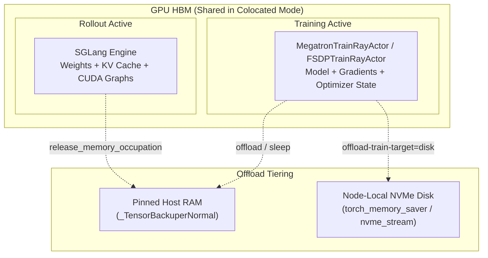
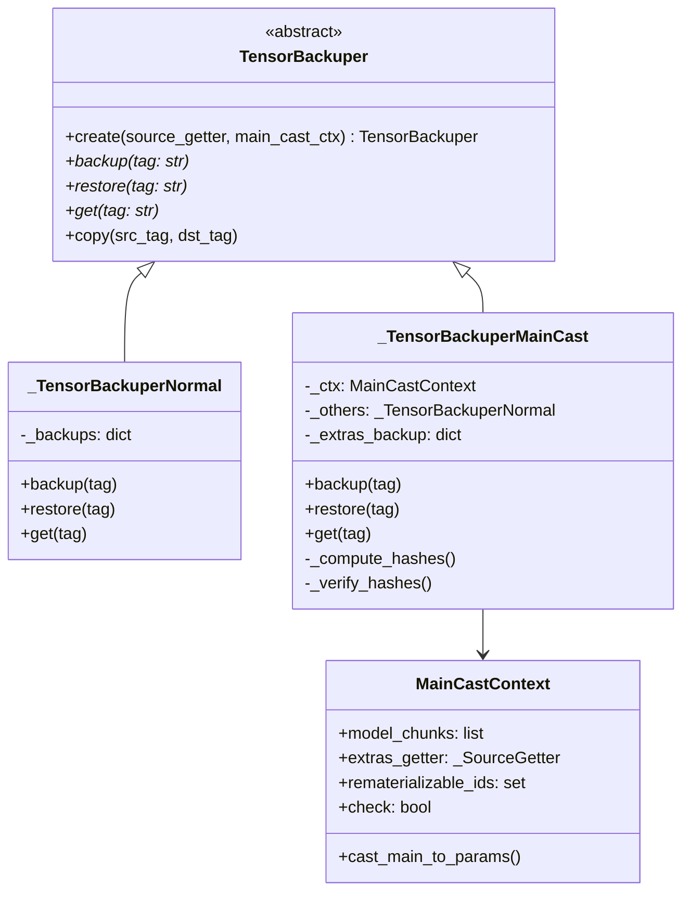
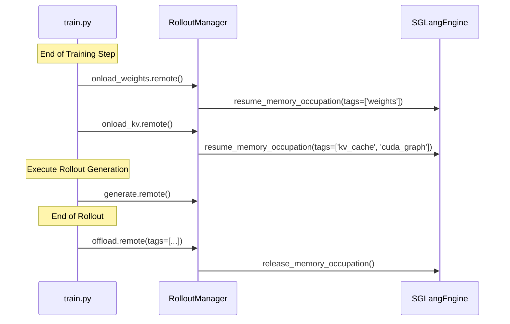

<!-- source: DeepWiki mcp.deepwiki.com · repo radixark/miles · page 6.3 Memory Management · fetched 2026-10-21 -->

# Memory Management

<details>
<summary>Relevant source files</summary>

The following files were used as context for generating this wiki page:

- [miles/backends/fsdp_utils/actor.py](miles/backends/fsdp_utils/actor.py)
- [miles/backends/fsdp_utils/arguments.py](miles/backends/fsdp_utils/arguments.py)
- [miles/backends/fsdp_utils/checkpoint.py](miles/backends/fsdp_utils/checkpoint.py)
- [miles/backends/megatron_utils/actor.py](miles/backends/megatron_utils/actor.py)
- [miles/backends/megatron_utils/model.py](miles/backends/megatron_utils/model.py)
- [miles/backends/megatron_utils/optimizer_state_reset.py](miles/backends/megatron_utils/optimizer_state_reset.py)
- [miles/utils/arguments.py](miles/utils/arguments.py)
- [miles/utils/workers/types.py](miles/utils/workers/types.py)
- [tests/e2e/ckpt/test_qwen3_5_0.8B_ckpt.py](tests/e2e/ckpt/test_qwen3_5_0.8B_ckpt.py)
- [tests/e2e/fsdp/test_qwen3_0.6B_fsdp_disk_delta.py](tests/e2e/fsdp/test_qwen3_0.6B_fsdp_disk_delta.py)
- [tests/e2e/megatron/model_scripts/test_deepseek_v4_flash_4layer_cp2_ci.py](tests/e2e/megatron/model_scripts/test_deepseek_v4_flash_4layer_cp2_ci.py)
- [tests/e2e/megatron/model_scripts/test_deepseek_v4_flash_4layer_megatron_impl_ci.py](tests/e2e/megatron/model_scripts/test_deepseek_v4_flash_4layer_megatron_impl_ci.py)
- [tests/e2e/megatron/model_scripts/test_kimi_k3_4layer_ci.py](tests/e2e/megatron/model_scripts/test_kimi_k3_4layer_ci.py)
- [tests/e2e/megatron/model_scripts/test_qwen3_8_next_4layer_ci.py](tests/e2e/megatron/model_scripts/test_qwen3_8_next_4layer_ci.py)
- [tests/e2e/megatron/test_glm47_flash/test_spec_mtptrain_r3_bf16_sgl_tp4_meg_tp2pp2.py](tests/e2e/megatron/test_glm47_flash/test_spec_mtptrain_r3_bf16_sgl_tp4_meg_tp2pp2.py)
- [tests/e2e/megatron/test_qwen3_30B_A3B/test_nospec_nor3_bf16_sgl_tp4_meg_tp2cp2.py](tests/e2e/megatron/test_qwen3_30B_A3B/test_nospec_nor3_bf16_sgl_tp4_meg_tp2cp2.py)
- [tests/e2e/megatron/test_qwen3_5_35B_A3B/test_nospec_nor3_bf16_sgl_dpattn2x2_meg_tp2pp2.py](tests/e2e/megatron/test_qwen3_5_35B_A3B/test_nospec_nor3_bf16_sgl_dpattn2x2_meg_tp2pp2.py)
- [tests/e2e/megatron/test_qwen3_5_35B_A3B/test_nospec_r3_bf16_sgl_dpattn1x4_meg_tp1cp1_fullyasync.py](tests/e2e/megatron/test_qwen3_5_35B_A3B/test_nospec_r3_bf16_sgl_dpattn1x4_meg_tp1cp1_fullyasync.py)
- [tests/e2e/megatron/test_qwen3_5_35B_A3B/test_spec_nor3_fp8_sgl_tp4_meg_tp2cp2.py](tests/e2e/megatron/test_qwen3_5_35B_A3B/test_spec_nor3_fp8_sgl_tp4_meg_tp2cp2.py)
- [tests/fast-gpu/test_dsv4_indexer_cp_balance.py](tests/fast-gpu/test_dsv4_indexer_cp_balance.py)
- [tests/fast-gpu/test_torch_native_offload.py](tests/fast-gpu/test_torch_native_offload.py)
- [tests/fast/backends/megatron_utils/test_model_initialize.py](tests/fast/backends/megatron_utils/test_model_initialize.py)
- [tests/fast/backends/megatron_utils/test_optimizer_state_reset.py](tests/fast/backends/megatron_utils/test_optimizer_state_reset.py)
- [tests/fast/backends/megatron_utils/test_shared_ppo_lifecycle.py](tests/fast/backends/megatron_utils/test_shared_ppo_lifecycle.py)
- [tests/fast/ray/rollout/conftest.py](tests/fast/ray/rollout/conftest.py)
- [tests/fast/utils/test_arguments.py](tests/fast/utils/test_arguments.py)
- [tests/fast/utils/workers/test_worker_comm_backend.py](tests/fast/utils/workers/test_worker_comm_backend.py)

</details>


This page documents Miles' memory management and offloading strategies for optimizing GPU memory utilization during large-scale RL training and rollout generation. It covers host memory offloading, node-local disk offload, tensor backuppers, streaming optimizer states, and resource coordination in colocated execution modes.

## Overview and Execution Modes

Miles supports two primary execution configurations that dictate how GPU resources are shared or partitioned:

1. **Separated Mode (Default)**: Training actors and SGLang inference engines reside on disjoint sets of GPUs. Memory offloading defaults to disabled because both phases maintain independent residency.
2. **Colocated Mode (`--colocate`)**: Training actors and rollout inference engines share the same physical GPUs. Memory offloading is mandatory here to dynamically swap weights, gradients, optimizer states, KV caches, and CUDA graphs between GPU high-bandwidth memory (HBM) and CPU/disk storage.

Sources: `docs/user-guide/training-backend.md:5-29`, `miles/utils/arguments.py:93-93`


**Diagram: Colocation Memory Lifecycle and Offload Tiering**
Sources: `docs/advanced/disk-offload.md:7-11`, `docs/user-guide/training-backend.md:5-29`

---

## Training Memory Offloading and Disk Spill

When training actors are paused during rollout generation in colocated mode, their HBM footprint must be evacuated. Miles provides multi-tiered offload targets managed via `--offload-train`, `--offload-train-target`, and backend-specific flags.

### CPU Pinned Memory Offload (Default)
By default, paused actors are copied to pinned host RAM via tensor backuppers or actor sleep handlers. For instance, in FSDP and Megatron backends, `--offload-train` toggles the actor entering a sleeping state (`self.sleep()`) where model weights and optimizer states are transferred to host memory [miles/backends/fsdp_utils/actor.py:176-178](), [miles/backends/megatron_utils/actor.py:105-110]().

### Node-Local Disk Offload (`--offload-train-target disk`)
For massive models where pinned host RAM is insufficient, Miles streams the paused actor to node-local NVMe storage `docs/advanced/disk-offload.md:7-10`.
- **Implementation**: Powered by `torch_memory_saver`, which hooks the PyTorch allocator to treat model weights, gradient buffers, and optimizer states as a single memory block `docs/advanced/disk-offload.md:32-36`. On startup, Megatron actors invoke `_setup_disk_offload_reclaim` to clear stale dump files and arm an `atexit` cleaner [miles/backends/megatron_utils/actor.py:90-103]().
- **Configuration**:
  ```bash
  --offload-train --offload-train-target disk \
  --offload-train-disk-dir /scratch/miles_offload \
  --offload-train-disk-chunk-mb 256
  ```
- **Data Flow**: Each rank streams data through a fixed-size pinned host staging buffer (sized by `--offload-train-disk-chunk-mb`) into rank-specific files under `--offload-train-disk-dir`. Files are overwritten in place each step and cleaned up on exit `docs/advanced/disk-offload.md:20-25`.

Sources: `docs/advanced/disk-offload.md:1-36`, [miles/backends/megatron_utils/actor.py:90-103](), [miles/backends/fsdp_utils/actor.py:176-178]()

---

## Streaming Optimizer States to Disk

To support training models whose optimizer states (fp32 main parameters and Adam/Muon momentum buffers) exceed GPU HBM *during* the active training step, Miles integrates NVMe streaming `[miles_plugins/optimizers/nvme_stream.py:1-29]()`.

### Mechanics of `NVMeOptimizerStateStore`
- **Bucketization**: Optimizer states are partitioned into per-bucket files capped by `BUCKET_NUMEL_LIMIT` (default 200,000,000 elements) `[miles_plugins/optimizers/nvme_stream.py:59-61]()`.
- **Step-Time Residency**: During `step()`, the optimizer walks buckets sequentially—materializing, loading from disk, executing the optimizer kernel on that single bucket, writing back updated master parameters, and releasing storage. Peak GPU residency is bounded by a single bucket rather than the entire optimizer state `[miles_plugins/optimizers/nvme_stream.py:1-8]()`.
- **Moment Dtype Optimization**: To reduce I/O overhead, momentum storage can be cast to lower precision via `--stream-optimizer-state-moment-dtype bf16` `docs/advanced/disk-offload.md:78-81`.

Sources: `docs/advanced/disk-offload.md:43-94`, `[miles_plugins/optimizers/nvme_stream.py:1-60]()`

---

## Tensor Backupper Infrastructure

The `TensorBackuper` abstract base class and its concrete implementations manage tensor backup and restoration workflows for actor, reference, and teacher models `[miles/utils/tensor_backper.py:22-52]()`.


**Diagram: TensorBackuper Class Hierarchy and Code Entities**
Sources: `[miles/utils/tensor_backper.py:12-104]()`

### Key Variants
1. **`_TensorBackuperNormal`**: Maintains full CPU-pinned tensor dictionaries for auxiliary models (e.g., reference models, teacher policies) where master weight reconstruction is unavailable `[miles/utils/tensor_backper.py:53-87]()`.
2. **`_TensorBackuperMainCast`**: Avoids keeping a duplicate pinned CPU copy of actor weights by rebuilding them from master weights (`cast_main_to_params`) followed by parameter all-gather (`start_param_sync`) during `restore()`. Only auxiliary extra tensors require pinned CPU storage `[miles/utils/tensor_backper.py:89-141]()`.

Sources: `[miles/utils/tensor_backper.py:1-182]`, `[tests/fast/utils/test_tensor_backper.py:10-78]()`

---

## Rollout Memory Offloading and SGLang Integration

During generation phases, rollout engines manage heavy allocations across weights, KV cache, and CUDA graphs.


**Diagram: Rollout Memory Transitions and Engine Coordination**
Sources: `docs/user-guide/training-backend.md:15-29`

Miles enables selective onloading where weights are synchronized first, while KV caches and CUDA graphs are initialized just before generation begins to minimize peak VRAM pressure.

Sources: `docs/user-guide/training-backend.md:15-29`

---

## Memory Utilities and Diagnostics

Miles provides runtime memory introspection tools in `[miles/utils/memory_utils.py]()` to monitor rank-local GPU allocations.

```python
def available_memory():
    device = torch.cuda.current_device()
    free, total = torch.cuda.mem_get_info(device)
    return {
        "gpu": str(device),
        "total_GB": _byte_to_gb(total),
        "free_GB": _byte_to_gb(free),
        "used_GB": _byte_to_gb(total - free),
        "allocated_GB": _byte_to_gb(torch.cuda.memory_allocated(device)),
        "reserved_GB": _byte_to_gb(torch.cuda.memory_reserved(device)),
    }
```
- `clear_memory(clear_host_memory: bool)`: Synchronizes CUDA streams, runs garbage collection `gc.collect()`, empties the PyTorch CUDA caching allocator, and optionally flushes host memory cache via `torch._C._host_emptyCache()` `[miles/utils/memory_utils.py:10-16]()`.
- `print_memory(msg, clear_before_print)`: Logs rank-specific memory utilization metrics across distributed ranks for debugging OOM conditions `[miles/utils/memory_utils.py:35-44]()`.

Sources: `[miles/utils/memory_utils.py:1-44]()`

---

