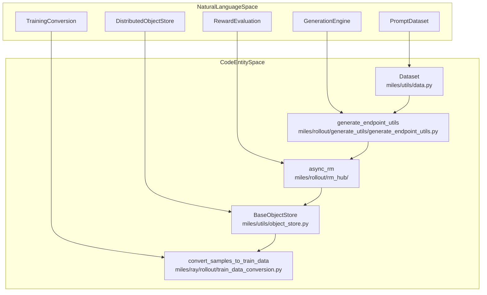
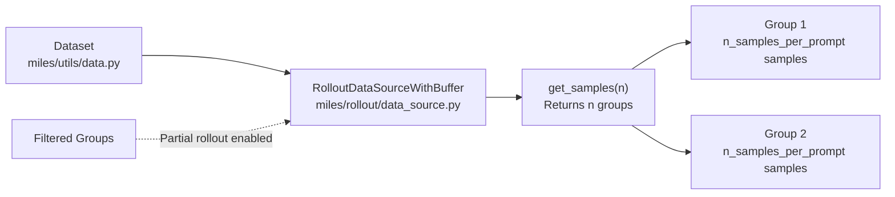
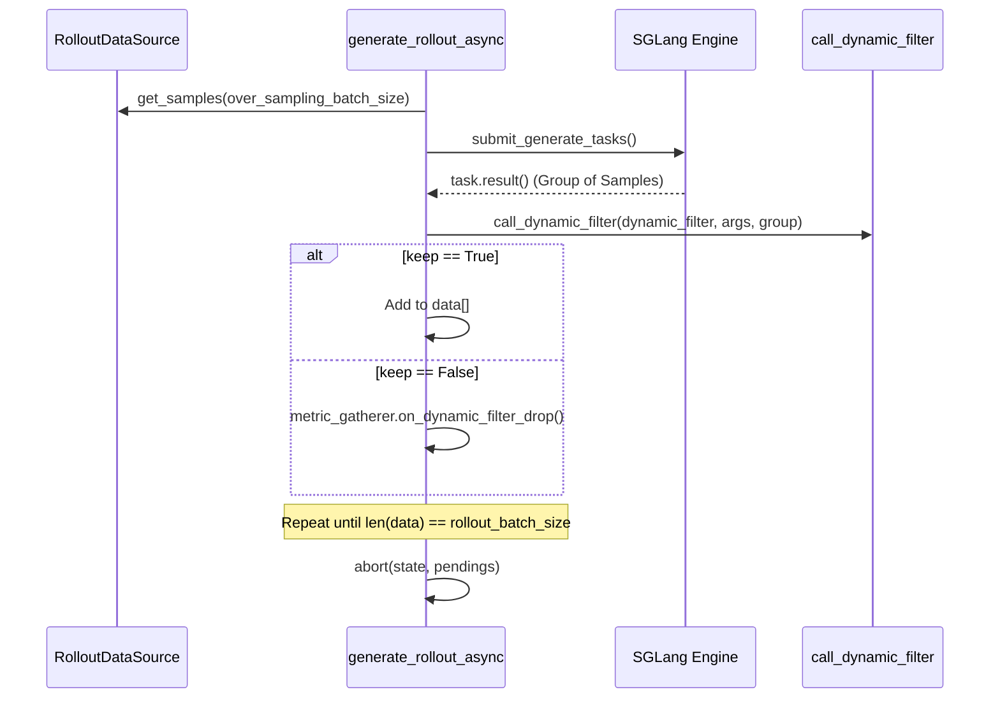
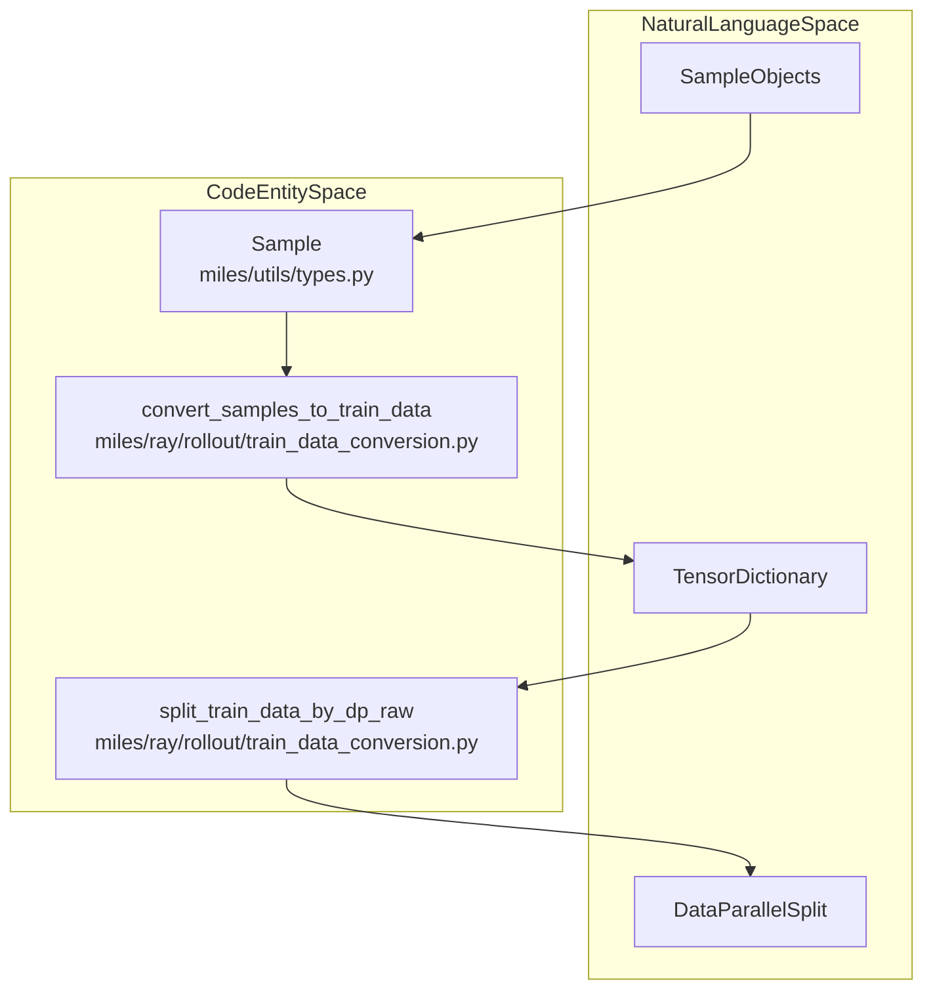

<!-- source: DeepWiki mcp.deepwiki.com · repo radixark/miles · page 6.4 Data Processing Pipeline · fetched 2026-10-21 -->

# Data Processing Pipeline

Relevant source files

The following files were used as context for generating this wiki page:

- [miles/ray/rollout/train_data_conversion.py](miles/ray/rollout/train_data_conversion.py)
- [miles/rollout/generate_utils/generate_endpoint_utils.py](miles/rollout/generate_utils/generate_endpoint_utils.py)
- [miles/rollout/generate_utils/rollout_topk_logprobs.py](miles/rollout/generate_utils/rollout_topk_logprobs.py)
- [miles/rollout/generate_utils/sample_utils.py](miles/rollout/generate_utils/sample_utils.py)
- [miles/rollout/generate_utils/sampling_mask.py](miles/rollout/generate_utils/sampling_mask.py)
- [miles/rollout/generate_utils/tool_call_utils.py](miles/rollout/generate_utils/tool_call_utils.py)
- [miles/rollout/session/samples/codec.py](miles/rollout/session/samples/codec.py)
- [miles/utils/data.py](miles/utils/data.py)
- [miles/utils/object_store.py](miles/utils/object_store.py)
- [miles/utils/object_store_config.py](miles/utils/object_store_config.py)
- [miles/utils/rollout_topk_logprobs.py](miles/utils/rollout_topk_logprobs.py)
- [miles/utils/types.py](miles/utils/types.py)
- [tests/fast/fixtures/score_centering_fixtures.py](tests/fast/fixtures/score_centering_fixtures.py)
- [tests/fast/ray/rollout/test_train_data_conversion.py](tests/fast/ray/rollout/test_train_data_conversion.py)
- [tests/fast/rollout/generate_utils/test_sampling_mask.py](tests/fast/rollout/generate_utils/test_sampling_mask.py)
- [tests/fast/rollout/generate_utils/test_score_centering_native.py](tests/fast/rollout/generate_utils/test_score_centering_native.py)
- [tests/fast/utils/test_data.py](tests/fast/utils/test_data.py)
- [tests/fast/utils/test_object_store.py](tests/fast/utils/test_object_store.py)
- [tests/fast/utils/test_object_store_config.py](tests/fast/utils/test_object_store_config.py)
- [tests/fast/utils/test_object_store_ref.py](tests/fast/utils/test_object_store_ref.py)
- [tests/manual/test_score_centering_live.py](tests/manual/test_score_centering_live.py)

## Purpose and Scope

This document explains how Miles transforms raw prompt data into training-ready batches through a multi-stage pipeline. The pipeline encompasses prompt sampling, generation orchestration, reward evaluation, dynamic filtering, object store serialization, and conversion to the format required by training actors. For information about the actual training loop that consumes this data, see [Training Features](). For details on SGLang inference integration, see [SGLang Integration](). For reward model specifics, see [Reward Model Hub]().

Sources: [miles/ray/rollout/train_data_conversion.py:57-158](), [miles/utils/data.py:28-182]()

---

## Overview of the Pipeline

The data processing pipeline consists of sequential stages that transform raw string prompts into partitioned training tensors distributed across data-parallel ranks.

Title: "Pipeline Overview: Natural Language Space to Code Entity Space"

Sources: [miles/ray/rollout/train_data_conversion.py:57-76](), [miles/utils/data.py:28-76](), [miles/utils/object_store.py:112-124]()

---

## Data Source and Sampling

### Dataset and File Reading

The `Dataset` class manages prompt files, supporting `.jsonl` and `.parquet` file formats with generalized row-slicing syntax.

| Feature | Code Entity | Purpose |
|---------|--------------|---------|
| File Reader | `read_file` [miles/utils/data.py:33-77]() | Iterates over `.jsonl` or `.parquet` rows |
| Path Parser | `_parse_generalized_path` [miles/utils/data.py:79-86]() | Extracts range slices from paths like `path@[start:end]` |
| Message Builder | `_build_messages` [miles/utils/data.py:138-181]() | Formats raw prompt keys into conversation dict structures |
| Length Filter | `filter_long_prompt` [miles/utils/data.py:89-135]() | Drops prompts exceeding `max_length` using tokenizers or processors |

Sources: [miles/utils/data.py:28-182]()

### Sampling Mechanics

Title: "Dataset Sampling Flow"

Sources: [miles/utils/data.py:28-135]()

---

## Over-Sampling and Generation

Over-sampling compensates for dynamic filtering by generating more samples than required for the target batch size. This orchestration is performed inside generation execution loops.

Title: "Over-Sampling and Generation Sequence"

Sources: [miles/rollout/generate_utils/generate_endpoint_utils.py:57-90]()

---

## Dynamic Filtering

Dynamic filtering removes low-quality prompt-response groups based on runtime criteria such as reward variance or execution status.

| Function | File | Logic |
|----------|------|-------|
| `check_reward_nonzero_std` | `miles/rollout/filter_hub/dynamic_sampling_filters.py` | Rejects group if reward standard deviation is below `1e-8` |
| `check_no_aborted` | `miles/rollout/filter_hub/dynamic_sampling_filters.py` | Rejects group if any sample status is `Sample.Status.ABORTED` |

Sources: [miles/utils/types.py:102-113]()

---

## Reward Evaluation and Normalization

Generated responses are scored asynchronously via reward model endpoints. Group-wise reward normalization is then applied for advantage estimators like GRPO or GSPO:
1. Mean subtraction across group samples.
2. Standard deviation scaling when reward normalization is enabled.

Sources: [miles/ray/rollout/train_data_conversion.py:70-76]()

---

## Object Store and Sharding

Large rollout buffers and training data packets are transferred between distributed actors using Miles' abstraction layer over Ray or Mooncake object stores.

| Class / Function | File | Role |
|------------------|------|------|
| `BaseObjectStore` | [miles/utils/object_store.py:112-124]() | Abstract interface for `put`, `get`, and `remove` operations |
| `RayObjectStore` | [miles/utils/object_store.py:146-165]() | Ray-backed object store implementation using `ray.put` and reference tracking |
| `MooncakeObjectStore` | [miles/utils/object_store.py:180-201]() | High-performance Mooncake distributed store backend |
| `ObjectStoreGetResult` | [miles/utils/object_store.py:57-76]() | Context manager handling automatic cleanup and reference release |

Sources: [miles/utils/object_store.py:42-201]()

---

## Conversion to Training Format

### Sample Conversion

The `convert_samples_to_train_data` function [miles/ray/rollout/train_data_conversion.py:57-158]() transforms `Sample` instances into a structured dictionary governed by `ROLLOUT_DATA_VALUE_SPEC` [miles/ray/rollout/train_data_conversion.py:33-54]().

| Sample Attribute | Training Dictionary Key | Logic |
|------------------|-------------------------|-------|
| `sample.tokens` | `tokens` | Token IDs list per sample [miles/ray/rollout/train_data_conversion.py:81]() |
| `sample.response_length` | `response_lengths` | Length of generated completion [miles/ray/rollout/train_data_conversion.py:82]() |
| `sample.reward` | `rewards` | Normalized reward score [miles/ray/rollout/train_data_conversion.py:85]() |
| `sample.loss_mask` | `loss_masks` | Binary loss mask; defaults to ones [miles/ray/rollout/train_data_conversion.py:94-106]() |

Title: "Data Conversion and Partitioning Mapping"

Sources: [miles/ray/rollout/train_data_conversion.py:12-54](), [miles/ray/rollout/train_data_conversion.py:57-158](), [miles/utils/types.py:68-125]()

---

## Partial Rollout and Trajectory Recycling

When partial rollout is enabled, unfinished or multi-turn trajectories are saved back and merged using `merge_samples` [miles/rollout/generate_utils/sample_utils.py:19-31]() to combine historical turns while preserving alignment state and replay masks.

Sources: [miles/rollout/generate_utils/sample_utils.py:19-146]()

---

