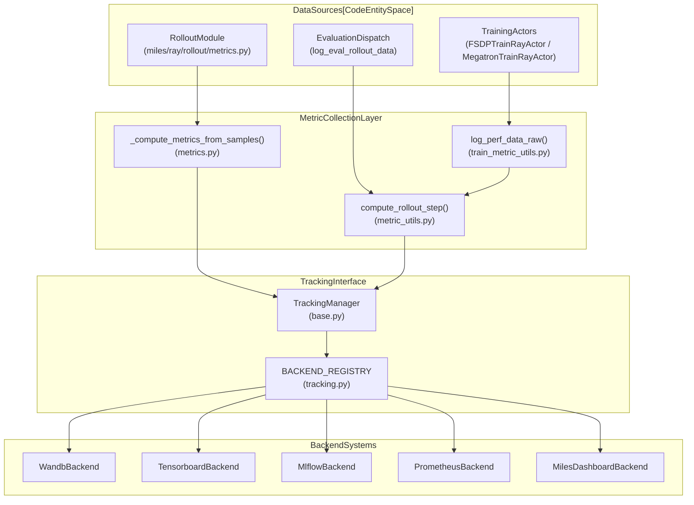
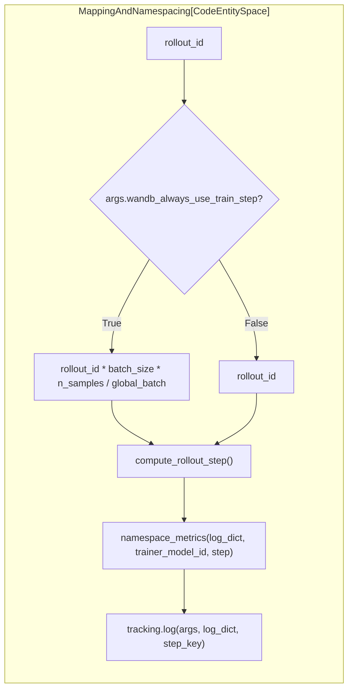

<!-- source: DeepWiki mcp.deepwiki.com · repo radixark/miles · page 6.5 Metrics and Logging · fetched 2026-10-21 -->

# Metrics and Logging

Relevant source files

The following files were used as context for generating this wiki page:

- [docs/examples/swe-agent-harbor-docker.md](docs/examples/swe-agent-harbor-docker.md)
- [examples/experimental/terminus-compaction/README.md](examples/experimental/terminus-compaction/README.md)
- [examples/experimental/terminus-compaction/run.py](examples/experimental/terminus-compaction/run.py)
- [examples/swe-agent-harbor-docker/README.md](examples/swe-agent-harbor-docker/README.md)
- [examples/swe-agent-harbor-docker/run_glm52_lora_tb2_daytona.py](examples/swe-agent-harbor-docker/run_glm52_lora_tb2_daytona.py)
- [miles/ray/rollout/metrics.py](miles/ray/rollout/metrics.py)
- [miles/utils/audit_utils/event_logger/models.py](miles/utils/audit_utils/event_logger/models.py)
- [miles/utils/env_report/collector.py](miles/utils/env_report/collector.py)
- [miles/utils/env_report/git_state.py](miles/utils/env_report/git_state.py)
- [miles/utils/env_report/launcher_report.py](miles/utils/env_report/launcher_report.py)
- [miles/utils/env_report/reporter.py](miles/utils/env_report/reporter.py)
- [miles/utils/metric_utils.py](miles/utils/metric_utils.py)
- [miles/utils/test_utils/comparisons/inference_engine_checksums.py](miles/utils/test_utils/comparisons/inference_engine_checksums.py)
- [miles/utils/tracking_utils/wandb_utils.py](miles/utils/tracking_utils/wandb_utils.py)
- [tests/fast/backends/training_utils/test_log_utils_namespacing.py](tests/fast/backends/training_utils/test_log_utils_namespacing.py)
- [tests/fast/examples/experimental/terminus_compaction/test_run.py](tests/fast/examples/experimental/terminus_compaction/test_run.py)
- [tests/fast/ray/rollout/test_metrics.py](tests/fast/ray/rollout/test_metrics.py)
- [tests/fast/ray/rollout/test_rollout_data_conversion.py](tests/fast/ray/rollout/test_rollout_data_conversion.py)
- [tests/fast/ray/test_train_actor_rpc_surface.py](tests/fast/ray/test_train_actor_rpc_surface.py)
- [tests/fast/utils/audit_utils/event_logger/test_models.py](tests/fast/utils/audit_utils/event_logger/test_models.py)
- [tests/fast/utils/env_report/conftest.py](tests/fast/utils/env_report/conftest.py)
- [tests/fast/utils/env_report/test_collector.py](tests/fast/utils/env_report/test_collector.py)
- [tests/fast/utils/env_report/test_git_state.py](tests/fast/utils/env_report/test_git_state.py)
- [tests/fast/utils/env_report/test_launcher_report.py](tests/fast/utils/env_report/test_launcher_report.py)
- [tests/fast/utils/env_report/test_reporter.py](tests/fast/utils/env_report/test_reporter.py)
- [tests/fast/utils/event_analyzer/rules/test_inference_engine_weight_checksum_consistency.py](tests/fast/utils/event_analyzer/rules/test_inference_engine_weight_checksum_consistency.py)
- [tests/fast/utils/test_metric_utils.py](tests/fast/utils/test_metric_utils.py)
- [tests/fast/utils/test_metric_utils_namespacing.py](tests/fast/utils/test_metric_utils_namespacing.py)
- [tests/fast/utils/test_utils/comparisons/test_inference_engine_checksums.py](tests/fast/utils/test_utils/comparisons/test_inference_engine_checksums.py)
- [tests/fast/utils/tracking_utils/test_wandb_utils.py](tests/fast/utils/tracking_utils/test_wandb_utils.py)

## Purpose and Scope

This page documents Miles' comprehensive metrics and logging infrastructure, which tracks experiment progress, rollout generation performance, model evaluation, and system throughput. The system integrates with Weights & Biases (W&B), TensorBoard, MLflow, Prometheus, and the Miles Dashboard to provide real-time monitoring of distributed RL training jobs.

Miles implements a unified interface for tracking that handles distributed synchronization, evaluation dispatch, custom logging functions, and specialized checks such as TITO (Text-In-Text-Out) session mismatch detection and repetition analysis.

---

## Architecture Overview

Miles utilizes a multi-layer logging and telemetry system. Metrics originate from training actors, rollout execution loops, or evaluation dispatchers, are processed through statistical aggregators, and are dispatched via the unified tracking manager.

**Logging and Telemetry Architecture**

Sources: [miles/utils/tracking_utils/base.py:1-188](), [miles/ray/rollout/metrics.py:23-94](), [miles/utils/train_metric_utils.py:14-60]()

---

## Tracking Systems and Backends

Miles abstracts experiment logging through the `TrackingManager` class, which iterates over configured backends and fans out logging calls [miles/utils/tracking_utils/base.py:162-188](). Each backend implements the abstract `TrackingBackend` interface (`init`, `log`, `finish`, and `define_step_key_metric_group`) [miles/utils/tracking_utils/base.py:24-40]().

*   **WandbBackend**: Integrates with Weights & Biases, supporting primary rank initialization (`init_wandb_primary`) and secondary worker synchronization (`init_wandb_secondary`), alongside custom step-metric grouping [miles/utils/tracking_utils/base.py:43-76](), [miles/utils/tracking_utils/wandb_utils.py:29-160]().
*   **TensorboardBackend**: Wraps `_TensorboardAdapter` and filters out explicit step-key fields (e.g., `train/step` or `rollout/step`) to match TensorBoard's explicit step argument passing [miles/utils/tracking_utils/base.py:78-99]().
*   **MlflowBackend**: Connects to MLflow tracking servers for parameter and metric logging [miles/utils/tracking_utils/base.py:101-117]().
*   **PrometheusBackend**: Interacts with a Ray actor-based Prometheus collector to expose live metrics for infrastructure scraping [miles/utils/tracking_utils/base.py:119-140]().
*   **MilesDashboardBackend**: Streams telemetry directly into the local Miles web dashboard application (`miles/dashboard`) via lazy-loaded hooks [miles/utils/tracking_utils/base.py:142-160]().

Sources: [miles/utils/tracking_utils/base.py:1-188](), [miles/utils/tracking_utils/wandb_utils.py:29-160]()

---

## Step Computation and Namespace Management

To synchronize training steps with evaluation and rollout phases, Miles maps rollout identifiers to global step numbers using `compute_rollout_step` [miles/utils/metric_utils.py:162-165](). When multi-policy training is active, metrics and step axes are namespaced via `namespace_metrics` and stripped using `strip_metrics_namespace` to ensure isolated logging streams [miles/utils/metric_utils.py:23-38]().

**Step Mapping and Namespacing Data Flow**

Sources: [miles/utils/metric_utils.py:23-38](), [miles/utils/metric_utils.py:162-165]()

---

## Rollout and Evaluation Metric Computation

Rollout and evaluation data undergo extensive statistical post-processing before being logged to active tracking backends.

### Rollout and Evaluation Functions
*   `log_rollout_data`: Computes rollout sample metrics, performance metrics, and pass-rates, assigning step keys via `compute_rollout_step` before calling tracking backends [miles/ray/rollout/metrics.py:74-101]().
*   `log_eval_rollout_data`: Evaluates rollout reward distributions, computes none-reward ratios (aborted/errored trials), pass rates, and truncated ratios [miles/ray/rollout/metrics.py:24-61](). Supports custom evaluation logging hooks via `args.custom_eval_rollout_log_function_path` [miles/ray/rollout/metrics.py:25-28]().
*   `log_eval_skip`: Records skipped evaluation points to maintain continuous timeline curves [miles/ray/rollout/metrics.py:64-72]().

### Sample-Level Metric Aggregation
Inside `_compute_metrics_from_samples`, Miles aggregates a wide array of quality and safety indicators [miles/ray/rollout/metrics.py:103-148]():
*   **Response Lengths**: Computes mean, median, max, and min statistics over effective response lengths and compacted session episode lengths [miles/ray/rollout/metrics.py:104-109]().
*   **Repetition Fraction**: Evaluates text repetition across sliding character windows using `has_repetition` [miles/utils/metric_utils.py:155-159](), [miles/ray/rollout/metrics.py:114]().
*   **Truncated Ratio**: Tracks the fraction of samples ending in `Sample.Status.TRUNCATED` [miles/ray/rollout/metrics.py:115]().
*   **Weight Versions**: Summarizes oldest weight versions and mixed-version rollout ratios [miles/ray/rollout/metrics.py:117-121]().
*   **TITO Mismatch Metrics**: For session servers v1/v2, monitors session mismatches across special token counts, types, non-assistant text, and assistant text, enforcing strict zero-tolerance assertions during CI test runs [miles/ray/rollout/metrics.py:123-147]().

Sources: [miles/ray/rollout/metrics.py:24-148](), [miles/utils/metric_utils.py:155-159]()

---

## Performance and Throughput Metrics

Performance telemetry is captured via training step logging utilities and event loggers.

*   **TFLOPS Calculation**: Computes forward pass TFLOPS (`perf/log_probs_tflops`, `perf/ref_log_probs_tflops`, `perf/actor_train_tflops`) based on total forward FLOPS and measured execution time [miles/utils/train_metric_utils.py:32-43]().
*   **Model Flops Utilization (MFU)**: Compares actor training TFLOPS against local peak BF16 TFLOPS to derive `perf/actor_train_mfu` [miles/utils/train_metric_utils.py:45-48]().
*   **Inference Engine Weight Checksums**: Logs `InferenceEngineWeightChecksumEvent` telemetry to track parameter consistency across rollout inference engines during weight synchronization [miles/utils/audit_utils/event_logger/models.py:113-120](), [miles/utils/test_utils/comparisons/inference_engine_checksums.py:9-44]().

Sources: [miles/utils/audit_utils/event_logger/models.py:113-120](), [miles/utils/test_utils/comparisons/inference_engine_checksums.py:9-44]()

---

## Metric Computation Utilities

| Utility Function | File Path | Description |
| :--- | :--- | :--- |
| `compute_statistics` | `miles/utils/metric_utils.py` | Computes mean, median, max, and min for a list of scalar values [miles/utils/metric_utils.py:85-92](). |
| `compression_ratio` | `miles/utils/metric_utils.py` | Calculates zlib/gzip/bz2/lzma compression ratios and savings percentages [miles/utils/metric_utils.py:95-136](). |
| `has_repetition` | `miles/utils/metric_utils.py` | Detects high repetition in generated text across sliding character windows [miles/utils/metric_utils.py:155-159](). |
| `compute_pass_rate` | `miles/utils/metric_utils.py` | Estimates unbiased `pass@k` metrics from flat rewards and group sizes [miles/utils/metric_utils.py:40-66](). |
| `compute_rollout_step` | `miles/utils/metric_utils.py` | Maps rollout identifiers to global training steps [miles/utils/metric_utils.py:162-165](). |

Sources: [miles/utils/metric_utils.py:1-165]()

---

