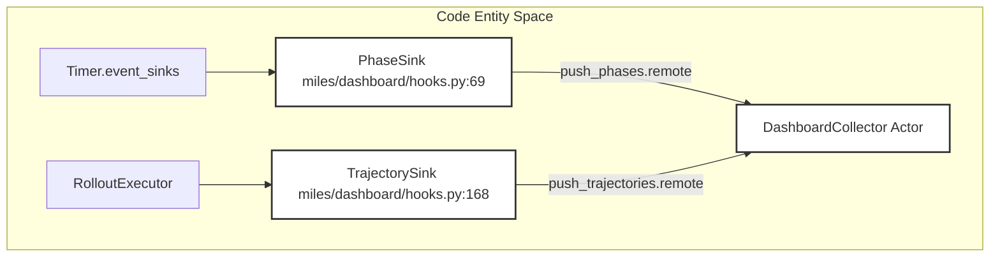
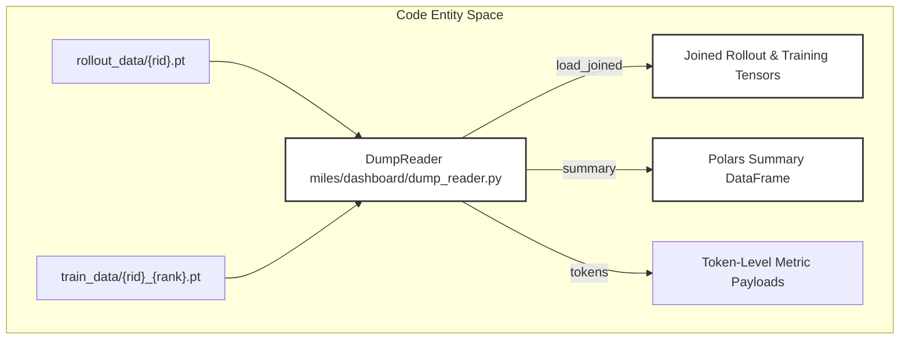

<!-- source: DeepWiki mcp.deepwiki.com · repo radixark/miles · page 6.6 Debug Dashboard and Data Dumping · fetched 2026-10-21 -->

# Debug Dashboard and Data Dumping

Relevant source files

The following files were used as context for generating this wiki page:

- [miles/dashboard/README.md](miles/dashboard/README.md)
- [miles/dashboard/advisory.py](miles/dashboard/advisory.py)
- [miles/dashboard/args.py](miles/dashboard/args.py)
- [miles/dashboard/dump_reader.py](miles/dashboard/dump_reader.py)
- [miles/dashboard/serve.py](miles/dashboard/serve.py)
- [miles/dashboard/server.py](miles/dashboard/server.py)
- [miles/dashboard/static/api.js](miles/dashboard/static/api.js)
- [miles/dashboard/static/app.js](miles/dashboard/static/app.js)
- [miles/dashboard/static/charts.js](miles/dashboard/static/charts.js)
- [miles/dashboard/static/conversation.js](miles/dashboard/static/conversation.js)
- [miles/dashboard/static/style.css](miles/dashboard/static/style.css)
- [miles/dashboard/static/views_metrics.js](miles/dashboard/static/views_metrics.js)
- [miles/dashboard/static/views_rollout.js](miles/dashboard/static/views_rollout.js)
- [miles/dashboard/static/views_timeline.js](miles/dashboard/static/views_timeline.js)
- [miles/dashboard/static/views_tokens.js](miles/dashboard/static/views_tokens.js)
- [miles/dashboard/store.py](miles/dashboard/store.py)
- [miles/utils/dumper_utils.py](miles/utils/dumper_utils.py)
- [miles/utils/test_utils/reconfigure_assertions.py](miles/utils/test_utils/reconfigure_assertions.py)
- [tests/e2e/conftest_dumper.py](tests/e2e/conftest_dumper.py)
- [tests/e2e/ft/conftest_ft/execution.py](tests/e2e/ft/conftest_ft/execution.py)
- [tests/e2e/ft/conftest_ft/modes.py](tests/e2e/ft/conftest_ft/modes.py)
- [tests/fast/dashboard/dummy_dump.py](tests/fast/dashboard/dummy_dump.py)
- [tests/fast/dashboard/test_advisory.py](tests/fast/dashboard/test_advisory.py)
- [tests/fast/dashboard/test_dump_reader_join.py](tests/fast/dashboard/test_dump_reader_join.py)
- [tests/fast/dashboard/test_dump_reader_views.py](tests/fast/dashboard/test_dump_reader_views.py)
- [tests/fast/dashboard/test_partitions.py](tests/fast/dashboard/test_partitions.py)
- [tests/fast/dashboard/test_server.py](tests/fast/dashboard/test_server.py)
- [tests/fast/dashboard/test_store.py](tests/fast/dashboard/test_store.py)
- [tests/fast/e2e/ft/test_modes.py](tests/fast/e2e/ft/test_modes.py)
- [tests/fast/e2e/ft/test_naming_scheme.py](tests/fast/e2e/ft/test_naming_scheme.py)
- [tests/fast/rollout/generate_utils/test_sample_utils.py](tests/fast/rollout/generate_utils/test_sample_utils.py)
- [tests/fast/utils/test_dumper_utils.py](tests/fast/utils/test_dumper_utils.py)
- [tests/fast/utils/test_types.py](tests/fast/utils/test_types.py)
- [tests/fast/utils/test_utils/test_reconfigure_assertions.py](tests/fast/utils/test_utils/test_reconfigure_assertions.py)

### Purpose and Scope
This page documents the implementation of the `miles/dashboard` web application and the underlying train/rollout dump utilities (`miles/utils/dumper_utils.py`). The dashboard provides real-time training dynamics telemetry, compute utilization tracing, and deep post-hoc inspection of trajectory, rollout, and per-token tensors. The dumper utilities capture precise forward/backward states, gradients, and SGLang engine outputs to resolve train-inference discrepancies.

Sources: `miles/dashboard/README.md:1-80` [miles/dashboard/README.md:1-79](), `miles/dashboard/hooks.py:1-32` [miles/dashboard/hooks.py:1-32]()

---

## 1. Process-Side Hooks & Telemetry Collection

Process-side hooks capture high-frequency timing intervals and sample lifecycles across training ranks and rollout managers without blocking training threads. 

### Phase and Trajectory Sinks
- **`PhaseSink`**: Acts as a `Timer` event sink. When a phase starts (`begin()`), it pushes an open interval (`OPEN_T1 = -1.0`) immediately for real-time visibility. Completed intervals are buffered up to `BATCH_MAX_EVENTS` (64) or `BATCH_MAX_SECONDS` (2.0) and pushed asynchronously (`PhaseEvent`) via Ray remote calls to the collector actor [miles/dashboard/hooks.py:69-136]().
- **`TrajectorySink`**: Collects per-sample lifecycle boundaries from rollout processes (`attempt_start`, `gen_start`, `gen_end`, `tool_start`, `tool_end`, `attempt_end`), duck-typed so that core code never needs to directly import dashboard modules [miles/dashboard/hooks.py:168-190]().
- **Error Isolation & Rate-Limiting**: All sinks swallow exceptions using a rate-limited warner (`RateLimitedWarner`) to ensure observability failures never abort a training step [miles/dashboard/hooks.py:5-8, 80]().

*Figure 1: Telemetry data flow from training and rollout processes to the DashboardCollector.*

Sources: `miles/dashboard/hooks.py:1-191` [miles/dashboard/hooks.py:1-191](), `tests/fast/dashboard/test_hooks.py:57-124` [tests/fast/dashboard/test_hooks.py:57-124]()

---

## 2. File-Backed Time-Series Store and Partitions

The metrics collector serializes incoming records into append-only JSONL files structured under `{dump_details}/dashboard/` [miles/dashboard/store.py:1-4].

### Stream Categorization and Schemas
- **Streams**: Defined in the `Stream` enum (`METRICS`, `PHASES`, `TOPOLOGY`, `GPU_UTIL`, `ENGINE_SERIES`, `TRAJECTORIES`, `GPU_PROCESSES`, `DATA_BUFFER`) [miles/dashboard/store.py:48-57]().
- **High-Rate Columnar Optimization**: High-rate data streams (`gpu_util`, `engine_series`) are held in memory as columnar Polars frames (approx. ~16 bytes/row instead of ~600 bytes for dataclasses) to enable vectorized filtering and low memory overhead [miles/dashboard/store.py:13-15].
- **Hourly Partitions**: Streams write hourly partition files (`{stream}/{YYYYMMDD_HH}.jsonl`) parsed lazily through an LRU block cache [miles/dashboard/store.py:16-19].

| Stream Name | Record Class | Frequency | Persistence Format |
| :--- | :--- | :--- | :--- |
| `metrics` | `MetricsRecord` | Per-step | JSONL |
| `phases` | `PhaseEvent` | Per-interval | Hourly Partition JSONL |
| `gpu_util` | `GpuSample` | High-rate (NVML) | Hourly Partition JSONL |
| `engine_series`| `EngineSample` | High-rate (Scraped) | Hourly Partition JSONL |
| `trajectories` | `TrajectoryEvent` | Per-lifecycle | JSONL |

Sources: `miles/dashboard/store.py:1-225` [miles/dashboard/store.py:1-225]()

---

## 3. Dump Reading and Data Joining (`dump_reader.py`)

`DumpReader` processes `--dump-details` artifact directories, joining rollout batches with training data shards [miles/dashboard/dump_reader.py:1-15].

### Core Data Joining Mechanics
- **Rollout Data**: Stored in `rollout_data/{rid}.pt`, holding the full sample batch for a given rollout iteration [miles/dashboard/dump_reader.py:3-4].
- **Train Data**: Stored in `train_data/{rid}_{rank}.pt`, holding per-token tensors, loss masks, log probabilities, and `sample_indices` mapping rows back to `Sample.index` [miles/dashboard/dump_reader.py:4-8].
- **`DumpStillWriting` Handling**: If a `.pt` file is currently being written by `torch.save()`, read attempts raise `DumpStillWriting`, which the FastAPI server translates to an HTTP `503 Service Unavailable` rather than treating it as file corruption [miles/dashboard/dump_reader.py:10-14, 34-36].
- **`TrainRow` Structure**: Wraps a single sample slice from a training rank dump, housing tensors for `tokens`, `loss_mask`, `log_probs`, `rollout_log_probs`, `ref_log_probs`, and `advantages` [miles/dashboard/dump_reader.py:128-183].

*Figure 2: `DumpReader` ingestion and join architecture.*

Sources: `miles/dashboard/dump_reader.py:1-183` [miles/dashboard/dump_reader.py:1-183](), `tests/fast/dashboard/test_dump_reader_views.py:18-53` [tests/fast/dashboard/test_dump_reader_views.py:18-53]()

---

## 4. Training and Inference Dumper Utilities (`dumper_utils.py`)

The dumper infrastructure captures internal state across inference engines and training actors during distinct execution phases [miles/utils/dumper_utils.py:1-33].

### Phases and Configuration
- **`DumperPhase`**: Enum defining three dumping stages [miles/utils/dumper_utils.py:28-32]:
  - `INFERENCE`: SGLang engine-side generation dumps.
  - `FWD_ONLY`: Forward pass activation/output dumps.
  - `FWD_BWD`: Forward-backward pass gradients and weight dumps.
- **`DumperMegatronUtil`**: Manages Megatron model hooks, wrapping forward steps with `_wrap_forward_step_with_stepping()` and invoking model/gradient dumps during `finalize()` [miles/utils/dumper_utils.py:107-150].
- **SGLang Integration**: `get_sglang_env()` configures environment variables like `DUMPER_NON_INTRUSIVE_MODE`, while `configure_sglang()` asynchronously posts configuration payloads to all active SGLang inference endpoints [miles/utils/dumper_utils.py:37-82].

Sources: `miles/utils/dumper_utils.py:1-185` [miles/utils/dumper_utils.py:1-185](), `tests/fast/utils/test_dumper_utils.py:13-166` [tests/fast/utils/test_dumper_utils.py:13-166]()

---

## 5. Dashboard Web Server and Static Views

The dashboard server exposes REST endpoints via FastAPI (`miles/dashboard/server.py`), consumed by a static single-page application (SPA) built under `miles/dashboard/static/` [miles/dashboard/README.md:72-79].

### Key Frontend Views
- **Metrics View**: Wandb-style sidebar categorizing training metrics and scraped `sglang` engine series [miles/dashboard/README.md:46-48].
- **Compute Utilization View**: Renders per-GPU phase bands, NVML utilization, and sglang overlays [miles/dashboard/README.md:49-53].
- **Rollouts View (`views_rollout.js`)**: Displays per-step trajectory tables and GRPO group degeneracy (`zero_std`), featuring auto-resolution of the newest valid step (`resolveLatest`) [miles/dashboard/static/views_rollout.js:81-115].
- **Token & Conversation View (`views_tokens.js`)**: Lazily loads token-level metrics (`loadTokensPane`), rendering divergence, entropy, and log-probability strips alongside role-tagged conversation turns [miles/dashboard/static/views_tokens.js:102-161].

Sources: `miles/dashboard/README.md:30-63` [miles/dashboard/README.md:30-63](), `miles/dashboard/static/views_rollout.js:1-115` [miles/dashboard/static/views_rollout.js:1-115](), `miles/dashboard/static/views_tokens.js:102-161` [miles/dashboard/static/views_tokens.js:102-161]()

---

