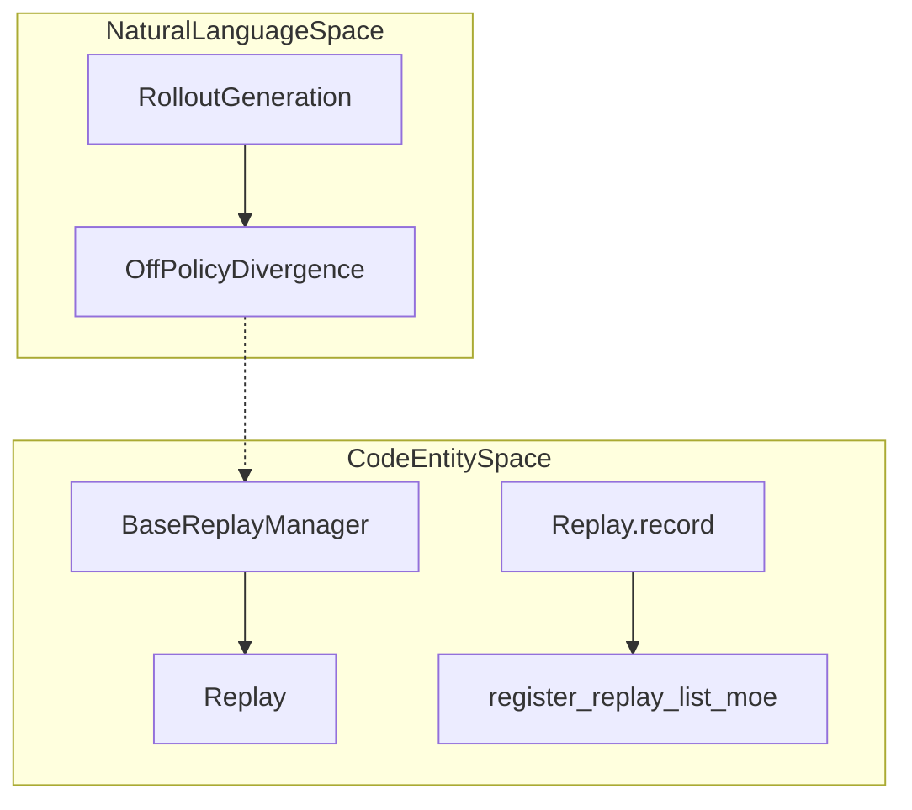
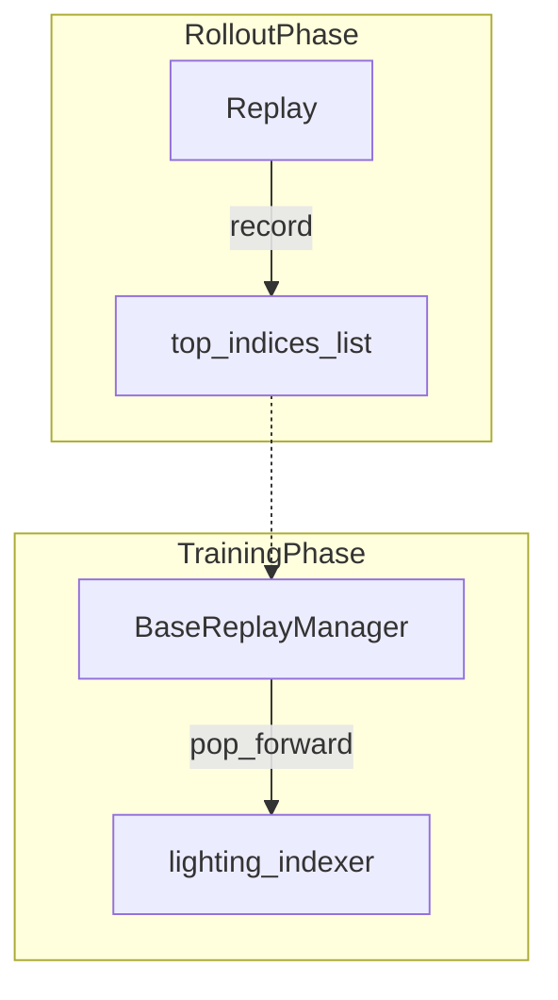

<!-- source: DeepWiki mcp.deepwiki.com · repo radixark/miles · page 7 Train-Inference Alignment · fetched 2026-10-21 -->

# Train-Inference Alignment

Relevant source files

The following files were used as context for generating this wiki page:

- [miles/backends/megatron_utils/replay_utils.py](miles/backends/megatron_utils/replay_utils.py)
- [miles/utils/replay_base.py](miles/utils/replay_base.py)

## Purpose and Scope

This document provides a high-level overview of Miles' core innovation: solving the **train-inference mismatch problem** that causes training instability and collapse in on-policy reinforcement learning. It covers system-level solutions (bit-wise identical computations, routing replay, unified quantization) and algorithmic corrections (importance sampling techniques) that ensure stable training.

As a parent page, this document outlines the multi-layered strategy and links to detailed child pages for each sub-topic. For details on the overall training execution, see [Training Orchestration](#3.2). For details on RL loss functions, see [RL Algorithms](#6.1).

---

## Overview

**Train-inference mismatch** occurs when a model produces different outputs during rollout (data generation) and training, even with identical inputs. This breaks the fundamental assumption of on-policy RL algorithms like PPO, where the data-collecting policy must match the optimized policy. Miles employs a defense-in-depth strategy combining deterministic system-level execution with algorithmic corrections.

*Diagram 1: System-to-code mapping for rollout alignment and routing replay infrastructure.*

Sources: `miles/utils/replay_base.py:14-48` [miles/utils/replay_base.py:14-48](), `miles/backends/megatron_utils/replay_utils.py:5-25` [miles/backends/megatron_utils/replay_utils.py:5-24]()

---

## 7.1 The Mismatch Problem

Train-inference mismatch arises from non-deterministic CUDA kernels, quantization discrepancies between rollout engines (like SGLang) and training backends (like Megatron-LM or FSDP), and divergent MoE expert routing. These discrepancies compound over time, leading to incorrect importance ratios, divergent advantage estimates, and ultimately training collapse.

For a comprehensive breakdown of the root causes, manifestations, and Miles' multi-layered solution framework, see [The Mismatch Problem](#7.1).

Sources: `miles/utils/replay_base.py:14-65` [miles/utils/replay_base.py:14-65]()

---

## 7.2 Bit-wise Identical Training

To achieve exact log probability matching between rollout and training phases, Miles leverages deterministic kernel selections. By configuring FlashAttention-3, DeepGEMM, and deterministic backend flags, the framework eliminates numerical drift caused by non-atomic reduction operations or non-deterministic GEMM algorithms.

For detailed configuration instructions and kernel implementation specifics, see [Bit-wise Identical Training](#7.2).

Sources: `miles/utils/replay_base.py:53-144` [miles/utils/replay_base.py:53-144]()

---

## 7.3 Rollout Routing Replay (R3)

Mixture-of-Experts (MoE) models and DeepSeek Attention (DSA) architectures suffer from severe instability if token-to-expert routing choices diverge between inference and training. **Rollout Routing Replay (R3)** solves this by recording top-k expert indices and routing decisions during rollout generation and replaying them deterministically during the training forward pass.

*Diagram 2: Data flow from rollout collection to training replay via `BaseReplayManager` and `Replay`.*

The `Replay` class in `miles/utils/replay_base.py` handles recording top indices to CPU pinned memory and popping them during forward and backward passes [miles/utils/replay_base.py:14-48](). The `BaseReplayManager` class manages replay streams, intercepting top-k functions (`get_topk_fn`) to inject recorded indices [miles/utils/replay_base.py:53-144](). Furthermore, Megatron MoE layers map these streams using `register_replay_list_moe` [miles/backends/megatron_utils/replay_utils.py:5-24]().

For detailed mechanics of R3, buffer management, and verification hooks, see [Rollout Routing Replay (R3)](#7.3).

Sources: `miles/utils/replay_base.py:14-144` [miles/utils/replay_base.py:14-144](), `miles/backends/megatron_utils/replay_utils.py:5-25` [miles/backends/megatron_utils/replay_utils.py:5-24]()

---

## 7.4 Importance Sampling (TIS/MIS)

When perfect system-level alignment is impossible—such as when interacting with black-box external APIs or legacy serving backends—algorithmic corrections are required. Truncated Importance Sampling (TIS) adjusts policy gradients by clipping importance weights, whereas Masked Importance Sampling (MIS) rejects trajectories exhibiting severe off-policy divergence.

For mathematical formulations and configuration parameters for TIS and MIS, see [Importance Sampling (TIS/MIS)](#7.4).

Sources: `miles/utils/replay_base.py:53-66` [miles/utils/replay_base.py:53-66]()

---

## 7.5 True On-Policy Mode

True On-Policy Mode represents Miles' strictest execution level. By enabling a single configuration flag, users activate all deterministic settings simultaneously: deterministic CUDA execution, exact log-probability verification, R3 routing replay, and synchronized quantization parameters.

For setup instructions and validation diagnostics for True On-Policy Mode, see [True On-Policy Mode](#7.5).

Sources: `miles/utils/replay_base.py:53-115` [miles/utils/replay_base.py:53-115]()

---

