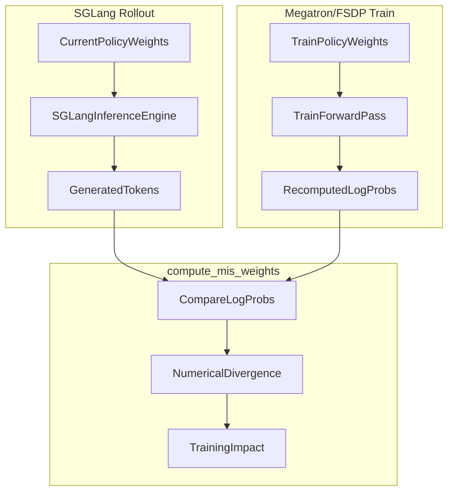
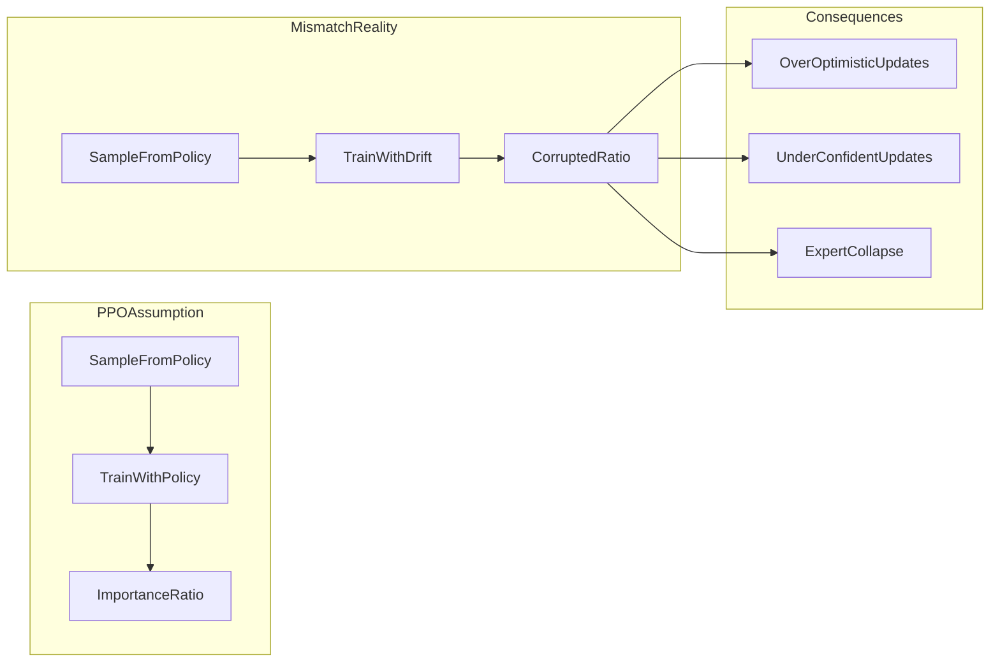
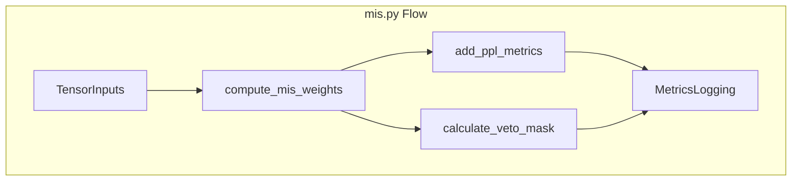
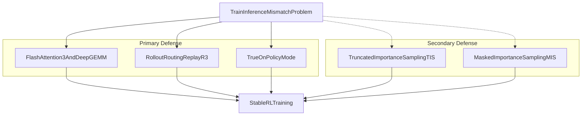

<!-- source: DeepWiki mcp.deepwiki.com · repo radixark/miles · page 7.1 The Mismatch Problem · fetched 2026-10-21 -->

# The Mismatch Problem

Relevant source files

The following files were used as context for generating this wiki page:

- [.gitignore](.gitignore)
- [README.md](README.md)
- [docker/patch/fla_kda_hoist_next_power_of_2.patch](docker/patch/fla_kda_hoist_next_power_of_2.patch)
- [docs/README.md](docs/README.md)
- [docs/advanced/lora.md](docs/advanced/lora.md)
- [docs/assets/images/acknowledgment.png](docs/assets/images/acknowledgment.png)
- [docs/docs.json](docs/docs.json)
- [docs/index.md](docs/index.md)
- [docs/models/glm/glm5-2.md](docs/models/glm/glm5-2.md)
- [docs/models/glm/glm5-3-flash.md](docs/models/glm/glm5-3-flash.md)
- [docs/models/glm/glm5-3.md](docs/models/glm/glm5-3.md)
- [docs/models/glm/glm5.md](docs/models/glm/glm5.md)
- [docs/models/glm/index.md](docs/models/glm/index.md)
- [docs/models/index.md](docs/models/index.md)
- [miles/backends/megatron_utils/megatron_to_hf/glm5_next.py](miles/backends/megatron_utils/megatron_to_hf/glm5_next.py)
- [tests/manual/launch_scripts/test_py_launch_scripts.py](tests/manual/launch_scripts/test_py_launch_scripts.py)

## Purpose and Scope

This page explains the **train-inference mismatch problem**, a fundamental challenge in on-policy reinforcement learning for large language models. It covers what the problem is, why it occurs, its impact on training stability, and how Miles detects and measures mismatch severity. For details on Miles' system-level solutions (bit-wise identical training), see [7.2](). For MoE-specific solutions, see [7.3](). For algorithmic corrections, see [7.4](). For the strictest operational mode, see [7.5]().

Sources: [README.md:46-49](), [docs/docs.json:54-78]()

---

## The Core Problem: Log Probability Divergence

**Definition**: Train-inference mismatch occurs when the same model produces different log probabilities for the same tokens during rollout (inference via SGLang) versus training (forward pass via FSDP/Megatron). This numerical divergence, even if small per-token, compounds across sequences and destabilizes on-policy RL algorithms.

### System Flow and Mismatch Points

The diagram below maps the data flow from generation to training, linking natural language system concepts to code entities in `examples/train_infer_mismatch_helper/mis.py` and backend utilities.

Sources: [README.md:46-49](), [examples/train_infer_mismatch_helper/mis.py:151-170]()

---

## Root Causes of Mismatch

Miles separates rollout and training into different systems for performance optimization, but this architectural decision introduces multiple sources of numerical divergence:

| Cause | Rollout (SGLang) | Training (FSDP/Megatron) | Impact |
|-------|------------------|---------------------------|---------|
| **Attention Kernels** | FlashInfer | FlashAttention-2/3 | Different accumulation order → different float rounding |
| **Quantization** | Dynamic FP8/INT8 | BF16/FP8 training | Quantization grid mismatch → log prob shifts [README.md:43-45]() |
| **MoE Routing** | TopK selection with ties broken arbitrarily | Same, but different RNG state | Non-deterministic expert selection → catastrophic divergence [README.md:24-26]() |
| **Parallelism** | Tensor parallel (TP) only | TP + PP + Context parallel (CP) | Different reduction order → accumulation errors [miles/backends/training_utils/cp_utils.py:104-136]() |
| **Numerics** | Inference-optimized (fast) | Training-optimized (stable) | Fused ops, different epsilon values |

Sources: [README.md:40-49](), [miles/backends/training_utils/cp_utils.py:96-136]()

---

## Why It Breaks On-Policy RL

On-policy RL algorithms like PPO rely on a critical assumption: **samples are generated from the current policy**. When log probabilities diverge, this assumption is violated.

**Mathematical Impact**: If `rollout_log_probs = train_log_probs + ε`, then the importance sampling ratio becomes `exp(ε)` instead of 1.0. For MoE models with 50+ layers, even small per-layer errors compound exponentially, causing ratios to explode or collapse to near-zero.

Sources: [examples/train_infer_mismatch_helper/mis.py:151-170](), [miles/backends/training_utils/log_utils.py:171-180]()

---

## Measuring Mismatch Severity

Miles implements comprehensive metrics to detect and quantify train-inference mismatch. These metrics are computed during the training loop and logged to experiment trackers.

### Key Metrics in `mis.py`

**1. Perplexity Divergence**
- **`training_ppl`**: Perplexity using `train_log_probs`.
- **`rollout_ppl`**: Perplexity using `rollout_log_probs`.
- **`ppl_ratio`**: `training_ppl / rollout_ppl`. Should be ≈ 1.0.

**2. KL Divergence Estimators**
- **`kl`**: Direct estimator: `mean(rollout_log_prob - train_log_prob)`.
- **`k3_kl`**: Stable estimator: `mean(exp(log_ratio) - log_ratio - 1)`.

**3. Chi-Squared Divergence**
- **`chi2_token`**: Token-level variance: `mean(exp(2*log_ratio)) - 1`.
- **`chi2_seq`**: Sequence-level variance: `exp(2*sum(log_ratio)) - 1`.

### Metric Computation Implementation

The logic for calculating these metrics is centralized in `examples/train_infer_mismatch_helper/mis.py`, connecting functions like `compute_mis_weights` and `add_ppl_metrics`.

Sources: [examples/train_infer_mismatch_helper/mis.py:83-170](), [examples/train_infer_mismatch_helper/mis.py:386-455]()

---

## Miles' Defense-in-Depth Strategy

Miles employs a **multi-layered approach** to solve mismatch, prioritizing system-level elimination over algorithmic correction.

### Layer 1: System-Level Solutions (Eliminate Mismatch)
1.  **Bit-wise Identical Kernels**: Using **FlashAttention-3** and **DeepGEMM** in both training and inference to ensure deterministic accumulation [README.md:46-54]().
2.  **Rollout Routing Replay (R3)**: Recording expert routing decisions in SGLang and replayed exactly in Megatron/FSDP to prevent MoE expert collapse [README.md:44-45]().
3.  **Unified FP8 Pipeline**: Ensuring both rollout and training use identical FP8 quantization logic [README.md:41-43]().

### Layer 2: Algorithmic Corrections (Tolerate Mismatch)
When system-level solutions are insufficient, Miles provides:
1.  **Truncated Importance Sampling (TIS)**: Bounding importance weights to prevent gradient explosions [README.md:50-51]().
2.  **Masked Importance Sampling (MIS)**: Rejecting samples where the mismatch is too severe [examples/train_infer_mismatch_helper/mis.py:132-149]().

Sources: [README.md:46-51](), [examples/train_infer_mismatch_helper/mis.py:132-170]()

---

## Summary Table: Code Entities for Mismatch Management

| Code Entity | File Path | Role |
| :--- | :--- | :--- |
| `compute_mis_weights` | [examples/train_infer_mismatch_helper/mis.py:151-170]() | Core logic for calculating IS weights and mismatch metrics. |
| `add_ppl_metrics` | [examples/train_infer_mismatch_helper/mis.py:386-455]() | Calculates Perplexity, KL, and Chi-Squared divergence. |
| `calculate_veto_mask` | [examples/train_infer_mismatch_helper/mis.py:83-101]() | Implements sequence-level rejection for "catastrophic" tokens. |
| `truncate` / `clip` | [examples/train_infer_mismatch_helper/mis.py:104-129]() | Logic for bounding importance sampling weights. |
| `get_sum_of_sample_mean` | [miles/backends/training_utils/cp_utils.py:96-136]() | Ensures correct metric averaging across Context Parallel ranks. |

Sources: [examples/train_infer_mismatch_helper/mis.py:1-455](), [miles/backends/training_utils/cp_utils.py:96-136]()

---

