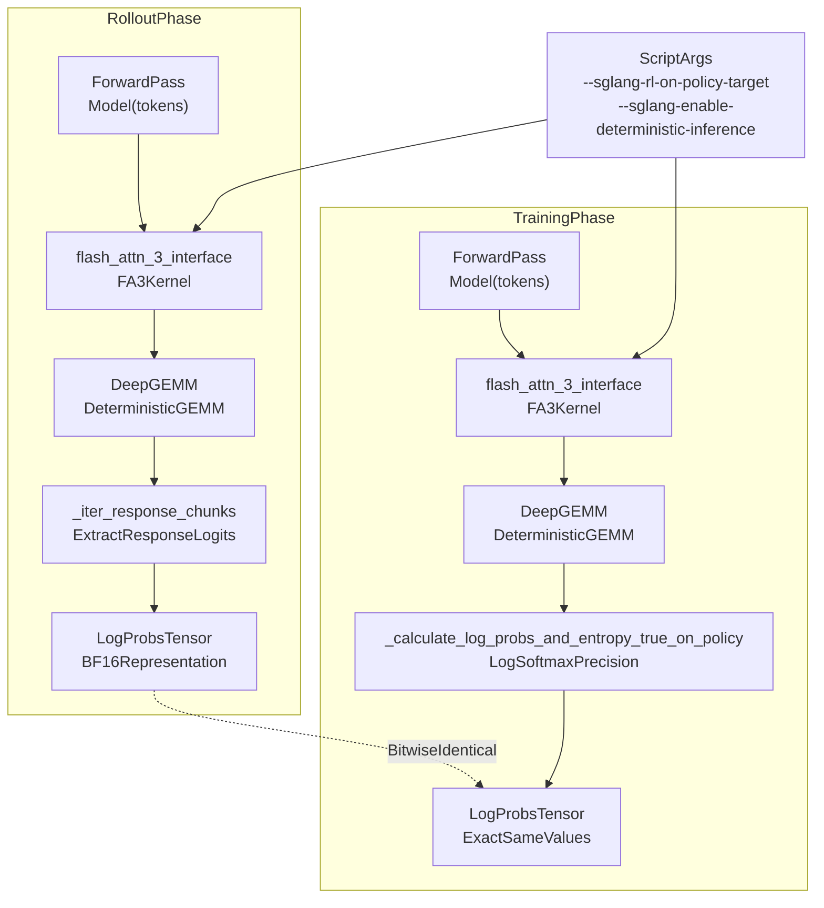
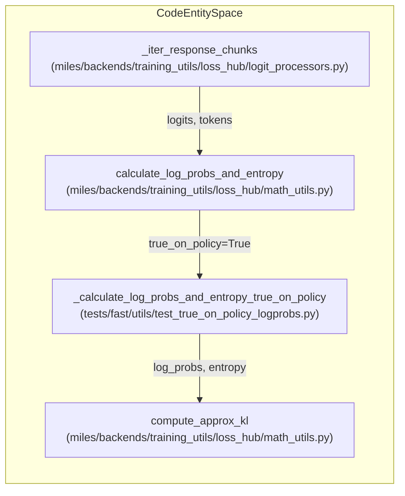

<!-- source: DeepWiki mcp.deepwiki.com · repo radixark/miles · page 7.2 Bit-wise Identical Training · fetched 2026-10-21 -->

# Bit-wise Identical Training

<details>
<summary>Relevant source files</summary>

The following files were used as context for generating this wiki page:

- [tests/e2e/megatron/test_glm47_flash/_common.py](tests/e2e/megatron/test_glm47_flash/_common.py)
- [tests/e2e/megatron/test_qwen3_30B_A3B/_common.py](tests/e2e/megatron/test_qwen3_30B_A3B/_common.py)
- [tests/e2e/megatron/test_qwen3_30B_A3B/test_deepep_fp8.py](tests/e2e/megatron/test_qwen3_30B_A3B/test_deepep_fp8.py)
- [tests/e2e/megatron/test_qwen3_30B_A3B/test_deepep_fp8_bridge.py](tests/e2e/megatron/test_qwen3_30B_A3B/test_deepep_fp8_bridge.py)
- [tests/e2e/megatron/test_qwen3_30B_A3B/test_disagg_broadcast.py](tests/e2e/megatron/test_qwen3_30B_A3B/test_disagg_broadcast.py)
- [tests/e2e/megatron/test_qwen3_30B_A3B/test_int4_rollout.py](tests/e2e/megatron/test_qwen3_30B_A3B/test_int4_rollout.py)
- [tests/e2e/megatron/test_qwen3_30B_A3B/test_r3_baseline.py](tests/e2e/megatron/test_qwen3_30B_A3B/test_r3_baseline.py)
- [tests/e2e/megatron/test_qwen3_30B_A3B/test_r3_deepep_fp8.py](tests/e2e/megatron/test_qwen3_30B_A3B/test_r3_deepep_fp8.py)
- [tests/e2e/megatron/test_qwen3_5_35B_A3B/_common.py](tests/e2e/megatron/test_qwen3_5_35B_A3B/_common.py)

</details>


## Purpose and Scope

This page documents Miles' system-level approach to achieving bit-wise identical log probabilities between training and inference (rollout) phases. By ensuring that forward passes produce exactly the same numerical results in both contexts, Miles eliminates a major source of train-inference mismatch that causes RL training instability.

For the broader context of train-inference mismatch and other solution approaches, see [7.1 The Mismatch Problem](). For algorithmic corrections when perfect alignment is impossible, see [7.4 Importance Sampling (TIS/MIS)](). For MoE-specific alignment, see [7.3 Rollout Routing Replay (R3)]().

Sources: [examples/true_on_policy/README.md:2-5](), [examples/true_on_policy_vlm/run_simple.py:100-105]()

---

## Overview

Bit-wise identical training ensures that every token's log probability computed during SGLang inference is numerically identical to the log probability computed during FSDP/Megatron training. This eliminates the primary cause of on-policy RL training collapse: when the training loop optimizes against log probabilities that differ from those used to generate the rollout data.

**Key Insight**: Unlike algorithmic solutions (TIS/MIS) that *correct* for mismatch, bit-wise identical training *eliminates* it at the system level through deterministic kernel selection and precise numerical configuration implemented in utilities such as `calculate_log_probs_and_entropy` [miles/backends/training_utils/loss_hub/math_utils.py:18-18]() and `_iter_response_chunks` [miles/backends/training_utils/loss_hub/logit_processors.py:13-22]().


Sources: [examples/true_on_policy/README.md:2-5](), [miles/backends/training_utils/loss_hub/math_utils.py:18-18](), [miles/backends/training_utils/loss_hub/logit_processors.py:13-22](), [tests/fast/true_on_policy/test_run_qwen3_4b.py:32-47]()

---

## The Challenge: Non-Determinism

Modern GPU operations contain multiple sources of non-determinism that cause training and inference to produce different numerical results even for identical inputs:

| Operation | Non-Determinism Source | Impact |
|-----------|------------------------|--------|
| **Attention** | Parallel reduction order, atomic operations | Different floating-point accumulation patterns |
| **GEMM** | cuBLAS algorithm selection, tensor core scheduling | Different rounding errors |
| **Softmax** | Implementation differences (torch.softmax vs manual) | Numerical instability amplification |
| **MoE Routing** | Expert load balancing, parallel token distribution | Different expert assignments |
| **Dtype Conversion** | FP32↔BF16 conversion timing, intermediate precision | Accumulated rounding errors |

Sources: [examples/true_on_policy/README.md:46-56]()

---

## Solution Architecture: Components

Miles achieves bit-wise identical training through coordinated kernel selection and environment configuration.

### Component 1: FlashAttention-3

FlashAttention-3 (FA3) is the foundation of deterministic attention computation on Hopper architecture (H100/B200). Miles installs a specific commit and patches the interface to ensure Hopper-specific kernels are available.

```dockerfile
# flash-attn hopper (FA3): Hopper-only (sm_90a). Coexists with FA2.
RUN pip install /tmp/wheels/flash_attn_3-*.whl && \
    python_path=$(python -c "import site; print(site.getsitepackages()[0])") && \
    mkdir -p $python_path/flash_attn_3 && \
    curl -fSL https://raw.githubusercontent.com/Dao-AILab/flash-attention/fbf24f67cf7f6442c5cfb2c1057f4bfc57e72d89/hopper/flash_attn_interface.py \
      -o $python_path/flash_attn_3/flash_attn_interface.py
```

In training scripts, FA3 is explicitly requested via command arguments such as `--sglang-attention-backend fa3` [tests/fast/true_on_policy/test_run_qwen3_4b.py:36]() and `--attn-implementation flash_attention_3`.

Sources: [docker/Dockerfile:66-71](), [tests/fast/true_on_policy/test_run_qwen3_4b.py:32-47]()

### Component 2: DeepGEMM and Deterministic GEMM

Matrix multiplications (GEMM) must use deterministic algorithms. Miles leverages DeepGEMM and forces cuBLAS into a deterministic mode via environment variables defined in training launch scripts.

```python
true_on_policy_envs = {
    "NCCL_ALGO": "allreduce:tree",
    "NVTE_ALLOW_NONDETERMINISTIC_ALGO": "0",
    "CUBLAS_WORKSPACE_CONFIG": ":4096:8",
}
```

Sources: [tests/fast/true_on_policy/test_run_qwen3_4b.py:96-98](), [examples/true_on_policy_vlm/run_simple.py:106-113]()

### Component 3: Batch Invariant Kernels

Batch invariant kernels are used to ensure that processing a sequence as part of a batch (during training) produces the same result as processing it individually or in a different batch configuration (during rollout).

Sources: [examples/true_on_policy/README.md:52-56](), [tests/fast/true_on_policy/test_run_qwen3_4b.py:42]()

---

## Implementation Details

### SGLang Patches for Determinism

The SGLang integration includes specific patches to enable deterministic behavior when `rl_on_policy_target` is set. This includes bypassing certain non-deterministic optimizations in sensitive paths and configuring `--sglang-enable-deterministic-inference` [tests/fast/true_on_policy/test_run_qwen3_4b.py:33]().

Sources: [tests/fast/true_on_policy/test_run_qwen3_4b.py:32-37]()

### Log Probability and Entropy Calculations

Exact numerical alignment is enforced during loss calculations via specialized functions in `miles/backends/training_utils/loss_hub/math_utils.py` and `miles/backends/training_utils/loss_hub/logit_processors.py`.


Sources: [miles/backends/training_utils/loss_hub/logit_processors.py:13-22](), [miles/backends/training_utils/loss_hub/math_utils.py:18-18](), [tests/fast/utils/test_true_on_policy_logprobs.py:4-8]()

---

## Configuration and Usage

### Example Launch Configuration

To enable bit-wise identical training, use the following flags generated via the script launcher interface:

```bash
# SGLang and Training flags
--sglang-attention-backend fa3 \
--sglang-enable-deterministic-inference \
--true-on-policy-mode \
--batch-invariant-mode \
--recompute-logprobs-via-prefill
```

Sources: [tests/fast/true_on_policy/test_run_qwen3_4b.py:32-44]()

### Critical Environment Variables

These variables must be set in the extra environment dictionary during script execution:

| Variable | Value | Purpose |
|----------|-------|---------|
| `NVTE_ALLOW_NONDETERMINISTIC_ALGO` | `0` | Disables non-deterministic algos in Transformer Engine |
| `CUBLAS_WORKSPACE_CONFIG` | `:4096:8` | Forces deterministic cuBLAS operations |
| `NCCL_ALGO` | `Ring` / `allreduce:tree` | Ensures deterministic collective communication |

Sources: [tests/fast/true_on_policy/test_run_qwen3_4b.py:96-98]()

---

## Summary of Expected Results

When bit-wise identical training is correctly configured:
1. **Log Probability Divergence**: The absolute difference between rollout and training log probabilities remains at `0`.
2. **Convergence**: RL training exhibits high stability because the importance sampling ratio at epoch initiation is identically 1.0.
3. **Performance Trade-off**: Strict determinism incurs an execution time overhead due to restrictions on non-deterministic hardware optimizations.

Sources: [examples/true_on_policy/README.md:31-40]()

---

