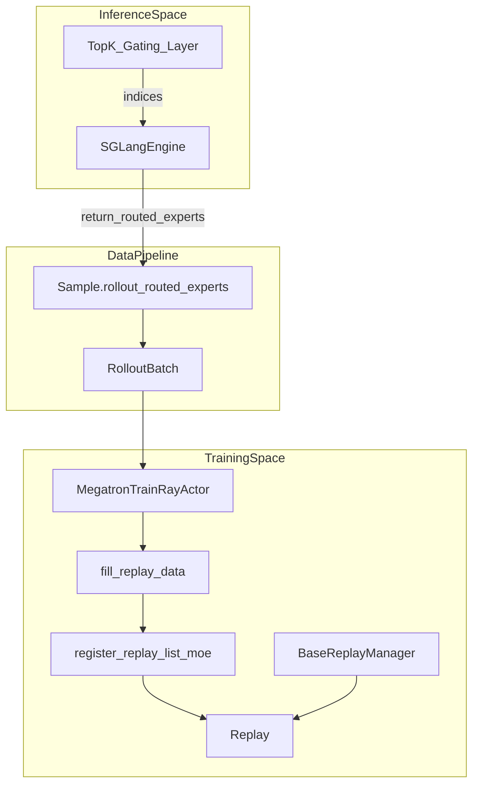
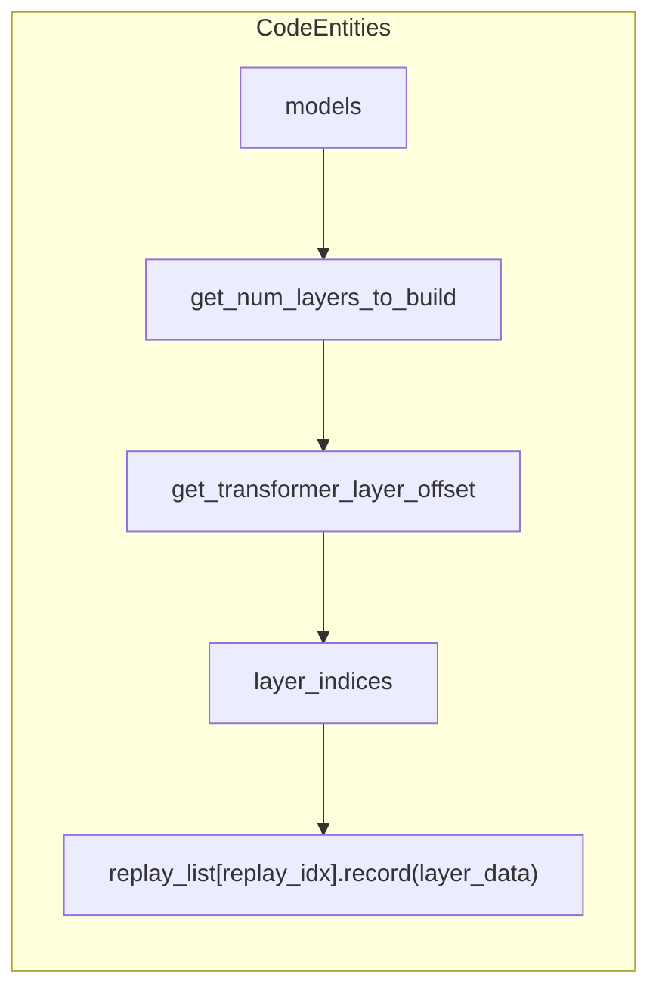

<!-- source: DeepWiki mcp.deepwiki.com · repo radixark/miles · page 7.3 Rollout Routing Replay (R3) · fetched 2026-10-21 -->

# Rollout Routing Replay (R3)

<details>
<summary>Relevant source files</summary>

The following files were used as context for generating this wiki page:

- [miles/backends/megatron_utils/replay_utils.py](miles/backends/megatron_utils/replay_utils.py)
- [miles/utils/replay_base.py](miles/utils/replay_base.py)
- [tests/e2e/megatron/test_glm47_flash/_common.py](tests/e2e/megatron/test_glm47_flash/_common.py)
- [tests/e2e/megatron/test_qwen3_30B_A3B/_common.py](tests/e2e/megatron/test_qwen3_30B_A3B/_common.py)
- [tests/e2e/megatron/test_qwen3_30B_A3B/test_deepep_fp8.py](tests/e2e/megatron/test_qwen3_30B_A3B/test_deepep_fp8.py)
- [tests/e2e/megatron/test_qwen3_30B_A3B/test_deepep_fp8_bridge.py](tests/e2e/megatron/test_qwen3_30B_A3B/test_deepep_fp8_bridge.py)
- [tests/e2e/megatron/test_qwen3_30B_A3B/test_disagg_broadcast.py](tests/e2e/megatron/test_qwen3_30B_A3B/test_disagg_broadcast.py)
- [tests/e2e/megatron/test_qwen3_30B_A3B/test_int4_rollout.py](tests/e2e/megatron/test_qwen3_30B_A3B/test_int4_rollout.py)
- [tests/e2e/megatron/test_qwen3_30B_A3B/test_r3_baseline.py](tests/e2e/megatron/test_qwen3_30B_A3B/test_r3_baseline.py)
- [tests/e2e/megatron/test_qwen3_30B_A3B/test_r3_deepep_fp8.py](tests/e2e/megatron/test_qwen3_30B_A3B/test_r3_deepep_fp8.py)
- [tests/e2e/megatron/test_qwen3_5_35B_A3B/_common.py](tests/e2e/megatron/test_qwen3_5_35B_A3B/_common.py)

</details>


## Purpose and Scope

Rollout Routing Replay (R3) is a core Miles feature designed to eliminate the train-inference mismatch in Mixture-of-Experts (MoE) models. In MoE architectures, a router selects a subset of "experts" for each token. Because these routing decisions are discrete and sensitive to numerical noise, the experts selected during rollout (inference) may differ from those selected during training forward passes, even if model weights are identical.

R3 solves this by:
1. **Recording** the exact expert indices chosen during SGLang rollout generation.
2. **Transferring** these indices alongside rollout trajectories to the training actors.
3. **Replaying** these recorded decisions within the training loop using `Replay` buffers and `BaseReplayManager` extensions [miles/utils/replay_base.py:14-144](), forcing the model to use the exact same expert computation graph as the rollout phase.

Sources: [miles/utils/replay_base.py:14-144](), [tests/e2e/megatron/test_qwen3_30B_A3B/_common.py:157-158]()

---

## Core Architecture and Code Entities

The R3 infrastructure bridges the SGLang inference engine and the Megatron training backend through a set of replay management utilities defined in `miles/utils/replay_base.py` and `miles/backends/megatron_utils/replay_utils.py`.


Sources: [miles/utils/replay_base.py:14-82](), [miles/backends/megatron_utils/replay_utils.py:5-24]()

---

## Implementation Details

### 1. Replay Buffers and Manager (`Replay` & `BaseReplayManager`)
The low-level mechanics of R3 are implemented in `miles/utils/replay_base.py`. The `Replay` class manages pinned CPU buffers to store routed indices efficiently, supporting recording, forward pop, backward pop, and clearing operations [miles/utils/replay_base.py:14-48]().

The `BaseReplayManager` class coordinates multiple streams across modules, providing a wrapped `get_topk_fn` method that intercepts routing decisions depending on the active stage [miles/utils/replay_base.py:53-144]().

Sources: [miles/utils/replay_base.py:14-144]()

### 2. Filling Replay Data (`fill_replay_data` & `register_replay_list_moe`)
During the transition from rollout to training, replay tensors are loaded into module queues. For Megatron MoE models, `register_replay_list_moe` maps the replay streams to individual Megatron MoE layers using the local model layout and parallel configuration [miles/backends/megatron_utils/replay_utils.py:5-24]().


Sources: [miles/backends/megatron_utils/replay_utils.py:5-24]()

### 3. Stage Management
The replay mechanism operates through a state machine controlled by `manager.stage`:
- `fallthrough`: Bypasses replay and uses standard dynamic routing (`old_topk_fn`) [miles/utils/replay_base.py:123-124]().
- `record`: Computes standard routing and records indices into the buffer [miles/utils/replay_base.py:126-133]().
- `replay_forward`: Pops and uses recorded indices during forward execution via `replay.pop_forward()` [miles/utils/replay_base.py:135-136]().
- `replay_backward`: Reuses recorded indices during backward propagation via `replay.pop_backward()` [miles/utils/replay_base.py:138-139]().

Additionally, `BaseReplayManager.check_replay_result` supports CI validation by measuring overlap between recomputed and replayed top-k indices [miles/utils/replay_base.py:158-179]().

Sources: [miles/utils/replay_base.py:116-144](), [miles/utils/replay_base.py:158-179]()

---

## Sequence Diagram: R3 Execution Flow

```mermaid
sequenceDiagram
    participant Actor as "MegatronTrainRayActor"
    participant Loader as "fill_replay_data"
    participant Manager as "BaseReplayManager"
    participant Router as "Megatron_MoE_Router"

    Actor->>Loader: "fill_replay_data(rollout_data, replay_list)"
    Loader->>Manager: "record(layer_data)"
    
    Note over Actor, Router: "Forward Pass with R3"
    Actor->>Manager: "set stage = replay_forward"
    Router->>Manager: "new_topk_fn(scores, topk)"
    Manager->>Manager: "replay.pop_forward()"
    Manager-->>Router: "top_indices"
    
    Note over Actor, Router: "Backward Pass with R3"
    Actor->>Manager: "set stage = replay_backward"
    Router->>Manager: "new_topk_fn(scores, topk)"
    Manager->>Manager: "replay.pop_backward()"
    Manager-->>Router: "top_indices"
```
Sources: [miles/utils/replay_base.py:116-144](), [miles/backends/megatron_utils/replay_utils.py:5-24]()

---

## Configuration and Usage

To enable R3 in training scripts, specify the appropriate rollout and routing replay flags (as seen in end-to-end test configurations) [tests/e2e/megatron/test_qwen3_30B_A3B/_common.py:157-158]():

| Argument | Purpose |
| :--- | :--- |
| `--use-routing-replay` | Enables the internal training-side replay manager and hooked top-k functions. |
| `--use-rollout-routing-replay` | Instructs the inference rollout engine to capture and return expert routing decisions. |

**Example CLI usage:**
```bash
python -m miles.train \
    --train-backend megatron \
    --use-routing-replay \
    --use-rollout-routing-replay \
    --moe-token-dispatcher-type alltoall
```
Sources: [tests/e2e/megatron/test_qwen3_30B_A3B/_common.py:157-168]()

---

