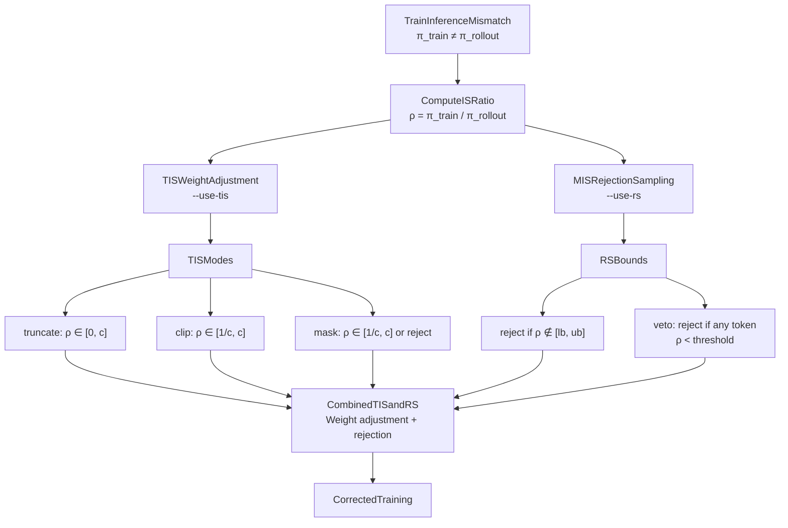
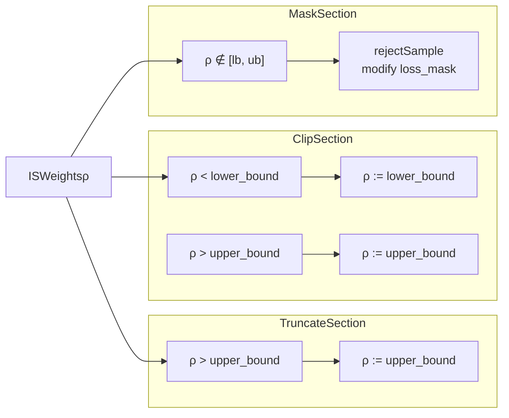
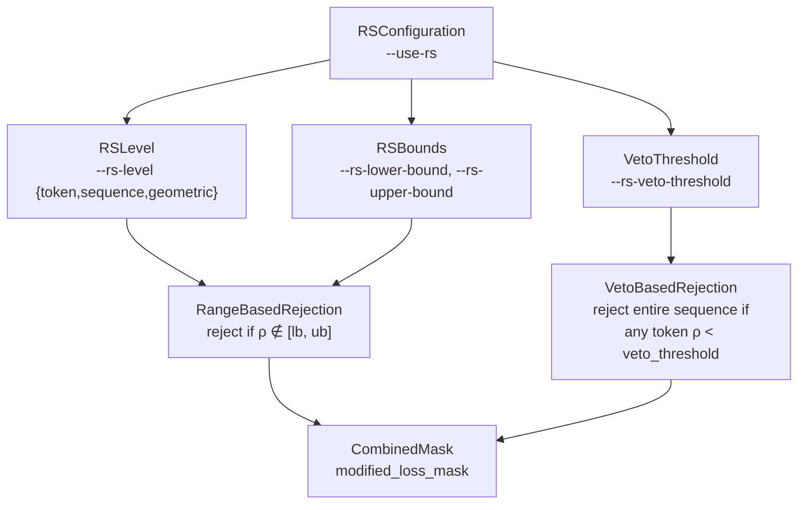
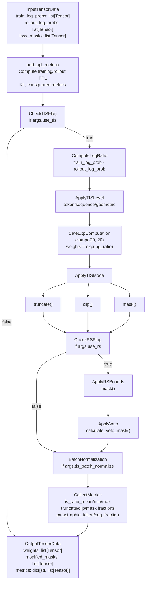
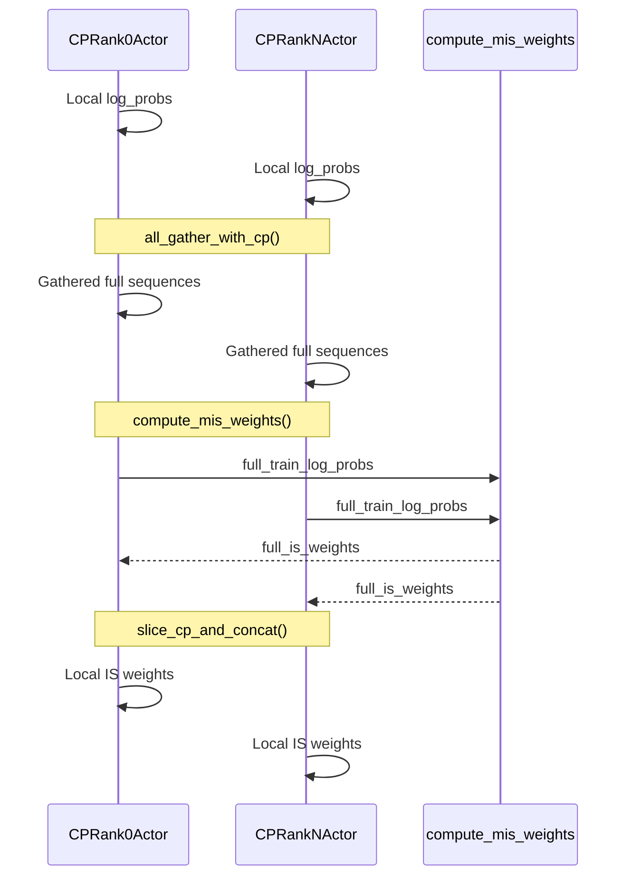

<!-- source: DeepWiki mcp.deepwiki.com · repo radixark/miles · page 7.4 Importance Sampling (TIS/MIS) · fetched 2026-10-21 -->

# Importance Sampling (TIS/MIS)

<details>
<summary>Relevant source files</summary>

The following files were used as context for generating this wiki page:

- [miles/backends/megatron_utils/arguments.py](miles/backends/megatron_utils/arguments.py)
- [tests/fast/backends/training_utils/loss/loss_test_utils.py](tests/fast/backends/training_utils/loss/loss_test_utils.py)
- [tests/fast/backends/training_utils/loss/test_advantages_pp_stage_guard.py](tests/fast/backends/training_utils/loss/test_advantages_pp_stage_guard.py)
- [tests/fast/backends/training_utils/loss/test_opd.py](tests/fast/backends/training_utils/loss/test_opd.py)
- [tests/fast/backends/training_utils/loss/test_training_logprob_reuse.py](tests/fast/backends/training_utils/loss/test_training_logprob_reuse.py)
- [tests/fast/backends/training_utils/test_chunked_log_probs.py](tests/fast/backends/training_utils/test_chunked_log_probs.py)
- [tests/fast/backends/training_utils/test_sampling_mask.py](tests/fast/backends/training_utils/test_sampling_mask.py)
- [tests/fast/backends/training_utils/test_true_on_policy_loss_metrics.py](tests/fast/backends/training_utils/test_true_on_policy_loss_metrics.py)

</details>


## Purpose and Scope

This page documents Miles' **Truncated Importance Sampling (TIS)** and **Masked Importance Sampling (MIS)** algorithms, which provide algorithmic corrections for off-policy bias when perfect train-inference alignment cannot be achieved through system-level solutions.

**When to use**: TIS/MIS are fallback mechanisms used when:
- Perfect bit-wise identical training is not feasible [7.2]().
- Rollout Routing Replay is unavailable (e.g., non-MoE models or specific inference configurations) [7.3]().
- Some level of train-inference mismatch is unavoidable due to hardware or kernel differences.

For understanding the broader mismatch problem and Miles' multi-layered approach, see [The Mismatch Problem](). For the strictest possible on-policy mode that enables all deterministic settings, see [True On-Policy Mode]().

**Key distinction**: TIS adjusts importance sampling weights, while MIS/RS performs rejection sampling by masking out off-policy samples.

Sources: [tests/fast/backends/training_utils/loss/loss_test_utils.py:99-104]()

---

## Problem Context

### Off-Policy Bias in RL

In on-policy RL algorithms like PPO or GRPO, training requires that the data distribution matches the current policy. However, in practice:

1. **Inference phase**: Rollout data is generated using SGLang inference engines with certain numerical behaviors (e.g., FP8, different attention backends).
2. **Training phase**: Log probabilities are recomputed using FSDP/Megatron training engines with potentially different numerical behaviors.
3. **Mismatch**: Even small differences in log probabilities cause the policy gradient estimator to be off-policy and biased.

### Importance Sampling Solution

Importance sampling corrects this bias by reweighting samples:

```
Loss_corrected = (π_train / π_rollout) * Loss_original
```

Where:
- `π_train / π_rollout` is the **importance sampling ratio** ($\rho$).
- Computed in log space: `exp(log_prob_train - log_prob_rollout)`.

**Problem**: Naive importance sampling has high variance. TIS and MIS provide different strategies to bound this variance.

Sources: [tests/fast/backends/training_utils/loss/loss_test_utils.py:99-107]()

---

## TIS vs MIS/RS: Two Complementary Approaches

Importance Sampling Logic Flow


Sources: [tests/fast/backends/training_utils/loss/loss_test_utils.py:99-107]()

---

## TIS: Truncated Importance Sampling

### Core Mechanism

TIS bounds importance sampling weights to reduce variance while maintaining consistency. The key hyperparameter is `--tis-clip` (default: 1.5) [tests/fast/backends/training_utils/loss/loss_test_utils.py:101]().

### TIS Modes

TIS Mode Comparison


#### Truncate Mode (`--tis-mode truncate`)

Clamps weights from above only:
`ρ' = min(ρ, upper_bound)`

**Use case**: When you want to limit the impact of positive mismatch but allow underweighting.

Sources: [tests/fast/backends/training_utils/loss/loss_test_utils.py:99-104]()

#### Clip Mode (`--tis-mode clip`)

Clamps weights from both sides using `--tis-clip` and `--tis-clip-low` [tests/fast/backends/training_utils/loss/loss_test_utils.py:101-102]().

**Use case**: Standard variance reduction, maintains all samples with bounded weights.

Sources: [tests/fast/backends/training_utils/loss/loss_test_utils.py:101-102]()

#### Mask Mode (`--tis-mode mask`)

Rejects samples outside bounds by modifying the loss mask.

**Use case**: When severe mismatch samples should be completely excluded from gradient computation.

Sources: [tests/fast/backends/training_utils/loss/loss_test_utils.py:99-104]()

---

## MIS: Masked Importance Sampling (Rejection Sampling)

### Core Mechanism

MIS (also called Rejection Sampling or RS) modifies the loss mask to reject samples with extreme importance ratios. This is orthogonal to TIS and can be combined with it.

### RS Configuration

Rejection Sampling Logic


Sources: [tests/fast/backends/training_utils/loss/loss_test_utils.py:99-104]()

### Range-Based Rejection

Rejects individual tokens or sequences where the IS ratio falls outside specified bounds.

Sources: [tests/fast/backends/training_utils/loss/loss_test_utils.py:99-104]()

### Veto Mechanism

Rejects entire sequences if **any** token has a catastrophically low ratio. This provides a safety net against severe distribution shift at individual tokens.

Sources: [tests/fast/backends/training_utils/loss/loss_test_utils.py:99-104]()

---

## Implementation Architecture

### Core Functionality

Algorithm Execution Flow


Sources: [tests/fast/backends/training_utils/loss/loss_test_utils.py:99-104]()

### Context Parallel (CP) Support

In Megatron-LM backends using Context Parallelism, log probabilities are distributed across ranks. Communication primitives synchronize weights across ranks.

IS Weight CP Workflow


Sources: [tests/fast/backends/training_utils/loss/loss_test_utils.py:99-104]()

---

## Configuration and Scripts

Importance Sampling is enabled via command-line arguments and configuration dictionaries parsed in `miles/backends/megatron_utils/arguments.py` and tested via `tests/fast/backends/training_utils/loss/loss_test_utils.py`.

- `use_tis`: bool flag to enable Truncated Importance Sampling [tests/fast/backends/training_utils/loss/loss_test_utils.py:99]()
- `tis_clip`: upper bound clip value [tests/fast/backends/training_utils/loss/loss_test_utils.py:101]()
- `tis_clip_low`: lower bound clip value [tests/fast/backends/training_utils/loss/loss_test_utils.py:102]()
- `custom_tis_function_path`: custom override path for TIS computation [tests/fast/backends/training_utils/loss/loss_test_utils.py:103]()

Sources: [miles/backends/megatron_utils/arguments.py:1-65](), [tests/fast/backends/training_utils/loss/loss_test_utils.py:99-104]()

---

## Metrics and Monitoring

Miles logs metrics to track train-inference alignment quality during policy optimization steps.

| Metric | Description |
|--------|-------------|
| `train_rollout_logprob_abs_diff` | Mean absolute difference between train and rollout log probabilities |
| `ppo_kl` | Kullback-Leibler divergence between old policy and current policy |
| `pg_clipfrac` | Fraction of policy gradient clips |

Sources: [tests/fast/backends/training_utils/test_true_on_policy_loss_metrics.py:82-125](), [tests/fast/backends/training_utils/loss/test_training_logprob_reuse.py:129-131]()

---

## Best Practices

1. **Monitor Log Probability Differences**: Track `train_rollout_logprob_abs_diff` to detect divergence between rollout and training engines [tests/fast/backends/training_utils/test_true_on_policy_loss_metrics.py:82-125]().
2. **Context Parallelism**: When using CP, ensure gather operations synchronize log probabilities correctly across ranks before computing importance weights.
3. **Hyperparameter Tuning**: Tune `--tis-clip` and `--tis-clip-low` based on empirical variance observed in mismatch metrics [tests/fast/backends/training_utils/loss/loss_test_utils.py:101-102]().

Sources: [miles/backends/megatron_utils/arguments.py:1-65](), [tests/fast/backends/training_utils/test_true_on_policy_loss_metrics.py:82-125]()

---

