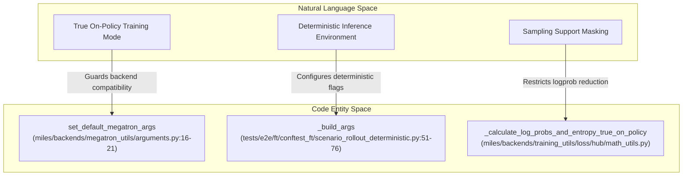
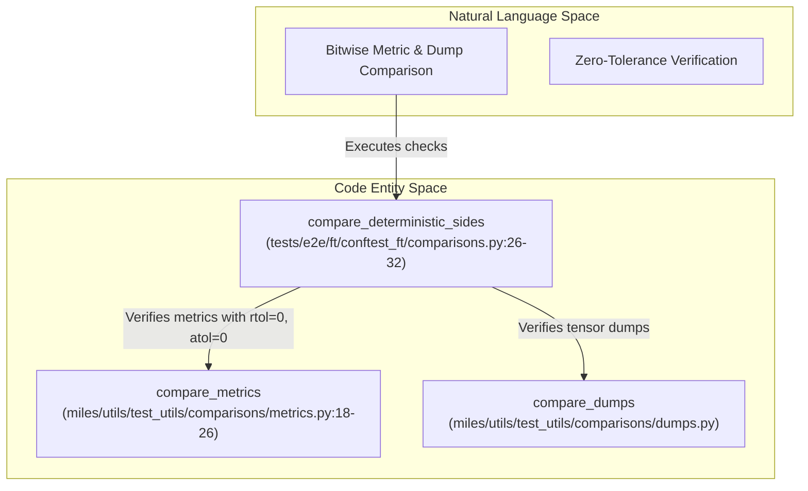

<!-- source: DeepWiki mcp.deepwiki.com · repo radixark/miles · page 7.5 True On-Policy Mode · fetched 2026-10-21 -->

# True On-Policy Mode

<details>
<summary>Relevant source files</summary>

The following files were used as context for generating this wiki page:

- [miles/backends/megatron_utils/arguments.py](miles/backends/megatron_utils/arguments.py)
- [miles/utils/test_utils/comparisons/metrics.py](miles/utils/test_utils/comparisons/metrics.py)
- [tests/e2e/deploy/conftest_deploy/hot_restart/__init__.py](tests/e2e/deploy/conftest_deploy/hot_restart/__init__.py)
- [tests/e2e/deploy/conftest_deploy/hot_restart/freeze_plan.py](tests/e2e/deploy/conftest_deploy/hot_restart/freeze_plan.py)
- [tests/e2e/ft/conftest_ft/comparisons.py](tests/e2e/ft/conftest_ft/comparisons.py)
- [tests/e2e/ft/conftest_ft/scenario_rollout_deterministic.py](tests/e2e/ft/conftest_ft/scenario_rollout_deterministic.py)
- [tests/fast/backends/training_utils/loss/loss_test_utils.py](tests/fast/backends/training_utils/loss/loss_test_utils.py)
- [tests/fast/backends/training_utils/loss/test_advantages_pp_stage_guard.py](tests/fast/backends/training_utils/loss/test_advantages_pp_stage_guard.py)
- [tests/fast/backends/training_utils/loss/test_opd.py](tests/fast/backends/training_utils/loss/test_opd.py)
- [tests/fast/backends/training_utils/loss/test_training_logprob_reuse.py](tests/fast/backends/training_utils/loss/test_training_logprob_reuse.py)
- [tests/fast/backends/training_utils/test_chunked_log_probs.py](tests/fast/backends/training_utils/test_chunked_log_probs.py)
- [tests/fast/backends/training_utils/test_sampling_mask.py](tests/fast/backends/training_utils/test_sampling_mask.py)
- [tests/fast/backends/training_utils/test_true_on_policy_loss_metrics.py](tests/fast/backends/training_utils/test_true_on_policy_loss_metrics.py)
- [tests/fast/e2e/deploy/hot_restart/__init__.py](tests/fast/e2e/deploy/hot_restart/__init__.py)
- [tests/fast/e2e/deploy/hot_restart/test_freeze_plan.py](tests/fast/e2e/deploy/hot_restart/test_freeze_plan.py)
- [tests/fast/e2e/ft/test_comparisons.py](tests/fast/e2e/ft/test_comparisons.py)
- [tests/fast/e2e/ft/test_scenario_rollout_deterministic.py](tests/fast/e2e/ft/test_scenario_rollout_deterministic.py)
- [tests/fast/utils/test_utils/comparisons/test_metrics.py](tests/fast/utils/test_utils/comparisons/test_metrics.py)

</details>


## Purpose and Scope

This page documents Miles' strictest deterministic training mode (`--true-on-policy-mode`), which enforces bitwise numerical equivalence between rollout inference (`SGLang`) and training backends (FSDP). This mode eliminates train-inference mismatch completely by enabling deterministic kernels, consistent precision handling, sampling support masks, and patched operations across the distributed system stack.

Sources: `[miles/backends/megatron_utils/arguments.py:16-21]`, `[tests/fast/backends/training_utils/test_sampling_mask.py:9-10]`

---

## Overview and Backend Restrictions

### The Train-Inference Mismatch Problem

Standard reinforcement learning training pipelines separate high-throughput rollout generation (`SGLang`) from distributed gradient updates (FSDP or Megatron-LM). Numerical drift between these phases leads to training collapse due to:
- Discrepancies in attention kernel implementations (e.g., FlashAttention variants)
- Mixed precision accumulation versus FP32 reduction paths
- Non-deterministic GEMM operations and cuBLAS workspace selection
- Expert routing divergence in Mixture-of-Experts (MoE) models

### Activation and Megatron Guard Rails

True on-policy mode is enabled via `--true-on-policy-mode`. However, due to version compatibility with distributed optimizers and tensor parallel kernels, the Megatron training backend explicitly rejects this flag by raising a `NotImplementedError` inside `set_default_megatron_args` (`[miles/backends/megatron_utils/arguments.py:16-21]()`):

```python
if getattr(args, "true_on_policy_mode", False):
    raise NotImplementedError(
        "--true-on-policy-mode is not supported on the megatron backend with this Megatron "
        "version; support lands in a follow-up PR. Use --train-backend fsdp for true-on-policy."
    )
```

Consequently, FSDP is the required training backend (`--train-backend fsdp`) for true on-policy execution.

Sources: `[miles/backends/megatron_utils/arguments.py:16-21]`, `[tests/fast/backends/training_utils/loss/loss_test_utils.py:69-76]`

---

## System Architecture and Code Entity Mapping

### Bridging Natural Language Space to Code Entity Space

The following architecture diagrams map high-level system concepts and runtime controls to their precise implementations in the codebase.

Title: True On-Policy System-to-Code Mapping



Sources: `[miles/backends/megatron_utils/arguments.py:16-21]`, `[tests/e2e/ft/conftest_ft/scenario_rollout_deterministic.py:51-76]`, `[tests/fast/backends/training_utils/test_sampling_mask.py:9-10]`

---

## Log Probabilities and Sampling Support Masking

### True On-Policy Logprob Calculation

In true on-policy mode, log probabilities are computed using sampling masks that mirror the support constraints observed during generation. This is implemented via `_calculate_log_probs_and_entropy_true_on_policy` (`[tests/fast/backends/training_utils/test_sampling_mask.py:9-10]()`), which masks out logits outside the rollout sampling support before computing log-softmax values:

```python
log_probs, entropy = _calculate_log_probs_and_entropy_true_on_policy(
    logits,
    tokens,
    None,
    with_entropy=True,
    sampling_mask=sampling_mask,
)
```

This guarantees that actor gradients account precisely for the truncated probability simplex experienced by the generation engine.

Sources: `[tests/fast/backends/training_utils/test_sampling_mask.py:9-10]`, `[tests/fast/backends/training_utils/test_sampling_mask.py:102-120]`

---

## Deterministic Execution Environments

### Deterministic Rollout Configuration

End-to-end deterministic test scenarios (such as `scenario_rollout_deterministic.py`) configure specific environment variables and execution parameters to suppress non-deterministic fallback paths and collectives (`[tests/e2e/ft/conftest_ft/scenario_rollout_deterministic.py:50-76]()`):

```python
DETERMINISTIC_INFERENCE_ENV_VARS: dict[str, str] = {"SGLANG_BATCH_INVARIANT_OPS_ENABLE_MM_FALLBACK_VARIANT": "false"}
```

Additional CLI arguments passed in this mode include:
- `--debug-deterministic-collective`
- `--sglang-disable-radix-cache`
- `--weight-decay 0`

Sources: `[tests/e2e/ft/conftest_ft/scenario_rollout_deterministic.py:50-76]`

---

## Verification and Metrics Comparison

### Verification Architecture and Code Mapping

Title: Deterministic Verification and Metric Comparison Flow



Sources: `[tests/e2e/ft/conftest_ft/comparisons.py:26-32]`, `[miles/utils/test_utils/comparisons/metrics.py:18-26]`, `[tests/fast/e2e/ft/test_comparisons.py:42-48]`

---

