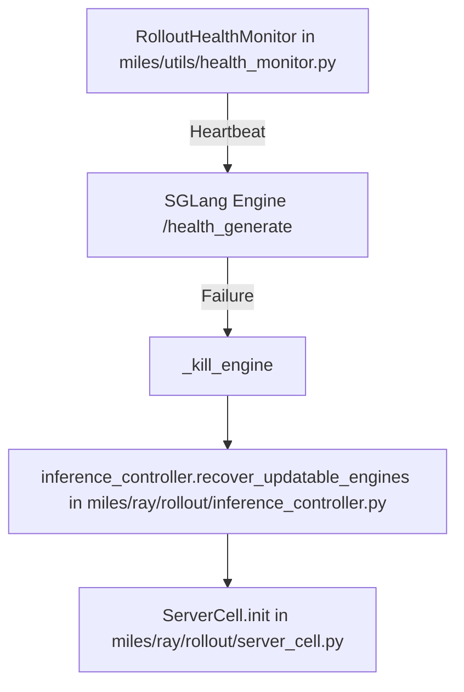

<!-- source: DeepWiki mcp.deepwiki.com · repo radixark/miles · page 8 Advanced Features · fetched 2026-10-21 -->

# Advanced Features

Relevant source files

The following files were used as context for generating this wiki page:

- [docs/advanced/fault-tolerance.md](docs/advanced/fault-tolerance.md)
- [docs/advanced/index.md](docs/advanced/index.md)
- [docs/advanced/int4-qat.md](docs/advanced/int4-qat.md)
- [docs/advanced/miles-router.md](docs/advanced/miles-router.md)
- [docs/advanced/p2p-weight-transfer.md](docs/advanced/p2p-weight-transfer.md)
- [docs/advanced/speculative-decoding.md](docs/advanced/speculative-decoding.md)
- [miles/ray/rollout/cell_state.py](miles/ray/rollout/cell_state.py)
- [tests/fast/ray/rollout/test_cell_state.py](tests/fast/ray/rollout/test_cell_state.py)
- [tests/fast/ray/rollout/test_rollout_server_health_checking.py](tests/fast/ray/rollout/test_rollout_server_health_checking.py)
- [tests/fast/ray/rollout/test_server_cell_addressing.py](tests/fast/ray/rollout/test_server_cell_addressing.py)
- [tests/fast/ray/rollout/test_server_cell_health_checker.py](tests/fast/ray/rollout/test_server_cell_health_checker.py)
- [tests/fast/ray/rollout/test_server_cell_state_machine.py](tests/fast/ray/rollout/test_server_cell_state_machine.py)

This page documents advanced capabilities in Miles that extend beyond basic RL training. These features address specific challenges in production deployments: quantized training for massive models, throughput optimization through speculative decoding, resilience to transient failures, and handling of complex model architectures. This is a parent page providing high-level overviews; for implementation details, refer to the respective child pages.

For train-inference alignment features, see [Train-Inference Alignment](#7). For basic training workflow, see [Training Orchestration](#3.2).

---

## FP8 and Quantization (8.1)

Miles supports unified low-precision training to eliminate precision drift between training and inference. Pipelines that train in BF16 but serve in FP8 often suffer from divergent log-probabilities. Miles solves this by sharing quantization logic across both phases, supporting formats like block-wise FP8, MXFP8, and NVFP4. Additionally, W4A16 Quantization-Aware Training (QAT) allows training massive models using simulated INT4 expert weights.

For details, see [FP8 and Quantization](#8.1).

**Sources:** [docs/advanced/index.md:14-27](), [docs/advanced/int4-qat.md:1-54]()

---

## Speculative Training (8.2)

Speculative decoding accelerates rollout by using a lightweight draft model to generate tokens that the target model verifies in batch. Miles supports training the draft model online alongside the target through online Multi-Token Prediction Supervised Fine-Tuning (MTP-SFT), preventing the draft model's distribution from degrading as the target model improves.

For details, see [Speculative Training](#8.2).

**Sources:** [docs/advanced/speculative-decoding.md:1-75]()

---

## Fault Tolerance (8.3)

Miles includes a robust fault-tolerance system to handle transient SGLang engine failures during long-running RL jobs. This includes background health monitoring via `RolloutHealthMonitor`, an FT API server, cell restarting logic, and automatic recovery routines that re-synchronize weights before resuming rollouts.

Title: "Fault Tolerance Health Check and Recovery Mapping"

**Sources:** [docs/advanced/fault-tolerance.md:1-50](), [miles/utils/health_monitor.py:160-180]()

For details, see [Fault Tolerance](#8.3).

**Sources:** [docs/advanced/fault-tolerance.md:1-50](), [miles/utils/health_monitor.py:160-180]()

---

## Multi-Token Prediction (8.4)

Miles integrates Megatron-LM's Multi-Token Prediction (MTP) feature, allowing models to predict multiple future tokens simultaneously. This enhances sample efficiency during training and provides the architectural basis for speculative MTP draft layers.

For details, see [Multi-Token Prediction](#8.4).

**Sources:** [docs/advanced/speculative-decoding.md:52-75](), [megatron.patch:463-604]()

---

## Context Parallelism (8.5)

Context Parallelism (CP) shards long sequences across multiple GPUs to manage memory overhead during both training and rollout. Miles supports CP integration with Ring Flash Attention and sequence packing.

For details, see [Context Parallelism](#8.5).

**Sources:** [docs/advanced/index.md:6-10]()

---

## Partial Rollout and Over-Sampling (8.6)

To maximize GPU utilization and throughput, Miles implements partial rollouts to recycle unfinished trajectories upon timeout, alongside over-sampling strategies that generate extra candidates to better populate the SGLang KV cache.

For details, see [Partial Rollout and Over-Sampling](#8.6).

**Sources:** [miles/utils/arguments.py:2082-2087]()

---

## PD Disaggregation and Miles Router (8.7)

Prefill-Decode (PD) Disaggregation splits SGLang engine pools into dedicated prefill units (optimized for compute-bound long prompts) and decode units (optimized for memory-bandwidth-bound token generation), coordinated via the Miles Router and SGLang model gateway.

Title: "PD Disaggregation Code Mapping"

**Sources:** [docs/advanced/index.md:55-60](), [miles/backends/sglang_utils/sglang_config.py:25-35]()

For details, see [PD Disaggregation and Miles Router](#8.7).

**Sources:** [docs/advanced/index.md:55-60]()

---

## Multi-LoRA and Tinker Serving (8.8)

Miles supports LoRA and multi-LoRA training topologies including adapter slots, isolated optimizers, and checkpointing. Furthermore, the Tinker service provides a multi-tenant serving architecture powered by `serve_tinker.py`, a core scheduler, and dynamic model queues.

Title: "Tinker Serving Architecture Mapping"

**Sources:** [docs/advanced/index.md:62-67]()

For details, see [Multi-LoRA and Tinker Serving](#8.8).

**Sources:** [docs/advanced/index.md:62-67]()

---

## Custom Kernels (8.9)

Miles packages specialized performance routines under `miles/kernels`, including sparse attention kernels (DSA), tilelang kernels, activation, embedding, hyper-connection, MoE, normalization, position, and quantization kernels. These are selectively chosen and heavily tested across diverse hardware backends.

For details, see [Custom Kernels](#8.9).

**Sources:** [docs/advanced/index.md:6-10]()

---

## Multi-Policy Training (8.10)

Miles coordinates multiple policies concurrently via `train_multi_policy.py`, implementing leader/follower policy coordination, Parker synchronization, shared checkpoint states, and advanced solver-verifier execution topologies.

For details, see [Multi-Policy Training](#8.10).

**Sources:** [docs/advanced/index.md:6-10]()

---

