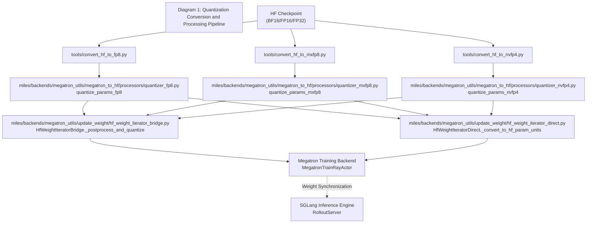
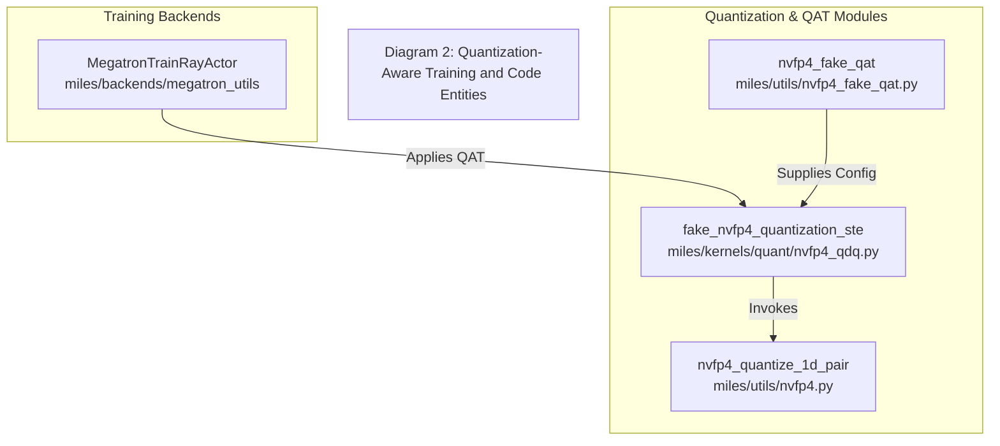

<!-- source: DeepWiki mcp.deepwiki.com · repo radixark/miles · page 8.1 FP8 and Quantization · fetched 2026-10-21 -->

# FP8 and Quantization

<details>
<summary>Relevant source files</summary>

The following files were used as context for generating this wiki page:

- [docs/advanced/low-precision.md](docs/advanced/low-precision.md)
- [miles/backends/megatron_utils/megatron_to_hf/__init__.py](miles/backends/megatron_utils/megatron_to_hf/__init__.py)
- [miles/backends/megatron_utils/megatron_to_hf/deepseekv4.py](miles/backends/megatron_utils/megatron_to_hf/deepseekv4.py)
- [miles/backends/megatron_utils/megatron_to_hf/processors/__init__.py](miles/backends/megatron_utils/megatron_to_hf/processors/__init__.py)
- [miles/backends/megatron_utils/megatron_to_hf/processors/quantizer_fp8.py](miles/backends/megatron_utils/megatron_to_hf/processors/quantizer_fp8.py)
- [miles/backends/megatron_utils/megatron_to_hf/processors/quantizer_mxfp8.py](miles/backends/megatron_utils/megatron_to_hf/processors/quantizer_mxfp8.py)
- [miles/backends/megatron_utils/megatron_to_hf/processors/quantizer_nvfp4.py](miles/backends/megatron_utils/megatron_to_hf/processors/quantizer_nvfp4.py)
- [miles/backends/megatron_utils/sglang.py](miles/backends/megatron_utils/sglang.py)
- [miles/backends/megatron_utils/update_weight/hf_weight_iterator_bridge.py](miles/backends/megatron_utils/update_weight/hf_weight_iterator_bridge.py)
- [miles/backends/megatron_utils/update_weight/hf_weight_iterator_direct.py](miles/backends/megatron_utils/update_weight/hf_weight_iterator_direct.py)
- [miles/utils/nvfp4.py](miles/utils/nvfp4.py)
- [miles/utils/nvfp4_fake_qat.py](miles/utils/nvfp4_fake_qat.py)
- [miles_plugins/mbridge/__init__.py](miles_plugins/mbridge/__init__.py)
- [miles_plugins/models/deepseek_v4/arguments.py](miles_plugins/models/deepseek_v4/arguments.py)
- [miles_plugins/models/deepseek_v4/ops/qat.py](miles_plugins/models/deepseek_v4/ops/qat.py)
- [tests/e2e/megatron/test_glm5_2_744b_a40b_5layer_nvfp4.py](tests/e2e/megatron/test_glm5_2_744b_a40b_5layer_nvfp4.py)
- [tests/e2e/megatron/test_glm5_2_744b_a40b_5layer_nvfp4_w4a16.py](tests/e2e/megatron/test_glm5_2_744b_a40b_5layer_nvfp4_w4a16.py)
- [tests/fast-gpu/test_nvfp4_quantizer.py](tests/fast-gpu/test_nvfp4_quantizer.py)
- [tests/fast/backends/megatron_utils/test_hf_weight_iterator_direct.py](tests/fast/backends/megatron_utils/test_hf_weight_iterator_direct.py)
- [tests/fast/backends/megatron_utils/test_lora_hf_weight_iterator.py](tests/fast/backends/megatron_utils/test_lora_hf_weight_iterator.py)
- [tests/fast/test_nvfp4_scope.py](tests/fast/test_nvfp4_scope.py)
- [tools/convert_hf_to_mxfp8.py](tools/convert_hf_to_mxfp8.py)
- [tools/convert_hf_to_nvfp4.py](tools/convert_hf_to_nvfp4.py)

</details>


## Purpose and Scope

This document details Miles' unified quantization infrastructure, encompassing the precision pipeline for train-inference alignment, NVFP4, MXFP8, and FP8 weight conversion tools, weight synchronization adapters, and Quantization-Aware Training (QAT). Miles provides specialized conversion and runtime tooling to transform HuggingFace (HF) checkpoints into hardware-optimized representations like NVFP4 for NVIDIA Blackwell architectures and MXFP8/FP8 for high-throughput inference across large-scale model post-training `[tools/convert_hf_to_nvfp4.py:1-16]`, `[miles/backends/megatron_utils/megatron_to_hf/processors/quantizer_fp8.py:16-125]`, `[miles/backends/megatron_utils/megatron_to_hf/processors/quantizer_nvfp4.py:53-96]()`.

Sources: `[tools/convert_hf_to_nvfp4.py:1-16]`, `[miles/backends/megatron_utils/megatron_to_hf/processors/quantizer_fp8.py:16-125]`, `[miles/backends/megatron_utils/megatron_to_hf/processors/quantizer_nvfp4.py:53-96]()`

## Overview: Unified Precision Pipeline

Miles ensures train-inference alignment by synchronizing quantization logic between rollout generation (via SGLang inference engines) and training backends (Megatron-LM or FSDP). During weight synchronization, parameters are exported, converted, and optionally quantized on-the-fly to match the rollout engine's storage format `[miles/backends/megatron_utils/update_weight/hf_weight_iterator_bridge.py:75-90]`, `[miles/backends/megatron_utils/update_weight/hf_weight_iterator_direct.py:140-147]()`.

| Format | Description | Target Hardware | Use Case |
|--------|-------------|-----------------|----------|
| **FP8 (E4M3)** | Standard 8-bit float (Tensor/Blockwise) | H100/H200/L40 | Training and Inference `[miles/backends/megatron_utils/megatron_to_hf/processors/quantizer_fp8.py:16-125]()` |
| **MXFP8** | OCP Microscaling format (E4M3/E8M0) | Blackwell/Hopper | High-throughput Inference `[miles/backends/megatron_utils/megatron_to_hf/processors/quantizer_mxfp8.py:6-107]()` |
| **NVFP4** | 4-bit float (E2M1) with 1D scaling | Blackwell | Expert GEMM compression `[tools/convert_hf_to_nvfp4.py:8-15]`, `[miles/backends/megatron_utils/megatron_to_hf/processors/quantizer_nvfp4.py:53-96]()` |
| **INT4 QAT / Fake Quant** | W4A16 Simulated QAT via STE | All CUDA | Memory-constrained Training `[tests/e2e/megatron/test_glm5_2_744b_a40b_5layer_nvfp4_w4a16.py:35-57]()` |

Sources: `[miles/backends/megatron_utils/megatron_to_hf/processors/quantizer_fp8.py:16-125]`, `[miles/backends/megatron_utils/megatron_to_hf/processors/quantizer_mxfp8.py:6-107]`, `[tools/convert_hf_to_nvfp4.py:8-15]`, `[miles/backends/megatron_utils/megatron_to_hf/processors/quantizer_nvfp4.py:53-96]`, `[tests/e2e/megatron/test_glm5_2_744b_a40b_5layer_nvfp4_w4a16.py:35-57]()`

## Quantization Conversion and Processing Pipeline

The following diagram bridges natural language concepts of quantization processing to the underlying codebase entities in conversion scripts and backend processors.



Sources: `[miles/backends/megatron_utils/megatron_to_hf/processors/quantizer_fp8.py:16-125]`, `[miles/backends/megatron_utils/megatron_to_hf/processors/quantizer_mxfp8.py:6-107]`, `[miles/backends/megatron_utils/megatron_to_hf/processors/quantizer_nvfp4.py:53-96]`, `[miles/backends/megatron_utils/update_weight/hf_weight_iterator_bridge.py:135-144]`, `[miles/backends/megatron_utils/update_weight/hf_weight_iterator_direct.py:140-147]()`

## FP8 Implementation and Processors

### FP8 Quantization Logic (`quantizer_fp8.py`)
`quantize_params_fp8` inspects Megatron parameter names (such as attention projections, MLP gates, and MoE experts) and applies either block-wise or per-tensor FP8 (E4M3) casting `[miles/backends/megatron_utils/megatron_to_hf/processors/quantizer_fp8.py:16-125]`. For DeepGEMM compatibility, `ue8m0` scaling formats are conditionally applied when requested by weight block sizes `[miles/backends/megatron_utils/megatron_to_hf/processors/quantizer_fp8.py:139-168]()`.

Per-tensor quantization clamps values to `float8_e4m3fn` bounds using computed scale vectors:
```python
scale = weight.abs().max().clamp(min=1e-12).to(torch.float32) / FP8_MAX
qweight = (weight / scale).clamp(min=FP8_MIN, max=FP8_MAX).to(torch.float8_e4m3fn)
scale = scale.view(1)
```
`[miles/backends/megatron_utils/megatron_to_hf/processors/quantizer_fp8.py:154-158]()`

Sources: `[miles/backends/megatron_utils/megatron_to_hf/processors/quantizer_fp8.py:16-168]()`

## Advanced Formats: MXFP8 and NVFP4

### MXFP8 Microscaling (`quantizer_mxfp8.py`)
`quantize_params_mxfp8` handles OCP MXFP8 block-scaling quantization for transformer layers and MoE experts `[miles/backends/megatron_utils/megatron_to_hf/processors/quantizer_mxfp8.py:6-107]`. It invokes `mxfp8_quantize` and assigns `.weight_scale_inv` scaling factors to block-quantized tensors `[miles/backends/megatron_utils/megatron_to_hf/processors/quantizer_mxfp8.py:110-114]()`.

### NVFP4 4-bit Float (`quantizer_nvfp4.py`)
`quantize_params_nvfp4` targets NVIDIA Blackwell architectures by compressing MoE routed-expert GEMMs into E2M1 4-bit representations with 1D block scaling (group size 16) `[tools/convert_hf_to_nvfp4.py:8-15]`, `[miles/backends/megatron_utils/megatron_to_hf/processors/quantizer_nvfp4.py:53-96]`.
- **Gated Pair Coupling**: `_quantize_moe_params` enforces that gate and up projection weights (e.g., `.gate_proj.weight` and `.up_proj.weight`) are quantized together using `nvfp4_quantize_1d_pair` so they share a single global `amax` `[miles/backends/megatron_utils/megatron_to_hf/processors/quantizer_nvfp4.py:98-142]()`.
- **Exclusion Rules**: High precision layers or boundary layers (such as first/last transformer layers or shared experts) can be bypassed using `--extra-high-precision-layers-megatron` or `ignore` rule lists `[miles/backends/megatron_utils/megatron_to_hf/processors/quantizer_nvfp4.py:59-81]()`.

Sources: `[miles/backends/megatron_utils/megatron_to_hf/processors/quantizer_mxfp8.py:6-114]`, `[tools/convert_hf_to_nvfp4.py:8-15]`, `[miles/backends/megatron_utils/megatron_to_hf/processors/quantizer_nvfp4.py:53-142]()`

## Quantization-Aware Training (QAT) and Fake Quantization

Miles supports QAT and fake quantization modes where quantization and dequantization are simulated during training using straight-through estimators (STE) or Transformer Engine recipes `[tests/fast-gpu/test_nvfp4_quantizer.py:27-34]`, `[tests/e2e/megatron/test_glm5_2_744b_a40b_5layer_nvfp4_w4a16.py:35-57]()`.



Sources: `[tests/fast-gpu/test_nvfp4_quantizer.py:27-34]`, `[miles/utils/nvfp4_fake_qat.py]`, `[tests/e2e/megatron/test_glm5_2_744b_a40b_5layer_nvfp4_w4a16.py:35-57]()`

## Conversion Tools Usage

Command-line utilities are provided under `tools/` for offline conversion of HuggingFace checkpoints:

```bash
# Convert HF checkpoint to NVFP4 (Blackwell MoE)
python tools/convert_hf_to_nvfp4.py \
    --model-dir /root/models/model \
    --save-dir /root/models/model-NVFP4 \
    --num-layers-at-start-in-bf16 1 \
    --num-layers-at-end-in-bf16 1

# Convert HF checkpoint to MXFP8
python tools/convert_hf_to_mxfp8.py \
    --model-dir /root/models/model \
    --save-dir /root/models/model-MXFP8
```

Sources: `[tools/convert_hf_to_nvfp4.py:1-16]`, `[tools/convert_hf_to_mxfp8.py:1-10]()`

## Summary of Quantization Parameters

| Parameter / Constant | Description | File Pointer |
|----------------------|-------------|--------------|
| `NVFP4_GROUP_SIZE` | Group size for NVFP4 (16) | `[miles/utils/nvfp4.py:35-40]()` |
| `FP8_MAX` | Max value for E4M3 (448.0) | `[miles/backends/megatron_utils/megatron_to_hf/processors/quantizer_fp8.py:137-138]()` |
| `quantize_params_fp8` | FP8 parameter quantization processor | `[miles/backends/megatron_utils/megatron_to_hf/processors/quantizer_fp8.py:16-125]()` |
| `quantize_params_mxfp8` | MXFP8 parameter quantization processor | `[miles/backends/megatron_utils/megatron_to_hf/processors/quantizer_mxfp8.py:6-107]()` |
| `quantize_params_nvfp4` | NVFP4 MoE parameter quantization processor | `[miles/backends/megatron_utils/megatron_to_hf/processors/quantizer_nvfp4.py:53-96]()` |

Sources: `[miles/utils/nvfp4.py:35-40]`, `[miles/backends/megatron_utils/megatron_to_hf/processors/quantizer_fp8.py:16-138]`, `[miles/backends/megatron_utils/megatron_to_hf/processors/quantizer_mxfp8.py:6-107]`, `[miles/backends/megatron_utils/megatron_to_hf/processors/quantizer_nvfp4.py:53-96]()`

---

