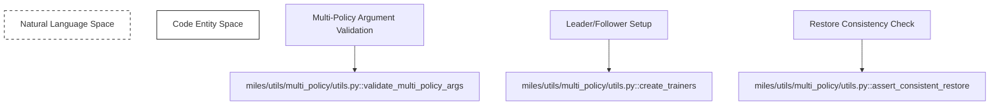
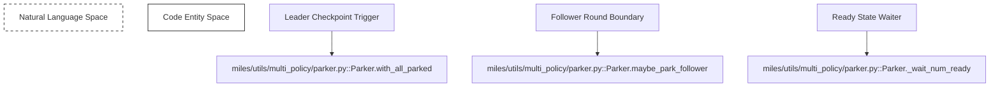

<!-- source: DeepWiki mcp.deepwiki.com · repo radixark/miles · page 8.10 Multi-Policy Training · fetched 2026-10-21 -->

# Multi-Policy Training

<details>
<summary>Relevant source files</summary>

The following files were used as context for generating this wiki page:

- [docs/examples/multi-policy.md](docs/examples/multi-policy.md)
- [examples/multi_policy/README.md](examples/multi_policy/README.md)
- [miles/utils/multi_policy/checkpoint_state.py](miles/utils/multi_policy/checkpoint_state.py)
- [miles/utils/multi_policy/parker.py](miles/utils/multi_policy/parker.py)
- [miles/utils/multi_policy/utils.py](miles/utils/multi_policy/utils.py)
- [tests/e2e/conftest_multi_policy.py](tests/e2e/conftest_multi_policy.py)
- [tests/e2e/deploy/conftest_deploy/split/scenario_split_multi_policy.py](tests/e2e/deploy/conftest_deploy/split/scenario_split_multi_policy.py)
- [tests/e2e/deploy/test_split_multi_policy.py](tests/e2e/deploy/test_split_multi_policy.py)
- [tests/e2e/long/test_multi_policy_solver_verifier_gsm8k.py](tests/e2e/long/test_multi_policy_solver_verifier_gsm8k.py)
- [tests/fast/e2e/deploy/split/test_scenario_split_multi_policy.py](tests/fast/e2e/deploy/split/test_scenario_split_multi_policy.py)
- [tests/fast/e2e/test_multi_policy_arg_verification.py](tests/fast/e2e/test_multi_policy_arg_verification.py)
- [tests/fast/e2e/test_multi_policy_eval_gate.py](tests/fast/e2e/test_multi_policy_eval_gate.py)
- [tests/fast/fixtures/args_fixtures.py](tests/fast/fixtures/args_fixtures.py)
- [tests/fast/utils/multi_policy/test_checkpoint_state.py](tests/fast/utils/multi_policy/test_checkpoint_state.py)
- [tests/fast/utils/multi_policy/test_parker.py](tests/fast/utils/multi_policy/test_parker.py)
- [tests/fast/utils/multi_policy/test_utils.py](tests/fast/utils/multi_policy/test_utils.py)

</details>


Multi-Policy Training in Miles enables the simultaneous joint training of multiple interacting models (such as solver-verifier pairs or co-evolving agents) within a unified asynchronous reinforcement learning loop. This leaf page documents the implementation of multi-policy coordination, argument validation, synchronization primitives (`Parker`), multi-policy checkpoint state management, and practical validation recipes.

---

## 1. Architectural Overview & Validation (`train_multi_policy.py`)

Multi-policy training coordinates separate trainer pools, each maintaining its own policy model, while sharing a unified rollout generation and inference stack via SGLang. At startup, `validate_multi_policy_args` enforces strict configuration invariants to ensure that multi-policy topologies match the SGLang server layout and avoid unsupported features like critic-sharing or local retry loops.

The initialization phase instantiates separate trainer handles and training models for each registered model ID via `create_trainers`.


*Figure 1: Multi-Policy Validation and Initialization Flow bridging conceptual setup to code functions.*

Sources: `[miles/utils/multi_policy/utils.py:1-136]`, `[tests/fast/utils/multi_policy/test_utils.py:1-148]()`

---

## 2. Leader/Follower Policy Coordination & Parker Synchronization

In multi-policy runs, policies operate asynchronously at their own iteration speeds, but they must periodically synchronize to write coordinated global checkpoints. Miles implements this via the `Parker` class (`miles/utils/multi_policy/parker.py`), which acts as an asynchronous barrier.

The leader policy (designated by `leader_model_id`) drives the global rollout loop, while follower policies execute steps asynchronously, invoking `maybe_park_follower()` at round boundaries. When a global checkpoint is triggered, the leader enters `with_all_parked()`, blocking until all followers reach their round boundaries and park.


*Figure 2: Parker Synchronization Mapping between conceptual follower coordination and Python synchronization methods.*

### Parker Synchronization Mechanics

| Method / Attribute | Role / Description |
| :--- | :--- |
| `Parker(num_followers=N)` | Initializes the synchronization barrier tracking $N$ follower policies. |
| `async with parker.with_all_parked()` | Context manager used by the leader to pause execution and await all followers. |
| `await parker.maybe_park_follower()` | Called at each follower round boundary to yield control and suspend if a checkpoint is pending. |
| `_wait_num_ready(target)` | Internal polling loop enforcing `PARK_TIMEOUT_SECONDS` (default: 3600s). |

Sources: `[miles/utils/multi_policy/parker.py:1-41]`, `[tests/fast/utils/multi_policy/test_parker.py:1-122]()`

---

## 3. Checkpoint State and Resumption

Multi-policy checkpoints record the exact rollout iteration and model states across all coordinated models. The `MultiPolicyCheckpointState` abstraction manages metadata persistence, ensuring that resuming a run restores every policy at a consistent global rollout index.

When restarting from disk, `assert_consistent_restore` verifies that the leader rollout ID matches the recorded state and that no individual policy has drifted from the global sequence.

```python
# Conceptual checkpoint validation flow during multi-policy restoration
state = MultiPolicyCheckpointState.load(Path(state_dir), leader_rollout_id=leader_rollout_id)
assert state.leader_model_id == leader_model_id
assert state.rollout_ids == restored_rollout_ids
```

Sources: `[miles/utils/multi_policy/utils.py:67-103]`, `[miles/utils/multi_policy/checkpoint_state.py]()`

---

## 4. Solver-Verifier Example (GSM8K)

A canonical multi-policy application is the **Solver-Verifier** setup on the GSM8K dataset (`examples/multi_policy/run_solver_verifier_gsm8k.py`). In this workflow:
* The **Solver** model generates multi-step reasoning solutions.
* The **Verifier** model scores or critiques the generated reasoning steps.
* Both models train jointly while exchanging rollouts via SGLang inference engines.

Integration tests validate that all ranks across both policies initialize with correct argument namespaces, report finite training metrics, and meet convergence bounds.

### Verification Assertions

* **Rank Identity Verification**: Ensures every GPU rank executes with its designated policy arguments (`assert_ranks_trained_with_policy_args`).
* **Log Probability Consistency**: Asserts that `train_rollout_logprob_abs_diff` remains within strict bounds ($\le 0.1$), confirming that the trainers and inference engines share identical weights.
* **Evaluation Performance Gates**: Checks that model accuracy improves against initial baseline bounds across training rollouts.

Sources: `[tests/e2e/conftest_multi_policy.py:1-144]`, `[tests/e2e/long/test_multi_policy_solver_verifier_gsm8k.py:1-36]`, `[tests/fast/e2e/test_multi_policy_arg_verification.py:1-133]()`

---

