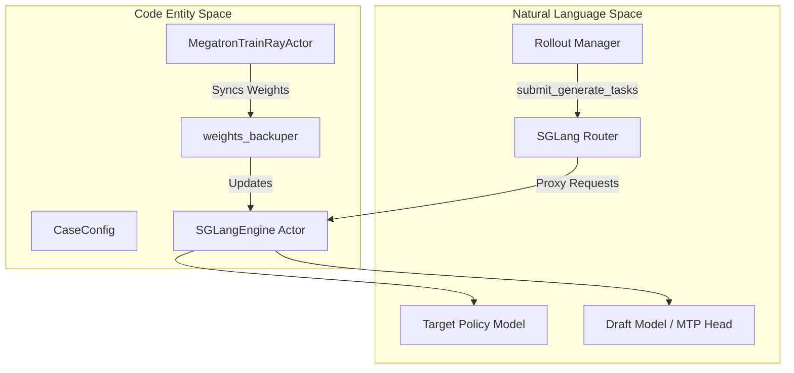
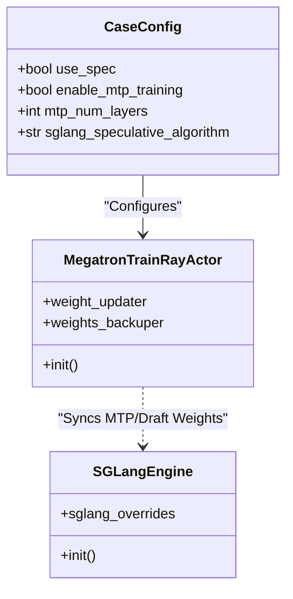

<!-- source: DeepWiki mcp.deepwiki.com · repo radixark/miles · page 8.2 Speculative Training · fetched 2026-10-21 -->

# Speculative Training

<details>
<summary>Relevant source files</summary>

The following files were used as context for generating this wiki page:

- [tests/e2e/megatron/test_glm47_flash/_common.py](tests/e2e/megatron/test_glm47_flash/_common.py)
- [tests/e2e/megatron/test_qwen3_30B_A3B/_common.py](tests/e2e/megatron/test_qwen3_30B_A3B/_common.py)
- [tests/e2e/megatron/test_qwen3_30B_A3B/test_deepep_fp8.py](tests/e2e/megatron/test_qwen3_30B_A3B/test_deepep_fp8.py)
- [tests/e2e/megatron/test_qwen3_30B_A3B/test_deepep_fp8_bridge.py](tests/e2e/megatron/test_qwen3_30B_A3B/test_deepep_fp8_bridge.py)
- [tests/e2e/megatron/test_qwen3_30B_A3B/test_disagg_broadcast.py](tests/e2e/megatron/test_qwen3_30B_A3B/test_disagg_broadcast.py)
- [tests/e2e/megatron/test_qwen3_30B_A3B/test_int4_rollout.py](tests/e2e/megatron/test_qwen3_30B_A3B/test_int4_rollout.py)
- [tests/e2e/megatron/test_qwen3_30B_A3B/test_r3_baseline.py](tests/e2e/megatron/test_qwen3_30B_A3B/test_r3_baseline.py)
- [tests/e2e/megatron/test_qwen3_30B_A3B/test_r3_deepep_fp8.py](tests/e2e/megatron/test_qwen3_30B_A3B/test_r3_deepep_fp8.py)
- [tests/e2e/megatron/test_qwen3_5_35B_A3B/_common.py](tests/e2e/megatron/test_qwen3_5_35B_A3B/_common.py)

</details>


## Purpose and Scope

This page documents Miles' speculative training feature, which accelerates rollout generation during RL training by 25%+ using online-updated draft models or Multi-Token Prediction (MTP) heads for speculative decoding. Unlike traditional speculative decoding with frozen draft models, Miles supports mechanisms to synchronize and update draft models alongside the target policy to prevent policy drift.

Sources: [tests/e2e/megatron/test_glm47_flash/_common.py:38-40](), [tests/e2e/megatron/test_qwen3_5_35B_A3B/_common.py:1-17]()

---

## Overview: Speculative Decoding in RL Context

Speculative decoding utilizes a smaller draft model or MTP head to generate candidate tokens that are verified in parallel by the target policy model. In reinforcement learning, policy drift occurs as the target policy updates via gradient steps. Miles addresses this by enabling simultaneous MTP training (`--enable-mtp-training`) and periodic weight synchronization to rollout engines (`use_spec = True`).

Sources: [tests/e2e/megatron/test_glm47_flash/_common.py:38-41](), [tests/e2e/megatron/test_qwen3_5_35B_A3B/_common.py:38-41]()

---

## System Architecture

### Rollout Generation with Speculation

The rollout system coordinates `SGLangEngine` actor instances configured with speculative decoding algorithms and draft schedulers. 

Title: Rollout Generation and Speculation Architecture

Sources: [tests/e2e/megatron/test_glm47_flash/_common.py:38-41](), [tests/e2e/megatron/test_qwen3_5_35B_A3B/_common.py:38-44]()

### Code Entity Mapping

Title: Speculative Training Code Entity Mapping

Sources: [tests/e2e/megatron/test_glm47_flash/_common.py:38-41](), [tests/e2e/megatron/test_qwen3_5_35B_A3B/_common.py:38-44]()

---

## Configuration and Arguments

Miles exposes speculative decoding flags through configuration classes such as `CaseConfig` and command-line arguments.

| Argument / Field | Description | Example Value |
|------------------|-------------|---------------|
| `use_spec` | Enables speculative decoding / EAGLE in rollout | `True` |
| `enable_mtp_training` | Enables training of MTP prediction heads | `True` |
| `--sglang-speculative-algorithm` | Algorithm for speculation (e.g., EAGLE) | `EAGLE` |
| `--mtp-num-layers` | Number of MTP layers built by the trainer | `1` |

Example configuration snippet from `CaseConfig`:
```python
@dataclass
class CaseConfig:
    use_spec: bool = True
    enable_mtp_training: bool = True
    mtp_num_layers: int = 1
    use_r3: bool = True
```
Sources: [tests/e2e/megatron/test_glm47_flash/_common.py:38-41](), [tests/e2e/megatron/test_qwen3_5_35B_A3B/_common.py:38-44]()

---

## Implementation Details

### MTP (Multi-Token Prediction) Training
For models like GLM-4.7-Flash and Qwen3.5-35B-A3B, Miles trains additional prediction heads alongside the main policy when `--enable-mtp-training` is active. 
- **Draft Synchronization**: When `use_spec` is enabled, the draft weights (including MTP layers) are synchronized from `MegatronTrainRayActor` to the rollout engines.
- **Selector Control**: The weight update check can target the main model alone (`check_weight_update_selector = "target"`) or include draft weights (`"all"`).

### Weight Synchronization
As `MegatronTrainRayActor` updates parameters during training, updated weights are synchronized to rollout worker engines via backup and broadcast mechanisms:
1. **Backup**: `weights_backuper` captures the current parameter state.
2. **Transfer**: Weights are pushed to rollout engines to maintain policy alignment during speculative generation.

Sources: [tests/e2e/megatron/test_glm47_flash/_common.py:38-41](), [tests/e2e/megatron/test_qwen3_5_35B_A3B/_common.py:38-47]()

---

## Performance, Monitoring, and Troubleshooting

### Performance Expectations
Speculative training targets a 25%+ speedup in rollout generation by reducing full target forward pass frequencies.

### Troubleshooting Acceptance Rate Drops
1. **MTP Training State**: Verify that `--enable-mtp-training` matches `use_spec` configuration to ensure draft weights evolve with the target policy.
2. **Weight Update Intervals**: Confirm that weight synchronization runs at expected iteration frequencies.

Sources: [tests/e2e/megatron/test_glm47_flash/_common.py:38-41](), [tests/e2e/megatron/test_qwen3_5_35B_A3B/_common.py:38-44]()

---

