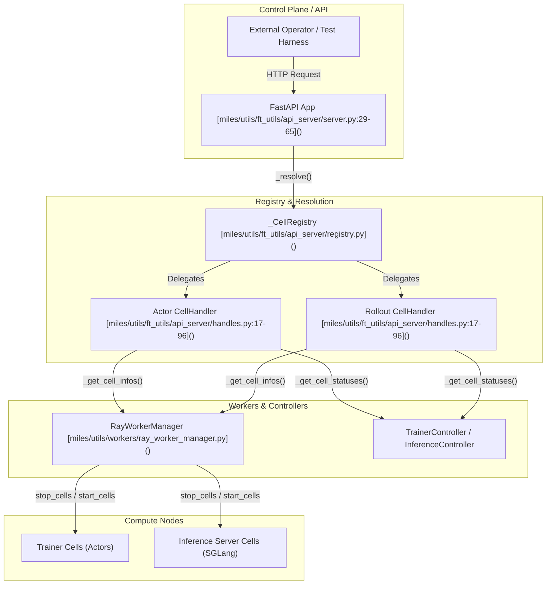
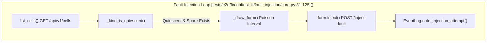

<!-- source: DeepWiki mcp.deepwiki.com · repo radixark/miles · page 8.3 Fault Tolerance · fetched 2026-10-21 -->

# Fault Tolerance

Relevant source files

The following files were used as context for generating this wiki page:

- [miles/utils/ft_utils/api_server/handles.py](miles/utils/ft_utils/api_server/handles.py)
- [miles/utils/ft_utils/api_server/server.py](miles/utils/ft_utils/api_server/server.py)
- [tests/e2e/deploy/conftest_deploy/hot_restart/assert_process.py](tests/e2e/deploy/conftest_deploy/hot_restart/assert_process.py)
- [tests/e2e/deploy/conftest_deploy/hot_restart/assert_redone_from_checkpoint.py](tests/e2e/deploy/conftest_deploy/hot_restart/assert_redone_from_checkpoint.py)
- [tests/e2e/deploy/conftest_deploy/hot_restart/assert_workloads.py](tests/e2e/deploy/conftest_deploy/hot_restart/assert_workloads.py)
- [tests/e2e/deploy/conftest_deploy/hot_restart/scenario_hot_restart_deterministic.py](tests/e2e/deploy/conftest_deploy/hot_restart/scenario_hot_restart_deterministic.py)
- [tests/e2e/deploy/test_hot_restart_checkpointed.py](tests/e2e/deploy/test_hot_restart_checkpointed.py)
- [tests/e2e/deploy/test_hot_restart_no_checkpoint.py](tests/e2e/deploy/test_hot_restart_no_checkpoint.py)
- [tests/e2e/ft/README.md](tests/e2e/ft/README.md)
- [tests/e2e/ft/conftest_ft/fault_injection/core.py](tests/e2e/ft/conftest_ft/fault_injection/core.py)
- [tests/e2e/ft/conftest_ft/fault_injection/entrypoint.py](tests/e2e/ft/conftest_ft/fault_injection/entrypoint.py)
- [tests/e2e/ft/conftest_ft/fault_injection/views.py](tests/e2e/ft/conftest_ft/fault_injection/views.py)
- [tests/e2e/ft/conftest_ft/scenario_random_crash.py](tests/e2e/ft/conftest_ft/scenario_random_crash.py)
- [tests/e2e/ft/conftest_ft/scenario_realistic_gsm8k.py](tests/e2e/ft/conftest_ft/scenario_realistic_gsm8k.py)
- [tests/e2e/ft/test_random_crash__kill_train_rollout__dp2_cp2.py](tests/e2e/ft/test_random_crash__kill_train_rollout__dp2_cp2.py)
- [tests/e2e/ft/test_random_crash_fully_async__kill_train_rollout__dp2_cp2.py](tests/e2e/ft/test_random_crash_fully_async__kill_train_rollout__dp2_cp2.py)
- [tests/fast/e2e/deploy/hot_restart/restart_facts.py](tests/fast/e2e/deploy/hot_restart/restart_facts.py)
- [tests/fast/e2e/deploy/hot_restart/test_assert_process.py](tests/fast/e2e/deploy/hot_restart/test_assert_process.py)
- [tests/fast/e2e/deploy/hot_restart/test_assert_redone_from_checkpoint.py](tests/fast/e2e/deploy/hot_restart/test_assert_redone_from_checkpoint.py)
- [tests/fast/e2e/deploy/hot_restart/test_assert_workloads.py](tests/fast/e2e/deploy/hot_restart/test_assert_workloads.py)
- [tests/fast/e2e/deploy/hot_restart/test_scenario_hot_restart.py](tests/fast/e2e/deploy/hot_restart/test_scenario_hot_restart.py)
- [tests/fast/e2e/deploy/hot_restart/test_scenario_hot_restart_no_checkpoint.py](tests/fast/e2e/deploy/hot_restart/test_scenario_hot_restart_no_checkpoint.py)
- [tests/fast/e2e/ft/fault_injection/test_core.py](tests/fast/e2e/ft/fault_injection/test_core.py)
- [tests/fast/e2e/ft/fault_injection/test_entrypoint.py](tests/fast/e2e/ft/fault_injection/test_entrypoint.py)
- [tests/fast/e2e/ft/fault_injection/test_views.py](tests/fast/e2e/ft/fault_injection/test_views.py)
- [tests/fast/e2e/ft/fault_injection/utils.py](tests/fast/e2e/ft/fault_injection/utils.py)
- [tests/fast/e2e/ft/test_rollout_gated_recovery.py](tests/fast/e2e/ft/test_rollout_gated_recovery.py)
- [tests/fast/e2e/ft/test_scenario_config_identity.py](tests/fast/e2e/ft/test_scenario_config_identity.py)
- [tests/fast/e2e/ft/test_scenario_random_crash.py](tests/fast/e2e/ft/test_scenario_random_crash.py)
- [tests/fast/ray/rollout/test_rollout_cell_status.py](tests/fast/ray/rollout/test_rollout_cell_status.py)
- [tests/fast/ray/train/test_group_reconcile.py](tests/fast/ray/train/test_group_reconcile.py)
- [tests/fast/utils/api_server/conftest.py](tests/fast/utils/api_server/conftest.py)
- [tests/fast/utils/api_server/test_handles.py](tests/fast/utils/api_server/test_handles.py)
- [tests/fast/utils/api_server/test_server.py](tests/fast/utils/api_server/test_server.py)

## Purpose and Scope

This document describes Miles' fault tolerance (FT) and resilience system, which handles failures of both SGLang rollout engine cells and Megatron/FSDP training actor cells during long-running RL training. The system features a Kubernetes-style REST API server, automated health monitoring, deterministic state replication, cell restart/healing loops, hot restart recovery, and a test-driven fault injection framework.

**Related topics:**
- For training orchestration and group management, see [3.2 Training Orchestration]()
- For rollout generation and inference server lifecycle, see [3.3 Rollout Generation System]()
- For weight synchronization mechanisms upon engine recovery, see [6.2 Weight Synchronization]()

---

## System Overview

Miles treats both training actor groups and inference rollout engines as first-class **Cells** managed by Ray worker managers and health-monitoring controllers. The architecture decouples observation (via cell status handlers) from remediation (via API server patches and mini-controllers).

Title: "Miles Fault Tolerance Architecture Mapping"

**Key Components & Code Entities:**

| Component | Code Entity | Responsibility |
|-----------|-------------|----------------|
| **FT API Server** | `miles/utils/ft_utils/api_server/server.py` | FastAPI application exposing Kubernetes-compatible `/api/v1/cells` endpoints for status polling, suspension, resumption, and fault injection [miles/utils/ft_utils/api_server/server.py:29-148](). |
| **Cell Handler** | `_CellHandler` (`miles/utils/ft_utils/api_server/handles.py`) | Bridges Ray worker managers (which own process liveness/suspension) with controllers (which own phase and health conditions) [miles/utils/ft_utils/api_server/handles.py:17-96](). |
| **Worker Manager** | `RayWorkerManager` (`miles/utils/workers/ray_worker_manager.py`) | Ray actor managing process creation, termination (`stop_cells`, `start_cells`), and fault injection across compute pools. |
| **Server Cell** | `ServerCell` (`miles/ray/rollout/server_cell.py`) | Individual SGLang inference engine wrapper maintaining phase, conditions (`Allocated`, `Healthy`, `Serving`), and workers hash. |

Sources: [miles/utils/ft_utils/api_server/server.py:29-148](), [miles/utils/ft_utils/api_server/handles.py:17-96](), [miles/ray/rollout/server_cell.py:18-23]()

---

## FT API Server and Cell Handlers

Miles embeds a FastAPI-based **FT API Server** inside the orchestrator process to provide a standardized, Kubernetes-like CRD interface (`Cell`, `CellList`, `CellPatch`, `FaultInjection`) for monitoring and managing training and inference cells [miles/utils/ft_utils/api_server/server.py:29-148]().

### API Server Endpoints

| Method | Path | Request Body | Description |
|--------|------|--------------|-------------|
| `GET` | `/api/v1/health` | None | Returns liveness status `{"status": "ok"}` [miles/utils/ft_utils/api_server/server.py:98-101](). |
| `GET` | `/api/v1/cells` | None | Returns a `CellList` of all registered actor and rollout cells with current metadata, specs, and conditions [miles/utils/ft_utils/api_server/server.py:102-105](). |
| `GET` | `/api/v1/cells/{name}` | None | Returns a single `Cell` object or a Kubernetes-formatted `404 Not Found` JSON status [miles/utils/ft_utils/api_server/server.py:106-110](). |
| `PATCH` | `/api/v1/cells/{name}` | `CellPatch` | Suspends (`spec.suspend: true`) or resumes (`spec.suspend: false`) a cell by delegating to the underlying worker manager [miles/utils/ft_utils/api_server/server.py:111-127](). |
| `POST` | `/api/v1/cells/{name}/inject-fault` | `FaultInjection` | Injects synthetic faults (e.g., `SIGKILL`, `EXCEPTION`) into a specific rank/worker within a cell [miles/utils/ft_utils/api_server/server.py:129-147](). |

### `_CellHandler` Implementation

The `_CellHandler` class merges data from two distributed sources:
1. **Worker Manager**: Reports whether cell processes are alive (`alive: bool`), process liveness, and a `workers_hash` generation token [miles/utils/ft_utils/api_server/handles.py:85-86]().
2. **Controller**: Reports high-level execution phase (`Running`, `Suspended`, `Pending`) and fine-grained health conditions (`Allocated`, `Healthy`, `Serving`) [miles/utils/ft_utils/api_server/handles.py:78-83]().

Sources: [miles/utils/ft_utils/api_server/server.py:29-148](), [miles/utils/ft_utils/api_server/handles.py:17-96]()

---

## Health Monitoring and Cell Status

Cells report tripartite health status using `TriState` enums (`TRUE`, `FALSE`, `UNKNOWN`) across three condition types: `Allocated`, `Healthy`, and `Serving` [miles/ray/rollout/server_cell.py:24](), [miles/utils/ft_utils/api_server/models.py]().

### Condition Lifecycle in Server Cells

During rollout generation, each `ServerCell` transitions through specific internal states that map to cell statuses:
* **Uninitialized / Gated**: Reported as phase `Pending` with `Allocated=True` and no health check verdict yet [tests/fast/ray/rollout/test_rollout_cell_status.py:56-61]().
* **Initializing**: If boot exceeds timeout thresholds, reports `Healthy=False` [tests/fast/ray/rollout/test_rollout_cell_status.py:70-78]().
* **Serving**: Answers `/health_generate` probes. If a probe fails, `Healthy` flips to `TriState.FALSE`, signaling the mini FT controller to initiate healing [tests/fast/ray/rollout/test_rollout_cell_status.py:103-112]().
* **Disposed**: Reported as phase `Suspended` with `Allocated=False` [tests/fast/ray/rollout/test_rollout_cell_status.py:130-136]().

Sources: [tests/fast/ray/rollout/test_rollout_cell_status.py:56-136](), [miles/ray/rollout/server_cell.py:18-23]()

---

## Cell Restart, Healing, and Hot Restart

The recovery infrastructure combines the mini-controller healing loop with **hot restart** capabilities (e.g., in `tests/e2e/deploy/conftest_deploy/hot_restart/`) to relaunch failed workloads from persistent checkpoints [tests/e2e/ft/conftest_ft/scenario_realistic_gsm8k.py:119-180](). When an orchestrator or worker process terminates unexpectedly, hot restart flags (`--hot-restart`) direct the backend to restore states from the latest checkpoint without re-running initialization.

Sources: [tests/e2e/ft/conftest_ft/scenario_realistic_gsm8k.py:119-180](), [tests/fast/e2e/ft/test_scenario_config_identity.py:112-124]()

---

## Fault Injection Framework and E2E Tests

Miles includes an E2E test suite under `tests/e2e/ft/` that tests resilience against random crashes (`scenario_random_crash`, `scenario_realistic_gsm8k`) [tests/e2e/ft/README.md:32-46](). 

Title: "Fault Injection and Quiescence Loop"

The fault injection engine uses Poisson-distributed intervals (`_compute_next_injection_time`) and quiescence validation (ensuring all replicas are healthy before injecting a new fault) to simulate realistic production disruptions [tests/e2e/ft/conftest_ft/fault_injection/core.py:27-100]().

Sources: [tests/e2e/ft/README.md:32-46](), [tests/e2e/ft/conftest_ft/fault_injection/core.py:27-125]()

---

## Distributed Process Recovery and Reloadable Groups

When actor cells or pipeline/tensor parallel groups crash and are restarted by Ray, PyTorch distributed process groups within training actors must be dynamically re-initialized without restarting the entire Ray job. Miles implements `ReloadableProcessGroup` to intercept `torch.distributed` operations and allow transparent recovery [miles/utils/reloadable_process_group.py:15-188]().

### Key Mechanisms
* **Monkey-Patching `torch.distributed`**: `monkey_patch_torch_dist()` intercepts collective primitives (`all_reduce`, `all_gather`, `broadcast`, etc.) to wrap process groups in `ReloadableProcessGroup` [miles/utils/reloadable_process_group.py:15-88]().
* **Destruction & Reloading**: When a cell crashes, `destroy_process_groups()` cleans up stale invalid handles [miles/utils/reloadable_process_group.py:131-146](). Upon cell restart, `reload_process_groups()` re-establishes communication channels across new worker ranks [miles/utils/reloadable_process_group.py:148-158]().

Sources: [miles/utils/reloadable_process_group.py:15-188]()

---

## Limitations and Best Practices

1. **External Engines**: Fault tolerance is **not supported** for external SGLang rollout engines (`--rollout-external`) because Miles does not govern their process lifecycle [miles/backends/sglang_utils/sglang_engine.py:184-185]().
2. **Colocation Mode**: In `--colocate` mode, training and inference share GPU hardware. Health checks are paused during training steps to prevent interference with critical tensor computations [miles/ray/rollout.py:79-86]().
3. **Compilation Grace Periods**: For large MoE models (e.g., DeepSeek-V3), configure `--rollout-health-check-first-wait 600` to allow sufficient time for JIT kernel compilation before health checks commence.

Sources: [miles/utils/arguments.py:436-461](), [miles/ray/rollout.py:79-86](), [miles/backends/sglang_utils/sglang_engine.py:184-185]()

---

