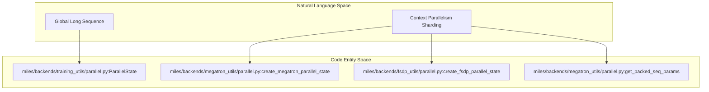
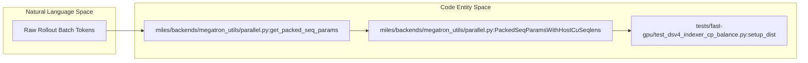

<!-- source: DeepWiki mcp.deepwiki.com · repo radixark/miles · page 8.5 Context Parallelism · fetched 2026-10-21 -->

# Context Parallelism

Relevant source files

The following files were used as context for generating this wiki page:

- [miles/backends/fsdp_utils/parallel.py](miles/backends/fsdp_utils/parallel.py)
- [miles/backends/megatron_utils/ci_utils.py](miles/backends/megatron_utils/ci_utils.py)
- [miles/backends/megatron_utils/initialize.py](miles/backends/megatron_utils/initialize.py)
- [miles/backends/megatron_utils/parallel.py](miles/backends/megatron_utils/parallel.py)
- [miles/backends/training_utils/parallel.py](miles/backends/training_utils/parallel.py)
- [tests/e2e/ckpt/test_qwen3_5_0.8B_ckpt.py](tests/e2e/ckpt/test_qwen3_5_0.8B_ckpt.py)
- [tests/e2e/fsdp/test_qwen3_0.6B_fsdp_disk_delta.py](tests/e2e/fsdp/test_qwen3_0.6B_fsdp_disk_delta.py)
- [tests/e2e/megatron/model_scripts/test_deepseek_v4_flash_4layer_cp2_ci.py](tests/e2e/megatron/model_scripts/test_deepseek_v4_flash_4layer_cp2_ci.py)
- [tests/e2e/megatron/model_scripts/test_deepseek_v4_flash_4layer_megatron_impl_ci.py](tests/e2e/megatron/model_scripts/test_deepseek_v4_flash_4layer_megatron_impl_ci.py)
- [tests/e2e/megatron/model_scripts/test_kimi_k3_4layer_ci.py](tests/e2e/megatron/model_scripts/test_kimi_k3_4layer_ci.py)
- [tests/e2e/megatron/model_scripts/test_qwen3_8_next_4layer_ci.py](tests/e2e/megatron/model_scripts/test_qwen3_8_next_4layer_ci.py)
- [tests/e2e/megatron/test_glm47_flash/test_spec_mtptrain_r3_bf16_sgl_tp4_meg_tp2pp2.py](tests/e2e/megatron/test_glm47_flash/test_spec_mtptrain_r3_bf16_sgl_tp4_meg_tp2pp2.py)
- [tests/e2e/megatron/test_qwen3_30B_A3B/test_nospec_nor3_bf16_sgl_tp4_meg_tp2cp2.py](tests/e2e/megatron/test_qwen3_30B_A3B/test_nospec_nor3_bf16_sgl_tp4_meg_tp2cp2.py)
- [tests/e2e/megatron/test_qwen3_5_35B_A3B/test_nospec_nor3_bf16_sgl_dpattn2x2_meg_tp2pp2.py](tests/e2e/megatron/test_qwen3_5_35B_A3B/test_nospec_nor3_bf16_sgl_dpattn2x2_meg_tp2pp2.py)
- [tests/e2e/megatron/test_qwen3_5_35B_A3B/test_nospec_r3_bf16_sgl_dpattn1x4_meg_tp1cp1_fullyasync.py](tests/e2e/megatron/test_qwen3_5_35B_A3B/test_nospec_r3_bf16_sgl_dpattn1x4_meg_tp1cp1_fullyasync.py)
- [tests/e2e/megatron/test_qwen3_5_35B_A3B/test_spec_nor3_fp8_sgl_tp4_meg_tp2cp2.py](tests/e2e/megatron/test_qwen3_5_35B_A3B/test_spec_nor3_fp8_sgl_tp4_meg_tp2cp2.py)
- [tests/fast-gpu/_fsdp_hybrid_shard_worker.py](tests/fast-gpu/_fsdp_hybrid_shard_worker.py)
- [tests/fast-gpu/test_dsv4_indexer_cp_balance.py](tests/fast-gpu/test_dsv4_indexer_cp_balance.py)
- [tests/fast-gpu/test_torch_native_offload.py](tests/fast-gpu/test_torch_native_offload.py)
- [tests/fast/backends/megatron_utils/test_initialize.py](tests/fast/backends/megatron_utils/test_initialize.py)

## Purpose and Scope

This page documents the Context Parallelism (CP) implementation in Miles, which enables training on sequences longer than a single GPU's memory capacity by sharding sequence chunks across multiple GPUs. CP is supported in both the FSDP and Megatron backends, utilizing a 2D or 4D device mesh architecture to combine CP with other parallelism dimensions.

Context Parallelism is critical for long-context reinforcement learning (RL) tasks, such as complex reasoning or multi-turn dialogues, where trajectories can exceed 32K+ tokens.

Sources: `[miles/backends/training_utils/parallel.py:32-51]()`, `[miles/backends/fsdp_utils/parallel.py:14-43]()`

## Overview

Context Parallelism addresses the memory bottleneck of the $O(n^2)$ attention mechanism by distributing a single sequence's attention computation across multiple GPUs. Miles implements multiple CP strategies depending on the backend and model architecture:

- **Ring Attention**: Distributed attention computation where KV cache data is shared in a ring topology.
- **Zigzag Ring Attention**: A specialized layout that optimizes for causal masks by splitting sequences into sub-chunks.
- **State-Passing CP**: Used for linear attention models to pass hidden states across ranks.

Key characteristics:
- Operates at the sequence level by splitting individual sequences.
- Requires sequence length configuration or padding managed during rollout data formatting.
- Corrects loss and metric calculations to account for distributed samples across parallel ranks.

**Diagram 1: Conceptual Architecture to Code Mapping**

Sources: `[miles/backends/training_utils/parallel.py:32-51]()`, `[miles/backends/megatron_utils/parallel.py:19-78]()`, `[miles/backends/fsdp_utils/parallel.py:46-56]()`, `[miles/backends/megatron_utils/parallel.py:111-124]()`

## Device Mesh and Parallel State

Miles manages parallel groups through the `ParallelState` dataclass `[miles/backends/training_utils/parallel.py:32-51]()`. For the Megatron backend, this state is created via `create_megatron_parallel_state()`, which interfaces with Megatron-LM's `mpu` `[miles/backends/megatron_utils/parallel.py:19-78]()`. For FSDP, `create_fsdp_parallel_state` sets up the device meshes `[miles/backends/fsdp_utils/parallel.py:46-99]()`.

### Rank Layout and Groups

The system distinguishes between several parallel groups to handle CP correctly:
- `intra_dp`: Standard data parallel group `[miles/backends/training_utils/parallel.py:38]()`.
- `intra_dp_cp`: Data parallel group that accounts for context parallelism `[miles/backends/training_utils/parallel.py:39]()`.
- `cp`: The specific process group for context parallelism communication `[miles/backends/training_utils/parallel.py:40]()`.

### Group Initialization Table

| Group | Purpose | Code Entity |
|-------|---------|-------------|
| **CP Group** | Handles ring attention or state passing communication. | `ParallelState.cp` `[miles/backends/training_utils/parallel.py:40]()` |
| **DP Group** | Handles gradient synchronization across non-CP ranks. | `ParallelState.intra_dp` `[miles/backends/training_utils/parallel.py:38]()` |
| **Intra-DP-CP** | Global group for metric reduction across all DP/CP ranks. | `ParallelState.intra_dp_cp` `[miles/backends/training_utils/parallel.py:39]()` |

Sources: `[miles/backends/training_utils/parallel.py:32-51]()`, `[miles/backends/megatron_utils/parallel.py:19-78]()`, `[miles/backends/fsdp_utils/parallel.py:46-99]()`

## Data Loading and CP Slicing

When CP is enabled, data preparation routines slice global sequences into rank-local chunks.

### Slicing Strategies

Miles supports primary layout formats for CP:

1. **THD (Total Length, Heads, Dim)**: Used for packed sequences via `get_packed_seq_params` `[miles/backends/megatron_utils/parallel.py:111-124]()`.
   - **Zigzag / Packed Slicing**: Default for Megatron Ring Attention, managing cumulative sequence lengths (`cu_seqlens`) on both host and device.
2. **BSHD (Batch, Seq, Heads, Dim)**: Used for padded sequences where padding and max sequence lengths are adjusted.

**Diagram 2: Slicing Pipeline to Code Entity Mapping**

Sources: `[miles/backends/megatron_utils/parallel.py:104-124]()`, `[tests/fast-gpu/test_dsv4_indexer_cp_balance.py:48-54]()`

## RL Loss Computation with CP

Computing RL losses requires aligning model logits with rollout tokens and log probabilities under context parallelism constraints. Specialized communication protocols (such as row exchanges in DeepSeek-V4 context-parallel indexers) ensure load balancing across ranks without breaking sequence semantics `[tests/fast-gpu/test_dsv4_indexer_cp_balance.py:1-15]()`.

### Response Alignment

CP layers split sequence dimension tensors across the `cp` process group, requiring attention mechanisms to coordinate token exchanges or all-gather operations.

### Correcting Sample Means

Standard mean operations fail when a sample is split across ranks. CP-aware loss functions collect partial reductions over the `cp` group to compute exact global sample means and token counts.

Sources: `[tests/fast-gpu/test_dsv4_indexer_cp_balance.py:1-117]()`

## Hybrid CP for Linear Attention

For models using linear attention or specialized recurrent layers, standard Ring Attention is augmented or replaced by hybrid mechanisms.

### State-Passing Mechanism

- **Layout Conversion**: Integration with external linear attention kernels and parallel state groups.
- **Communication**: Inter-rank state exchanges are coordinated via process groups configured in `ParallelState` `[miles/backends/training_utils/parallel.py:32-51]()`.

Sources: `[miles/backends/training_utils/parallel.py:32-51]()`

## Metrics and Logging

Logging in CP mode requires gathering data across the `effective_dp_cp` group to ensure statistics are averaged correctly.

- **Gathering**: Collects metrics across ranks respecting the combined DP and CP topologies.
- **CP-Correct Averaging**: Token-level metrics are reduced across ranks using collective communication primitives defined in `ParallelState`.

Sources: `[miles/backends/training_utils/parallel.py:32-51]()`, `[miles/backends/megatron_utils/initialize.py:164-169]()`

---

