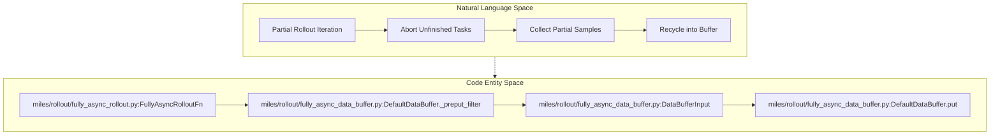
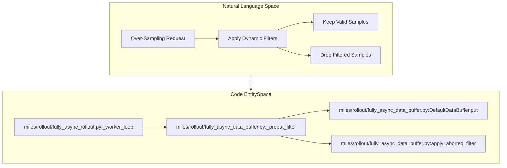

<!-- source: DeepWiki mcp.deepwiki.com · repo radixark/miles · page 8.6 Partial Rollout and Over-Sampling · fetched 2026-10-21 -->

# Partial Rollout and Over-Sampling

<details>
<summary>Relevant source files</summary>

The following files were used as context for generating this wiki page:

- [docs/developer/architecture.md](docs/developer/architecture.md)
- [docs/user-guide/fully-async.md](docs/user-guide/fully-async.md)
- [examples/infra_features/fully_async/external_eval_fn.py](examples/infra_features/fully_async/external_eval_fn.py)
- [miles/ray/rollout/rollout_executor.py](miles/ray/rollout/rollout_executor.py)
- [miles/rollout/base_types.py](miles/rollout/base_types.py)
- [miles/rollout/checkpoint_eval.py](miles/rollout/checkpoint_eval.py)
- [miles/rollout/filter_hub/common_filters.py](miles/rollout/filter_hub/common_filters.py)
- [miles/rollout/filter_hub/dynamic_sampling_filters.py](miles/rollout/filter_hub/dynamic_sampling_filters.py)
- [miles/rollout/fully_async_data_buffer.py](miles/rollout/fully_async_data_buffer.py)
- [miles/rollout/fully_async_rollout.py](miles/rollout/fully_async_rollout.py)
- [tests/fast/ray/rollout/real_ray/test_rollout_executor.py](tests/fast/ray/rollout/real_ray/test_rollout_executor.py)
- [tests/fast/ray/rollout/test_rollout_executor.py](tests/fast/ray/rollout/test_rollout_executor.py)
- [tests/fast/ray/rollout/test_rollout_executor_rpc_surface.py](tests/fast/ray/rollout/test_rollout_executor_rpc_surface.py)
- [tests/fast/ray/test_kubernetes_assembly.py](tests/fast/ray/test_kubernetes_assembly.py)
- [tests/fast/ray/train/test_trainer_controller_rpc_surface.py](tests/fast/ray/train/test_trainer_controller_rpc_surface.py)
- [tests/fast/rollout/inference_rollout/test_sample_completion_backfill.py](tests/fast/rollout/inference_rollout/test_sample_completion_backfill.py)
- [tests/fast/rollout/test_checkpoint_eval.py](tests/fast/rollout/test_checkpoint_eval.py)
- [tests/fast/rollout/test_filters.py](tests/fast/rollout/test_filters.py)
- [tests/fast/rollout/test_fully_async_rollout.py](tests/fast/rollout/test_fully_async_rollout.py)

</details>


This page documents Miles' mechanisms for maximizing GPU utilization and data quality during rollout generation. **Partial Rollout** recycles unfinished or aborted response trajectories across multiple rollout iterations, avoiding waste when responses are truncated or interrupted. **Over-Sampling** generates more prompts than needed to compensate for samples rejected by dynamic filters, ensuring the training batch is always full.

For information about the overall rollout generation system, see [docs/developer/architecture.md](). For dynamic filtering strategies, see `miles/rollout/filter_hub/` [tests/fast/rollout/test_filters.py:10-18]().

---

## Configuration Parameters

| Parameter | Type | Default | Description |
|-----------|------|---------|-------------|
| `--partial-rollout` | `bool` | `False` | Enable recycling of unfinished/aborted samples |
| `--mask-offpolicy-in-partial-rollout` | `bool` | `False` | Mask previously-generated tokens as off-policy |
| `--over-sampling-batch-size` | `int` | `rollout_batch_size` | Granularity of sampling operations for over-sampling |
| `--dynamic-sampling-filter-path` | `str` | `None` | Path to filter function (e.g., variance check) |

Sources: `miles/utils/arguments.py`

---

## Partial Rollout Mechanism

### How It Works

Standard rollout generation discards unfinished or aborted trajectories when a batch size limit is reached or generation times out. With partial rollout enabled (`--partial-rollout`), `abort()` collects unfinished or partial samples and pushes them back into the data buffer [miles/rollout/fully_async_rollout.py:76-80]().

Diagram mapping natural language concepts of partial rollout to code entities:


Sources: `miles/rollout/fully_async_rollout.py:56-100`, `miles/rollout/fully_async_data_buffer.py:106-164`

### Sample States and Metadata Tagging

When a sample is collected as a partial rollout, it is tagged with its origin rollout ID so that downstream processing and loss masks can track its lineage:

```python
# From miles/rollout/fully_async_data_buffer.py:130-154
```

Sources: `miles/rollout/fully_async_data_buffer.py:130-154`

---

## Off-Policy Masking

When a sample is continued across rollout iterations, its tokens were generated under different policy weight versions. This introduces off-policy bias.

### The Solution: Loss Masking

Setting `--mask-offpolicy-in-partial-rollout` zeroes out the loss for tokens generated in previous iterations [tests/fast/rollout/test_fully_async_rollout.py:79-101]().

Sources: `tests/fast/rollout/test_fully_async_rollout.py:79-101`, `miles/rollout/fully_async_data_buffer.py:130-173`

---

## Over-Sampling and Dynamic Filtering

### Motivation

Dynamic filters (such as reward variance checks) reject low-quality sample groups. Without over-sampling, these rejections reduce the effective training batch size, degrading GPU utilization during optimizer steps.

### Over-Sampling Workflow

The asynchronous rollout loop requests batches and passes them through pre-put filters before adding them to the final training batch [miles/rollout/fully_async_rollout.py:144-155]().

Diagram mapping natural language over-sampling workflows to code implementation:


Sources: `miles/rollout/fully_async_rollout.py:144-155`, `miles/rollout/fully_async_data_buffer.py:155-173`

### Implementation Details in DefaultDataBuffer

In fully-async mode, `DefaultDataBuffer` manages pre-put filtering and capacity limits [miles/rollout/fully_async_data_buffer.py:130-164]().

Sources: `miles/rollout/fully_async_data_buffer.py:130-164`

---

## Performance Considerations

- **GPU Utilization**: By over-sampling (`--over-sampling-batch-size`), the training step maintains a full global batch size despite downstream filtering.
- **Memory Management**: Partial rollout buffers unfinished trajectories in `DefaultDataBuffer` (`miles/rollout/fully_async_data_buffer.py`), avoiding costly re-generation of long-context prompts at the expense of CPU memory overhead [miles/rollout/fully_async_data_buffer.py:130-164]().

Sources: `miles/rollout/fully_async_data_buffer.py:130-164`, `miles/rollout/fully_async_rollout.py:56-100`

---

