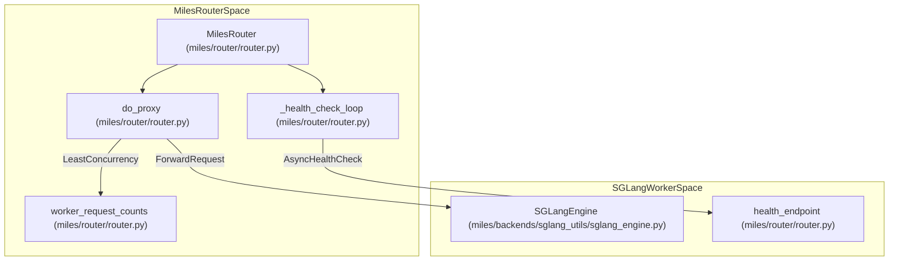
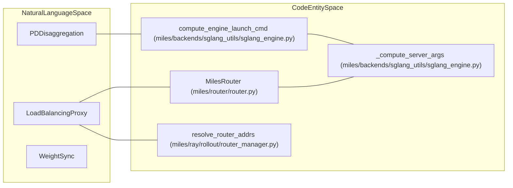

<!-- source: DeepWiki mcp.deepwiki.com · repo radixark/miles · page 8.7 PD Disaggregation and Miles Router · fetched 2026-10-21 -->

# PD Disaggregation and Miles Router

Relevant source files

The following files were used as context for generating this wiki page:

- [miles/backends/megatron_utils/lora/bridge.py](miles/backends/megatron_utils/lora/bridge.py)
- [miles/backends/megatron_utils/lora/utils.py](miles/backends/megatron_utils/lora/utils.py)
- [miles/backends/sglang_utils/sglang_engine.py](miles/backends/sglang_utils/sglang_engine.py)
- [miles/ray/rollout/router_manager.py](miles/ray/rollout/router_manager.py)
- [miles/router/router.py](miles/router/router.py)
- [miles/utils/http_utils.py](miles/utils/http_utils.py)
- [tests/fast/backends/megatron_utils/test_lora_utils.py](tests/fast/backends/megatron_utils/test_lora_utils.py)
- [tests/fast/backends/sglang_utils/conftest.py](tests/fast/backends/sglang_utils/conftest.py)
- [tests/fast/backends/sglang_utils/test_compute_server_args.py](tests/fast/backends/sglang_utils/test_compute_server_args.py)
- [tests/fast/backends/sglang_utils/test_server_args_utils.py](tests/fast/backends/sglang_utils/test_server_args_utils.py)
- [tests/fast/backends/sglang_utils/test_sglang_engine.py](tests/fast/backends/sglang_utils/test_sglang_engine.py)
- [tests/fast/ray/rollout/test_router_manager.py](tests/fast/ray/rollout/test_router_manager.py)
- [tests/fast/ray/test_import_cycles.py](tests/fast/ray/test_import_cycles.py)
- [tests/fast/router/test_router.py](tests/fast/router/test_router.py)
- [tests/fast/utils/external_utils/miles_workbench/preflight/test_checkers.py](tests/fast/utils/external_utils/miles_workbench/preflight/test_checkers.py)
- [tests/fast/utils/test_http_utils.py](tests/fast/utils/test_http_utils.py)

Miles leverages SGLang's prefill-decode (PD) disaggregation to optimize rollout throughput by separating the computationally heavy prefill stage from the memory-bandwidth-bound decode stage. To manage these complex distributed configurations, Miles provides the **Miles Router**, a high-performance proxy that handles load balancing, health monitoring, and weight synchronization across heterogeneous engine groups.

## Overview of PD Disaggregation

In large-scale RL training, rollouts often involve long contexts or large batches where KV cache management becomes a bottleneck. PD disaggregation allows Miles to allocate specific GPU resources to "prefill" engines (optimized for throughput and context processing) and "decode" engines (optimized for low-latency token generation) [miles/backends/sglang_utils/sglang_engine.py:129-138]().

### Configuration Structure and Worker Types
When configuring server groups, the `_compute_server_args` function handles distinct worker type requirements [miles/backends/sglang_utils/sglang_engine.py:78-94]():
1. **Prefill Workers**: Configured with `disaggregation_mode="prefill"`, a round-robin load balancing method, and a required `disaggregation_bootstrap_port` [miles/backends/sglang_utils/sglang_engine.py:129-135]().
2. **Decode Workers**: Configured with `disaggregation_mode="decode"` and `prefill_round_robin_balance=True` [miles/backends/sglang_utils/sglang_engine.py:136-138]().

### Data Flow in Disaggregated Mode
When a request is initiated, the Miles Router directs the prompt to a prefill engine. Once the initial KV cache is populated, the state is transferred to a decode engine for token generation. This separation ensures that slow decoding steps do not block the high-throughput prefill pipeline.

Sources: [miles/backends/sglang_utils/sglang_engine.py:37-138]()

## Miles Router Architecture

The `MilesRouter` is a FastAPI-based proxy defined in `miles/router/router.py` that sits in front of SGLang engine groups [miles/router/router.py:36-43](). It provides a unified entry point while abstracting the underlying physical worker pool.

### Key Components
- **HTTP Client**: Uses `httpx.AsyncClient` with configurable connection limits and timeouts to forward requests to SGLang workers [miles/router/router.py:52-56]().
- **Health Monitor**: A background loop (`_health_check_loop`) that periodically checks `/health` endpoints via `_check_worker_health` [miles/router/router.py:68-81](). Workers failing a threshold of checks are marked as dead and quarantined (`dead_workers`) [miles/router/router.py:104-108]().
- **Proxy Handlers**: Implements `proxy` and `do_proxy` methods to handle catch-all request forwarding and header cleanup [miles/router/router.py:126-160]().

### Miles Router Implementation Diagram
This diagram shows the relationship between the proxy logic and the SGLang backend.

**Sources:** [miles/router/router.py:36-160](), [miles/backends/sglang_utils/sglang_engine.py:37-138]()

Sources: [miles/router/router.py:36-160]()

## Router Manager and Readiness

Orchestration of routers and session servers is managed by `miles/ray/rollout/router_manager.py`. The `resolve_router_addrs` function waits for every model's router concurrently and records addresses on `args` [miles/ray/rollout/router_manager.py:25-56]().

### Readiness Checks
- `wait_router_ready`: Retrieves worker names via `compute_router_worker_name` and polls TCP readiness using `wait_tcp_ready_async` [miles/ray/rollout/router_manager.py:59-65](), [miles/utils/http_utils.py:72-86]().
- `wait_session_server_ready`: Manages standalone session servers when `--use-session-server` is enabled [miles/ray/rollout/router_manager.py:68-115]().

Sources: [miles/ray/rollout/router_manager.py:25-115](), [miles/utils/http_utils.py:72-86]()

## System Entity Mapping

The following diagram bridges the high-level PD Disaggregation and routing concepts to specific classes and functions in the Miles codebase.

**Sources:** [miles/router/router.py:36](), [miles/backends/sglang_utils/sglang_engine.py:37](), [miles/ray/rollout/router_manager.py:25]()

Sources: [miles/router/router.py:36](), [miles/backends/sglang_utils/sglang_engine.py:37](), [miles/ray/rollout/router_manager.py:25]()

---

