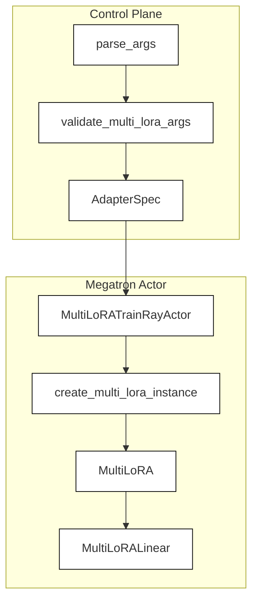
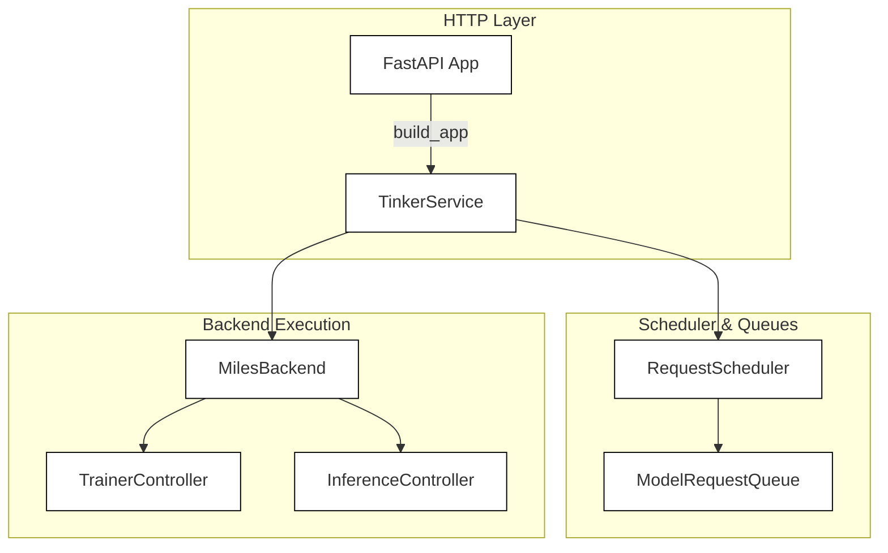

<!-- source: DeepWiki mcp.deepwiki.com · repo radixark/miles · page 8.8 Multi-LoRA and Tinker Serving · fetched 2026-10-21 -->

# Multi-LoRA and Tinker Serving

Relevant source files

The following files were used as context for generating this wiki page:

- [docs/models/deepseek/deepseek-v3-2.md](docs/models/deepseek/deepseek-v3-2.md)
- [miles/backends/megatron_utils/lora/bridge.py](miles/backends/megatron_utils/lora/bridge.py)
- [miles/backends/megatron_utils/lora/utils.py](miles/backends/megatron_utils/lora/utils.py)
- [miles/backends/sglang_utils/sglang_engine.py](miles/backends/sglang_utils/sglang_engine.py)
- [scripts/run_deepseek_v32.py](scripts/run_deepseek_v32.py)
- [tests/e2e/ft/test_trainer_no_failure__kill_train__dp2_cp2__moe_5layer.py](tests/e2e/ft/test_trainer_no_failure__kill_train__dp2_cp2__moe_5layer.py)
- [tests/e2e/ft/test_trainer_no_failure__kill_train__dp2_cp2_pp2__fake_rollout__moe_5layer.py](tests/e2e/ft/test_trainer_no_failure__kill_train__dp2_cp2_pp2__fake_rollout__moe_5layer.py)
- [tests/e2e/ft/test_trainer_no_failure__kill_train__dp2_cp2_tp2_ep2__fake_rollout__moe_5layer.py](tests/e2e/ft/test_trainer_no_failure__kill_train__dp2_cp2_tp2_ep2__fake_rollout__moe_5layer.py)
- [tests/e2e/ft/test_trainer_no_failure__kill_train__dp4_cp2__fake_rollout__moe_5layer.py](tests/e2e/ft/test_trainer_no_failure__kill_train__dp4_cp2__fake_rollout__moe_5layer.py)
- [tests/e2e/lora/test_tinker_cookbook_gateway.py](tests/e2e/lora/test_tinker_cookbook_gateway.py)
- [tests/e2e/lora/test_tinker_multi_tenant_gateway.py](tests/e2e/lora/test_tinker_multi_tenant_gateway.py)
- [tests/e2e/megatron/test_qwen3_4B_offload_disaggregated.py](tests/e2e/megatron/test_qwen3_4B_offload_disaggregated.py)
- [tests/e2e/short/test_dumper.py](tests/e2e/short/test_dumper.py)
- [tests/fast/backends/megatron_utils/test_lora_utils.py](tests/fast/backends/megatron_utils/test_lora_utils.py)
- [tests/fast/backends/sglang_utils/conftest.py](tests/fast/backends/sglang_utils/conftest.py)
- [tests/fast/backends/sglang_utils/test_compute_server_args.py](tests/fast/backends/sglang_utils/test_compute_server_args.py)
- [tests/fast/backends/sglang_utils/test_server_args_utils.py](tests/fast/backends/sglang_utils/test_server_args_utils.py)
- [tests/fast/backends/sglang_utils/test_sglang_engine.py](tests/fast/backends/sglang_utils/test_sglang_engine.py)
- [tests/fast/ray/test_import_cycles.py](tests/fast/ray/test_import_cycles.py)
- [tests/fast/utils/external_utils/miles_workbench/preflight/test_checkers.py](tests/fast/utils/external_utils/miles_workbench/preflight/test_checkers.py)

## Purpose and Scope

This document details the multi-tenant adapter training and serving architecture in Miles, covering the Multi-LoRA training subsystem (slots, per-tenant slot optimizers, adapter checkpointing) and the Tinker serving stack (core scheduler, model request queues, FastAPI server, and entrypoint `serve_tinker.py`). Multi-LoRA enables multiple isolated adapter slots to be trained concurrently on a shared frozen base model and served dynamically without merging weights into the base checkpoint.

Sources: `docs/advanced/lora.md:1-24` [], `serve_tinker.py:25-76` []

---

## 1. Multi-LoRA Training Architecture and Slot Mechanics

Multi-LoRA training in Miles allocates fixed adapter "slots" within the Megatron model graph. The frozen base model resides in GPU memory, while multiple named adapters maintain independent parameter states and optimizer buffers. 

### Slot Specification and Arguments

The Multi-LoRA configuration is managed via `miles/utils/multi_lora.py`, which defines the `AdapterSpec` dataclass and validation routines. Adapter slots require specific runtime constraints, such as disabling context parallelism (`--context-parallel-size 1`), pipeline parallelism (`--pipeline-model-parallel-size 1`), and distributed optimizers (`--use-distributed-optimizer False`), because gradient accumulation occurs across iterations within per-slot states [miles/utils/multi_lora.py:15-102]().

*Diagram 1: Bridging Multi-LoRA training argument validation (`validate_multi_lora_args`, `AdapterSpec`) to Megatron actor initialization (`MultiLoRATrainRayActor`, `create_multi_lora_instance`, `MultiLoRA`, `MultiLoRALinear`).*
Sources: `miles/utils/multi_lora.py:15-102` [], `miles/backends/megatron_utils/lora/slots.py:14-40` []

### Model Instrumentation and Slicing

Adapters are attached using Megatron Bridge PEFT modules via `create_multi_lora_instance()` [miles/backends/megatron_utils/lora/slots.py:14-40](). When exporting adapters or slicing ranks, `slice_lora_to_rank()` inspects tensor shapes to trim padding safely from the rank dimension without corrupting grouped-expert structures [miles/backends/megatron_utils/lora/slots.py:42-50]().

Sources: `miles/backends/megatron_utils/lora/slots.py:14-65` []

---

## 2. Per-Tenant Slot Optimizers

Each active tenant slot owns an isolated optimizer instance to prevent state leakage between tenants.

### SlotOptimizer Implementation

The `SlotOptimizer` class wraps a Megatron-Core `LayerWiseDistributedOptimizer` restricted entirely to a single slot's parameters [miles/backends/megatron_utils/lora/optimizer.py:102-133](). 

- **Parameter Isolation**: `adapter_slot_parameters()` scans all `MultiLoRALinear` modules across model chunks to collect parameters belonging exclusively to the target slot index [miles/backends/megatron_utils/lora/optimizer.py:43-58]().
- **Optimizer Semantics**: Only Adam-family optimizers are supported. `SlotOptimizer.apply_adam_params()` dynamically updates learning rates, betas, epsilon, and weight decay from incoming request payloads [miles/backends/megatron_utils/lora/optimizer.py:134-141]().
- **Gradient Clipping and Stepping**: `clip_and_step()` computes gradient norms across the slot parameters using BF16 native paths (bypassing dynamic loss scalers) and skips parameter updates if non-finite norms are detected [miles/backends/megatron_utils/lora/optimizer.py:142-157]().

Sources: `miles/backends/megatron_utils/lora/optimizer.py:26-157` []

---

## 3. Ray Actor Execution and Checkpointing

The training execution is distributed across Ray actors via `MultiLoRATrainRayActor`, which inherits from `MegatronTrainRayActor` [miles/backends/megatron_utils/lora/actor.py:17-18]().

### Actor Methods and State Management

- `forward_backward`: Executes a forward-backward pass for a specific rollout batch on the active slot [miles/backends/megatron_utils/lora/actor.py:31-37]().
- `optim_step`: Dispatches optimizer steps across `slot_optimizers` [miles/backends/megatron_utils/lora/actor.py:38-41]().
- `load_slot` / `unload_slot`: Dynamically instantiates or destroys adapter weights and slot optimizers on the fly [miles/backends/megatron_utils/lora/actor.py:54-60,66]().
- `export_slot`: Publishes adapter weights using `WeightPublisher` for consumption by SGLang rollout servers [miles/backends/megatron_utils/lora/actor.py:66]().

### Checkpoint Atomic Persistence

Adapter checkpoints are written collectively across distributed ranks using `write_checkpoint_dir()` in `miles/backends/training_utils/checkpoint_io.py`. This function creates temporary directories (`_tmp_<name>`), writes shard files collectively under a global barrier, and atomically replaces the destination path via symbolic linking and POSIX `os.replace` semantics [miles/backends/training_utils/checkpoint_io.py:17-61]().

Sources: `miles/backends/megatron_utils/lora/actor.py:17-76` [], `miles/backends/training_utils/checkpoint_io.py:17-61` []

---

## 4. Tinker Service Architecture

The Tinker service (`serve_tinker.py`) provides a multi-tenant HTTP gateway for dynamic model creation, forward-backward training steps, sampling, and weight saving/loading.

*Diagram 2: Bridging Tinker HTTP app (`FastAPI`, `TinkerService`) and scheduling entities (`RequestScheduler`, `ModelRequestQueue`) to execution backends (`MilesBackend`, `TrainerController`, `InferenceController`).*
Sources: `serve_tinker.py:25-76` [], `miles/tinker/core/service.py:43-91` []

### Core Components and Scheduler

- **`TinkerService`**: Manages model records, session heartbeats, free slot allocations (`self.free_slots`), and coordinates the central event loop [miles/tinker/core/service.py:43-91]().
- **`RequestScheduler`**: Selects ready request batches (`BatchUnit`) or barriers (`BarrierUnit`) based on token budgets and queue states [miles/tinker/core/scheduler.py:21-21]().
- **`ModelRequestQueue`**: Encapsulates queued operations for an individual tenant model instance [miles/tinker/core/model_queue.py:1-1]().

Sources: `serve_tinker.py:25-76` [], `miles/tinker/core/service.py:43-91` []

---

## 5. Request Decoding and Input Validation

Incoming SDK requests are parsed and validated against pinned schema definitions before entering the scheduling loop.

### Encoding and Validation Pipeline

- **`miles/tinker/server/encoding.py`**: Translates incoming JSON commands (`optim_step`, `save_state`, `load_state`, `forward_backward`) into internal data structures. Datums encode input tokens and target labels such that each step scores $\text{logprob}(t_i \mid x_{0\dots i})$ [miles/tinker/server/encoding.py:1-74]().
- **`miles/tinker/core/input_validation.py`**: Validates model configuration parameters against fixed server adapter layouts (`validate_model_config`) and checks batch payloads against vocabulary bounds and token budget constraints (`validate_batch_payload`) [miles/tinker/core/input_validation.py:14-89]().

Sources: `miles/tinker/server/encoding.py:1-90` [], `miles/tinker/core/input_validation.py:14-89` []

---

