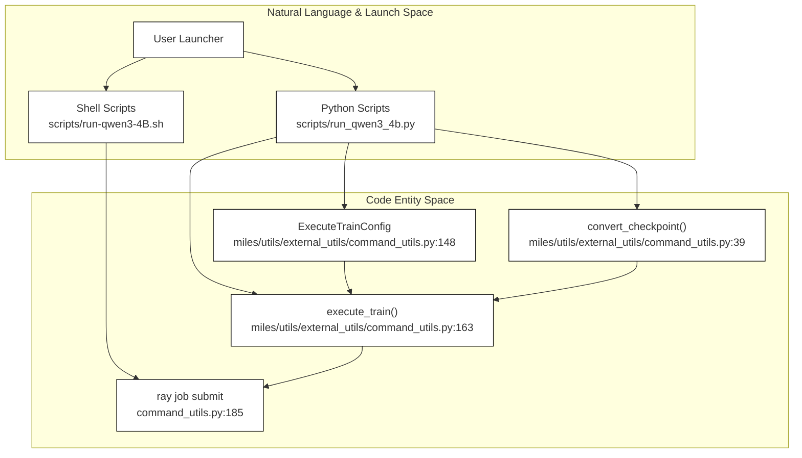

<!-- source: DeepWiki mcp.deepwiki.com · repo radixark/miles · page 9 Running Training Jobs · fetched 2026-10-21 -->

# Running Training Jobs

Relevant source files

The following files were used as context for generating this wiki page:

- [docs/developer/debug.md](docs/developer/debug.md)
- [docs/user-guide/argument-groups.md](docs/user-guide/argument-groups.md)
- [docs/user-guide/cli-reference.md](docs/user-guide/cli-reference.md)
- [docs/user-guide/concepts.md](docs/user-guide/concepts.md)
- [docs/user-guide/customization.md](docs/user-guide/customization.md)
- [docs/user-guide/index.md](docs/user-guide/index.md)
- [docs/user-guide/monitoring.md](docs/user-guide/monitoring.md)
- [miles/utils/test_utils/ft_test_actions.py](miles/utils/test_utils/ft_test_actions.py)
- [tests/fast/doc/test_debug_doc_ft_actions.py](tests/fast/doc/test_debug_doc_ft_actions.py)
- [tests/fast/ray/train/test_group_create.py](tests/fast/ray/train/test_group_create.py)
- [tests/fast/utils/test_utils/test_ft_test_actions.py](tests/fast/utils/test_utils/test_ft_test_actions.py)

This page serves as a high-level guide to launching training runs within Miles, providing an architectural overview of how training workflows, configurations, and scripts are organized. Miles supports both type-safe Python dataclass CLI wrappers and traditional shell scripts to orchestrate distributed Ray training jobs [scripts/run_qwen3_4b.py:14-39](), [miles/utils/external_utils/command_utils.py:148-188]().

For detailed technical guides and code walkthroughs, refer to the child pages covering each subsystem below.

Title: "Natural Language to Code Mapping for Job Launchers"

Sources: [scripts/run_qwen3_4b.py:14-39](), [miles/utils/external_utils/command_utils.py:39-49](), [miles/utils/external_utils/command_utils.py:148-188]()

---

## 9.1 Command-Line Interface

The command-line interface provides argument parsing and validation for launching training jobs. It relies heavily on Python dataclasses and Typer-based helpers to structure arguments into logical categories such as checkpoint paths, rollout parameters, optimizer settings, and hardware parallelism strategies [docs/user-guide/cli-reference.md:5-15]().

For details, see [Command-Line Interface](#9.1).

Sources: [docs/user-guide/cli-reference.md:5-15](), [scripts/run_qwen3_4b.py:14-39]()

---

## 9.2 Python Training Scripts

Miles provides concrete example launcher scripts for various model families—including Qwen, GLM, DeepSeek, Kimi, and Nemotron—via the `command_utils` framework. These scripts inherit from `ExecuteTrainConfig` [miles/utils/external_utils/command_utils.py:148-154]() and define model-specific preparation and execution hooks [scripts/run_qwen3_4b.py:64-90]().

For details, see [Python Training Scripts](#9.2).

Sources: [scripts/run_qwen3_4b.py:14-90](), [miles/utils/external_utils/command_utils.py:148-172]()

---

## 9.3 Shell Script Examples

For direct shell-based executions, bash scripts organize arguments into array variables (`CKPT_ARGS`, `ROLLOUT_ARGS`, `PERF_ARGS`, etc.) and handle process cleanups, environment variables (`PYTHONPATH`, `CUDA_DEVICE_MAX_CONNECTIONS`), and Ray cluster setup [docs/user-guide/cli-reference.md:124-135]().

For details, see [Shell Script Examples](#9.3).

Sources: [docs/user-guide/cli-reference.md:124-135](), [miles/utils/external_utils/command_utils.py:163-188]()

---

## 9.4 Parallelism Configuration

Configuring multi-dimensional parallelism (Tensor Parallelism, Pipeline Parallelism, Expert Parallelism, and Context Parallelism) varies across hardware platforms like NVIDIA H100 and Blackwell or AMD ROCm [docs/user-guide/argument-groups.md:105-120](). Proper tuning ensures memory headroom and throughput balance.

For details, see [Parallelism Configuration](#9.4).

Sources: [docs/user-guide/argument-groups.md:105-120]()

---

## 9.5 Multi-Node Training

Running distributed training across multiple nodes involves bootstrapping Ray workers over SSH, syncing model distributions, and coordinating Single Program Multiple Data (SPMD) training loops [miles/utils/external_utils/command_utils.py:87-115]().

For details, see [Multi-Node Training](#9.5).

Sources: [miles/utils/external_utils/command_utils.py:87-115]()

---

## 9.6 Checkpoint Management

Miles manages interoperability between HuggingFace formats and Megatron tensor-parallel checkpoints via utility scripts like `convert_hf_to_torch_dist.py` [miles/utils/external_utils/command_utils.py:39-84]() and precision casting helpers [miles/utils/external_utils/command_utils.py:133-145]().

For details, see [Checkpoint Management](#9.6).

Sources: [miles/utils/external_utils/command_utils.py:39-84](), [miles/utils/external_utils/command_utils.py:133-145]()

---

## 9.7 Kubernetes and Helm Deployment

Miles provides a complete Kubernetes cluster backend managed via Helm charts under `charts/` (`miles-run`, `miles-workbench`, `miles-common`). The `helm_backend` launcher builds configuration values, computes manifest differences, handles worker naming, and manages colocation pairing for containerized workloads.

For details, see [Kubernetes and Helm Deployment](#9.7).

Sources: [docs/user-guide/cli-reference.md:143-152]()

---

