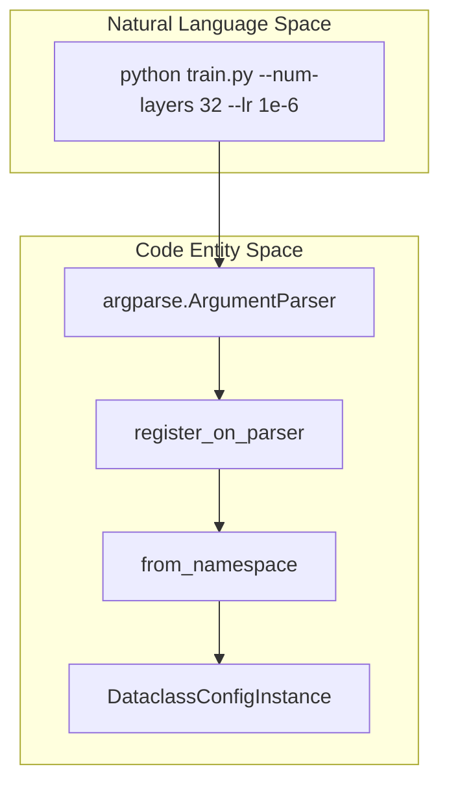
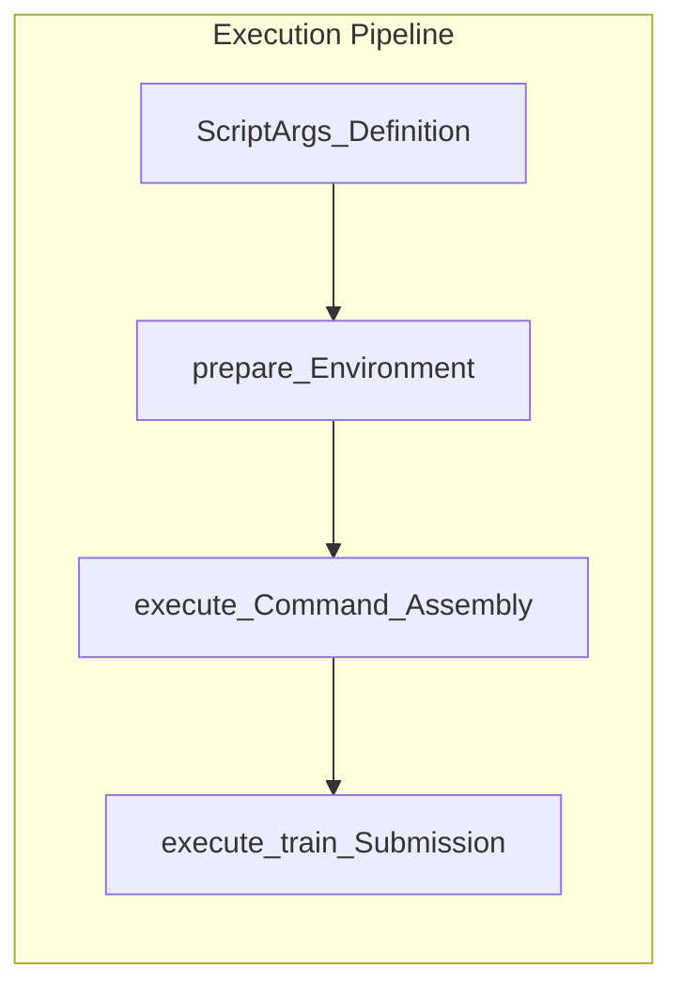

<!-- source: DeepWiki mcp.deepwiki.com · repo radixark/miles · page 9.1 Command-Line Interface · fetched 2026-10-21 -->

# Command-Line Interface

<details>
<summary>Relevant source files</summary>

The following files were used as context for generating this wiki page:

- [docs/developer/debug.md](docs/developer/debug.md)
- [docs/user-guide/argument-groups.md](docs/user-guide/argument-groups.md)
- [docs/user-guide/cli-reference.md](docs/user-guide/cli-reference.md)
- [docs/user-guide/concepts.md](docs/user-guide/concepts.md)
- [docs/user-guide/customization.md](docs/user-guide/customization.md)
- [docs/user-guide/index.md](docs/user-guide/index.md)
- [docs/user-guide/monitoring.md](docs/user-guide/monitoring.md)
- [miles/utils/argparse_utils.py](miles/utils/argparse_utils.py)
- [miles/utils/test_utils/ft_test_actions.py](miles/utils/test_utils/ft_test_actions.py)
- [miles/utils/typer_utils.py](miles/utils/typer_utils.py)
- [tests/e2e/megatron/model_scripts/test_glm5_3_flash_4layer_ci.py](tests/e2e/megatron/model_scripts/test_glm5_3_flash_4layer_ci.py)
- [tests/fast/doc/test_debug_doc_ft_actions.py](tests/fast/doc/test_debug_doc_ft_actions.py)
- [tests/fast/ray/train/test_group_create.py](tests/fast/ray/train/test_group_create.py)
- [tests/fast/utils/test_argparse_utils.py](tests/fast/utils/test_argparse_utils.py)
- [tests/fast/utils/test_parallel_utils.py](tests/fast/utils/test_parallel_utils.py)
- [tests/fast/utils/test_typer_utils.py](tests/fast/utils/test_typer_utils.py)
- [tests/fast/utils/test_utils/test_ft_test_actions.py](tests/fast/utils/test_utils/test_ft_test_actions.py)

</details>


## Purpose and Scope
This page documents Miles' command-line configuration framework, covering the dataclass-based Typer CLI system (`miles/utils/typer_utils.py`), bi-directional argument bridging, launcher script structuring, and common command patterns used across training and debugging workflows.

Sources: [miles/utils/typer_utils.py:1-50](), [docs/user-guide/cli-reference.md:5-15]()

---

## 1. Typer Dataclass CLI System

Miles implements a declarative CLI interface using Python dataclasses and `typer` [miles/utils/typer_utils.py:1-12](). The `dataclass_cli` decorator reflects on dataclass fields, automatically registering them as Typer options with automatic environment variable bindings (prefixed by `MILES_SCRIPT_` by default) and help text extraction from field metadata [miles/utils/typer_utils.py:33-54]().

When invoked, `dataclass_cli` constructs the dataclass instance via `_build()` [miles/utils/typer_utils.py:139-147](), prints a formatted summary table of active arguments via `_print_arguments()` [miles/utils/typer_utils.py:149-162](), and passes the configuration object to the wrapped command function [miles/utils/typer_utils.py:82-97]().

```mermaid
graph TB
    subgraph "Natural Language Space"
        CLI_OPT["--name \"Alice\" --count 10"]
        ENV_VAR["MILES_SCRIPT_NAME=\"Bob\""]
    end
    
    subgraph "Code Entity Space"
        DECORATOR["dataclass_cli (miles/utils/typer_utils.py:28-54)"]
        WRAPPER["_wrap (miles/utils/typer_utils.py:82-97)"]
        BUILDER["_build (miles/utils/typer_utils.py:139-147)"]
        PRINT_ARGS["_print_arguments (miles/utils/typer_utils.py:149-162)"]
    end

    CLI_OPT --> DECORATOR
    ENV_VAR --> DECORATOR
    DECORATOR --> WRAPPER
    WRAPPER --> BUILDER
    WRAPPER --> PRINT_ARGS
```
Title: CLI Dataclass Binding Pipeline
Sources: [miles/utils/typer_utils.py:28-162]()

| Dataclass Field | CLI Option | Environment Variable | Type Behavior |
|----------------|------------|---------------------|---------------|
| `name: str` | `--name` | `MILES_SCRIPT_NAME` | Single string value [miles/utils/typer_utils.py:100-129]() |
| `count: int` | `--count` | `MILES_SCRIPT_COUNT` | Parsed as integer [miles/utils/typer_utils.py:100-129]() |
| `verbose: bool` | `--verbose / --no-verbose` | `MILES_SCRIPT_VERBOSE` | Boolean flag [miles/utils/typer_utils.py:100-129]() |

Sources: [miles/utils/typer_utils.py:100-129]()

---

## 2. Dataclass-to-Argparse Bridge

To support legacy Megatron-LM argument parsers and fine-grained training scripts that rely on standard Python `argparse`, Miles provides bridge utilities for converting dataclasses into `argparse` arguments and vice-versa.


Title: Argparse Bridge Integration Pipeline
Sources: [docs/user-guide/cli-reference.md:5-15]()

Core helpers inspect type hints (`str`, `int`, `float`, `Path`, `bool`) and map them directly into `argparse.ArgumentParser` argument groups, allowing seamless composition of Miles-specific flags alongside inherited Megatron flags (`--num-layers`, `--rotary-base`, etc.) [docs/user-guide/cli-reference.md:5-10]().

Sources: [docs/user-guide/cli-reference.md:5-15]()

---

## 3. Training Script Launch Architecture

Miles training workflows are launched via Python runner scripts that structure execution into distinct preparation, command assembly, and submission phases [docs/user-guide/argument-groups.md:5-12]().


Title: Training Launch Pipeline Architecture
Sources: [docs/user-guide/argument-groups.md:5-25]()

### Launch Script Lifecycle

1. **Script Args Definition**: Subclasses configuration schemas to accept model-specific parameters and hardware layouts [docs/user-guide/argument-groups.md:14-25]().
2. **Environment Preparation**: Handles checkpoint downloading, tokenizer verification, and local weight checks [docs/user-guide/argument-groups.md:14-25]().
3. **Command Assembly**: Assembles command strings (`train_args`) categorized into checkpoint paths (`ckpt_args`), rollout parameters (`rollout_args`), parallelism settings (`perf_args`), and optimizer hyperparameters (`optimizer_args`) [docs/user-guide/argument-groups.md:14-25]().
4. **Job Submission**: Invokes execution handlers which manage cluster bootstrap and submit the job via Ray [docs/user-guide/argument-groups.md:5-12]().

Sources: [docs/user-guide/argument-groups.md:5-25]()

---

## 4. Execution Flow and Common Patterns

Training jobs follow standard invocation patterns depending on cluster topology, parallelism requirements, and debugging modes [docs/user-guide/cli-reference.md:5-15](), [docs/developer/debug.md:9-20]().

### Common Command Patterns

- **Standard Distributed Launch**:
  ```bash
  ray job submit --address=auto -- python3 train.py --actor-num-nodes 1 --actor-num-gpus-per-node 8 --rollout-batch-size 32
  ```
  Sources: [docs/user-guide/cli-reference.md:20-30]()

- **Debugging Rollout or Training Halves**:
  ```bash
  python3 train.py --debug-rollout-only --save-debug-rollout-data /tmp/rollout_{rollout_id}.pt
  python3 train.py --load-debug-rollout-data /tmp/rollout_{rollout_id}.pt
  ```
  Sources: [docs/developer/debug.md:9-17]()

Sources: [docs/user-guide/cli-reference.md:5-30](), [docs/developer/debug.md:9-17]()

---

