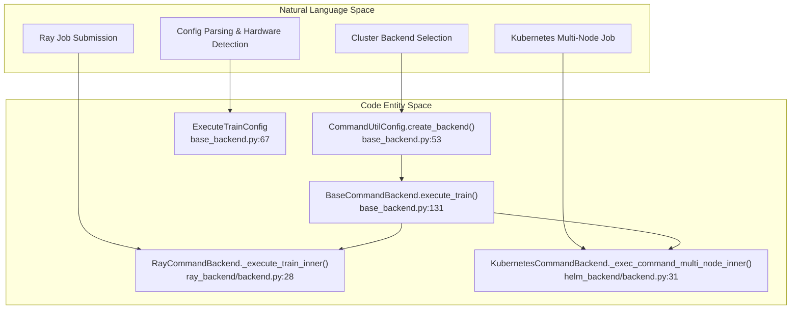
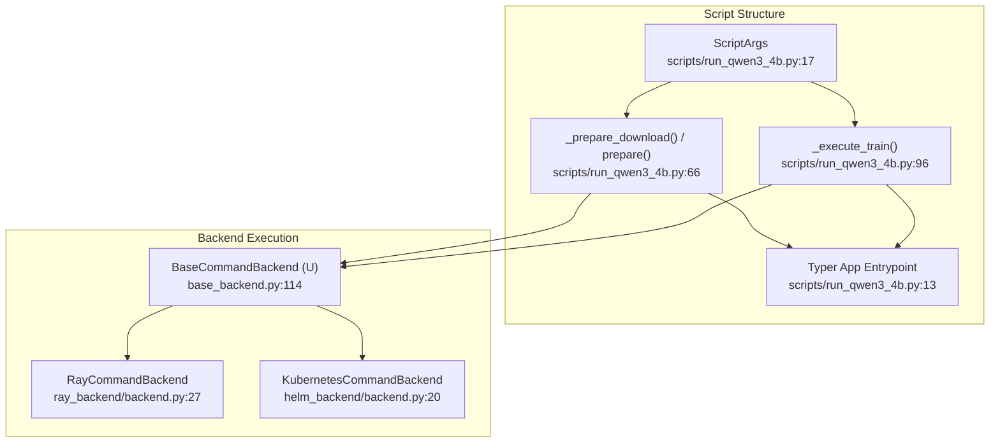

<!-- source: DeepWiki mcp.deepwiki.com · repo radixark/miles · page 9.2 Python Training Scripts · fetched 2026-10-21 -->

# Python Training Scripts

Relevant source files

The following files were used as context for generating this wiki page:

- [docker/Dockerfile.rubin](docker/Dockerfile.rubin)
- [docker/image_inputs.py](docker/image_inputs.py)
- [examples/experimental/harbor/run.py](examples/experimental/harbor/run.py)
- [examples/experimental/nemo-gym-workspace-assistant/run_nemotron35_workplace.py](examples/experimental/nemo-gym-workspace-assistant/run_nemotron35_workplace.py)
- [miles/backends/megatron_utils/megatron_to_hf/deepseekv3.py](miles/backends/megatron_utils/megatron_to_hf/deepseekv3.py)
- [miles/utils/external_utils/command_utils/base_backend.py](miles/utils/external_utils/command_utils/base_backend.py)
- [miles/utils/external_utils/command_utils/common.py](miles/utils/external_utils/command_utils/common.py)
- [miles/utils/external_utils/command_utils/helm_backend/backend.py](miles/utils/external_utils/command_utils/helm_backend/backend.py)
- [miles/utils/external_utils/command_utils/ray_backend/backend.py](miles/utils/external_utils/command_utils/ray_backend/backend.py)
- [miles_plugins/mbridge/deepseek_v32.py](miles_plugins/mbridge/deepseek_v32.py)
- [miles_plugins/models/deepseek_v4/ops/cp_row_balance.py](miles_plugins/models/deepseek_v4/ops/cp_row_balance.py)
- [scripts/run_deepseek.py](scripts/run_deepseek.py)
- [scripts/run_deepseek_v4.py](scripts/run_deepseek_v4.py)
- [scripts/run_glm45_355b_a32b.py](scripts/run_glm45_355b_a32b.py)
- [scripts/run_glm5_2_744b_a40b.py](scripts/run_glm5_2_744b_a40b.py)
- [scripts/run_glm5_744b_a40b.py](scripts/run_glm5_744b_a40b.py)
- [scripts/run_kimi_k25.py](scripts/run_kimi_k25.py)
- [scripts/run_mcore_fsdp.py](scripts/run_mcore_fsdp.py)
- [scripts/run_qwen3_30b_a3b.py](scripts/run_qwen3_30b_a3b.py)
- [scripts/run_qwen3_4b.py](scripts/run_qwen3_4b.py)
- [tests/fast/backends/training_utils/test_get_batch_cu_seqlens.py](tests/fast/backends/training_utils/test_get_batch_cu_seqlens.py)
- [tests/fast/launch_scripts/test_run_deepseek_v4.py](tests/fast/launch_scripts/test_run_deepseek_v4.py)
- [tests/fast/miles_plugins/models/deepseek_v4/ops/test_cp_row_balance.py](tests/fast/miles_plugins/models/deepseek_v4/ops/test_cp_row_balance.py)
- [tests/fast/test_training_images.py](tests/fast/test_training_images.py)
- [tests/fast/utils/external_utils/command_utils/helm_backend/test_multi_node_scheduling.py](tests/fast/utils/external_utils/command_utils/helm_backend/test_multi_node_scheduling.py)
- [tests/fast/utils/external_utils/command_utils/ray_backend/test_command.py](tests/fast/utils/external_utils/command_utils/ray_backend/test_command.py)
- [tests/fast/utils/external_utils/command_utils/test_base_backend.py](tests/fast/utils/external_utils/command_utils/test_base_backend.py)
- [tests/fast/utils/test_command_utils.py](tests/fast/utils/test_command_utils.py)

This page walks through example Python launch scripts for different model families (Qwen, GLM, DeepSeek, Kimi, and Nemotron/others) and documents the underlying `command_utils` launcher framework (`miles/utils/external_utils/command_utils/base_backend.py` [miles/utils/external_utils/command_utils/base_backend.py:1-168]()). These scripts encapsulate model-specific hyperparameters, hardware configurations, multi-node preparation commands, and training workflows.

---

## Purpose and Scope

Python training scripts serve as high-level orchestration layers bridging natural language training workflows and distributed execution code entities. Their responsibilities include:
- Managing configuration schemas via dataclasses extending `ExecuteTrainConfig` [miles/utils/external_utils/command_utils.py:67-83]().
- Handling environment resolution, hardware detection (`resolve_hardware`), and dynamic GPU allocation [scripts/run_qwen3_30b_a3b.py:40-49]().
- Orchestrating dataset and model downloads via `hf download` or HuggingFace hub helpers [scripts/run_qwen3_30b_a3b.py:60-65]().
- Converting checkpoints to Megatron or SPMD formats via `convert_checkpoint` [scripts/run_qwen3_30b_a3b.py:104-112]().
- Assembling comprehensive command-line argument strings for `train.py` [scripts/run_qwen3_4b.py:111-143]().
- Dispatching execution through cluster backends via `BaseCommandBackend.execute_train()` [miles/utils/external_utils/command_utils.py:131-155]().

Sources: [scripts/run_qwen3_30b_a3b.py:10-113](), [miles/utils/external_utils/command_utils/base_backend.py:67-155]()

---

## The `command_utils` Launcher Framework

The `command_utils` package provides reusable primitives for orchestrating preparation, environment resolution, and job submission across single-node and multi-node GPU clusters (Ray and Kubernetes).

### Core Utilities and Classes

- `CommandUtilConfig`: Base configuration dataclass defining cluster backend selection (`cluster_backend`), namespace, and Helm values [miles/utils/external_utils/command_utils/base_backend.py:43-64]().
- `ExecuteTrainConfig`: Extends `CommandUtilConfig` to add training-specific parameters such as `cuda_core_dump`, `num_nodes`, `extra_env_vars`, `output_dir`, `deploy_component`, and `hot_restart` [miles/utils/external_utils/command_utils/base_backend.py:67-84]().
- `BaseCommandBackend`: Abstract base class enforcing strict backend stubbing rules (`_execute_train_inner`, `_exec_command_gpu_inner`, `_exec_command_multi_node_inner`) and managing cleanups and environment injection [miles/utils/external_utils/command_utils/base_backend.py:114-168]().
- `RayCommandBackend` & `KubernetesCommandBackend`: Concrete implementations supporting Ray jobs (`miles/utils/external_utils/command_utils/ray_backend/backend.py` [miles/utils/external_utils/command_utils/ray_backend/backend.py:27-72]()) and Kubernetes helm/job releases (`miles/utils/external_utils/command_utils/helm_backend/backend.py` [miles/utils/external_utils/command_utils/helm_backend/backend.py:20-56]()).

Title: Launcher Framework Code Entity Mapping

Sources: [miles/utils/external_utils/command_utils/base_backend.py:43-168](), [miles/utils/external_utils/command_utils/ray_backend/backend.py:27-72](), [miles/utils/external_utils/command_utils/helm_backend/backend.py:20-56]()

---

## Script Anatomy and Execution Flow

Model-specific launch scripts in `scripts/` adhere to a modular layout consisting of a `ScriptArgs` configuration dataclass, a preparation phase (`prepare()` or model-specific preparers), an execution builder (`execute()` or `_execute_train()`), and a Typer CLI entry point.

Title: Script Execution Flow and Code Entities

Sources: [scripts/run_qwen3_4b.py:13-110](), [miles/utils/external_utils/command_utils/base_backend.py:114-168](), [miles/utils/external_utils/command_utils/ray_backend/backend.py:27-72]()

---

## Model-Specific Launch Scripts

### Qwen Scripts (`run_qwen3_30b_a3b.py` and `run_qwen3_4b.py`)
Qwen scripts configure dense and MoE variants (e.g., `Qwen3-4B`, `Qwen3-30B-A3B`) [scripts/run_qwen3_30b_a3b.py:14](), [scripts/run_qwen3_4b.py:20](). They automatically resolve hardware profiles, set tensor/context parallelism defaults, parse precision toggles (`rollout_fp8`, `rollout_mxfp8`, `rollout_nvfp4`), and build checkpoint arguments (`--hf-checkpoint`, `--ref-load`, `--load`, `--save`) [scripts/run_qwen3_30b_a3b.py:40-142](), [scripts/run_qwen3_4b.py:43-122]().

Sources: [scripts/run_qwen3_30b_a3b.py:1-142](), [scripts/run_qwen3_4b.py:1-122]()

### GLM Scripts (`run_glm45_355b_a32b.py`, `run_glm5_744b_a40b.py`)
GLM scripts handle large-scale MoE architectures (such as `GLM-4.5` and `GLM-5 744B-A40B`) [scripts/run_glm45_355b_a32b.py:21](), [scripts/run_glm5_744b_a40b.py:71](). They manage pruned testing models (`GLM-5_4layer`, `GLM-5_20layer`), DeepEP communication configurations (`use_deepep`, `megatron_use_deepep`), dynamic sampling filters, and node-local storage rsync copies via `_prepare_cmd()` [scripts/run_glm45_355b_a32b.py:93-107](), [scripts/run_glm5_744b_a40b.py:75-107]().

Sources: [scripts/run_glm45_355b_a32b.py:1-107](), [scripts/run_glm5_744b_a40b.py:55-148]()

### DeepSeek Scripts (`run_deepseek.py`, `run_deepseek_v4.py`)
DeepSeek launch scripts handle multi-node MoE configurations across variants like `DeepSeek-V3` and `DeepSeek-V4-Flash-FP8` [scripts/run_deepseek.py:21](), [scripts/run_deepseek_v4.py:103](). They support direct-HF initialization with trainer-owned MXFP8 rollouts, Transformer Engine precision files (`_DSV4_TE_PRECISION_CONFIG`), and expert parallelism sizing [scripts/run_deepseek_v4.py:30-92]().

Sources: [scripts/run_deepseek.py:16-95](), [scripts/run_deepseek_v4.py:95-159]()

---

## Hardware Adaptation and Execution

Launch scripts dynamically query available hardware via `command_utils.resolve_hardware()` and map to verified profiles (`H100`, `H200`, `B200`, `GB300`) [scripts/run_qwen3_30b_a3b.py:40](), [scripts/run_glm5_744b_a40b.py:93](). Once configuration arguments are assembled, execution is dispatched to either `RayCommandBackend` (which manages cluster cleanup, head startup via `ray start`, optional Mooncake object store master initialization, and `run_ray_job()`) or `KubernetesCommandBackend` (which schedules command jobs through Helm charts) [miles/utils/external_utils/command_utils/ray_backend/backend.py:28-72](), [miles/utils/external_utils/command_utils/helm_backend/backend.py:20-56]().

Sources: [miles/utils/external_utils/command_utils/ray_backend/backend.py:28-72](), [miles/utils/external_utils/command_utils/helm_backend/backend.py:20-56]()

---

