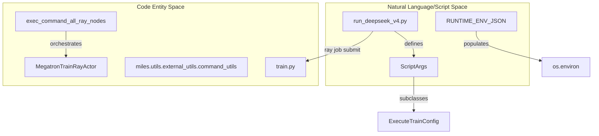
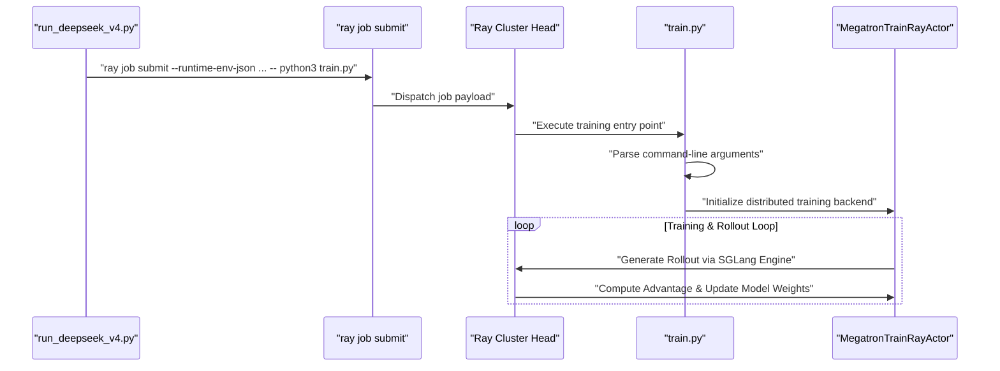

<!-- source: DeepWiki mcp.deepwiki.com · repo radixark/miles · page 9.3 Shell Script Examples · fetched 2026-10-21 -->

# Shell Script Examples

<details>
<summary>Relevant source files</summary>

The following files were used as context for generating this wiki page:

- [miles/utils/debug_utils/run_megatron/cli/commands/__init__.py](miles/utils/debug_utils/run_megatron/cli/commands/__init__.py)
- [miles/utils/debug_utils/run_megatron/cli/commands/args.py](miles/utils/debug_utils/run_megatron/cli/commands/args.py)
- [miles/utils/debug_utils/run_megatron/cli/commands/compare.py](miles/utils/debug_utils/run_megatron/cli/commands/compare.py)
- [miles/utils/debug_utils/run_megatron/cli/commands/run.py](miles/utils/debug_utils/run_megatron/cli/commands/run.py)
- [miles/utils/debug_utils/run_megatron/cli/commands/run_and_compare.py](miles/utils/debug_utils/run_megatron/cli/commands/run_and_compare.py)
- [miles/utils/debug_utils/run_megatron/cli/worker_executor.py](miles/utils/debug_utils/run_megatron/cli/worker_executor.py)
- [miles/utils/debug_utils/run_megatron/worker/main.py](miles/utils/debug_utils/run_megatron/worker/main.py)
- [miles/utils/debug_utils/run_megatron/worker/output.py](miles/utils/debug_utils/run_megatron/worker/output.py)
- [miles/utils/debug_utils/run_megatron/worker/replay.py](miles/utils/debug_utils/run_megatron/worker/replay.py)
- [miles/utils/debug_utils/run_megatron/worker/script_args.py](miles/utils/debug_utils/run_megatron/worker/script_args.py)
- [miles/utils/external_utils/command_utils/ray_backend/command.py](miles/utils/external_utils/command_utils/ray_backend/command.py)
- [miles/utils/external_utils/ray_job.py](miles/utils/external_utils/ray_job.py)
- [scripts/amd/run_deepseek_v4.py](scripts/amd/run_deepseek_v4.py)
- [scripts/amd/run_glm5_2_744b_a40b.py](scripts/amd/run_glm5_2_744b_a40b.py)
- [scripts/amd/run_inkling.py](scripts/amd/run_inkling.py)
- [scripts/run_inkling.py](scripts/run_inkling.py)
- [tests/e2e/megatron/model_scripts/test_deepseek_v32_5layer_mxfp8.py](tests/e2e/megatron/model_scripts/test_deepseek_v32_5layer_mxfp8.py)
- [tests/e2e/megatron/model_scripts/test_inkling_small_6layer_ci.py](tests/e2e/megatron/model_scripts/test_inkling_small_6layer_ci.py)
- [tests/e2e/megatron/model_scripts/test_inkling_small_6layer_lora_ci.py](tests/e2e/megatron/model_scripts/test_inkling_small_6layer_lora_ci.py)
- [tests/e2e/short/test_run_megatron.py](tests/e2e/short/test_run_megatron.py)
- [tests/fast/utils/debug_utils/run_megatron/cli/commands/test_compare.py](tests/fast/utils/debug_utils/run_megatron/cli/commands/test_compare.py)
- [tests/fast/utils/debug_utils/run_megatron/cli/commands/test_run.py](tests/fast/utils/debug_utils/run_megatron/cli/commands/test_run.py)
- [tests/fast/utils/debug_utils/run_megatron/cli/commands/test_run_and_compare.py](tests/fast/utils/debug_utils/run_megatron/cli/commands/test_run_and_compare.py)
- [tests/fast/utils/debug_utils/run_megatron/cli/test_worker_executor.py](tests/fast/utils/debug_utils/run_megatron/cli/test_worker_executor.py)
- [tests/fast/utils/debug_utils/run_megatron/worker/test_batch.py](tests/fast/utils/debug_utils/run_megatron/worker/test_batch.py)
- [tests/fast/utils/debug_utils/run_megatron/worker/test_replay.py](tests/fast/utils/debug_utils/run_megatron/worker/test_replay.py)
- [tests/fast/utils/debug_utils/run_megatron/worker/test_script_args.py](tests/fast/utils/debug_utils/run_megatron/worker/test_script_args.py)
- [tests/fast/utils/external_utils/command_utils/ray_backend/conftest.py](tests/fast/utils/external_utils/command_utils/ray_backend/conftest.py)
- [tests/snapshots/launch_scripts/py/scripts/amd/run_deepseek_v4.py/full_train.txt](tests/snapshots/launch_scripts/py/scripts/amd/run_deepseek_v4.py/full_train.txt)
- [tests/snapshots/launch_scripts/py/scripts/amd/run_deepseek_v4.py/train.txt](tests/snapshots/launch_scripts/py/scripts/amd/run_deepseek_v4.py/train.txt)

</details>


## Purpose and Scope

This page documents the shell script and Python launcher script interfaces used to initialize Ray clusters, configure runtime environments, handle multi-node network parameters, clean up stale processes, and submit distributed reinforcement learning training jobs in Miles. 

Launch scripts serve as the primary execution harness for distributed reinforcement learning and fine-tuning runs across diverse hardware backends (NVIDIA CUDA, AMD ROCm). Each script performs a consistent lifecycle sequence:
- **Process Cleanup**: Terminates stale Ray, SGLang, and Python instances to prevent port bindings or GPU memory leaks [tests/snapshots/launch_scripts/py/scripts/amd/run_deepseek_v4.py/train.txt:1-4]().
- **Hardware & Network Detection**: Detects NVLink topologies and resolves local network interfaces for cross-node NCCL/Gloo communication [miles/utils/external_utils/command_utils/ray_backend/command.py:33-46]().
- **Configuration Modularization**: Organizes hyperparameters, paths, and parallelism flags into structured dataclasses (`ScriptArgs`) and bash command arrays [scripts/amd/run_deepseek_v4.py:52-106]().
- **Ray Orchestration & Submission**: Defines the Ray runtime environment JSON (`RUNTIME_ENV_JSON`) and executes `ray job submit` or direct actor orchestration targeting `train.py` [tests/snapshots/launch_scripts/py/scripts/amd/run_deepseek_v4.py/train.txt:16-19]().

Sources: [scripts/amd/run_deepseek_v4.py:1-28](), [tests/snapshots/launch_scripts/py/scripts/amd/run_deepseek_v4.py/train.txt:1-20]()

## System Interface Diagram

The following diagram bridges the script configuration space to the internal code entities that consume them during distributed startup.



Sources: [scripts/amd/run_deepseek_v4.py:30-37](), [miles/utils/external_utils/command_utils/ray_backend/command.py:28-66]()

## Script Lifecycle and Environment Setup

### Process Cleanup and Cluster Initialization
Launch scripts begin by ensuring a clean execution state, forcefully terminating lingering Ray nodes, SGLang servers, and Redis instances before spawning fresh worker pools [tests/snapshots/launch_scripts/py/scripts/amd/run_deepseek_v4.py/train.txt:1-4](). 

Cluster head nodes are initialized via `ray start --head`, and multi-node execution environments inspect alive nodes through Ray's runtime state API [miles/utils/external_utils/command_utils/ray_backend/command.py:33-46]().

```python
def exec_command_all_ray_nodes(
    cmd: str, capture_output: bool = False, num_nodes: int | None = None
) -> list[str | None]:
    ray.init(address="auto")
    try:
        current_ip = get_current_node_ip()
        nodes = sorted(
            [n for n in ray.nodes() if n.get("Alive")],
            key=lambda n: (n["NodeManagerAddress"] != current_ip, n["NodeManagerAddress"]),
        )
        assert len(nodes) > 0
...
```
[miles/utils/external_utils/command_utils/ray_backend/command.py:28-42]()

Sources: [tests/snapshots/launch_scripts/py/scripts/amd/run_deepseek_v4.py/train.txt:1-11](), [miles/utils/external_utils/command_utils/ray_backend/command.py:28-66]()

### Runtime Environment Configuration
The runtime environment JSON configuration dictionary controls environment variables injected into all Ray worker tasks and actors, ensuring consistent CUDA, NCCL, and Python path behavior across nodes [tests/snapshots/launch_scripts/py/scripts/amd/run_deepseek_v4.py/train.txt:16-19]().

```json
{
  "env_vars": {
    "PYTHONUNBUFFERED": "1",
    "CUDA_DEVICE_MAX_CONNECTIONS": "1",
    "NCCL_NVLS_ENABLE": "0",
    "MASTER_ADDR": "127.0.0.1",
    "PYTHONPATH": "<REPO_ROOT>:/root/Megatron-LM:/frozen/pythonpath"
  }
}
```
[tests/snapshots/launch_scripts/py/scripts/amd/run_deepseek_v4.py/train.txt:18]()

Sources: [tests/snapshots/launch_scripts/py/scripts/amd/run_deepseek_v4.py/train.txt:16-19]()

## Modular Argument Structures

Launcher scripts (such as `scripts/amd/run_deepseek_v4.py` and `scripts/run_inkling.py`) use Typer and dataclasses inheriting from `command_utils.ExecuteTrainConfig` to modularize parameters [scripts/amd/run_deepseek_v4.py:34-53](), [scripts/run_inkling.py:61-84]().

### 1. Model and Precision Configuration (`ScriptArgs`)
Defines model paths, task types, quantization flags, and precision settings.

```python
@dataclass
class ScriptArgs(command_utils.ExecuteTrainConfig):
    mode: Literal["normal", "debug_minimal"] = "debug_minimal"
    run_id: str = command_utils.create_run_id()
    model_name: Literal["DeepSeek-V4-Flash-FP8", "DeepSeek-V4-Flash-FP8-4layer"] = "DeepSeek-V4-Flash-FP8"
    task: Literal["dapo_aime", "gsm8k"] = "dapo_aime"
    fp8_training: bool = True
    enable_r3: bool = True
    train_deterministic: bool = True
```
[scripts/amd/run_deepseek_v4.py:52-103]()

Sources: [scripts/amd/run_deepseek_v4.py:52-106](), [scripts/run_inkling.py:83-125]()

### 2. Parallelism and Topology Allocation
Calculates cluster distribution, tensor parallel sizes, and colocation parameters dynamically in `__post_init__` [scripts/amd/run_deepseek_v4.py:107-121]().

```python
    def __post_init__(self):
        if not self.model_org:
            self.model_org = _DEFAULT_MODEL_ORG[self.model_name]
        assert self.rollout_num_nodes >= 0
        assert self.rollout_num_nodes < self.num_nodes
        self.colocate = self.rollout_num_nodes == 0
        self.actor_num_nodes = self.num_nodes - self.rollout_num_nodes
        self.actor_num_gpus_per_node = self.num_gpus_per_node
```
[scripts/amd/run_deepseek_v4.py:107-116]()

Sources: [scripts/amd/run_deepseek_v4.py:107-121](), [scripts/run_inkling.py:126-147]()

## Ray Job Submission and Execution Flow



Sources: [tests/snapshots/launch_scripts/py/scripts/amd/run_deepseek_v4.py/train.txt:16-19](), [scripts/amd/run_deepseek_v4.py:1-28]()

## Specialized Script Examples

### DeepSeek V4 Full Pipeline Script
The DeepSeek V4 script (`scripts/amd/run_deepseek_v4.py`) supports one-shot execution pipelines encompassing download, FP8 to BF16 checkpoint conversion, SPMD weight sharding, and Ray job submission [scripts/amd/run_deepseek_v4.py:14-28]().

```python
def _prepare_download(args: ScriptArgs):
    """Download HF checkpoint + task dataset. Idempotent: hf skips existing blobs."""
    U = args.create_backend()
    U.exec_command_cpu(f"mkdir -p {args.model_dir} {args.data_dir}")
    if args.hf_checkpoint is None:
        dest = f"{args.model_dir}/{args.model_name}"
        U.exec_command_cpu(f"hf download {args.model_org}/{args.model_name} --local-dir {dest}")
    _download_dataset(args)
```
[scripts/amd/run_deepseek_v4.py:164-175]()

Sources: [scripts/amd/run_deepseek_v4.py:164-175](), [tests/snapshots/launch_scripts/py/scripts/amd/run_deepseek_v4.py/full_train.txt:1-100]()

### Inkling Family Training Script
`scripts/run_inkling.py` supports full parameter GRPO and LoRA training modes across colocated and fully-asynchronous disaggregated topologies [scripts/run_inkling.py:20-37](). It handles layer-sliced model registries for lightweight CI smoke testing and multi-node GPU allocations [scripts/run_inkling.py:69-75]().

Sources: [scripts/run_inkling.py:1-54]()

---

