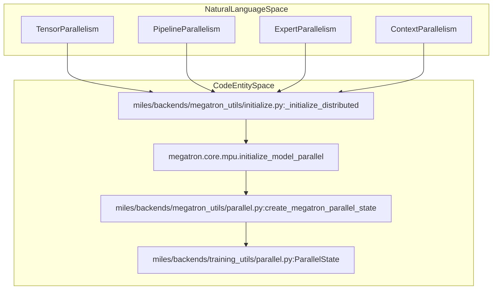
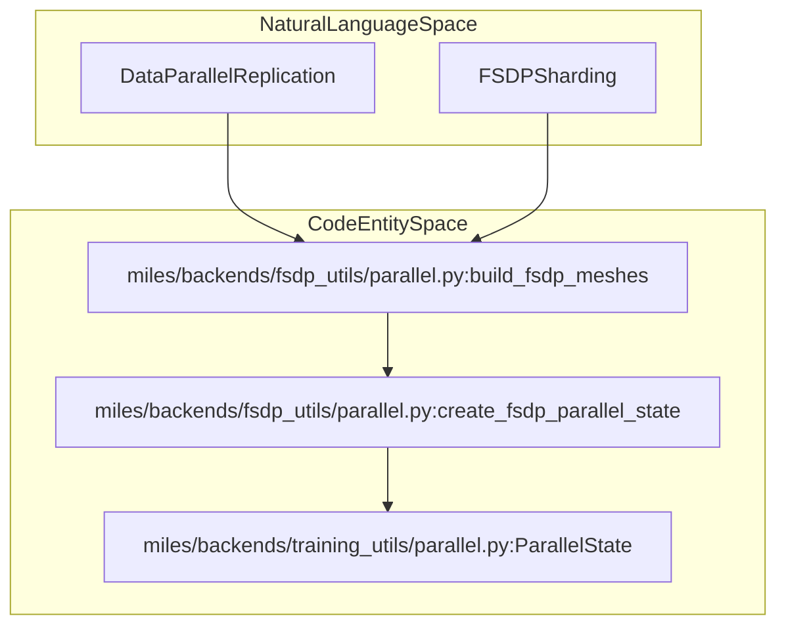
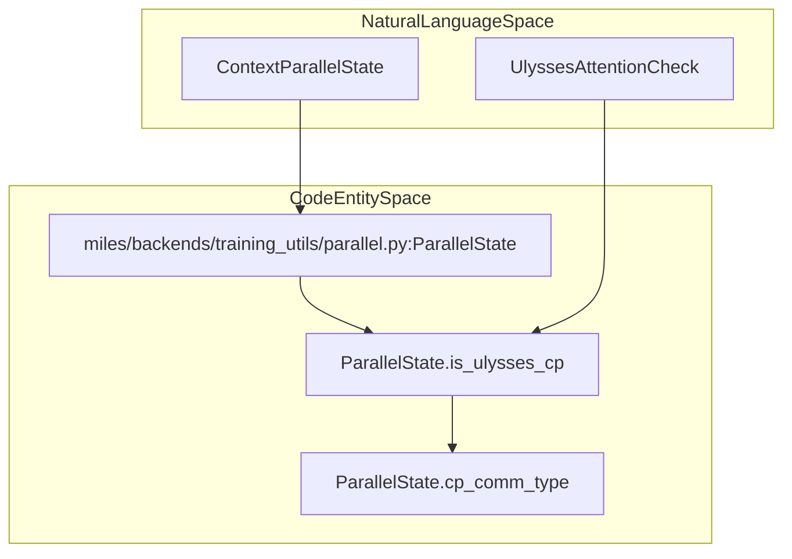

<!-- source: DeepWiki mcp.deepwiki.com · repo radixark/miles · page 9.4 Parallelism Configuration · fetched 2026-10-21 -->

# Parallelism Configuration

<details>
<summary>Relevant source files</summary>

The following files were used as context for generating this wiki page:

- [miles/backends/fsdp_utils/parallel.py](miles/backends/fsdp_utils/parallel.py)
- [miles/backends/megatron_utils/ci_utils.py](miles/backends/megatron_utils/ci_utils.py)
- [miles/backends/megatron_utils/initialize.py](miles/backends/megatron_utils/initialize.py)
- [miles/backends/megatron_utils/parallel.py](miles/backends/megatron_utils/parallel.py)
- [miles/backends/training_utils/parallel.py](miles/backends/training_utils/parallel.py)
- [tests/fast-gpu/_fsdp_hybrid_shard_worker.py](tests/fast-gpu/_fsdp_hybrid_shard_worker.py)
- [tests/fast/backends/megatron_utils/test_initialize.py](tests/fast/backends/megatron_utils/test_initialize.py)

</details>


## Purpose and Scope
This page provides a comprehensive guide to configuring parallelism strategies in Miles for distributed training across GPUs and nodes. Parallelism configuration determines how model parameters, activations, and gradients are partitioned across available hardware resources. It covers tensor parallelism (TP), pipeline parallelism (PP), expert parallelism (EP), context parallelism (CP), and data parallelism (DP) across both FSDP and Megatron backends.

---

## Overview of Parallelism Dimensions
Miles supports multiple orthogonal parallelism strategies that can be combined to efficiently train large models. The available dimensions depend on the selected training backend (`--train-backend megatron` or `--train-backend fsdp`) [miles/backends/megatron_utils/parallel.py:19-78](), [miles/backends/fsdp_utils/parallel.py:46-99]().

### Parallelism Types and Code Mapping

| Dimension | CLI Argument / Field | Code Reference | Availability | Notes |
|-----------|----------------------|----------------|--------------|-------|
| **Tensor Parallelism** (TP) | `args.tensor_model_parallel_size` | `ParallelState.tp` | Both backends | Split weight matrices across GPUs [miles/backends/training_utils/parallel.py:41]() |
| **Pipeline Parallelism** (PP) | `args.pipeline_model_parallel_size` | `ParallelState.pp` | Megatron only | Partition layers across GPUs [miles/backends/training_utils/parallel.py:42]() |
| **Expert Parallelism** (EP) | `args.expert_model_parallel_size` | `ParallelState.ep` | Both backends | Distribute MoE experts [miles/backends/training_utils/parallel.py:43]() |
| **Expert Tensor Parallel** (ETP) | `args.expert_tensor_parallel_size` | `ParallelState.etp` | Megatron only | Additional TP within experts [miles/backends/training_utils/parallel.py:44]() |
| **Context Parallelism** (CP) | `args.context_parallel_size` | `ParallelState.cp` | Both backends | Split sequences for long contexts [miles/backends/training_utils/parallel.py:40]() |
| **Data Parallelism** (DP) | Computed | `ParallelState.intra_dp` | Both backends | Computed from world size and other dimensions [miles/backends/training_utils/parallel.py:38]() |

**Parallelism Constraint:**
The core world size product is structured across processes via `ParallelState` and backend initializers [miles/backends/training_utils/parallel.py:33-54](), [miles/backends/megatron_utils/parallel.py:19-78]().

Sources: [miles/backends/megatron_utils/parallel.py:19-78](), [miles/backends/training_utils/parallel.py:33-54](), [miles/backends/megatron_utils/initialize.py:72-92]()

---

## Backend-Specific Parallelism and Topologies

### Megatron Backend: 4D Parallelism Topology
The Megatron backend supports full 4D parallelism (TP, PP, EP, CP) plus implicit data parallelism. This is orchestrated via `create_megatron_parallel_state` and initialized through `_initialize_distributed` [miles/backends/megatron_utils/initialize.py:72-92](), [miles/backends/megatron_utils/parallel.py:19-78]().

Title: Megatron Parallelism Initialization Flow


The `create_megatron_parallel_state` function in `miles/backends/megatron_utils/parallel.py` wraps the Megatron Core `mpu` calls into a unified `ParallelState` object used throughout the training execution [miles/backends/megatron_utils/parallel.py:19-78]().

Sources: [miles/backends/megatron_utils/initialize.py:72-92](), [miles/backends/megatron_utils/parallel.py:19-78](), [miles/backends/training_utils/parallel.py:33-54]()

---

### FSDP Backend: 2D Parallelism Mesh
The FSDP backend uses a 2D device mesh combining data replication and FSDP sharding. This is managed by `create_fsdp_parallel_state` and `build_fsdp_meshes` [miles/backends/fsdp_utils/parallel.py:14-99]().

Title: FSDP Device Mesh Construction Flow


Sources: [miles/backends/fsdp_utils/parallel.py:14-99](), [miles/backends/training_utils/parallel.py:33-54]()

---

## Context Parallelism (CP) and Sequence Sharding Implementation

Context Parallelism in Miles shards long sequences across multiple GPUs. The `ParallelState` tracks whether Ulysses-style attention (`is_ulysses_cp`) or ring-attention is active based on `cp_comm_type` [miles/backends/training_utils/parallel.py:79-84](), [miles/backends/megatron_utils/parallel.py:42-42]().



### Key Properties for Context Parallelism
- `ParallelState.cp`: Group info for context parallel ranks [miles/backends/training_utils/parallel.py:40]()
- `ParallelState.is_ulysses_cp`: Property verifying if communication type is set to all-to-all (`a2a`) for Ulysses CP [miles/backends/training_utils/parallel.py:79-84]()
- `ParallelState.effective_dp_cp`: Combines data parallel and context parallel group structures depending on `_DPMode` [miles/backends/training_utils/parallel.py:68-72]()

Sources: [miles/backends/training_utils/parallel.py:33-86](), [miles/backends/megatron_utils/parallel.py:37-42]()

---

## Cluster Resource Management and World Size Constraints

Hardware resource allocation is configured via runtime arguments. The `ParallelState` data class maintains group hierarchies for intra-DP, independent DP, TP, PP, EP, ETP, and CP [miles/backends/training_utils/parallel.py:33-54]().

### Configuration Parameters Summary

| Argument | Type | Default | Backend | Description |
|----------|------|---------|---------|-------------|
| `--tensor-model-parallel-size` | int | 1 | Both | Split weight matrices across GPUs |
| `--pipeline-model-parallel-size` | int | 1 | Megatron | Partition layers across GPUs |
| `--expert-model-parallel-size` | int | 1 | Both | Distribute MoE experts |
| `--context-parallel-size` | int | 1 | Both | Split sequences for long contexts |
| `--dp-replicate-size` | int | 1 | FSDP | Data parallel replication factor [miles/backends/fsdp_utils/parallel.py:54]() |

Sources: [miles/backends/training_utils/parallel.py:33-54](), [miles/backends/fsdp_utils/parallel.py:46-64]()

---

## Example Configuration Patterns

### Single-Node PPO (Megatron Backend)
For a standard model on 8x GPUs with Tensor Parallelism:
```bash
--train-backend megatron
--tensor-model-parallel-size 2
--pipeline-model-parallel-size 1
--context-parallel-size 1
# Result: DP = 8 / (2 * 1 * 1) = 4
```

### Hybrid FSDP Configuration
For data-parallel scaling with FSDP2 hybrid sharding:
```bash
--train-backend fsdp
--dp-replicate-size 2
# Result: Shard size = world_size / 2
```

Sources: [miles/backends/fsdp_utils/parallel.py:46-64](), [miles/backends/megatron_utils/parallel.py:19-78]()

---

