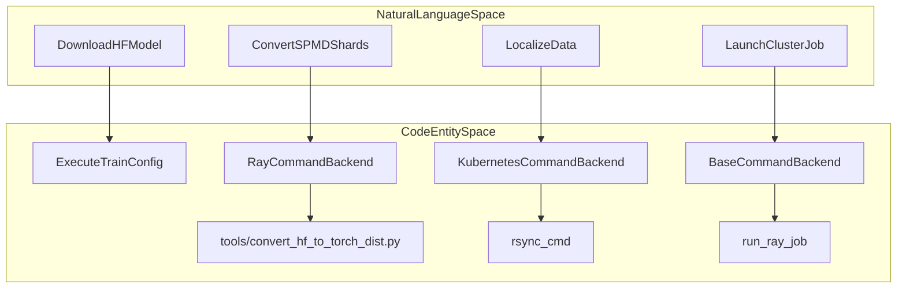
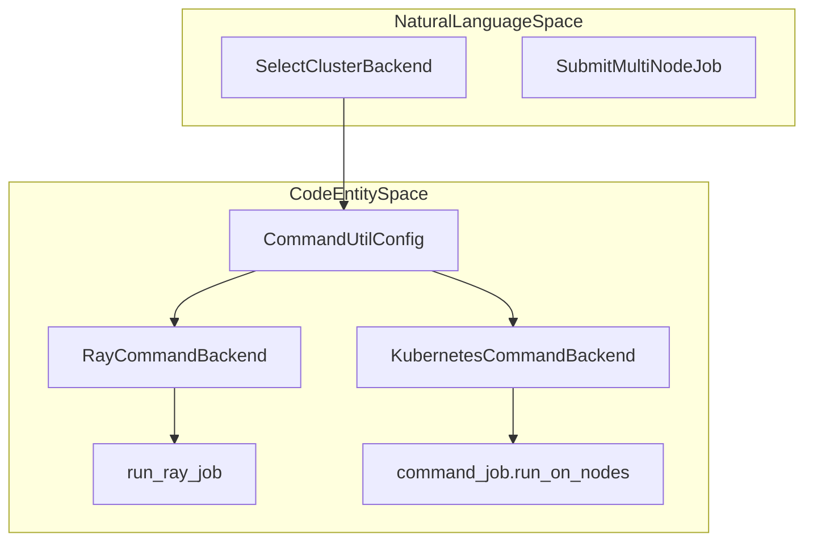
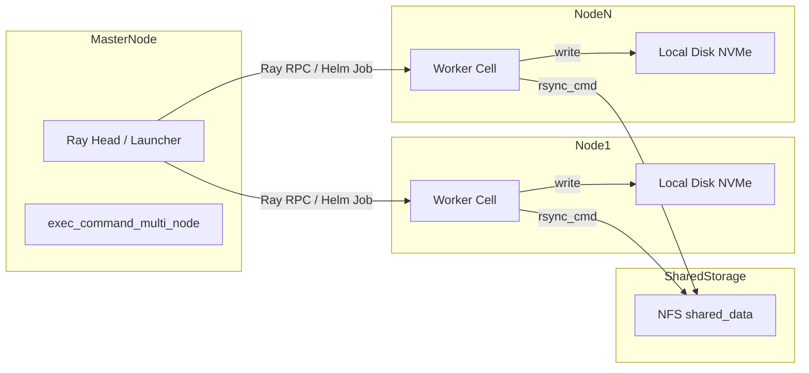

<!-- source: DeepWiki mcp.deepwiki.com · repo radixark/miles · page 9.5 Multi-Node Training · fetched 2026-10-21 -->

# Multi-Node Training

<details>
<summary>Relevant source files</summary>

The following files were used as context for generating this wiki page:

- [examples/experimental/harbor/run.py](examples/experimental/harbor/run.py)
- [examples/experimental/nemo-gym-workspace-assistant/run_nemotron35_workplace.py](examples/experimental/nemo-gym-workspace-assistant/run_nemotron35_workplace.py)
- [miles/utils/external_utils/command_utils/base_backend.py](miles/utils/external_utils/command_utils/base_backend.py)
- [miles/utils/external_utils/command_utils/common.py](miles/utils/external_utils/command_utils/common.py)
- [miles/utils/external_utils/command_utils/helm_backend/backend.py](miles/utils/external_utils/command_utils/helm_backend/backend.py)
- [miles/utils/external_utils/command_utils/ray_backend/backend.py](miles/utils/external_utils/command_utils/ray_backend/backend.py)
- [miles/utils/workers/registration/__init__.py](miles/utils/workers/registration/__init__.py)
- [miles/utils/workers/registration/hub.py](miles/utils/workers/registration/hub.py)
- [miles/utils/workers/registration/models.py](miles/utils/workers/registration/models.py)
- [miles/utils/workers/registration/reporter.py](miles/utils/workers/registration/reporter.py)
- [tests/fast/utils/audit_utils/test_process_identity.py](tests/fast/utils/audit_utils/test_process_identity.py)
- [tests/fast/utils/external_utils/command_utils/helm_backend/test_multi_node_scheduling.py](tests/fast/utils/external_utils/command_utils/helm_backend/test_multi_node_scheduling.py)
- [tests/fast/utils/external_utils/command_utils/ray_backend/test_command.py](tests/fast/utils/external_utils/command_utils/ray_backend/test_command.py)
- [tests/fast/utils/external_utils/command_utils/test_base_backend.py](tests/fast/utils/external_utils/command_utils/test_base_backend.py)
- [tests/fast/utils/test_command_utils.py](tests/fast/utils/test_command_utils.py)
- [tests/fast/utils/workers/registration/__init__.py](tests/fast/utils/workers/registration/__init__.py)
- [tests/fast/utils/workers/registration/test_hub.py](tests/fast/utils/workers/registration/test_hub.py)
- [tests/fast/utils/workers/registration/test_reporter.py](tests/fast/utils/workers/registration/test_reporter.py)

</details>


## Purpose and Scope

This page explains how to set up and run Miles training jobs across multiple nodes (machines) connected in a cluster. Multi-node training is essential for models that are too large to fit on a single node's GPUs or when you need to scale training throughput beyond what a single node can provide.

For configuring parallelism strategies within a node or across nodes, see **Parallelism Configuration**. For checkpoint format conversion details, see **Checkpoint Management**. For Ray cluster setup and resource allocation, see **Ray Resource Management**.

**Key aspects covered:**
- When multi-node training is required.
- The four-stage workflow for multi-node preparation.
- SPMD (Single Program Multiple Data) checkpoint conversion for distributed models (`tools/convert_hf_to_torch_dist.py`).
- Shared vs. local storage architecture.
- Cluster backend orchestration via Ray and Kubernetes (`ExecuteTrainConfig`, `RayCommandBackend`, and `KubernetesCommandBackend`).

Sources: [miles/utils/external_utils/command_utils/base_backend.py:66-84](), [miles/utils/external_utils/command_utils/ray_backend/backend.py:27-73](), [miles/utils/external_utils/command_utils/helm_backend/backend.py:20-56]()

---

## When Multi-Node Training is Required

Multi-node training becomes necessary when the model size or memory requirements exceed the capacity of a single machine (typically 8 GPUs).

| Scenario | Single Node Limit | Multi-Node Solution |
|----------|------------------|---------------------|
| **Model Size** | ~30B parameters | 300B+ parameters distributed across nodes |
| **Memory Constraints** | Limited by node's total GPU memory | Aggregate memory across multiple nodes |
| **Pipeline Parallelism** | Limited by GPUs per node | Pipeline stages distributed across nodes |
| **Expert Parallelism** | MoE experts limited to node GPUs | Experts sharded across cluster |

**Examples from the codebase:**
- **Single-node**: Qwen3-30B-A3B (8x H100) [scripts/run_qwen3_30b_a3b.py:1-175]().
- **Multi-node**: GLM-4.5-355B-A32B (8+ nodes) [scripts/run_glm45_355b_a32b.py:171-190]().
- **Multi-node**: DeepSeek-V3 (8+ nodes) [scripts/run_deepseek.py:184-193]().
- **Multi-node**: GLM-5-744B-A40B (16+ nodes) [scripts/run_glm5_744b_a40b.py:15-21]().

Sources: [scripts/run_qwen3_30b_a3b.py:1-175](), [scripts/run_glm45_355b_a32b.py:171-190](), [scripts/run_deepseek.py:184-193](), [scripts/run_glm5_744b_a40b.py:15-21]()

---

## Multi-Node Workflow Overview

Multi-node training in Miles follows a four-stage workflow to properly prepare checkpoints and data across the cluster.

### Training Preparation Data Flow
This diagram shows the transition from natural language orchestration intents to underlying code entities across cluster command backends.


Sources: [miles/utils/external_utils/command_utils/base_backend.py:66-102](), [miles/utils/external_utils/command_utils/ray_backend/backend.py:27-73](), [miles/utils/external_utils/command_utils/helm_backend/backend.py:20-56](), [tools/convert_hf_to_torch_dist.py:81-145]()

### Workflow Stages

1.  **Stage 1: prepare_single**: Executed once on a single node. It downloads the HuggingFace model and datasets to a shared NFS directory [scripts/run_glm5_744b_a40b.py:156-161]().
2.  **Stage 2: prepare_spmd**: Executed across all nodes. It uses `torchrun` and `tools/convert_hf_to_torch_dist.py` to shard the model weights into the `torch_dist` format based on the target TP/PP/EP configuration [tools/convert_hf_to_torch_dist.py:97-150]().
3.  **Stage 3: prepare_cp**: Executed on all nodes. It uses `rsync_cmd` to copy the sharded model from shared storage to node-local NVMe disks to minimize I/O latency during training [miles/utils/external_utils/command_utils/common.py:46-47](), [scripts/run_glm5_744b_a40b.py:193-206]().
4.  **Stage 4: train**: Launching the actual training job using Ray or Kubernetes Helm backends [miles/utils/external_utils/command_utils/base_backend.py:53-64](), [miles/utils/external_utils/command_utils/ray_backend/backend.py:27-73]().

Sources: [scripts/run_glm5_744b_a40b.py:156-206](), [tools/convert_hf_to_torch_dist.py:97-150](), [miles/utils/external_utils/command_utils/common.py:46-47](), [miles/utils/external_utils/command_utils/base_backend.py:53-64]()

---

## Cluster Backends for Multi-Node Launch

Miles supports multiple cluster execution backends via `CommandUtilConfig` and `BaseCommandBackend` subclasses [miles/utils/external_utils/command_utils/base_backend.py:43-64]().

### Ray vs. Kubernetes Helm Backends
- **RayCommandBackend**: Handles head node startup, optional Mooncake store orchestration, environment variable injection, and `run_ray_job` execution [miles/utils/external_utils/command_utils/ray_backend/backend.py:27-73]().
- **KubernetesCommandBackend**: Uses Helm charts and `command_job.run_on_nodes` to schedule multi-node training completions across pods while validating node affinity constraints [miles/utils/external_utils/command_utils/helm_backend/backend.py:20-56](), [tests/fast/utils/external_utils/command_utils/helm_backend/test_multi_node_scheduling.py:104-140]().

### Multi-Node Backend Orchestration
This diagram maps cluster backend abstractions to their implementation classes.


Sources: [miles/utils/external_utils/command_utils/base_backend.py:43-64](), [miles/utils/external_utils/command_utils/ray_backend/backend.py:27-73](), [miles/utils/external_utils/command_utils/helm_backend/backend.py:20-56]()

---

## SPMD Checkpoint Conversion

SPMD (Single Program Multiple Data) conversion is handled by `tools/convert_hf_to_torch_dist.py`. This script initializes a distributed process group with NCCL and uses `mbridge.AutoBridge` to load HuggingFace weights into a Megatron-structured model [tools/convert_hf_to_torch_dist.py:100-125]().

### Distributed Initialization
The conversion script calculates the correct Pipeline Parallel (PP) size based on the total world size and number of layers if not explicitly provided [tools/convert_hf_to_torch_dist.py:64-92]().

```python
# From tools/convert_hf_to_torch_dist.py
if args.pipeline_model_parallel_size == 1 and world_size > 1 and not os.environ.get("CONVERT_KEEP_PP1"):
    pp_size = world_size
    while True:
        args.pipeline_model_parallel_size = pp_size
        args.decoder_last_pipeline_num_layers = args.num_layers - ceildiv(
            args.num_layers, args.pipeline_model_parallel_size
        ) * (args.pipeline_model_parallel_size - 1)

        if args.decoder_last_pipeline_num_layers > 0:
            break

        if pp_size % 2 == 0:
            pp_size //= 2
        else:
            raise ValueError(
                f"Cannot find a valid pipeline model parallel size for {args.num_layers} layers and {world_size} GPUs."
            )
```

### Checkpoint Logic
Once weights are loaded, `save_checkpoint` is called to write the `torch_dist` format shards [tools/convert_hf_to_torch_dist.py:133](). Rank 0 then writes a completion signal to the tracker file [tools/convert_hf_to_torch_dist.py:144-148]().

Sources: [tools/convert_hf_to_torch_dist.py:51-150]()

---

## Storage and Data Flow

Multi-node training utilizes a two-tier storage approach:
1.  **Shared Storage (NFS/Lustre)**: For global assets and saving final checkpoints [scripts/run_glm5_744b_a40b.py:28-29]().
2.  **Local Storage (NVMe)**: For reading weights during the training loop via `rsync_cmd` to avoid network bottlenecks [miles/utils/external_utils/command_utils/common.py:46-47](), [scripts/run_glm5_744b_a40b.py:30]().

### Node-Local Distribution
Ray and backend launchers coordinate multi-node worker placement and file synchronization [miles/utils/external_utils/command_utils/ray_backend/backend.py:27-94]().


Sources: [miles/utils/external_utils/command_utils/ray_backend/backend.py:27-94](), [miles/utils/external_utils/command_utils/common.py:46-47](), [scripts/run_glm5_744b_a40b.py:28-30]()

---

## Ray Orchestration and Environment

The command backend injects runtime environment variables via `train_env_vars` to configure distributed training across nodes [miles/utils/external_utils/command_utils/common.py:50-77]().

### Environment Variables for Multi-Node
- `MASTER_ADDR`: Set to the head node's IP for NCCL coordination [miles/utils/external_utils/command_utils/ray_backend/backend.py:119-131]().
- `PYTHONPATH`: Prepended with source directories and Megatron paths via `_pythonpath_with_sources` [miles/utils/external_utils/command_utils/common.py:34-39]().
- `NCCL_NVLS_ENABLE`: Automatically resolved or configured based on NVLink topology checks [miles/utils/external_utils/command_utils/ray_backend/backend.py:113-122]().
- `CUDA_DEVICE_MAX_CONNECTIONS`: Set to `"1"` for non-FSDP backends to manage computation-communication overlapping [miles/utils/external_utils/command_utils/common.py:55-63]().

Sources: [miles/utils/external_utils/command_utils/common.py:34-77](), [miles/utils/external_utils/command_utils/ray_backend/backend.py:113-131]()

---

