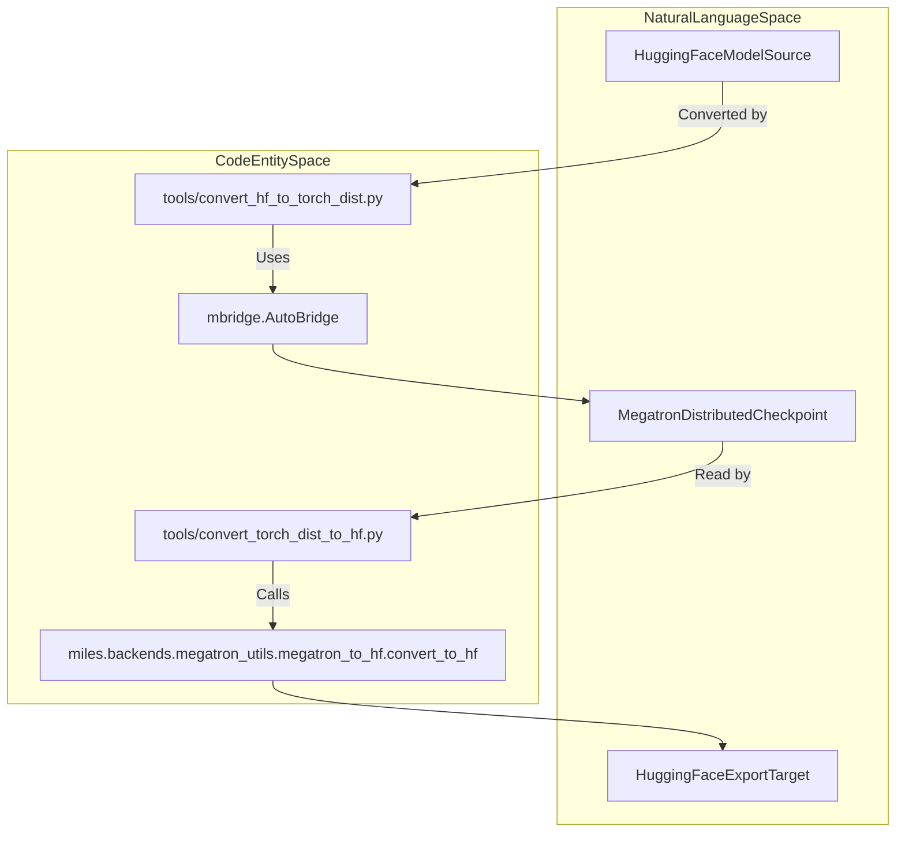
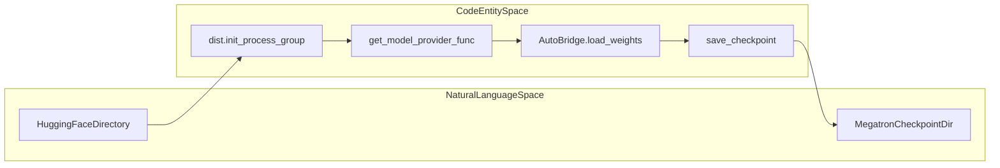
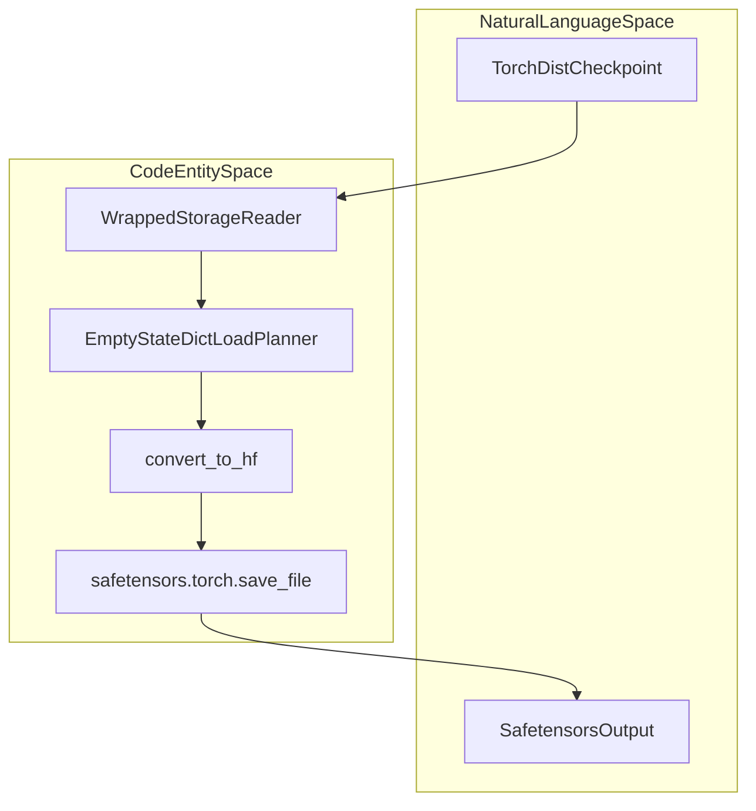
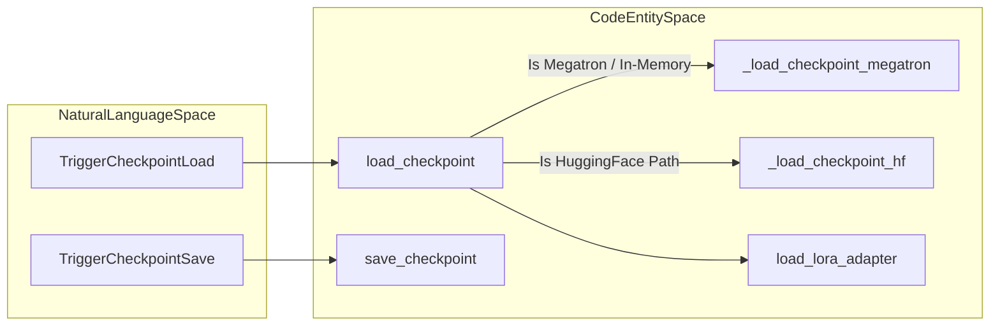

<!-- source: DeepWiki mcp.deepwiki.com · repo radixark/miles · page 9.6 Checkpoint Management · fetched 2026-10-21 -->

# Checkpoint Management

Relevant source files

The following files were used as context for generating this wiki page:

- [miles/backends/megatron_utils/checkpoint.py](miles/backends/megatron_utils/checkpoint.py)
- [miles/backends/megatron_utils/megatron_to_hf/linear_attn_layout.py](miles/backends/megatron_utils/megatron_to_hf/linear_attn_layout.py)
- [miles/rollout/generate_hub/multi_turn.py](miles/rollout/generate_hub/multi_turn.py)
- [miles/rollout/generate_hub/single_turn.py](miles/rollout/generate_hub/single_turn.py)
- [miles/utils/mask_utils.py](miles/utils/mask_utils.py)
- [miles/utils/processing_utils.py](miles/utils/processing_utils.py)
- [miles/utils/test_utils/mock_sglang_server.py](miles/utils/test_utils/mock_sglang_server.py)
- [miles/utils/test_utils/mock_tools.py](miles/utils/test_utils/mock_tools.py)
- [miles_plugins/mbridge/qwen3_5.py](miles_plugins/mbridge/qwen3_5.py)
- [miles_plugins/models/cp_utils.py](miles_plugins/models/cp_utils.py)
- [miles_plugins/models/hf_attention.py](miles_plugins/models/hf_attention.py)
- [miles_plugins/models/linear_attn.py](miles_plugins/models/linear_attn.py)
- [miles_plugins/models/qwen3_5.py](miles_plugins/models/qwen3_5.py)
- [miles_plugins/models/qwen3_next.py](miles_plugins/models/qwen3_next.py)
- [tests/e2e/precision/test_hf_attention_cp_relayout.py](tests/e2e/precision/test_hf_attention_cp_relayout.py)
- [tests/fast-gpu/linear_attn_reference.py](tests/fast-gpu/linear_attn_reference.py)
- [tests/fast-gpu/test_linear_attn_head_sharded.py](tests/fast-gpu/test_linear_attn_head_sharded.py)
- [tests/fast-gpu/test_linear_attn_layer.py](tests/fast-gpu/test_linear_attn_layer.py)
- [tests/fast-gpu/test_linear_attn_short_conv.py](tests/fast-gpu/test_linear_attn_short_conv.py)
- [tests/fast/models/test_linear_attn_kernel_selection.py](tests/fast/models/test_linear_attn_kernel_selection.py)
- [tests/fast/rollout/generate_hub/test_tool_call_utils.py](tests/fast/rollout/generate_hub/test_tool_call_utils.py)
- [tests/fast/rollout/inference_rollout/integration/test_agent_metadata.py](tests/fast/rollout/inference_rollout/integration/test_agent_metadata.py)
- [tests/fast/rollout/inference_rollout/integration/test_multi_turn.py](tests/fast/rollout/inference_rollout/integration/test_multi_turn.py)
- [tests/fast/utils/test_utils/test_mock_sglang_server.py](tests/fast/utils/test_utils/test_mock_sglang_server.py)
- [tests/fast/utils/test_utils/test_mock_tools.py](tests/fast/utils/test_utils/test_mock_tools.py)
- [tools/convert_fsdp_to_hf.py](tools/convert_fsdp_to_hf.py)
- [tools/convert_hf_to_torch_dist.py](tools/convert_hf_to_torch_dist.py)
- [tools/convert_to_hf.py](tools/convert_to_hf.py)

## Purpose and Scope

This page documents Miles' checkpoint management system, which handles saving and loading model weights, optimizer states, and training metadata across backends. It covers bidirectional format conversion between HuggingFace and Megatron-LM distributed checkpoints via conversion tools in `tools/`, loading strategies for training resumption, asynchronous saving, and bridging weight structures for inference synchronization.

Sources: `tools/convert_hf_to_torch_dist.py:22-48](), [miles/backends/megatron_utils/checkpoint.py:107-164]()`

---

## Checkpoint Formats and Backends

Miles supports multiple training backends and weight layouts, translating between them to ensure compatibility between high-throughput training and rollout serving engines.

| Backend / Format | Target Use Case | Sharding / Layout Strategy | Key Tools / Modules |
|------------------|-----------------|---------------------------|---------------------|
| **Megatron Distributed** | Large-scale 4D parallel training | 4D sharded tensor/pipeline/expert/context parallel `.pt` parts | `tools/convert_hf_to_torch_dist.py`, `save_checkpoint` |
| **HuggingFace Safetensors** | SGLang inference rollout & distribution | Standard un-sharded or index-mapped `.safetensors` | `tools/convert_torch_dist_to_hf.py`, `AutoBridge` |
| **FSDP DCP** | PyTorch native training ($\le 100$B) | PyTorch Distributed Checkpoint sharded state dict | `FSDPTrainRayActor` |

### Conversion and Checkpoint Lifecycle

Sources: `tools/convert_hf_to_torch_dist.py:22-35](), [tools/convert_torch_dist_to_hf.py:160-188]()`

---

## HuggingFace to Megatron Conversion

Initializing a Megatron-LM training run from a public HuggingFace model requires sharding and remapping tensors to match the configured 4D parallelism topology. This is handled by `tools/convert_hf_to_torch_dist.py`.

### Implementation Details

1. **Distributed Initialization**: Sets up a temporary `nccl` process group using `os.environ` parameters (`WORLD_SIZE`, `RANK`, `LOCAL_RANK`) to coordinate model sharding across GPUs [tools/convert_hf_to_torch_dist.py:114-133]().
2. **Model Instantiation**: Builds the model via `get_model_provider_func(args)` and wraps it with `get_model` [tools/convert_hf_to_torch_dist.py:134-136]().
3. **Bridge Loading**: Loads weights using `AutoBridge.from_pretrained(hf_model_path, trust_remote_code=True)` with memory-efficient loading enabled [tools/convert_hf_to_torch_dist.py:140-143]().
4. **Serialization**: Invokes `save_checkpoint(1, model, None, None, 0)` and writes `release` to `latest_checkpointed_iteration.txt` on rank 0 to signify completion [tools/convert_hf_to_torch_dist.py:151-164]().

Sources: `tools/convert_hf_to_torch_dist.py:114-165]()`

---

## Megatron to HuggingFace Conversion

To export trained Megatron distributed checkpoints back into HuggingFace format (e.g. for evaluation or SGLang rollout engine consumption), Miles provides `tools/convert_torch_dist_to_hf.py`.

### Key Components

- **`UnpicklerWrapper`**: Intercepts unpickling of metadata to substitute missing Megatron/GLM classes with dummy objects during state dict inspection [tools/convert_torch_dist_to_hf.py:18-30]().
- **`WrappedStorageReader`**: Subclasses `dist_cp.FileSystemReader` to safely load sharded metadata without strict class dependencies [tools/convert_torch_dist_to_hf.py:33-45]().
- **`EmptyStateDictLoadPlanner`**: Allocates empty tensors matching metadata shapes to skip full optimizer state loading when only model weights are needed [tools/convert_torch_dist_to_hf.py:47-64]().
- **`save_tensors`**: Iterates through named parameters, removes padding if a padded vocabulary was used, converts tensor names via `convert_to_hf`, and writes out `.safetensors` chunks alongside `model.safetensors.index.json` [tools/convert_torch_dist_to_hf.py:105-137]().

Sources: `tools/convert_torch_dist_to_hf.py:18-144]()`

---

## Megatron Checkpoint Operations

### Save and Load Strategy

Training resumption and periodic snapshotting are governed by Megatron-LM primitives integrated into Miles training scripts and managed by `miles/backends/megatron_utils/checkpoint.py`.

The core function `load_checkpoint` handles checking whether checkpoints exist on disk or via in-memory local checkpoint managers (`checkpointing_context`), checking model-specific assertions (such as DeepSeek-V4 or linear attention state requirements), delegating to Megatron's native loading or HuggingFace loading bridges, and restoring optional LoRA adapters via `load_lora_adapter` [miles/backends/megatron_utils/checkpoint.py:107-164]().

Sources: `miles/backends/megatron_utils/checkpoint.py:107-164]()`

---

## Configuration and Command-Line Interface

Checkpoint behavior is configured via standard command-line arguments parsed during startup.

| Argument | Description | Code Reference |
|----------|-------------|----------------|
| `--hf-checkpoint` | Path to input HuggingFace model | [tools/convert_hf_to_torch_dist.py:29]() |
| `--save` | Directory to save Megatron checkpoints | [tools/convert_hf_to_torch_dist.py:154]() |
| `--load` | Directory to resume training from | [miles/backends/megatron_utils/checkpoint.py:111]() |
| `--lora-adapter-path` | Path to LoRA adapter weights for resumption | [miles/backends/megatron_utils/checkpoint.py:144]() |
| `--megatron-to-hf-mode` | Conversion mode (`raw` vs `bridge`) | [tools/convert_hf_to_torch_dist.py:33-37]() |
| `--no-load-optim` | Skip loading optimizer states when loading LoRA or weights | [miles/backends/megatron_utils/checkpoint.py:151]() |

Sources: `tools/convert_hf_to_torch_dist.py:25-37](), [miles/backends/megatron_utils/checkpoint.py:107-152]()`

---

