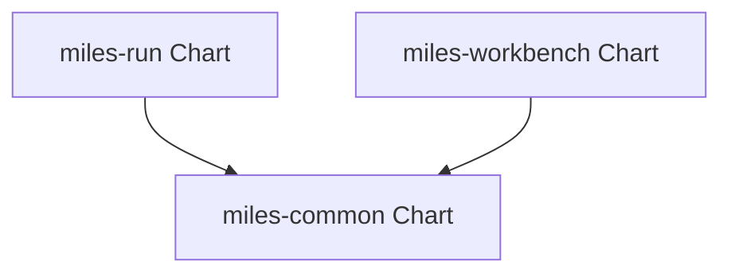
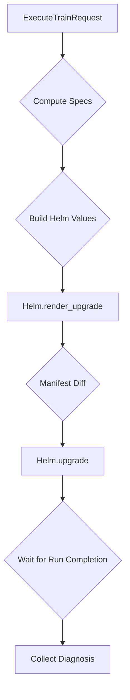

<!-- source: DeepWiki mcp.deepwiki.com · repo radixark/miles · page 9.7 Kubernetes and Helm Deployment · fetched 2026-10-21 -->

# Kubernetes and Helm Deployment

<details>
<summary>Relevant source files</summary>

The following files were used as context for generating this wiki page:

- [charts/miles-common/templates/_infra.tpl](charts/miles-common/templates/_infra.tpl)
- [charts/miles-run/templates/_helpers.tpl](charts/miles-run/templates/_helpers.tpl)
- [charts/miles-run/templates/_pool.tpl](charts/miles-run/templates/_pool.tpl)
- [charts/miles-run/templates/colocate-pairing.yaml](charts/miles-run/templates/colocate-pairing.yaml)
- [charts/miles-run/templates/command-job.yaml](charts/miles-run/templates/command-job.yaml)
- [charts/miles-run/templates/orchestrator.yaml](charts/miles-run/templates/orchestrator.yaml)
- [charts/miles-run/templates/validate-infra-paths.yaml](charts/miles-run/templates/validate-infra-paths.yaml)
- [charts/miles-run/values.schema.json](charts/miles-run/values.schema.json)
- [charts/miles-run/values.yaml](charts/miles-run/values.yaml)
- [charts/miles-workbench/templates/NOTES.txt](charts/miles-workbench/templates/NOTES.txt)
- [charts/miles-workbench/templates/_helpers.tpl](charts/miles-workbench/templates/_helpers.tpl)
- [charts/miles-workbench/templates/infra-configmap.yaml](charts/miles-workbench/templates/infra-configmap.yaml)
- [charts/miles-workbench/templates/statefulset.yaml](charts/miles-workbench/templates/statefulset.yaml)
- [charts/miles-workbench/templates/validate-infra-paths.yaml](charts/miles-workbench/templates/validate-infra-paths.yaml)
- [charts/miles-workbench/values.schema.json](charts/miles-workbench/values.schema.json)
- [charts/miles-workbench/values.yaml](charts/miles-workbench/values.yaml)
- [charts/shared-infra.schema.json](charts/shared-infra.schema.json)
- [docs/advanced/cluster-backend.md](docs/advanced/cluster-backend.md)
- [miles/utils/external_utils/colocate_pairing/__main__.py](miles/utils/external_utils/colocate_pairing/__main__.py)
- [miles/utils/external_utils/colocate_pairing/config.py](miles/utils/external_utils/colocate_pairing/config.py)
- [miles/utils/external_utils/colocate_pairing/controller.py](miles/utils/external_utils/colocate_pairing/controller.py)
- [miles/utils/external_utils/colocate_pairing/pods.py](miles/utils/external_utils/colocate_pairing/pods.py)
- [miles/utils/external_utils/command_utils/helm_backend/launcher/command_wrapper.py](miles/utils/external_utils/command_utils/helm_backend/launcher/command_wrapper.py)
- [miles/utils/external_utils/command_utils/helm_backend/launcher/entrypoint.py](miles/utils/external_utils/command_utils/helm_backend/launcher/entrypoint.py)
- [miles/utils/external_utils/command_utils/helm_backend/launcher/launch_record.py](miles/utils/external_utils/command_utils/helm_backend/launcher/launch_record.py)
- [miles/utils/external_utils/command_utils/helm_backend/launcher/values/builder.py](miles/utils/external_utils/command_utils/helm_backend/launcher/values/builder.py)
- [miles/utils/external_utils/command_utils/helm_backend/launcher/values/colocate.py](miles/utils/external_utils/command_utils/helm_backend/launcher/values/colocate.py)
- [miles/utils/external_utils/command_utils/helm_backend/launcher/values/helm_values_types.py](miles/utils/external_utils/command_utils/helm_backend/launcher/values/helm_values_types.py)
- [miles/utils/external_utils/command_utils/helm_backend/launcher/values/misc.py](miles/utils/external_utils/command_utils/helm_backend/launcher/values/misc.py)
- [miles/utils/external_utils/command_utils/helm_backend/naming.py](miles/utils/external_utils/command_utils/helm_backend/naming.py)
- [miles/utils/workers/env_vars.py](miles/utils/workers/env_vars.py)
- [miles/utils/workers/polling_reconcile_loop.py](miles/utils/workers/polling_reconcile_loop.py)
- [miles/utils/workers/reconcile/__init__.py](miles/utils/workers/reconcile/__init__.py)
- [miles/utils/workers/reconcile/loop.py](miles/utils/workers/reconcile/loop.py)
- [miles/utils/workers/reconcile/object_store.py](miles/utils/workers/reconcile/object_store.py)
- [miles/utils/workers/reconcile/retry_scheduler.py](miles/utils/workers/reconcile/retry_scheduler.py)
- [miles/utils/workers/reconcile/source_event.py](miles/utils/workers/reconcile/source_event.py)
- [miles/utils/workers/reconcile/source_stream_driver.py](miles/utils/workers/reconcile/source_stream_driver.py)
- [miles/utils/workers/reconcile/work_queue.py](miles/utils/workers/reconcile/work_queue.py)
- [miles/utils/workers/worker_provider/kubernetes/core/__init__.py](miles/utils/workers/worker_provider/kubernetes/core/__init__.py)
- [miles/utils/workers/worker_provider/kubernetes/core/cell_view.py](miles/utils/workers/worker_provider/kubernetes/core/cell_view.py)
- [miles/utils/workers/worker_provider/kubernetes/core/pod_view.py](miles/utils/workers/worker_provider/kubernetes/core/pod_view.py)
- [miles/utils/workers/worker_provider/kubernetes/core/provider.py](miles/utils/workers/worker_provider/kubernetes/core/provider.py)
- [miles/utils/workers/worker_provider/kubernetes/helm/env.py](miles/utils/workers/worker_provider/kubernetes/helm/env.py)
- [tests/fast/charts/miles_common/test_helpers.py](tests/fast/charts/miles_common/test_helpers.py)
- [tests/fast/charts/miles_run/test_colocate.py](tests/fast/charts/miles_run/test_colocate.py)
- [tests/fast/charts/miles_run/test_command_job.py](tests/fast/charts/miles_run/test_command_job.py)
- [tests/fast/charts/miles_run/test_infra_paths.py](tests/fast/charts/miles_run/test_infra_paths.py)
- [tests/fast/charts/miles_run/test_orchestrator.py](tests/fast/charts/miles_run/test_orchestrator.py)
- [tests/fast/charts/miles_run/test_shm.py](tests/fast/charts/miles_run/test_shm.py)
- [tests/fast/charts/miles_workbench/test_rbac.py](tests/fast/charts/miles_workbench/test_rbac.py)
- [tests/fast/charts/miles_workbench/test_statefulset.py](tests/fast/charts/miles_workbench/test_statefulset.py)
- [tests/fast/charts/miles_workbench/test_values_schema.py](tests/fast/charts/miles_workbench/test_values_schema.py)
- [tests/fast/charts/test_shared_infra_contract.py](tests/fast/charts/test_shared_infra_contract.py)
- [tests/fast/charts/utils.py](tests/fast/charts/utils.py)
- [tests/fast/tools/kubernetes/test_lint_charts.py](tests/fast/tools/kubernetes/test_lint_charts.py)
- [tests/fast/utils/external_utils/colocate_pairing/test_main.py](tests/fast/utils/external_utils/colocate_pairing/test_main.py)
- [tests/fast/utils/external_utils/command_utils/helm_backend/launcher/test_command_wrapper.py](tests/fast/utils/external_utils/command_utils/helm_backend/launcher/test_command_wrapper.py)
- [tests/fast/utils/external_utils/command_utils/helm_backend/launcher/test_entrypoint.py](tests/fast/utils/external_utils/command_utils/helm_backend/launcher/test_entrypoint.py)
- [tests/fast/utils/external_utils/command_utils/helm_backend/launcher/test_launch_colocate.py](tests/fast/utils/external_utils/command_utils/helm_backend/launcher/test_launch_colocate.py)
- [tests/fast/utils/external_utils/command_utils/helm_backend/launcher/test_launch_lifecycle.py](tests/fast/utils/external_utils/command_utils/helm_backend/launcher/test_launch_lifecycle.py)
- [tests/fast/utils/external_utils/command_utils/helm_backend/launcher/test_launch_record.py](tests/fast/utils/external_utils/command_utils/helm_backend/launcher/test_launch_record.py)
- [tests/fast/utils/external_utils/command_utils/helm_backend/launcher/test_launch_snapshot.py](tests/fast/utils/external_utils/command_utils/helm_backend/launcher/test_launch_snapshot.py)
- [tests/fast/utils/external_utils/command_utils/helm_backend/launcher/test_run_diagnosis.py](tests/fast/utils/external_utils/command_utils/helm_backend/launcher/test_run_diagnosis.py)
- [tests/fast/utils/external_utils/command_utils/helm_backend/launcher/values/test_builder.py](tests/fast/utils/external_utils/command_utils/helm_backend/launcher/values/test_builder.py)
- [tests/fast/utils/external_utils/command_utils/helm_backend/launcher/values/test_colocate.py](tests/fast/utils/external_utils/command_utils/helm_backend/launcher/values/test_colocate.py)
- [tests/fast/utils/external_utils/command_utils/helm_backend/launcher/values/test_misc.py](tests/fast/utils/external_utils/command_utils/helm_backend/launcher/values/test_misc.py)
- [tests/fast/utils/external_utils/command_utils/helm_backend/test_cluster_backend_flag.py](tests/fast/utils/external_utils/command_utils/helm_backend/test_cluster_backend_flag.py)
- [tests/fast/utils/external_utils/command_utils/helm_backend/test_naming.py](tests/fast/utils/external_utils/command_utils/helm_backend/test_naming.py)
- [tests/fast/utils/external_utils/test_colocate_pairing.py](tests/fast/utils/external_utils/test_colocate_pairing.py)
- [tests/fast/utils/workers/reconcile/__init__.py](tests/fast/utils/workers/reconcile/__init__.py)
- [tests/fast/utils/workers/reconcile/test_loop.py](tests/fast/utils/workers/reconcile/test_loop.py)
- [tests/fast/utils/workers/reconcile/test_object_store.py](tests/fast/utils/workers/reconcile/test_object_store.py)
- [tests/fast/utils/workers/reconcile/test_retry_scheduler.py](tests/fast/utils/workers/reconcile/test_retry_scheduler.py)
- [tests/fast/utils/workers/reconcile/test_source_stream_driver.py](tests/fast/utils/workers/reconcile/test_source_stream_driver.py)
- [tests/fast/utils/workers/reconcile/test_work_queue.py](tests/fast/utils/workers/reconcile/test_work_queue.py)
- [tests/fast/utils/workers/test_polling_reconcile_loop.py](tests/fast/utils/workers/test_polling_reconcile_loop.py)
- [tests/fast/utils/workers/worker_provider/kubernetes/__init__.py](tests/fast/utils/workers/worker_provider/kubernetes/__init__.py)
- [tests/fast/utils/workers/worker_provider/kubernetes/core/__init__.py](tests/fast/utils/workers/worker_provider/kubernetes/core/__init__.py)
- [tests/fast/utils/workers/worker_provider/kubernetes/core/test_cell_view.py](tests/fast/utils/workers/worker_provider/kubernetes/core/test_cell_view.py)
- [tests/fast/utils/workers/worker_provider/kubernetes/core/test_pod_view.py](tests/fast/utils/workers/worker_provider/kubernetes/core/test_pod_view.py)
- [tests/fast/utils/workers/worker_provider/kubernetes/core/test_provider.py](tests/fast/utils/workers/worker_provider/kubernetes/core/test_provider.py)
- [tests/fast/utils/workers/worker_provider/kubernetes/helm/__init__.py](tests/fast/utils/workers/worker_provider/kubernetes/helm/__init__.py)
- [tests/fast/utils/workers/worker_provider/kubernetes/helm/test_env.py](tests/fast/utils/workers/worker_provider/kubernetes/helm/test_env.py)
- [tests/snapshots/helm_backend/kubernetes_launch.txt](tests/snapshots/helm_backend/kubernetes_launch.txt)
- [tools/kubernetes/generate_chart_schema.py](tools/kubernetes/generate_chart_schema.py)
- [tools/kubernetes/lint_charts.py](tools/kubernetes/lint_charts.py)

</details>


This page details Miles' Kubernetes cluster backend, focusing on the Helm charts used for deployment, the `helm_backend` launcher, and the Kubernetes worker provider and reconcile loop. It covers the structure of the Helm charts (`miles-run`, `miles-workbench`, `miles-common`), how the launcher builds Helm values, performs manifest diffs, handles naming conventions, and manages colocation pairing. It also explains the Kubernetes worker provider's role in orchestrating Miles components and the reconcile loop that ensures cluster state alignment.

## Helm Charts Overview

Miles utilizes Helm charts for deploying its various components onto a Kubernetes cluster. There are three primary charts: `miles-run`, `miles-workbench`, and `miles-common`.

*   **`miles-run`**: This chart is responsible for deploying a Miles training or inference run. It includes templates for orchestrator pods, static workers, inference engines, trainer engines, and optional command jobs. It defines the core resources needed for a distributed Miles job.
    *   Its `values.schema.json` [charts/miles-run/values.schema.json]() defines the expected structure and validation rules for its configuration.
    *   The `values.yaml` [charts/miles-run/values.yaml]() provides default values.
    *   Helper templates in `_helpers.tpl` [charts/miles-run/templates/_helpers.tpl]() define common labels, environment variables, pod defaults, and volume configurations.
*   **`miles-workbench`**: This chart is designed for deploying a development or interactive environment for Miles, often a single StatefulSet.
    *   Its `values.schema.json` [charts/miles-workbench/values.schema.json]() specifies its configuration.
    *   The `values.yaml` [charts/miles-workbench/values.yaml]() provides default values.
    *   It includes templates for StatefulSets [charts/miles-workbench/templates/statefulset.yaml]() and RBAC configurations [tests/fast/charts/miles_workbench/test_rbac.py]().
*   **`miles-common`**: This is a library chart that provides common definitions and utilities shared across `miles-run` and `miles-workbench`. It includes shared labels, image configurations, and volume definitions.
    *   `_infra.tpl` [charts/miles-common/templates/_infra.tpl]() defines common infrastructure-related templates.

### Helm Chart Structure and Dependencies

The charts are organized under the `charts/` directory. `miles-run` and `miles-workbench` depend on `miles-common`. The `Helm.build_dependencies` method [miles/utils/external_utils/command_utils/helm_backend/launcher/command_wrapper.py:93-97]() ensures that these dependencies are built before deployment.



**Diagram: Helm Chart Dependencies**

Sources:
- [charts/miles-run/values.schema.json]()
- [charts/miles-run/values.yaml]()
- [charts/miles-run/templates/_helpers.tpl]()
- [charts/miles-workbench/values.schema.json]()
- [charts/miles-workbench/values.yaml]()
- [charts/miles-workbench/templates/statefulset.yaml]()
- [charts/miles-workbench/templates/_helpers.tpl]()
- [charts/miles-common/templates/_infra.tpl]()
- [miles/utils/external_utils/command_utils/helm_backend/launcher/command_wrapper.py:93-97]()
- [tests/fast/charts/miles_workbench/test_rbac.py]()

## The `helm_backend` Launcher

The `helm_backend` launcher, primarily implemented in `miles/utils/external_utils/command_utils/helm_backend/launcher/entrypoint.py`(), is responsible for orchestrating the deployment of Miles jobs onto Kubernetes using Helm.

### Deployment Workflow

The `execute_train` function [miles/utils/external_utils/command_utils/helm_backend/launcher/entrypoint.py:81-102]() is the entry point for launching a training job. It performs the following key steps:

1.  **Run ID and Release Naming**: It validates the `run_id` and constructs the Helm release name using `ReleaseName` [miles/utils/external_utils/command_utils/helm_backend/naming.py:39-71](). The release name incorporates the chart name, run ID, deploy component (e.g., `TRAINER`), and an optional instance ID.
2.  **Environment Variables**: It computes environment variables for the training process using `train_env_vars` [miles/utils/external_utils/command_utils/helm_backend/launcher/entrypoint.py:95]().
3.  **Compute Specs**: It determines the worker specifications (`specs`) based on the provided arguments using `compute_specs` [miles/utils/external_utils/command_utils/helm_backend/launcher/entrypoint.py:105]().
4.  **Hot Restart Planning**: It plans for hot restarts if configured, using `plan_hot_restart` [miles/utils/external_utils/command_utils/helm_backend/launcher/entrypoint.py:115-120](). This involves identifying components that need to be restarted and stamping them with a `restart_at` annotation.
5.  **Values Builder**: It builds the Helm values for the deployment using `build_values` [miles/utils/external_utils/command_utils/helm_backend/launcher/values/builder.py:32-33](). This is a crucial step where Miles' internal worker specifications are translated into Helm-compatible values.
6.  **Manifest Rendering and Diff**: It renders the Helm chart with the computed values to get the desired Kubernetes manifest. It then performs a manifest diff against the currently installed release (if any) to determine what changes need to be applied. This is handled by `Helm.render_upgrade` [miles/utils/external_utils/command_utils/helm_backend/launcher/command_wrapper.py:43-53]() and `manifest_diff.compute` [miles/utils/external_utils/command_utils/helm_backend/launcher/manifest_diff.py:10-11]().
7.  **Helm Upgrade**: Finally, it executes a `helm upgrade --install` command to apply the changes to the Kubernetes cluster using `Helm.upgrade` [miles/utils/external_utils/command_utils/helm_backend/launcher/command_wrapper.py:32-40]().
8.  **Observability and Monitoring**: The launcher integrates with observability tools, including `with_observability` [miles/utils/external_utils/command_utils/helm_backend/launcher/observability/diagnosis.py:10-11]() for diagnosis collection and `wait_for_run` [miles/utils/external_utils/command_utils/helm_backend/orchestrator/observer.py:10-11]() to monitor the run's progress.



**Diagram: Helm Backend Launcher Workflow**

Sources:
- [miles/utils/external_utils/command_utils/helm_backend/launcher/entrypoint.py:81-102]()
- [miles/utils/external_utils/command_utils/helm_backend/naming.py:39-71]()
- [miles/utils/external_utils/command_utils/helm_backend/launcher/entrypoint.py:95]()
- [miles/utils/external_utils/command_utils/helm_backend/launcher/entrypoint.py:105]()
- [miles/utils/external_utils/command_utils/helm_backend/launcher/entrypoint.py:115-120]()
- [miles/utils/external_utils/command_utils/helm_backend/launcher/values/builder.py:32-33]()
- [miles/utils/external_utils/command_utils/helm_backend/launcher/command_wrapper.py:43-53]()
- [miles/utils/external_utils/command_utils/helm_backend/launcher/manifest_diff.py:10-11]()
- [miles/utils/external_utils/command_utils/helm_backend/launcher/command_wrapper.py:32-40]()
- [miles/utils/external_utils/command_utils/helm_backend/launcher/observability/diagnosis.py:10-11]()
- [miles/utils/external_utils/command_utils/helm_backend/orchestrator/observer.py:10-11]()

### Values Builder

The `build_values` function [miles/utils/external_utils/command_utils/helm_backend/launcher/values/builder.py:32-33]() in `miles/utils/external_utils/command_utils/helm_backend/launcher/values/builder.py` is central to translating Miles' internal worker specifications into the Helm values format.

It takes a list of `BaseWorkerSpec` objects and a `LaunchPlan` to construct a `MilesRunChartValues` object. This involves:

*   **Orchestrator Configuration**: Setting up the orchestrator command and restart policy.
*   **Worker Pool Entries**: Iterating through `BaseWorkerSpec` objects (static workers, inference engines, trainer engines) and converting them into `PoolEntry` objects [miles/utils/external_utils/command_utils/helm_backend/launcher/values/helm_values_types.py:78-91](). The `build_entry` function [miles/utils/external_utils/command_utils/helm_backend/launcher/values/pool_entry.py:10-11]() handles this conversion, including port and address allocation.
*   **Mooncake Configuration**: If Mooncake is used as an object store, its configuration is included.
*   **Colocation Pairing**: If colocation is enabled, it computes the `PairingConfig` using `pairing_config` [miles/utils/external_utils/command_utils/helm_backend/launcher/values/colocate.py:10-11]() to define how inference and trainer pods should be placed together.

The `RunValues` Pydantic model [miles/utils/external_utils/command_utils/helm_backend/launcher/values/helm_values_types.py:120-133]() defines the structure of the `run` section in the Helm values, encompassing all these configurations.

Sources:
- [miles/utils/external_utils/command_utils/helm_backend/launcher/values/builder.py:32-33]()
- [miles/utils/external_utils/command_utils/helm_backend/launcher/values/helm_values_types.py:78-91]()
- [miles/utils/external_utils/command_utils/helm_backend/launcher/values/pool_entry.py:10-11]()
- [miles/utils/external_utils/command_utils/helm_backend/launcher/values/colocate.py:10-11]()
- [miles/utils/external_utils/command_utils/helm_backend/launcher/values/helm_values_types.py:120-133]()

### Manifest Diff

The `manifest_diff` module [miles/utils/external_utils/command_utils/helm_backend/launcher/manifest_diff.py]() is responsible for comparing the desired Kubernetes manifest (rendered from Helm) with the currently installed manifest. This allows the launcher to identify which Kubernetes objects need to be created, updated, or deleted.

The `Manifest` class [miles/utils/external_utils/command_utils/helm_backend/launcher/manifest_types.py:10-11]() parses the raw YAML output from Helm into a structured representation, making it easier to compare objects.

Sources:
- [miles/utils/external_utils/command_utils/helm_backend/launcher/manifest_diff.py]()
- [miles/utils/external_utils/command_utils/helm_backend/launcher/manifest_types.py:10-11]()

### Naming Conventions

Miles uses a consistent naming scheme for Helm releases and Kubernetes objects to ensure clarity and avoid conflicts. The `naming.py` module [miles/utils/external_utils/command_utils/helm_backend/naming.py]() defines these conventions:

*   **Release Names**: Constructed using `ReleaseName` [miles/utils/external_utils/command_utils/helm_backend/naming.py:39-71](), which combines the chart name, `run_id`, `deploy_component`, and `deploy_instance_id`. This ensures uniqueness and traceability.
*   **Object Names**: Kubernetes object names (e.g., services, deployments) are derived from the release name and component-specific suffixes using `component_name` [miles/utils/workers/worker_provider/kubernetes/helm/naming.py:12-13](). Examples include `orchestrator_object` [miles/utils/external_utils/command_utils/helm_backend/naming.py:103-104]() and `platform_account_name` [miles/utils/external_utils/command_utils/helm_backend/naming.py:34-36]().
*   **Run Files**: Directories and files for storing run-specific data (e.g., Helm values, launch records, orchestrator state) are organized under a `miles-runs` directory within a shared root, as defined by `RunFiles` [miles/utils/external_utils/command_utils/helm_backend/naming.py:119-148]().

Sources:
- [miles/utils/external_utils/command_utils/helm_backend/naming.py]()
- [miles/utils/external_utils/command_utils/helm_backend/naming.py:39-71]()
- [miles/utils/workers/worker_provider/kubernetes/helm/naming.py:12-13]()
- [miles/utils/external_utils/command_utils/helm_backend/naming.py:103-104]()
- [miles/utils/external_utils/command_utils/helm_backend/naming.py:34-36]()
- [miles/utils/external_utils/command_utils/helm_backend/naming.py:119-148]()

### Colocation Pairing

Colocation pairing is a strategy to optimize resource utilization by placing inference and trainer pods on the same Kubernetes nodes, often sharing GPUs. The `colocate_pairing` module [miles/utils/external_utils/colocate_pairing/controller.py]() and `miles/utils/external_utils/command_utils/helm_backend/launcher/values/colocate.py`() handle this.

The `PairingConfig` [miles/utils/external_utils/colocate_pairing/config.py:18-19]() defines the layout and resource allocation for colocated pods. The `pairing_config` function [miles/utils/external_utils/command_utils/helm_backend/launcher/values/colocate.py:10-11]() in the values builder computes this configuration based on the worker specifications.

The `PairingLayout` [miles/utils/external_utils/colocate_pairing/config.py:21-30]() specifies the number of cells, pods per cell, and GPU allocation for both inference and trainer components. The `_place_inference_pod` function [miles/utils/external_utils/colocate_pairing/controller.py:21-22]() determines the optimal placement of inference pods relative to trainer pods, including the `base_gpu_id` [miles/utils/external_utils/colocate_pairing/controller.py:21-22]() for each inference pod.

This ensures that when colocation is enabled, the Helm chart generates Kubernetes manifests that enforce these placement constraints, typically through node selectors and affinity rules.

Sources:
- [miles/utils/external_utils/colocate_pairing/controller.py]()
- [miles/utils/external_utils/command_utils/helm_backend/launcher/values/colocate.py]()
- [miles/utils/external_utils/colocate_pairing/config.py:18-19]()
- [miles/utils/external_utils/command_utils/helm_backend/launcher/values/colocate.py:10-11]()
- [miles/utils/external_utils/colocate_pairing/config.py:21-30]()
- [miles/utils/external_utils/colocate_pairing/controller.py:21-22]()
- [tests/fast/utils/external_utils/test_colocate_pairing.py:101-102]()

## Kubernetes Worker Provider and Reconcile Loop

Miles' Kubernetes worker provider is responsible for managing the lifecycle of Ray actors (workers) within the Kubernetes cluster. This is achieved through a reconcile loop that continuously monitors the desired state (from Miles' perspective) and the actual state (in Kubernetes) and takes corrective actions.

### Worker Provider

The Kubernetes worker provider interacts with the Kubernetes API to create, update, and delete resources like Pods, StatefulSets, and Services. It translates Miles' `BaseWorkerSpec` into Kubernetes-specific configurations.

Key components and concepts:

*   **`PodView` and `CellView`**: These classes [miles/utils/workers/worker_provider/kubernetes/core/pod_view.py](), [miles/utils/workers/worker_provider/kubernetes/core/cell_view.py]() provide an abstraction over Kubernetes Pods and "cells" (groups of pods, often corresponding to a Ray actor pool). They allow Miles to query and manipulate Kubernetes resources in a structured way.
*   **`INSTANCE_LABEL`**: A Kubernetes label [miles/utils/workers/worker_provider/kubernetes/helm/env.py:15]() used to identify all resources belonging to a specific Miles release. This is crucial for the reconcile loop to select relevant objects.
*   **`static_cell_addrs`**: This function [miles/utils/workers/worker_provider/kubernetes/helm/naming.py:54]() computes the network addresses for static worker cells, which are then used by other Miles components to communicate.

### Reconcile Loop

The `ReconcileLoop` [miles/utils/workers/reconcile/loop.py]() is a core component that ensures the Kubernetes cluster state matches the desired state defined by Miles. It operates by:

1.  **Observing Events**: It watches for `UpsertEvent` (creation/update) and `DeleteEvent` (deletion) events from various sources, including the object store [miles/utils/workers/reconcile/object_store.py]() and Kubernetes API.
2.  **Comparing States**: It compares the observed state with the desired state (e.g., worker specifications).
3.  **Taking Action**: Based on the comparison, it performs actions such as:
    *   Creating new Kubernetes resources (Pods, StatefulSets, Services) if they are missing.
    *   Updating existing resources if their configuration has changed.
    *   Deleting resources that are no longer needed.
    *   Handling hot restarts by detecting `restart_at` annotations [miles/utils/external_utils/command_utils/helm_backend/launcher/manifest_types.py:16-17]() and triggering pod restarts.

The reconcile loop is designed to be fault-tolerant and self-healing, continuously working to bring the cluster into the desired state even in the face of transient failures.

```mermaid
graph TD
    A[Miles Desired State (WorkerSpecs)] --> B{ReconcileLoop}
    B --> C[Kubernetes API]
    C --> D[Kubernetes Cluster State]
    D --> B
    B -- Create/Update/Delete --> C
    B -- Observe Events --> A
```

**Diagram: Kubernetes Reconcile Loop**

Sources:
- [miles/utils/workers/worker_provider/kubernetes/core/pod_view.py]()
- [miles/utils/workers/worker_provider/kubernetes/core/cell_view.py]()
- [miles/utils/workers/worker_provider/kubernetes/helm/env.py:15]()
- [miles/utils/workers/worker_provider/kubernetes/helm/naming.py:54]()
- [miles/utils/workers/reconcile/loop.py]()
- [miles/utils/workers/reconcile/object_store.py]()
- [miles/utils/external_utils/command_utils/helm_backend/launcher/manifest_types.py:16-17]()
- [tests/fast/utils/workers/reconcile/test_loop.py]()
- [tests/fast/utils/workers/reconcile/test_object_store.py]()
- [tests/fast/utils/workers/worker_provider/kubernetes/core/test_pod_view.py]()
- [tests/fast/utils/workers/worker_provider/kubernetes/core/test_cell_view.py]()

---

