# Page: Overview

# Overview

<details>
<summary>Relevant source files</summary>

The following files were used as context for generating this wiki page:

- [.gitignore](.gitignore)
- [README.md](README.md)
- [docker/patch/fla_kda_hoist_next_power_of_2.patch](docker/patch/fla_kda_hoist_next_power_of_2.patch)
- [docs/README.md](docs/README.md)
- [docs/advanced/lora.md](docs/advanced/lora.md)
- [docs/assets/images/acknowledgment.png](docs/assets/images/acknowledgment.png)
- [docs/docs.json](docs/docs.json)
- [docs/index.md](docs/index.md)
- [docs/models/glm/glm5-2.md](docs/models/glm/glm5-2.md)
- [docs/models/glm/glm5-3-flash.md](docs/models/glm/glm5-3-flash.md)
- [docs/models/glm/glm5-3.md](docs/models/glm/glm5-3.md)
- [docs/models/glm/glm5.md](docs/models/glm/glm5.md)
- [docs/models/glm/index.md](docs/models/glm/index.md)
- [docs/models/index.md](docs/models/index.md)
- [miles/backends/megatron_utils/megatron_to_hf/glm5_next.py](miles/backends/megatron_utils/megatron_to_hf/glm5_next.py)
- [miles/ray/wiring.py](miles/ray/wiring.py)
- [miles/utils/async_utils.py](miles/utils/async_utils.py)
- [miles/utils/orchestration_utils.py](miles/utils/orchestration_utils.py)
- [tests/fast/fixtures/driver_fakes.py](tests/fast/fixtures/driver_fakes.py)
- [tests/fast/ray/test_wiring.py](tests/fast/ray/test_wiring.py)
- [tests/fast/test_platform_contract.py](tests/fast/test_platform_contract.py)
- [tests/fast/test_train.py](tests/fast/test_train.py)
- [tests/fast/test_train_async.py](tests/fast/test_train_async.py)
- [tests/fast/test_train_multi_policy.py](tests/fast/test_train_multi_policy.py)
- [tests/fast/utils/test_async_utils.py](tests/fast/utils/test_async_utils.py)
- [tests/fast/utils/test_orchestration_utils.py](tests/fast/utils/test_orchestration_utils.py)
- [tests/fast/utils/workers/test_ray_communication_boundary.py](tests/fast/utils/workers/test_ray_communication_boundary.py)
- [tests/manual/launch_scripts/test_py_launch_scripts.py](tests/manual/launch_scripts/test_py_launch_scripts.py)
- [train.py](train.py)
- [train_async.py](train_async.py)
- [train_multi_policy.py](train_multi_policy.py)

</details>


This page provides a high-level technical introduction to Miles, explaining its architecture, core design philosophy around train-inference alignment, and its structural relationship to foundational components like SGLang, Megatron-LM, and Ray [README.md:32-42]().

---

## What is Miles?

**Miles** is an enterprise-grade reinforcement learning (RL) framework built for large-scale model post-training [README.md:32-34](). Originating as a production-hardened fork of `slime`, Miles bridges the gap between research prototypes and production-scale training infrastructure by pairing **SGLang** for high-throughput rollout generation with **Megatron-LM** for parallelized large-scale training [README.md:32-36](). Native PyTorch FSDP2 and `torchtitan` backends are also provided for alternative training workflows, though primary scaling, multi-LoRA, and frontier model recipes target Megatron-LM [README.md:32-45](), [docs/index.md:6-13]().

Sources: [README.md:32-45](), [docs/index.md:6-13]()

---

## Core Value Proposition: Train-Inference Alignment

The central challenge in large-scale RL post-training is **train-inference mismatch**—discrepancies between the rollout generation environment (SGLang) and the training environment (Megatron-LM or FSDP) regarding numerical precision, kernel execution, or expert routing in Mixture-of-Experts (MoE) architectures. These discrepancies cause training instability and collapse during on-policy RL [README.md:39-80]().

Miles addresses this through a multi-layered correction strategy:

**Train-Inference Alignment Strategy**
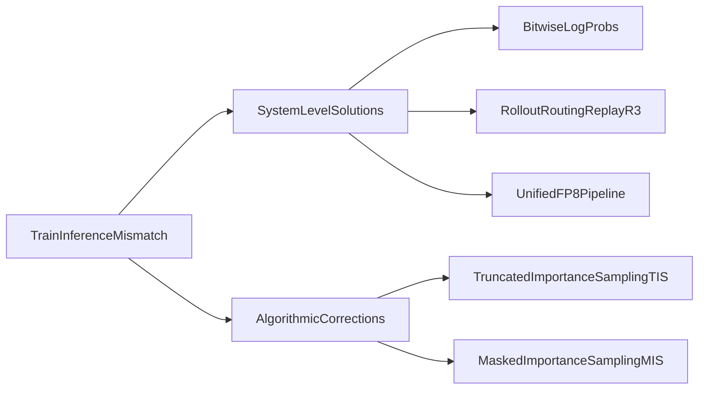

*   **System-level solutions**: Enforce exact bit-wise log probability matching using deterministic kernels (e.g., FlashAttention-3, DeepGEMM) and **Rollout Routing Replay (R3)** to record and replay MoE expert routing decisions [README.md:69-80]().
*   **Algorithmic corrections**: Apply **Truncated Importance Sampling (TIS)** and **Masked Importance Sampling (MIS)** in asynchronous drivers like `train_async.py` to compensate for unavoidable off-policy lag [README.md:51-53](), [train_async.py:24-26]().

Sources: [README.md:39-80](), [train_async.py:24-26]()

---

## Three-Layer System Architecture

Miles organizes its execution graph into three distinct architectural layers managed through Ray placement groups [README.md:39-80](), [train.py:25-38]().

**Three-Layer System Architecture**
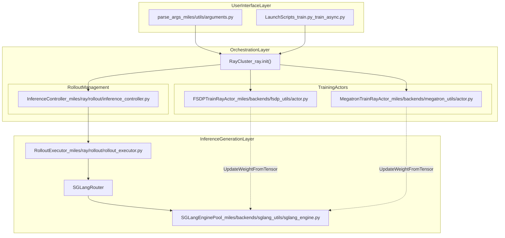

### Layer Responsibilities

1.  **User Interface Layer**: Parses arguments and configures execution environments via entry points like `train.py` [train.py:25-28]() and `train_async.py` [train_async.py:23-27]().
2.  **Orchestration & Training Layer**: Ray orchestrates distributed training actors (`MegatronTrainRayActor`, `FSDPTrainRayActor`) alongside rollout controllers (`InferenceController`) [README.md:39-53](), [train.py:37-41]().
3.  **Inference & Generation Layer**: High-throughput generation is driven by SGLang engines managed by `RolloutExecutor` and bridged back to training via tensor-bucket weight updates [README.md:39-60](), [train.py:37-48]().

Sources: [README.md:39-60](), [train.py:25-48](), [train_async.py:23-27]()

---

## Component-to-Code Entity Mapping

The following diagram maps high-level framework subsystems to their underlying codebase implementations, highlighting key classes and execution modules.

**Component to Code Entity Mapping**
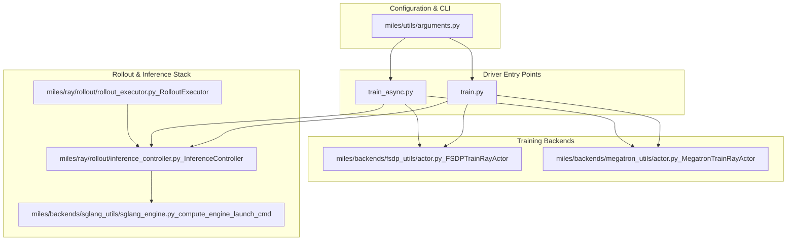

Sources: [train.py:25-45](), [train_async.py:24-38]()

---

## Training Workflow Implementation

Miles supports synchronous training (`train.py`), asynchronous pipelined training (`train_async.py`), and multi-policy coordination (`train_multi_policy.py`) [train.py:25-156](), [train_async.py:23-137](), [train_multi_policy.py:32-102](). The sequence below details the interaction between the driver, rollout generation workers, and training actors during a rollout-training iteration [train.py:103-132](), [train_async.py:71-96]().

**Training Loop Sequence**
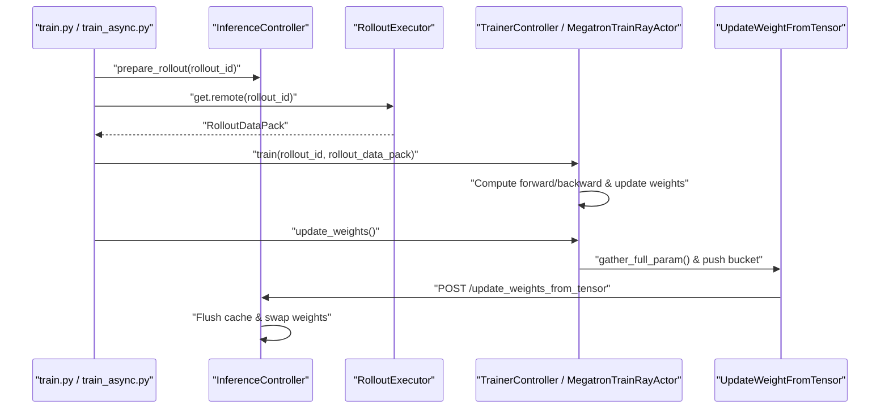

### Workflow Highlights

1.  **Preparation**: The driver instructs `InferenceController` to prepare SGLang engines for the upcoming rollout [train.py:104](), [train_async.py:66]().
2.  **Rollout Collection**: `RolloutExecutor` generates or fetches trajectories and returns a rollout data pack [train.py:105](), [train_async.py:67]().
3.  **Training Step**: The training actor executes policy optimization on the rollout batch [train.py:121-130](), [train_async.py:86-95]().
4.  **Weight Synchronization**: Updated weights are synchronized back to the SGLang inference engines via zero-copy tensor streaming or NCCL broadcast (`update_weights`) [train.py:48](), [train_async.py:41](), [train_multi_policy.py:58]().

Sources: [train.py:25-156](), [train_async.py:23-137](), [train_multi_policy.py:32-102]()

---

# Page: Getting Started

# Getting Started

<details>
<summary>Relevant source files</summary>

The following files were used as context for generating this wiki page:

- [docs/advanced/disaggregated-rollout.md](docs/advanced/disaggregated-rollout.md)
- [docs/advanced/disk-offload.md](docs/advanced/disk-offload.md)
- [docs/advanced/pd-disaggregation.md](docs/advanced/pd-disaggregation.md)
- [docs/getting-started/quick-start.md](docs/getting-started/quick-start.md)
- [docs/models/deepseek/deepseek-v4-1-flash.md](docs/models/deepseek/deepseek-v4-1-flash.md)
- [docs/models/deepseek/deepseek.md](docs/models/deepseek/deepseek.md)
- [docs/models/deepseek/index.md](docs/models/deepseek/index.md)
- [docs/user-guide/training-backend.md](docs/user-guide/training-backend.md)
- [examples/infra_features/fully_async/run_qwen3_30b_a3b_fully_async.py](examples/infra_features/fully_async/run_qwen3_30b_a3b_fully_async.py)
- [examples/infra_features/random_async/run_random_async_3node.py](examples/infra_features/random_async/run_random_async_3node.py)
- [examples/swe-agent-harbor-docker/run-glm47-flash-agentic-async.py](examples/swe-agent-harbor-docker/run-glm47-flash-agentic-async.py)
- [examples/swe-agent-harbor-docker/run.py](examples/swe-agent-harbor-docker/run.py)
- [miles/backends/sglang_utils/sglang_api_client.py](miles/backends/sglang_utils/sglang_api_client.py)
- [miles_plugins/optimizers/__init__.py](miles_plugins/optimizers/__init__.py)
- [miles_plugins/optimizers/nvme_stream.py](miles_plugins/optimizers/nvme_stream.py)
- [tests/fast-gpu/test_nvme_optimizer_streamed_grads.py](tests/fast-gpu/test_nvme_optimizer_streamed_grads.py)
- [tests/fast/backends/megatron_utils/test_lora_model_branches.py](tests/fast/backends/megatron_utils/test_lora_model_branches.py)
- [tests/fast/backends/sglang_utils/test_sglang_api_client.py](tests/fast/backends/sglang_utils/test_sglang_api_client.py)
- [tests/fast/examples/test_example_launcher_flags.py](tests/fast/examples/test_example_launcher_flags.py)
- [tests/fast/optimizers/__init__.py](tests/fast/optimizers/__init__.py)
- [tests/fast/optimizers/test_nvme_stream.py](tests/fast/optimizers/test_nvme_stream.py)

</details>


This page provides a high-level overview of how to get started with Miles, covering prerequisites, the basic training workflow, installation summaries, and quick-start entry points. 

**Child Pages**: 
- For detailed installation instructions including Docker setup and dependency management, see [Installation and Docker Setup](#2.1). 
- For a step-by-step tutorial with a working example using a small model, see [Quick Start Tutorial](#2.2). 
- For comprehensive configuration options and the argument parsing system, see [Configuration System](#2.3).

---

## Purpose and Scope

This parent page guides you through the high-level concepts required to begin working with Miles:
- System prerequisites and hardware requirements
- The high-level training workflow bridging natural language concepts to code entities
- Quick installation options via Docker or from source
- References to detailed child guides for setup, tutorials, and configuration

---

## Prerequisites and System Requirements

Miles is engineered for GPU-accelerated post-training across large-scale distributed clusters [docs/getting-started/quick-start.md:5-9]().

| Component | Requirement | Recommended |
|-----------|-------------|-------------|
| **GPU** | NVIDIA (H100, H200, B-series) or AMD | H100 or B-series for FP8/FA3 support [docs/getting-started/quick-start.md:5-9]() |
| **VRAM** | 40GB+ per GPU | 80GB+ per GPU |
| **Network** | High-bandwidth (InfiniBand, RoCEv2) | 200Gbps+ per node for multi-node |
| **Storage** | 500GB+ free disk space | NVMe SSD for fast checkpointing [docs/getting-started/quick-start.md:8-9]() |

- **Operating System**: Linux (Ubuntu 20.04+ recommended)
- **Docker**: Required with GPU access for the recommended installation path [docs/getting-started/quick-start.md:9-17]()

Sources: [docs/getting-started/quick-start.md:5-20]()

---

## High-Level Training Workflow

Miles implements an on-policy reinforcement learning workflow alternating between rollout generation and policy training [docs/getting-started/quick-start.md:134-142](). 

### Training Loop Code Mapping

Title: Training Loop Natural Language to Code Mapping
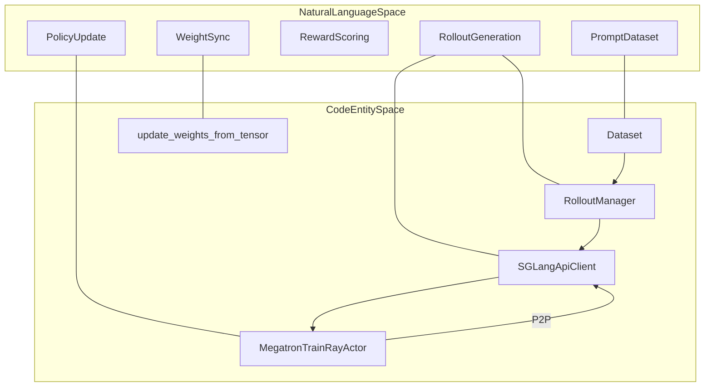
Sources: [docs/getting-started/quick-start.md:117-142](), [miles/backends/sglang_utils/sglang_api_client.py:112-137]()

---

## Installation Overview

The recommended installation path utilizes Docker images containing patched versions of SGLang and Megatron-LM [docs/getting-started/quick-start.md:34-47](). 

For full instructions covering container execution, source builds, and verification checks, see [Installation and Docker Setup](#2.1).

Sources: [docs/getting-started/quick-start.md:34-53]()

---

## Quick Start Overview

A minimal training run can be executed using dense models such as Qwen3-4B via provided launcher scripts [docs/getting-started/quick-start.md:24-93](). 

For a complete walk-through including dataset downloads, Megatron weight conversion, and monitoring metrics, see [Quick Start Tutorial](#2.2).

Sources: [docs/getting-started/quick-start.md:1-124]()

---

## Configuration System Overview

Miles provides a comprehensive argument parsing system via `arguments.py`, organizing flags into distinct functional categories (checkpointing, rollout, optimization, and parallelisms) [docs/user-guide/training-backend.md:79-90]().

For details on parameter groups and tuning options, see [Configuration System](#2.3).

Sources: [docs/user-guide/training-backend.md:79-90]()

---

## System Architecture Mapping

Title: System Architecture and Orchestration Mapping
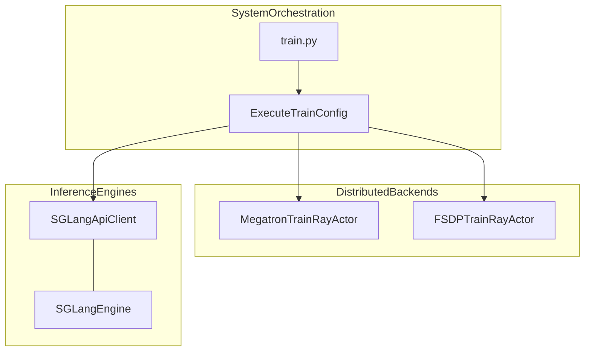
Sources: [docs/user-guide/training-backend.md:5-14](), [miles/backends/sglang_utils/sglang_api_client.py:59-90]()

---

## Next Steps

1. **[Installation and Docker Setup](#2.1)**: Install dependencies and configure environment images.
2. **[Quick Start Tutorial](#2.2)**: Run your first training job.
3. **[Configuration System](#2.3)**: Explore configuration options and argument groups.

Sources: [docs/getting-started/quick-start.md:1-124](), [docs/user-guide/training-backend.md:1-38]()

---

# Page: Installation and Docker Setup

# Installation and Docker Setup

<details>
<summary>Relevant source files</summary>

The following files were used as context for generating this wiki page:

- [.github/workflows/docker-build.yml](.github/workflows/docker-build.yml)
- [docker/Dockerfile](docker/Dockerfile)
- [docker/Dockerfile.rocm](docker/Dockerfile.rocm)
- [docker/amd/prebuild_aiter_jit.py](docker/amd/prebuild_aiter_jit.py)
- [docker/build.py](docker/build.py)
- [docs/developer/ci/02-docker-build.md](docs/developer/ci/02-docker-build.md)
- [docs/developer/versions.md](docs/developer/versions.md)
- [docs/getting-started/installation.md](docs/getting-started/installation.md)
- [docs/hardware-platforms/amd-gpus.md](docs/hardware-platforms/amd-gpus.md)
- [examples/experimental/openenv/tb2_sandbox_modal.py](examples/experimental/openenv/tb2_sandbox_modal.py)
- [miles/rollout/agentic/credentials.py](miles/rollout/agentic/credentials.py)
- [requirements.txt](requirements.txt)
- [scripts/amd/run_qwen3_30b_a3b.py](scripts/amd/run_qwen3_30b_a3b.py)
- [scripts/amd/run_qwen3_4b.py](scripts/amd/run_qwen3_4b.py)
- [setup.py](setup.py)
- [tests/fast/examples/experimental/openenv/test_openenv_modal_agent_function.py](tests/fast/examples/experimental/openenv/test_openenv_modal_agent_function.py)
- [tests/fast/examples/experimental/openenv/test_tb2_sandbox_modal.py](tests/fast/examples/experimental/openenv/test_tb2_sandbox_modal.py)
- [tests/fast/rollout/agentic/test_credentials.py](tests/fast/rollout/agentic/test_credentials.py)
- [tests/fast/test_docker_image_inputs.py](tests/fast/test_docker_image_inputs.py)
- [tests/test_fsdp_import.py](tests/test_fsdp_import.py)

</details>


This page explains how to install Miles via Docker or from source, including the setup of patched SGLang and Megatron-LM dependencies. Miles is designed for high-performance RL post-training and requires specific versions of its dependencies to ensure train-inference alignment.

Sources: [docs/getting-started/installation.md:1-7]()

## Docker Build Architecture and Variants

Miles uses a multi-stage Docker build process managed via `docker/build.py` [docker/build.py:3-10]() and `docker/Dockerfile` [docker/Dockerfile:1-13](). The build system integrates a complex stack of dependencies, including custom forks of SGLang and Megatron-LM, prebuilt wheels, and hardware-specific runtime components.

### Build Variants
The framework defines several standard build variants in `docker/build.py` [docker/build.py:23-92]():
- `cu13`: Multi-arch (`linux/amd64`, `linux/arm64`) CUDA 13 base image (`radixark/miles`) [docker/build.py:24-29]().
- `cu13-x86` / `cu13-aarch64`: Single-architecture builds for CUDA 13 [docker/build.py:30-41]().
- `rubin`: Vera Rubin (aarch64/SM107) build variant using `docker/Dockerfile.rubin` [docker/build.py:42-48]().
- `rocm724-mi35x`, `rocm10-mi35x`, `rocm10-mi30x`: AMD ROCm variants using `docker/Dockerfile.rocm` [docker/Dockerfile.rocm:4-15](), [docker/build.py:49-91]().

### Dependency Graph and Code Mapping

The following diagram bridges system architecture descriptions to the underlying build configuration files and directories.

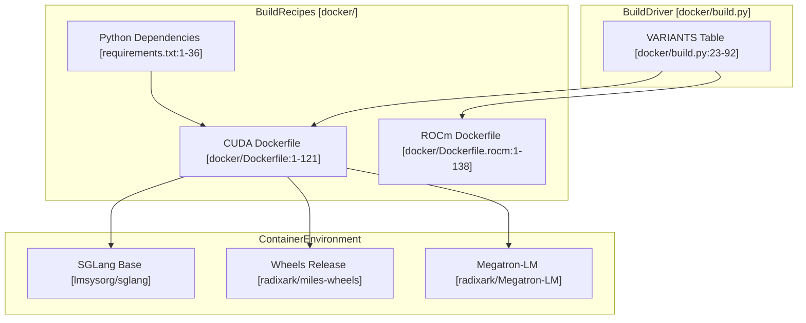

Sources: [docker/build.py:23-92](), [docker/Dockerfile:1-121](), [docker/Dockerfile.rocm:1-138](), [requirements.txt:1-35]()

---

## The Three Dependency Trees and Patched Dependencies

A Miles execution environment operates across three active Python source trees on a single `PYTHONPATH`, as detailed in `docs/developer/versions.md` [docs/developer/versions.md:5-16](). Because Miles relies on specialized kernel features (such as bit-wise identical log-probability matching and MoE routing replay), stock releases of upstream dependencies are insufficient.

| Tree | Repository / Branch | In-Container Path | Purpose |
|---|---|---|---|
| **Miles** | `radixark/miles` (this repo) | `/root/miles` | Core RL framework, orchestration, actors, and collectors [docs/developer/versions.md:13]() |
| **SGLang** | [`sgl-project/sglang`](https://github.com/sgl-project/sglang) (`sglang-miles`) | `/sgl-workspace/sglang` | High-throughput inference engine, router, and KV cache manager [docs/developer/versions.md:14]() |
| **Megatron-LM** | [`radixark/Megatron-LM`](https://github.com/radixark/Megatron-LM) (`miles-main`) | `/root/Megatron-LM` | Distributed training backend with 4D parallelism [docs/developer/versions.md:15]() |

### Dependency Integration and Tree Layout

The following diagram maps the logical dependency hierarchy to the concrete directory layout and installation commands inside the container image.

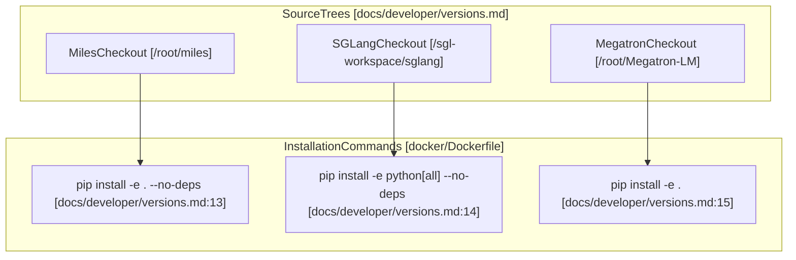

Sources: [docs/developer/versions.md:5-16](), [docker/Dockerfile:1-121]()

---

## Installation Procedures

### 1. Using Pre-built Docker Images
The standard deployment method utilizes pre-built Docker images from Docker Hub (`radixark/miles`) [docs/developer/versions.md:84-85]() or ROCm dev registries [docs/hardware-platforms/amd-gpus.md:12-20](). 

```bash
# Pull the latest development container image (NVIDIA)
docker pull radixark/miles:latest

# Launch container with GPU access and shared memory configuration for Ray
docker run --rm \
  --gpus all --ipc=host --shm-size=32g \
  --ulimit memlock=-1 --ulimit stack=67108864 \
  --network=host \
  -it radixark/miles:latest /bin/bash
```

Sources: [docs/getting-started/installation.md:8-43](), [docs/developer/versions.md:84-96]()

### 2. Building from Source via Build Script
To build custom images locally with modified pins or local source trees, invoke `docker/build.py` [docker/build.py:3-10]():

```bash
# Build multi-arch CUDA 13 image
python docker/build.py --variant cu13 --image-tag dev --dry-run

# Build single-arch CUDA 13 x86 image with a custom tag
python docker/build.py --variant cu13-x86 --image-tag custom --custom-tag my-experiment --push
```

Sources: [docker/build.py:3-10](), [docs/developer/versions.md:100-108]()

### 3. Manual Source Installation
For bare-metal or non-containerized environments, install the core requirements and package dependencies directly:

1. **Clone and Install Dependencies**:
   ```bash
   git clone https://github.com/radixark/miles.git
   cd miles
   pip install -r requirements.txt
   pip install -e . --no-deps
   ```
2. **Patched Dependencies Warning**: Installing stock SGLang or Megatron-LM at the wrong commit causes alignment issues. Use Docker or check out the exact branches (`sglang-miles` and `miles-main`) [docs/getting-started/installation.md:53-69]().

Sources: [docs/getting-started/installation.md:53-69](), [requirements.txt:1-35](), [setup.py:40-48]()

---

## Platform-Specific Setup

### NVIDIA Hopper and Blackwell
For Hopper (`sm_90a`) and Blackwell architectures, the Docker build fetches prebuilt wheels (`radixark/miles-wheels`) containing optimized kernels such as FlashAttention-3 (`flash_attn_3`), Flash-MLA, and Transformer Engine [docker/Dockerfile:28-83](). Transformer Engine installation is verified automatically during image assembly.

### AMD ROCm (MI350 / gfx950)
AMD ROCm deployments rely on `docker/Dockerfile.rocm` [docker/Dockerfile.rocm:1-138](), utilizing specialized ROCm base images (`rocm/sgl-dev`) and the `XinyuJiangCMU/miles-wheels-rocm` repository for prebuilt components like Apex and Transformer Engine [docker/Dockerfile.rocm:17-47]().

Sources: [docker/Dockerfile:28-83](), [docker/Dockerfile.rocm:1-138](), [docs/hardware-platforms/amd-gpus.md:1-48]()

---

# Page: Quick Start Tutorial

# Quick Start Tutorial

<details>
<summary>Relevant source files</summary>

The following files were used as context for generating this wiki page:

- [docs/advanced/disaggregated-rollout.md](docs/advanced/disaggregated-rollout.md)
- [docs/advanced/disk-offload.md](docs/advanced/disk-offload.md)
- [docs/advanced/pd-disaggregation.md](docs/advanced/pd-disaggregation.md)
- [docs/getting-started/quick-start.md](docs/getting-started/quick-start.md)
- [docs/models/deepseek/deepseek-v4-1-flash.md](docs/models/deepseek/deepseek-v4-1-flash.md)
- [docs/models/deepseek/deepseek.md](docs/models/deepseek/deepseek.md)
- [docs/models/deepseek/index.md](docs/models/deepseek/index.md)
- [docs/user-guide/training-backend.md](docs/user-guide/training-backend.md)
- [examples/infra_features/fully_async/run_qwen3_30b_a3b_fully_async.py](examples/infra_features/fully_async/run_qwen3_30b_a3b_fully_async.py)
- [examples/infra_features/random_async/run_random_async_3node.py](examples/infra_features/random_async/run_random_async_3node.py)
- [examples/swe-agent-harbor-docker/run-glm47-flash-agentic-async.py](examples/swe-agent-harbor-docker/run-glm47-flash-agentic-async.py)
- [examples/swe-agent-harbor-docker/run.py](examples/swe-agent-harbor-docker/run.py)
- [miles/backends/sglang_utils/sglang_api_client.py](miles/backends/sglang_utils/sglang_api_client.py)
- [miles_plugins/optimizers/__init__.py](miles_plugins/optimizers/__init__.py)
- [miles_plugins/optimizers/nvme_stream.py](miles_plugins/optimizers/nvme_stream.py)
- [tests/e2e/common_dirs.py](tests/e2e/common_dirs.py)
- [tests/e2e/long/test_qwen2.5_0.5B_gsm8k.py](tests/e2e/long/test_qwen2.5_0.5B_gsm8k.py)
- [tests/e2e/long/test_qwen2.5_0.5B_gsm8k_async.py](tests/e2e/long/test_qwen2.5_0.5B_gsm8k_async.py)
- [tests/e2e/lora/test_lora_qwen2.5_0.5B.py](tests/e2e/lora/test_lora_qwen2.5_0.5B.py)
- [tests/e2e/megatron/test_mimo_7B_mtp_only_grad.py](tests/e2e/megatron/test_mimo_7B_mtp_only_grad.py)
- [tests/e2e/megatron/test_qwen3_30B_A3B/test_baseline.py](tests/e2e/megatron/test_qwen3_30B_A3B/test_baseline.py)
- [tests/e2e/precision/test_qwen3_5_cp_correctness.py](tests/e2e/precision/test_qwen3_5_cp_correctness.py)
- [tests/e2e/sglang_config/test_sglang_config.py](tests/e2e/sglang_config/test_sglang_config.py)
- [tests/e2e/sglang_config/test_sglang_config_mixed_offload.py](tests/e2e/sglang_config/test_sglang_config_mixed_offload.py)
- [tests/e2e/sglang_config/test_sglang_config_mixed_offload_ft.py](tests/e2e/sglang_config/test_sglang_config_mixed_offload_ft.py)
- [tests/e2e/short/test_qwen2.5_0.5B_gsm8k_async_short.py](tests/e2e/short/test_qwen2.5_0.5B_gsm8k_async_short.py)
- [tests/e2e/short/test_qwen2.5_0.5B_gsm8k_short.py](tests/e2e/short/test_qwen2.5_0.5B_gsm8k_short.py)
- [tests/e2e/short/test_qwen3_0.6B_fsdp_colocated_2xGPU.py](tests/e2e/short/test_qwen3_0.6B_fsdp_colocated_2xGPU.py)
- [tests/fast-gpu/test_nvme_optimizer_streamed_grads.py](tests/fast-gpu/test_nvme_optimizer_streamed_grads.py)
- [tests/fast/backends/megatron_utils/test_lora_model_branches.py](tests/fast/backends/megatron_utils/test_lora_model_branches.py)
- [tests/fast/backends/sglang_utils/test_sglang_api_client.py](tests/fast/backends/sglang_utils/test_sglang_api_client.py)
- [tests/fast/e2e/test_common_dirs.py](tests/fast/e2e/test_common_dirs.py)
- [tests/fast/examples/test_example_launcher_flags.py](tests/fast/examples/test_example_launcher_flags.py)
- [tests/fast/optimizers/__init__.py](tests/fast/optimizers/__init__.py)
- [tests/fast/optimizers/test_nvme_stream.py](tests/fast/optimizers/test_nvme_stream.py)

</details>


This page walks through a minimal training example using a small model (`Qwen3-4B`), explaining the basic end-to-end workflow, data flow, key launcher scripts, and core configuration concepts in Miles [docs/getting-started/quick-start.md:1-25]().

---

## Overview

Miles pairs [SGLang](https://github.com/sgl-project/sglang) for high-throughput rollout generation with [Megatron-LM](https://github.com/NVIDIA/Megatron-LM) for distributed training [docs/getting-started/quick-start.md:117-124](). The quick start workflow runs a Group Relative Policy Optimization (GRPO) training loop on a math problem dataset using a dense model [docs/getting-started/quick-start.md:22-25]().

Sources: [docs/getting-started/quick-start.md:1-28](), [docs/getting-started/quick-start.md:117-124]()

---

## Prerequisites and Environment Setup

Before launching a training job, verify that your hardware and container environment meet the requirements [docs/getting-started/quick-start.md:5-20]():
- **Hardware**: A node with 8 GPUs (NVIDIA H100, H200, or B-series) with NVLink [docs/getting-started/quick-start.md:7]().
- **Storage**: At least 500 GB of free disk space for models, datasets, and checkpoints [docs/getting-started/quick-start.md:8]().
- **Software**: Docker with NVIDIA Container Toolkit enabled [docs/getting-started/quick-start.md:9]().

Verify the environment with pre-flight checks:
```bash
nvidia-smi -L
docker run --rm --gpus all ubuntu nvidia-smi
df -h $(docker info -f '{{.DockerRootDir}}')
```
Sources: [docs/getting-started/quick-start.md:11-20]()

---

## Architecture & Data Flow

The training loop alternates between generation (SGLang rollout engines) and policy optimization (Megatron actor trainer), synchronizing weights in-loop [docs/getting-started/quick-start.md:117-142]().

Title: Miles Quick Start Natural Language to Code Entity Mapping
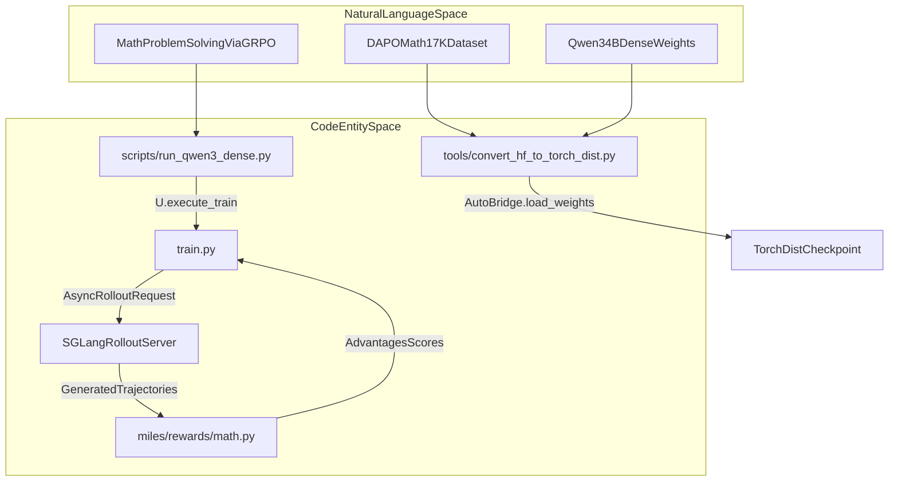
Sources: [docs/getting-started/quick-start.md:117-152](), [tools/convert_hf_to_torch_dist.py:12-48]()

---

## Step 1: Start the Container

Pull and launch the official Miles container image with the required IPC, memory, and host networking flags [docs/getting-started/quick-start.md:31-43]():

```bash
docker pull radixark/miles:latest
docker run --rm \
  --gpus all \
  --ipc=host \
  --shm-size=32g \
  --ulimit memlock=-1 \
  --ulimit stack=67108864 \
  --network=host \
  -it radixark/miles:latest /bin/bash
```

Inside the container, ensure your editable installation of Miles and Megatron-LM paths are synchronized [docs/getting-started/quick-start.md:45-51]():
```bash
cd /root/miles && git pull && pip install -e . --no-deps
```

Sources: [docs/getting-started/quick-start.md:29-53]()

---

## Step 2: Download Model and Dataset

Download the base model and training/evaluation datasets using HuggingFace CLI utilities [docs/getting-started/quick-start.md:55-66]():

```bash
# Target model for training
hf download Qwen/Qwen3-4B --local-dir /root/models/Qwen3-4B

# Training prompts (math problems with verifiable answers)
hf download --repo-type dataset zhuzilin/dapo-math-17k --local-dir /root/datasets/dapo-math-17k

# Evaluation benchmark (AIME 2024)
hf download --repo-type dataset zhuzilin/aime-2024 --local-dir /root/datasets/aime-2024
```

Sources: [docs/getting-started/quick-start.md:55-66]()

---

## Step 3: Convert Checkpoint to Megatron Format

Megatron-LM requires sharded `torch_dist` checkpoints. Map the downloaded HuggingFace weights using `tools/convert_hf_to_torch_dist.py` [docs/getting-started/quick-start.md:68-87](), [tools/convert_hf_to_torch_dist.py:22-48]():

```bash
cd /root/miles
MODEL_ARGS_LINE="$(python3 miles/utils/external_utils/model_args_utils.py qwen3-4B)" || exit 1
read -ra MODEL_ARGS <<< "${MODEL_ARGS_LINE}"

PYTHONPATH=/root/Megatron-LM python tools/convert_hf_to_torch_dist.py \
   "${MODEL_ARGS[@]}" \
   --hf-checkpoint /root/models/Qwen3-4B \
   --save /root/models/Qwen3-4B_torch_dist
```

Sources: [docs/getting-started/quick-start.md:68-87](), [tools/convert_hf_to_torch_dist.py:117-148]()

---

## Step 4: Launch Training

Launch the training script using the provided Qwen dense runner [docs/getting-started/quick-start.md:89-95]():

```bash
python scripts/run_qwen3_dense.py --model-name Qwen3-4B
```

Title: Training Job Execution Flow
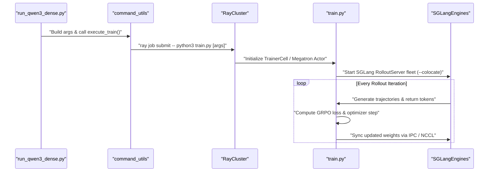
Sources: [docs/getting-started/quick-start.md:89-142](), [docs/getting-started/quick-start.md:162-176]()

---

## Key Concepts & Batch Sizing

The batch-sizing configuration satisfies the identity relation where Miles automatically resolves any unspecified parameter [docs/getting-started/quick-start.md:143-152]():

```text
rollout_batch_size × n_samples_per_prompt
  = global_batch_size × num_steps_per_rollout
```

- **Colocation**: The recipe sets `--colocate` where four SGLang engines (2 GPUs each) and the Megatron trainer share the same 8 GPUs, alternating between generation and training [docs/getting-started/quick-start.md:168-170]().
- **Weight Transfer Modes**: For disaggregated runs, modes include `broadcast`, `broadcast_packed`, `p2p`, or `disk-delta` [docs/getting-started/quick-start.md:172-177]().

Sources: [docs/getting-started/quick-start.md:143-177]()

---

## Step 5: Monitoring and Verification

Once engines warm up, console outputs stream structured metric groups per rollout iteration [docs/getting-started/quick-start.md:104-115]():

```text
perf 0: {'perf/rollout_time': 98.6, ...}
rollout 0: {'rollout/raw_reward': 0.32, 'rollout/log_probs': -0.27, ...}
step 0: {'train/loss': 0.0021, 'train/pg_loss': 0.0018, 'train/grad_norm': 0.62, ...}
```

- **`rollout/raw_reward`**: Mean score of generated responses evaluated against dataset verification rules, drifting upward during training [docs/getting-started/quick-start.md:114-115]().
- **Checkpointing**: Checkpoints are saved under `/root/shared_data/checkpoints` every 20 rollouts [docs/getting-started/quick-start.md:98-99]().

Sources: [docs/getting-started/quick-start.md:104-116]()

---

## Troubleshooting

- **Out of Memory (OOM) during Rollout**: Tune `--sglang-mem-fraction-static` down (e.g., from `0.7` to `0.4`) to free memory for generation [docs/getting-started/quick-start.md:195-197]().
- **Ray Connection Failures**: Reset local cluster state with `ray stop && ray start --head --port=6379` [docs/getting-started/quick-start.md:198-200]().

Sources: [docs/getting-started/quick-start.md:195-202]()

---

# Page: Configuration System

# Configuration System

<details>
<summary>Relevant source files</summary>

The following files were used as context for generating this wiki page:

- [miles/backends/fsdp_utils/actor.py](miles/backends/fsdp_utils/actor.py)
- [miles/backends/fsdp_utils/arguments.py](miles/backends/fsdp_utils/arguments.py)
- [miles/backends/fsdp_utils/checkpoint.py](miles/backends/fsdp_utils/checkpoint.py)
- [miles/backends/megatron_utils/actor.py](miles/backends/megatron_utils/actor.py)
- [miles/backends/megatron_utils/model.py](miles/backends/megatron_utils/model.py)
- [miles/backends/megatron_utils/optimizer_state_reset.py](miles/backends/megatron_utils/optimizer_state_reset.py)
- [miles/backends/sglang_utils/arguments.py](miles/backends/sglang_utils/arguments.py)
- [miles/backends/sglang_utils/sglang_config.py](miles/backends/sglang_utils/sglang_config.py)
- [miles/utils/arguments.py](miles/utils/arguments.py)
- [miles/utils/workers/types.py](miles/utils/workers/types.py)
- [tests/fast/backends/megatron_utils/test_model_initialize.py](tests/fast/backends/megatron_utils/test_model_initialize.py)
- [tests/fast/backends/megatron_utils/test_optimizer_state_reset.py](tests/fast/backends/megatron_utils/test_optimizer_state_reset.py)
- [tests/fast/backends/megatron_utils/test_shared_ppo_lifecycle.py](tests/fast/backends/megatron_utils/test_shared_ppo_lifecycle.py)
- [tests/fast/backends/sglang_utils/test_arguments.py](tests/fast/backends/sglang_utils/test_arguments.py)
- [tests/fast/backends/sglang_utils/test_sglang_config.py](tests/fast/backends/sglang_utils/test_sglang_config.py)
- [tests/fast/ray/rollout/conftest.py](tests/fast/ray/rollout/conftest.py)
- [tests/fast/utils/test_arguments.py](tests/fast/utils/test_arguments.py)
- [tests/fast/utils/test_sglang_config.py](tests/fast/utils/test_sglang_config.py)
- [tests/fast/utils/workers/test_worker_comm_backend.py](tests/fast/utils/workers/test_worker_comm_backend.py)

</details>


## Purpose and Scope

This document describes Miles' comprehensive configuration system, which provides a centralized approach to managing training, rollout, evaluation, and system parameters through a hierarchical argument parsing framework implemented in `miles/utils/arguments.py` [miles/utils/arguments.py:1-42](). The configuration system supports command-line arguments, environment variables, and YAML files, with specialized backend extensions for SGLang and Megatron-LM.

Sources: [miles/utils/arguments.py:1-42]()

---

## Configuration Architecture

Miles uses a multi-layered configuration system centered around `miles/utils/arguments.py`, which integrates with Megatron-LM's argument parser while adding extensive RL-specific and distributed training capabilities via `get_miles_extra_args_provider` [miles/utils/arguments.py:141-146]().

### Configuration Initialization Flow

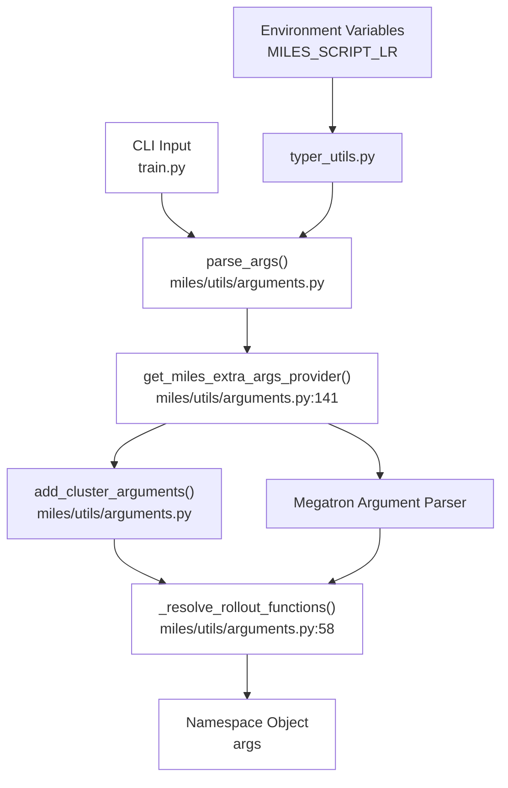

**Sources**: [miles/utils/arguments.py:1-146](), [miles/utils/typer_utils.py:1-50]()

---

## Main Configuration Groups

The configuration system organizes parameters into logical groups, each managed by a dedicated function or argument provider.

### Configuration Group Structure

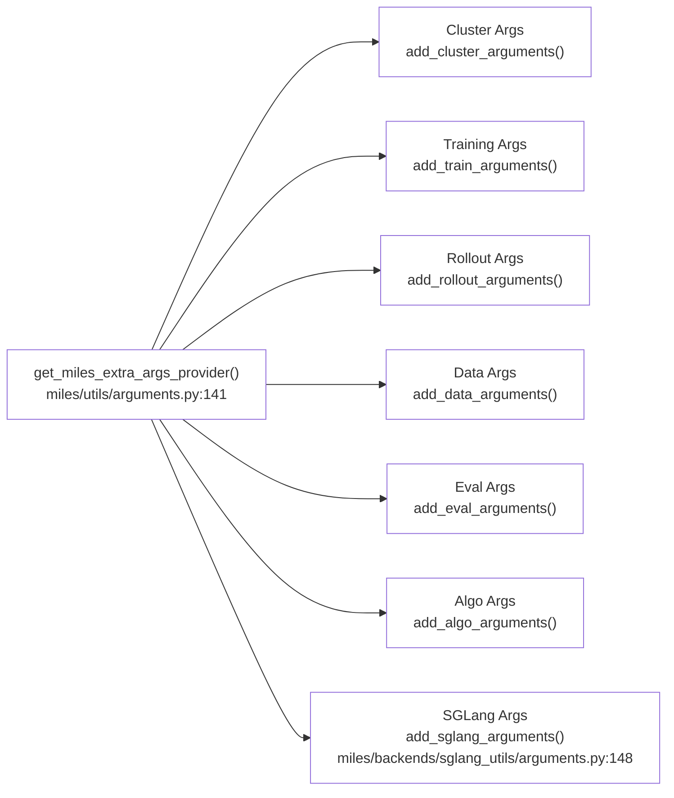

**Sources**: [miles/utils/arguments.py:141-146](), [miles/backends/sglang_utils/arguments.py:148-172]()

---

## Key Configuration Categories

### 1. Cluster Configuration

Defines the distributed computing environment using Ray placement groups and resource allocation.

| Parameter | Type | Default | Description |
|-----------|------|---------|-------------|
| `--actor-num-nodes` | int | 1 | Number of nodes for training actor [tests/fast/ray/rollout/conftest.py:75]() |
| `--actor-num-gpus-per-node` | int | 8 | GPUs per node for training actor [tests/fast/ray/rollout/conftest.py:76]() |
| `--rollout-num-gpus` | int | None | Total GPUs for inference engines [tests/fast/ray/rollout/conftest.py:27]() |
| `--rollout-num-gpus-per-engine` | int | 1 | GPUs per SGLang engine (TP size) [tests/fast/ray/rollout/conftest.py:28]() |
| `--colocate` | bool | False | Co-locate training and inference on same GPUs [tests/fast/ray/rollout/conftest.py:74]() |

**Key Features**:
- **Colocation Mode**: When `--colocate` is enabled, resource allocations share physical hardware between training actors and rollout engines.
- **Resource Reordering**: Ray placement groups reorder bundles to match physical node topologies.

**Sources**: [tests/fast/ray/rollout/conftest.py:25-95]()

---

### 2. Training Configuration & Backends

Controls the training backend (`MegatronTrainRayActor` or `FSDPTrainRayActor`) and architectural specifications.

| Parameter | Type | Default | Description |
|-----------|------|---------|-------------|
| `--train-backend` | str | "megatron" | Training backend selection (`megatron` or `fsdp`) [tests/fast/ray/rollout/conftest.py:78]() |
| `--hf-checkpoint` | path | None | HF directory providing tokenizer and config [tests/fast/ray/rollout/conftest.py:149]() |
| `--load` | path | None | Checkpoint path to resume training from [tests/fast/ray/rollout/conftest.py:168]() |
| `--save` | path | None | Directory to store actor checkpoints [tests/fast/ray/rollout/conftest.py:169]() |

**True On-Policy Mode**: Configures deterministic execution flags across backends to match rollout log-probabilities with training forward passes [miles/backends/fsdp_utils/actor.py:97-98]().

**Sources**: [miles/backends/megatron_utils/actor.py:105-160](), [miles/backends/fsdp_utils/actor.py:36-100]()

---

### 3. Rollout Configuration

Manages the generation of trajectories during the rollout phase.

| Parameter | Type | Default | Description |
|-----------|------|---------|-------------|
| `--rollout-temperature` | float | 1.0 | Sampling temperature for text generation [tests/fast/ray/rollout/conftest.py:37]() |
| `--rollout-max-response-len` | int | None | Maximum response length in tokens [tests/fast/ray/rollout/conftest.py:36]() |
| `--rollout-function-path` | str | None | Custom rollout generation function path [tests/fast/ray/rollout/conftest.py:151]() |
| `--n-samples-per-prompt` | int | 1 | Responses per prompt for group sampling [tests/fast/ray/rollout/conftest.py:34]() |
| `--partial-rollout` | bool | False | Recycle unfinished samples |

**Sources**: [miles/utils/arguments.py:58-120](), [tests/fast/ray/rollout/conftest.py:26-48]()

---

### 4. SGLang and Server Group Configuration (`_RawSglangConfig` / `ServerGroupConfig`)

Miles forwards arguments prefixed with `--sglang-` directly to the SGLang inference server [miles/backends/sglang_utils/arguments.py:148-172](). Advanced deployments use `--sglang-config` to specify heterogeneous server groups (`_RawSglangConfig`) [miles/backends/sglang_utils/sglang_config.py:72-116]().

| Parameter | Type | Default | Description |
|-----------|------|---------|-------------|
| `--sglang-mem-fraction-static` | float | 0.8 | KV cache memory fraction allocation |
| `--sglang-router-port` | int | None | Port for the SGLang router [miles/backends/sglang_utils/arguments.py:13]() |
| `--sglang-dp-size` | int | 1 | Data parallel size for SGLang engine [miles/backends/sglang_utils/arguments.py:122]() |
| `--sglang-config` | str | None | Path to YAML config for SGLang engine deployment [miles/backends/sglang_utils/arguments.py:167]() |

**Sources**: [miles/backends/sglang_utils/arguments.py:1-172](), [miles/backends/sglang_utils/sglang_config.py:21-140]()

---

## Configuration Flow Through System

### Runtime Configuration Propagation Pipeline

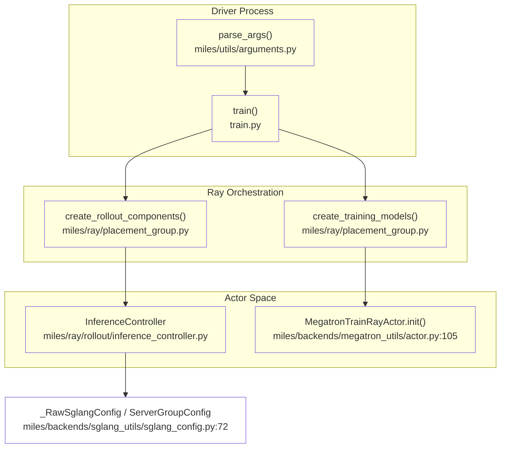

**Sources**: [miles/ray/placement_group.py:1-180](), [miles/backends/megatron_utils/actor.py:105-160](), [miles/backends/sglang_utils/sglang_config.py:72-140]()

---

## Advanced Configuration Features

### 1. Argument Resetting
Miles uses `reset_arg` to override Megatron-LM or parser defaults for specialized RL workloads [miles/utils/arguments.py:121-135]().

### 2. Checkpoint Management
The system differentiates between various checkpoint roles:
- `--load`: Path to resume actor weights.
- `--pretrained-checkpoint`: Pretrained initialization weights [miles/backends/megatron_utils/model.py:152]().

### 3. YAML Configuration Validation
FSDP and SGLang configs support YAML file loading with strict validation checking via `reject_unknown_config_keys` and Pydantic models (`_RawSglangConfig`, `ServerGroupConfig`) [miles/backends/fsdp_utils/arguments.py:117-127](), [miles/backends/sglang_utils/sglang_config.py:21-152]().

Sources: [miles/utils/arguments.py:121-135](), [miles/backends/fsdp_utils/arguments.py:117-148](), [miles/backends/sglang_utils/sglang_config.py:21-152]()

---

# Page: Core Architecture

# Core Architecture

<details>
<summary>Relevant source files</summary>

The following files were used as context for generating this wiki page:

- [miles/ray/placement_group.py](miles/ray/placement_group.py)
- [miles/ray/specs/entrypoint.py](miles/ray/specs/entrypoint.py)
- [miles/ray/specs/train.py](miles/ray/specs/train.py)
- [miles/utils/audit_utils/process_identity.py](miles/utils/audit_utils/process_identity.py)
- [miles/utils/hot_restart.py](miles/utils/hot_restart.py)
- [tests/fast/ray/rollout/test_rollout_executor_init.py](tests/fast/ray/rollout/test_rollout_executor_init.py)
- [tests/fast/ray/specs/test_entrypoint.py](tests/fast/ray/specs/test_entrypoint.py)
- [tests/fast/ray/specs/test_train.py](tests/fast/ray/specs/test_train.py)
- [tests/fast/ray/test_cell_meta.py](tests/fast/ray/test_cell_meta.py)
- [tests/fast/ray/test_placement_group.py](tests/fast/ray/test_placement_group.py)
- [tests/fast/ray/test_placement_group_shared_ppo.py](tests/fast/ray/test_placement_group_shared_ppo.py)
- [tests/fast/utils/test_hot_restart.py](tests/fast/utils/test_hot_restart.py)
- [tests/fast/utils/test_process_identity.py](tests/fast/utils/test_process_identity.py)

</details>


This document explains Miles' high-level system architecture and design principles, focusing on the separation of training and inference engines, Ray-based orchestration, and distributed communication infrastructure. As a parent page, this overview provides a high-level conceptual summary of the system and links to detailed child pages for each architectural subsystem.

For detailed technical documentation, see the child pages:
- [System Design and Components](#3.1) — Detailed separation of training and inference and component interaction
- [Training Orchestration](#3.2) — Entry points (`train.py`, `train_async.py`), sync/async modes, and `TrainerController`
- [Rollout Generation System](#3.3) — `InferenceController`, `RolloutServer`, `ServerCell`, and data flow
- [Ray Resource Management](#3.4) — Placement groups, resource allocation strategies, and distributed execution
- [Worker Management and RPC Infrastructure](#3.5) — `RayWorkerManager`, worker specs, pools/cells, and RPC client/server layers

---

## High-Level System Overview

Miles is designed as an enterprise-grade reinforcement learning post-training framework that couples distributed model training backends (such as Megatron-LM and FSDP2) with high-throughput inference engines (`SGLang`) via Ray [miles/ray/placement_group.py:146-163](). The architecture decouples policy-updating training actors from rollout generation workers to optimize hardware utilization and avoid memory contention.

Title: Miles Core System Architecture
```mermaid
graph TB
    subgraph "Driver"
        DriverEntryPoint["train.py / train_async.py"]
    end

    subgraph "Control Plane & Orchestration"
        WorkerManager["RayWorkerManager<br/>miles/ray/wiring.py"]
        InferenceCtrl["InferenceController<br/>miles/ray/rollout/inference_controller.py"]
        TrainerCtrl["TrainerController<br/>miles/ray/train/group.py"]
        RolloutExec["RolloutExecutor<br/>miles/ray/rollout/rollout_executor.py"]
    end

    subgraph "Data & Compute Workers"
        TrainActor["MegatronTrainRayActor / FSDPTrainRayActor<br/>miles/ray/specs/train.py"]
        EngineCell["ServerCell / SGLang Engine<br/>miles/ray/specs/inference.py"]
    end

    DriverEntryPoint --> WorkerManager
    WorkerManager --> InferenceCtrl
    WorkerManager --> TrainerCtrl
    InferenceCtrl --> EngineCell
    TrainerCtrl --> TrainActor
    RolloutExec --> InferenceCtrl

    Sources: [miles/ray/placement_group.py:146-163](), [miles/ray/specs/train.py:40-46]()
```

Sources: [miles/ray/placement_group.py:146-163](), [miles/ray/specs/train.py:40-46]()

---

## 3.1. System Design and Components

The Miles architecture isolates training computation from inference generation. Training actors run state-intensive gradient updates utilizing Megatron-LM or FSDP backends, while inference requests are channeled through SGLang-based worker cells [miles/ray/specs/train.py:40-46](). 

For full details on component separation, cluster topology, and interactions, see [System Design and Components](#3.1).

Sources: [miles/ray/specs/train.py:40-46]()

---

## 3.2. Training Orchestration

Training execution is driven by entry points that manage the lifecycle of rollouts, training steps, evaluation dispatches, and periodic checkpoint saving. The system abstracts distributed groups via `TrainerController` and `TrainerCell` handles [miles/ray/specs/train.py:40-114]().

For details on the main training loop, synchronous vs. asynchronous modes, and state transitions, see [Training Orchestration](#3.2).

Sources: [miles/ray/specs/train.py:40-114]()

---

## 3.3. Rollout Generation System

Rollout generation is managed through the `InferenceController`, `RolloutServer`, and `ServerCell` abstraction stack, coordinated alongside the `RolloutExecutor` [miles/ray/placement_group.py:12-19](). Prompts are transformed into training-ready trajectory batches complete with log probabilities, advantages, and rewards.

For details on generation pipelines, sample processing, and data flow from prompts to training datasets, see [Rollout Generation System](#3.3).

Sources: [miles/ray/placement_group.py:12-19]()

---

## 3.4. Ray Resource Management

Ray placement groups govern strict physical hardware layout, bundle creation, and device allocation via `_create_placement_group()` and `_get_placement_group_layout()` [miles/ray/placement_group.py:81-139](). Miles queries physical node topology using helper actors (`InfoActor`) to enforce deterministic bundle sorting and scheduling strategies (`PACK`) across nodes and GPUs [miles/ray/placement_group.py:48-118]().

Title: Placement Group Resource Allocation Flow
```mermaid
graph LR
    Args["args: Namespace"] --> GetLayout["_get_placement_group_layout<br/>miles/ray/placement_group.py:122"]
    GetLayout --> CreatePG["_create_placement_group<br/>miles/ray/placement_group.py:81"]
    CreatePG --> InfoActor["InfoActor.options(...)<br/>miles/ray/placement_group.py:95"]
    InfoActor --> SortBundles["sort_key & Reordering<br/>miles/ray/placement_group.py:54-72"]
    SortBundles --> PGInfo["PlacementGroupInfo<br/>miles/ray/placement_group.py:75-79"]

    Sources: [miles/ray/placement_group.py:48-139]()
```

For details on placement groups, resource allocation strategies, and distributed execution topologies, see [Ray Resource Management](#3.4).

Sources: [miles/ray/placement_group.py:48-139]()

---

## 3.5. Worker Management and Infrastructure

Worker lifecycle management, port/address allocation, and RPC communication layers are structured around worker specifications (`ServeWorkerSpec`) and entrypoint calculations (`compute_specs`) [miles/ray/specs/entrypoint.py:8-23](). This layer handles cross-actor RPC channels, context locking utilities, and process grouping [miles/utils/audit_utils/process_identity.py:9-52]().

For details on worker specs, pools, cell structures, port allocation, and RPC clients/servers, see [Worker Management and RPC Infrastructure](#3.5).

Sources: [miles/ray/specs/entrypoint.py:8-23](), [miles/utils/audit_utils/process_identity.py:9-52]()

---

# Page: System Design and Components

# System Design and Components

<details>
<summary>Relevant source files</summary>

The following files were used as context for generating this wiki page:

- [miles/ray/placement_group.py](miles/ray/placement_group.py)
- [miles/ray/specs/entrypoint.py](miles/ray/specs/entrypoint.py)
- [miles/ray/specs/train.py](miles/ray/specs/train.py)
- [miles/ray/wiring.py](miles/ray/wiring.py)
- [miles/utils/async_utils.py](miles/utils/async_utils.py)
- [miles/utils/audit_utils/process_identity.py](miles/utils/audit_utils/process_identity.py)
- [miles/utils/hot_restart.py](miles/utils/hot_restart.py)
- [miles/utils/orchestration_utils.py](miles/utils/orchestration_utils.py)
- [tests/fast/fixtures/driver_fakes.py](tests/fast/fixtures/driver_fakes.py)
- [tests/fast/ray/rollout/test_rollout_executor_init.py](tests/fast/ray/rollout/test_rollout_executor_init.py)
- [tests/fast/ray/specs/test_entrypoint.py](tests/fast/ray/specs/test_entrypoint.py)
- [tests/fast/ray/specs/test_train.py](tests/fast/ray/specs/test_train.py)
- [tests/fast/ray/test_cell_meta.py](tests/fast/ray/test_cell_meta.py)
- [tests/fast/ray/test_placement_group.py](tests/fast/ray/test_placement_group.py)
- [tests/fast/ray/test_placement_group_shared_ppo.py](tests/fast/ray/test_placement_group_shared_ppo.py)
- [tests/fast/ray/test_wiring.py](tests/fast/ray/test_wiring.py)
- [tests/fast/test_platform_contract.py](tests/fast/test_platform_contract.py)
- [tests/fast/test_train.py](tests/fast/test_train.py)
- [tests/fast/test_train_async.py](tests/fast/test_train_async.py)
- [tests/fast/test_train_multi_policy.py](tests/fast/test_train_multi_policy.py)
- [tests/fast/utils/test_async_utils.py](tests/fast/utils/test_async_utils.py)
- [tests/fast/utils/test_hot_restart.py](tests/fast/utils/test_hot_restart.py)
- [tests/fast/utils/test_orchestration_utils.py](tests/fast/utils/test_orchestration_utils.py)
- [tests/fast/utils/test_process_identity.py](tests/fast/utils/test_process_identity.py)
- [tests/fast/utils/workers/test_ray_communication_boundary.py](tests/fast/utils/workers/test_ray_communication_boundary.py)
- [train.py](train.py)
- [train_async.py](train_async.py)
- [train_multi_policy.py](train_multi_policy.py)

</details>


## Purpose and Scope

This page explains Miles' high-level system architecture, the separation of training and inference workloads, Ray-based orchestration, and how major system components interact. It details the transition from high-level orchestration down to concrete classes like `TrainerController`, `InferenceController`, `RolloutExecutor`, and training backend actors (`MegatronTrainRayActor`, `FSDPTrainRayActor`, and `TorchtitanTrainRayActor`).

For specific training backends, see [FSDP Backend](4.1) and [Megatron Backend](4.2). For details on the training loop, see [Training Orchestration](3.2). For rollout generation mechanics, see [Rollout Generation System](3.3).

---

## Three-Layer Architecture Overview

Miles implements a clean separation of concerns across three layers: **User Interface**, **Orchestration & Training**, and **Inference & Generation**. This architecture enables independent scaling, memory management, and asynchronous execution of training versus inference workloads.

### Architecture Diagram: Component Hierarchy

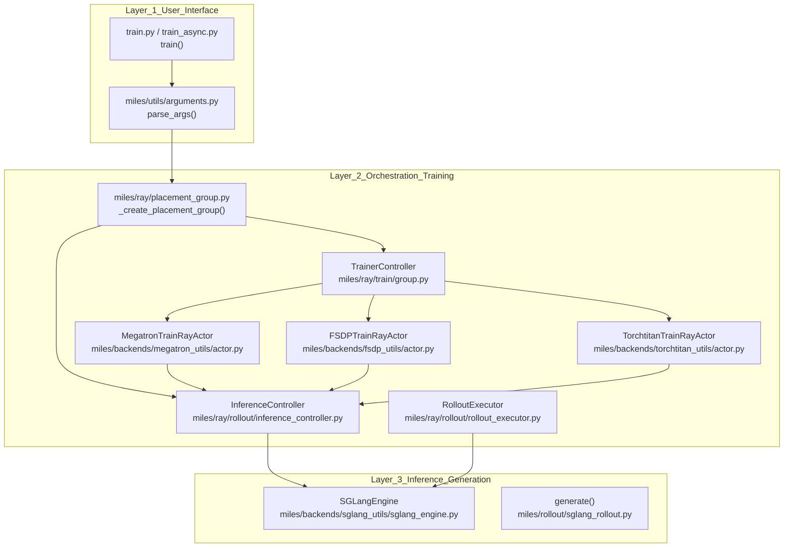

Sources: [train.py:25-45](), [train_async.py:24-38](), [miles/ray/placement_group.py:81-163](), [miles/ray/specs/train.py:40-46]()

---

## Core Components

The following table summarizes the responsibilities of each major component in the Miles codebase:

| Component | File Path | Key Responsibilities | Ray Actor / Class |
|-----------|-----------|---------------------|-----------|
| **InferenceController** | `miles/ray/rollout/inference_controller.py` | Manages the SGLang server fleet, lifecycle, weight updates, and KV cache operations. | Ray Actor Group / Manager |
| **RolloutExecutor** | [miles/ray/placement_group.py:19]() | Executes rollout generation pipelines, fetches trajectories, and buffers samples. | Ray Actor (`@ray.remote`) |
| **TrainerController** | [miles/ray/specs/train.py:40]() | Coordinates training actors (actor/critic), manages gradient steps, and invokes weight syncing. | Ray Actor (`TrainerController`) |
| **MegatronTrainRayActor** | [miles/ray/specs/train.py:43]() | Megatron-LM training actor supporting 4D parallelism (TP/PP/EP/CP). | Ray Actor (`TrainRayActor`) |
| **FSDPTrainRayActor** | [miles/ray/specs/train.py:44]() | PyTorch FSDP2 training actor supporting stock HuggingFace models and LoRA. | Ray Actor (`TrainRayActor`) |
| **TorchtitanTrainRayActor** | [miles/ray/specs/train.py:45]() | TorchTitan training actor for experimental modular PyTorch pipelines. | Ray Actor (`TrainRayActor`) |
| **SGLangEngine** | [miles/backends/sglang_utils/sglang_engine.py]() | High-throughput inference worker running `sglang.launch_server`. | External Process / Ray Worker |

Sources: [miles/ray/placement_group.py:122-162](), [miles/ray/specs/train.py:40-46]()

---

## Component Interaction Flow

The interaction between the main driver script (`train.py` or `train_async.py`) and Ray actors follows a structured sequence to guarantee resource allocation, initialization order, and synchronization before training loops begin.

### Sequence Diagram: Training Initialization and Synchronous Step

```mermaid
sequenceDiagram
    participant Driver as train.py
    participant PG as miles/ray/placement_group.py
    participant IC as InferenceController
    participant RE as RolloutExecutor
    participant TC as TrainerController
    participant Actor as MegatronTrainRayActor
    
    Driver->>PG: create_placement_groups(args)
    PG-->>Driver: Placement groups (actor, rollout)
    
    Driver->>IC: create_rollout_components(args)
    IC->>IC: init() (launch SGLang engine pool)
    
    Driver->>TC: create_training_models(args, rollout_executor)
    TC->>Actor: init() (Megatron initialization & topology setup)
    
    Driver->>TC: update_weights(args, actor_model, rollout_executor, inference_controller)
    TC->>IC: update_weights() / IPC sync
    
    loop Rollout & Training Epoch
        Driver->>IC: prepare_rollout(rollout_id)
        Driver->>RE: rollout_executor.get(rollout_id)
        RE-->>Driver: RolloutBatch data pack
        
        Driver->>TC: actor_model.train(rollout_id, rollout_data_pack)
        TC->>Actor: train step execution
        Actor-->>TC: loss and metrics
        TC-->>Driver: step complete
    end
```

Sources: [train.py:25-131](), [miles/ray/placement_group.py:146-163]()

---

## Key Architectural Decisions

### 1. Separation of Training and Inference
Miles separates training backends from inference execution. This is controlled via runtime arguments in `miles/utils/arguments.py`:
- **Colocation Mode**: Training and inference share identical physical GPUs (`--colocate`). To prevent Out-Of-Memory (OOM) errors, offloading of model weights and KV caches between rollout and training phases is enforced [train.py:107-118]().
- **Disaggregated Mode**: Inference runs on dedicated SGLang engine pools while training runs on separate Ray actors, enabling overlapping asynchronous execution [train_async.py:24-25]().

Sources: [train.py:107-118](), [train_async.py:24-25]()

### 2. Ray-Based Resource Management
Miles relies on Ray placement groups to guarantee deterministic worker placement and topology constraints:
- `_create_placement_group` allocates bundles with `strategy="PACK"` to minimize cross-node communication overhead [miles/ray/placement_group.py:81-87]().
- `InfoActor` queries node IPs and physical GPU IDs, sorting them via `sort_key` to maintain deterministic rank assignments across nodes [miles/ray/placement_group.py:48-72]().

Sources: [miles/ray/placement_group.py:48-119]()

### 3. Unified Actor Abstraction (`TrainRayActor`)
All training backends (Megatron, FSDP, TorchTitan) map to concrete subclasses of `TrainRayActor`, exposing standard RPC entry points for `.init()`, `.train()`, `.save_model()`, and weight updates [miles/ray/specs/train.py:42-46]().

Sources: [miles/ray/specs/train.py:40-46]()

---

## Data Flow and Code Entity Mapping

The diagrams below bridge Natural Language Space concepts to Code Entity Space implementations across rollout generation and weight synchronization.

### Diagram: Rollout to Training Data Flow

```mermaid
graph LR
    subgraph "Inference_Rollout_Space"
        SGL["SGLangEngine<br/>miles/backends/sglang_utils/sglang_engine.py"]
        Gen["generate()<br/>miles/rollout/sglang_rollout.py"]
        RE["RolloutExecutor<br/>miles/ray/rollout/rollout_executor.py"]
    end
    
    subgraph "Training_Space"
        TC["TrainerController<br/>miles/ray/train/group.py"]
        Actor["MegatronTrainRayActor<br/>miles/backends/megatron_utils/actor.py"]
        Loss["compute_advantages_and_returns<br/>miles/backends/training_utils/loss.py"]
    end
    
    SGL --> Gen
    Gen -- "Sample / RolloutBatch" --> RE
    RE -- "get()" --> TC
    TC --> Actor
    Actor --> Loss
```

Sources: [miles/ray/specs/train.py:40-46](), [train.py:105-130]()

### Diagram: Weight Synchronization Data Flow

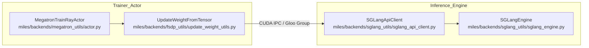

Sources: [train.py:48-48](), [train_async.py:41-41]()

---

## Configuration System Overview

System configuration is parsed via `parse_args()` in `miles/utils/arguments.py`, merging CLI flags, dataclass defaults, and YAML config files. Major configuration categories include cluster topology (`--actor-num-nodes`, `--rollout-num-gpus`), backend selection (`--train-backend`), offloading policies (`--offload-train`, `--offload-rollout`), and rollout sampling parameters [train.py:14-14]().

Sources: [train.py:14-14](), [train_async.py:12-12]()

---

## Summary of Interaction Modes

- **Synchronous Training (`train.py`)**: Strictly alternates between generation and training steps. Rollout data is fetched completely before model training begins, ensuring synchronous execution [train.py:103-131]().
- **Asynchronous Training (`train_async.py`)**: Overlaps rollout generation for epoch `N+1` with training on epoch `N` using futures created via `eager_create_task`, maximizing hardware utilization [train_async.py:70-96]().
- **Multi-Policy Training (`train_multi_policy.py`)**: Coordinates multiple policy actors with synchronization primitives (`Parker`) to run heterogeneous or co-evolving policy experiments simultaneously [train_multi_policy.py:32-101]().

Sources: [train.py:103-131](), [train_async.py:70-96](), [train_multi_policy.py:32-101]()

---

# Page: Training Orchestration

# Training Orchestration

<details>
<summary>Relevant source files</summary>

The following files were used as context for generating this wiki page:

- [miles/ray/train/cell.py](miles/ray/train/cell.py)
- [miles/ray/train/cell_monitor.py](miles/ray/train/cell_monitor.py)
- [miles/ray/train/cell_state.py](miles/ray/train/cell_state.py)
- [miles/ray/train/group.py](miles/ray/train/group.py)
- [miles/ray/wiring.py](miles/ray/wiring.py)
- [miles/utils/async_utils.py](miles/utils/async_utils.py)
- [miles/utils/audit_utils/event_analyzer/analyzer.py](miles/utils/audit_utils/event_analyzer/analyzer.py)
- [miles/utils/ft_utils/api_server/models.py](miles/utils/ft_utils/api_server/models.py)
- [miles/utils/orchestration_utils.py](miles/utils/orchestration_utils.py)
- [miles/utils/workers/naming.py](miles/utils/workers/naming.py)
- [tests/fast/fixtures/driver_fakes.py](tests/fast/fixtures/driver_fakes.py)
- [tests/fast/ray/test_wiring.py](tests/fast/ray/test_wiring.py)
- [tests/fast/ray/train/conftest.py](tests/fast/ray/train/conftest.py)
- [tests/fast/ray/train/dummy_actor.py](tests/fast/ray/train/dummy_actor.py)
- [tests/fast/ray/train/fake_worker_manager.py](tests/fast/ray/train/fake_worker_manager.py)
- [tests/fast/ray/train/test_cell.py](tests/fast/ray/train/test_cell.py)
- [tests/fast/ray/train/test_cell_monitor.py](tests/fast/ray/train/test_cell_monitor.py)
- [tests/fast/ray/train/test_cell_restart.py](tests/fast/ray/train/test_cell_restart.py)
- [tests/fast/ray/train/test_group.py](tests/fast/ray/train/test_group.py)
- [tests/fast/ray/train/test_group_failure_reporting.py](tests/fast/ray/train/test_group_failure_reporting.py)
- [tests/fast/ray/train/test_load_state.py](tests/fast/ray/train/test_load_state.py)
- [tests/fast/ray/train/test_train_external_data.py](tests/fast/ray/train/test_train_external_data.py)
- [tests/fast/ray/train/test_train_return_value.py](tests/fast/ray/train/test_train_return_value.py)
- [tests/fast/test_platform_contract.py](tests/fast/test_platform_contract.py)
- [tests/fast/test_train.py](tests/fast/test_train.py)
- [tests/fast/test_train_async.py](tests/fast/test_train_async.py)
- [tests/fast/test_train_multi_policy.py](tests/fast/test_train_multi_policy.py)
- [tests/fast/utils/api_server/test_models.py](tests/fast/utils/api_server/test_models.py)
- [tests/fast/utils/event_analyzer/test_analyzer.py](tests/fast/utils/event_analyzer/test_analyzer.py)
- [tests/fast/utils/test_async_utils.py](tests/fast/utils/test_async_utils.py)
- [tests/fast/utils/test_orchestration_utils.py](tests/fast/utils/test_orchestration_utils.py)
- [tests/fast/utils/workers/test_ray_communication_boundary.py](tests/fast/utils/workers/test_ray_communication_boundary.py)
- [train.py](train.py)
- [train_async.py](train_async.py)
- [train_multi_policy.py](train_multi_policy.py)

</details>


## Purpose and Scope

This page documents the training orchestration layer in Miles, focusing on the synchronous (`train.py`) [train.py:25-156]() and asynchronous (`train_async.py`) [train_async.py:24-137]() entry points, synchronous vs. asynchronous execution modes, and the group abstraction layer centered around `TrainerController` [miles/ray/train/group.py:52]() and `TrainerCell` [miles/ray/train/cell.py:29](). It details how orchestration coordinates rollout generation, actor-critic training steps, memory offloading, and parameter synchronization across distributed Ray workers.

Sources: [train.py:25-156](), [train_async.py:24-137](), [miles/ray/train/group.py:52-166](), [miles/ray/train/cell.py:29-107]()

---

## Entry Points: Synchronous vs. Asynchronous Training Modes

Miles provides two primary execution scripts depending on hardware topology, colocation preferences, and throughput requirements.

| Entry Point | Execution Mode | Key Characteristics | Source Citations |
|-------------|----------------|---------------------|------------------|
| `train.py` | Synchronous | Sequential execution; generates rollout data, offloads/clears cache, executes training on actor/critic models, updates weights, and loops. Supports colocation (`--colocate`). | [train.py:25-156]() |
| `train_async.py` | Asynchronous | Pipelines rollout generation of step $N+1$ concurrently with training on step $N$ using `eager_create_task` and future resolution. Does not support colocation. | [train_async.py:24-137]() |

### Synchronous Training Flow (`train.py`)
The synchronous loop instantiates worker managers, object stores, tracking utilities, rollout components via `create_rollout_components` [train.py:37](), and model trainers via `create_training_models` [train.py:41](). It ensures weights are synchronized (`update_weights`) before iterating through rollout epochs [train.py:48-105]().

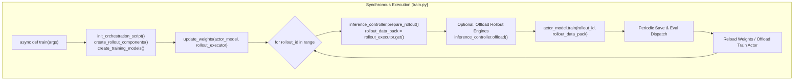

Sources: [train.py:25-156](), [train_async.py:24-137]()

### Asynchronous Training Flow (`train_async.py`)
The asynchronous loop enforces that colocation is disabled (`assert not args.colocate`) [train_async.py:24]() and validates async off-policy correction settings [train_async.py:25](). It initiates future tasks for the next rollout using `eager_create_task` while training on the current rollout buffer [train_async.py:70-83]().

Sources: [train_async.py:24-137](), [miles/ray/placement_group.py:127-180]()

---

## Training Control Abstraction: `TrainerController` and `TrainerCell`

Training compute nodes are managed via a hierarchical group abstraction layer defined in `miles/ray/train/group.py` and `miles/ray/train/cell.py`.

### `TrainerController`
`TrainerController` acts as the orchestrator for a role pool (such as `actor` or `critic`) [miles/ray/train/group.py:52](). It manages `TrainerCell` instances (`self._cells_by_id`) [miles/ray/train/group.py:81](), oversees worker reconciliation (`_reconcile`, `_add_cell`, `_remove_cell`) [miles/ray/train/group.py:121-137](), handles witness ID allocations for audit logging, and dispatches distributed training steps across cells.

### `TrainerCell`
`TrainerCell` represents an individual replica or independent data parallel (Indep-DP) cell [miles/ray/train/cell.py:29](). Each cell manages its own worker handles (`RayWorkerProvider`), master addresses [miles/ray/train/cell.py:53](), state transitions (`StateAllocatedUninitialized`, `StateAllocatedAlive`, `StateAllocatedErrored`) [miles/ray/train/cell.py:58](), and execution of remote actor methods such as `init` and `train` [miles/ray/train/cell.py:62-107]().

### Diagram: Controller-to-Cell Code Mapping
The following diagram bridges the high-level training group abstractions to their concrete code entities and execution paths.

```mermaid
graph TB
    subgraph "Natural Language Space"
        TC["TrainerController Pool"]
        Cell["Individual Training Cell"]
        Actor["Training Workers / Actors"]
    end

    subgraph "Code Entity Space"
        TC_Class["miles.ray.train.group.TrainerController"]
        Cell_Class["miles.ray.train.cell.TrainerCell"]
        Actor_Class["miles.backends.megatron_utils.actor.MegatronTrainRayActor / fsdp_utils"]
        
        TC_Class -->|"owns dict[str, TrainerCell]"| Cell_Class
        Cell_Class -->|"executes via RPC"| Actor_Class
    end

    TC -.-> TC_Class
    Cell -.-> Cell_Class
    Actor -.-> Actor_Class
```

Sources: [miles/ray/train/group.py:52-160](), [miles/ray/train/cell.py:29-107]()

---

## Main Training Loop & Data Flow

During each iteration of the training loop (`train.py` or `train_async.py`), data flows from prompt generation in SGLang rollout engines through the `RolloutExecutor` into the training actor group managed by `TrainerController`.

### Detailed Step-by-Step Data Flow

1. **Rollout Preparation**: The `InferenceController` prepares the rollout engines for the given `rollout_id` [train.py:104](), [train_async.py:66]().
2. **Rollout Fetching**: The `RolloutExecutor` asynchronous actor returns a `rollout_data_pack` containing generated trajectories, prompt-response pairs, and log probabilities [train.py:105](), [train_async.py:67]().
3. **Memory Offloading**: If `args.offload_rollout` is active, KV caches or weights on the inference engine are offloaded or cleared to free GPU memory for training [train.py:107-118]().
4. **Training Execution**: `actor_model.train(rollout_id, rollout_data_pack)` (which invokes `TrainerController.train()` and subsequently `TrainerCell.train()` [miles/ray/train/cell.py:92]()) executes the forward-backward passes on the underlying training actor.
5. **Parameter Synchronization**: Updated actor weights are pushed back to the rollout inference engines via `update_weights(args, actor_model, rollout_executor, inference_controller)` [train.py:48](), [train_async.py:115]().

### Diagram: Execution Flow & Actor Interaction

```mermaid
sequenceDiagram
    participant Script as "train.py / train_async.py"
    participant IC as "InferenceController"
    participant RE as "RolloutExecutor"
    participant TC as "TrainerController"
    participant Cell as "TrainerCell"
    participant Actor as "Megatron/FSDPTrainRayActor"

    Script->>IC: prepare_rollout(rollout_id)
    Script->>RE: get(rollout_id)
    RE-->>Script: rollout_data_pack
    
    Note over Script,Actor: Training Phase
    Script->>TC: train(rollout_id, rollout_data_pack)
    TC->>Cell: train(rollout_id, rollout_data_ref, ...)
    Cell->>Actor: execute("train", ...)
    Actor-->>Cell: TrainStepOutput
    Cell-->>TC: Results list
    TC-->>Script: Completed training step
    
    Script->>TC: update_weights()
    TC->>RE: set_weight_version(version)
```

Sources: [train.py:101-132](), [train_async.py:65-96](), [miles/ray/train/group.py:169-174](), [miles/ray/train/cell.py:92-113]()

---

## Summary of Configuration Parameters in Orchestration

The orchestration layer relies on several key configuration attributes parsed via `arguments.py`:

* `args.fully_async`: Selects fully asynchronous pipeline execution [train.py:26]().
* `args.colocate`: Places inference engines and training actors on the same physical GPUs [train_async.py:24]().
* `args.offload_train` / `args.offload_rollout`: Manages CPU/GPU memory offloading strategies during step transitions [train.py:58](), [train.py:72]().
* `args.update_weights_interval`: Frequency of weight synchronization updates in asynchronous runs [train_async.py:77]().

Sources: [train.py:25-156](), [train_async.py:24-137]()

---

# Page: Rollout Generation System

# Rollout Generation System

<details>
<summary>Relevant source files</summary>

The following files were used as context for generating this wiki page:

- [docs/developer/architecture.md](docs/developer/architecture.md)
- [docs/user-guide/fully-async.md](docs/user-guide/fully-async.md)
- [examples/infra_features/fully_async/external_eval_fn.py](examples/infra_features/fully_async/external_eval_fn.py)
- [miles/dashboard/hooks.py](miles/dashboard/hooks.py)
- [miles/ray/rollout/inference_controller.py](miles/ray/rollout/inference_controller.py)
- [miles/ray/rollout/rollout_executor.py](miles/ray/rollout/rollout_executor.py)
- [miles/ray/rollout/rollout_server.py](miles/ray/rollout/rollout_server.py)
- [miles/ray/rollout/server_cell.py](miles/ray/rollout/server_cell.py)
- [miles/rollout/base_types.py](miles/rollout/base_types.py)
- [miles/rollout/checkpoint_eval.py](miles/rollout/checkpoint_eval.py)
- [miles/rollout/filter_hub/common_filters.py](miles/rollout/filter_hub/common_filters.py)
- [miles/rollout/filter_hub/dynamic_sampling_filters.py](miles/rollout/filter_hub/dynamic_sampling_filters.py)
- [miles/rollout/fully_async_data_buffer.py](miles/rollout/fully_async_data_buffer.py)
- [miles/rollout/fully_async_rollout.py](miles/rollout/fully_async_rollout.py)
- [miles/utils/workers/worker_info.py](miles/utils/workers/worker_info.py)
- [tests/fast/dashboard/test_hooks.py](tests/fast/dashboard/test_hooks.py)
- [tests/fast/ray/rollout/real_ray/test_rollout_executor.py](tests/fast/ray/rollout/real_ray/test_rollout_executor.py)
- [tests/fast/ray/rollout/test_config_matrix.py](tests/fast/ray/rollout/test_config_matrix.py)
- [tests/fast/ray/rollout/test_inference_controller.py](tests/fast/ray/rollout/test_inference_controller.py)
- [tests/fast/ray/rollout/test_rollout_executor.py](tests/fast/ray/rollout/test_rollout_executor.py)
- [tests/fast/ray/rollout/test_rollout_executor_rpc_surface.py](tests/fast/ray/rollout/test_rollout_executor_rpc_surface.py)
- [tests/fast/ray/rollout/test_rollout_server.py](tests/fast/ray/rollout/test_rollout_server.py)
- [tests/fast/ray/rollout/test_rollout_server_expected_num_cells.py](tests/fast/ray/rollout/test_rollout_server_expected_num_cells.py)
- [tests/fast/ray/rollout/test_rollout_server_locking.py](tests/fast/ray/rollout/test_rollout_server_locking.py)
- [tests/fast/ray/rollout/test_rollout_server_wait_cells.py](tests/fast/ray/rollout/test_rollout_server_wait_cells.py)
- [tests/fast/ray/rollout/test_server_cell.py](tests/fast/ray/rollout/test_server_cell.py)
- [tests/fast/ray/test_kubernetes_assembly.py](tests/fast/ray/test_kubernetes_assembly.py)
- [tests/fast/ray/test_update_weights_ordering.py](tests/fast/ray/test_update_weights_ordering.py)
- [tests/fast/ray/train/test_trainer_controller_rpc_surface.py](tests/fast/ray/train/test_trainer_controller_rpc_surface.py)
- [tests/fast/rollout/inference_rollout/test_sample_completion_backfill.py](tests/fast/rollout/inference_rollout/test_sample_completion_backfill.py)
- [tests/fast/rollout/test_checkpoint_eval.py](tests/fast/rollout/test_checkpoint_eval.py)
- [tests/fast/rollout/test_filters.py](tests/fast/rollout/test_filters.py)
- [tests/fast/rollout/test_fully_async_rollout.py](tests/fast/rollout/test_fully_async_rollout.py)

</details>


## Purpose and Scope

The Rollout Generation System manages high-throughput inference generation, rollout coordination, and the translation of generated trajectories into training data. It replaces older monolithic rollout managers with a structured, decoupled stack consisting of `InferenceController`, `RolloutServer`, `ServerCell`, and the `RolloutExecutor` Ray actor.

This page explains the implementation of this stack, the `ServerCell` state machine, the data flow from prompts to training data tensors, and engine lifecycle management including weight synchronization and memory offloading.

---

## Architecture and Component Stack

The rollout infrastructure divides responsibilities across three hierarchical layers: `InferenceController` manages global model servers and synchronization; `RolloutServer` groups engine instances behind shared routers; and `ServerCell` manages individual engine processes, network gates, and health tracking.

```mermaid
graph TB
    subgraph NaturalLanguageSpace["System Conceptual Space"]
        IC["Inference Controller"]
        RS["Rollout Server"]
        SC["Server Cell"]
        RE["Rollout Executor"]
    end
    
    subgraph CodeEntitySpace["Code Entity Space"]
        IC_CLS["miles/ray/rollout/inference_controller.py:InferenceController"]
        RS_CLS["miles/ray/rollout/rollout_server.py:RolloutServer"]
        SC_CLS["miles/ray/rollout/server_cell.py:ServerCell"]
        RE_CLS["miles/ray/rollout/rollout_executor.py:RolloutExecutor"]
    end
    
    IC --> IC_CLS
    RS --> RS_CLS
    SC --> SC_CLS
    RE --> RE_CLS
```
Sources: [miles/ray/rollout/inference_controller.py:46-159](), [miles/ray/rollout/rollout_server.py:68-181](), [miles/ray/rollout/server_cell.py:56-179](), [miles/ray/rollout/rollout_executor.py:53-100]()

### Core Component Responsibilities

| Component | Class / File Path | Role and Responsibilities |
|-----------|-------------------|---------------------------|
| `InferenceController` | `miles/ray/rollout/inference_controller.py` | Orchestrates rollout servers, eval fleets, weight update windows, and health-monitoring pauses. |
| `RolloutServer` | `miles/ray/rollout/rollout_server.py` | Manages a collection of `ServerCell` instances sharing a single router IP and port. |
| `ServerCell` | `miles/ray/rollout/server_cell.py` | Encapsulates a specific engine worker cell, tracking its state machine, health checker, and SGLang API client. |
| `RolloutExecutor` | `miles/ray/rollout/rollout_executor.py` | Ray actor that executes rollout functions, loads data sources, manages debug logs, and converts raw samples into DP-sharded training data. |

Sources: [miles/ray/rollout/inference_controller.py:46-77](), [miles/ray/rollout/rollout_server.py:68-78](), [miles/ray/rollout/server_cell.py:56-78](), [miles/ray/rollout/rollout_executor.py:53-100]()

---

## ServerCell State Machine and Lifecycle

Each `ServerCell` progresses through a strict state machine defined in `miles/ray/rollout/cell_state.py`. 

```mermaid
stateDiagram-v2
    direction LR
    state "StateUninitialized" as Uninit
    state "StateInitializing" as Init
    state "StatePendingWeights" as Pending
    state "StateServing" as Serving
    state "StateDisposed" as Disposed

    [*] --> Uninit
    Uninit --> Init : "cell.init()"
    Init --> Pending : "probe_server_healthy() == true"
    Pending --> Serving : "mark_weights_ready()"
    Serving --> Disposed : "dispose()"
    Pending --> Disposed : "dispose()"
    Init --> Disposed : "dispose()"
```
Sources: [miles/ray/rollout/cell_state.py:4-31](), [miles/ray/rollout/server_cell.py:155-179]()

### Cell States and Transitions

1. **`StateUninitialized`**: The initial bookkeeping state after construction [miles/ray/rollout/cell_state.py:21-21]().
2. **`StateInitializing`**: Triggered via `ServerCell.init()`. Activates the launch gate and waits for the SGLang server endpoint to pass health probes [miles/ray/rollout/server_cell.py:155-171]().
3. **`StatePendingWeights`**: The engine is healthy and responding, but waiting for initial or updated weights to be loaded before serving live traffic [miles/ray/rollout/cell_state.py:19-19]().
4. **`StateServing`**: The cell is fully active, accepting rollout requests via the router [miles/ray/rollout/cell_state.py:20-20]().
5. **`StateDisposed`**: Cleaned up and shut down, releasing all associated Ray actors and health-check loops [miles/ray/rollout/cell_state.py:17-17]().

Sources: [miles/ray/rollout/server_cell.py:86-146](), [miles/ray/rollout/cell_state.py:4-31]()

---

## Data Flow: Prompts to Training Data

The `RolloutExecutor` actor orchestrates the transformation of raw data source prompts into structured training tensors.

```mermaid
graph TB
    subgraph NaturalLanguageSpace["Pipeline Space"]
        DS["DataSource Prompts"]
        GEN["Rollout Generation Function"]
        ROUTER["SGLang Router & Engines"]
        CONV["Sample Conversion"]
        DP_SPLIT["Data Parallel Splitting"]
    end
    
    subgraph CodeEntitySpace["Code Entity Space"]
        DS_CLS["miles/ray/rollout/rollout_executor.py:get()"]
        GEN_FN["miles/rollout/inference_rollout/compatibility.py:load_rollout_function"]
        SGL_API["miles/backends/sglang_utils/sglang_api_client.py:SGLangApiClient"]
        CONV_FN["miles/ray/rollout/train_data_conversion.py:convert_samples_to_train_data"]
        SPLIT_FN["miles/ray/rollout/train_data_conversion.py:split_train_data_by_dp"]
    end
    
    DS --> DS_CLS
    DS_CLS --> GEN
    GEN --> GEN_FN
    GEN_FN --> ROUTER
    ROUTER --> SGL_API
    SGL_API --> CONV
    CONV --> CONV_FN
    CONV_FN --> DP_SPLIT
    DP_SPLIT --> SPLIT_FN
```
Sources: [miles/ray/rollout/rollout_executor.py:53-140](), [miles/ray/rollout/train_data_conversion.py:15-18](), [miles/rollout/inference_rollout/compatibility.py:26-26]()

### Data Flow Execution Steps

1. **Prompt Fetching**: `RolloutExecutor` runs generation loops using loaded rollout functions (such as `FullyAsyncRolloutFn`) [miles/rollout/fully_async_rollout.py:56-99]().
2. **Generation**: The loaded rollout function executes inference calls against the active rollout engines through the SGLang routing layer, returning a collection of `Sample` objects containing tokens, responses, rewards, and log probabilities [miles/rollout/fully_async_rollout.py:134-142]().
3. **Conversion**: `convert_samples_to_train_data` transforms the list of samples into token ID tensors, loss masks, rollout log probabilities, and MoE routing records (`rollout_routed_experts`) [miles/ray/rollout/train_data_conversion.py:15-18]().
4. **Sharding**: Depending on configuration, data is split or packed for distribution across data-parallel ranks using `split_train_data_by_dp` [miles/ray/rollout/train_data_conversion.py:17-17]().

Sources: [miles/ray/rollout/rollout_executor.py:53-140](), [miles/ray/rollout/train_data_conversion.py:15-18]()

---

## Weight Updates, Offloading, and Health Monitoring

To support colocated training and inference on limited GPU hardware, the rollout system manages memory offloading and pauses health checks during weight synchronization.

### InferenceController Lifecycle Integration

- **Weight Update Windows**: When training finishes a step, `InferenceController` manages active server states and update orchestration [miles/ray/rollout/inference_controller.py:90-111]().
- **Memory Offloading**: `RolloutServer.offload()` and `onload()` manage releasing or resuming GPU memory occupations across all managed server cells [miles/ray/rollout/rollout_server.py:142-151]().

```mermaid
graph TB
    subgraph NaturalLanguageSpace["Control Flow"]
        PAUSE["Pause Health Checks"]
        SNAPSHOT["Snapshot Engine Hashes"]
        UPDATE["Broadcast Weights"]
        RESUME["Resume Health Probing"]
    end
    
    subgraph CodeEntitySpace["Code Entity Space"]
        PAUSE_FN["miles/ray/rollout/inference_controller.py:_health_monitoring_pause"]
        SNAP_FN["miles/ray/rollout/inference_controller.py:start_update_weights"]
        UPD_FN["miles/ray/placement_group.py:update_weights"]
        RES_FN["miles/ray/rollout/inference_controller.py:_health_monitoring_resume"]
    end
    
    PAUSE --> PAUSE_FN
    SNAPSHOT --> SNAP_FN
    UPDATE --> UPD_FN
    RESUME --> RES_FN
```
Sources: [miles/ray/rollout/inference_controller.py:149-159](), [miles/ray/rollout/rollout_server.py:142-151]()

---

# Page: Ray Resource Management

# Ray Resource Management

<details>
<summary>Relevant source files</summary>

The following files were used as context for generating this wiki page:

- [miles/ray/placement_group.py](miles/ray/placement_group.py)
- [miles/ray/specs/entrypoint.py](miles/ray/specs/entrypoint.py)
- [miles/ray/specs/train.py](miles/ray/specs/train.py)
- [miles/utils/audit_utils/process_identity.py](miles/utils/audit_utils/process_identity.py)
- [miles/utils/hot_restart.py](miles/utils/hot_restart.py)
- [miles/utils/workers/backend_capability/__init__.py](miles/utils/workers/backend_capability/__init__.py)
- [miles/utils/workers/backend_capability/base.py](miles/utils/workers/backend_capability/base.py)
- [miles/utils/workers/backend_capability/ray.py](miles/utils/workers/backend_capability/ray.py)
- [miles/utils/workers/cell_operations/ray.py](miles/utils/workers/cell_operations/ray.py)
- [miles/utils/workers/worker_provider/ray.py](miles/utils/workers/worker_provider/ray.py)
- [tests/fast/fixtures/capability_fixtures.py](tests/fast/fixtures/capability_fixtures.py)
- [tests/fast/ray/rollout/test_rollout_executor_init.py](tests/fast/ray/rollout/test_rollout_executor_init.py)
- [tests/fast/ray/specs/test_entrypoint.py](tests/fast/ray/specs/test_entrypoint.py)
- [tests/fast/ray/specs/test_train.py](tests/fast/ray/specs/test_train.py)
- [tests/fast/ray/test_cell_meta.py](tests/fast/ray/test_cell_meta.py)
- [tests/fast/ray/test_placement_group.py](tests/fast/ray/test_placement_group.py)
- [tests/fast/ray/test_placement_group_shared_ppo.py](tests/fast/ray/test_placement_group_shared_ppo.py)
- [tests/fast/utils/test_hot_restart.py](tests/fast/utils/test_hot_restart.py)
- [tests/fast/utils/test_process_identity.py](tests/fast/utils/test_process_identity.py)
- [tests/fast/utils/workers/backend_capability/test_ray.py](tests/fast/utils/workers/backend_capability/test_ray.py)
- [tests/fast/utils/workers/cell_operations/test_ray.py](tests/fast/utils/workers/cell_operations/test_ray.py)
- [tests/fast/utils/workers/worker_provider/test_ray.py](tests/fast/utils/workers/worker_provider/test_ray.py)

</details>


This document explains how Miles manages GPU resources across distributed nodes using Ray's placement groups, actor groups, and scheduling strategies. It covers the allocation of GPUs for training actors (actor and critic models) and rollout engines, coordination protocols for distributed initialization, and deployment patterns (colocated vs. distributed).

For training orchestration details, see [3.2 Training Orchestration](). For rollout generation specifics, see [3.3 Rollout Generation System]().

---

## Overview

Miles uses **Ray placement groups** to reserve and allocate GPU resources deterministically across a cluster. Three logical components are mapped to these resources:

- **actor**: Primary training model (Actor in RL terms). `[miles/ray/placement_group.py:123-124]()`
- **critic**: Optional value model for algorithms like PPO. `[miles/ray/placement_group.py:160-161]()`
- **rollout**: SGLang inference engines for data generation. `[miles/ray/placement_group.py:129-131]()`

The system supports two main deployment strategies via command-line configuration:
- **Colocated**: Training and rollout share the same GPUs, using memory offloading to toggle between phases. `[miles/ray/placement_group.py:136-137]()`
- **Distributed**: Training and rollout use separate GPU sets for simultaneous execution or higher throughput. `[miles/ray/placement_group.py:138-138]()`

Resource management is coordinated through `TrainerController` for training actors and `InferenceController` for inference engines. `[miles/ray/placement_group.py:124-124]`, `[miles/ray/placement_group.py:130-131]()`

Sources: `[miles/ray/placement_group.py:122-140]()`, `[miles/ray/placement_group.py:146-162]()`

---

## Placement Group Architecture

### Bundle Creation and Ordering

Ray placement groups allocate resources as **bundles**, where each bundle represents one GPU plus associated CPU resources (`{"GPU": 1, "CPU": 1}`). `[miles/ray/placement_group.py:86-86]()`

**Placement Group Entity Mapping**

```mermaid
graph TB
    subgraph "NaturalLanguageSpace"
        NodeIP["NodeIPAddress"]
        GPURank["GPURankOrID"]
        Strategy["PackingStrategy"]
    end

    subgraph "CodeEntitySpace"
        PG["ray.util.placement_group.placement_group"]
        SortKey["miles.ray.placement_group.sort_key"]
        InfoActor["miles.ray.placement_group.InfoActor"]
        BundleMap["pg_reordered_bundle_indices"]
    end

    NodeIP --> SortKey
    GPURank --> SortKey
    Strategy --> PG
    InfoActor --> BundleMap
    SortKey --> BundleMap
```
Sources: `[miles/ray/placement_group.py:48-73]`, `[miles/ray/placement_group.py:81-120]()`

The `_create_placement_group` function ensures deterministic mapping by:
1. **Instantiating the PG**: Using `strategy="PACK"` to minimize fragmentation. `[miles/ray/placement_group.py:87-87]()`
2. **Querying physical IDs**: Spawning temporary `InfoActor` instances on every bundle to retrieve `(node_ip, gpu_id)`. `[miles/ray/placement_group.py:92-102]()`
3. **Sorting**: The `sort_key` function parses IP addresses or hostnames to provide a stable numerical representation for sorting. `[miles/ray/placement_group.py:54-72]()`
4. **Reordering**: Mapping logical rank `i` to the actual Ray bundle index that sits on the expected physical hardware. `[miles/ray/placement_group.py:106-110]()`

Sources: `[miles/ray/placement_group.py:81-120]`, `[miles/ray/placement_group.py:48-73]()`

### Resource Allocation Strategies

The `_get_placement_group_layout` function calculates total GPU requirements based on the operational mode. `[miles/ray/placement_group.py:122-139]()`

| Mode | GPU Calculation Logic | Bundle Index Slicing |
|:---|:---|:---|
| **Colocated** | `max(trainer_num_gpus, rollout_num_gpus)` | `rollout_offset = 0` (Shares with actor). `[miles/ray/placement_group.py:136-137]()` |
| **Distributed** | `trainer_num_gpus + rollout_num_gpus` | `rollout_offset = trainer_num_gpus`. `[miles/ray/placement_group.py:138-138]()` |
| **Debug Train Only** | `trainer_num_gpus + eval_num_gpus` | `rollout_offset = trainer_num_gpus`. `[miles/ray/placement_group.py:125-127]()` |

Sources: `[miles/ray/placement_group.py:122-139]()`, `[miles/ray/placement_group.py:146-162]()`

---

## TrainerGroup: Managing Training Actors

The training infrastructure manages collections of training actor instances via controller classes (`TrainerController`), handling their lifecycle and distributed communication setup. `[miles/ray/specs/train.py:40-46]()`

### Actor Allocation and Implementation

**Training Actor Entity Mapping**

```mermaid
graph LR
    subgraph "MilesRayLayer"
        TC["TrainerController"]
        TRA["TrainRayActor"]
    end

    subgraph "BackendImplementation"
        MTRA["MegatronTrainRayActor"]
        FTRA["FSDPTrainRayActor"]
        TTRA["TorchtitanTrainRayActor"]
    end

    subgraph "RayScheduling"
        PGSS["PlacementGroupSchedulingStrategy"]
    end

    TC --> TRA
    TRA -- "megatron" --> MTRA
    TRA -- "fsdp" --> FTRA
    TRA -- "torchtitan" --> TTRA
    MTRA --> PGSS
    FTRA --> PGSS
    TTRA --> PGSS
```
Sources: `[miles/ray/specs/train.py:40-46]()`, `[miles/ray/specs/train.py:123-150]()`

The training actors execute backend-specific initialization loops:
- **Backend Selection**: Dynamically routes execution to `MegatronTrainRayActor`, `FSDPTrainRayActor`, or `TorchtitanTrainRayActor`. `[miles/ray/specs/train.py:42-46]()`
- **Cell and Worker Specs**: `specs_trainer` maps configurations into `ServeWorkerSpec` instances specifying cell structures and resource requests. `[miles/ray/specs/train.py:153-174]()`
- **GPU Pinning**: Uses Ray scheduling strategies referencing placement group bundle indices to enforce physical locality. `[miles/ray/placement_group.py:95-101]()`

Sources: `[miles/ray/specs/train.py:40-46]`, `[miles/ray/specs/train.py:123-174]()`

---

## Worker Provider & Ray Infrastructure

Ray actor management integrates with worker providers (`RayWorkerProvider`) to monitor worker life cycles, fetch addresses, and handle cell replication. `[miles/utils/workers/worker_provider/ray.py:16-27]()`

- **Cell Management**: `RayWorkerProvider` communicates with a worker manager handle to list alive cells, stop cells, and fetch worker info structures. `[miles/utils/workers/worker_provider/ray.py:30-61]()`
- **Process Identity**: Components are uniquely identified across the cluster using typed identities like `TrainProcessIdentity` and `TrainerControllerProcessIdentity`. `[miles/utils/audit_utils/process_identity.py:27-46]()`

Sources: `[miles/utils/workers/worker_provider/ray.py:16-73]`, `[miles/utils/audit_utils/process_identity.py:27-46]()`

---

## Configuration Summary

Resource allocation is primarily driven by command-line arguments and cluster configuration flags:

| Category | Argument | Description |
|:---|:---|:---|
| **Training** | `--actor-num-nodes` | Number of nodes for training actor. `[miles/ray/placement_group.py:143-143]()` |
| | `--actor-num-gpus-per-node` | GPUs per node for training actor. `[miles/ray/placement_group.py:143-143]()` |
| **Rollout** | `--rollout-num-gpus` | Total GPUs for inference (ignored if colocated). `[miles/ray/placement_group.py:129-130]()` |
| **Strategy** | `--colocate` | Share GPUs between training and rollout. `[miles/ray/placement_group.py:136-137]()` |

Sources: `[miles/ray/placement_group.py:122-144]()`

---

# Page: Worker Management and RPC Infrastructure

# Worker Management and RPC Infrastructure

<details>
<summary>Relevant source files</summary>

The following files were used as context for generating this wiki page:

- [miles/ray/specs/inference.py](miles/ray/specs/inference.py)
- [miles/rollout/session/server.py](miles/rollout/session/server.py)
- [miles/utils/context_lock.py](miles/utils/context_lock.py)
- [miles/utils/workers/ray_worker_handle.py](miles/utils/workers/ray_worker_handle.py)
- [miles/utils/workers/ray_worker_manager.py](miles/utils/workers/ray_worker_manager.py)
- [miles/utils/workers/rpc/client/call.py](miles/utils/workers/rpc/client/call.py)
- [miles/utils/workers/rpc/client/handle.py](miles/utils/workers/rpc/client/handle.py)
- [miles/utils/workers/rpc/client/misc.py](miles/utils/workers/rpc/client/misc.py)
- [miles/utils/workers/rpc/common/metadata.py](miles/utils/workers/rpc/common/metadata.py)
- [miles/utils/workers/rpc/common/serialization.py](miles/utils/workers/rpc/common/serialization.py)
- [miles/utils/workers/rpc/server/executor.py](miles/utils/workers/rpc/server/executor.py)
- [miles/utils/workers/worker_handle.py](miles/utils/workers/worker_handle.py)
- [miles/utils/workers/worker_spec.py](miles/utils/workers/worker_spec.py)
- [tests/fast/ray/specs/test_inference.py](tests/fast/ray/specs/test_inference.py)
- [tests/fast/rollout/session/test_server.py](tests/fast/rollout/session/test_server.py)
- [tests/fast/utils/test_context_lock.py](tests/fast/utils/test_context_lock.py)
- [tests/fast/utils/test_context_lock_failure_patterns.py](tests/fast/utils/test_context_lock_failure_patterns.py)
- [tests/fast/utils/test_mini_ft_controller.py](tests/fast/utils/test_mini_ft_controller.py)
- [tests/fast/utils/workers/e2e/conftest.py](tests/fast/utils/workers/e2e/conftest.py)
- [tests/fast/utils/workers/e2e/e2e_worker.py](tests/fast/utils/workers/e2e/e2e_worker.py)
- [tests/fast/utils/workers/e2e/test_client_local_validation.py](tests/fast/utils/workers/e2e/test_client_local_validation.py)
- [tests/fast/utils/workers/e2e/test_client_retry.py](tests/fast/utils/workers/e2e/test_client_retry.py)
- [tests/fast/utils/workers/e2e/test_complex_types.py](tests/fast/utils/workers/e2e/test_complex_types.py)
- [tests/fast/utils/workers/e2e/test_concurrency.py](tests/fast/utils/workers/e2e/test_concurrency.py)
- [tests/fast/utils/workers/e2e/test_happy_path.py](tests/fast/utils/workers/e2e/test_happy_path.py)
- [tests/fast/utils/workers/e2e/test_protocol_raw_http.py](tests/fast/utils/workers/e2e/test_protocol_raw_http.py)
- [tests/fast/utils/workers/e2e/test_worker_errors.py](tests/fast/utils/workers/e2e/test_worker_errors.py)
- [tests/fast/utils/workers/fake_ray.py](tests/fast/utils/workers/fake_ray.py)
- [tests/fast/utils/workers/real_ray/test_ray_worker_manager.py](tests/fast/utils/workers/real_ray/test_ray_worker_manager.py)
- [tests/fast/utils/workers/real_ray/test_worker_handle.py](tests/fast/utils/workers/real_ray/test_worker_handle.py)
- [tests/fast/utils/workers/rpc/client/test_handle.py](tests/fast/utils/workers/rpc/client/test_handle.py)
- [tests/fast/utils/workers/rpc/client/test_misc.py](tests/fast/utils/workers/rpc/client/test_misc.py)
- [tests/fast/utils/workers/rpc/common/postponed_annotation_worker.py](tests/fast/utils/workers/rpc/common/postponed_annotation_worker.py)
- [tests/fast/utils/workers/rpc/common/test_metadata.py](tests/fast/utils/workers/rpc/common/test_metadata.py)
- [tests/fast/utils/workers/rpc/common/test_serialization.py](tests/fast/utils/workers/rpc/common/test_serialization.py)
- [tests/fast/utils/workers/test_ray_worker_manager.py](tests/fast/utils/workers/test_ray_worker_manager.py)
- [tests/fast/utils/workers/test_ray_worker_manager_serve.py](tests/fast/utils/workers/test_ray_worker_manager_serve.py)
- [tests/fast/utils/workers/test_worker_handle.py](tests/fast/utils/workers/test_worker_handle.py)
- [tests/fast/utils/workers/test_worker_spec.py](tests/fast/utils/workers/test_worker_spec.py)
- [tests/snapshots/charts/miles-run/typical-values.yaml](tests/snapshots/charts/miles-run/typical-values.yaml)
- [tests/snapshots/charts/miles-run/typical.yaml](tests/snapshots/charts/miles-run/typical.yaml)

</details>


## 1. Purpose and Scope
Miles orchestrates heterogeneous distributed workers—including SGLang inference engines, routers, session servers, and rollout managers—across Ray clusters. The worker management infrastructure (`miles/utils/workers/`) provides:
- Declarative worker specifications via `BaseWorkerSpec`, `CommandWorkerSpec`, and `ServeWorkerSpec` [miles/utils/workers/worker_spec.py:97-152]().
- Ray orchestration and lifecycle management via `RayWorkerManager`, pool managers, and cell managers [miles/utils/workers/ray_worker_manager.py:56-104]().
- Dynamic port allocation and address resolution via `PortAllocator` [miles/utils/workers/ray_worker_manager.py:58]().
- An asynchronous RPC client/server layer (`miles/utils/workers/rpc/`) for inter-actor messaging.
- Reentrant concurrency control and discipline enforcement via `ContextLock` and function decorators (`miles/utils/context_lock.py`) [miles/utils/context_lock.py:33-145]().

Sources: `miles/utils/workers/ray_worker_manager.py`, `miles/utils/workers/worker_spec.py`, `miles/utils/context_lock.py`

---

## 2. Worker Specifications and Hierarchy
Worker configurations are defined using Pydantic models in `miles/utils/workers/worker_spec.py` [miles/utils/workers/worker_spec.py:1-166]().

### Spec Types and Configuration
- **`BaseWorkerSpec`**: Defines base pool properties such as `name`, `port_infos`, `env_var` builders, and `SchedulingSpec` [miles/utils/workers/worker_spec.py:97-106]().
- **`CommandWorkerSpec`**: Extends `BaseWorkerSpec` for subprocess-backed actors using a `launch_command` callback that accepts a `LaunchCommandContext` [miles/utils/workers/worker_spec.py:145-147]().
- **`ServeWorkerSpec`**: Extends `BaseWorkerSpec` for Ray Actor-backed workers (`worker_class`, `ctor_kwargs`), automatically injecting an `rpc` port info entry if absent [miles/utils/workers/worker_spec.py:150-166]().

### Pools and Cells Topology
Workers are grouped into logical **Pools** (e.g., `INFERENCE_CONTROLLER_POOL_ID` [miles/ray/specs/inference.py:37](), `SESSION_SERVER_POOL_ID` [miles/ray/specs/inference.py:38]()) and partitioned into **Cells** [miles/utils/workers/ray_worker_manager.py:79](). Each cell contains worker actors managed by `_BaseActorManager` subclasses [miles/utils/workers/ray_worker_manager.py:130]().

Diagram: Ray Worker Management Code Entity Topology
```mermaid
graph TD
    A["RayWorkerManager\n(miles/utils/workers/ray_worker_manager.py)"] -->|"_pools"| B["_PoolManager\n(miles/utils/workers/ray_worker_manager.py)"]
    B -->|"cells"| C["_CellManager\n(miles/utils/workers/ray_worker_manager.py)"]
    C -->|"actors"| D["_BaseActorManager\n(miles/utils/workers/ray_worker_manager.py)"]
    D -->|"wraps"| E["CommandActor / ServeActor\n(miles/utils/workers/command_actor.py)"]
```
Sources: `miles/utils/workers/ray_worker_manager.py`, `miles/ray/specs/inference.py`, `miles/utils/workers/worker_spec.py`

---

## 3. RayWorkerManager and Lifecycle Orchestration
`RayWorkerManager` is a singleton Ray actor registered under the well-known name `_ACTOR_NAME = "ray_worker_manager"` [miles/utils/workers/ray_worker_manager.py:51]().

### Initialization and Lifecycle Flow
1. **Launch**: `RayWorkerManager.launch()` initializes the Ray remote actor and invokes `init()` [miles/utils/workers/ray_worker_manager.py:60-66]().
2. **Cell Startup**: `init()` builds pool managers and calls `start_cells()` across cell identifiers [miles/utils/workers/ray_worker_manager.py:72-84]().
3. **Actor Launch & Port Allocation**: `_CellManager` coordinates `launch_actors()`, `alloc_ports()`, and `post_setup()` under an asynchronous `_membership_lock` [miles/utils/workers/ray_worker_manager.py:85-95]().
4. **Fault Rollback**: Failures during cell startup trigger `asyncio.gather(*[c.stop() for c in cells])` to clean up partially provisioned resources [miles/utils/workers/ray_worker_manager.py:92-95]().

Diagram: RayWorkerManager Lifecycle Sequence
```mermaid
sequenceDiagram
    participant Driver as "Driver"
    participant RWM as "RayWorkerManager\n(ray_worker_manager.py)"
    participant CM as "_CellManager\n(ray_worker_manager.py)"
    participant Actor as "_BaseActorManager\n(ray_worker_manager.py)"

    Driver->>RWM: "launch(args, specs, pgs)"
    RWM->>RWM: "init(args, specs, pgs)"
    RWM->>CM: "start_cells(cell_ids)"
    CM->>Actor: "launch_actors()"
    CM->>Actor: "alloc_ports()"
    CM->>Actor: "post_setup()"
    RWM-->>Driver: "ActorHandle"
```
Sources: `miles/utils/workers/ray_worker_manager.py`

---

## 4. Port and Address Allocation
Port configuration and allocation are managed by `PortAllocator` and `PortInfo` [miles/utils/workers/ray_worker_manager.py:58](), [miles/utils/workers/worker_spec.py:20]().

### Port Properties & Constraints
- **`mode`**: Supports `"per_worker"` (unique ports per instance) or `"master"` (shared endpoint across the pod) [miles/utils/workers/worker_spec.py:23]().
- **`allow_dynamic`**: Allows dynamic port fallback if a static port is unavailable [miles/utils/workers/worker_spec.py:24]().
- **`num_consecutive`**: Reserves contiguous port ranges for libraries like NCCL [miles/utils/workers/worker_spec.py:25]().
- **`offset_by_cell`**: Shifts static ports by cell index, rejecting dynamic allocation configurations via Pydantic model validation [miles/utils/workers/worker_spec.py:26-38]().

Workers retrieve addresses via `get_worker_addrs(worker_name)` returning `NamedHostAndPorts` (`dict[str, HostAndPort]`) [miles/utils/workers/ray_worker_manager.py:116-122](), [miles/utils/workers/worker_spec.py:135-136]().

Sources: `miles/utils/workers/ray_worker_manager.py`, `miles/utils/workers/worker_spec.py`

---

## 5. Worker RPC Client and Server Layer
The `miles/utils/workers/rpc/` module implements asynchronous RPC communication between Ray actors and external clients.
- **Server Execution**: FastAPI/ASGI servers hosted via `ServeActor` dispatch requests through internal executors (`miles/utils/workers/rpc/server/executor.py`) [miles/utils/workers/ray_worker_manager.py:27](), [miles/utils/workers/rpc/server/executor.py]().
- **Client Handling**: `RayWorkerHandle` and RPC client modules manage HTTP request dispatching, structured serialization of tensors/metadata, and automatic retries [miles/utils/workers/ray_worker_manager.py:25](), [miles/utils/workers/rpc/common/serialization.py]().

Sources: `miles/utils/workers/ray_worker_manager.py`, `miles/utils/workers/rpc/server/executor.py`, `miles/utils/workers/rpc/common/serialization.py`

---

## 6. Context Locking and Discipline Utilities
Concurrency safety inside controllers and rollout components is enforced using reentrant-aware `ContextLock` primitives and decorator validation in `miles/utils/context_lock.py` [miles/utils/context_lock.py:33-192]().

### `ContextLock` Mechanics
- Uses `contextvars.ContextVar` (`_held_lock`) to track lock ownership per asynchronous execution context [miles/utils/context_lock.py:30, 50-54]().
- **`acquire()`**: Acquires the underlying `asyncio.Lock`, logs warnings if waiting exceeds `WAIT_LOG_INTERVAL_SECONDS = 5.0`, and records a generation grant [miles/utils/context_lock.py:14, 71-79]().
- **`detach()` / `reattach()`**: Permits tasks to temporarily yield lock ownership across asynchronous boundaries [miles/utils/context_lock.py:100-112]().

### Discipline Decorators
Classes wrapped with `@enforce_lock_discipline` enforce that methods use proper locking markers [miles/utils/context_lock.py:134-145]():
- **`@with_lock`**: Automatically acquires and releases the object's `ContextLock` [miles/utils/context_lock.py:148-158]().
- **`@acquires_lock`**: Acquires the lock and detaches it upon completion [miles/utils/context_lock.py:160-176]().
- **`@releases_lock`**: Reattaches a detached lock and releases it [miles/utils/context_lock.py:179-192]().
- **`@requires_lock`**: Asserts that `held_in_current_context` is true [tests/fast/utils/test_context_lock.py:74-86]().
- **`@lock_exempt`**: Bypasses discipline checks for initialization methods [tests/fast/utils/test_context_lock.py:40-41]().

Diagram: Context Locking Discipline Code Entity Architecture
```mermaid
graph TD
    A["_Guarded Class\n(tests/fast/utils/test_context_lock.py)"] -->|"decorated by"| B["enforce_lock_discipline()\n(miles/utils/context_lock.py)"]
    A -->|"holds"| C["ContextLock\n(miles/utils/context_lock.py)"]
    C -->|"tracked by"| D["_held_lock (ContextVar)\n(miles/utils/context_lock.py)"]
    A -->|"uses"| E["@with_lock / @acquires_lock / @releases_lock\n(miles/utils/context_lock.py)"]
```
Sources: `miles/utils/context_lock.py`, `tests/fast/utils/test_context_lock.py`

---

# Page: Distributed Training Backends

# Distributed Training Backends

<details>
<summary>Relevant source files</summary>

The following files were used as context for generating this wiki page:

- [miles/backends/fsdp_utils/actor.py](miles/backends/fsdp_utils/actor.py)
- [miles/backends/fsdp_utils/arguments.py](miles/backends/fsdp_utils/arguments.py)
- [miles/backends/fsdp_utils/checkpoint.py](miles/backends/fsdp_utils/checkpoint.py)
- [miles/backends/megatron_utils/actor.py](miles/backends/megatron_utils/actor.py)
- [miles/backends/megatron_utils/model.py](miles/backends/megatron_utils/model.py)
- [miles/backends/megatron_utils/optimizer_state_reset.py](miles/backends/megatron_utils/optimizer_state_reset.py)
- [miles/utils/arguments.py](miles/utils/arguments.py)
- [miles/utils/workers/types.py](miles/utils/workers/types.py)
- [tests/fast/backends/megatron_utils/test_model_initialize.py](tests/fast/backends/megatron_utils/test_model_initialize.py)
- [tests/fast/backends/megatron_utils/test_optimizer_state_reset.py](tests/fast/backends/megatron_utils/test_optimizer_state_reset.py)
- [tests/fast/backends/megatron_utils/test_shared_ppo_lifecycle.py](tests/fast/backends/megatron_utils/test_shared_ppo_lifecycle.py)
- [tests/fast/ray/rollout/conftest.py](tests/fast/ray/rollout/conftest.py)
- [tests/fast/utils/test_arguments.py](tests/fast/utils/test_arguments.py)
- [tests/fast/utils/workers/test_worker_comm_backend.py](tests/fast/utils/workers/test_worker_comm_backend.py)

</details>


## Purpose and Scope

This page provides an architectural overview of Miles' distributed training backend options: **FSDP** (Fully Sharded Data Parallel via PyTorch FSDP2), **Megatron-LM**, and **TorchTitan**. It details how training backends are abstracted, compares their capabilities and parallelism trade-offs, and guides developers on choosing the appropriate backend for large-scale RL training.

For implementation specifics of each backend, consult the respective child pages:
- FSDP implementation: [FSDP Backend](#4.1)
- Megatron implementation: [Megatron Backend](#4.2)
- TorchTitan implementation: [TorchTitan Backend](#4.3)

For overarching training orchestration details, see [Training Orchestration](#3.2).

---

## Backend Architecture and Selection

Miles abstracts distributed training actors behind a unified interface (`TrainRayActor`), allowing seamless switching between backend implementations via command-line arguments. The initialization and parallel state configuration are handled during actor setup.

### Backend Initialization and Code Mapping

```mermaid
graph TB
    subgraph "NaturalLanguageSpace"
        CLIArgs["Command-Line Arguments"]
        BackendSelection["Backend Selection Logic"]
        FSDPBackend["FSDP Backend Data & Context Parallel"]
        MegatronBackend["Megatron-LM 4D Parallelism TP PP EP CP"]
        TorchTitanBackend["TorchTitan Backend"]
    end

    subgraph "CodeEntitySpace"
        ArgumentsPy["miles/utils/arguments.py"]
        FSDPParallel["miles/backends/fsdp_utils/parallel.py"]
        MegatronInit["miles/backends/megatron_utils/initialize.py"]
        ModelSetup["miles/backends/megatron_utils/model.py"]
    end

    CLIArgs --> ArgumentsPy
    BackendSelection --> FSDPParallel
    BackendSelection --> MegatronInit
    FSDPBackend --> FSDPParallel
    MegatronBackend --> MegatronInit
    MegatronInit --> ModelSetup
```
Sources: [miles/utils/arguments.py:1-70](), [miles/backends/megatron_utils/initialize.py:64-135](), [miles/backends/fsdp_utils/parallel.py:14-43]()

### Parallel State and Distributed Topology

Both backends construct a uniform `ParallelState` instance to manage process topologies for tensor parallelism, pipeline parallelism, context parallelism, and data parallelism.

```mermaid
graph LR
    subgraph "NaturalLanguageSpace"
        ParallelismState["Distributed Parallel State"]
        DataParallel["Data Parallelism DP"]
        TensorParallel["Tensor Parallelism TP"]
        PipelineParallel["Pipeline Parallelism PP"]
        ContextParallel["Context Parallelism CP"]
    end

    subgraph "CodeEntitySpace"
        ParallelStateClass["miles/backends/training_utils/parallel.py"]
        MegatronParallel["miles/backends/megatron_utils/parallel.py"]
        FSDPMesh["miles/backends/fsdp_utils/parallel.py"]
    end

    ParallelismState --> ParallelStateClass
    DataParallel --> MegatronParallel
    TensorParallel --> MegatronParallel
    PipelineParallel --> MegatronParallel
    ContextParallel --> MegatronParallel
    DataParallel --> FSDPMesh
    ContextParallel --> FSDPMesh
```
Sources: [miles/backends/training_utils/parallel.py:33-51](), [miles/backends/megatron_utils/parallel.py:18-65](), [miles/backends/fsdp_utils/parallel.py:14-43]()

---

## Backend Comparison

### Parallelism Strategies

*   **FSDP Backend**: Operates primarily via PyTorch FSDP2 sharding across the data-parallel group, combined with Context Parallelism (`cp`) for long-sequence training. It operates without Tensor or Pipeline Parallelism. [miles/backends/fsdp_utils/arguments.py:58-65]()
*   **Megatron-LM Backend**: Implements full 4D parallelism (`tp`, `pp`, `ep`, `cp`), making it suitable for massive models (70B+ parameters) and Mixture-of-Experts (MoE) architectures. [miles/backends/megatron_utils/actor.py:105-160]()
*   **TorchTitan Backend**: Leverages native PyTorch modular training components (`miles/backends/torchtitan_utils`), providing a lightweight alternative configured for modern modular parallelism and HuggingFace weight iterators.

Sources: [miles/backends/megatron_utils/arguments.py:12-17](), [miles/backends/fsdp_utils/arguments.py:58-65]()

### Feature Matrix

| Feature | FSDP Backend | Megatron-LM Backend | TorchTitan Backend |
|---------|--------------|---------------------|---------------------|
| **Tensor Parallelism (TP)** | ✗ | ✓ [miles/backends/megatron_utils/parallel.py:41-45]() | ✓ (Modular TP) |
| **Pipeline Parallelism (PP)** | ✗ | ✓ [miles/backends/megatron_utils/parallel.py:46-50]() | ✗ |
| **Expert Parallelism (EP)** | ✗ | ✓ [miles/backends/megatron_utils/parallel.py:51-55]() | ✓ (TorchTitan MoE) |
| **Context Parallelism (CP)** | ✓ (Ring/Ulysses) | ✓ [miles/backends/megatron_utils/initialize.py:50-51]() | ✓ |
| **Optimizer Support** | PyTorch / Custom Muon | Distributed Optimizer / Adam / Muon [miles/backends/megatron_utils/arguments.py:20-27]() | PyTorch Native / Titan Optimizers |
| **True On-Policy Mode** | Fully Supported | Not Supported | Supported via Native PyTorch |

Sources: [miles/utils/arguments.py:10-21](), [miles/backends/megatron_utils/arguments.py:12-27](), [miles/backends/fsdp_utils/arguments.py:10-29]()

---

## Decision Guide: When to Use Each Backend

### Choose FSDP When:
1.  **Training smaller to medium models** (< 70B parameters) where single-node or standard data parallelism suffices.
2.  **Running True On-Policy Mode (`--true-on-policy-mode`)**, which currently requires the FSDP backend due to deterministic kernel and log-probability alignment constraints.
3.  **Prototyping rapidly** with standard HuggingFace model loading and minimal parallelism configuration overhead.

Sources: [miles/utils/arguments.py:10-21](), [miles/backends/fsdp_utils/arguments.py:61-65]()

### Choose Megatron-LM When:
1.  **Scaling to 70B+ parameter models** requiring Pipeline Parallelism (`pp`) and Tensor Parallelism (`tp`) to fit within GPU memory limits.
2.  **Training Mixture-of-Experts (MoE)** models that mandate Expert Parallelism (`ep`) and custom routing handling.
3.  **Handling extreme context lengths** where Megatron's optimized Context Parallelism stack is required.

Sources: [miles/backends/megatron_utils/arguments.py:12-17](), [miles/backends/megatron_utils/initialize.py:41-62]()

### Choose TorchTitan When:
1.  **Leveraging PyTorch native modular components** (`miles/backends/torchtitan_utils`) for experimental parallel configurations.
2.  **Integrating native HuggingFace weight iterators** with custom loss and routing replay logic outside of Megatron's ecosystem.

Sources: [miles/utils/arguments.py:10-35]()

---

## Child Pages

For deep technical dives into each implementation, refer to the child pages:
- [FSDP Backend](#4.1) — Details on `FSDPTrainRayActor`, FSDP2 wrapping strategy, LoRA support, and checkpoint management.
- [Megatron Backend](#4.2) — Details on `MegatronTrainRayActor`, 4D parallelism (`tp`/`pp`/`ep`/`cp`), model providers, and Megatron-LM integration.
- [TorchTitan Backend](#4.3) — Details on `miles/backends/torchtitan_utils` backend: actor, trainer, parallel config, loss, routing replay, and HF weight iterator.

---

# Page: FSDP Backend

# FSDP Backend

<details>
<summary>Relevant source files</summary>

The following files were used as context for generating this wiki page:

- [miles/backends/fsdp_utils/actor.py](miles/backends/fsdp_utils/actor.py)
- [miles/backends/fsdp_utils/arguments.py](miles/backends/fsdp_utils/arguments.py)
- [miles/backends/fsdp_utils/checkpoint.py](miles/backends/fsdp_utils/checkpoint.py)
- [miles/backends/fsdp_utils/parallel.py](miles/backends/fsdp_utils/parallel.py)
- [miles/backends/megatron_utils/actor.py](miles/backends/megatron_utils/actor.py)
- [miles/backends/megatron_utils/ci_utils.py](miles/backends/megatron_utils/ci_utils.py)
- [miles/backends/megatron_utils/initialize.py](miles/backends/megatron_utils/initialize.py)
- [miles/backends/megatron_utils/model.py](miles/backends/megatron_utils/model.py)
- [miles/backends/megatron_utils/optimizer_state_reset.py](miles/backends/megatron_utils/optimizer_state_reset.py)
- [miles/backends/megatron_utils/parallel.py](miles/backends/megatron_utils/parallel.py)
- [miles/backends/training_utils/parallel.py](miles/backends/training_utils/parallel.py)
- [miles/utils/arguments.py](miles/utils/arguments.py)
- [miles/utils/workers/types.py](miles/utils/workers/types.py)
- [tests/fast-gpu/_fsdp_hybrid_shard_worker.py](tests/fast-gpu/_fsdp_hybrid_shard_worker.py)
- [tests/fast/backends/megatron_utils/test_initialize.py](tests/fast/backends/megatron_utils/test_initialize.py)
- [tests/fast/backends/megatron_utils/test_model_initialize.py](tests/fast/backends/megatron_utils/test_model_initialize.py)
- [tests/fast/backends/megatron_utils/test_optimizer_state_reset.py](tests/fast/backends/megatron_utils/test_optimizer_state_reset.py)
- [tests/fast/backends/megatron_utils/test_shared_ppo_lifecycle.py](tests/fast/backends/megatron_utils/test_shared_ppo_lifecycle.py)
- [tests/fast/ray/rollout/conftest.py](tests/fast/ray/rollout/conftest.py)
- [tests/fast/utils/test_arguments.py](tests/fast/utils/test_arguments.py)
- [tests/fast/utils/workers/test_worker_comm_backend.py](tests/fast/utils/workers/test_worker_comm_backend.py)

</details>


## Purpose and Scope

The FSDP Backend provides a PyTorch-native distributed training implementation using FSDP2 (Fully Sharded Data Parallel, version 2) for training large language models. This backend serves as an alternative to the Megatron backend and is selected via configuration arguments or the FSDP argument parser (`build_fsdp_parser`).

Key characteristics:
- **Direct HuggingFace Loading**: Loads models directly from HuggingFace format via `load_hf_assets` and `AutoModelForCausalLM.from_pretrained()`, bypassing manual checkpoint conversion steps `[miles/backends/fsdp_utils/actor.py:84]()`.
- **Hybrid Sharding & Parallelism**: Supports data parallelism and optional context parallelism via `create_fsdp_parallel_state` `[miles/backends/fsdp_utils/actor.py:64]()`, with configurable replication size (`dp_replicate_size`) `[miles/backends/fsdp_utils/arguments.py:59]()`.
- **CPU Offloading**: Supports aggressive CPU offloading for states, parameters, and gradients via `fsdp_cpu_offload` `[miles/backends/fsdp_utils/arguments.py:52-54]()`.

Sources: `[miles/backends/fsdp_utils/actor.py:36-85]()`, `[miles/backends/fsdp_utils/arguments.py:10-77]()`

---

## Architecture Overview and FSDPTrainRayActor

The core execution unit of the FSDP backend is `FSDPTrainRayActor`, which inherits from `TorchNativeTrainRayActor` `[miles/backends/fsdp_utils/actor.py:36-37]()`. It manages initialization, precision policies, patching, FSDP2 model wrapping, and weight updates.

### FSDP Actor Initialization and Training Flow

```mermaid
graph TB
    subgraph "Execution Space"
        INIT["FSDPTrainRayActor.init()"]
        PARALLEL["create_fsdp_parallel_state()"]
        LOAD_HF["load_hf_assets()"]
        PATCH["apply_class_patches()"]
        BUILD_MODEL["_build_model_with_attn_bridge()"]
        FSDP_WRAP["apply_fsdp2()"]
        
        INIT --> PARALLEL
        PARALLEL --> LOAD_HF
        LOAD_HF --> PATCH
        PATCH --> BUILD_MODEL
        BUILD_MODEL --> FSDP_WRAP
    end
    
    subgraph "Code Entity Space"
        ACTOR["miles/backends/fsdp_utils/actor.py:FSDPTrainRayActor"]
        PARALLEL_MOD["miles/backends/fsdp_utils/parallel.py:create_fsdp_parallel_state"]
        WEIGHT_ITER["miles/backends/fsdp_utils/hf_weight_iterator.py:FSDPHfWeightIterator"]
        
        ACTOR -.-> PARALLEL_MOD
        ACTOR -.-> WEIGHT_ITER
    end
```

**Key Components:**
- **`FSDPTrainRayActor`**: Manages the local training process, model weights, and integration with Ray `[miles/backends/fsdp_utils/actor.py:36-37]()`.
- **Precision Policy**: Resolved via `resolve_precision_policy()`, dictating parameter and reduction data types `[miles/backends/fsdp_utils/actor.py:86]()`.
- **Routing Replay**: Integrated via `routing_replay.enable()` and `routing_replay.install()` for MoE expert routing consistency `[miles/backends/fsdp_utils/actor.py:88,108]()`.

Sources: `[miles/backends/fsdp_utils/actor.py:36-114]()`, `[miles/backends/fsdp_utils/parallel.py]()`

---

## FSDP2 Configuration and Wrapping Strategy

The FSDP2 wrapping strategy handles sharding across device meshes and applies precision configurations defined in `FSDPArgs` `[miles/backends/fsdp_utils/arguments.py:10-77]()`.

### Configuration Parameters

| Argument | Type | Default | Description |
|----------|------|---------|-------------|
| `fsdp_cpu_offload` | `bool` | `False` | Offloads parameters, gradients, and optimizer states to CPU `[miles/backends/fsdp_utils/arguments.py:52-54]()`. |
| `fsdp_state_dict_cpu_offload` | `bool` | `True` | Offloads full state dict to CPU during collection `[miles/backends/fsdp_utils/arguments.py:51]()`. |
| `dp_replicate_size` | `int` | `1` | FSDP2 hybrid-shard replica count `[miles/backends/fsdp_utils/arguments.py:59]()`. |
| `fsdp_cpu_backend` | `str \| None` | `"gloo"` | CPU backend for FSDP CPU offload `[miles/backends/fsdp_utils/arguments.py:55-57]()`. |

Sources: `[miles/backends/fsdp_utils/arguments.py:10-77]()`

---

## Checkpoint Management

Checkpoint saving and loading in the FSDP backend leverages PyTorch's native state dict collection utilities, coordinated by the `checkpoint` module `[miles/backends/fsdp_utils/checkpoint.py]` and invoked within `FSDPTrainRayActor.init()` `[miles/backends/fsdp_utils/actor.py:160]()`.

- **Full State Dict Loading**: `_fsdp2_load_full_state_dict()` reloads complete state dictionaries into the sharded FSDP model instance `[miles/backends/fsdp_utils/actor.py:131-136]()`.
- **CPU Offloading during Checkpointing**: Controlled by `fsdp_state_dict_cpu_offload` to prevent out-of-memory errors on GPU when gathering parameters for serialization `[miles/backends/fsdp_utils/arguments.py:51]()`.

Sources: `[miles/backends/fsdp_utils/actor.py:131-160]()`, `[miles/backends/fsdp_utils/checkpoint.py]()`, `[miles/backends/fsdp_utils/arguments.py:51]()`

---

## Weight Synchronization and Iteration

Weight updates transferred from the training actor to the SGLang rollout engines are managed via `FSDPHfWeightIterator` `[miles/backends/fsdp_utils/actor.py:170]()`, which iterates over sharded parameters and prepares them for synchronization.

### Weight Sync Architecture

```mermaid
graph TB
    subgraph "Execution Space"
        START["FSDPTrainRayActor.init()"]
        WEIGHT_UPDATER["_build_weight_updater()"]
        ITERATOR["FSDPHfWeightIterator.build()"]
        
        START --> WEIGHT_UPDATER
        WEIGHT_UPDATER --> ITERATOR
    end
    
    subgraph "Code Entity Space"
        ACTOR_FILE["miles/backends/fsdp_utils/actor.py:FSDPTrainRayActor"]
        ITER_FILE["miles/backends/fsdp_utils/hf_weight_iterator.py:FSDPHfWeightIterator"]
        
        ACTOR_FILE -.-> ITER_FILE
    end
```

- **`FSDPHfWeightIterator`**: Extracts and formats model weights from the FSDP2 sharded state structures into HuggingFace-compatible formats for downstream rollout consumption `[miles/backends/fsdp_utils/actor.py:170]()`.
- **Optimizer Integration**: Supports standard AdamW optimization configured via `FSDPArgs` parameters (`lr`, `adam_beta1`, `adam_beta2`, `weight_decay`) bound directly to model parameters `[miles/backends/fsdp_utils/actor.py:143-150]()`.

Sources: `[miles/backends/fsdp_utils/actor.py:143-172]()`, `[miles/backends/fsdp_utils/hf_weight_iterator.py]()`

---

# Page: Megatron Backend

# Megatron Backend

<details>
<summary>Relevant source files</summary>

The following files were used as context for generating this wiki page:

- [docs/diffusion/user-guide/cli-reference.md](docs/diffusion/user-guide/cli-reference.md)
- [examples/multi_policy/run_solver_verifier_gsm8k.py](examples/multi_policy/run_solver_verifier_gsm8k.py)
- [examples/multi_policy/solver_verifier.py](examples/multi_policy/solver_verifier.py)
- [miles/backends/fsdp_utils/parallel.py](miles/backends/fsdp_utils/parallel.py)
- [miles/backends/megatron_utils/ci_utils.py](miles/backends/megatron_utils/ci_utils.py)
- [miles/backends/megatron_utils/initialize.py](miles/backends/megatron_utils/initialize.py)
- [miles/backends/megatron_utils/megatron_config.py](miles/backends/megatron_utils/megatron_config.py)
- [miles/backends/megatron_utils/model_provider.py](miles/backends/megatron_utils/model_provider.py)
- [miles/backends/megatron_utils/optimizer_utils.py](miles/backends/megatron_utils/optimizer_utils.py)
- [miles/backends/megatron_utils/parallel.py](miles/backends/megatron_utils/parallel.py)
- [miles/backends/training_utils/parallel.py](miles/backends/training_utils/parallel.py)
- [miles/backends/training_utils/weight_update/hf_weight_iterator/atomic_groups.py](miles/backends/training_utils/weight_update/hf_weight_iterator/atomic_groups.py)
- [miles/ray/rollout/debug_data.py](miles/ray/rollout/debug_data.py)
- [miles/utils/hf_rollout_schema.py](miles/utils/hf_rollout_schema.py)
- [miles/utils/hf_utils/config.py](miles/utils/hf_utils/config.py)
- [miles/utils/hf_utils/weight_mapping.py](miles/utils/hf_utils/weight_mapping.py)
- [miles/utils/megatron_bridge_utils.py](miles/utils/megatron_bridge_utils.py)
- [miles/utils/metric_checker.py](miles/utils/metric_checker.py)
- [miles/utils/mxfp8.py](miles/utils/mxfp8.py)
- [miles/utils/profile_utils.py](miles/utils/profile_utils.py)
- [miles_plugins/mbridge/deepseek_v4.py](miles_plugins/mbridge/deepseek_v4.py)
- [tests/e2e/fsdp/test_qwen3_0.6B_megatron_fsdp_align.py](tests/e2e/fsdp/test_qwen3_0.6B_megatron_fsdp_align.py)
- [tests/e2e/precision/test_qwen3_0.6B_parallel_check.py](tests/e2e/precision/test_qwen3_0.6B_parallel_check.py)
- [tests/e2e/short/test_multi_policy_solver_verifier_gsm8k.py](tests/e2e/short/test_multi_policy_solver_verifier_gsm8k.py)
- [tests/fast-gpu/_fsdp_hybrid_shard_worker.py](tests/fast-gpu/_fsdp_hybrid_shard_worker.py)
- [tests/fast/backends/megatron_utils/test_bridge_mtp_detachment.py](tests/fast/backends/megatron_utils/test_bridge_mtp_detachment.py)
- [tests/fast/backends/megatron_utils/test_initialize.py](tests/fast/backends/megatron_utils/test_initialize.py)
- [tests/fast/backends/megatron_utils/test_megatron_config.py](tests/fast/backends/megatron_utils/test_megatron_config.py)
- [tests/fast/backends/megatron_utils/test_optimizer_utils.py](tests/fast/backends/megatron_utils/test_optimizer_utils.py)
- [tests/fast/backends/training_utils/weight_update/test_atomic_groups.py](tests/fast/backends/training_utils/weight_update/test_atomic_groups.py)
- [tests/fast/examples/multi_policy/test_run_solver_verifier_gsm8k.py](tests/fast/examples/multi_policy/test_run_solver_verifier_gsm8k.py)
- [tests/fast/examples/multi_policy/test_solver_verifier.py](tests/fast/examples/multi_policy/test_solver_verifier.py)
- [tests/fast/ray/rollout/test_debug_data.py](tests/fast/ray/rollout/test_debug_data.py)
- [tests/fast/utils/hf_utils/test_weight_mapping.py](tests/fast/utils/hf_utils/test_weight_mapping.py)

</details>


## Purpose and Scope

This document provides a detailed technical specification of the Megatron training backend in Miles, implemented via `MegatronTrainRayActor` and associated utilities. The Megatron backend supports large-scale distributed training with 4-dimensional parallelism: tensor parallelism (TP), pipeline parallelism (PP), expert parallelism (EP), and context parallelism (CP). This backend is designed for training large language models (especially Mixture-of-Experts architectures like DeepSeek and Nemotron-H) where advanced sharding and custom parallelism strategies are required beyond standard FSDP data parallelism.

Sources: [miles/backends/megatron_utils/model_provider.py:27-110](), [miles/backends/megatron_utils/initialize.py:95-161]()

---

## Architecture Overview

The Megatron backend coordinates with Megatron-LM's distributed core primitives (`megatron.core`) and handles model construction, optimizer setup, context-parallel data processing, and loss computation.

Title: Natural Language Space to Code Entity Space: Architecture Bridge
```mermaid
graph TB
    subgraph "NaturalLanguageSpace ["System Components"]"
        SYS_INIT["Distributed Initialization"]
        SYS_CONFIG["Configuration and Overrides Resolution"]
        SYS_OPTIM["Optimizer State Management"]
    end

    subgraph "CodeEntitySpace ["Miles Megatron Backend Entities"]"
        INIT_MOD["miles/backends/megatron_utils/initialize.init()"]
        CONFIG_MOD["miles/backends/megatron_utils/megatron_config.resolve_megatron_config()"]
        OPTIM_MOD["miles/backends/megatron_utils/optimizer_utils.reset_optimizer_state()"]
        MODEL_PROV["miles/backends/megatron_utils/model_provider.get_model_provider_func()"]
    end

    SYS_INIT --> INIT_MOD
    SYS_CONFIG --> CONFIG_MOD
    SYS_OPTIM --> OPTIM_MOD
    SYS_CONFIG --> MODEL_PROV
```
Sources: [miles/backends/megatron_utils/initialize.py:95-161](), [miles/backends/megatron_utils/megatron_config.py:161-216](), [miles/backends/megatron_utils/optimizer_utils.py:6-38]()

---

## 4D Parallelism Strategy

The Megatron backend implements a 4-dimensional parallelism topology (TP, PP, EP, CP) alongside data parallelism (`intra_dp` and `indep_dp`).

Title: Natural Language Space to Code Entity Space: Parallelism Topology Bridge
```mermaid
graph TB
    subgraph "NaturalLanguageSpace ["Parallelism Dimensions"]"
        NAT_TP["Tensor Parallelism (TP)"]
        NAT_PP["Pipeline Parallelism (PP)"]
        NAT_CP["Context Parallelism (CP)"]
        NAT_EP["Expert Parallelism (EP)"]
        NAT_DP["Independent Data Parallelism (indep_dp)"]
    end

    subgraph "CodeEntitySpace ["Miles Parallelism and Process Group Entities"]"
        CODE_TP["miles/backends/training_utils/parallel.ParallelState.tp"]
        CODE_PP["miles/backends/training_utils/parallel.ParallelState.pp"]
        CODE_CP["miles/backends/training_utils/parallel.ParallelState.cp"]
        CODE_EP["miles/backends/training_utils/parallel.ParallelState.ep"]
        CODE_INDEP["miles/backends/megatron_utils/ft/indep_dp.create_indep_dp_group()"]
        CODE_STATE["miles/backends/megatron_utils/parallel.create_megatron_parallel_state()"]
    end

    NAT_TP --> CODE_TP
    NAT_PP --> CODE_PP
    NAT_CP --> CODE_CP
    NAT_EP --> CODE_EP
    NAT_DP --> CODE_INDEP
    NAT_TP --> CODE_STATE
```
Sources: [miles/backends/training_utils/parallel.py:32-86](), [miles/backends/megatron_utils/parallel.py:19-77]()

---

## Initialization Process and Argument Validation

Initialization begins with `init(args)` in `initialize.py`, which sets up PyTorch distributed, calls Megatron's `initialize_model_parallel`, sets random seeds, builds the tokenizer, and initializes the independent data-parallel group (`indep_dp`) [miles/backends/megatron_utils/initialize.py:95-161](). 

Configuration parsing and policy overrides are managed through `MegatronConfig` and `MegatronTrainerConfig` in `megatron_config.py`, which validate multi-policy trainer arguments, enforce uniqueness of trainer IDs, and handle per-policy hyperparameters [miles/backends/megatron_utils/megatron_config.py:161-216]().

Sources: [miles/backends/megatron_utils/initialize.py:95-161](), [miles/backends/megatron_utils/megatron_config.py:161-216]()

---

## Model Providers and HuggingFace Bridge

Models are constructed using model provider functions retrieved via `get_model_provider_func(args, role)` [miles/backends/megatron_utils/model_provider.py:143-152](). 

`_apply_bridge_runtime_config(provider, args)` copies runtime configurations (such as tensor parallelism size, activation recomputation settings, sequence parallelism, MTP detachment, and FP8 recipes) onto bridge-built model configurations [miles/backends/megatron_utils/model_provider.py:27-110](). Custom layers like `LinearForLastLayer` handle sequence-parallel logits gather operations for final output layers [miles/backends/megatron_utils/model_provider.py:112-140]().

Sources: [miles/backends/megatron_utils/model_provider.py:27-152]()

---

## Training Workflow and Optimizer State Management

During rollbacks or training iterations, optimizer states must be safely cleared or reset without discarding global configuration. `reset_optimizer_state(...)` in `optimizer_utils.py` clears inner optimizer states, removes step counters from fused parameter groups, and re-initializes states for non-PyTorch optimizers [miles/backends/megatron_utils/optimizer_utils.py:6-38]().

| Function / Component | File Path | Role |
|---|---|---|
| `reset_optimizer_state` | `miles/backends/megatron_utils/optimizer_utils.py:6` | Resets optimizer moments, steps, and gradients for rollout rollback. |
| `_check_optimizer_state_empty` | `miles/backends/megatron_utils/optimizer_utils.py:40` | Asserts that optimizer states and gradients are fully cleared. |
| `_apply_bridge_runtime_config` | `miles/backends/megatron_utils/model_provider.py:27` | Applies CLI arguments to HuggingFace bridge model providers. |
| `create_megatron_parallel_state` | `miles/backends/megatron_utils/parallel.py:19` | Builds unified `ParallelState` from Megatron MPU groups. |

Sources: [miles/backends/megatron_utils/optimizer_utils.py:6-68](), [miles/backends/megatron_utils/model_provider.py:27-110](), [miles/backends/megatron_utils/parallel.py:19-77]()

---

## Weight Management and Memory Profiling

The backend interacts with tensor backupers and weight updaters to sync parameters with rollout engines. Profiling utilities such as `TrainProfiler` and `_TorchMemoryProfiler` manage PyTorch CUDA memory history recording, OOM observers, and trace handlers for performance debugging [miles/utils/profile_utils.py:13-128]().

Sources: [miles/utils/profile_utils.py:13-128]()

---

# Page: TorchTitan Backend

# TorchTitan Backend

<details>
<summary>Relevant source files</summary>

The following files were used as context for generating this wiki page:

- [miles/backends/fsdp_utils/parallel.py](miles/backends/fsdp_utils/parallel.py)
- [miles/backends/megatron_utils/ci_utils.py](miles/backends/megatron_utils/ci_utils.py)
- [miles/backends/megatron_utils/initialize.py](miles/backends/megatron_utils/initialize.py)
- [miles/backends/megatron_utils/parallel.py](miles/backends/megatron_utils/parallel.py)
- [miles/backends/training_utils/parallel.py](miles/backends/training_utils/parallel.py)
- [miles_plugins/models/qwen3_8_next/hyper_connection.py](miles_plugins/models/qwen3_8_next/hyper_connection.py)
- [miles_plugins/models/qwen3_8_next/ops/attention.py](miles_plugins/models/qwen3_8_next/ops/attention.py)
- [miles_plugins/models/qwen3_8_next/ops/ple.py](miles_plugins/models/qwen3_8_next/ops/ple.py)
- [tests/fast-gpu/_fsdp_hybrid_shard_worker.py](tests/fast-gpu/_fsdp_hybrid_shard_worker.py)
- [tests/fast-gpu/test_nvme_optimizer_main_init.py](tests/fast-gpu/test_nvme_optimizer_main_init.py)
- [tests/fast-gpu/test_qwen3_8_next_long_offsets.py](tests/fast-gpu/test_qwen3_8_next_long_offsets.py)
- [tests/fast-gpu/test_qwen3_8_next_ops.py](tests/fast-gpu/test_qwen3_8_next_ops.py)
- [tests/fast-gpu/test_torchtitan_routing_replay.py](tests/fast-gpu/test_torchtitan_routing_replay.py)
- [tests/fast/backends/megatron_utils/test_initialize.py](tests/fast/backends/megatron_utils/test_initialize.py)
- [tests/fast/test_qsa_block_sparse_attn.py](tests/fast/test_qsa_block_sparse_attn.py)
- [tests/fast/test_qsa_tile_index.py](tests/fast/test_qsa_tile_index.py)

</details>


## Purpose and Scope
This document provides full technical documentation for the TorchTitan backend integration within Miles (`miles/backends/torchtitan_utils`). It covers the actor and trainer abstractions, parallel configuration, loss integration, MoE routing replay mechanisms, HuggingFace weight iteration strategies, and architectural comparisons against the FSDP and Megatron backend implementations.

---

## 1. TorchTitan Actor and Trainer Integration
The TorchTitan backend wraps PyTorch-native native training paradigms (leveraging FSDP2 and device meshes) into the Ray-based actor framework used by Miles. While Megatron-LM manages custom 4D parallelism and FSDP utilizes direct `fully_shard` APIs, the TorchTitan backend uses TorchTitan's modular components for configuring transformer layers, optimizers, and data parallel execution.

```mermaid
graph TD
    subcode["Natural Language Space to Code Entity Space"]
    RayActor[""Ray Trainer Actor""] -->|Initializes| TorchTitanTrainer[""milestone.backends.torchtitan_utils.trainer""]
    TorchTitanTrainer -->|Builds Mesh| DeviceMesh[""torch.distributed.device_mesh.DeviceMesh""]
    TorchTitanTrainer -->|Wraps Model| TorchTitanModel[""torchtitan.models""]
    TorchTitanTrainer -->|Executes Step| ParallelState[""miles.backends.training_utils.parallel.ParallelState""]

    classDef default fill:#fff,stroke:#000,stroke-width:1px;
```
*Figure 1: Natural Language Space to Code Entity Space mapping for TorchTitan initialization.*

Sources: `miles/backends/training_utils/parallel.py:33-87`

---

## 2. Parallelism Configuration and State Management
Parallelism state across all backends is unified through the `ParallelState` dataclass defined in `miles/backends/training_utils/parallel.py`. The TorchTitan backend populates these fields using PyTorch device meshes and process groups.

```python
@dataclass
class ParallelState:
    intra_dp: GroupInfo
    intra_dp_cp: GroupInfo
    cp: GroupInfo
    tp: GroupInfo
    pp: GroupInfo
    ep: GroupInfo
    etp: GroupInfo
    indep_dp: GroupInfo
    edp: GroupInfo | None = None
    tp_dp_cp: GroupInfo | None = None
    meshes: dict[str, DeviceMesh] = field(default_factory=dict)
    cp_comm_type: str | list[str] | tuple[str, ...] | None = None
    is_pp_last_stage: bool = True
    vpp_size: int | None = 1
    microbatch_group_size_per_vp_stage: int | None = None
```
*(Reference: `miles/backends/training_utils/parallel.py:33-54`)*

The `ParallelState` exposes property evaluators for runtime mode detection (`_DPMode.INTRA` vs `_DPMode.INDEP`), metrics reporting rank checks (`is_metrics_rank`), and communication backend selection (`is_ulysses_cp`):

```python
    @property
    def is_metrics_rank(self) -> bool:
        return self.effective_dp_cp.rank == 0 and self.tp.rank == 0 and self.is_pp_last_stage

    @property
    def is_ulysses_cp(self) -> bool:
        cp_comm_type = self.cp_comm_type
        if isinstance(cp_comm_type, (list, tuple)):
            cp_comm_type = cp_comm_type[0] if cp_comm_type else None
        return self.cp.size > 1 and cp_comm_type == "a2a"
```
*(Reference: `miles/backends/training_utils/parallel.py:75-84`)*

Sources: `miles/backends/training_utils/parallel.py:33-87`

---

## 3. MoE Routing Replay in TorchTitan
To prevent train-inference divergence in Mixture-of-Experts (MoE) models, the TorchTitan backend implements Rollout Routing Replay (R3). During rollout generation, expert routing choices are recorded and subsequently replayed during training microbatches.

```mermaid
graph TD
    subcode2["Natural Language Space to Code Entity Space"]
    RouterSub[""Token Choice Top-K Router""] -->|Subclasses| TokenRouter[""torchtitan.models.common.moe.TokenChoiceTopKRouter""]
    RouterSub -->|Installs Hooks| InstallFn[""miles.backends.torchtitan_utils.routing_replay.install""]
    InstallFn -->|Manages Queues| ReplayManager[""miles.utils.replay_base.routing_replay_manager""]
    ReplayManager -->|Enforces Guard| Guard[""miles.backends.torchtitan_utils.routing_replay.consumption_guard""]

    classDef default fill:#fff,stroke:#000,stroke-width:1px;
```
*Figure 2: Routing Replay mapping for MoE expert synchronization.*

Sources: `tests/fast-gpu/test_torchtitan_routing_replay.py:38-78`

The routing replay mechanism ensures that microbatches consume exact recorded expert selections, throwing errors if stray forwards or unaligned recomputes occur:

```python
def test_each_microbatch_replays_its_own_entry(part):
    _queue_microbatches(3)
    scores = torch.rand(1, 4, 8, device="cuda")

    with routing_replay.consumption_guard([part], 3):
        for expected in range(3):
            assert part(scores).unique().tolist() == [expected]
```
*(Reference: `tests/fast-gpu/test_torchtitan_routing_replay.py:91-98`)*

Sources: `tests/fast-gpu/test_torchtitan_routing_replay.py:33-164`

---

## 4. HF Weight Iterator and Backend Comparisons
Unlike Megatron (which requires explicit weight layout transformations or bridge files) and FSDP (which natively loads PyTorch state dicts), the TorchTitan backend interfaces directly with HuggingFace (HF) weight iterators to stream model parameters into sharded device tensors.

| Feature / Dimension | FSDP Backend (`miles/backends/fsdp_utils`) | Megatron Backend (`miles/backends/megatron_utils`) | TorchTitan Backend (`miles/backends/torchtitan_utils`) |
| :--- | :--- | :--- | :--- |
| **Sharding Strategy** | FSDP2 (`fully_shard`) | 4D Parallelism (TP/PP/EP/CP) | TorchTitan / FSDP Device Mesh |
| **Model Definition** | Native PyTorch `nn.Module` | Megatron Core Modules (`MegatronModule`) | TorchTitan Modular Architectures |
| **Weight Loading** | Direct state-dict sharding | Custom Bridge / HF Converter | HF Weight Iterator Streamer |
| **Routing Replay** | Optional / Custom | Native Megatron MoE Integration | `torchtitan_utils.routing_replay` |

Sources: `miles/backends/fsdp_utils/parallel.py:46-99`, `miles/backends/megatron_utils/parallel.py:19-77`, `tests/fast-gpu/test_torchtitan_routing_replay.py:28-56`

---

# Page: Inference and Generation

# Inference and Generation

<details>
<summary>Relevant source files</summary>

The following files were used as context for generating this wiki page:

- [miles/rollout/inference_rollout/compatibility.py](miles/rollout/inference_rollout/compatibility.py)
- [miles/rollout/inference_rollout/inference_rollout_common.py](miles/rollout/inference_rollout/inference_rollout_common.py)
- [miles/rollout/inference_rollout/inference_rollout_eval.py](miles/rollout/inference_rollout/inference_rollout_eval.py)
- [miles/rollout/inference_rollout/inference_rollout_train.py](miles/rollout/inference_rollout/inference_rollout_train.py)
- [miles/rollout/sglang_rollout.py](miles/rollout/sglang_rollout.py)
- [miles/utils/environ.py](miles/utils/environ.py)
- [tests/fast/rollout/inference_rollout/integration/test_multi_sample.py](tests/fast/rollout/inference_rollout/integration/test_multi_sample.py)
- [tests/fast/rollout/inference_rollout/integration/test_over_sampling.py](tests/fast/rollout/inference_rollout/integration/test_over_sampling.py)
- [tests/fast/rollout/inference_rollout/integration/test_sample_filter.py](tests/fast/rollout/inference_rollout/integration/test_sample_filter.py)
- [tests/fast/rollout/inference_rollout/test_compatibility.py](tests/fast/rollout/inference_rollout/test_compatibility.py)
- [tests/fast/rollout/inference_rollout/test_inference_rollout_train.py](tests/fast/rollout/inference_rollout/test_inference_rollout_train.py)
- [tests/fast/rollout/test_sglang_rollout.py](tests/fast/rollout/test_sglang_rollout.py)

</details>


This page documents how inference is performed during rollouts and evaluation in Miles. As a parent page, it provides a high-level architectural overview of SGLang integration, generation pipelines, and reward model evaluation. 

For deep technical details, see the child pages:
- SGLang Integration: [SGLang Integration](#5.1)
- Generation Pipeline: [Generation Pipeline](#5.2)
- Reward Model Hub: [Reward Model Hub](#5.3)

---

## 5.1 SGLang Integration

Miles integrates SGLang to provide high-throughput generation and inference capabilities during reinforcement learning rollouts. The generation state and router interfaces manage multi-model deployments, concurrent requests via `asyncio.Semaphore`, and sampling parameter configurations [miles/rollout/sglang_rollout.py:76-125](), [miles/rollout/inference_rollout/inference_rollout_common.py:31-57]().

```mermaid
graph TB
    subgraph "NaturalLanguageSpace"
        A["SGLang Server Configuration & Router"]
        B["Sampling Parameters & Concurrency Control"]
    end
    subgraph "CodeEntitySpace"
        C["GenerateState<br/>miles/rollout/sglang_rollout.py:76-125"]
        D["GenerateState<br/>miles/rollout/inference_rollout/inference_rollout_common.py:31-57"]
        E["get_model_url()<br/>miles/rollout/sglang_rollout.py:57-74"]
    end
    A --> C
    A --> D
    A --> E
    B --> C
    B --> D
```
**Sources:** `[miles/rollout/sglang_rollout.py:57-125]()`, `[miles/rollout/inference_rollout/inference_rollout_common.py:31-57]()`.

For details on how the router, engines, server arguments computation, and API clients are structured, see [SGLang Integration](#5.1).

---

## 5.2 Generation Pipeline

The generation pipeline handles single-turn, multi-turn, and agentic rollout workflows. It manages task submission, asynchronous execution, partial rollout recycling, filtering, and reward computation across trajectories [miles/rollout/inference_rollout/inference_rollout_common.py:59-176](), [miles/rollout/inference_rollout/inference_rollout_train.py:93-168](), [miles/rollout/inference_rollout/inference_rollout_eval.py:24-36]().

```mermaid
graph TB
    subgraph "NaturalLanguageSpace"
        F["Asynchronous Rollout Training Loop"]
        G["Evaluation Datasets Runner"]
        H["Generation & Reward Coordination"]
    end
    subgraph "CodeEntitySpace"
        I["generate_rollout_async()<br/>miles/rollout/inference_rollout/inference_rollout_train.py:93-168"]
        J["run_eval_datasets()<br/>miles/rollout/inference_rollout/inference_rollout_eval.py:24-36"]
        K["generate_and_rm()<br/>miles/rollout/inference_rollout/inference_rollout_common.py:59-136"]
    end
    F --> I
    G --> J
    H --> K
```
**Sources:** `[miles/rollout/inference_rollout/inference_rollout_common.py:59-176]()`, `[miles/rollout/inference_rollout/inference_rollout_train.py:93-168]()`, `[miles/rollout/inference_rollout/inference_rollout_eval.py:24-36]()`.

For details on single-turn/multi-turn generation, agentic workflows, partial rollouts, and filtering logic, see [Generation Pipeline](#5.2).

---

## 5.3 Reward Model Hub

Miles incorporates a modular reward model evaluation system to score rollout trajectories. It supports both built-in reward types and custom user-defined reward functions, coordinating batched asynchronous scoring across evaluation engines via `async_rm` and `batched_async_rm` [miles/rollout/inference_rollout/inference_rollout_common.py:123-132]().

```mermaid
graph TB
    subgraph "NaturalLanguageSpace"
        L["Batched Asynchronous Reward Scoring"]
    end
    subgraph "CodeEntitySpace"
        M["generate_and_rm()<br/>miles/rollout/inference_rollout/inference_rollout_common.py:59-136"]
        N["batched_async_rm()<br/>miles/rollout/sglang_rollout.py:50-50"]
    end
    L --> M
    L --> N
```
**Sources:** `[miles/rollout/inference_rollout/inference_rollout_common.py:59-136]()`, `[miles/rollout/sglang_rollout.py:50-50]()`.

For details on reward model architectures, built-in types, and custom reward functions, see [Reward Model Hub](#5.3).

---

# Page: SGLang Integration

# SGLang Integration

<details>
<summary>Relevant source files</summary>

The following files were used as context for generating this wiki page:

- [miles/backends/megatron_utils/lora/bridge.py](miles/backends/megatron_utils/lora/bridge.py)
- [miles/backends/megatron_utils/lora/utils.py](miles/backends/megatron_utils/lora/utils.py)
- [miles/backends/sglang_utils/arguments.py](miles/backends/sglang_utils/arguments.py)
- [miles/backends/sglang_utils/sglang_config.py](miles/backends/sglang_utils/sglang_config.py)
- [miles/backends/sglang_utils/sglang_engine.py](miles/backends/sglang_utils/sglang_engine.py)
- [miles/ray/rollout/router_manager.py](miles/ray/rollout/router_manager.py)
- [miles/router/router.py](miles/router/router.py)
- [miles/utils/http_utils.py](miles/utils/http_utils.py)
- [tests/fast/backends/megatron_utils/test_lora_utils.py](tests/fast/backends/megatron_utils/test_lora_utils.py)
- [tests/fast/backends/sglang_utils/conftest.py](tests/fast/backends/sglang_utils/conftest.py)
- [tests/fast/backends/sglang_utils/test_arguments.py](tests/fast/backends/sglang_utils/test_arguments.py)
- [tests/fast/backends/sglang_utils/test_compute_server_args.py](tests/fast/backends/sglang_utils/test_compute_server_args.py)
- [tests/fast/backends/sglang_utils/test_server_args_utils.py](tests/fast/backends/sglang_utils/test_server_args_utils.py)
- [tests/fast/backends/sglang_utils/test_sglang_config.py](tests/fast/backends/sglang_utils/test_sglang_config.py)
- [tests/fast/backends/sglang_utils/test_sglang_engine.py](tests/fast/backends/sglang_utils/test_sglang_engine.py)
- [tests/fast/ray/rollout/test_router_manager.py](tests/fast/ray/rollout/test_router_manager.py)
- [tests/fast/ray/test_import_cycles.py](tests/fast/ray/test_import_cycles.py)
- [tests/fast/router/test_router.py](tests/fast/router/test_router.py)
- [tests/fast/utils/external_utils/miles_workbench/preflight/test_checkers.py](tests/fast/utils/external_utils/miles_workbench/preflight/test_checkers.py)
- [tests/fast/utils/test_http_utils.py](tests/fast/utils/test_http_utils.py)
- [tests/fast/utils/test_sglang_config.py](tests/fast/utils/test_sglang_config.py)

</details>


## Purpose and Scope

This document explains how Miles integrates with SGLang for high-throughput inference during policy rollout generation and evaluation. SGLang provides the core inference engines that execute trained models, while Miles builds a robust orchestration, routing, and argument translation layer around them.

The integration encompasses:
- Configuration parsing and resolution via YAML and command-line arguments (`_RawSglangConfig`, `ServerGroupConfig`, `resolve_sglang_config`) [miles/backends/sglang_utils/sglang_config.py:21-140](), [miles/backends/sglang_utils/sglang_config.py:144-180]().
- Dynamic `ServerArgs` computation, serialization, and CLI roundtripping (`compute_engine_launch_cmd`, `_compute_server_args`, `server_args_to_argv`) [miles/backends/sglang_utils/sglang_engine.py:37-124]().
- Router resolution and management (`resolve_router_addrs`, `wait_router_ready`, `MilesRouter`) [miles/ray/rollout/router_manager.py:25-65](), [miles/router/router.py:20-67]().
- Network utilities and HTTP helpers (`wait_tcp_ready_async`, `GeneralHttpClientProvider`) [miles/utils/http_utils.py:72-86](), [miles/utils/http_utils.py:172-192]().

---

## Configuration and Server Groups

Miles configures SGLang engine deployments either through legacy flags or comprehensive YAML configuration files parsed by `_RawSglangConfig` and resolved into `ServerGroupConfig` objects [miles/backends/sglang_utils/sglang_config.py:72-140]().

### Configuration Architecture

```mermaid
graph TD
    YAML["Config YAML File"] -->|"_RawSglangConfig.from_file_arg()"| RawCfg["_RawSglangConfig"]
    RawCfg --> RawModels["list[_RawModelConfig]"]
    RawModels --> RawGroups["list[_RawServerGroupConfig]"]
    RawGroups -->|"ServerGroupConfig.resolve()"| ResolvedGroups["list[ServerGroupConfig]"]
    
    subgraph "Code Entity Space"
        RawCfgCode["miles.backends.sglang_utils.sglang_config._RawSglangConfig"]
        ResolvedGroupsCode["miles.backends.sglang_utils.sglang_config.ServerGroupConfig"]
        ResolverCode["miles.backends.sglang_utils.sglang_config.resolve_sglang_config"]
    end
    
    ResolverCode -.-> ResolvedGroupsCode

    Sources: [miles/backends/sglang_utils/sglang_config.py:72-180]()
```

Each model deployment supports distinct server groups categorized by `worker_type` (`regular`, `prefill`, `decode`, or `placeholder`), enabling Prefill-Decode (PD) disaggregation [miles/backends/sglang_utils/sglang_config.py:21-39]().

| Raw Config Class | Resolved Class | Role | File Location |
|------------------|----------------|------|---|
| `_RawSglangConfig` | `SglangConfig` | Root container for multi-model SGLang configurations | [miles/backends/sglang_utils/sglang_config.py:72-116]() |
| `_RawModelConfig` | `ModelConfig` | Defines model paths, update flags, and server groups | [miles/backends/sglang_utils/sglang_config.py:41-70]() |
| `_RawServerGroupConfig` | `ServerGroupConfig` | Specifies GPU counts, TP width (`num_gpus_per_engine`), and overrides | [miles/backends/sglang_utils/sglang_config.py:21-39]() |

**Sources:** [miles/backends/sglang_utils/sglang_config.py:21-180](), [tests/fast/backends/sglang_utils/test_sglang_config.py:1-65]()

---

## Server Args Computation and CLI Translation

SGLang engine instances are launched by serializing configuration parameters into command-line arguments via `server_args_to_argv` and parsing them back via `parse_server_args_argv` [miles/backends/sglang_utils/sglang_engine.py:9](), [tests/fast/backends/sglang_utils/test_server_args_utils.py:18]().

### Server Args Translation Flow

```mermaid
graph LR
    Dict["server_args_dict"] -->|"server_args_to_argv()"| Argv["list[str] (CLI Argv)"]
    Argv -->|"parse_server_args_argv()"| Parsed["ServerArgs"]
    
    subgraph "Code Entity Space"
        DictCode["miles.backends.sglang_utils.sglang_engine._compute_server_args"]
        ArgvCode["miles.backends.sglang_utils.server_args_utils.server_args_to_argv"]
        ParserCode["miles.backends.sglang_utils.server_args_utils.parse_server_args_argv"]
    end

    DictCode -.-> Dict
    ArgvCode -.-> Argv
    ParserCode -.-> Parsed

    Sources: [miles/backends/sglang_utils/sglang_engine.py:78-124](), [miles/backends/sglang_utils/server_args_utils.py:18]()
```

CLI argument registration is handled by prefixing SGLang's native `ServerArgs` arguments (e.g., `--sglang-*` and `--eval-sglang-*`), while selectively skipping certain fields like `model_path`, `port`, and internal cluster parameters that Miles manages dynamically [miles/backends/sglang_utils/arguments.py:40-64]().

**Sources:** [miles/backends/sglang_utils/sglang_engine.py:37-124](), [miles/backends/sglang_utils/arguments.py:40-164](), [tests/fast/backends/sglang_utils/test_server_args_utils.py:39-86]()

---

## Router Resolution and Proxy Infrastructure

Miles resolves model routers and manages request proxying and health checking through `resolve_router_addrs`, `wait_router_ready`, and the `MilesRouter` class [miles/ray/rollout/router_manager.py:25-65](), [miles/router/router.py:36-67]().

### Router Management and Proxy Flow

```mermaid
graph TB
    subgraph "Orchestration Layer"
        Resolve["resolve_router_addrs()"] --> Wait["wait_router_ready()"]
        Wait --> TCP["wait_tcp_ready_async()"]
    end

    subgraph "Proxy Server"
        MilesRouter["MilesRouter"] --> Health["_health_check_loop()"]
        MilesRouter --> Proxy["proxy() / do_proxy()"]
    end

    TCP --> MilesRouter

    subgraph "Code Entity Space"
        ResolveCode["miles.ray.rollout.router_manager.resolve_router_addrs"]
        WaitCode["miles.ray.rollout.router_manager.wait_router_ready"]
        RouterCode["miles.router.router.MilesRouter"]
        TcpCode["miles.utils.http_utils.wait_tcp_ready_async"]
    end

    ResolveCode -.-> Resolve
    WaitCode -.-> Wait
    RouterCode -.-> MilesRouter
    TcpCode -.-> TCP

    Sources: [miles/ray/rollout/router_manager.py:25-65](), [miles/router/router.py:36-125]()
```

### Key Router Functions and Methods

- `resolve_router_addrs()`: Waits for every model's router and records its address on `args` keyed by model name [miles/ray/rollout/router_manager.py:25-36]().
- `wait_router_ready()`: Polls the worker provider for the router worker name and waits for TCP readiness using `wait_tcp_ready_async` [miles/ray/rollout/router_manager.py:59-65]().
- `MilesRouter._health_check_loop()`: Background task monitoring worker health, marking consecutive failures, and quarantining dead workers [miles/router/router.py:82-118]().
- `MilesRouter.do_proxy()`: Core HTTP proxy logic forwarding requests to underlying SGLang engines using `httpx.AsyncClient` [miles/router/router.py:131-160]().

**Sources:** [miles/ray/rollout/router_manager.py:25-65](), [miles/router/router.py:36-160](), [tests/fast/ray/rollout/test_router_manager.py:50-98]()

---

## Network and HTTP Utilities

Communication resilience relies on asynchronous socket polling (`wait_tcp_ready_async`), robust IP resolution (`resolve_ip`), and pooled client management (`GeneralHttpClientProvider`) [miles/utils/http_utils.py:72-87](), [miles/utils/http_utils.py:95-116](), [miles/utils/http_utils.py:172-192]().

**Sources:** [miles/utils/http_utils.py:72-192](), [tests/fast/utils/test_http_utils.py:83-151]()

---

# Page: Generation Pipeline

# Generation Pipeline

<details>
<summary>Relevant source files</summary>

The following files were used as context for generating this wiki page:

- [docs/developer/architecture.md](docs/developer/architecture.md)
- [docs/user-guide/fully-async.md](docs/user-guide/fully-async.md)
- [examples/infra_features/fully_async/external_eval_fn.py](examples/infra_features/fully_async/external_eval_fn.py)
- [miles/ray/rollout/rollout_executor.py](miles/ray/rollout/rollout_executor.py)
- [miles/ray/rollout/train_data_conversion.py](miles/ray/rollout/train_data_conversion.py)
- [miles/rollout/base_types.py](miles/rollout/base_types.py)
- [miles/rollout/checkpoint_eval.py](miles/rollout/checkpoint_eval.py)
- [miles/rollout/filter_hub/common_filters.py](miles/rollout/filter_hub/common_filters.py)
- [miles/rollout/filter_hub/dynamic_sampling_filters.py](miles/rollout/filter_hub/dynamic_sampling_filters.py)
- [miles/rollout/fully_async_data_buffer.py](miles/rollout/fully_async_data_buffer.py)
- [miles/rollout/fully_async_rollout.py](miles/rollout/fully_async_rollout.py)
- [miles/rollout/generate_utils/generate_endpoint_utils.py](miles/rollout/generate_utils/generate_endpoint_utils.py)
- [miles/rollout/generate_utils/rollout_topk_logprobs.py](miles/rollout/generate_utils/rollout_topk_logprobs.py)
- [miles/rollout/generate_utils/sample_utils.py](miles/rollout/generate_utils/sample_utils.py)
- [miles/rollout/generate_utils/sampling_mask.py](miles/rollout/generate_utils/sampling_mask.py)
- [miles/rollout/generate_utils/tool_call_utils.py](miles/rollout/generate_utils/tool_call_utils.py)
- [miles/rollout/inference_rollout/compatibility.py](miles/rollout/inference_rollout/compatibility.py)
- [miles/rollout/inference_rollout/inference_rollout_common.py](miles/rollout/inference_rollout/inference_rollout_common.py)
- [miles/rollout/inference_rollout/inference_rollout_eval.py](miles/rollout/inference_rollout/inference_rollout_eval.py)
- [miles/rollout/inference_rollout/inference_rollout_train.py](miles/rollout/inference_rollout/inference_rollout_train.py)
- [miles/rollout/session/samples/codec.py](miles/rollout/session/samples/codec.py)
- [miles/rollout/sglang_rollout.py](miles/rollout/sglang_rollout.py)
- [miles/utils/environ.py](miles/utils/environ.py)
- [miles/utils/rollout_topk_logprobs.py](miles/utils/rollout_topk_logprobs.py)
- [miles/utils/types.py](miles/utils/types.py)
- [tests/fast/fixtures/score_centering_fixtures.py](tests/fast/fixtures/score_centering_fixtures.py)
- [tests/fast/ray/rollout/real_ray/test_rollout_executor.py](tests/fast/ray/rollout/real_ray/test_rollout_executor.py)
- [tests/fast/ray/rollout/test_rollout_executor.py](tests/fast/ray/rollout/test_rollout_executor.py)
- [tests/fast/ray/rollout/test_rollout_executor_rpc_surface.py](tests/fast/ray/rollout/test_rollout_executor_rpc_surface.py)
- [tests/fast/ray/rollout/test_train_data_conversion.py](tests/fast/ray/rollout/test_train_data_conversion.py)
- [tests/fast/ray/test_kubernetes_assembly.py](tests/fast/ray/test_kubernetes_assembly.py)
- [tests/fast/ray/train/test_trainer_controller_rpc_surface.py](tests/fast/ray/train/test_trainer_controller_rpc_surface.py)
- [tests/fast/rollout/generate_utils/test_sampling_mask.py](tests/fast/rollout/generate_utils/test_sampling_mask.py)
- [tests/fast/rollout/generate_utils/test_score_centering_native.py](tests/fast/rollout/generate_utils/test_score_centering_native.py)
- [tests/fast/rollout/inference_rollout/integration/test_multi_sample.py](tests/fast/rollout/inference_rollout/integration/test_multi_sample.py)
- [tests/fast/rollout/inference_rollout/integration/test_over_sampling.py](tests/fast/rollout/inference_rollout/integration/test_over_sampling.py)
- [tests/fast/rollout/inference_rollout/integration/test_sample_filter.py](tests/fast/rollout/inference_rollout/integration/test_sample_filter.py)
- [tests/fast/rollout/inference_rollout/test_compatibility.py](tests/fast/rollout/inference_rollout/test_compatibility.py)
- [tests/fast/rollout/inference_rollout/test_inference_rollout_train.py](tests/fast/rollout/inference_rollout/test_inference_rollout_train.py)
- [tests/fast/rollout/inference_rollout/test_sample_completion_backfill.py](tests/fast/rollout/inference_rollout/test_sample_completion_backfill.py)
- [tests/fast/rollout/test_checkpoint_eval.py](tests/fast/rollout/test_checkpoint_eval.py)
- [tests/fast/rollout/test_filters.py](tests/fast/rollout/test_filters.py)
- [tests/fast/rollout/test_fully_async_rollout.py](tests/fast/rollout/test_fully_async_rollout.py)
- [tests/fast/rollout/test_sglang_rollout.py](tests/fast/rollout/test_sglang_rollout.py)
- [tests/manual/test_score_centering_live.py](tests/manual/test_score_centering_live.py)

</details>


## Purpose and Scope

This document details the generation pipeline in Miles (`miles/rollout/`), which transforms prompts into model-generated responses during rollout and evaluation phases. The generation system coordinates single-turn generation [miles/rollout/sglang_rollout.py](), multi-turn dialogues [miles/rollout/generate_utils/sample_utils.py](), agentic tool-use workflows, partial rollouts [miles/rollout/inference_rollout/inference_rollout_train.py](), fully-asynchronous rollout loops [miles/rollout/fully_async_rollout.py](), and downstream conversion to training data tensors [miles/ray/rollout/train_data_conversion.py]().

For information about the underlying SGLang inference engines and routers, see [SGLang Integration (5.1)](). For scoring generated responses, see [Reward Model Hub (5.3)]().

Sources: [miles/rollout/fully_async_rollout.py:1-17](), [miles/rollout/inference_rollout/inference_rollout_train.py:1-22](), [miles/rollout/sglang_rollout.py:1-55]()

---

## Generation Hub Architecture & Execution Modes

The generation pipeline is organized around pluggable generation functions that consume a `GenerateState` object (`miles/rollout/inference_rollout/inference_rollout_common.py` / `miles/rollout/sglang_rollout.py`) and return `Sample` or `list[Sample]` objects (`miles/utils/types.py`).

Diagram: Generation Pipeline Architecture and Code Mapping
```mermaid
graph TB
    subgraph CodeEntitySpace["Code Entity Space"]
        RM["RolloutExecutor<br/>miles/ray/rollout/rollout_executor.py"]
        TrainLoop["generate_rollout_async()<br/>miles/rollout/inference_rollout/inference_rollout_train.py"]
        AsyncLoop["FullyAsyncRolloutFn<br/>miles/rollout/fully_async_rollout.py"]
        State["GenerateState<br/>miles/rollout/sglang_rollout.py"]
        PayloadUtil["compute_request_payload()<br/>miles/rollout/generate_utils/generate_endpoint_utils.py"]
        Engine["SGLang Router / Engine"]
    end

    RM --> TrainLoop
    RM --> AsyncLoop
    TrainLoop --> State
    AsyncLoop --> State
    State --> PayloadUtil
    PayloadUtil --> Engine
```

Sources: [miles/ray/rollout/rollout_executor.py:53-119](), [miles/rollout/inference_rollout/inference_rollout_train.py:93-123](), [miles/rollout/fully_async_rollout.py:56-99](), [miles/rollout/sglang_rollout.py:76-112](), [miles/rollout/generate_utils/generate_endpoint_utils.py:57-90]()

| Strategy Module | Key Class / Function | Description |
|-----------------|---------------------|-------------|
| `miles/rollout/sglang_rollout.py` | `generate()` / `GenerateState` | Standard prompt-to-response text generation via SGLang `/generate` endpoint with DP balancing. |
| `miles/rollout/generate_utils/sample_utils.py` | `merge_samples()` | Iterative multi-turn conversational loop merging sequences and replay metadata. |
| `miles/rollout/inference_rollout/inference_rollout_train.py` | `generate_rollout_async()` | Synchronous / batch rollout orchestrator coordinating progress and worker aborts. |
| `miles/rollout/fully_async_rollout.py` | `FullyAsyncRolloutFn` | Decoupled background generation loop feeding a ring buffer. |

Sources: [miles/rollout/sglang_rollout.py:76-154](), [miles/rollout/generate_utils/sample_utils.py:18-32](), [miles/rollout/inference_rollout/inference_rollout_train.py:93-168](), [miles/rollout/fully_async_rollout.py:56-99]()

---

## Single-Turn and Multi-Turn Generation

In single-turn generation, a prompt is encoded into `input_ids` via `compute_prompt_ids_from_sample` (`miles/rollout/generate_utils/generate_endpoint_utils.py`) and sent with sampling parameters to the SGLang engine [miles/rollout/sglang_rollout.py:147-180]().

Multi-turn generation handles conversational sequences by sequentially invoking generation across turns, accumulating tokens in `Sample.tokens` and `Sample.rollout_log_probs`, and merging samples via `merge_samples` (`miles/rollout/generate_utils/sample_utils.py`) while preserving routing metadata and sampling masks [miles/rollout/generate_utils/sample_utils.py:18-32]().

Diagram: Single-Turn and Multi-Turn Dataflow
```mermaid
sequenceDiagram
    participant S as "Sample"
    participant EU as "compute_request_payload()<br/>miles/rollout/generate_utils/generate_endpoint_utils.py"
    participant SGL as "SGLang Router"
    participant SU as "merge_samples()<br/>miles/rollout/generate_utils/sample_utils.py"

    S->>EU: "compute_prompt_ids_from_sample(state, sample)"
    EU->>EU: "compute_request_payload(args, input_ids, params)"
    EU->>SGL: "POST /generate (input_ids, sampling_params)"
    SGL-->>EU: "output (text, token_logprobs, routed_experts)"
    EU->>S: "update_sample_from_response(args, sample, payload, output)"
    alt Multi-Turn Sequence
        S->>SU: "merge_samples(samples, tokenizer)"
        SU->>S: "_merge_sample_pair(acc, sample, tokenizer)"
    end
```

Sources: [miles/rollout/generate_utils/generate_endpoint_utils.py:22-141](), [miles/rollout/generate_utils/sample_utils.py:18-32]()

---

## Partial Rollout Mechanism

Partial rollout (`miles/rollout/inference_rollout/inference_rollout_train.py`) allows Miles to handle interrupted or truncated trajectories across iterations.

1. **In-Flight Capture**: When training iterations abort or timeout, pending generation tasks are collected and abort requests are broadcasted to SGLang workers [miles/rollout/inference_rollout/inference_rollout_train.py:26-40]().
2. **Partial Preservation**: Samples with non-empty responses have their `start_rollout_id` recorded in `sample.metadata` and are pushed back into the data buffer [miles/rollout/inference_rollout/inference_rollout_train.py:46-55]().
3. **Resumption**: Subsequent rollout cycles resume generation from the existing `sample.tokens`, decrementing `max_new_tokens` by the existing response length [miles/rollout/sglang_rollout.py:176-180]().

Sources: [miles/rollout/inference_rollout/inference_rollout_train.py:26-60](), [miles/rollout/sglang_rollout.py:176-180]()

---

## Fully-Asynchronous Rollout Pipeline

Configured via `train_async.py --fully-async`, `FullyAsyncRolloutFn` (`miles/rollout/fully_async_rollout.py`) decouples generation from training steps so rollout never blocks on gradient updates [miles/rollout/fully_async_rollout.py:1-17]().

Diagram: Fully-Asynchronous Rollout Architecture
```mermaid
graph TB
    subgraph CodeEntitySpace["Code Entity Space"]
        Trainer["train_async.py<br/>Trainer Loop"]
        RolloutFn["FullyAsyncRolloutFn<br/>miles/rollout/fully_async_rollout.py"]
        Buffer["DefaultDataBuffer<br/>miles/rollout/fully_async_data_buffer.py"]
        Worker["_worker_loop()<br/>miles/rollout/fully_async_rollout.py"]
        Scheduler["submission_scheduler.py<br/>make_submission_scheduler()"]
        Engine["SGLang Inference Engines"]
    end

    Trainer -->|"drains buffer"| RolloutFn
    RolloutFn -->|"creates task"| Worker
    Worker -->|"checks capacity"| Scheduler
    Scheduler -->|"gets samples"| Worker
    Worker -->|"generates via SGLang"| Engine
    Engine -->|"puts finished groups"| Buffer
    Buffer -->|"returns to trainer"| RolloutFn
```

Sources: [miles/rollout/fully_async_rollout.py:56-155](), [miles/rollout/fully_async_data_buffer.py:1-44]()

### Key Components in Fully-Async Rollout
- **`FullyAsyncRolloutFn`**: Extends `BaseRolloutFn` (`miles/rollout/base_types.py`) to manage background workers and data buffers [miles/rollout/fully_async_rollout.py:56-99]().
- **`_worker_loop`**: A persistent background task that maintains up to `async_max_concurrent_samples` or `rollout_batch_size` groups in flight [miles/rollout/fully_async_rollout.py:122-155]().
- **Staleness Control**: Groups generated under older weight versions are tracked using `WeightVersionsPerCall` (`miles/utils/types.py`) and filtered if `max_weight_staleness` is exceeded [miles/tests/fast/rollout/test_fully_async_rollout.py:84-85]().

Sources: [miles/rollout/fully_async_rollout.py:56-155](), [miles/utils/types.py:14-57](), [tests/fast/rollout/test_fully_async_rollout.py:79-101]()

---

## Rollout Filters and Training Data Conversion

Once samples are generated, they pass through validation and filtering before conversion to training tensors via `convert_samples_to_train_data` (`miles/ray/rollout/train_data_conversion.py`).

| Function / Filter | Location | Purpose |
|-------------------|----------|---------|
| `apply_preput_filters` | `miles/rollout/filter_hub/common_filters.py` | Applies dynamic sampling filters before buffer ingestion. |
| `convert_samples_to_train_data` | `miles/ray/rollout/train_data_conversion.py` | Converts `Sample` objects into ragged tensors and arrays for distributed training backends [miles/ray/rollout/train_data_conversion.py:57-90](). |
| `_post_process_rewards` | `miles/ray/rollout/train_data_conversion.py` | Normalizes and post-processes raw rewards from reward models or heuristics [miles/ray/rollout/train_data_conversion.py:70-75](). |

Sources: [miles/ray/rollout/train_data_conversion.py:57-110](), [miles/rollout/filter_hub/common_filters.py:1-25]()

---

# Page: Reward Model Hub

# Reward Model Hub

<details>
<summary>Relevant source files</summary>

The following files were used as context for generating this wiki page:

- [miles/rollout/generate_utils/prefill_logprobs.py](miles/rollout/generate_utils/prefill_logprobs.py)
- [miles/rollout/rm_hub/__init__.py](miles/rollout/rm_hub/__init__.py)
- [miles_plugins/models/inkling/lora.py](miles_plugins/models/inkling/lora.py)
- [miles_plugins/models/normalization.py](miles_plugins/models/normalization.py)
- [tests/fast/rollout/generate_utils/test_prefill_logprobs.py](tests/fast/rollout/generate_utils/test_prefill_logprobs.py)
- [tests/fast/rollout/rm_hub/test_reward_config_resolution.py](tests/fast/rollout/rm_hub/test_reward_config_resolution.py)
- [tests/fast/rollout/rm_hub/test_rm_hub.py](tests/fast/rollout/rm_hub/test_rm_hub.py)
- [tests/fast/test_glm5_indexer_query_norm.py](tests/fast/test_glm5_indexer_query_norm.py)

</details>


## Purpose and Scope

The Reward Model Hub provides a pluggable reward evaluation system for scoring generated model responses during RL training. It supports multiple built-in reward types (rule-based, extractive, remote), custom reward functions via dynamic loading, and batched asynchronous evaluation for high throughput.

For information about how rewards are used in training algorithms, see section 6.1. For generation workflows that produce samples to be evaluated, see section 5.2.

---

## System Overview

The Reward Model Hub acts as an abstraction layer between data generation and training, allowing flexible experimentation with different reward signals without modifying core training code.

### Architecture Position

```mermaid
graph TB
    subgraph "Rollout Space"
        RolloutManager["RolloutManager"]
        GenHub["Generation Hub"]
        SGLang["SGLang Engines"]
    end

    subgraph "Reward Hub Space"
        RMHub["async_rm / batched_async_rm"]
        RemoteRM["remote_rm"]
        ResolveConfig["_resolve_reward_config"]
    end

    subgraph "Training Space"
        TrainActor["Training Actor"]
    end
    
    RolloutManager --> GenHub
    GenHub --> SGLang
    SGLang --> RolloutManager
    RolloutManager --> RMHub
    RMHub --> ResolveConfig
    RMHub -.->|"remote_rm"| RemoteRM
    RMHub --> RolloutManager
    RolloutManager --> TrainActor
```

**Sources**: [miles/rollout/rm_hub/__init__.py:1-108](), [miles/utils/types.py:10-52]()

### Core Data Flow

```mermaid
sequenceDiagram
    participant RM as RolloutManager
    participant Hub as batched_async_rm
    participant Resolve as _resolve_reward_config
    participant Built as async_rm
    participant Custom as load_function
    participant Remote as remote_rm
    
    RM->>Hub: batched_async_rm(args, samples)
    
    alt args.custom_rm_path is not None
        Hub->>Custom: load_function(args.custom_rm_path)
        Custom-->>Hub: rewards
    else Built-in RM Path
        loop Each Sample
            Hub->>Resolve: _resolve_reward_config(args, sample)
            Resolve-->>Hub: custom_rm_path, rm_type
            alt rm_type == remote_rm
                Hub->>Remote: remote_rm(args, sample)
                Remote-->>Hub: reward
            else rule-based (deepscaler/math/f1/etc)
                Hub->>Built: async_rm(args, sample)
                Built-->>Hub: reward
            end
        end
    end
    
    Hub-->>RM: List[int | float]
    RM->>RM: Set Sample.reward
```

**Sources**: [miles/rollout/rm_hub/__init__.py:18-108](), [miles/utils/types.py:24-24]()

---

## Configuration Resolution and Precedence

The hub determines how a sample should be scored by resolving configuration parameters through `_resolve_reward_config` [miles/rollout/rm_hub/__init__.py:31-39](). Precedence is structured so that fine-grained sample-level specifications override process-wide defaults:

1. **Reward Spec (`sample.reward_spec`)**: If defined, `custom_rm_path` and `rm_type` specified in the sample's `RewardSpec` take highest priority [miles/rollout/rm_hub/__init__.py:33-38](). Empty or unset spec fields correctly fall through rather than disabling downstream defaults [tests/fast/rollout/rm_hub/test_reward_config_resolution.py:1-4]().
2. **Sample Metadata (`sample.metadata`)**: If the reward spec leaves fields unset, the hub checks `sample.metadata.get("rm_type")` [miles/rollout/rm_hub/__init__.py:34-37]().
3. **Process-Wide Arguments (`args`)**: If neither the spec nor metadata provides a value, the hub falls back to global configuration flags (`args.custom_rm_path` and `args.rm_type`) [miles/rollout/rm_hub/__init__.py:35-37]().

**Sources**: [miles/rollout/rm_hub/__init__.py:31-39](), [tests/fast/rollout/rm_hub/test_reward_config_resolution.py:1-39]()

---

## Built-in Reward Types

The hub supports multiple reward types specified via `args.rm_type` or metadata [miles/rollout/rm_hub/__init__.py:31-39](). 

### Reward Type Reference

| Reward Type | Description | Label Required | Implementation |
|-------------|-------------|----------------|----------------|
| `remote_rm` | Calls external reward model via HTTP POST to `args.rm_url` | Yes | `remote_rm` [miles/rollout/rm_hub/__init__.py:18-28]() |
| `deepscaler` | Rule-based reward for DeepScaler reasoning | Yes | `get_deepscaler_rule_based_reward` [miles/rollout/rm_hub/__init__.py:60-61]() |
| `gemma_math` | Gemma math reward evaluation | Yes | `get_gemma_math_reward` [miles/rollout/rm_hub/__init__.py:62-63]() |
| `dapo` | DAPO math scoring (exact match) | Yes | `compute_score_dapo` [miles/rollout/rm_hub/__init__.py:64-65]() |
| `math` | Math problem grading using VERL's answer extractor | Yes | `grade_answer_verl` [miles/rollout/rm_hub/__init__.py:66-67]() |
| `f1` | F1 score between response and label | Yes | `f1_score` [miles/rollout/rm_hub/__init__.py:68-69]() |
| `gpqa` | GPQA multiple choice grading | Yes | `compute_gpqa_reward` [miles/rollout/rm_hub/__init__.py:70-71]() |
| `ifbench` | IFBench instruction following scoring | Yes | `compute_ifbench_reward` [miles/rollout/rm_hub/__init__.py:72-75]() |
| `random` | Random binary reward for testing | No | `random.randint(0, 1)` [miles/rollout/rm_hub/__init__.py:76-77]() |
| `deterministic_random` | Deterministic pseudo-random reward based on hash | No | `hashlib.sha256` [miles/rollout/rm_hub/__init__.py:78-81]() |
| `boxed_*` | Extracts boxed answer, then applies `*` reward type | Yes | `extract_boxed_answer` [miles/rollout/rm_hub/__init__.py:52-55]() |

**Sources**: [miles/rollout/rm_hub/__init__.py:18-86]()

### Boxed Answer Extraction

For math problems, prefixing any reward type with `boxed_` triggers `extract_boxed_answer` to first isolate content within LaTeX `\boxed{...}` tags before scoring [miles/rollout/rm_hub/__init__.py:52-55]().

**Sources**: [miles/rollout/rm_hub/__init__.py:52-55](), [miles/rollout/rm_hub/__init__.py:14-14]()

---

## API Reference

### Core Functions

#### `async_rm`

Evaluates a single sample asynchronously [miles/rollout/rm_hub/__init__.py:42-86]().

```python
async def async_rm(args, sample: Sample, **kwargs) -> int | float | dict
```

**Behavior**:
1. Resolves reward configuration via `_resolve_reward_config(args, sample)` [miles/rollout/rm_hub/__init__.py:31-43]().
2. Checks `custom_rm_path`; if set, loads function via `load_function` and awaits it [miles/rollout/rm_hub/__init__.py:45-47]().
3. Handles `boxed_` prefixing [miles/rollout/rm_hub/__init__.py:52-55]().
4. Dispatches based on `rm_type` to built-in handlers (`remote_rm`, `deepscaler`, `gemma_math`, `dapo`, `math`, `f1`, `gpqa`, `ifbench`, `random`, `deterministic_random`) [miles/rollout/rm_hub/__init__.py:58-86]().

**Sources**: [miles/rollout/rm_hub/__init__.py:31-86]()

#### `batched_async_rm`

Evaluates multiple samples concurrently using `asyncio.gather` [miles/rollout/rm_hub/__init__.py:88-108]().

```python
async def batched_async_rm(
    args,
    samples: list[Sample],
    inplace_set_reward_field: bool = False,
    **kwargs,
) -> list[int | float | dict] | None
```

**Optimizations**:
- If `inplace_set_reward_field` is `True`, it updates `Sample.reward` directly across the batch [miles/rollout/rm_hub/__init__.py:94-101]().
- Custom reward functions at `args.custom_rm_path` are called with the full list of samples to allow batch processing [miles/rollout/rm_hub/__init__.py:103-105]().

**Sources**: [miles/rollout/rm_hub/__init__.py:88-108]()

---

## Custom Reward Functions

Users can provide a custom reward function by specifying a Python import path (e.g., `my_module.my_file:my_func`) via `--custom-rm-path` or sample reward specifications [miles/rollout/rm_hub/__init__.py:33-36]().

### Interface and Dispatch

```mermaid
graph TB
    subgraph "FunctionDispatchSpace"
        BatchCall["batched_async_rm"]
        SingleCall["async_rm"]
    end

    subgraph "RegistrySpace"
        Loader["load_function"]
    end

    subgraph "UserCodeSpace"
        CustomFn["CustomRewardFunction"]
    end

    BatchCall --"args.custom_rm_path"--> Loader
    SingleCall --"spec.custom_rm_path"--> Loader
    Loader --> CustomFn
```

**Sources**: [miles/rollout/rm_hub/__init__.py:31-47](), [miles/rollout/rm_hub/__init__.py:103-105](), [miles/utils/function_registry.py:7-7]()

---

## Integration with Sample Types

The Reward Model Hub operates on the `Sample` dataclass, mapping prompts, responses, and labels to reward scores [miles/utils/types.py:8-52]().

### Sample Entity Mapping

| Code Entity | Field | Purpose in RM Hub |
|-------------|-------|-------------------|
| `Sample` | `prompt` | Input context sent to remote or rule-based RMs [miles/utils/types.py:10-52]() |
| `Sample` | `response` | Model output evaluated by scoring functions [miles/utils/types.py:10-52]() |
| `Sample` | `label` | Reference answer for correctness checking [miles/utils/types.py:10-52]() |
| `Sample` | `reward` | Target field populated when `inplace_set_reward_field=True` [miles/rollout/rm_hub/__init__.py:94-101]() |
| `Sample` | `metadata` | Per-sample overrides such as `rm_type` [miles/rollout/rm_hub/__init__.py:34-37]() |
| `Sample` | `reward_spec` | Structured reward configuration spec [miles/rollout/rm_hub/__init__.py:33-35]() |

**Sources**: [miles/rollout/rm_hub/__init__.py:31-39](), [miles/utils/types.py:8-52]()

---

## Performance Characteristics

### Concurrency
Built-in reward evaluations are dispatched concurrently via `asyncio.gather` inside `batched_async_rm`, avoiding synchronous blocking during rollout post-processing [miles/rollout/rm_hub/__init__.py:106-107]().

### Remote RM Efficiency
The `remote_rm` implementation leverages `aiohttp.ClientSession` for asynchronous HTTP POST requests to external reward model endpoints [miles/rollout/rm_hub/__init__.py:18-28]().

**Sources**: [miles/rollout/rm_hub/__init__.py:18-28](), [miles/rollout/rm_hub/__init__.py:106-107]()

---

# Page: Training Features

# Training Features

<details>
<summary>Relevant source files</summary>

The following files were used as context for generating this wiki page:

- [miles/backends/megatron_utils/arguments.py](miles/backends/megatron_utils/arguments.py)
- [tests/fast/backends/training_utils/loss/loss_test_utils.py](tests/fast/backends/training_utils/loss/loss_test_utils.py)
- [tests/fast/backends/training_utils/loss/test_advantages_pp_stage_guard.py](tests/fast/backends/training_utils/loss/test_advantages_pp_stage_guard.py)
- [tests/fast/backends/training_utils/loss/test_opd.py](tests/fast/backends/training_utils/loss/test_opd.py)
- [tests/fast/backends/training_utils/loss/test_training_logprob_reuse.py](tests/fast/backends/training_utils/loss/test_training_logprob_reuse.py)
- [tests/fast/backends/training_utils/test_chunked_log_probs.py](tests/fast/backends/training_utils/test_chunked_log_probs.py)
- [tests/fast/backends/training_utils/test_sampling_mask.py](tests/fast/backends/training_utils/test_sampling_mask.py)
- [tests/fast/backends/training_utils/test_true_on_policy_loss_metrics.py](tests/fast/backends/training_utils/test_true_on_policy_loss_metrics.py)

</details>


## Purpose and Scope

This document provides a high-level overview of Miles' core training features, orchestrating the reinforcement learning training lifecycle from data ingestion to gradient updates and weight synchronization. As a PARENT page, this section introduces the fundamental building blocks of the training infrastructure and links to specialized child pages for deep technical details.

For distributed training backend mechanics, see [FSDP Backend](#4.1) and [Megatron Backend](#4.2). For train-inference alignment strategies, see [Train-Inference Alignment](#7).

```mermaid
graph TB
    Start[""Training Orchestration train.py""]
    Rollout[""Rollout Generation RolloutManager""]
    Data[""Data Processing Pipeline DataIterator""]
    Train[""Model Training TrainRayActor""]
    Sync[""Weight Synchronization update_weights()""]
    
    Start --> Rollout
    Rollout --> Data
    Data --> Train
    Train --> Sync
    Sync --> Rollout
```
Sources: [tests/fast/backends/training_utils/loss/loss_test_utils.py:69-114](), [miles/backends/megatron_utils/arguments.py:16-65]()

---

## 6.1. RL Algorithms

Miles supports multiple advanced reinforcement learning algorithms and advantage estimators, including Proximal Policy Optimization (PPO), Group Relative Policy Optimization (GRPO), and Group-based Scaled Policy Optimization (GSPO) [tests/fast/backends/training_utils/loss/loss_test_utils.py:69-114, tests/fast/backends/training_utils/loss/test_training_logprob_reuse.py:56-63](). These estimators operate on response-aligned log-probabilities, reference KL divergences, and masked advantages. Orthogonal enhancements such as On-Policy Distillation (OPD) and advantage normalization are applied directly within the loss computation pipeline [tests/fast/backends/training_utils/loss/test_opd.py:24-48]().

For detailed documentation on loss formulations, advantage estimation math, and hyperparameter configuration, see [RL Algorithms](#6.1).

Sources: [tests/fast/backends/training_utils/loss/loss_test_utils.py:69-114](), [tests/fast/backends/training_utils/loss/test_opd.py:24-48](), [tests/fast/backends/training_utils/loss/test_training_logprob_reuse.py:56-63]()

---

## 6.2. Weight Synchronization

To keep inference engines aligned with newly updated model parameters during iterative RL, Miles implements robust weight update protocols. These include zero-copy shared memory updates, peer-to-peer transfers, disk-delta syncing, and integration with HuggingFace weight iterators. Update timing and propagation strategies ensure minimal blocking overhead across distributed Ray actors.

For a comprehensive explanation of weight update topologies and protocols, see [Weight Synchronization](#6.2).

Sources: [miles/backends/megatron_utils/arguments.py:16-65]()

---

## 6.3. Memory Management

Training large language models alongside high-throughput inference engines requires aggressive memory management. Miles incorporates tensor offloading strategies, CPU tensor backers, disk offload layers, and flexible colocation modes to swap model weights between memory spaces during the rollout and training phases.

For details on memory partitioning and offload configurations, see [Memory Management](#6.3).

Sources: [tests/fast/backends/training_utils/loss/loss_test_utils.py:69-114]()

---

## 6.4. Data Processing Pipeline

The data processing pipeline ingests raw rollout trajectories, performs dynamic batch sizing and sequence-length balancing, applies filtering and over-sampling rules, and converts samples into context-parallel (CP) ready training micro-batches [tests/fast/backends/training_utils/test_sampling_mask.py:13-24](). This ensures optimized memory layouts for both `thd` and `bshd` tensor formats.

For details on dataset preparation, padding heuristics, and sampling logic, see [Data Processing Pipeline](#6.4).

Sources: [tests/fast/backends/training_utils/test_sampling_mask.py:13-24]()

---

## 6.5. Metrics and Logging

Experiment tracking and metric collection are unified across distributed training and rollout workers. Miles integrates with platforms such as Weights & Biases (W&B), MLflow, TensorBoard, and Prometheus. Per-rank metrics are gathered and reduced on source data-parallel ranks, while continuous checkers evaluate generation quality and training stability.

For information on metric collection APIs and experiment trackers, see [Metrics and Logging](#6.5).

Sources: [tests/fast/backends/training_utils/loss/loss_test_utils.py:69-114]()

---

## 6.6. Debug Dashboard and Data Dumping

Miles provides a dedicated debugging ecosystem centered around the `miles/dashboard` web application. This application includes a centralized store, backend server, React hooks, and static JavaScript views that consume structured training and rollout diagnostic dumps to inspect generation artifacts, reward distributions, and step-level metrics.

For architectural details on the dashboard server, store layout, and data dumping utilities, see [Debug Dashboard and Data Dumping](#6.6).

Sources: [tests/fast/backends/training_utils/loss/loss_test_utils.py:69-114]()

---

# Page: RL Algorithms

# RL Algorithms

<details>
<summary>Relevant source files</summary>

The following files were used as context for generating this wiki page:

- [docs/examples/infra-features/score-centering.md](docs/examples/infra-features/score-centering.md)
- [examples/infra_features/score_centering/README.md](examples/infra_features/score_centering/README.md)
- [miles/backends/megatron_utils/arguments.py](miles/backends/megatron_utils/arguments.py)
- [miles/backends/training_utils/loss/hub/score_centering/estimator.py](miles/backends/training_utils/loss/hub/score_centering/estimator.py)
- [miles/backends/training_utils/loss/hub/score_centering/masks.py](miles/backends/training_utils/loss/hub/score_centering/masks.py)
- [miles/utils/score_centering.py](miles/utils/score_centering.py)
- [tests/fast/backends/training_utils/loss/loss_test_utils.py](tests/fast/backends/training_utils/loss/loss_test_utils.py)
- [tests/fast/backends/training_utils/loss/test_advantages_pp_stage_guard.py](tests/fast/backends/training_utils/loss/test_advantages_pp_stage_guard.py)
- [tests/fast/backends/training_utils/loss/test_opd.py](tests/fast/backends/training_utils/loss/test_opd.py)
- [tests/fast/backends/training_utils/loss/test_training_logprob_reuse.py](tests/fast/backends/training_utils/loss/test_training_logprob_reuse.py)
- [tests/fast/backends/training_utils/test_chunked_log_probs.py](tests/fast/backends/training_utils/test_chunked_log_probs.py)
- [tests/fast/backends/training_utils/test_sampling_mask.py](tests/fast/backends/training_utils/test_sampling_mask.py)
- [tests/fast/backends/training_utils/test_score_centering.py](tests/fast/backends/training_utils/test_score_centering.py)
- [tests/fast/backends/training_utils/test_true_on_policy_loss_metrics.py](tests/fast/backends/training_utils/test_true_on_policy_loss_metrics.py)
- [tests/fast/rollout/generate_utils/test_score_centering_contracts.py](tests/fast/rollout/generate_utils/test_score_centering_contracts.py)

</details>


This page documents the reinforcement learning algorithms implemented in Miles, including advantage estimators (GRPO, GSPO, PPO, REINFORCE++), return computation, loss functions, on-policy distillation (OPD), score centering, and algorithm parameters. For reward model integration, see page [5.3](). For the overall training loop that invokes these algorithms, see page [3.2]().

## Overview

Miles implements multiple RL algorithms that compute advantages and returns from rollout data. The core computation happens in the training backends during the actor training phase via `compute_advantages_and_returns()` in `miles/backends/training_utils/loss.py` [tests/fast/backends/training_utils/loss/test_opd.py:102-102]().

All algorithms share a common input structure from rollout data: rewards, log-probabilities, loss masks, and optionally value predictions. The choice of algorithm is controlled by the `--advantage-estimator` argument.

**Sources**: [tests/fast/backends/training_utils/loss/test_opd.py:102-102]()

## Algorithm Selection and Configuration

### Available Algorithms

The framework supports multiple advantage estimators configured via `--advantage-estimator`:

| Algorithm | Description | Requires Value Model | Key Parameters |
|-----------|-------------|---------------------|----------------|
| `grpo` | Group Relative Policy Optimization [tests/fast/backends/training_utils/loss/loss_test_utils.py:78-78]() | No | `--kl-coef`, `--grpo-std-normalization` |
| `gspo` | Group-wise Sequential Policy Optimization | No | `--kl-coef`, `--grpo-std-normalization` |
| `ppo` | Proximal Policy Optimization (GAE) [tests/fast/backends/training_utils/loss/test_true_on_policy_loss_metrics.py:16-16]() | Yes | `--gamma`, `--lambd`, `--kl-coef` |
| `reinforce_plus_plus` | REINFORCE with KL penalty and gamma | No | `--gamma`, `--kl-coef` |
| `reinforce_plus_plus_baseline` | REINFORCE++ with group baseline | No | `--kl-coef` |

### Key Configuration Arguments

```python
# Advantage estimator selection
--advantage-estimator grpo  # Choose algorithm

# PPO-specific (GAE computation)
--gamma 1.0           # Discount factor [tests/fast/backends/training_utils/loss/loss_test_utils.py:84-84]
--lambd 0.95          # GAE lambda parameter [tests/fast/backends/training_utils/loss/loss_test_utils.py:85-85]

# KL penalty (reward shaping before advantage)
--kl-coef 0.1         # KL coefficient for reward shaping [tests/fast/backends/training_utils/loss/loss_test_utils.py:82-82]

# Normalization
--normalize-advantages              # Whiten advantages across DP group
--grpo-std-normalization           # Normalize by std in GRPO/GSPO
--rewards-normalization            # Normalize rewards in GRPO-like methods
```

**Sources**: [tests/fast/backends/training_utils/loss/loss_test_utils.py:78-86]()

## Advantage and Return Computation Flow

The following diagram illustrates the flow from raw rollout data to the final advantages used for backpropagation, linking natural language concepts to specific code entities like `compute_advantages_and_returns` and `compute_advantages`.

### Advantage Pipeline
```mermaid
graph TB
    Input["RolloutBatch<br/>(rewards, log_probs,<br/>ref_log_probs, values)"]
    
    KL["Compute KL Divergence<br/>compute_approx_kl()"]
    
    Estimator{Advantage<br/>Estimator?}
    
    AdvComp["compute_advantages()<br/>miles/backends/training_utils/loss/objective.py"]
    
    OPD["Apply OPD KL Penalty<br/>apply_opd_kl_to_advantages()"]
    
    Norm["Optional: Normalize<br/>normalize_advantages()"]
    
    Output["advantages, returns<br/>(tensors)"]
    
    Input --> KL
    KL --> Estimator
    
    Estimator -->|grpo/gspo/ppo/reinforce++| AdvComp
    AdvComp --> OPD
    OPD --> Norm
    Norm --> Output
```

**Sources**: [tests/fast/backends/training_utils/loss/test_opd.py:95-102]()

## GRPO, GSPO, and PPO Estimators

### GRPO: Group Relative Policy Optimization
GRPO normalizes rewards within groups of responses sharing the same prompt, eliminating the need for a separate value (critic) model. When `--rewards-normalization` is enabled, rewards are centered and scaled within the response group [docs/examples/infra-features/score-centering.md:24-24]().

### GSPO Variant
GSPO (Group-wise Sequential Policy Optimization) handles the KL penalty by computing a sequence-level KL for each sample and broadcasting it to all tokens rather than using per-token KL.

### PPO: Proximal Policy Optimization
PPO uses Generalized Advantage Estimation (GAE) requiring a critic value model. It computes approximate KL divergences and applies probability clipping ratios bounded by `--eps-clip` [tests/fast/backends/training_utils/loss/loss_test_utils.py:93-93]() and `--eps-clip-high` [tests/fast/backends/training_utils/loss/loss_test_utils.py:94-94]().

**Sources**: [docs/examples/infra-features/score-centering.md:24-24](), [tests/fast/backends/training_utils/loss/loss_test_utils.py:93-94]()

## Score Centering: Correcting Off-Policy Drift

Miles implements **Score Centering** (`--loss-type score_centering`) based on arXiv:2609.20807, correcting off-policy score drift using the sampler's top-$k$ probabilities or support replay with optional truncated importance sampling (TIS) or masked importance sampling (MIS) weights [docs/examples/infra-features/score-centering.md:3-8]().

### Enabling Score Centering
Score centering requires specific recipe flags and is compatible with the GRPO advantage estimator [docs/examples/infra-features/score-centering.md:12-25]():
```bash
--loss-type score_centering \
--advantage-estimator grpo \
--rollout-top-logprobs-num 128 \
--score-centering-is none \
--rollout-temperature 1.0 \
--rollout-top-p 1.0 \
--rollout-top-k -1 \
--use-rollout-logprobs \
--disable-grpo-std-normalization \
--calculate-per-token-loss
```

### Mathematical Formulation
As implemented in `score_centering_loss()` in `miles/backends/training_utils/loss/hub/score_centering/estimator.py`, let $p$ be the current trainer distribution, $q$ the rollout sampler distribution, $H$ the stored candidates, $A$ the detached advantage, and $f$ the importance weight function [docs/examples/infra-features/score-centering.md:39-49]():

$$\rho = \frac{\max(1 - \sum q[H], 10^{-6})}{\max(1 - \sum p[H], 10^{-6})}$$

$$\alpha = \rho \cdot f\left(\frac{1}{\rho}\right)$$

$$\text{loss} = -A \cdot \left( \text{stop\_grad}\left(f\left(\frac{p[\text{token}]}{q[\text{token}]}\right)\right) \log p[\text{token}] - \sum \text{stop\_grad}\left(q[H] f\left(\frac{p[H]}{q[H]}\right) - \alpha p[H]\right) \log p[H] \right)$$

Validation contracts for arguments and sampling modes are enforced in `validate_score_centering_args()` (`miles/utils/score_centering.py`) [miles/utils/score_centering.py:10-43]().

**Sources**: [docs/examples/infra-features/score-centering.md:3-49](), [miles/utils/score_centering.py:10-43](), [miles/backends/training_utils/loss/hub/score_centering/estimator.py:64-95]()

## On-Policy Distillation (OPD)

On-policy distillation is applied orthogonally on top of any advantage estimator via `--use-opd`. The function `apply_opd_kl_to_advantages()` (`miles/backends/training_utils/loss/hub/opd.py`) modifies per-token advantages by subtracting a weighted reverse-KL penalty against a teacher policy [tests/fast/backends/training_utils/loss/test_opd.py:28-40]():

$$\text{advantage}_{\text{opd}} = \text{advantage} - \beta_{\text{opd}} \cdot (\log \pi_{\text{student}} - \log \pi_{\text{teacher}})$$

This penalty encourages student trajectories to align with teacher log probabilities without requiring changes to the core policy loss objectives.

**Sources**: [tests/fast/backends/training_utils/loss/test_opd.py:28-40]()

## Loss Functions and Metrics

The final step is the clipped policy loss computation handled inside `policy_loss_function()` (`miles/backends/training_utils/loss/hub/losses.py`), which computes log probabilities, entropy regularization, and PPO/GSPO clipping ratios [tests/fast/backends/training_utils/loss/test_training_logprob_reuse.py:13-13]().

### Tracked RL Metrics

| Metric | Code Symbol | Description |
|--------|-------------|-------------|
| Advantage | `advantages` | Mean advantage after optional normalization [tests/fast/backends/training_utils/loss/loss_test_utils.py:86-86] |
| KL Divergence | `compute_approx_kl` | Approximate KL between current and base policy [tests/fast/backends/training_utils/loss/test_training_logprob_reuse.py:129-129] |
| Clip Fraction | `pg_clipfrac` | Percentage of samples clipped by PPO [tests/fast/backends/training_utils/loss/test_training_logprob_reuse.py:130-130] |
| Train-Rollout Absolute Diff | `train_rollout_logprob_abs_diff` | Mean absolute difference between training and rollout log probabilities [docs/examples/infra-features/score-centering.md:36-36] |

**Sources**: [docs/examples/infra-features/score-centering.md:36-36](), [tests/fast/backends/training_utils/loss/loss_test_utils.py:86-86](), [tests/fast/backends/training_utils/loss/test_training_logprob_reuse.py:129-130]()

---

# Page: Weight Synchronization

# Weight Synchronization

<details>
<summary>Relevant source files</summary>

The following files were used as context for generating this wiki page:

- [miles/backends/megatron_utils/hf_export.py](miles/backends/megatron_utils/hf_export.py)
- [miles/backends/megatron_utils/megatron_to_hf/__init__.py](miles/backends/megatron_utils/megatron_to_hf/__init__.py)
- [miles/backends/megatron_utils/megatron_to_hf/deepseekv4.py](miles/backends/megatron_utils/megatron_to_hf/deepseekv4.py)
- [miles/backends/megatron_utils/megatron_to_hf/processors/quantizer_fp8.py](miles/backends/megatron_utils/megatron_to_hf/processors/quantizer_fp8.py)
- [miles/backends/megatron_utils/megatron_to_hf/processors/quantizer_mxfp8.py](miles/backends/megatron_utils/megatron_to_hf/processors/quantizer_mxfp8.py)
- [miles/backends/megatron_utils/sglang.py](miles/backends/megatron_utils/sglang.py)
- [miles/backends/megatron_utils/update_weight/hf_weight_iterator.py](miles/backends/megatron_utils/update_weight/hf_weight_iterator.py)
- [miles/backends/megatron_utils/update_weight/hf_weight_iterator_bridge.py](miles/backends/megatron_utils/update_weight/hf_weight_iterator_bridge.py)
- [miles/backends/megatron_utils/update_weight/hf_weight_iterator_direct.py](miles/backends/megatron_utils/update_weight/hf_weight_iterator_direct.py)
- [miles/backends/training_utils/weight_update/hf_weight_iterator/__init__.py](miles/backends/training_utils/weight_update/hf_weight_iterator/__init__.py)
- [miles/backends/training_utils/weight_update/protocol.py](miles/backends/training_utils/weight_update/protocol.py)
- [miles/backends/training_utils/weight_update/protocols/broadcast.py](miles/backends/training_utils/weight_update/protocols/broadcast.py)
- [miles/backends/training_utils/weight_update/protocols/cuda_ipc.py](miles/backends/training_utils/weight_update/protocols/cuda_ipc.py)
- [miles/backends/training_utils/weight_update/protocols/delta.py](miles/backends/training_utils/weight_update/protocols/delta.py)
- [miles/backends/training_utils/weight_update/protocols/p2p.py](miles/backends/training_utils/weight_update/protocols/p2p.py)
- [miles/backends/training_utils/weight_update/session.py](miles/backends/training_utils/weight_update/session.py)
- [miles/backends/training_utils/weight_update/updater.py](miles/backends/training_utils/weight_update/updater.py)
- [miles/backends/training_utils/weight_update/utils.py](miles/backends/training_utils/weight_update/utils.py)
- [miles_plugins/mbridge/__init__.py](miles_plugins/mbridge/__init__.py)
- [miles_plugins/models/deepseek_v4/arguments.py](miles_plugins/models/deepseek_v4/arguments.py)
- [miles_plugins/models/deepseek_v4/ops/qat.py](miles_plugins/models/deepseek_v4/ops/qat.py)
- [tests/fast/backends/megatron_utils/test_hf_weight_iterator_direct.py](tests/fast/backends/megatron_utils/test_hf_weight_iterator_direct.py)
- [tests/fast/backends/megatron_utils/test_lora_hf_weight_iterator.py](tests/fast/backends/megatron_utils/test_lora_hf_weight_iterator.py)
- [tests/fast/backends/training_utils/weight_update/test_broadcast.py](tests/fast/backends/training_utils/weight_update/test_broadcast.py)
- [tests/fast/backends/training_utils/weight_update/test_broadcast_engine_lock.py](tests/fast/backends/training_utils/weight_update/test_broadcast_engine_lock.py)
- [tests/fast/backends/training_utils/weight_update/test_cuda_ipc.py](tests/fast/backends/training_utils/weight_update/test_cuda_ipc.py)
- [tests/fast/backends/training_utils/weight_update/test_disk_delta_engine_calls.py](tests/fast/backends/training_utils/weight_update/test_disk_delta_engine_calls.py)
- [tests/fast/backends/training_utils/weight_update/test_hf_weight_iterator.py](tests/fast/backends/training_utils/weight_update/test_hf_weight_iterator.py)
- [tests/fast/backends/training_utils/weight_update/test_lora_weight_sync_validation.py](tests/fast/backends/training_utils/weight_update/test_lora_weight_sync_validation.py)
- [tools/convert_hf_to_mxfp8.py](tools/convert_hf_to_mxfp8.py)

</details>


This page explains weight update protocols (broadcast, CUDA IPC, P2P/Mooncake, disk-delta), HuggingFace weight iterators, quantization processors, and update timing mechanisms in Miles.

## Overview and Core Components

Weight synchronization transfers trained model parameters from training actors to inference engines (SGLang) after each training step, ensuring rollout engines stay aligned with the latest model weights for on-policy RL algorithms. The synchronization lifecycle is managed by `WeightUpdater` in `miles/backends/training_utils/weight_update/updater.py` [miles/backends/training_utils/weight_update/updater.py:43-78](), which coordinates the transfer protocol (`WeightTransferProtocol`) and the HuggingFace weight iterator (`HfWeightIteratorBase`).

Sources: [miles/backends/training_utils/weight_update/updater.py:43-78]()

## Weight Transfer Protocols

Miles supports multiple weight transfer modes selected via `--update-weight-transfer-mode` or `--colocate` [miles/backends/training_utils/weight_update/protocol.py:73-95]():
- **CUDA IPC / Tensor (`colocate=True`)**: Uses zero-copy Ray object store and Gloo/IPC for colocated configurations via `UpdateWeightFromTensor` [miles/backends/training_utils/weight_update/protocol.py:79-82]().
- **Broadcast (`update_weight_transfer_mode == "broadcast"`)**: Uses NCCL broadcast across distributed nodes via `UpdateWeightFromDistributed` [miles/backends/training_utils/weight_update/protocol.py:83-86]().
- **Disk-Delta (`update_weight_transfer_mode == "disk-delta"`)**: Writes compressed weight diffs to a shared filesystem via `UpdateWeightFromDiskDelta`, where rollout engines pull and reload checkpoints [miles/backends/training_utils/weight_update/protocols/delta.py:69-82]().
- **P2P / Mooncake (`update_weight_transfer_mode == "p2p"`)**: Uses Mooncake TransferEngine for RDMA direct memory writes via `UpdateWeightP2P` [miles/backends/training_utils/weight_update/protocol.py:91-94]().

Diagram: Weight Update Protocol Code Entities
```mermaid
graph TB
    subgraph "Driver Layer"
        WU["WeightUpdater"]
    end

    subgraph "Protocol Factory Space"
        Factory["get_weight_transfer_protocol(args)"]
        Base["WeightTransferProtocol"]
    end

    subgraph "Concrete Implementations"
        IPC["UpdateWeightFromTensor"]
        Dist["UpdateWeightFromDistributed"]
        Delta["UpdateWeightFromDiskDelta"]
        P2P["UpdateWeightP2P"]
    end

    WU -->|"calls"| Factory
    Factory --> Base
    Base <|-- IPC
    Base <|-- Dist
    Base <|-- Delta
    Base <|-- P2P
```
Sources: [miles/backends/training_utils/weight_update/updater.py:43-78](), [miles/backends/training_utils/weight_update/protocol.py:15-95](), [miles/backends/training_utils/weight_update/protocols/delta.py:69-82]()

## HuggingFace Weight Iterators and Quantization

Weight iteration converts Megatron-LM tensor layouts into standard HuggingFace parameter names and structures. Miles provides two iterator implementations via `get_hf_weight_iterator()` in `miles/backends/megatron_utils/update_weight/hf_weight_iterator.py` [miles/backends/megatron_utils/update_weight/hf_weight_iterator.py:68-90]():
- **`HfWeightIteratorDirect`**: Raw direct conversion (`"raw"`), packing non-expert and expert batches and mapping via `convert_to_hf` [miles/backends/megatron_utils/update_weight/hf_weight_iterator_direct.py:31-76]().
- **`HfWeightIteratorBridge`**: Uses Megatron-Bridge's `AutoBridge` (`"bridge"`) to export base and LoRA weights (`_export_current_adapter`) with bridge-based conversion tasks [miles/backends/megatron_utils/update_weight/hf_weight_iterator_bridge.py:26-94]().

Parameters can be quantized on-the-fly during iteration. FP8 block-wise or per-tensor quantization is handled by `quantize_params_fp8` [miles/backends/megatron_utils/megatron_to_hf/processors/quantizer_fp8.py:16-63](), and MXFP8 block-scaled quantization is handled by `quantize_params_mxfp8` [miles/backends/megatron_utils/megatron_to_hf/processors/quantizer_mxfp8.py:6-107]().

Diagram: HF Weight Iterator and Quantization Code Architecture
```mermaid
graph TB
    subgraph "Factory Space"
        GetIter["get_hf_weight_iterator"]
        BaseIter["HfWeightIteratorBase"]
    end

    subgraph "Implementations Space"
        Direct["HfWeightIteratorDirect"]
        Bridge["HfWeightIteratorBridge"]
    end

    subgraph "Conversion and Quantization"
        Convert["convert_to_hf"]
        FP8["quantize_params_fp8"]
        MXFP8["quantize_params_mxfp8"]
    end

    GetIter -->|"args.megatron_to_hf_mode"| BaseIter
    BaseIter <|-- Direct
    BaseIter <|-- Bridge
    Direct --> Convert
    Bridge --> FP8
    Convert --> FP8
    Convert --> MXFP8
```
Sources: [miles/backends/megatron_utils/update_weight/hf_weight_iterator.py:27-90](), [miles/backends/megatron_utils/update_weight/hf_weight_iterator_direct.py:31-76](), [miles/backends/megatron_utils/update_weight/hf_weight_iterator_bridge.py:26-94](), [miles/backends/megatron_utils/megatron_to_hf/processors/quantizer_fp8.py:16-63](), [miles/backends/megatron_utils/megatron_to_hf/processors/quantizer_mxfp8.py:6-107]()

## Update Timing and Lifecycle

The weight synchronization cycle is driven by `WeightUpdater.update_weights()` in `miles/backends/training_utils/weight_update/updater.py` [miles/backends/training_utils/weight_update/updater.py:124-166]().
1. **Session Initialization**: `protocol.begin_sync()` checks whether to run synchronization for the current step [miles/backends/training_utils/weight_update/updater.py:127-129]().
2. **Engine Pausing & Adapter Registration**: If the protocol uses sessions (`use_weight_update_session=True`), rollout engines are paused via `pause_engines()`, new LoRA adapters are registered, and `begin_weight_update()` is called [miles/backends/training_utils/weight_update/updater.py:135-140]().
3. **Weight Streaming**: `_hf_weight_iterator.iter_hf_weights()` yields buckets of tensors which are sent via `protocol.send_bucket(bucket)` [miles/backends/training_utils/weight_update/updater.py:150-160]().
4. **Finalization & Resuming**: `protocol.finalize()` is called, engines finish updating, `end_weight_update()` is invoked, and engines resume generation [miles/backends/training_utils/weight_update/updater.py:164-166]().

Sources: [miles/backends/training_utils/weight_update/updater.py:124-166]()

---

# Page: Memory Management

# Memory Management

<details>
<summary>Relevant source files</summary>

The following files were used as context for generating this wiki page:

- [miles/backends/fsdp_utils/actor.py](miles/backends/fsdp_utils/actor.py)
- [miles/backends/fsdp_utils/arguments.py](miles/backends/fsdp_utils/arguments.py)
- [miles/backends/fsdp_utils/checkpoint.py](miles/backends/fsdp_utils/checkpoint.py)
- [miles/backends/megatron_utils/actor.py](miles/backends/megatron_utils/actor.py)
- [miles/backends/megatron_utils/model.py](miles/backends/megatron_utils/model.py)
- [miles/backends/megatron_utils/optimizer_state_reset.py](miles/backends/megatron_utils/optimizer_state_reset.py)
- [miles/utils/arguments.py](miles/utils/arguments.py)
- [miles/utils/workers/types.py](miles/utils/workers/types.py)
- [tests/e2e/ckpt/test_qwen3_5_0.8B_ckpt.py](tests/e2e/ckpt/test_qwen3_5_0.8B_ckpt.py)
- [tests/e2e/fsdp/test_qwen3_0.6B_fsdp_disk_delta.py](tests/e2e/fsdp/test_qwen3_0.6B_fsdp_disk_delta.py)
- [tests/e2e/megatron/model_scripts/test_deepseek_v4_flash_4layer_cp2_ci.py](tests/e2e/megatron/model_scripts/test_deepseek_v4_flash_4layer_cp2_ci.py)
- [tests/e2e/megatron/model_scripts/test_deepseek_v4_flash_4layer_megatron_impl_ci.py](tests/e2e/megatron/model_scripts/test_deepseek_v4_flash_4layer_megatron_impl_ci.py)
- [tests/e2e/megatron/model_scripts/test_kimi_k3_4layer_ci.py](tests/e2e/megatron/model_scripts/test_kimi_k3_4layer_ci.py)
- [tests/e2e/megatron/model_scripts/test_qwen3_8_next_4layer_ci.py](tests/e2e/megatron/model_scripts/test_qwen3_8_next_4layer_ci.py)
- [tests/e2e/megatron/test_glm47_flash/test_spec_mtptrain_r3_bf16_sgl_tp4_meg_tp2pp2.py](tests/e2e/megatron/test_glm47_flash/test_spec_mtptrain_r3_bf16_sgl_tp4_meg_tp2pp2.py)
- [tests/e2e/megatron/test_qwen3_30B_A3B/test_nospec_nor3_bf16_sgl_tp4_meg_tp2cp2.py](tests/e2e/megatron/test_qwen3_30B_A3B/test_nospec_nor3_bf16_sgl_tp4_meg_tp2cp2.py)
- [tests/e2e/megatron/test_qwen3_5_35B_A3B/test_nospec_nor3_bf16_sgl_dpattn2x2_meg_tp2pp2.py](tests/e2e/megatron/test_qwen3_5_35B_A3B/test_nospec_nor3_bf16_sgl_dpattn2x2_meg_tp2pp2.py)
- [tests/e2e/megatron/test_qwen3_5_35B_A3B/test_nospec_r3_bf16_sgl_dpattn1x4_meg_tp1cp1_fullyasync.py](tests/e2e/megatron/test_qwen3_5_35B_A3B/test_nospec_r3_bf16_sgl_dpattn1x4_meg_tp1cp1_fullyasync.py)
- [tests/e2e/megatron/test_qwen3_5_35B_A3B/test_spec_nor3_fp8_sgl_tp4_meg_tp2cp2.py](tests/e2e/megatron/test_qwen3_5_35B_A3B/test_spec_nor3_fp8_sgl_tp4_meg_tp2cp2.py)
- [tests/fast-gpu/test_dsv4_indexer_cp_balance.py](tests/fast-gpu/test_dsv4_indexer_cp_balance.py)
- [tests/fast-gpu/test_torch_native_offload.py](tests/fast-gpu/test_torch_native_offload.py)
- [tests/fast/backends/megatron_utils/test_model_initialize.py](tests/fast/backends/megatron_utils/test_model_initialize.py)
- [tests/fast/backends/megatron_utils/test_optimizer_state_reset.py](tests/fast/backends/megatron_utils/test_optimizer_state_reset.py)
- [tests/fast/backends/megatron_utils/test_shared_ppo_lifecycle.py](tests/fast/backends/megatron_utils/test_shared_ppo_lifecycle.py)
- [tests/fast/ray/rollout/conftest.py](tests/fast/ray/rollout/conftest.py)
- [tests/fast/utils/test_arguments.py](tests/fast/utils/test_arguments.py)
- [tests/fast/utils/workers/test_worker_comm_backend.py](tests/fast/utils/workers/test_worker_comm_backend.py)

</details>


This page documents Miles' memory management and offloading strategies for optimizing GPU memory utilization during large-scale RL training and rollout generation. It covers host memory offloading, node-local disk offload, tensor backuppers, streaming optimizer states, and resource coordination in colocated execution modes.

## Overview and Execution Modes

Miles supports two primary execution configurations that dictate how GPU resources are shared or partitioned:

1. **Separated Mode (Default)**: Training actors and SGLang inference engines reside on disjoint sets of GPUs. Memory offloading defaults to disabled because both phases maintain independent residency.
2. **Colocated Mode (`--colocate`)**: Training actors and rollout inference engines share the same physical GPUs. Memory offloading is mandatory here to dynamically swap weights, gradients, optimizer states, KV caches, and CUDA graphs between GPU high-bandwidth memory (HBM) and CPU/disk storage.

Sources: `docs/user-guide/training-backend.md:5-29`, `miles/utils/arguments.py:93-93`

```mermaid
graph TB
    subgraph GPU_Resource["GPU HBM (Shared in Colocated Mode)"]
        subgraph Train_Phase["Training Active"]
            Actor["MegatronTrainRayActor / FSDPTrainRayActor<br/>Model + Gradients + Optimizer State"]
        end
        subgraph Rollout_Phase["Rollout Active"]
            Engine["SGLang Engine<br/>Weights + KV Cache + CUDA Graphs"]
        end
    end

    subgraph Storage["Offload Tiering"]
        CPU["Pinned Host RAM<br/>(_TensorBackuperNormal)"]
        Disk["Node-Local NVMe Disk<br/>(torch_memory_saver / nvme_stream)"]
    end

    Actor -.->|offload / sleep| CPU
    Actor -.->|offload-train-target=disk| Disk
    Engine -.->|release_memory_occupation| CPU
```
**Diagram: Colocation Memory Lifecycle and Offload Tiering**
Sources: `docs/advanced/disk-offload.md:7-11`, `docs/user-guide/training-backend.md:5-29`

---

## Training Memory Offloading and Disk Spill

When training actors are paused during rollout generation in colocated mode, their HBM footprint must be evacuated. Miles provides multi-tiered offload targets managed via `--offload-train`, `--offload-train-target`, and backend-specific flags.

### CPU Pinned Memory Offload (Default)
By default, paused actors are copied to pinned host RAM via tensor backuppers or actor sleep handlers. For instance, in FSDP and Megatron backends, `--offload-train` toggles the actor entering a sleeping state (`self.sleep()`) where model weights and optimizer states are transferred to host memory [miles/backends/fsdp_utils/actor.py:176-178](), [miles/backends/megatron_utils/actor.py:105-110]().

### Node-Local Disk Offload (`--offload-train-target disk`)
For massive models where pinned host RAM is insufficient, Miles streams the paused actor to node-local NVMe storage `docs/advanced/disk-offload.md:7-10`.
- **Implementation**: Powered by `torch_memory_saver`, which hooks the PyTorch allocator to treat model weights, gradient buffers, and optimizer states as a single memory block `docs/advanced/disk-offload.md:32-36`. On startup, Megatron actors invoke `_setup_disk_offload_reclaim` to clear stale dump files and arm an `atexit` cleaner [miles/backends/megatron_utils/actor.py:90-103]().
- **Configuration**:
  ```bash
  --offload-train --offload-train-target disk \
  --offload-train-disk-dir /scratch/miles_offload \
  --offload-train-disk-chunk-mb 256
  ```
- **Data Flow**: Each rank streams data through a fixed-size pinned host staging buffer (sized by `--offload-train-disk-chunk-mb`) into rank-specific files under `--offload-train-disk-dir`. Files are overwritten in place each step and cleaned up on exit `docs/advanced/disk-offload.md:20-25`.

Sources: `docs/advanced/disk-offload.md:1-36`, [miles/backends/megatron_utils/actor.py:90-103](), [miles/backends/fsdp_utils/actor.py:176-178]()

---

## Streaming Optimizer States to Disk

To support training models whose optimizer states (fp32 main parameters and Adam/Muon momentum buffers) exceed GPU HBM *during* the active training step, Miles integrates NVMe streaming `[miles_plugins/optimizers/nvme_stream.py:1-29]()`.

### Mechanics of `NVMeOptimizerStateStore`
- **Bucketization**: Optimizer states are partitioned into per-bucket files capped by `BUCKET_NUMEL_LIMIT` (default 200,000,000 elements) `[miles_plugins/optimizers/nvme_stream.py:59-61]()`.
- **Step-Time Residency**: During `step()`, the optimizer walks buckets sequentially—materializing, loading from disk, executing the optimizer kernel on that single bucket, writing back updated master parameters, and releasing storage. Peak GPU residency is bounded by a single bucket rather than the entire optimizer state `[miles_plugins/optimizers/nvme_stream.py:1-8]()`.
- **Moment Dtype Optimization**: To reduce I/O overhead, momentum storage can be cast to lower precision via `--stream-optimizer-state-moment-dtype bf16` `docs/advanced/disk-offload.md:78-81`.

Sources: `docs/advanced/disk-offload.md:43-94`, `[miles_plugins/optimizers/nvme_stream.py:1-60]()`

---

## Tensor Backupper Infrastructure

The `TensorBackuper` abstract base class and its concrete implementations manage tensor backup and restoration workflows for actor, reference, and teacher models `[miles/utils/tensor_backper.py:22-52]()`.

```mermaid
classDiagram
    class TensorBackuper {
        <<abstract>>
        +create(source_getter, main_cast_ctx) TensorBackuper
        +backup(tag: str)*
        +restore(tag: str)*
        +get(tag: str)*
        +copy(src_tag, dst_tag)
    }

    class _TensorBackuperNormal {
        -_backups: dict
        +backup(tag)
        +restore(tag)
        +get(tag)
    }

    class _TensorBackuperMainCast {
        -_ctx: MainCastContext
        -_others: _TensorBackuperNormal
        -_extras_backup: dict
        +backup(tag)
        +restore(tag)
        +get(tag)
        -_compute_hashes()
        -_verify_hashes()
    }

    class MainCastContext {
        +cast_main_to_params()
        +model_chunks: list
        +extras_getter: _SourceGetter
        +rematerializable_ids: set
        +check: bool
    }

    TensorBackuper <|-- _TensorBackuperNormal
    TensorBackuper <|-- _TensorBackuperMainCast
    _TensorBackuperMainCast --> MainCastContext
```
**Diagram: TensorBackuper Class Hierarchy and Code Entities**
Sources: `[miles/utils/tensor_backper.py:12-104]()`

### Key Variants
1. **`_TensorBackuperNormal`**: Maintains full CPU-pinned tensor dictionaries for auxiliary models (e.g., reference models, teacher policies) where master weight reconstruction is unavailable `[miles/utils/tensor_backper.py:53-87]()`.
2. **`_TensorBackuperMainCast`**: Avoids keeping a duplicate pinned CPU copy of actor weights by rebuilding them from master weights (`cast_main_to_params`) followed by parameter all-gather (`start_param_sync`) during `restore()`. Only auxiliary extra tensors require pinned CPU storage `[miles/utils/tensor_backper.py:89-141]()`.

Sources: `[miles/utils/tensor_backper.py:1-182]`, `[tests/fast/utils/test_tensor_backper.py:10-78]()`

---

## Rollout Memory Offloading and SGLang Integration

During generation phases, rollout engines manage heavy allocations across weights, KV cache, and CUDA graphs.

```mermaid
sequenceDiagram
    participant TM as train.py
    participant RM as RolloutManager
    participant SE as SGLangEngine

    Note over TM: End of Training Step
    TM->>RM: onload_weights.remote()
    RM->>SE: resume_memory_occupation(tags=['weights'])

    TM->>RM: onload_kv.remote()
    RM->>SE: resume_memory_occupation(tags=['kv_cache', 'cuda_graph'])

    Note over TM: Execute Rollout Generation
    TM->>RM: generate.remote()

    Note over TM: End of Rollout
    TM->>RM: offload.remote(tags=[...])
    RM->>SE: release_memory_occupation()
```
**Diagram: Rollout Memory Transitions and Engine Coordination**
Sources: `docs/user-guide/training-backend.md:15-29`

Miles enables selective onloading where weights are synchronized first, while KV caches and CUDA graphs are initialized just before generation begins to minimize peak VRAM pressure.

Sources: `docs/user-guide/training-backend.md:15-29`

---

## Memory Utilities and Diagnostics

Miles provides runtime memory introspection tools in `[miles/utils/memory_utils.py]()` to monitor rank-local GPU allocations.

```python
def available_memory():
    device = torch.cuda.current_device()
    free, total = torch.cuda.mem_get_info(device)
    return {
        "gpu": str(device),
        "total_GB": _byte_to_gb(total),
        "free_GB": _byte_to_gb(free),
        "used_GB": _byte_to_gb(total - free),
        "allocated_GB": _byte_to_gb(torch.cuda.memory_allocated(device)),
        "reserved_GB": _byte_to_gb(torch.cuda.memory_reserved(device)),
    }
```
- `clear_memory(clear_host_memory: bool)`: Synchronizes CUDA streams, runs garbage collection `gc.collect()`, empties the PyTorch CUDA caching allocator, and optionally flushes host memory cache via `torch._C._host_emptyCache()` `[miles/utils/memory_utils.py:10-16]()`.
- `print_memory(msg, clear_before_print)`: Logs rank-specific memory utilization metrics across distributed ranks for debugging OOM conditions `[miles/utils/memory_utils.py:35-44]()`.

Sources: `[miles/utils/memory_utils.py:1-44]()`

---

# Page: Data Processing Pipeline

# Data Processing Pipeline

<details>
<summary>Relevant source files</summary>

The following files were used as context for generating this wiki page:

- [miles/ray/rollout/train_data_conversion.py](miles/ray/rollout/train_data_conversion.py)
- [miles/rollout/generate_utils/generate_endpoint_utils.py](miles/rollout/generate_utils/generate_endpoint_utils.py)
- [miles/rollout/generate_utils/rollout_topk_logprobs.py](miles/rollout/generate_utils/rollout_topk_logprobs.py)
- [miles/rollout/generate_utils/sample_utils.py](miles/rollout/generate_utils/sample_utils.py)
- [miles/rollout/generate_utils/sampling_mask.py](miles/rollout/generate_utils/sampling_mask.py)
- [miles/rollout/generate_utils/tool_call_utils.py](miles/rollout/generate_utils/tool_call_utils.py)
- [miles/rollout/session/samples/codec.py](miles/rollout/session/samples/codec.py)
- [miles/utils/data.py](miles/utils/data.py)
- [miles/utils/object_store.py](miles/utils/object_store.py)
- [miles/utils/object_store_config.py](miles/utils/object_store_config.py)
- [miles/utils/rollout_topk_logprobs.py](miles/utils/rollout_topk_logprobs.py)
- [miles/utils/types.py](miles/utils/types.py)
- [tests/fast/fixtures/score_centering_fixtures.py](tests/fast/fixtures/score_centering_fixtures.py)
- [tests/fast/ray/rollout/test_train_data_conversion.py](tests/fast/ray/rollout/test_train_data_conversion.py)
- [tests/fast/rollout/generate_utils/test_sampling_mask.py](tests/fast/rollout/generate_utils/test_sampling_mask.py)
- [tests/fast/rollout/generate_utils/test_score_centering_native.py](tests/fast/rollout/generate_utils/test_score_centering_native.py)
- [tests/fast/utils/test_data.py](tests/fast/utils/test_data.py)
- [tests/fast/utils/test_object_store.py](tests/fast/utils/test_object_store.py)
- [tests/fast/utils/test_object_store_config.py](tests/fast/utils/test_object_store_config.py)
- [tests/fast/utils/test_object_store_ref.py](tests/fast/utils/test_object_store_ref.py)
- [tests/manual/test_score_centering_live.py](tests/manual/test_score_centering_live.py)

</details>


## Purpose and Scope

This document explains how Miles transforms raw prompt data into training-ready batches through a multi-stage pipeline. The pipeline encompasses prompt sampling, generation orchestration, reward evaluation, dynamic filtering, object store serialization, and conversion to the format required by training actors. For information about the actual training loop that consumes this data, see [Training Features](). For details on SGLang inference integration, see [SGLang Integration](). For reward model specifics, see [Reward Model Hub]().

Sources: [miles/ray/rollout/train_data_conversion.py:57-158](), [miles/utils/data.py:28-182]()

---

## Overview of the Pipeline

The data processing pipeline consists of sequential stages that transform raw string prompts into partitioned training tensors distributed across data-parallel ranks.

Title: "Pipeline Overview: Natural Language Space to Code Entity Space"
```mermaid
graph TB
    subgraph "NaturalLanguageSpace"
        NL_Source["PromptDataset"]
        NL_Gen["GenerationEngine"]
        NL_RM["RewardEvaluation"]
        NL_Store["DistributedObjectStore"]
        NL_Conv["TrainingConversion"]
    end
    subgraph "CodeEntitySpace"
        CE_Source["Dataset<br/>miles/utils/data.py"]
        CE_Gen["generate_endpoint_utils<br/>miles/rollout/generate_utils/generate_endpoint_utils.py"]
        CE_RM["async_rm<br/>miles/rollout/rm_hub/"]
        CE_Store["BaseObjectStore<br/>miles/utils/object_store.py"]
        CE_Conv["convert_samples_to_train_data<br/>miles/ray/rollout/train_data_conversion.py"]
    end
    NL_Source --> CE_Source
    NL_Gen --> CE_Gen
    NL_RM --> CE_RM
    NL_Store --> CE_Store
    NL_Conv --> CE_Conv
    CE_Source --> CE_Gen
    CE_Gen --> CE_RM
    CE_RM --> CE_Store
    CE_Store --> CE_Conv
```

Sources: [miles/ray/rollout/train_data_conversion.py:57-76](), [miles/utils/data.py:28-76](), [miles/utils/object_store.py:112-124]()

---

## Data Source and Sampling

### Dataset and File Reading

The `Dataset` class manages prompt files, supporting `.jsonl` and `.parquet` file formats with generalized row-slicing syntax.

| Feature | Code Entity | Purpose |
|---------|--------------|---------|
| File Reader | `read_file` [miles/utils/data.py:33-77]() | Iterates over `.jsonl` or `.parquet` rows |
| Path Parser | `_parse_generalized_path` [miles/utils/data.py:79-86]() | Extracts range slices from paths like `path@[start:end]` |
| Message Builder | `_build_messages` [miles/utils/data.py:138-181]() | Formats raw prompt keys into conversation dict structures |
| Length Filter | `filter_long_prompt` [miles/utils/data.py:89-135]() | Drops prompts exceeding `max_length` using tokenizers or processors |

Sources: [miles/utils/data.py:28-182]()

### Sampling Mechanics

Title: "Dataset Sampling Flow"
```mermaid
graph LR
    Dataset["Dataset<br/>miles/utils/data.py"]
    Buffer["RolloutDataSourceWithBuffer<br/>miles/rollout/data_source.py"]
    Sample["get_samples(n)<br/>Returns n groups"]
    
    Dataset --> Buffer
    Buffer --> Sample
    
    Sample --> Group1["Group 1<br/>n_samples_per_prompt samples"]
    Sample --> Group2["Group 2<br/>n_samples_per_prompt samples"]
    
    Rejected["Filtered Groups"] -.->|"Partial rollout enabled"| Buffer
```

Sources: [miles/utils/data.py:28-135]()

---

## Over-Sampling and Generation

Over-sampling compensates for dynamic filtering by generating more samples than required for the target batch size. This orchestration is performed inside generation execution loops.

Title: "Over-Sampling and Generation Sequence"
```mermaid
sequenceDiagram
    participant DS as RolloutDataSource
    participant G as generate_rollout_async
    participant SGL as SGLang Engine
    participant F as call_dynamic_filter
    
    G->>DS: get_samples(over_sampling_batch_size)
    G->>SGL: submit_generate_tasks()
    SGL-->>G: task.result() (Group of Samples)
    G->>F: call_dynamic_filter(dynamic_filter, args, group)
    alt keep == True
        G->>G: Add to data[]
    else keep == False
        G->>G: metric_gatherer.on_dynamic_filter_drop()
    end
    Note over G: Repeat until len(data) == rollout_batch_size
    G->>G: abort(state, pendings)
```

Sources: [miles/rollout/generate_utils/generate_endpoint_utils.py:57-90]()

---

## Dynamic Filtering

Dynamic filtering removes low-quality prompt-response groups based on runtime criteria such as reward variance or execution status.

| Function | File | Logic |
|----------|------|-------|
| `check_reward_nonzero_std` | `miles/rollout/filter_hub/dynamic_sampling_filters.py` | Rejects group if reward standard deviation is below `1e-8` |
| `check_no_aborted` | `miles/rollout/filter_hub/dynamic_sampling_filters.py` | Rejects group if any sample status is `Sample.Status.ABORTED` |

Sources: [miles/utils/types.py:102-113]()

---

## Reward Evaluation and Normalization

Generated responses are scored asynchronously via reward model endpoints. Group-wise reward normalization is then applied for advantage estimators like GRPO or GSPO:
1. Mean subtraction across group samples.
2. Standard deviation scaling when reward normalization is enabled.

Sources: [miles/ray/rollout/train_data_conversion.py:70-76]()

---

## Object Store and Sharding

Large rollout buffers and training data packets are transferred between distributed actors using Miles' abstraction layer over Ray or Mooncake object stores.

| Class / Function | File | Role |
|------------------|------|------|
| `BaseObjectStore` | [miles/utils/object_store.py:112-124]() | Abstract interface for `put`, `get`, and `remove` operations |
| `RayObjectStore` | [miles/utils/object_store.py:146-165]() | Ray-backed object store implementation using `ray.put` and reference tracking |
| `MooncakeObjectStore` | [miles/utils/object_store.py:180-201]() | High-performance Mooncake distributed store backend |
| `ObjectStoreGetResult` | [miles/utils/object_store.py:57-76]() | Context manager handling automatic cleanup and reference release |

Sources: [miles/utils/object_store.py:42-201]()

---

## Conversion to Training Format

### Sample Conversion

The `convert_samples_to_train_data` function [miles/ray/rollout/train_data_conversion.py:57-158]() transforms `Sample` instances into a structured dictionary governed by `ROLLOUT_DATA_VALUE_SPEC` [miles/ray/rollout/train_data_conversion.py:33-54]().

| Sample Attribute | Training Dictionary Key | Logic |
|------------------|-------------------------|-------|
| `sample.tokens` | `tokens` | Token IDs list per sample [miles/ray/rollout/train_data_conversion.py:81]() |
| `sample.response_length` | `response_lengths` | Length of generated completion [miles/ray/rollout/train_data_conversion.py:82]() |
| `sample.reward` | `rewards` | Normalized reward score [miles/ray/rollout/train_data_conversion.py:85]() |
| `sample.loss_mask` | `loss_masks` | Binary loss mask; defaults to ones [miles/ray/rollout/train_data_conversion.py:94-106]() |

Title: "Data Conversion and Partitioning Mapping"
```mermaid
graph TB
    subgraph "NaturalLanguageSpace"
        NL_Sample["SampleObjects"]
        NL_Dict["TensorDictionary"]
        NL_Part["DataParallelSplit"]
    end
    subgraph "CodeEntitySpace"
        CE_Sample["Sample<br/>miles/utils/types.py"]
        CE_Conv["convert_samples_to_train_data<br/>miles/ray/rollout/train_data_conversion.py"]
        CE_Split["split_train_data_by_dp_raw<br/>miles/ray/rollout/train_data_conversion.py"]
    end
    NL_Sample --> CE_Sample
    CE_Sample --> CE_Conv
    CE_Conv --> NL_Dict
    NL_Dict --> CE_Split
    CE_Split --> NL_Part
```

Sources: [miles/ray/rollout/train_data_conversion.py:12-54](), [miles/ray/rollout/train_data_conversion.py:57-158](), [miles/utils/types.py:68-125]()

---

## Partial Rollout and Trajectory Recycling

When partial rollout is enabled, unfinished or multi-turn trajectories are saved back and merged using `merge_samples` [miles/rollout/generate_utils/sample_utils.py:19-31]() to combine historical turns while preserving alignment state and replay masks.

Sources: [miles/rollout/generate_utils/sample_utils.py:19-146]()

---

# Page: Metrics and Logging

# Metrics and Logging

<details>
<summary>Relevant source files</summary>

The following files were used as context for generating this wiki page:

- [docs/examples/swe-agent-harbor-docker.md](docs/examples/swe-agent-harbor-docker.md)
- [examples/experimental/terminus-compaction/README.md](examples/experimental/terminus-compaction/README.md)
- [examples/experimental/terminus-compaction/run.py](examples/experimental/terminus-compaction/run.py)
- [examples/swe-agent-harbor-docker/README.md](examples/swe-agent-harbor-docker/README.md)
- [examples/swe-agent-harbor-docker/run_glm52_lora_tb2_daytona.py](examples/swe-agent-harbor-docker/run_glm52_lora_tb2_daytona.py)
- [miles/ray/rollout/metrics.py](miles/ray/rollout/metrics.py)
- [miles/utils/audit_utils/event_logger/models.py](miles/utils/audit_utils/event_logger/models.py)
- [miles/utils/env_report/collector.py](miles/utils/env_report/collector.py)
- [miles/utils/env_report/git_state.py](miles/utils/env_report/git_state.py)
- [miles/utils/env_report/launcher_report.py](miles/utils/env_report/launcher_report.py)
- [miles/utils/env_report/reporter.py](miles/utils/env_report/reporter.py)
- [miles/utils/metric_utils.py](miles/utils/metric_utils.py)
- [miles/utils/test_utils/comparisons/inference_engine_checksums.py](miles/utils/test_utils/comparisons/inference_engine_checksums.py)
- [miles/utils/tracking_utils/wandb_utils.py](miles/utils/tracking_utils/wandb_utils.py)
- [tests/fast/backends/training_utils/test_log_utils_namespacing.py](tests/fast/backends/training_utils/test_log_utils_namespacing.py)
- [tests/fast/examples/experimental/terminus_compaction/test_run.py](tests/fast/examples/experimental/terminus_compaction/test_run.py)
- [tests/fast/ray/rollout/test_metrics.py](tests/fast/ray/rollout/test_metrics.py)
- [tests/fast/ray/rollout/test_rollout_data_conversion.py](tests/fast/ray/rollout/test_rollout_data_conversion.py)
- [tests/fast/ray/test_train_actor_rpc_surface.py](tests/fast/ray/test_train_actor_rpc_surface.py)
- [tests/fast/utils/audit_utils/event_logger/test_models.py](tests/fast/utils/audit_utils/event_logger/test_models.py)
- [tests/fast/utils/env_report/conftest.py](tests/fast/utils/env_report/conftest.py)
- [tests/fast/utils/env_report/test_collector.py](tests/fast/utils/env_report/test_collector.py)
- [tests/fast/utils/env_report/test_git_state.py](tests/fast/utils/env_report/test_git_state.py)
- [tests/fast/utils/env_report/test_launcher_report.py](tests/fast/utils/env_report/test_launcher_report.py)
- [tests/fast/utils/env_report/test_reporter.py](tests/fast/utils/env_report/test_reporter.py)
- [tests/fast/utils/event_analyzer/rules/test_inference_engine_weight_checksum_consistency.py](tests/fast/utils/event_analyzer/rules/test_inference_engine_weight_checksum_consistency.py)
- [tests/fast/utils/test_metric_utils.py](tests/fast/utils/test_metric_utils.py)
- [tests/fast/utils/test_metric_utils_namespacing.py](tests/fast/utils/test_metric_utils_namespacing.py)
- [tests/fast/utils/test_utils/comparisons/test_inference_engine_checksums.py](tests/fast/utils/test_utils/comparisons/test_inference_engine_checksums.py)
- [tests/fast/utils/tracking_utils/test_wandb_utils.py](tests/fast/utils/tracking_utils/test_wandb_utils.py)

</details>


## Purpose and Scope

This page documents Miles' comprehensive metrics and logging infrastructure, which tracks experiment progress, rollout generation performance, model evaluation, and system throughput. The system integrates with Weights & Biases (W&B), TensorBoard, MLflow, Prometheus, and the Miles Dashboard to provide real-time monitoring of distributed RL training jobs.

Miles implements a unified interface for tracking that handles distributed synchronization, evaluation dispatch, custom logging functions, and specialized checks such as TITO (Text-In-Text-Out) session mismatch detection and repetition analysis.

---

## Architecture Overview

Miles utilizes a multi-layer logging and telemetry system. Metrics originate from training actors, rollout execution loops, or evaluation dispatchers, are processed through statistical aggregators, and are dispatched via the unified tracking manager.

**Logging and Telemetry Architecture**

```mermaid
graph TB
    subgraph "DataSources[CodeEntitySpace]"
        TRAIN["TrainingActors<br/>(FSDPTrainRayActor / MegatronTrainRayActor)"]
        ROLLOUT["RolloutModule<br/>(miles/ray/rollout/metrics.py)"]
        EVAL["EvaluationDispatch<br/>(log_eval_rollout_data)"]
    end
    
    subgraph "MetricCollectionLayer"
        PERF["log_perf_data_raw()<br/>(train_metric_utils.py)"]
        SAMPLE_METRICS["_compute_metrics_from_samples()<br/>(metrics.py)"]
        STEP_CALC["compute_rollout_step()<br/>(metric_utils.py)"]
    end
    
    subgraph "TrackingInterface"
        T_MANAGER["TrackingManager<br/>(base.py)"]
        BACKEND_REG["BACKEND_REGISTRY<br/>(tracking.py)"]
    end
    
    subgraph "BackendSystems"
        WANDB["WandbBackend"]
        TB["TensorboardBackend"]
        MLF["MlflowBackend"]
        PROM["PrometheusBackend"]
        DASH["MilesDashboardBackend"]
    end
    
    TRAIN --> PERF
    ROLLOUT --> SAMPLE_METRICS
    EVAL --> STEP_CALC
    SAMPLE_METRICS --> T_MANAGER
    PERF --> STEP_CALC
    STEP_CALC --> T_MANAGER
    
    T_MANAGER --> BACKEND_REG
    BACKEND_REG --> WANDB
    BACKEND_REG --> TB
    BACKEND_REG --> MLF
    BACKEND_REG --> PROM
    BACKEND_REG --> DASH
```

Sources: [miles/utils/tracking_utils/base.py:1-188](), [miles/ray/rollout/metrics.py:23-94](), [miles/utils/train_metric_utils.py:14-60]()

---

## Tracking Systems and Backends

Miles abstracts experiment logging through the `TrackingManager` class, which iterates over configured backends and fans out logging calls [miles/utils/tracking_utils/base.py:162-188](). Each backend implements the abstract `TrackingBackend` interface (`init`, `log`, `finish`, and `define_step_key_metric_group`) [miles/utils/tracking_utils/base.py:24-40]().

*   **WandbBackend**: Integrates with Weights & Biases, supporting primary rank initialization (`init_wandb_primary`) and secondary worker synchronization (`init_wandb_secondary`), alongside custom step-metric grouping [miles/utils/tracking_utils/base.py:43-76](), [miles/utils/tracking_utils/wandb_utils.py:29-160]().
*   **TensorboardBackend**: Wraps `_TensorboardAdapter` and filters out explicit step-key fields (e.g., `train/step` or `rollout/step`) to match TensorBoard's explicit step argument passing [miles/utils/tracking_utils/base.py:78-99]().
*   **MlflowBackend**: Connects to MLflow tracking servers for parameter and metric logging [miles/utils/tracking_utils/base.py:101-117]().
*   **PrometheusBackend**: Interacts with a Ray actor-based Prometheus collector to expose live metrics for infrastructure scraping [miles/utils/tracking_utils/base.py:119-140]().
*   **MilesDashboardBackend**: Streams telemetry directly into the local Miles web dashboard application (`miles/dashboard`) via lazy-loaded hooks [miles/utils/tracking_utils/base.py:142-160]().

Sources: [miles/utils/tracking_utils/base.py:1-188](), [miles/utils/tracking_utils/wandb_utils.py:29-160]()

---

## Step Computation and Namespace Management

To synchronize training steps with evaluation and rollout phases, Miles maps rollout identifiers to global step numbers using `compute_rollout_step` [miles/utils/metric_utils.py:162-165](). When multi-policy training is active, metrics and step axes are namespaced via `namespace_metrics` and stripped using `strip_metrics_namespace` to ensure isolated logging streams [miles/utils/metric_utils.py:23-38]().

**Step Mapping and Namespacing Data Flow**

```mermaid
graph LR
    subgraph "MappingAndNamespacing[CodeEntitySpace]"
        RID["rollout_id"] --> CHECK{"args.wandb_always_use_train_step?"}
        CHECK -- "True" --> SCALED["rollout_id * batch_size * n_samples / global_batch"]
        CHECK -- "False" --> DIRECT["rollout_id"]
        SCALED --> STEP["compute_rollout_step()"]
        DIRECT --> STEP
        STEP --> NS["namespace_metrics(log_dict, trainer_model_id, step)"]
        NS --> TMANAGER["tracking.log(args, log_dict, step_key)"]
    end
```

Sources: [miles/utils/metric_utils.py:23-38](), [miles/utils/metric_utils.py:162-165]()

---

## Rollout and Evaluation Metric Computation

Rollout and evaluation data undergo extensive statistical post-processing before being logged to active tracking backends.

### Rollout and Evaluation Functions
*   `log_rollout_data`: Computes rollout sample metrics, performance metrics, and pass-rates, assigning step keys via `compute_rollout_step` before calling tracking backends [miles/ray/rollout/metrics.py:74-101]().
*   `log_eval_rollout_data`: Evaluates rollout reward distributions, computes none-reward ratios (aborted/errored trials), pass rates, and truncated ratios [miles/ray/rollout/metrics.py:24-61](). Supports custom evaluation logging hooks via `args.custom_eval_rollout_log_function_path` [miles/ray/rollout/metrics.py:25-28]().
*   `log_eval_skip`: Records skipped evaluation points to maintain continuous timeline curves [miles/ray/rollout/metrics.py:64-72]().

### Sample-Level Metric Aggregation
Inside `_compute_metrics_from_samples`, Miles aggregates a wide array of quality and safety indicators [miles/ray/rollout/metrics.py:103-148]():
*   **Response Lengths**: Computes mean, median, max, and min statistics over effective response lengths and compacted session episode lengths [miles/ray/rollout/metrics.py:104-109]().
*   **Repetition Fraction**: Evaluates text repetition across sliding character windows using `has_repetition` [miles/utils/metric_utils.py:155-159](), [miles/ray/rollout/metrics.py:114]().
*   **Truncated Ratio**: Tracks the fraction of samples ending in `Sample.Status.TRUNCATED` [miles/ray/rollout/metrics.py:115]().
*   **Weight Versions**: Summarizes oldest weight versions and mixed-version rollout ratios [miles/ray/rollout/metrics.py:117-121]().
*   **TITO Mismatch Metrics**: For session servers v1/v2, monitors session mismatches across special token counts, types, non-assistant text, and assistant text, enforcing strict zero-tolerance assertions during CI test runs [miles/ray/rollout/metrics.py:123-147]().

Sources: [miles/ray/rollout/metrics.py:24-148](), [miles/utils/metric_utils.py:155-159]()

---

## Performance and Throughput Metrics

Performance telemetry is captured via training step logging utilities and event loggers.

*   **TFLOPS Calculation**: Computes forward pass TFLOPS (`perf/log_probs_tflops`, `perf/ref_log_probs_tflops`, `perf/actor_train_tflops`) based on total forward FLOPS and measured execution time [miles/utils/train_metric_utils.py:32-43]().
*   **Model Flops Utilization (MFU)**: Compares actor training TFLOPS against local peak BF16 TFLOPS to derive `perf/actor_train_mfu` [miles/utils/train_metric_utils.py:45-48]().
*   **Inference Engine Weight Checksums**: Logs `InferenceEngineWeightChecksumEvent` telemetry to track parameter consistency across rollout inference engines during weight synchronization [miles/utils/audit_utils/event_logger/models.py:113-120](), [miles/utils/test_utils/comparisons/inference_engine_checksums.py:9-44]().

Sources: [miles/utils/audit_utils/event_logger/models.py:113-120](), [miles/utils/test_utils/comparisons/inference_engine_checksums.py:9-44]()

---

## Metric Computation Utilities

| Utility Function | File Path | Description |
| :--- | :--- | :--- |
| `compute_statistics` | `miles/utils/metric_utils.py` | Computes mean, median, max, and min for a list of scalar values [miles/utils/metric_utils.py:85-92](). |
| `compression_ratio` | `miles/utils/metric_utils.py` | Calculates zlib/gzip/bz2/lzma compression ratios and savings percentages [miles/utils/metric_utils.py:95-136](). |
| `has_repetition` | `miles/utils/metric_utils.py` | Detects high repetition in generated text across sliding character windows [miles/utils/metric_utils.py:155-159](). |
| `compute_pass_rate` | `miles/utils/metric_utils.py` | Estimates unbiased `pass@k` metrics from flat rewards and group sizes [miles/utils/metric_utils.py:40-66](). |
| `compute_rollout_step` | `miles/utils/metric_utils.py` | Maps rollout identifiers to global training steps [miles/utils/metric_utils.py:162-165](). |

Sources: [miles/utils/metric_utils.py:1-165]()

---

# Page: Debug Dashboard and Data Dumping

# Debug Dashboard and Data Dumping

<details>
<summary>Relevant source files</summary>

The following files were used as context for generating this wiki page:

- [miles/dashboard/README.md](miles/dashboard/README.md)
- [miles/dashboard/advisory.py](miles/dashboard/advisory.py)
- [miles/dashboard/args.py](miles/dashboard/args.py)
- [miles/dashboard/dump_reader.py](miles/dashboard/dump_reader.py)
- [miles/dashboard/serve.py](miles/dashboard/serve.py)
- [miles/dashboard/server.py](miles/dashboard/server.py)
- [miles/dashboard/static/api.js](miles/dashboard/static/api.js)
- [miles/dashboard/static/app.js](miles/dashboard/static/app.js)
- [miles/dashboard/static/charts.js](miles/dashboard/static/charts.js)
- [miles/dashboard/static/conversation.js](miles/dashboard/static/conversation.js)
- [miles/dashboard/static/style.css](miles/dashboard/static/style.css)
- [miles/dashboard/static/views_metrics.js](miles/dashboard/static/views_metrics.js)
- [miles/dashboard/static/views_rollout.js](miles/dashboard/static/views_rollout.js)
- [miles/dashboard/static/views_timeline.js](miles/dashboard/static/views_timeline.js)
- [miles/dashboard/static/views_tokens.js](miles/dashboard/static/views_tokens.js)
- [miles/dashboard/store.py](miles/dashboard/store.py)
- [miles/utils/dumper_utils.py](miles/utils/dumper_utils.py)
- [miles/utils/test_utils/reconfigure_assertions.py](miles/utils/test_utils/reconfigure_assertions.py)
- [tests/e2e/conftest_dumper.py](tests/e2e/conftest_dumper.py)
- [tests/e2e/ft/conftest_ft/execution.py](tests/e2e/ft/conftest_ft/execution.py)
- [tests/e2e/ft/conftest_ft/modes.py](tests/e2e/ft/conftest_ft/modes.py)
- [tests/fast/dashboard/dummy_dump.py](tests/fast/dashboard/dummy_dump.py)
- [tests/fast/dashboard/test_advisory.py](tests/fast/dashboard/test_advisory.py)
- [tests/fast/dashboard/test_dump_reader_join.py](tests/fast/dashboard/test_dump_reader_join.py)
- [tests/fast/dashboard/test_dump_reader_views.py](tests/fast/dashboard/test_dump_reader_views.py)
- [tests/fast/dashboard/test_partitions.py](tests/fast/dashboard/test_partitions.py)
- [tests/fast/dashboard/test_server.py](tests/fast/dashboard/test_server.py)
- [tests/fast/dashboard/test_store.py](tests/fast/dashboard/test_store.py)
- [tests/fast/e2e/ft/test_modes.py](tests/fast/e2e/ft/test_modes.py)
- [tests/fast/e2e/ft/test_naming_scheme.py](tests/fast/e2e/ft/test_naming_scheme.py)
- [tests/fast/rollout/generate_utils/test_sample_utils.py](tests/fast/rollout/generate_utils/test_sample_utils.py)
- [tests/fast/utils/test_dumper_utils.py](tests/fast/utils/test_dumper_utils.py)
- [tests/fast/utils/test_types.py](tests/fast/utils/test_types.py)
- [tests/fast/utils/test_utils/test_reconfigure_assertions.py](tests/fast/utils/test_utils/test_reconfigure_assertions.py)

</details>


### Purpose and Scope
This page documents the implementation of the `miles/dashboard` web application and the underlying train/rollout dump utilities (`miles/utils/dumper_utils.py`). The dashboard provides real-time training dynamics telemetry, compute utilization tracing, and deep post-hoc inspection of trajectory, rollout, and per-token tensors. The dumper utilities capture precise forward/backward states, gradients, and SGLang engine outputs to resolve train-inference discrepancies.

Sources: `miles/dashboard/README.md:1-80` [miles/dashboard/README.md:1-79](), `miles/dashboard/hooks.py:1-32` [miles/dashboard/hooks.py:1-32]()

---

## 1. Process-Side Hooks & Telemetry Collection

Process-side hooks capture high-frequency timing intervals and sample lifecycles across training ranks and rollout managers without blocking training threads. 

### Phase and Trajectory Sinks
- **`PhaseSink`**: Acts as a `Timer` event sink. When a phase starts (`begin()`), it pushes an open interval (`OPEN_T1 = -1.0`) immediately for real-time visibility. Completed intervals are buffered up to `BATCH_MAX_EVENTS` (64) or `BATCH_MAX_SECONDS` (2.0) and pushed asynchronously (`PhaseEvent`) via Ray remote calls to the collector actor [miles/dashboard/hooks.py:69-136]().
- **`TrajectorySink`**: Collects per-sample lifecycle boundaries from rollout processes (`attempt_start`, `gen_start`, `gen_end`, `tool_start`, `tool_end`, `attempt_end`), duck-typed so that core code never needs to directly import dashboard modules [miles/dashboard/hooks.py:168-190]().
- **Error Isolation & Rate-Limiting**: All sinks swallow exceptions using a rate-limited warner (`RateLimitedWarner`) to ensure observability failures never abort a training step [miles/dashboard/hooks.py:5-8, 80]().

```mermaid
graph TD
    subgraph CodeEntitySpace ["Code Entity Space"]
        Timer["Timer.event_sinks"] --> PS["PhaseSink miles/dashboard/hooks.py:69"]
        Rollout["RolloutExecutor"] --> TS["TrajectorySink miles/dashboard/hooks.py:168"]
        PS -->|push_phases.remote| Collector["DashboardCollector Actor"]
        TS -->|push_trajectories.remote| Collector
    end

    style PS fill:#fff,stroke:#333,stroke-width:2px
    style TS fill:#fff,stroke:#333,stroke-width:2px
    style Collector fill:#fff,stroke:#333,stroke-width:2px
```
*Figure 1: Telemetry data flow from training and rollout processes to the DashboardCollector.*

Sources: `miles/dashboard/hooks.py:1-191` [miles/dashboard/hooks.py:1-191](), `tests/fast/dashboard/test_hooks.py:57-124` [tests/fast/dashboard/test_hooks.py:57-124]()

---

## 2. File-Backed Time-Series Store and Partitions

The metrics collector serializes incoming records into append-only JSONL files structured under `{dump_details}/dashboard/` [miles/dashboard/store.py:1-4].

### Stream Categorization and Schemas
- **Streams**: Defined in the `Stream` enum (`METRICS`, `PHASES`, `TOPOLOGY`, `GPU_UTIL`, `ENGINE_SERIES`, `TRAJECTORIES`, `GPU_PROCESSES`, `DATA_BUFFER`) [miles/dashboard/store.py:48-57]().
- **High-Rate Columnar Optimization**: High-rate data streams (`gpu_util`, `engine_series`) are held in memory as columnar Polars frames (approx. ~16 bytes/row instead of ~600 bytes for dataclasses) to enable vectorized filtering and low memory overhead [miles/dashboard/store.py:13-15].
- **Hourly Partitions**: Streams write hourly partition files (`{stream}/{YYYYMMDD_HH}.jsonl`) parsed lazily through an LRU block cache [miles/dashboard/store.py:16-19].

| Stream Name | Record Class | Frequency | Persistence Format |
| :--- | :--- | :--- | :--- |
| `metrics` | `MetricsRecord` | Per-step | JSONL |
| `phases` | `PhaseEvent` | Per-interval | Hourly Partition JSONL |
| `gpu_util` | `GpuSample` | High-rate (NVML) | Hourly Partition JSONL |
| `engine_series`| `EngineSample` | High-rate (Scraped) | Hourly Partition JSONL |
| `trajectories` | `TrajectoryEvent` | Per-lifecycle | JSONL |

Sources: `miles/dashboard/store.py:1-225` [miles/dashboard/store.py:1-225]()

---

## 3. Dump Reading and Data Joining (`dump_reader.py`)

`DumpReader` processes `--dump-details` artifact directories, joining rollout batches with training data shards [miles/dashboard/dump_reader.py:1-15].

### Core Data Joining Mechanics
- **Rollout Data**: Stored in `rollout_data/{rid}.pt`, holding the full sample batch for a given rollout iteration [miles/dashboard/dump_reader.py:3-4].
- **Train Data**: Stored in `train_data/{rid}_{rank}.pt`, holding per-token tensors, loss masks, log probabilities, and `sample_indices` mapping rows back to `Sample.index` [miles/dashboard/dump_reader.py:4-8].
- **`DumpStillWriting` Handling**: If a `.pt` file is currently being written by `torch.save()`, read attempts raise `DumpStillWriting`, which the FastAPI server translates to an HTTP `503 Service Unavailable` rather than treating it as file corruption [miles/dashboard/dump_reader.py:10-14, 34-36].
- **`TrainRow` Structure**: Wraps a single sample slice from a training rank dump, housing tensors for `tokens`, `loss_mask`, `log_probs`, `rollout_log_probs`, `ref_log_probs`, and `advantages` [miles/dashboard/dump_reader.py:128-183].

```mermaid
graph TD
    subgraph CodeEntitySpace ["Code Entity Space"]
        PT1["rollout_data/{rid}.pt"] --> DR["DumpReader miles/dashboard/dump_reader.py"]
        PT2["train_data/{rid}_{rank}.pt"] --> DR
        DR -->|load_joined| Joined["Joined Rollout & Training Tensors"]
        DR -->|summary| Summary["Polars Summary DataFrame"]
        DR -->|tokens| TokenPayload["Token-Level Metric Payloads"]
    end

    style DR fill:#fff,stroke:#333,stroke-width:2px
    style Joined fill:#fff,stroke:#333,stroke-width:2px
    style Summary fill:#fff,stroke:#333,stroke-width:2px
```
*Figure 2: `DumpReader` ingestion and join architecture.*

Sources: `miles/dashboard/dump_reader.py:1-183` [miles/dashboard/dump_reader.py:1-183](), `tests/fast/dashboard/test_dump_reader_views.py:18-53` [tests/fast/dashboard/test_dump_reader_views.py:18-53]()

---

## 4. Training and Inference Dumper Utilities (`dumper_utils.py`)

The dumper infrastructure captures internal state across inference engines and training actors during distinct execution phases [miles/utils/dumper_utils.py:1-33].

### Phases and Configuration
- **`DumperPhase`**: Enum defining three dumping stages [miles/utils/dumper_utils.py:28-32]:
  - `INFERENCE`: SGLang engine-side generation dumps.
  - `FWD_ONLY`: Forward pass activation/output dumps.
  - `FWD_BWD`: Forward-backward pass gradients and weight dumps.
- **`DumperMegatronUtil`**: Manages Megatron model hooks, wrapping forward steps with `_wrap_forward_step_with_stepping()` and invoking model/gradient dumps during `finalize()` [miles/utils/dumper_utils.py:107-150].
- **SGLang Integration**: `get_sglang_env()` configures environment variables like `DUMPER_NON_INTRUSIVE_MODE`, while `configure_sglang()` asynchronously posts configuration payloads to all active SGLang inference endpoints [miles/utils/dumper_utils.py:37-82].

Sources: `miles/utils/dumper_utils.py:1-185` [miles/utils/dumper_utils.py:1-185](), `tests/fast/utils/test_dumper_utils.py:13-166` [tests/fast/utils/test_dumper_utils.py:13-166]()

---

## 5. Dashboard Web Server and Static Views

The dashboard server exposes REST endpoints via FastAPI (`miles/dashboard/server.py`), consumed by a static single-page application (SPA) built under `miles/dashboard/static/` [miles/dashboard/README.md:72-79].

### Key Frontend Views
- **Metrics View**: Wandb-style sidebar categorizing training metrics and scraped `sglang` engine series [miles/dashboard/README.md:46-48].
- **Compute Utilization View**: Renders per-GPU phase bands, NVML utilization, and sglang overlays [miles/dashboard/README.md:49-53].
- **Rollouts View (`views_rollout.js`)**: Displays per-step trajectory tables and GRPO group degeneracy (`zero_std`), featuring auto-resolution of the newest valid step (`resolveLatest`) [miles/dashboard/static/views_rollout.js:81-115].
- **Token & Conversation View (`views_tokens.js`)**: Lazily loads token-level metrics (`loadTokensPane`), rendering divergence, entropy, and log-probability strips alongside role-tagged conversation turns [miles/dashboard/static/views_tokens.js:102-161].

Sources: `miles/dashboard/README.md:30-63` [miles/dashboard/README.md:30-63](), `miles/dashboard/static/views_rollout.js:1-115` [miles/dashboard/static/views_rollout.js:1-115](), `miles/dashboard/static/views_tokens.js:102-161` [miles/dashboard/static/views_tokens.js:102-161]()

---

# Page: Train-Inference Alignment

# Train-Inference Alignment

<details>
<summary>Relevant source files</summary>

The following files were used as context for generating this wiki page:

- [miles/backends/megatron_utils/replay_utils.py](miles/backends/megatron_utils/replay_utils.py)
- [miles/utils/replay_base.py](miles/utils/replay_base.py)

</details>


## Purpose and Scope

This document provides a high-level overview of Miles' core innovation: solving the **train-inference mismatch problem** that causes training instability and collapse in on-policy reinforcement learning. It covers system-level solutions (bit-wise identical computations, routing replay, unified quantization) and algorithmic corrections (importance sampling techniques) that ensure stable training.

As a parent page, this document outlines the multi-layered strategy and links to detailed child pages for each sub-topic. For details on the overall training execution, see [Training Orchestration](#3.2). For details on RL loss functions, see [RL Algorithms](#6.1).

---

## Overview

**Train-inference mismatch** occurs when a model produces different outputs during rollout (data generation) and training, even with identical inputs. This breaks the fundamental assumption of on-policy RL algorithms like PPO, where the data-collecting policy must match the optimized policy. Miles employs a defense-in-depth strategy combining deterministic system-level execution with algorithmic corrections.

```mermaid
graph TB
    subgraph "NaturalLanguageSpace"
        S1["RolloutGeneration"] --> S2["OffPolicyDivergence"]
    end
    subgraph "CodeEntitySpace"
        C1["BaseReplayManager"] --> C2["Replay"]
        C3["Replay.record"] --> C4["register_replay_list_moe"]
    end
    S2 -.-> C1
```
*Diagram 1: System-to-code mapping for rollout alignment and routing replay infrastructure.*

Sources: `miles/utils/replay_base.py:14-48` [miles/utils/replay_base.py:14-48](), `miles/backends/megatron_utils/replay_utils.py:5-25` [miles/backends/megatron_utils/replay_utils.py:5-24]()

---

## 7.1 The Mismatch Problem

Train-inference mismatch arises from non-deterministic CUDA kernels, quantization discrepancies between rollout engines (like SGLang) and training backends (like Megatron-LM or FSDP), and divergent MoE expert routing. These discrepancies compound over time, leading to incorrect importance ratios, divergent advantage estimates, and ultimately training collapse.

For a comprehensive breakdown of the root causes, manifestations, and Miles' multi-layered solution framework, see [The Mismatch Problem](#7.1).

Sources: `miles/utils/replay_base.py:14-65` [miles/utils/replay_base.py:14-65]()

---

## 7.2 Bit-wise Identical Training

To achieve exact log probability matching between rollout and training phases, Miles leverages deterministic kernel selections. By configuring FlashAttention-3, DeepGEMM, and deterministic backend flags, the framework eliminates numerical drift caused by non-atomic reduction operations or non-deterministic GEMM algorithms.

For detailed configuration instructions and kernel implementation specifics, see [Bit-wise Identical Training](#7.2).

Sources: `miles/utils/replay_base.py:53-144` [miles/utils/replay_base.py:53-144]()

---

## 7.3 Rollout Routing Replay (R3)

Mixture-of-Experts (MoE) models and DeepSeek Attention (DSA) architectures suffer from severe instability if token-to-expert routing choices diverge between inference and training. **Rollout Routing Replay (R3)** solves this by recording top-k expert indices and routing decisions during rollout generation and replaying them deterministically during the training forward pass.

```mermaid
graph TB
    subgraph "RolloutPhase"
        R[Replay] -->|record| T[top_indices_list]
    end
    subgraph "TrainingPhase"
        M[BaseReplayManager] -->|pop_forward| P[lighting_indexer]
    end
    T -.-> M
```
*Diagram 2: Data flow from rollout collection to training replay via `BaseReplayManager` and `Replay`.*

The `Replay` class in `miles/utils/replay_base.py` handles recording top indices to CPU pinned memory and popping them during forward and backward passes [miles/utils/replay_base.py:14-48](). The `BaseReplayManager` class manages replay streams, intercepting top-k functions (`get_topk_fn`) to inject recorded indices [miles/utils/replay_base.py:53-144](). Furthermore, Megatron MoE layers map these streams using `register_replay_list_moe` [miles/backends/megatron_utils/replay_utils.py:5-24]().

For detailed mechanics of R3, buffer management, and verification hooks, see [Rollout Routing Replay (R3)](#7.3).

Sources: `miles/utils/replay_base.py:14-144` [miles/utils/replay_base.py:14-144](), `miles/backends/megatron_utils/replay_utils.py:5-25` [miles/backends/megatron_utils/replay_utils.py:5-24]()

---

## 7.4 Importance Sampling (TIS/MIS)

When perfect system-level alignment is impossible—such as when interacting with black-box external APIs or legacy serving backends—algorithmic corrections are required. Truncated Importance Sampling (TIS) adjusts policy gradients by clipping importance weights, whereas Masked Importance Sampling (MIS) rejects trajectories exhibiting severe off-policy divergence.

For mathematical formulations and configuration parameters for TIS and MIS, see [Importance Sampling (TIS/MIS)](#7.4).

Sources: `miles/utils/replay_base.py:53-66` [miles/utils/replay_base.py:53-66]()

---

## 7.5 True On-Policy Mode

True On-Policy Mode represents Miles' strictest execution level. By enabling a single configuration flag, users activate all deterministic settings simultaneously: deterministic CUDA execution, exact log-probability verification, R3 routing replay, and synchronized quantization parameters.

For setup instructions and validation diagnostics for True On-Policy Mode, see [True On-Policy Mode](#7.5).

Sources: `miles/utils/replay_base.py:53-115` [miles/utils/replay_base.py:53-115]()

---

# Page: The Mismatch Problem

# The Mismatch Problem

<details>
<summary>Relevant source files</summary>

The following files were used as context for generating this wiki page:

- [.gitignore](.gitignore)
- [README.md](README.md)
- [docker/patch/fla_kda_hoist_next_power_of_2.patch](docker/patch/fla_kda_hoist_next_power_of_2.patch)
- [docs/README.md](docs/README.md)
- [docs/advanced/lora.md](docs/advanced/lora.md)
- [docs/assets/images/acknowledgment.png](docs/assets/images/acknowledgment.png)
- [docs/docs.json](docs/docs.json)
- [docs/index.md](docs/index.md)
- [docs/models/glm/glm5-2.md](docs/models/glm/glm5-2.md)
- [docs/models/glm/glm5-3-flash.md](docs/models/glm/glm5-3-flash.md)
- [docs/models/glm/glm5-3.md](docs/models/glm/glm5-3.md)
- [docs/models/glm/glm5.md](docs/models/glm/glm5.md)
- [docs/models/glm/index.md](docs/models/glm/index.md)
- [docs/models/index.md](docs/models/index.md)
- [miles/backends/megatron_utils/megatron_to_hf/glm5_next.py](miles/backends/megatron_utils/megatron_to_hf/glm5_next.py)
- [tests/manual/launch_scripts/test_py_launch_scripts.py](tests/manual/launch_scripts/test_py_launch_scripts.py)

</details>


## Purpose and Scope

This page explains the **train-inference mismatch problem**, a fundamental challenge in on-policy reinforcement learning for large language models. It covers what the problem is, why it occurs, its impact on training stability, and how Miles detects and measures mismatch severity. For details on Miles' system-level solutions (bit-wise identical training), see [7.2](). For MoE-specific solutions, see [7.3](). For algorithmic corrections, see [7.4](). For the strictest operational mode, see [7.5]().

Sources: [README.md:46-49](), [docs/docs.json:54-78]()

---

## The Core Problem: Log Probability Divergence

**Definition**: Train-inference mismatch occurs when the same model produces different log probabilities for the same tokens during rollout (inference via SGLang) versus training (forward pass via FSDP/Megatron). This numerical divergence, even if small per-token, compounds across sequences and destabilizes on-policy RL algorithms.

### System Flow and Mismatch Points

The diagram below maps the data flow from generation to training, linking natural language system concepts to code entities in `examples/train_infer_mismatch_helper/mis.py` and backend utilities.

```mermaid
graph TB
    subgraph RolloutPhase["SGLang Rollout"]
        RolloutPolicy["CurrentPolicyWeights"]
        SGLangEngine["SGLangInferenceEngine"]
        RolloutTokens["GeneratedTokens"]
    end
    
    subgraph TrainingPhase["Megatron/FSDP Train"]
        TrainPolicy["TrainPolicyWeights"]
        TrainEngine["TrainForwardPass"]
        TrainLogProbs["RecomputedLogProbs"]
    end
    
    subgraph MismatchComparison["compute_mis_weights"]
        Comparison["CompareLogProbs"]
        Divergence["NumericalDivergence"]
        Impact["TrainingImpact"]
    end
    
    RolloutPolicy --> SGLangEngine
    SGLangEngine --> RolloutTokens
    
    TrainPolicy --> TrainEngine
    TrainEngine --> TrainLogProbs
    
    RolloutTokens --> Comparison
    TrainLogProbs --> Comparison
    Comparison --> Divergence
    Divergence --> Impact
```

Sources: [README.md:46-49](), [examples/train_infer_mismatch_helper/mis.py:151-170]()

---

## Root Causes of Mismatch

Miles separates rollout and training into different systems for performance optimization, but this architectural decision introduces multiple sources of numerical divergence:

| Cause | Rollout (SGLang) | Training (FSDP/Megatron) | Impact |
|-------|------------------|---------------------------|---------|
| **Attention Kernels** | FlashInfer | FlashAttention-2/3 | Different accumulation order → different float rounding |
| **Quantization** | Dynamic FP8/INT8 | BF16/FP8 training | Quantization grid mismatch → log prob shifts [README.md:43-45]() |
| **MoE Routing** | TopK selection with ties broken arbitrarily | Same, but different RNG state | Non-deterministic expert selection → catastrophic divergence [README.md:24-26]() |
| **Parallelism** | Tensor parallel (TP) only | TP + PP + Context parallel (CP) | Different reduction order → accumulation errors [miles/backends/training_utils/cp_utils.py:104-136]() |
| **Numerics** | Inference-optimized (fast) | Training-optimized (stable) | Fused ops, different epsilon values |

Sources: [README.md:40-49](), [miles/backends/training_utils/cp_utils.py:96-136]()

---

## Why It Breaks On-Policy RL

On-policy RL algorithms like PPO rely on a critical assumption: **samples are generated from the current policy**. When log probabilities diverge, this assumption is violated.

**Mathematical Impact**: If `rollout_log_probs = train_log_probs + ε`, then the importance sampling ratio becomes `exp(ε)` instead of 1.0. For MoE models with 50+ layers, even small per-layer errors compound exponentially, causing ratios to explode or collapse to near-zero.

```mermaid
graph LR
    subgraph PPOAssumption["PPOAssumption"]
        A1["SampleFromPolicy"]
        A2["TrainWithPolicy"]
        A3["ImportanceRatio"]
    end
    
    subgraph MismatchReality["MismatchReality"]
        B1["SampleFromPolicy"]
        B2["TrainWithDrift"]
        B3["CorruptedRatio"]
    end
    
    subgraph Consequences["Consequences"]
        C1["OverOptimisticUpdates"]
        C2["UnderConfidentUpdates"]
        C3["ExpertCollapse"]
    end
    
    A1 --> A2 --> A3
    B1 --> B2 --> B3
    B3 --> C1
    B3 --> C2
    B3 --> C3
```

Sources: [examples/train_infer_mismatch_helper/mis.py:151-170](), [miles/backends/training_utils/log_utils.py:171-180]()

---

## Measuring Mismatch Severity

Miles implements comprehensive metrics to detect and quantify train-inference mismatch. These metrics are computed during the training loop and logged to experiment trackers.

### Key Metrics in `mis.py`

**1. Perplexity Divergence**
- **`training_ppl`**: Perplexity using `train_log_probs`.
- **`rollout_ppl`**: Perplexity using `rollout_log_probs`.
- **`ppl_ratio`**: `training_ppl / rollout_ppl`. Should be ≈ 1.0.

**2. KL Divergence Estimators**
- **`kl`**: Direct estimator: `mean(rollout_log_prob - train_log_prob)`.
- **`k3_kl`**: Stable estimator: `mean(exp(log_ratio) - log_ratio - 1)`.

**3. Chi-Squared Divergence**
- **`chi2_token`**: Token-level variance: `mean(exp(2*log_ratio)) - 1`.
- **`chi2_seq`**: Sequence-level variance: `exp(2*sum(log_ratio)) - 1`.

### Metric Computation Implementation

The logic for calculating these metrics is centralized in `examples/train_infer_mismatch_helper/mis.py`, connecting functions like `compute_mis_weights` and `add_ppl_metrics`.

```mermaid
graph TB
    subgraph CodeEntityFlow["mis.py Flow"]
        Input["TensorInputs"]
        Ratio["compute_mis_weights"]
        Metrics["add_ppl_metrics"]
        Stats["calculate_veto_mask"]
        Log["MetricsLogging"]
    end
    
    Input --> Ratio
    Ratio --> Metrics
    Ratio --> Stats
    Metrics --> Log
    Stats --> Log
```

Sources: [examples/train_infer_mismatch_helper/mis.py:83-170](), [examples/train_infer_mismatch_helper/mis.py:386-455]()

---

## Miles' Defense-in-Depth Strategy

Miles employs a **multi-layered approach** to solve mismatch, prioritizing system-level elimination over algorithmic correction.

### Layer 1: System-Level Solutions (Eliminate Mismatch)
1.  **Bit-wise Identical Kernels**: Using **FlashAttention-3** and **DeepGEMM** in both training and inference to ensure deterministic accumulation [README.md:46-54]().
2.  **Rollout Routing Replay (R3)**: Recording expert routing decisions in SGLang and replayed exactly in Megatron/FSDP to prevent MoE expert collapse [README.md:44-45]().
3.  **Unified FP8 Pipeline**: Ensuring both rollout and training use identical FP8 quantization logic [README.md:41-43]().

### Layer 2: Algorithmic Corrections (Tolerate Mismatch)
When system-level solutions are insufficient, Miles provides:
1.  **Truncated Importance Sampling (TIS)**: Bounding importance weights to prevent gradient explosions [README.md:50-51]().
2.  **Masked Importance Sampling (MIS)**: Rejecting samples where the mismatch is too severe [examples/train_infer_mismatch_helper/mis.py:132-149]().

```mermaid
graph TB
    Problem["TrainInferenceMismatchProblem"]
    
    subgraph SystemAlignment["Primary Defense"]
        L1A["FlashAttention3AndDeepGEMM"]
        L1B["RolloutRoutingReplayR3"]
        L1C["TrueOnPolicyMode"]
    end
    
    subgraph AlgorithmicFixes["Secondary Defense"]
        L2A["TruncatedImportanceSamplingTIS"]
        L2B["MaskedImportanceSamplingMIS"]
    end
    
    Success["StableRLTraining"]
    
    Problem --> L1A
    Problem --> L1B
    Problem --> L1C
    
    Problem -.-> L2A
    Problem -.-> L2B
    
    L1A --> Success
    L1B --> Success
    L1C --> Success
    L2A --> Success
    L2B --> Success
```

Sources: [README.md:46-51](), [examples/train_infer_mismatch_helper/mis.py:132-170]()

---

## Summary Table: Code Entities for Mismatch Management

| Code Entity | File Path | Role |
| :--- | :--- | :--- |
| `compute_mis_weights` | [examples/train_infer_mismatch_helper/mis.py:151-170]() | Core logic for calculating IS weights and mismatch metrics. |
| `add_ppl_metrics` | [examples/train_infer_mismatch_helper/mis.py:386-455]() | Calculates Perplexity, KL, and Chi-Squared divergence. |
| `calculate_veto_mask` | [examples/train_infer_mismatch_helper/mis.py:83-101]() | Implements sequence-level rejection for "catastrophic" tokens. |
| `truncate` / `clip` | [examples/train_infer_mismatch_helper/mis.py:104-129]() | Logic for bounding importance sampling weights. |
| `get_sum_of_sample_mean` | [miles/backends/training_utils/cp_utils.py:96-136]() | Ensures correct metric averaging across Context Parallel ranks. |

Sources: [examples/train_infer_mismatch_helper/mis.py:1-455](), [miles/backends/training_utils/cp_utils.py:96-136]()

---

# Page: Bit-wise Identical Training

# Bit-wise Identical Training

<details>
<summary>Relevant source files</summary>

The following files were used as context for generating this wiki page:

- [tests/e2e/megatron/test_glm47_flash/_common.py](tests/e2e/megatron/test_glm47_flash/_common.py)
- [tests/e2e/megatron/test_qwen3_30B_A3B/_common.py](tests/e2e/megatron/test_qwen3_30B_A3B/_common.py)
- [tests/e2e/megatron/test_qwen3_30B_A3B/test_deepep_fp8.py](tests/e2e/megatron/test_qwen3_30B_A3B/test_deepep_fp8.py)
- [tests/e2e/megatron/test_qwen3_30B_A3B/test_deepep_fp8_bridge.py](tests/e2e/megatron/test_qwen3_30B_A3B/test_deepep_fp8_bridge.py)
- [tests/e2e/megatron/test_qwen3_30B_A3B/test_disagg_broadcast.py](tests/e2e/megatron/test_qwen3_30B_A3B/test_disagg_broadcast.py)
- [tests/e2e/megatron/test_qwen3_30B_A3B/test_int4_rollout.py](tests/e2e/megatron/test_qwen3_30B_A3B/test_int4_rollout.py)
- [tests/e2e/megatron/test_qwen3_30B_A3B/test_r3_baseline.py](tests/e2e/megatron/test_qwen3_30B_A3B/test_r3_baseline.py)
- [tests/e2e/megatron/test_qwen3_30B_A3B/test_r3_deepep_fp8.py](tests/e2e/megatron/test_qwen3_30B_A3B/test_r3_deepep_fp8.py)
- [tests/e2e/megatron/test_qwen3_5_35B_A3B/_common.py](tests/e2e/megatron/test_qwen3_5_35B_A3B/_common.py)

</details>


## Purpose and Scope

This page documents Miles' system-level approach to achieving bit-wise identical log probabilities between training and inference (rollout) phases. By ensuring that forward passes produce exactly the same numerical results in both contexts, Miles eliminates a major source of train-inference mismatch that causes RL training instability.

For the broader context of train-inference mismatch and other solution approaches, see [7.1 The Mismatch Problem](). For algorithmic corrections when perfect alignment is impossible, see [7.4 Importance Sampling (TIS/MIS)](). For MoE-specific alignment, see [7.3 Rollout Routing Replay (R3)]().

Sources: [examples/true_on_policy/README.md:2-5](), [examples/true_on_policy_vlm/run_simple.py:100-105]()

---

## Overview

Bit-wise identical training ensures that every token's log probability computed during SGLang inference is numerically identical to the log probability computed during FSDP/Megatron training. This eliminates the primary cause of on-policy RL training collapse: when the training loop optimizes against log probabilities that differ from those used to generate the rollout data.

**Key Insight**: Unlike algorithmic solutions (TIS/MIS) that *correct* for mismatch, bit-wise identical training *eliminates* it at the system level through deterministic kernel selection and precise numerical configuration implemented in utilities such as `calculate_log_probs_and_entropy` [miles/backends/training_utils/loss_hub/math_utils.py:18-18]() and `_iter_response_chunks` [miles/backends/training_utils/loss_hub/logit_processors.py:13-22]().

```mermaid
graph TB
    subgraph "RolloutPhase"
        R1["ForwardPass<br/>Model(tokens)"]
        R2["flash_attn_3_interface<br/>FA3Kernel"]
        R3["DeepGEMM<br/>DeterministicGEMM"]
        R4["_iter_response_chunks<br/>ExtractResponseLogits"]
        R5["LogProbsTensor<br/>BF16Representation"]
    end
    
    subgraph "TrainingPhase"
        T1["ForwardPass<br/>Model(tokens)"]
        T2["flash_attn_3_interface<br/>FA3Kernel"]
        T3["DeepGEMM<br/>DeterministicGEMM"]
        T4["_calculate_log_probs_and_entropy_true_on_policy<br/>LogSoftmaxPrecision"]
        T5["LogProbsTensor<br/>ExactSameValues"]
    end
    
    R1 --> R2
    R2 --> R3
    R3 --> R4
    R4 --> R5
    
    T1 --> T2
    T2 --> T3
    T3 --> T4
    T4 --> T5
    
    R5 -.->|BitwiseIdentical| T5
    
    Config["ScriptArgs<br/>--sglang-rl-on-policy-target<br/>--sglang-enable-deterministic-inference"]
    Config --> R2
    Config --> T2
```
Sources: [examples/true_on_policy/README.md:2-5](), [miles/backends/training_utils/loss_hub/math_utils.py:18-18](), [miles/backends/training_utils/loss_hub/logit_processors.py:13-22](), [tests/fast/true_on_policy/test_run_qwen3_4b.py:32-47]()

---

## The Challenge: Non-Determinism

Modern GPU operations contain multiple sources of non-determinism that cause training and inference to produce different numerical results even for identical inputs:

| Operation | Non-Determinism Source | Impact |
|-----------|------------------------|--------|
| **Attention** | Parallel reduction order, atomic operations | Different floating-point accumulation patterns |
| **GEMM** | cuBLAS algorithm selection, tensor core scheduling | Different rounding errors |
| **Softmax** | Implementation differences (torch.softmax vs manual) | Numerical instability amplification |
| **MoE Routing** | Expert load balancing, parallel token distribution | Different expert assignments |
| **Dtype Conversion** | FP32↔BF16 conversion timing, intermediate precision | Accumulated rounding errors |

Sources: [examples/true_on_policy/README.md:46-56]()

---

## Solution Architecture: Components

Miles achieves bit-wise identical training through coordinated kernel selection and environment configuration.

### Component 1: FlashAttention-3

FlashAttention-3 (FA3) is the foundation of deterministic attention computation on Hopper architecture (H100/B200). Miles installs a specific commit and patches the interface to ensure Hopper-specific kernels are available.

```dockerfile
# flash-attn hopper (FA3): Hopper-only (sm_90a). Coexists with FA2.
RUN pip install /tmp/wheels/flash_attn_3-*.whl && \
    python_path=$(python -c "import site; print(site.getsitepackages()[0])") && \
    mkdir -p $python_path/flash_attn_3 && \
    curl -fSL https://raw.githubusercontent.com/Dao-AILab/flash-attention/fbf24f67cf7f6442c5cfb2c1057f4bfc57e72d89/hopper/flash_attn_interface.py \
      -o $python_path/flash_attn_3/flash_attn_interface.py
```

In training scripts, FA3 is explicitly requested via command arguments such as `--sglang-attention-backend fa3` [tests/fast/true_on_policy/test_run_qwen3_4b.py:36]() and `--attn-implementation flash_attention_3`.

Sources: [docker/Dockerfile:66-71](), [tests/fast/true_on_policy/test_run_qwen3_4b.py:32-47]()

### Component 2: DeepGEMM and Deterministic GEMM

Matrix multiplications (GEMM) must use deterministic algorithms. Miles leverages DeepGEMM and forces cuBLAS into a deterministic mode via environment variables defined in training launch scripts.

```python
true_on_policy_envs = {
    "NCCL_ALGO": "allreduce:tree",
    "NVTE_ALLOW_NONDETERMINISTIC_ALGO": "0",
    "CUBLAS_WORKSPACE_CONFIG": ":4096:8",
}
```

Sources: [tests/fast/true_on_policy/test_run_qwen3_4b.py:96-98](), [examples/true_on_policy_vlm/run_simple.py:106-113]()

### Component 3: Batch Invariant Kernels

Batch invariant kernels are used to ensure that processing a sequence as part of a batch (during training) produces the same result as processing it individually or in a different batch configuration (during rollout).

Sources: [examples/true_on_policy/README.md:52-56](), [tests/fast/true_on_policy/test_run_qwen3_4b.py:42]()

---

## Implementation Details

### SGLang Patches for Determinism

The SGLang integration includes specific patches to enable deterministic behavior when `rl_on_policy_target` is set. This includes bypassing certain non-deterministic optimizations in sensitive paths and configuring `--sglang-enable-deterministic-inference` [tests/fast/true_on_policy/test_run_qwen3_4b.py:33]().

Sources: [tests/fast/true_on_policy/test_run_qwen3_4b.py:32-37]()

### Log Probability and Entropy Calculations

Exact numerical alignment is enforced during loss calculations via specialized functions in `miles/backends/training_utils/loss_hub/math_utils.py` and `miles/backends/training_utils/loss_hub/logit_processors.py`.

```mermaid
graph LR
    subgraph "CodeEntitySpace"
        IT["_iter_response_chunks<br/>(miles/backends/training_utils/loss_hub/logit_processors.py)"]
        CL["calculate_log_probs_and_entropy<br/>(miles/backends/training_utils/loss_hub/math_utils.py)"]
        TP["_calculate_log_probs_and_entropy_true_on_policy<br/>(tests/fast/utils/test_true_on_policy_logprobs.py)"]
        AK["compute_approx_kl<br/>(miles/backends/training_utils/loss_hub/math_utils.py)"]
    end

    IT -->|"logits, tokens"| CL
    CL -->|"true_on_policy=True"| TP
    TP -->|"log_probs, entropy"| AK
```
Sources: [miles/backends/training_utils/loss_hub/logit_processors.py:13-22](), [miles/backends/training_utils/loss_hub/math_utils.py:18-18](), [tests/fast/utils/test_true_on_policy_logprobs.py:4-8]()

---

## Configuration and Usage

### Example Launch Configuration

To enable bit-wise identical training, use the following flags generated via the script launcher interface:

```bash
# SGLang and Training flags
--sglang-attention-backend fa3 \
--sglang-enable-deterministic-inference \
--true-on-policy-mode \
--batch-invariant-mode \
--recompute-logprobs-via-prefill
```

Sources: [tests/fast/true_on_policy/test_run_qwen3_4b.py:32-44]()

### Critical Environment Variables

These variables must be set in the extra environment dictionary during script execution:

| Variable | Value | Purpose |
|----------|-------|---------|
| `NVTE_ALLOW_NONDETERMINISTIC_ALGO` | `0` | Disables non-deterministic algos in Transformer Engine |
| `CUBLAS_WORKSPACE_CONFIG` | `:4096:8` | Forces deterministic cuBLAS operations |
| `NCCL_ALGO` | `Ring` / `allreduce:tree` | Ensures deterministic collective communication |

Sources: [tests/fast/true_on_policy/test_run_qwen3_4b.py:96-98]()

---

## Summary of Expected Results

When bit-wise identical training is correctly configured:
1. **Log Probability Divergence**: The absolute difference between rollout and training log probabilities remains at `0`.
2. **Convergence**: RL training exhibits high stability because the importance sampling ratio at epoch initiation is identically 1.0.
3. **Performance Trade-off**: Strict determinism incurs an execution time overhead due to restrictions on non-deterministic hardware optimizations.

Sources: [examples/true_on_policy/README.md:31-40]()

---

# Page: Rollout Routing Replay (R3)

# Rollout Routing Replay (R3)

<details>
<summary>Relevant source files</summary>

The following files were used as context for generating this wiki page:

- [miles/backends/megatron_utils/replay_utils.py](miles/backends/megatron_utils/replay_utils.py)
- [miles/utils/replay_base.py](miles/utils/replay_base.py)
- [tests/e2e/megatron/test_glm47_flash/_common.py](tests/e2e/megatron/test_glm47_flash/_common.py)
- [tests/e2e/megatron/test_qwen3_30B_A3B/_common.py](tests/e2e/megatron/test_qwen3_30B_A3B/_common.py)
- [tests/e2e/megatron/test_qwen3_30B_A3B/test_deepep_fp8.py](tests/e2e/megatron/test_qwen3_30B_A3B/test_deepep_fp8.py)
- [tests/e2e/megatron/test_qwen3_30B_A3B/test_deepep_fp8_bridge.py](tests/e2e/megatron/test_qwen3_30B_A3B/test_deepep_fp8_bridge.py)
- [tests/e2e/megatron/test_qwen3_30B_A3B/test_disagg_broadcast.py](tests/e2e/megatron/test_qwen3_30B_A3B/test_disagg_broadcast.py)
- [tests/e2e/megatron/test_qwen3_30B_A3B/test_int4_rollout.py](tests/e2e/megatron/test_qwen3_30B_A3B/test_int4_rollout.py)
- [tests/e2e/megatron/test_qwen3_30B_A3B/test_r3_baseline.py](tests/e2e/megatron/test_qwen3_30B_A3B/test_r3_baseline.py)
- [tests/e2e/megatron/test_qwen3_30B_A3B/test_r3_deepep_fp8.py](tests/e2e/megatron/test_qwen3_30B_A3B/test_r3_deepep_fp8.py)
- [tests/e2e/megatron/test_qwen3_5_35B_A3B/_common.py](tests/e2e/megatron/test_qwen3_5_35B_A3B/_common.py)

</details>


## Purpose and Scope

Rollout Routing Replay (R3) is a core Miles feature designed to eliminate the train-inference mismatch in Mixture-of-Experts (MoE) models. In MoE architectures, a router selects a subset of "experts" for each token. Because these routing decisions are discrete and sensitive to numerical noise, the experts selected during rollout (inference) may differ from those selected during training forward passes, even if model weights are identical.

R3 solves this by:
1. **Recording** the exact expert indices chosen during SGLang rollout generation.
2. **Transferring** these indices alongside rollout trajectories to the training actors.
3. **Replaying** these recorded decisions within the training loop using `Replay` buffers and `BaseReplayManager` extensions [miles/utils/replay_base.py:14-144](), forcing the model to use the exact same expert computation graph as the rollout phase.

Sources: [miles/utils/replay_base.py:14-144](), [tests/e2e/megatron/test_qwen3_30B_A3B/_common.py:157-158]()

---

## Core Architecture and Code Entities

The R3 infrastructure bridges the SGLang inference engine and the Megatron training backend through a set of replay management utilities defined in `miles/utils/replay_base.py` and `miles/backends/megatron_utils/replay_utils.py`.

```mermaid
graph TB
    subgraph "InferenceSpace"
        SGL["SGLangEngine"]
        SGL_Router["TopK_Gating_Layer"]
    end

    subgraph "DataPipeline"
        SampleObj["Sample.rollout_routed_experts"]
        Batch["RolloutBatch"]
    end

    subgraph "TrainingSpace"
        Actor["MegatronTrainRayActor"]
        FillReplay["fill_replay_data"]
        RegisterMoE["register_replay_list_moe"]
        Manager["BaseReplayManager"]
        ReplayBuf["Replay"]
    end

    SGL_Router -->|indices| SGL
    SGL -->|return_routed_experts| SampleObj
    SampleObj --> Batch
    Batch --> Actor
    Actor --> FillReplay
    FillReplay --> RegisterMoE
    RegisterMoE --> ReplayBuf
    Manager --> ReplayBuf
```
Sources: [miles/utils/replay_base.py:14-82](), [miles/backends/megatron_utils/replay_utils.py:5-24]()

---

## Implementation Details

### 1. Replay Buffers and Manager (`Replay` & `BaseReplayManager`)
The low-level mechanics of R3 are implemented in `miles/utils/replay_base.py`. The `Replay` class manages pinned CPU buffers to store routed indices efficiently, supporting recording, forward pop, backward pop, and clearing operations [miles/utils/replay_base.py:14-48]().

The `BaseReplayManager` class coordinates multiple streams across modules, providing a wrapped `get_topk_fn` method that intercepts routing decisions depending on the active stage [miles/utils/replay_base.py:53-144]().

Sources: [miles/utils/replay_base.py:14-144]()

### 2. Filling Replay Data (`fill_replay_data` & `register_replay_list_moe`)
During the transition from rollout to training, replay tensors are loaded into module queues. For Megatron MoE models, `register_replay_list_moe` maps the replay streams to individual Megatron MoE layers using the local model layout and parallel configuration [miles/backends/megatron_utils/replay_utils.py:5-24]().

```mermaid
graph LR
    subgraph "CodeEntities"
        MDL["models"] --> GNL["get_num_layers_to_build"]
        GNL --> OFS["get_transformer_layer_offset"]
        OFS --> LIDX["layer_indices"]
        LIDX --> REC["replay_list[replay_idx].record(layer_data)"]
    end
```
Sources: [miles/backends/megatron_utils/replay_utils.py:5-24]()

### 3. Stage Management
The replay mechanism operates through a state machine controlled by `manager.stage`:
- `fallthrough`: Bypasses replay and uses standard dynamic routing (`old_topk_fn`) [miles/utils/replay_base.py:123-124]().
- `record`: Computes standard routing and records indices into the buffer [miles/utils/replay_base.py:126-133]().
- `replay_forward`: Pops and uses recorded indices during forward execution via `replay.pop_forward()` [miles/utils/replay_base.py:135-136]().
- `replay_backward`: Reuses recorded indices during backward propagation via `replay.pop_backward()` [miles/utils/replay_base.py:138-139]().

Additionally, `BaseReplayManager.check_replay_result` supports CI validation by measuring overlap between recomputed and replayed top-k indices [miles/utils/replay_base.py:158-179]().

Sources: [miles/utils/replay_base.py:116-144](), [miles/utils/replay_base.py:158-179]()

---

## Sequence Diagram: R3 Execution Flow

```mermaid
sequenceDiagram
    participant Actor as "MegatronTrainRayActor"
    participant Loader as "fill_replay_data"
    participant Manager as "BaseReplayManager"
    participant Router as "Megatron_MoE_Router"

    Actor->>Loader: "fill_replay_data(rollout_data, replay_list)"
    Loader->>Manager: "record(layer_data)"
    
    Note over Actor, Router: "Forward Pass with R3"
    Actor->>Manager: "set stage = replay_forward"
    Router->>Manager: "new_topk_fn(scores, topk)"
    Manager->>Manager: "replay.pop_forward()"
    Manager-->>Router: "top_indices"
    
    Note over Actor, Router: "Backward Pass with R3"
    Actor->>Manager: "set stage = replay_backward"
    Router->>Manager: "new_topk_fn(scores, topk)"
    Manager->>Manager: "replay.pop_backward()"
    Manager-->>Router: "top_indices"
```
Sources: [miles/utils/replay_base.py:116-144](), [miles/backends/megatron_utils/replay_utils.py:5-24]()

---

## Configuration and Usage

To enable R3 in training scripts, specify the appropriate rollout and routing replay flags (as seen in end-to-end test configurations) [tests/e2e/megatron/test_qwen3_30B_A3B/_common.py:157-158]():

| Argument | Purpose |
| :--- | :--- |
| `--use-routing-replay` | Enables the internal training-side replay manager and hooked top-k functions. |
| `--use-rollout-routing-replay` | Instructs the inference rollout engine to capture and return expert routing decisions. |

**Example CLI usage:**
```bash
python -m miles.train \
    --train-backend megatron \
    --use-routing-replay \
    --use-rollout-routing-replay \
    --moe-token-dispatcher-type alltoall
```
Sources: [tests/e2e/megatron/test_qwen3_30B_A3B/_common.py:157-168]()

---

# Page: Importance Sampling (TIS/MIS)

# Importance Sampling (TIS/MIS)

<details>
<summary>Relevant source files</summary>

The following files were used as context for generating this wiki page:

- [miles/backends/megatron_utils/arguments.py](miles/backends/megatron_utils/arguments.py)
- [tests/fast/backends/training_utils/loss/loss_test_utils.py](tests/fast/backends/training_utils/loss/loss_test_utils.py)
- [tests/fast/backends/training_utils/loss/test_advantages_pp_stage_guard.py](tests/fast/backends/training_utils/loss/test_advantages_pp_stage_guard.py)
- [tests/fast/backends/training_utils/loss/test_opd.py](tests/fast/backends/training_utils/loss/test_opd.py)
- [tests/fast/backends/training_utils/loss/test_training_logprob_reuse.py](tests/fast/backends/training_utils/loss/test_training_logprob_reuse.py)
- [tests/fast/backends/training_utils/test_chunked_log_probs.py](tests/fast/backends/training_utils/test_chunked_log_probs.py)
- [tests/fast/backends/training_utils/test_sampling_mask.py](tests/fast/backends/training_utils/test_sampling_mask.py)
- [tests/fast/backends/training_utils/test_true_on_policy_loss_metrics.py](tests/fast/backends/training_utils/test_true_on_policy_loss_metrics.py)

</details>


## Purpose and Scope

This page documents Miles' **Truncated Importance Sampling (TIS)** and **Masked Importance Sampling (MIS)** algorithms, which provide algorithmic corrections for off-policy bias when perfect train-inference alignment cannot be achieved through system-level solutions.

**When to use**: TIS/MIS are fallback mechanisms used when:
- Perfect bit-wise identical training is not feasible [7.2]().
- Rollout Routing Replay is unavailable (e.g., non-MoE models or specific inference configurations) [7.3]().
- Some level of train-inference mismatch is unavoidable due to hardware or kernel differences.

For understanding the broader mismatch problem and Miles' multi-layered approach, see [The Mismatch Problem](). For the strictest possible on-policy mode that enables all deterministic settings, see [True On-Policy Mode]().

**Key distinction**: TIS adjusts importance sampling weights, while MIS/RS performs rejection sampling by masking out off-policy samples.

Sources: [tests/fast/backends/training_utils/loss/loss_test_utils.py:99-104]()

---

## Problem Context

### Off-Policy Bias in RL

In on-policy RL algorithms like PPO or GRPO, training requires that the data distribution matches the current policy. However, in practice:

1. **Inference phase**: Rollout data is generated using SGLang inference engines with certain numerical behaviors (e.g., FP8, different attention backends).
2. **Training phase**: Log probabilities are recomputed using FSDP/Megatron training engines with potentially different numerical behaviors.
3. **Mismatch**: Even small differences in log probabilities cause the policy gradient estimator to be off-policy and biased.

### Importance Sampling Solution

Importance sampling corrects this bias by reweighting samples:

```
Loss_corrected = (π_train / π_rollout) * Loss_original
```

Where:
- `π_train / π_rollout` is the **importance sampling ratio** ($\rho$).
- Computed in log space: `exp(log_prob_train - log_prob_rollout)`.

**Problem**: Naive importance sampling has high variance. TIS and MIS provide different strategies to bound this variance.

Sources: [tests/fast/backends/training_utils/loss/loss_test_utils.py:99-107]()

---

## TIS vs MIS/RS: Two Complementary Approaches

Importance Sampling Logic Flow
```mermaid
graph TB
    Mismatch["TrainInferenceMismatch<br/>π_train ≠ π_rollout"]
    
    ComputeRatio["ComputeISRatio<br/>ρ = π_train / π_rollout"]
    
    TIS["TISWeightAdjustment<br/>--use-tis"]
    MIS["MISRejectionSampling<br/>--use-rs"]
    
    TISModes["TISModes"]
    Truncate["truncate: ρ ∈ [0, c]"]
    Clip["clip: ρ ∈ [1/c, c]"]
    Mask["mask: ρ ∈ [1/c, c] or reject"]
    
    RSBounds["RSBounds"]
    RSRange["reject if ρ ∉ [lb, ub]"]
    RSVeto["veto: reject if any token<br/>ρ < threshold"]
    
    Combined["CombinedTISandRS<br/>Weight adjustment + rejection"]
    
    Result["CorrectedTraining"]
    
    Mismatch --> ComputeRatio
    ComputeRatio --> TIS
    ComputeRatio --> MIS
    
    TIS --> TISModes
    TISModes --> Truncate
    TISModes --> Clip
    TISModes --> Mask
    
    MIS --> RSBounds
    RSBounds --> RSRange
    RSBounds --> RSVeto
    
    Truncate --> Combined
    Clip --> Combined
    Mask --> Combined
    RSRange --> Combined
    RSVeto --> Combined
    
    Combined --> Result
```

Sources: [tests/fast/backends/training_utils/loss/loss_test_utils.py:99-107]()

---

## TIS: Truncated Importance Sampling

### Core Mechanism

TIS bounds importance sampling weights to reduce variance while maintaining consistency. The key hyperparameter is `--tis-clip` (default: 1.5) [tests/fast/backends/training_utils/loss/loss_test_utils.py:101]().

### TIS Modes

TIS Mode Comparison
```mermaid
graph LR
    Weights["ISWeightsρ"]
    
    subgraph TruncateSection
        T1["ρ > upper_bound"]
        T2["ρ := upper_bound"]
    end
    
    subgraph ClipSection
        C1["ρ < lower_bound"]
        C2["ρ := lower_bound"]
        C3["ρ > upper_bound"]
        C4["ρ := upper_bound"]
    end
    
    subgraph MaskSection
        M1["ρ ∉ [lb, ub]"]
        M2["rejectSample<br/>modify loss_mask"]
    end
    
    Weights --> T1
    Weights --> C1
    Weights --> M1
    
    T1 --> T2
    C1 --> C2
    C3 --> C4
    M1 --> M2
```

#### Truncate Mode (`--tis-mode truncate`)

Clamps weights from above only:
`ρ' = min(ρ, upper_bound)`

**Use case**: When you want to limit the impact of positive mismatch but allow underweighting.

Sources: [tests/fast/backends/training_utils/loss/loss_test_utils.py:99-104]()

#### Clip Mode (`--tis-mode clip`)

Clamps weights from both sides using `--tis-clip` and `--tis-clip-low` [tests/fast/backends/training_utils/loss/loss_test_utils.py:101-102]().

**Use case**: Standard variance reduction, maintains all samples with bounded weights.

Sources: [tests/fast/backends/training_utils/loss/loss_test_utils.py:101-102]()

#### Mask Mode (`--tis-mode mask`)

Rejects samples outside bounds by modifying the loss mask.

**Use case**: When severe mismatch samples should be completely excluded from gradient computation.

Sources: [tests/fast/backends/training_utils/loss/loss_test_utils.py:99-104]()

---

## MIS: Masked Importance Sampling (Rejection Sampling)

### Core Mechanism

MIS (also called Rejection Sampling or RS) modifies the loss mask to reject samples with extreme importance ratios. This is orthogonal to TIS and can be combined with it.

### RS Configuration

Rejection Sampling Logic
```mermaid
graph TB
    RSConfig["RSConfiguration<br/>--use-rs"]
    
    Level["RSLevel<br/>--rs-level {token,sequence,geometric}"]
    Bounds["RSBounds<br/>--rs-lower-bound, --rs-upper-bound"]
    Veto["VetoThreshold<br/>--rs-veto-threshold"]
    
    RangeMask["RangeBasedRejection<br/>reject if ρ ∉ [lb, ub]"]
    VetoMask["VetoBasedRejection<br/>reject entire sequence if<br/>any token ρ < veto_threshold"]
    
    CombinedMask["CombinedMask<br/>modified_loss_mask"]
    
    RSConfig --> Level
    RSConfig --> Bounds
    RSConfig --> Veto
    
    Level --> RangeMask
    Bounds --> RangeMask
    
    Veto --> VetoMask
    
    RangeMask --> CombinedMask
    VetoMask --> CombinedMask
```

Sources: [tests/fast/backends/training_utils/loss/loss_test_utils.py:99-104]()

### Range-Based Rejection

Rejects individual tokens or sequences where the IS ratio falls outside specified bounds.

Sources: [tests/fast/backends/training_utils/loss/loss_test_utils.py:99-104]()

### Veto Mechanism

Rejects entire sequences if **any** token has a catastrophically low ratio. This provides a safety net against severe distribution shift at individual tokens.

Sources: [tests/fast/backends/training_utils/loss/loss_test_utils.py:99-104]()

---

## Implementation Architecture

### Core Functionality

Algorithm Execution Flow
```mermaid
graph TB
    Input["InputTensorData<br/>train_log_probs: list[Tensor]<br/>rollout_log_probs: list[Tensor]<br/>loss_masks: list[Tensor]"]
    
    AddPPL["add_ppl_metrics<br/>Compute training/rollout PPL<br/>KL, chi-squared metrics"]
    
    CheckTIS["CheckTISFlag<br/>if args.use_tis"]
    
    ComputeRatio["ComputeLogRatio<br/>train_log_prob - rollout_log_prob"]
    
    ApplyLevel["ApplyTISLevel<br/>token/sequence/geometric"]
    
    SafeExp["SafeExpComputation<br/>clamp(-20, 20)<br/>weights = exp(log_ratio)"]
    
    ApplyMode["ApplyTISMode"]
    TruncateOp["truncate()"]
    ClipOp["clip()"]
    MaskOp["mask()"]
    
    CheckRS["CheckRSFlag<br/>if args.use_rs"]
    
    RSMask["ApplyRSBounds<br/>mask()"]
    RSVeto["ApplyVeto<br/>calculate_veto_mask()"]
    
    BatchNorm["BatchNormalization<br/>if args.tis_batch_normalize"]
    
    Metrics["CollectMetrics<br/>is_ratio_mean/min/max<br/>truncate/clip/mask fractions<br/>catastrophic_token/seq_fraction"]
    
    Output["OutputTensorData<br/>weights: list[Tensor]<br/>modified_masks: list[Tensor]<br/>metrics: dict[str, list[Tensor]]"]
    
    Input --> AddPPL
    AddPPL --> CheckTIS
    CheckTIS -->|false| Output
    CheckTIS -->|true| ComputeRatio
    
    ComputeRatio --> ApplyLevel
    ApplyLevel --> SafeExp
    SafeExp --> ApplyMode
    
    ApplyMode --> TruncateOp
    ApplyMode --> ClipOp
    ApplyMode --> MaskOp
    
    TruncateOp --> CheckRS
    ClipOp --> CheckRS
    MaskOp --> CheckRS
    
    CheckRS -->|false| BatchNorm
    CheckRS -->|true| RSMask
    
    RSMask --> RSVeto
    RSVeto --> BatchNorm
    
    BatchNorm --> Metrics
    Metrics --> Output
```

Sources: [tests/fast/backends/training_utils/loss/loss_test_utils.py:99-104]()

### Context Parallel (CP) Support

In Megatron-LM backends using Context Parallelism, log probabilities are distributed across ranks. Communication primitives synchronize weights across ranks.

IS Weight CP Workflow
```mermaid
sequenceDiagram
    participant Rank0 as CPRank0Actor
    participant RankN as CPRankNActor
    participant MIS as compute_mis_weights
    
    Rank0->>Rank0: Local log_probs
    RankN->>RankN: Local log_probs
    
    Note over Rank0,RankN: all_gather_with_cp()
    
    Rank0->>Rank0: Gathered full sequences
    RankN->>RankN: Gathered full sequences
    
    Note over Rank0,RankN: compute_mis_weights()
    
    Rank0->>MIS: full_train_log_probs
    RankN->>MIS: full_train_log_probs
    MIS-->>Rank0: full_is_weights
    MIS-->>RankN: full_is_weights
    
    Note over Rank0,RankN: slice_cp_and_concat()
    
    Rank0->>Rank0: Local IS weights
    RankN->>RankN: Local IS weights
```

Sources: [tests/fast/backends/training_utils/loss/loss_test_utils.py:99-104]()

---

## Configuration and Scripts

Importance Sampling is enabled via command-line arguments and configuration dictionaries parsed in `miles/backends/megatron_utils/arguments.py` and tested via `tests/fast/backends/training_utils/loss/loss_test_utils.py`.

- `use_tis`: bool flag to enable Truncated Importance Sampling [tests/fast/backends/training_utils/loss/loss_test_utils.py:99]()
- `tis_clip`: upper bound clip value [tests/fast/backends/training_utils/loss/loss_test_utils.py:101]()
- `tis_clip_low`: lower bound clip value [tests/fast/backends/training_utils/loss/loss_test_utils.py:102]()
- `custom_tis_function_path`: custom override path for TIS computation [tests/fast/backends/training_utils/loss/loss_test_utils.py:103]()

Sources: [miles/backends/megatron_utils/arguments.py:1-65](), [tests/fast/backends/training_utils/loss/loss_test_utils.py:99-104]()

---

## Metrics and Monitoring

Miles logs metrics to track train-inference alignment quality during policy optimization steps.

| Metric | Description |
|--------|-------------|
| `train_rollout_logprob_abs_diff` | Mean absolute difference between train and rollout log probabilities |
| `ppo_kl` | Kullback-Leibler divergence between old policy and current policy |
| `pg_clipfrac` | Fraction of policy gradient clips |

Sources: [tests/fast/backends/training_utils/test_true_on_policy_loss_metrics.py:82-125](), [tests/fast/backends/training_utils/loss/test_training_logprob_reuse.py:129-131]()

---

## Best Practices

1. **Monitor Log Probability Differences**: Track `train_rollout_logprob_abs_diff` to detect divergence between rollout and training engines [tests/fast/backends/training_utils/test_true_on_policy_loss_metrics.py:82-125]().
2. **Context Parallelism**: When using CP, ensure gather operations synchronize log probabilities correctly across ranks before computing importance weights.
3. **Hyperparameter Tuning**: Tune `--tis-clip` and `--tis-clip-low` based on empirical variance observed in mismatch metrics [tests/fast/backends/training_utils/loss/loss_test_utils.py:101-102]().

Sources: [miles/backends/megatron_utils/arguments.py:1-65](), [tests/fast/backends/training_utils/test_true_on_policy_loss_metrics.py:82-125]()

---

# Page: True On-Policy Mode

# True On-Policy Mode

<details>
<summary>Relevant source files</summary>

The following files were used as context for generating this wiki page:

- [miles/backends/megatron_utils/arguments.py](miles/backends/megatron_utils/arguments.py)
- [miles/utils/test_utils/comparisons/metrics.py](miles/utils/test_utils/comparisons/metrics.py)
- [tests/e2e/deploy/conftest_deploy/hot_restart/__init__.py](tests/e2e/deploy/conftest_deploy/hot_restart/__init__.py)
- [tests/e2e/deploy/conftest_deploy/hot_restart/freeze_plan.py](tests/e2e/deploy/conftest_deploy/hot_restart/freeze_plan.py)
- [tests/e2e/ft/conftest_ft/comparisons.py](tests/e2e/ft/conftest_ft/comparisons.py)
- [tests/e2e/ft/conftest_ft/scenario_rollout_deterministic.py](tests/e2e/ft/conftest_ft/scenario_rollout_deterministic.py)
- [tests/fast/backends/training_utils/loss/loss_test_utils.py](tests/fast/backends/training_utils/loss/loss_test_utils.py)
- [tests/fast/backends/training_utils/loss/test_advantages_pp_stage_guard.py](tests/fast/backends/training_utils/loss/test_advantages_pp_stage_guard.py)
- [tests/fast/backends/training_utils/loss/test_opd.py](tests/fast/backends/training_utils/loss/test_opd.py)
- [tests/fast/backends/training_utils/loss/test_training_logprob_reuse.py](tests/fast/backends/training_utils/loss/test_training_logprob_reuse.py)
- [tests/fast/backends/training_utils/test_chunked_log_probs.py](tests/fast/backends/training_utils/test_chunked_log_probs.py)
- [tests/fast/backends/training_utils/test_sampling_mask.py](tests/fast/backends/training_utils/test_sampling_mask.py)
- [tests/fast/backends/training_utils/test_true_on_policy_loss_metrics.py](tests/fast/backends/training_utils/test_true_on_policy_loss_metrics.py)
- [tests/fast/e2e/deploy/hot_restart/__init__.py](tests/fast/e2e/deploy/hot_restart/__init__.py)
- [tests/fast/e2e/deploy/hot_restart/test_freeze_plan.py](tests/fast/e2e/deploy/hot_restart/test_freeze_plan.py)
- [tests/fast/e2e/ft/test_comparisons.py](tests/fast/e2e/ft/test_comparisons.py)
- [tests/fast/e2e/ft/test_scenario_rollout_deterministic.py](tests/fast/e2e/ft/test_scenario_rollout_deterministic.py)
- [tests/fast/utils/test_utils/comparisons/test_metrics.py](tests/fast/utils/test_utils/comparisons/test_metrics.py)

</details>


## Purpose and Scope

This page documents Miles' strictest deterministic training mode (`--true-on-policy-mode`), which enforces bitwise numerical equivalence between rollout inference (`SGLang`) and training backends (FSDP). This mode eliminates train-inference mismatch completely by enabling deterministic kernels, consistent precision handling, sampling support masks, and patched operations across the distributed system stack.

Sources: `[miles/backends/megatron_utils/arguments.py:16-21]`, `[tests/fast/backends/training_utils/test_sampling_mask.py:9-10]`

---

## Overview and Backend Restrictions

### The Train-Inference Mismatch Problem

Standard reinforcement learning training pipelines separate high-throughput rollout generation (`SGLang`) from distributed gradient updates (FSDP or Megatron-LM). Numerical drift between these phases leads to training collapse due to:
- Discrepancies in attention kernel implementations (e.g., FlashAttention variants)
- Mixed precision accumulation versus FP32 reduction paths
- Non-deterministic GEMM operations and cuBLAS workspace selection
- Expert routing divergence in Mixture-of-Experts (MoE) models

### Activation and Megatron Guard Rails

True on-policy mode is enabled via `--true-on-policy-mode`. However, due to version compatibility with distributed optimizers and tensor parallel kernels, the Megatron training backend explicitly rejects this flag by raising a `NotImplementedError` inside `set_default_megatron_args` (`[miles/backends/megatron_utils/arguments.py:16-21]()`):

```python
if getattr(args, "true_on_policy_mode", False):
    raise NotImplementedError(
        "--true-on-policy-mode is not supported on the megatron backend with this Megatron "
        "version; support lands in a follow-up PR. Use --train-backend fsdp for true-on-policy."
    )
```

Consequently, FSDP is the required training backend (`--train-backend fsdp`) for true on-policy execution.

Sources: `[miles/backends/megatron_utils/arguments.py:16-21]`, `[tests/fast/backends/training_utils/loss/loss_test_utils.py:69-76]`

---

## System Architecture and Code Entity Mapping

### Bridging Natural Language Space to Code Entity Space

The following architecture diagrams map high-level system concepts and runtime controls to their precise implementations in the codebase.

Title: True On-Policy System-to-Code Mapping

```mermaid
graph TB
    subgraph "Natural Language Space"
    NLFlag["True On-Policy Training Mode"]
    NLEnv["Deterministic Inference Environment"]
    NLMask["Sampling Support Masking"]
    end

    subgraph "Code Entity Space"
    CEArg["set_default_megatron_args<br/>(miles/backends/megatron_utils/arguments.py:16-21)"]
    CEEnv["_build_args<br/>(tests/e2e/ft/conftest_ft/scenario_rollout_deterministic.py:51-76)"]
    CEMask["_calculate_log_probs_and_entropy_true_on_policy<br/>(miles/backends/training_utils/loss/hub/math_utils.py)"]
    end

    NLFlag -->|"Guards backend compatibility"| CEArg
    NLEnv -->|"Configures deterministic flags"| CEEnv
    NLMask -->|"Restricts logprob reduction"| CEMask
```

Sources: `[miles/backends/megatron_utils/arguments.py:16-21]`, `[tests/e2e/ft/conftest_ft/scenario_rollout_deterministic.py:51-76]`, `[tests/fast/backends/training_utils/test_sampling_mask.py:9-10]`

---

## Log Probabilities and Sampling Support Masking

### True On-Policy Logprob Calculation

In true on-policy mode, log probabilities are computed using sampling masks that mirror the support constraints observed during generation. This is implemented via `_calculate_log_probs_and_entropy_true_on_policy` (`[tests/fast/backends/training_utils/test_sampling_mask.py:9-10]()`), which masks out logits outside the rollout sampling support before computing log-softmax values:

```python
log_probs, entropy = _calculate_log_probs_and_entropy_true_on_policy(
    logits,
    tokens,
    None,
    with_entropy=True,
    sampling_mask=sampling_mask,
)
```

This guarantees that actor gradients account precisely for the truncated probability simplex experienced by the generation engine.

Sources: `[tests/fast/backends/training_utils/test_sampling_mask.py:9-10]`, `[tests/fast/backends/training_utils/test_sampling_mask.py:102-120]`

---

## Deterministic Execution Environments

### Deterministic Rollout Configuration

End-to-end deterministic test scenarios (such as `scenario_rollout_deterministic.py`) configure specific environment variables and execution parameters to suppress non-deterministic fallback paths and collectives (`[tests/e2e/ft/conftest_ft/scenario_rollout_deterministic.py:50-76]()`):

```python
DETERMINISTIC_INFERENCE_ENV_VARS: dict[str, str] = {"SGLANG_BATCH_INVARIANT_OPS_ENABLE_MM_FALLBACK_VARIANT": "false"}
```

Additional CLI arguments passed in this mode include:
- `--debug-deterministic-collective`
- `--sglang-disable-radix-cache`
- `--weight-decay 0`

Sources: `[tests/e2e/ft/conftest_ft/scenario_rollout_deterministic.py:50-76]`

---

## Verification and Metrics Comparison

### Verification Architecture and Code Mapping

Title: Deterministic Verification and Metric Comparison Flow

```mermaid
graph TB
    subgraph "Natural Language Space"
    NLCompare["Bitwise Metric & Dump Comparison"]
    NLCheck["Zero-Tolerance Verification"]
    end

    subgraph "Code Entity Space"
    CECompare["compare_deterministic_sides<br/>(tests/e2e/ft/conftest_ft/comparisons.py:26-32)"]
    CEMetric["compare_metrics<br/>(miles/utils/test_utils/comparisons/metrics.py:18-26)"]
    CEDump["compare_dumps<br/>(miles/utils/test_utils/comparisons/dumps.py)"]
    end

    NLCompare -->|"Executes checks"| CECompare
    CECompare -->|"Verifies metrics with rtol=0, atol=0"| CEMetric
    CECompare -->|"Verifies tensor dumps"| CEDump
```

Sources: `[tests/e2e/ft/conftest_ft/comparisons.py:26-32]`, `[miles/utils/test_utils/comparisons/metrics.py:18-26]`, `[tests/fast/e2e/ft/test_comparisons.py:42-48]`

---

# Page: Advanced Features

# Advanced Features

<details>
<summary>Relevant source files</summary>

The following files were used as context for generating this wiki page:

- [docs/advanced/fault-tolerance.md](docs/advanced/fault-tolerance.md)
- [docs/advanced/index.md](docs/advanced/index.md)
- [docs/advanced/int4-qat.md](docs/advanced/int4-qat.md)
- [docs/advanced/miles-router.md](docs/advanced/miles-router.md)
- [docs/advanced/p2p-weight-transfer.md](docs/advanced/p2p-weight-transfer.md)
- [docs/advanced/speculative-decoding.md](docs/advanced/speculative-decoding.md)
- [miles/ray/rollout/cell_state.py](miles/ray/rollout/cell_state.py)
- [tests/fast/ray/rollout/test_cell_state.py](tests/fast/ray/rollout/test_cell_state.py)
- [tests/fast/ray/rollout/test_rollout_server_health_checking.py](tests/fast/ray/rollout/test_rollout_server_health_checking.py)
- [tests/fast/ray/rollout/test_server_cell_addressing.py](tests/fast/ray/rollout/test_server_cell_addressing.py)
- [tests/fast/ray/rollout/test_server_cell_health_checker.py](tests/fast/ray/rollout/test_server_cell_health_checker.py)
- [tests/fast/ray/rollout/test_server_cell_state_machine.py](tests/fast/ray/rollout/test_server_cell_state_machine.py)

</details>


This page documents advanced capabilities in Miles that extend beyond basic RL training. These features address specific challenges in production deployments: quantized training for massive models, throughput optimization through speculative decoding, resilience to transient failures, and handling of complex model architectures. This is a parent page providing high-level overviews; for implementation details, refer to the respective child pages.

For train-inference alignment features, see [Train-Inference Alignment](#7). For basic training workflow, see [Training Orchestration](#3.2).

---

## FP8 and Quantization (8.1)

Miles supports unified low-precision training to eliminate precision drift between training and inference. Pipelines that train in BF16 but serve in FP8 often suffer from divergent log-probabilities. Miles solves this by sharing quantization logic across both phases, supporting formats like block-wise FP8, MXFP8, and NVFP4. Additionally, W4A16 Quantization-Aware Training (QAT) allows training massive models using simulated INT4 expert weights.

For details, see [FP8 and Quantization](#8.1).

**Sources:** [docs/advanced/index.md:14-27](), [docs/advanced/int4-qat.md:1-54]()

---

## Speculative Training (8.2)

Speculative decoding accelerates rollout by using a lightweight draft model to generate tokens that the target model verifies in batch. Miles supports training the draft model online alongside the target through online Multi-Token Prediction Supervised Fine-Tuning (MTP-SFT), preventing the draft model's distribution from degrading as the target model improves.

For details, see [Speculative Training](#8.2).

**Sources:** [docs/advanced/speculative-decoding.md:1-75]()

---

## Fault Tolerance (8.3)

Miles includes a robust fault-tolerance system to handle transient SGLang engine failures during long-running RL jobs. This includes background health monitoring via `RolloutHealthMonitor`, an FT API server, cell restarting logic, and automatic recovery routines that re-synchronize weights before resuming rollouts.

Title: "Fault Tolerance Health Check and Recovery Mapping"
```mermaid
flowchart TD
    Monitor["RolloutHealthMonitor in miles/utils/health_monitor.py"] -->|Heartbeat| SGLangEngine["SGLang Engine /health_generate"]
    SGLangEngine -->|Failure| Kill["_kill_engine"]
    Kill --> Recover["inference_controller.recover_updatable_engines in miles/ray/rollout/inference_controller.py"]
    Recover --> ServerCellInit["ServerCell.init in miles/ray/rollout/server_cell.py"]
```
**Sources:** [docs/advanced/fault-tolerance.md:1-50](), [miles/utils/health_monitor.py:160-180]()

For details, see [Fault Tolerance](#8.3).

**Sources:** [docs/advanced/fault-tolerance.md:1-50](), [miles/utils/health_monitor.py:160-180]()

---

## Multi-Token Prediction (8.4)

Miles integrates Megatron-LM's Multi-Token Prediction (MTP) feature, allowing models to predict multiple future tokens simultaneously. This enhances sample efficiency during training and provides the architectural basis for speculative MTP draft layers.

For details, see [Multi-Token Prediction](#8.4).

**Sources:** [docs/advanced/speculative-decoding.md:52-75](), [megatron.patch:463-604]()

---

## Context Parallelism (8.5)

Context Parallelism (CP) shards long sequences across multiple GPUs to manage memory overhead during both training and rollout. Miles supports CP integration with Ring Flash Attention and sequence packing.

For details, see [Context Parallelism](#8.5).

**Sources:** [docs/advanced/index.md:6-10]()

---

## Partial Rollout and Over-Sampling (8.6)

To maximize GPU utilization and throughput, Miles implements partial rollouts to recycle unfinished trajectories upon timeout, alongside over-sampling strategies that generate extra candidates to better populate the SGLang KV cache.

For details, see [Partial Rollout and Over-Sampling](#8.6).

**Sources:** [miles/utils/arguments.py:2082-2087]()

---

## PD Disaggregation and Miles Router (8.7)

Prefill-Decode (PD) Disaggregation splits SGLang engine pools into dedicated prefill units (optimized for compute-bound long prompts) and decode units (optimized for memory-bandwidth-bound token generation), coordinated via the Miles Router and SGLang model gateway.

Title: "PD Disaggregation Code Mapping"
```mermaid
flowchart LR
    Prompt["Prompt"] --> ConfigResolver["resolve_sglang_config in miles/backends/sglang_utils/sglang_config.py"]
    ConfigResolver --> PrefillPool["prefill_num_servers pool"]
    PrefillPool -->|KV Migration| DecodePool["Decode pool"]
    DecodePool --> Output["Response"]
```
**Sources:** [docs/advanced/index.md:55-60](), [miles/backends/sglang_utils/sglang_config.py:25-35]()

For details, see [PD Disaggregation and Miles Router](#8.7).

**Sources:** [docs/advanced/index.md:55-60]()

---

## Multi-LoRA and Tinker Serving (8.8)

Miles supports LoRA and multi-LoRA training topologies including adapter slots, isolated optimizers, and checkpointing. Furthermore, the Tinker service provides a multi-tenant serving architecture powered by `serve_tinker.py`, a core scheduler, and dynamic model queues.

Title: "Tinker Serving Architecture Mapping"
```mermaid
flowchart LR
    ClientReq["ClientRequest"] --> TinkerServer["FastAPI serve_tinker.py"]
    TinkerServer --> TinkerSched["TinkerScheduler"]
    TinkerSched --> ModelQ["ModelQueue"]
    ModelQ --> AdapterSlot["LoRA Adapter Slots"]
```
**Sources:** [docs/advanced/index.md:62-67]()

For details, see [Multi-LoRA and Tinker Serving](#8.8).

**Sources:** [docs/advanced/index.md:62-67]()

---

## Custom Kernels (8.9)

Miles packages specialized performance routines under `miles/kernels`, including sparse attention kernels (DSA), tilelang kernels, activation, embedding, hyper-connection, MoE, normalization, position, and quantization kernels. These are selectively chosen and heavily tested across diverse hardware backends.

For details, see [Custom Kernels](#8.9).

**Sources:** [docs/advanced/index.md:6-10]()

---

## Multi-Policy Training (8.10)

Miles coordinates multiple policies concurrently via `train_multi_policy.py`, implementing leader/follower policy coordination, Parker synchronization, shared checkpoint states, and advanced solver-verifier execution topologies.

For details, see [Multi-Policy Training](#8.10).

**Sources:** [docs/advanced/index.md:6-10]()

---

# Page: FP8 and Quantization

# FP8 and Quantization

<details>
<summary>Relevant source files</summary>

The following files were used as context for generating this wiki page:

- [docs/advanced/low-precision.md](docs/advanced/low-precision.md)
- [miles/backends/megatron_utils/megatron_to_hf/__init__.py](miles/backends/megatron_utils/megatron_to_hf/__init__.py)
- [miles/backends/megatron_utils/megatron_to_hf/deepseekv4.py](miles/backends/megatron_utils/megatron_to_hf/deepseekv4.py)
- [miles/backends/megatron_utils/megatron_to_hf/processors/__init__.py](miles/backends/megatron_utils/megatron_to_hf/processors/__init__.py)
- [miles/backends/megatron_utils/megatron_to_hf/processors/quantizer_fp8.py](miles/backends/megatron_utils/megatron_to_hf/processors/quantizer_fp8.py)
- [miles/backends/megatron_utils/megatron_to_hf/processors/quantizer_mxfp8.py](miles/backends/megatron_utils/megatron_to_hf/processors/quantizer_mxfp8.py)
- [miles/backends/megatron_utils/megatron_to_hf/processors/quantizer_nvfp4.py](miles/backends/megatron_utils/megatron_to_hf/processors/quantizer_nvfp4.py)
- [miles/backends/megatron_utils/sglang.py](miles/backends/megatron_utils/sglang.py)
- [miles/backends/megatron_utils/update_weight/hf_weight_iterator_bridge.py](miles/backends/megatron_utils/update_weight/hf_weight_iterator_bridge.py)
- [miles/backends/megatron_utils/update_weight/hf_weight_iterator_direct.py](miles/backends/megatron_utils/update_weight/hf_weight_iterator_direct.py)
- [miles/utils/nvfp4.py](miles/utils/nvfp4.py)
- [miles/utils/nvfp4_fake_qat.py](miles/utils/nvfp4_fake_qat.py)
- [miles_plugins/mbridge/__init__.py](miles_plugins/mbridge/__init__.py)
- [miles_plugins/models/deepseek_v4/arguments.py](miles_plugins/models/deepseek_v4/arguments.py)
- [miles_plugins/models/deepseek_v4/ops/qat.py](miles_plugins/models/deepseek_v4/ops/qat.py)
- [tests/e2e/megatron/test_glm5_2_744b_a40b_5layer_nvfp4.py](tests/e2e/megatron/test_glm5_2_744b_a40b_5layer_nvfp4.py)
- [tests/e2e/megatron/test_glm5_2_744b_a40b_5layer_nvfp4_w4a16.py](tests/e2e/megatron/test_glm5_2_744b_a40b_5layer_nvfp4_w4a16.py)
- [tests/fast-gpu/test_nvfp4_quantizer.py](tests/fast-gpu/test_nvfp4_quantizer.py)
- [tests/fast/backends/megatron_utils/test_hf_weight_iterator_direct.py](tests/fast/backends/megatron_utils/test_hf_weight_iterator_direct.py)
- [tests/fast/backends/megatron_utils/test_lora_hf_weight_iterator.py](tests/fast/backends/megatron_utils/test_lora_hf_weight_iterator.py)
- [tests/fast/test_nvfp4_scope.py](tests/fast/test_nvfp4_scope.py)
- [tools/convert_hf_to_mxfp8.py](tools/convert_hf_to_mxfp8.py)
- [tools/convert_hf_to_nvfp4.py](tools/convert_hf_to_nvfp4.py)

</details>


## Purpose and Scope

This document details Miles' unified quantization infrastructure, encompassing the precision pipeline for train-inference alignment, NVFP4, MXFP8, and FP8 weight conversion tools, weight synchronization adapters, and Quantization-Aware Training (QAT). Miles provides specialized conversion and runtime tooling to transform HuggingFace (HF) checkpoints into hardware-optimized representations like NVFP4 for NVIDIA Blackwell architectures and MXFP8/FP8 for high-throughput inference across large-scale model post-training `[tools/convert_hf_to_nvfp4.py:1-16]`, `[miles/backends/megatron_utils/megatron_to_hf/processors/quantizer_fp8.py:16-125]`, `[miles/backends/megatron_utils/megatron_to_hf/processors/quantizer_nvfp4.py:53-96]()`.

Sources: `[tools/convert_hf_to_nvfp4.py:1-16]`, `[miles/backends/megatron_utils/megatron_to_hf/processors/quantizer_fp8.py:16-125]`, `[miles/backends/megatron_utils/megatron_to_hf/processors/quantizer_nvfp4.py:53-96]()`

## Overview: Unified Precision Pipeline

Miles ensures train-inference alignment by synchronizing quantization logic between rollout generation (via SGLang inference engines) and training backends (Megatron-LM or FSDP). During weight synchronization, parameters are exported, converted, and optionally quantized on-the-fly to match the rollout engine's storage format `[miles/backends/megatron_utils/update_weight/hf_weight_iterator_bridge.py:75-90]`, `[miles/backends/megatron_utils/update_weight/hf_weight_iterator_direct.py:140-147]()`.

| Format | Description | Target Hardware | Use Case |
|--------|-------------|-----------------|----------|
| **FP8 (E4M3)** | Standard 8-bit float (Tensor/Blockwise) | H100/H200/L40 | Training and Inference `[miles/backends/megatron_utils/megatron_to_hf/processors/quantizer_fp8.py:16-125]()` |
| **MXFP8** | OCP Microscaling format (E4M3/E8M0) | Blackwell/Hopper | High-throughput Inference `[miles/backends/megatron_utils/megatron_to_hf/processors/quantizer_mxfp8.py:6-107]()` |
| **NVFP4** | 4-bit float (E2M1) with 1D scaling | Blackwell | Expert GEMM compression `[tools/convert_hf_to_nvfp4.py:8-15]`, `[miles/backends/megatron_utils/megatron_to_hf/processors/quantizer_nvfp4.py:53-96]()` |
| **INT4 QAT / Fake Quant** | W4A16 Simulated QAT via STE | All CUDA | Memory-constrained Training `[tests/e2e/megatron/test_glm5_2_744b_a40b_5layer_nvfp4_w4a16.py:35-57]()` |

Sources: `[miles/backends/megatron_utils/megatron_to_hf/processors/quantizer_fp8.py:16-125]`, `[miles/backends/megatron_utils/megatron_to_hf/processors/quantizer_mxfp8.py:6-107]`, `[tools/convert_hf_to_nvfp4.py:8-15]`, `[miles/backends/megatron_utils/megatron_to_hf/processors/quantizer_nvfp4.py:53-96]`, `[tests/e2e/megatron/test_glm5_2_744b_a40b_5layer_nvfp4_w4a16.py:35-57]()`

## Quantization Conversion and Processing Pipeline

The following diagram bridges natural language concepts of quantization processing to the underlying codebase entities in conversion scripts and backend processors.

```mermaid
graph TD
    Title["Diagram 1: Quantization Conversion and Processing Pipeline"]
    HFModel["HF Checkpoint<br/>(BF16/FP16/FP32)"]
    ConvFP8["tools/convert_hf_to_fp8.py"]
    ConvMX["tools/convert_hf_to_mxfp8.py"]
    ConvNV["tools/convert_hf_to_nvfp4.py"]

    ProcFP8["miles/backends/megatron_utils/megatron_to_hf/processors/quantizer_fp8.py<br/>quantize_params_fp8"]
    ProcMX["miles/backends/megatron_utils/megatron_to_hf/processors/quantizer_mxfp8.py<br/>quantize_params_mxfp8"]
    ProcNV["miles/backends/megatron_utils/megatron_to_hf/processors/quantizer_nvfp4.py<br/>quantize_params_nvfp4"]

    Bridge["miles/backends/megatron_utils/update_weight/hf_weight_iterator_bridge.py<br/>HfWeightIteratorBridge._postprocess_and_quantize"]
    Direct["miles/backends/megatron_utils/update_weight/hf_weight_iterator_direct.py<br/>HfWeightIteratorDirect._convert_to_hf_param_units"]

    Megatron["Megatron Training Backend<br/>MegatronTrainRayActor"]
    SGLang["SGLang Inference Engine<br/>RolloutServer"]

    HFModel --> ConvFP8 & ConvMX & ConvNV
    ConvFP8 --> ProcFP8
    ConvMX --> ProcMX
    ConvNV --> ProcNV
    
    ProcFP8 & ProcMX & ProcNV --> Bridge & Direct
    Bridge & Direct --> Megatron
    Megatron -.->|"Weight Synchronization"| SGLang
```

Sources: `[miles/backends/megatron_utils/megatron_to_hf/processors/quantizer_fp8.py:16-125]`, `[miles/backends/megatron_utils/megatron_to_hf/processors/quantizer_mxfp8.py:6-107]`, `[miles/backends/megatron_utils/megatron_to_hf/processors/quantizer_nvfp4.py:53-96]`, `[miles/backends/megatron_utils/update_weight/hf_weight_iterator_bridge.py:135-144]`, `[miles/backends/megatron_utils/update_weight/hf_weight_iterator_direct.py:140-147]()`

## FP8 Implementation and Processors

### FP8 Quantization Logic (`quantizer_fp8.py`)
`quantize_params_fp8` inspects Megatron parameter names (such as attention projections, MLP gates, and MoE experts) and applies either block-wise or per-tensor FP8 (E4M3) casting `[miles/backends/megatron_utils/megatron_to_hf/processors/quantizer_fp8.py:16-125]`. For DeepGEMM compatibility, `ue8m0` scaling formats are conditionally applied when requested by weight block sizes `[miles/backends/megatron_utils/megatron_to_hf/processors/quantizer_fp8.py:139-168]()`.

Per-tensor quantization clamps values to `float8_e4m3fn` bounds using computed scale vectors:
```python
scale = weight.abs().max().clamp(min=1e-12).to(torch.float32) / FP8_MAX
qweight = (weight / scale).clamp(min=FP8_MIN, max=FP8_MAX).to(torch.float8_e4m3fn)
scale = scale.view(1)
```
`[miles/backends/megatron_utils/megatron_to_hf/processors/quantizer_fp8.py:154-158]()`

Sources: `[miles/backends/megatron_utils/megatron_to_hf/processors/quantizer_fp8.py:16-168]()`

## Advanced Formats: MXFP8 and NVFP4

### MXFP8 Microscaling (`quantizer_mxfp8.py`)
`quantize_params_mxfp8` handles OCP MXFP8 block-scaling quantization for transformer layers and MoE experts `[miles/backends/megatron_utils/megatron_to_hf/processors/quantizer_mxfp8.py:6-107]`. It invokes `mxfp8_quantize` and assigns `.weight_scale_inv` scaling factors to block-quantized tensors `[miles/backends/megatron_utils/megatron_to_hf/processors/quantizer_mxfp8.py:110-114]()`.

### NVFP4 4-bit Float (`quantizer_nvfp4.py`)
`quantize_params_nvfp4` targets NVIDIA Blackwell architectures by compressing MoE routed-expert GEMMs into E2M1 4-bit representations with 1D block scaling (group size 16) `[tools/convert_hf_to_nvfp4.py:8-15]`, `[miles/backends/megatron_utils/megatron_to_hf/processors/quantizer_nvfp4.py:53-96]`.
- **Gated Pair Coupling**: `_quantize_moe_params` enforces that gate and up projection weights (e.g., `.gate_proj.weight` and `.up_proj.weight`) are quantized together using `nvfp4_quantize_1d_pair` so they share a single global `amax` `[miles/backends/megatron_utils/megatron_to_hf/processors/quantizer_nvfp4.py:98-142]()`.
- **Exclusion Rules**: High precision layers or boundary layers (such as first/last transformer layers or shared experts) can be bypassed using `--extra-high-precision-layers-megatron` or `ignore` rule lists `[miles/backends/megatron_utils/megatron_to_hf/processors/quantizer_nvfp4.py:59-81]()`.

Sources: `[miles/backends/megatron_utils/megatron_to_hf/processors/quantizer_mxfp8.py:6-114]`, `[tools/convert_hf_to_nvfp4.py:8-15]`, `[miles/backends/megatron_utils/megatron_to_hf/processors/quantizer_nvfp4.py:53-142]()`

## Quantization-Aware Training (QAT) and Fake Quantization

Miles supports QAT and fake quantization modes where quantization and dequantization are simulated during training using straight-through estimators (STE) or Transformer Engine recipes `[tests/fast-gpu/test_nvfp4_quantizer.py:27-34]`, `[tests/e2e/megatron/test_glm5_2_744b_a40b_5layer_nvfp4_w4a16.py:35-57]()`.

```mermaid
graph TD
    Title["Diagram 2: Quantization-Aware Training and Code Entities"]
    subgraph "Training Backends"
        MegatronActor["MegatronTrainRayActor<br/>miles/backends/megatron_utils"]
    end
    
    subgraph "Quantization & QAT Modules"
        NVFP4Q1D["nvfp4_quantize_1d_pair<br/>miles/utils/nvfp4.py"]
        FakeSTE["fake_nvfp4_quantization_ste<br/>miles/kernels/quant/nvfp4_qdq.py"]
        QATUtils["nvfp4_fake_qat<br/>miles/utils/nvfp4_fake_qat.py"]
    end

    MegatronActor -->|Applies QAT| FakeSTE
    FakeSTE -->|Invokes| NVFP4Q1D
    QATUtils -->|Supplies Config| FakeSTE
```

Sources: `[tests/fast-gpu/test_nvfp4_quantizer.py:27-34]`, `[miles/utils/nvfp4_fake_qat.py]`, `[tests/e2e/megatron/test_glm5_2_744b_a40b_5layer_nvfp4_w4a16.py:35-57]()`

## Conversion Tools Usage

Command-line utilities are provided under `tools/` for offline conversion of HuggingFace checkpoints:

```bash
# Convert HF checkpoint to NVFP4 (Blackwell MoE)
python tools/convert_hf_to_nvfp4.py \
    --model-dir /root/models/model \
    --save-dir /root/models/model-NVFP4 \
    --num-layers-at-start-in-bf16 1 \
    --num-layers-at-end-in-bf16 1

# Convert HF checkpoint to MXFP8
python tools/convert_hf_to_mxfp8.py \
    --model-dir /root/models/model \
    --save-dir /root/models/model-MXFP8
```

Sources: `[tools/convert_hf_to_nvfp4.py:1-16]`, `[tools/convert_hf_to_mxfp8.py:1-10]()`

## Summary of Quantization Parameters

| Parameter / Constant | Description | File Pointer |
|----------------------|-------------|--------------|
| `NVFP4_GROUP_SIZE` | Group size for NVFP4 (16) | `[miles/utils/nvfp4.py:35-40]()` |
| `FP8_MAX` | Max value for E4M3 (448.0) | `[miles/backends/megatron_utils/megatron_to_hf/processors/quantizer_fp8.py:137-138]()` |
| `quantize_params_fp8` | FP8 parameter quantization processor | `[miles/backends/megatron_utils/megatron_to_hf/processors/quantizer_fp8.py:16-125]()` |
| `quantize_params_mxfp8` | MXFP8 parameter quantization processor | `[miles/backends/megatron_utils/megatron_to_hf/processors/quantizer_mxfp8.py:6-107]()` |
| `quantize_params_nvfp4` | NVFP4 MoE parameter quantization processor | `[miles/backends/megatron_utils/megatron_to_hf/processors/quantizer_nvfp4.py:53-96]()` |

Sources: `[miles/utils/nvfp4.py:35-40]`, `[miles/backends/megatron_utils/megatron_to_hf/processors/quantizer_fp8.py:16-138]`, `[miles/backends/megatron_utils/megatron_to_hf/processors/quantizer_mxfp8.py:6-107]`, `[miles/backends/megatron_utils/megatron_to_hf/processors/quantizer_nvfp4.py:53-96]()`

---

# Page: Speculative Training

# Speculative Training

<details>
<summary>Relevant source files</summary>

The following files were used as context for generating this wiki page:

- [tests/e2e/megatron/test_glm47_flash/_common.py](tests/e2e/megatron/test_glm47_flash/_common.py)
- [tests/e2e/megatron/test_qwen3_30B_A3B/_common.py](tests/e2e/megatron/test_qwen3_30B_A3B/_common.py)
- [tests/e2e/megatron/test_qwen3_30B_A3B/test_deepep_fp8.py](tests/e2e/megatron/test_qwen3_30B_A3B/test_deepep_fp8.py)
- [tests/e2e/megatron/test_qwen3_30B_A3B/test_deepep_fp8_bridge.py](tests/e2e/megatron/test_qwen3_30B_A3B/test_deepep_fp8_bridge.py)
- [tests/e2e/megatron/test_qwen3_30B_A3B/test_disagg_broadcast.py](tests/e2e/megatron/test_qwen3_30B_A3B/test_disagg_broadcast.py)
- [tests/e2e/megatron/test_qwen3_30B_A3B/test_int4_rollout.py](tests/e2e/megatron/test_qwen3_30B_A3B/test_int4_rollout.py)
- [tests/e2e/megatron/test_qwen3_30B_A3B/test_r3_baseline.py](tests/e2e/megatron/test_qwen3_30B_A3B/test_r3_baseline.py)
- [tests/e2e/megatron/test_qwen3_30B_A3B/test_r3_deepep_fp8.py](tests/e2e/megatron/test_qwen3_30B_A3B/test_r3_deepep_fp8.py)
- [tests/e2e/megatron/test_qwen3_5_35B_A3B/_common.py](tests/e2e/megatron/test_qwen3_5_35B_A3B/_common.py)

</details>


## Purpose and Scope

This page documents Miles' speculative training feature, which accelerates rollout generation during RL training by 25%+ using online-updated draft models or Multi-Token Prediction (MTP) heads for speculative decoding. Unlike traditional speculative decoding with frozen draft models, Miles supports mechanisms to synchronize and update draft models alongside the target policy to prevent policy drift.

Sources: [tests/e2e/megatron/test_glm47_flash/_common.py:38-40](), [tests/e2e/megatron/test_qwen3_5_35B_A3B/_common.py:1-17]()

---

## Overview: Speculative Decoding in RL Context

Speculative decoding utilizes a smaller draft model or MTP head to generate candidate tokens that are verified in parallel by the target policy model. In reinforcement learning, policy drift occurs as the target policy updates via gradient steps. Miles addresses this by enabling simultaneous MTP training (`--enable-mtp-training`) and periodic weight synchronization to rollout engines (`use_spec = True`).

Sources: [tests/e2e/megatron/test_glm47_flash/_common.py:38-41](), [tests/e2e/megatron/test_qwen3_5_35B_A3B/_common.py:38-41]()

---

## System Architecture

### Rollout Generation with Speculation

The rollout system coordinates `SGLangEngine` actor instances configured with speculative decoding algorithms and draft schedulers. 

Title: Rollout Generation and Speculation Architecture
```mermaid
graph TB
    subgraph NaturalLanguageSpace["Natural Language Space"]
        RM["Rollout Manager"]
        Router["SGLang Router"]
        TargetModel["Target Policy Model"]
        DraftModel["Draft Model / MTP Head"]
    end

    subgraph CodeEntitySpace["Code Entity Space"]
        CaseConfig["CaseConfig"]
        SGLangEngine["SGLangEngine Actor"]
        MegatronTrainRayActor["MegatronTrainRayActor"]
        WeightsBackuper["weights_backuper"]
    end

    RM -->|"submit_generate_tasks"| Router
    Router -->|"Proxy Requests"| SGLangEngine
    SGLangEngine --> DraftModel
    SGLangEngine --> TargetModel
    MegatronTrainRayActor -->|"Syncs Weights"| WeightsBackuper
    WeightsBackuper -->|"Updates"| SGLangEngine
```
Sources: [tests/e2e/megatron/test_glm47_flash/_common.py:38-41](), [tests/e2e/megatron/test_qwen3_5_35B_A3B/_common.py:38-44]()

### Code Entity Mapping

Title: Speculative Training Code Entity Mapping
```mermaid
classDiagram
    class CaseConfig {
        +bool use_spec
        +bool enable_mtp_training
        +int mtp_num_layers
        +str sglang_speculative_algorithm
    }
    class MegatronTrainRayActor {
        +init()
        +weight_updater
        +weights_backuper
    }
    class SGLangEngine {
        +init()
        +sglang_overrides
    }

    CaseConfig --> MegatronTrainRayActor : "Configures"
    MegatronTrainRayActor ..> SGLangEngine : "Syncs MTP/Draft Weights"
```
Sources: [tests/e2e/megatron/test_glm47_flash/_common.py:38-41](), [tests/e2e/megatron/test_qwen3_5_35B_A3B/_common.py:38-44]()

---

## Configuration and Arguments

Miles exposes speculative decoding flags through configuration classes such as `CaseConfig` and command-line arguments.

| Argument / Field | Description | Example Value |
|------------------|-------------|---------------|
| `use_spec` | Enables speculative decoding / EAGLE in rollout | `True` |
| `enable_mtp_training` | Enables training of MTP prediction heads | `True` |
| `--sglang-speculative-algorithm` | Algorithm for speculation (e.g., EAGLE) | `EAGLE` |
| `--mtp-num-layers` | Number of MTP layers built by the trainer | `1` |

Example configuration snippet from `CaseConfig`:
```python
@dataclass
class CaseConfig:
    use_spec: bool = True
    enable_mtp_training: bool = True
    mtp_num_layers: int = 1
    use_r3: bool = True
```
Sources: [tests/e2e/megatron/test_glm47_flash/_common.py:38-41](), [tests/e2e/megatron/test_qwen3_5_35B_A3B/_common.py:38-44]()

---

## Implementation Details

### MTP (Multi-Token Prediction) Training
For models like GLM-4.7-Flash and Qwen3.5-35B-A3B, Miles trains additional prediction heads alongside the main policy when `--enable-mtp-training` is active. 
- **Draft Synchronization**: When `use_spec` is enabled, the draft weights (including MTP layers) are synchronized from `MegatronTrainRayActor` to the rollout engines.
- **Selector Control**: The weight update check can target the main model alone (`check_weight_update_selector = "target"`) or include draft weights (`"all"`).

### Weight Synchronization
As `MegatronTrainRayActor` updates parameters during training, updated weights are synchronized to rollout worker engines via backup and broadcast mechanisms:
1. **Backup**: `weights_backuper` captures the current parameter state.
2. **Transfer**: Weights are pushed to rollout engines to maintain policy alignment during speculative generation.

Sources: [tests/e2e/megatron/test_glm47_flash/_common.py:38-41](), [tests/e2e/megatron/test_qwen3_5_35B_A3B/_common.py:38-47]()

---

## Performance, Monitoring, and Troubleshooting

### Performance Expectations
Speculative training targets a 25%+ speedup in rollout generation by reducing full target forward pass frequencies.

### Troubleshooting Acceptance Rate Drops
1. **MTP Training State**: Verify that `--enable-mtp-training` matches `use_spec` configuration to ensure draft weights evolve with the target policy.
2. **Weight Update Intervals**: Confirm that weight synchronization runs at expected iteration frequencies.

Sources: [tests/e2e/megatron/test_glm47_flash/_common.py:38-41](), [tests/e2e/megatron/test_qwen3_5_35B_A3B/_common.py:38-44]()

---

# Page: Fault Tolerance

# Fault Tolerance

<details>
<summary>Relevant source files</summary>

The following files were used as context for generating this wiki page:

- [miles/utils/ft_utils/api_server/handles.py](miles/utils/ft_utils/api_server/handles.py)
- [miles/utils/ft_utils/api_server/server.py](miles/utils/ft_utils/api_server/server.py)
- [tests/e2e/deploy/conftest_deploy/hot_restart/assert_process.py](tests/e2e/deploy/conftest_deploy/hot_restart/assert_process.py)
- [tests/e2e/deploy/conftest_deploy/hot_restart/assert_redone_from_checkpoint.py](tests/e2e/deploy/conftest_deploy/hot_restart/assert_redone_from_checkpoint.py)
- [tests/e2e/deploy/conftest_deploy/hot_restart/assert_workloads.py](tests/e2e/deploy/conftest_deploy/hot_restart/assert_workloads.py)
- [tests/e2e/deploy/conftest_deploy/hot_restart/scenario_hot_restart_deterministic.py](tests/e2e/deploy/conftest_deploy/hot_restart/scenario_hot_restart_deterministic.py)
- [tests/e2e/deploy/test_hot_restart_checkpointed.py](tests/e2e/deploy/test_hot_restart_checkpointed.py)
- [tests/e2e/deploy/test_hot_restart_no_checkpoint.py](tests/e2e/deploy/test_hot_restart_no_checkpoint.py)
- [tests/e2e/ft/README.md](tests/e2e/ft/README.md)
- [tests/e2e/ft/conftest_ft/fault_injection/core.py](tests/e2e/ft/conftest_ft/fault_injection/core.py)
- [tests/e2e/ft/conftest_ft/fault_injection/entrypoint.py](tests/e2e/ft/conftest_ft/fault_injection/entrypoint.py)
- [tests/e2e/ft/conftest_ft/fault_injection/views.py](tests/e2e/ft/conftest_ft/fault_injection/views.py)
- [tests/e2e/ft/conftest_ft/scenario_random_crash.py](tests/e2e/ft/conftest_ft/scenario_random_crash.py)
- [tests/e2e/ft/conftest_ft/scenario_realistic_gsm8k.py](tests/e2e/ft/conftest_ft/scenario_realistic_gsm8k.py)
- [tests/e2e/ft/test_random_crash__kill_train_rollout__dp2_cp2.py](tests/e2e/ft/test_random_crash__kill_train_rollout__dp2_cp2.py)
- [tests/e2e/ft/test_random_crash_fully_async__kill_train_rollout__dp2_cp2.py](tests/e2e/ft/test_random_crash_fully_async__kill_train_rollout__dp2_cp2.py)
- [tests/fast/e2e/deploy/hot_restart/restart_facts.py](tests/fast/e2e/deploy/hot_restart/restart_facts.py)
- [tests/fast/e2e/deploy/hot_restart/test_assert_process.py](tests/fast/e2e/deploy/hot_restart/test_assert_process.py)
- [tests/fast/e2e/deploy/hot_restart/test_assert_redone_from_checkpoint.py](tests/fast/e2e/deploy/hot_restart/test_assert_redone_from_checkpoint.py)
- [tests/fast/e2e/deploy/hot_restart/test_assert_workloads.py](tests/fast/e2e/deploy/hot_restart/test_assert_workloads.py)
- [tests/fast/e2e/deploy/hot_restart/test_scenario_hot_restart.py](tests/fast/e2e/deploy/hot_restart/test_scenario_hot_restart.py)
- [tests/fast/e2e/deploy/hot_restart/test_scenario_hot_restart_no_checkpoint.py](tests/fast/e2e/deploy/hot_restart/test_scenario_hot_restart_no_checkpoint.py)
- [tests/fast/e2e/ft/fault_injection/test_core.py](tests/fast/e2e/ft/fault_injection/test_core.py)
- [tests/fast/e2e/ft/fault_injection/test_entrypoint.py](tests/fast/e2e/ft/fault_injection/test_entrypoint.py)
- [tests/fast/e2e/ft/fault_injection/test_views.py](tests/fast/e2e/ft/fault_injection/test_views.py)
- [tests/fast/e2e/ft/fault_injection/utils.py](tests/fast/e2e/ft/fault_injection/utils.py)
- [tests/fast/e2e/ft/test_rollout_gated_recovery.py](tests/fast/e2e/ft/test_rollout_gated_recovery.py)
- [tests/fast/e2e/ft/test_scenario_config_identity.py](tests/fast/e2e/ft/test_scenario_config_identity.py)
- [tests/fast/e2e/ft/test_scenario_random_crash.py](tests/fast/e2e/ft/test_scenario_random_crash.py)
- [tests/fast/ray/rollout/test_rollout_cell_status.py](tests/fast/ray/rollout/test_rollout_cell_status.py)
- [tests/fast/ray/train/test_group_reconcile.py](tests/fast/ray/train/test_group_reconcile.py)
- [tests/fast/utils/api_server/conftest.py](tests/fast/utils/api_server/conftest.py)
- [tests/fast/utils/api_server/test_handles.py](tests/fast/utils/api_server/test_handles.py)
- [tests/fast/utils/api_server/test_server.py](tests/fast/utils/api_server/test_server.py)

</details>


## Purpose and Scope

This document describes Miles' fault tolerance (FT) and resilience system, which handles failures of both SGLang rollout engine cells and Megatron/FSDP training actor cells during long-running RL training. The system features a Kubernetes-style REST API server, automated health monitoring, deterministic state replication, cell restart/healing loops, hot restart recovery, and a test-driven fault injection framework.

**Related topics:**
- For training orchestration and group management, see [3.2 Training Orchestration]()
- For rollout generation and inference server lifecycle, see [3.3 Rollout Generation System]()
- For weight synchronization mechanisms upon engine recovery, see [6.2 Weight Synchronization]()

---

## System Overview

Miles treats both training actor groups and inference rollout engines as first-class **Cells** managed by Ray worker managers and health-monitoring controllers. The architecture decouples observation (via cell status handlers) from remediation (via API server patches and mini-controllers).

Title: "Miles Fault Tolerance Architecture Mapping"
```mermaid
graph TB
    subgraph "Control Plane / API"
        FT["External Operator / Test Harness"]
        API["FastAPI App [miles/utils/ft_utils/api_server/server.py:29-65]()"]
    end

    subgraph "Registry & Resolution"
        REG["_CellRegistry [miles/utils/ft_utils/api_server/registry.py]()"]
        H_ACT["Actor CellHandler [miles/utils/ft_utils/api_server/handles.py:17-96]()"]
        H_ROL["Rollout CellHandler [miles/utils/ft_utils/api_server/handles.py:17-96]()"]
    end

    subgraph "Workers & Controllers"
        WM["RayWorkerManager [miles/utils/workers/ray_worker_manager.py]()"]
        CONT["TrainerController / InferenceController"]
    end

    subgraph "Compute Nodes"
        AC["Trainer Cells (Actors)"]
        RC["Inference Server Cells (SGLang)"]
    end

    FT -->|"HTTP Request"| API
    API -->|"_resolve()"| REG
    REG -->|"Delegates"| H_ACT
    REG -->|"Delegates"| H_ROL
    H_ACT -->|"_get_cell_infos()"| WM
    H_ROL -->|"_get_cell_infos()"| WM
    H_ACT -->|"_get_cell_statuses()"| CONT
    H_ROL -->|"_get_cell_statuses()"| CONT
    WM -->|"stop_cells / start_cells"| AC
    WM -->|"stop_cells / start_cells"| RC
```

**Key Components & Code Entities:**

| Component | Code Entity | Responsibility |
|-----------|-------------|----------------|
| **FT API Server** | `miles/utils/ft_utils/api_server/server.py` | FastAPI application exposing Kubernetes-compatible `/api/v1/cells` endpoints for status polling, suspension, resumption, and fault injection [miles/utils/ft_utils/api_server/server.py:29-148](). |
| **Cell Handler** | `_CellHandler` (`miles/utils/ft_utils/api_server/handles.py`) | Bridges Ray worker managers (which own process liveness/suspension) with controllers (which own phase and health conditions) [miles/utils/ft_utils/api_server/handles.py:17-96](). |
| **Worker Manager** | `RayWorkerManager` (`miles/utils/workers/ray_worker_manager.py`) | Ray actor managing process creation, termination (`stop_cells`, `start_cells`), and fault injection across compute pools. |
| **Server Cell** | `ServerCell` (`miles/ray/rollout/server_cell.py`) | Individual SGLang inference engine wrapper maintaining phase, conditions (`Allocated`, `Healthy`, `Serving`), and workers hash. |

Sources: [miles/utils/ft_utils/api_server/server.py:29-148](), [miles/utils/ft_utils/api_server/handles.py:17-96](), [miles/ray/rollout/server_cell.py:18-23]()

---

## FT API Server and Cell Handlers

Miles embeds a FastAPI-based **FT API Server** inside the orchestrator process to provide a standardized, Kubernetes-like CRD interface (`Cell`, `CellList`, `CellPatch`, `FaultInjection`) for monitoring and managing training and inference cells [miles/utils/ft_utils/api_server/server.py:29-148]().

### API Server Endpoints

| Method | Path | Request Body | Description |
|--------|------|--------------|-------------|
| `GET` | `/api/v1/health` | None | Returns liveness status `{"status": "ok"}` [miles/utils/ft_utils/api_server/server.py:98-101](). |
| `GET` | `/api/v1/cells` | None | Returns a `CellList` of all registered actor and rollout cells with current metadata, specs, and conditions [miles/utils/ft_utils/api_server/server.py:102-105](). |
| `GET` | `/api/v1/cells/{name}` | None | Returns a single `Cell` object or a Kubernetes-formatted `404 Not Found` JSON status [miles/utils/ft_utils/api_server/server.py:106-110](). |
| `PATCH` | `/api/v1/cells/{name}` | `CellPatch` | Suspends (`spec.suspend: true`) or resumes (`spec.suspend: false`) a cell by delegating to the underlying worker manager [miles/utils/ft_utils/api_server/server.py:111-127](). |
| `POST` | `/api/v1/cells/{name}/inject-fault` | `FaultInjection` | Injects synthetic faults (e.g., `SIGKILL`, `EXCEPTION`) into a specific rank/worker within a cell [miles/utils/ft_utils/api_server/server.py:129-147](). |

### `_CellHandler` Implementation

The `_CellHandler` class merges data from two distributed sources:
1. **Worker Manager**: Reports whether cell processes are alive (`alive: bool`), process liveness, and a `workers_hash` generation token [miles/utils/ft_utils/api_server/handles.py:85-86]().
2. **Controller**: Reports high-level execution phase (`Running`, `Suspended`, `Pending`) and fine-grained health conditions (`Allocated`, `Healthy`, `Serving`) [miles/utils/ft_utils/api_server/handles.py:78-83]().

Sources: [miles/utils/ft_utils/api_server/server.py:29-148](), [miles/utils/ft_utils/api_server/handles.py:17-96]()

---

## Health Monitoring and Cell Status

Cells report tripartite health status using `TriState` enums (`TRUE`, `FALSE`, `UNKNOWN`) across three condition types: `Allocated`, `Healthy`, and `Serving` [miles/ray/rollout/server_cell.py:24](), [miles/utils/ft_utils/api_server/models.py]().

### Condition Lifecycle in Server Cells

During rollout generation, each `ServerCell` transitions through specific internal states that map to cell statuses:
* **Uninitialized / Gated**: Reported as phase `Pending` with `Allocated=True` and no health check verdict yet [tests/fast/ray/rollout/test_rollout_cell_status.py:56-61]().
* **Initializing**: If boot exceeds timeout thresholds, reports `Healthy=False` [tests/fast/ray/rollout/test_rollout_cell_status.py:70-78]().
* **Serving**: Answers `/health_generate` probes. If a probe fails, `Healthy` flips to `TriState.FALSE`, signaling the mini FT controller to initiate healing [tests/fast/ray/rollout/test_rollout_cell_status.py:103-112]().
* **Disposed**: Reported as phase `Suspended` with `Allocated=False` [tests/fast/ray/rollout/test_rollout_cell_status.py:130-136]().

Sources: [tests/fast/ray/rollout/test_rollout_cell_status.py:56-136](), [miles/ray/rollout/server_cell.py:18-23]()

---

## Cell Restart, Healing, and Hot Restart

The recovery infrastructure combines the mini-controller healing loop with **hot restart** capabilities (e.g., in `tests/e2e/deploy/conftest_deploy/hot_restart/`) to relaunch failed workloads from persistent checkpoints [tests/e2e/ft/conftest_ft/scenario_realistic_gsm8k.py:119-180](). When an orchestrator or worker process terminates unexpectedly, hot restart flags (`--hot-restart`) direct the backend to restore states from the latest checkpoint without re-running initialization.

Sources: [tests/e2e/ft/conftest_ft/scenario_realistic_gsm8k.py:119-180](), [tests/fast/e2e/ft/test_scenario_config_identity.py:112-124]()

---

## Fault Injection Framework and E2E Tests

Miles includes an E2E test suite under `tests/e2e/ft/` that tests resilience against random crashes (`scenario_random_crash`, `scenario_realistic_gsm8k`) [tests/e2e/ft/README.md:32-46](). 

Title: "Fault Injection and Quiescence Loop"
```mermaid
graph TB
    subgraph "Fault Injection Loop [tests/e2e/ft/conftest_ft/fault_injection/core.py:31-125]()"
        POLL["list_cells() GET /api/v1/cells"] --> EVAL["_kind_is_quiescent()"]
        EVAL -->|"Quiescent & Spare Exists"| DRAW["_draw_form() Poisson Interval"]
        DRAW --> INJ["form.inject() POST /inject-fault"]
        INJ --> LOG["EventLog.note_injection_attempt()"]
    end
```

The fault injection engine uses Poisson-distributed intervals (`_compute_next_injection_time`) and quiescence validation (ensuring all replicas are healthy before injecting a new fault) to simulate realistic production disruptions [tests/e2e/ft/conftest_ft/fault_injection/core.py:27-100]().

Sources: [tests/e2e/ft/README.md:32-46](), [tests/e2e/ft/conftest_ft/fault_injection/core.py:27-125]()

---

## Distributed Process Recovery and Reloadable Groups

When actor cells or pipeline/tensor parallel groups crash and are restarted by Ray, PyTorch distributed process groups within training actors must be dynamically re-initialized without restarting the entire Ray job. Miles implements `ReloadableProcessGroup` to intercept `torch.distributed` operations and allow transparent recovery [miles/utils/reloadable_process_group.py:15-188]().

### Key Mechanisms
* **Monkey-Patching `torch.distributed`**: `monkey_patch_torch_dist()` intercepts collective primitives (`all_reduce`, `all_gather`, `broadcast`, etc.) to wrap process groups in `ReloadableProcessGroup` [miles/utils/reloadable_process_group.py:15-88]().
* **Destruction & Reloading**: When a cell crashes, `destroy_process_groups()` cleans up stale invalid handles [miles/utils/reloadable_process_group.py:131-146](). Upon cell restart, `reload_process_groups()` re-establishes communication channels across new worker ranks [miles/utils/reloadable_process_group.py:148-158]().

Sources: [miles/utils/reloadable_process_group.py:15-188]()

---

## Limitations and Best Practices

1. **External Engines**: Fault tolerance is **not supported** for external SGLang rollout engines (`--rollout-external`) because Miles does not govern their process lifecycle [miles/backends/sglang_utils/sglang_engine.py:184-185]().
2. **Colocation Mode**: In `--colocate` mode, training and inference share GPU hardware. Health checks are paused during training steps to prevent interference with critical tensor computations [miles/ray/rollout.py:79-86]().
3. **Compilation Grace Periods**: For large MoE models (e.g., DeepSeek-V3), configure `--rollout-health-check-first-wait 600` to allow sufficient time for JIT kernel compilation before health checks commence.

Sources: [miles/utils/arguments.py:436-461](), [miles/ray/rollout.py:79-86](), [miles/backends/sglang_utils/sglang_engine.py:184-185]()

---

# Page: Multi-Token Prediction

# Multi-Token Prediction

<details>
<summary>Relevant source files</summary>

The following files were used as context for generating this wiki page:

- [miles/backends/megatron_utils/model_provider.py](miles/backends/megatron_utils/model_provider.py)
- [miles/backends/training_utils/weight_update/hf_weight_iterator/atomic_groups.py](miles/backends/training_utils/weight_update/hf_weight_iterator/atomic_groups.py)
- [miles/utils/hf_rollout_schema.py](miles/utils/hf_rollout_schema.py)
- [miles/utils/hf_utils/config.py](miles/utils/hf_utils/config.py)
- [miles/utils/hf_utils/weight_mapping.py](miles/utils/hf_utils/weight_mapping.py)
- [miles/utils/megatron_bridge_utils.py](miles/utils/megatron_bridge_utils.py)
- [miles/utils/metric_checker.py](miles/utils/metric_checker.py)
- [miles/utils/mxfp8.py](miles/utils/mxfp8.py)
- [miles/utils/profile_utils.py](miles/utils/profile_utils.py)
- [miles_plugins/mbridge/deepseek_v4.py](miles_plugins/mbridge/deepseek_v4.py)
- [tests/fast/backends/megatron_utils/test_bridge_mtp_detachment.py](tests/fast/backends/megatron_utils/test_bridge_mtp_detachment.py)
- [tests/fast/backends/training_utils/weight_update/test_atomic_groups.py](tests/fast/backends/training_utils/weight_update/test_atomic_groups.py)
- [tests/fast/utils/hf_utils/test_weight_mapping.py](tests/fast/utils/hf_utils/test_weight_mapping.py)

</details>


## Purpose and Scope
This page documents Multi-Token Prediction (MTP), a Megatron-LM feature that enables a model to predict multiple future tokens simultaneously during training. MTP is a key architectural feature in models like **GLM-4.7-Flash** and **Qwen 3.5**, designed to provide additional learning signals and improve training efficiency.

In Miles, MTP is integrated into the Megatron training backend [miles/backends/megatron_utils/model_provider.py:53-55](). When building models from HuggingFace checkpoints via the Megatron bridge, runtime configurations ensure that MTP heads properly detach parameters so that only the designated draft layers are trained [miles/backends/megatron_utils/model_provider.py:52-55]().

Sources: [miles/backends/megatron_utils/model_provider.py:52-55]()

---

## MTP Architecture Overview
MTP extends the standard transformer backbone by adding auxiliary prediction heads. While the primary head predicts token $t+1$, the MTP layers predict tokens $t+2, t+3, \dots, t+n+1$. These layers typically share the same embedding and output projection space as the primary head but operate on hidden states at different depths or via specific MTP modules.

### Code Entity Space: MTP Structure & Bridge Configuration
The implementation involves modifications to the Megatron core transformer and loss functions, associating system concepts with code entities such as `GPTModel`, `_apply_bridge_runtime_config`, and `LinearForLastLayer`.

```mermaid
graph TB
    Input["input_ids"]
    
    subgraph "Megatron GPTModel Backbone"
        Block0["TransformerBlock0"]
        BlockN1["TransformerBlockN<br/>(MTP Start)"]
        BlockN2["GPTModel"]
    end
    
    subgraph "Bridge and Runtime"
        Bridge["_apply_bridge_runtime_config"]
        Detach["mtp_detach_heads = True"]
        LastLayer["LinearForLastLayer"]
    end
    
    subgraph "Loss Computation"
        L0["PrimaryLoss"]
        L1["MTPLoss1"]
        TotalLoss["TotalScaledLoss"]
    end
    
    Input --> Block0
    Block0 --> BlockN1
    BlockN1 --> BlockN2
    Bridge --> Detach
    Detach --> LastLayer
    BlockN2 --> LastLayer
    LastLayer --> L0
    LastLayer --> L1
    L0 --> TotalLoss
    L1 --> TotalLoss
```
Sources: [miles/backends/megatron_utils/model_provider.py:52-55](), [miles/backends/megatron_utils/model_provider.py:112-140]()

---

## Bridge Mode and MTP Detachment
When initializing models from HuggingFace checkpoints, the Megatron bridge skips standard transformer configuration parsing and relies on `_apply_bridge_runtime_config` to apply MTP parameters [miles/backends/megatron_utils/model_provider.py:27-39](). 

To ensure that training stability is maintained and gradient updates only affect the appropriate draft parameters, the runtime configuration explicitly enforces MTP head detachment [miles/backends/megatron_utils/model_provider.py:52-55]():

```python
# From miles/backends/megatron_utils/model_provider.py
if getattr(args, "enable_mtp_training", False):
    provider.mtp_detach_heads = True
```

Unit tests under the test suite verify that bridge-built providers correctly toggle detachment and configure runtime depths based on command-line arguments [tests/fast/backends/megatron_utils/test_bridge_mtp_detachment.py:70-100]().

Sources: [miles/backends/megatron_utils/model_provider.py:52-55](), [tests/fast/backends/megatron_utils/test_bridge_mtp_detachment.py:70-100]()

---

## MTP Training Pipeline
The MTP training pipeline modifies standard forward execution to handle shifted labels and auxiliary losses across distributed parallelism.

### Data Flow and Label Rolling

```mermaid
sequenceDiagram
    participant D as DataIterator
    participant M as GPTModel
    participant B as _apply_bridge_runtime_config
    participant L as LossFunction

    D->>M: input_ids, labels
    B->>M: Apply mtp_detach_heads
    M->>M: Backbone Forward
    Note right of M: Generate hidden states for primary + MTP
    M->>L: primary_logits, mtp_logits_list
    
    Note over L: Roll labels for each MTP depth
    L->>L: Compute CrossEntropy(primary_logits, labels_shifted_1)
    L->>L: Compute CrossEntropy(mtp_logits_k, labels_shifted_k+1)
    L->>M: total_loss
    M->>M: Backward Pass
```
Sources: [miles/backends/megatron_utils/model_provider.py:52-55](), [tests/fast/backends/megatron_utils/test_bridge_mtp_detachment.py:70-86]()

---

## Configuration and Enabling MTP
MTP is enabled via command-line arguments handled in the configuration and argument parsing utilities.

### Key Arguments

| Argument | Type | Description |
|----------|------|-------------|
| `--enable-mtp-training` | bool | Enables MTP logic and sets `mtp_detach_heads = True` [miles/backends/megatron_utils/model_provider.py:52-55]() |
| `--mtp-num-layers` | int | Number of additional future tokens predicted by auxiliary heads [tests/fast/backends/megatron_utils/test_bridge_mtp_detachment.py:93-100]() |

Sources: [miles/backends/megatron_utils/model_provider.py:52-55](), [tests/fast/backends/megatron_utils/test_bridge_mtp_detachment.py:70-100]()

---

# Page: Context Parallelism

# Context Parallelism

<details>
<summary>Relevant source files</summary>

The following files were used as context for generating this wiki page:

- [miles/backends/fsdp_utils/parallel.py](miles/backends/fsdp_utils/parallel.py)
- [miles/backends/megatron_utils/ci_utils.py](miles/backends/megatron_utils/ci_utils.py)
- [miles/backends/megatron_utils/initialize.py](miles/backends/megatron_utils/initialize.py)
- [miles/backends/megatron_utils/parallel.py](miles/backends/megatron_utils/parallel.py)
- [miles/backends/training_utils/parallel.py](miles/backends/training_utils/parallel.py)
- [tests/e2e/ckpt/test_qwen3_5_0.8B_ckpt.py](tests/e2e/ckpt/test_qwen3_5_0.8B_ckpt.py)
- [tests/e2e/fsdp/test_qwen3_0.6B_fsdp_disk_delta.py](tests/e2e/fsdp/test_qwen3_0.6B_fsdp_disk_delta.py)
- [tests/e2e/megatron/model_scripts/test_deepseek_v4_flash_4layer_cp2_ci.py](tests/e2e/megatron/model_scripts/test_deepseek_v4_flash_4layer_cp2_ci.py)
- [tests/e2e/megatron/model_scripts/test_deepseek_v4_flash_4layer_megatron_impl_ci.py](tests/e2e/megatron/model_scripts/test_deepseek_v4_flash_4layer_megatron_impl_ci.py)
- [tests/e2e/megatron/model_scripts/test_kimi_k3_4layer_ci.py](tests/e2e/megatron/model_scripts/test_kimi_k3_4layer_ci.py)
- [tests/e2e/megatron/model_scripts/test_qwen3_8_next_4layer_ci.py](tests/e2e/megatron/model_scripts/test_qwen3_8_next_4layer_ci.py)
- [tests/e2e/megatron/test_glm47_flash/test_spec_mtptrain_r3_bf16_sgl_tp4_meg_tp2pp2.py](tests/e2e/megatron/test_glm47_flash/test_spec_mtptrain_r3_bf16_sgl_tp4_meg_tp2pp2.py)
- [tests/e2e/megatron/test_qwen3_30B_A3B/test_nospec_nor3_bf16_sgl_tp4_meg_tp2cp2.py](tests/e2e/megatron/test_qwen3_30B_A3B/test_nospec_nor3_bf16_sgl_tp4_meg_tp2cp2.py)
- [tests/e2e/megatron/test_qwen3_5_35B_A3B/test_nospec_nor3_bf16_sgl_dpattn2x2_meg_tp2pp2.py](tests/e2e/megatron/test_qwen3_5_35B_A3B/test_nospec_nor3_bf16_sgl_dpattn2x2_meg_tp2pp2.py)
- [tests/e2e/megatron/test_qwen3_5_35B_A3B/test_nospec_r3_bf16_sgl_dpattn1x4_meg_tp1cp1_fullyasync.py](tests/e2e/megatron/test_qwen3_5_35B_A3B/test_nospec_r3_bf16_sgl_dpattn1x4_meg_tp1cp1_fullyasync.py)
- [tests/e2e/megatron/test_qwen3_5_35B_A3B/test_spec_nor3_fp8_sgl_tp4_meg_tp2cp2.py](tests/e2e/megatron/test_qwen3_5_35B_A3B/test_spec_nor3_fp8_sgl_tp4_meg_tp2cp2.py)
- [tests/fast-gpu/_fsdp_hybrid_shard_worker.py](tests/fast-gpu/_fsdp_hybrid_shard_worker.py)
- [tests/fast-gpu/test_dsv4_indexer_cp_balance.py](tests/fast-gpu/test_dsv4_indexer_cp_balance.py)
- [tests/fast-gpu/test_torch_native_offload.py](tests/fast-gpu/test_torch_native_offload.py)
- [tests/fast/backends/megatron_utils/test_initialize.py](tests/fast/backends/megatron_utils/test_initialize.py)

</details>


## Purpose and Scope

This page documents the Context Parallelism (CP) implementation in Miles, which enables training on sequences longer than a single GPU's memory capacity by sharding sequence chunks across multiple GPUs. CP is supported in both the FSDP and Megatron backends, utilizing a 2D or 4D device mesh architecture to combine CP with other parallelism dimensions.

Context Parallelism is critical for long-context reinforcement learning (RL) tasks, such as complex reasoning or multi-turn dialogues, where trajectories can exceed 32K+ tokens.

Sources: `[miles/backends/training_utils/parallel.py:32-51]()`, `[miles/backends/fsdp_utils/parallel.py:14-43]()`

## Overview

Context Parallelism addresses the memory bottleneck of the $O(n^2)$ attention mechanism by distributing a single sequence's attention computation across multiple GPUs. Miles implements multiple CP strategies depending on the backend and model architecture:

- **Ring Attention**: Distributed attention computation where KV cache data is shared in a ring topology.
- **Zigzag Ring Attention**: A specialized layout that optimizes for causal masks by splitting sequences into sub-chunks.
- **State-Passing CP**: Used for linear attention models to pass hidden states across ranks.

Key characteristics:
- Operates at the sequence level by splitting individual sequences.
- Requires sequence length configuration or padding managed during rollout data formatting.
- Corrects loss and metric calculations to account for distributed samples across parallel ranks.

**Diagram 1: Conceptual Architecture to Code Mapping**

```mermaid
graph TB
    subgraph "Natural Language Space"
        N1["Global Long Sequence"]
        N2["Context Parallelism Sharding"]
    end

    subgraph "Code Entity Space"
        C1["miles/backends/training_utils/parallel.py:ParallelState"]
        C2["miles/backends/megatron_utils/parallel.py:create_megatron_parallel_state"]
        C3["miles/backends/fsdp_utils/parallel.py:create_fsdp_parallel_state"]
        C4["miles/backends/megatron_utils/parallel.py:get_packed_seq_params"]
    end

    N1 --> C1
    N2 --> C2
    N2 --> C3
    N2 --> C4
```

Sources: `[miles/backends/training_utils/parallel.py:32-51]()`, `[miles/backends/megatron_utils/parallel.py:19-78]()`, `[miles/backends/fsdp_utils/parallel.py:46-56]()`, `[miles/backends/megatron_utils/parallel.py:111-124]()`

## Device Mesh and Parallel State

Miles manages parallel groups through the `ParallelState` dataclass `[miles/backends/training_utils/parallel.py:32-51]()`. For the Megatron backend, this state is created via `create_megatron_parallel_state()`, which interfaces with Megatron-LM's `mpu` `[miles/backends/megatron_utils/parallel.py:19-78]()`. For FSDP, `create_fsdp_parallel_state` sets up the device meshes `[miles/backends/fsdp_utils/parallel.py:46-99]()`.

### Rank Layout and Groups

The system distinguishes between several parallel groups to handle CP correctly:
- `intra_dp`: Standard data parallel group `[miles/backends/training_utils/parallel.py:38]()`.
- `intra_dp_cp`: Data parallel group that accounts for context parallelism `[miles/backends/training_utils/parallel.py:39]()`.
- `cp`: The specific process group for context parallelism communication `[miles/backends/training_utils/parallel.py:40]()`.

### Group Initialization Table

| Group | Purpose | Code Entity |
|-------|---------|-------------|
| **CP Group** | Handles ring attention or state passing communication. | `ParallelState.cp` `[miles/backends/training_utils/parallel.py:40]()` |
| **DP Group** | Handles gradient synchronization across non-CP ranks. | `ParallelState.intra_dp` `[miles/backends/training_utils/parallel.py:38]()` |
| **Intra-DP-CP** | Global group for metric reduction across all DP/CP ranks. | `ParallelState.intra_dp_cp` `[miles/backends/training_utils/parallel.py:39]()` |

Sources: `[miles/backends/training_utils/parallel.py:32-51]()`, `[miles/backends/megatron_utils/parallel.py:19-78]()`, `[miles/backends/fsdp_utils/parallel.py:46-99]()`

## Data Loading and CP Slicing

When CP is enabled, data preparation routines slice global sequences into rank-local chunks.

### Slicing Strategies

Miles supports primary layout formats for CP:

1. **THD (Total Length, Heads, Dim)**: Used for packed sequences via `get_packed_seq_params` `[miles/backends/megatron_utils/parallel.py:111-124]()`.
   - **Zigzag / Packed Slicing**: Default for Megatron Ring Attention, managing cumulative sequence lengths (`cu_seqlens`) on both host and device.
2. **BSHD (Batch, Seq, Heads, Dim)**: Used for padded sequences where padding and max sequence lengths are adjusted.

**Diagram 2: Slicing Pipeline to Code Entity Mapping**

```mermaid
graph LR
    subgraph "Natural Language Space"
        NL["Raw Rollout Batch Tokens"]
    end

    subgraph "Code Entity Space"
        CE1["miles/backends/megatron_utils/parallel.py:get_packed_seq_params"]
        CE2["miles/backends/megatron_utils/parallel.py:PackedSeqParamsWithHostCuSeqlens"]
        CE3["tests/fast-gpu/test_dsv4_indexer_cp_balance.py:setup_dist"]
    end

    NL --> CE1
    CE1 --> CE2
    CE2 --> CE3
```

Sources: `[miles/backends/megatron_utils/parallel.py:104-124]()`, `[tests/fast-gpu/test_dsv4_indexer_cp_balance.py:48-54]()`

## RL Loss Computation with CP

Computing RL losses requires aligning model logits with rollout tokens and log probabilities under context parallelism constraints. Specialized communication protocols (such as row exchanges in DeepSeek-V4 context-parallel indexers) ensure load balancing across ranks without breaking sequence semantics `[tests/fast-gpu/test_dsv4_indexer_cp_balance.py:1-15]()`.

### Response Alignment

CP layers split sequence dimension tensors across the `cp` process group, requiring attention mechanisms to coordinate token exchanges or all-gather operations.

### Correcting Sample Means

Standard mean operations fail when a sample is split across ranks. CP-aware loss functions collect partial reductions over the `cp` group to compute exact global sample means and token counts.

Sources: `[tests/fast-gpu/test_dsv4_indexer_cp_balance.py:1-117]()`

## Hybrid CP for Linear Attention

For models using linear attention or specialized recurrent layers, standard Ring Attention is augmented or replaced by hybrid mechanisms.

### State-Passing Mechanism

- **Layout Conversion**: Integration with external linear attention kernels and parallel state groups.
- **Communication**: Inter-rank state exchanges are coordinated via process groups configured in `ParallelState` `[miles/backends/training_utils/parallel.py:32-51]()`.

Sources: `[miles/backends/training_utils/parallel.py:32-51]()`

## Metrics and Logging

Logging in CP mode requires gathering data across the `effective_dp_cp` group to ensure statistics are averaged correctly.

- **Gathering**: Collects metrics across ranks respecting the combined DP and CP topologies.
- **CP-Correct Averaging**: Token-level metrics are reduced across ranks using collective communication primitives defined in `ParallelState`.

Sources: `[miles/backends/training_utils/parallel.py:32-51]()`, `[miles/backends/megatron_utils/initialize.py:164-169]()`

---

# Page: Partial Rollout and Over-Sampling

# Partial Rollout and Over-Sampling

<details>
<summary>Relevant source files</summary>

The following files were used as context for generating this wiki page:

- [docs/developer/architecture.md](docs/developer/architecture.md)
- [docs/user-guide/fully-async.md](docs/user-guide/fully-async.md)
- [examples/infra_features/fully_async/external_eval_fn.py](examples/infra_features/fully_async/external_eval_fn.py)
- [miles/ray/rollout/rollout_executor.py](miles/ray/rollout/rollout_executor.py)
- [miles/rollout/base_types.py](miles/rollout/base_types.py)
- [miles/rollout/checkpoint_eval.py](miles/rollout/checkpoint_eval.py)
- [miles/rollout/filter_hub/common_filters.py](miles/rollout/filter_hub/common_filters.py)
- [miles/rollout/filter_hub/dynamic_sampling_filters.py](miles/rollout/filter_hub/dynamic_sampling_filters.py)
- [miles/rollout/fully_async_data_buffer.py](miles/rollout/fully_async_data_buffer.py)
- [miles/rollout/fully_async_rollout.py](miles/rollout/fully_async_rollout.py)
- [tests/fast/ray/rollout/real_ray/test_rollout_executor.py](tests/fast/ray/rollout/real_ray/test_rollout_executor.py)
- [tests/fast/ray/rollout/test_rollout_executor.py](tests/fast/ray/rollout/test_rollout_executor.py)
- [tests/fast/ray/rollout/test_rollout_executor_rpc_surface.py](tests/fast/ray/rollout/test_rollout_executor_rpc_surface.py)
- [tests/fast/ray/test_kubernetes_assembly.py](tests/fast/ray/test_kubernetes_assembly.py)
- [tests/fast/ray/train/test_trainer_controller_rpc_surface.py](tests/fast/ray/train/test_trainer_controller_rpc_surface.py)
- [tests/fast/rollout/inference_rollout/test_sample_completion_backfill.py](tests/fast/rollout/inference_rollout/test_sample_completion_backfill.py)
- [tests/fast/rollout/test_checkpoint_eval.py](tests/fast/rollout/test_checkpoint_eval.py)
- [tests/fast/rollout/test_filters.py](tests/fast/rollout/test_filters.py)
- [tests/fast/rollout/test_fully_async_rollout.py](tests/fast/rollout/test_fully_async_rollout.py)

</details>


This page documents Miles' mechanisms for maximizing GPU utilization and data quality during rollout generation. **Partial Rollout** recycles unfinished or aborted response trajectories across multiple rollout iterations, avoiding waste when responses are truncated or interrupted. **Over-Sampling** generates more prompts than needed to compensate for samples rejected by dynamic filters, ensuring the training batch is always full.

For information about the overall rollout generation system, see [docs/developer/architecture.md](). For dynamic filtering strategies, see `miles/rollout/filter_hub/` [tests/fast/rollout/test_filters.py:10-18]().

---

## Configuration Parameters

| Parameter | Type | Default | Description |
|-----------|------|---------|-------------|
| `--partial-rollout` | `bool` | `False` | Enable recycling of unfinished/aborted samples |
| `--mask-offpolicy-in-partial-rollout` | `bool` | `False` | Mask previously-generated tokens as off-policy |
| `--over-sampling-batch-size` | `int` | `rollout_batch_size` | Granularity of sampling operations for over-sampling |
| `--dynamic-sampling-filter-path` | `str` | `None` | Path to filter function (e.g., variance check) |

Sources: `miles/utils/arguments.py`

---

## Partial Rollout Mechanism

### How It Works

Standard rollout generation discards unfinished or aborted trajectories when a batch size limit is reached or generation times out. With partial rollout enabled (`--partial-rollout`), `abort()` collects unfinished or partial samples and pushes them back into the data buffer [miles/rollout/fully_async_rollout.py:76-80]().

Diagram mapping natural language concepts of partial rollout to code entities:

```mermaid
flowchart TB
    subgraph NaturalLanguageSpace ["Natural Language Space"]
        PR["Partial Rollout Iteration"] --> AB["Abort Unfinished Tasks"]
        AB --> CL["Collect Partial Samples"]
        CL --> RB["Recycle into Buffer"]
    end

    subgraph CodeEntitySpace ["Code Entity Space"]
        PR_Code["miles/rollout/fully_async_rollout.py:FullyAsyncRolloutFn"] --> AB_Code["miles/rollout/fully_async_data_buffer.py:DefaultDataBuffer._preput_filter"]
        AB_Code --> CL_Code["miles/rollout/fully_async_data_buffer.py:DataBufferInput"]
        CL_Code --> RB_Code["miles/rollout/fully_async_data_buffer.py:DefaultDataBuffer.put"]
    end

    NaturalLanguageSpace -.-> CodeEntitySpace
```
Sources: `miles/rollout/fully_async_rollout.py:56-100`, `miles/rollout/fully_async_data_buffer.py:106-164`

### Sample States and Metadata Tagging

When a sample is collected as a partial rollout, it is tagged with its origin rollout ID so that downstream processing and loss masks can track its lineage:

```python
# From miles/rollout/fully_async_data_buffer.py:130-154
```

Sources: `miles/rollout/fully_async_data_buffer.py:130-154`

---

## Off-Policy Masking

When a sample is continued across rollout iterations, its tokens were generated under different policy weight versions. This introduces off-policy bias.

### The Solution: Loss Masking

Setting `--mask-offpolicy-in-partial-rollout` zeroes out the loss for tokens generated in previous iterations [tests/fast/rollout/test_fully_async_rollout.py:79-101]().

Sources: `tests/fast/rollout/test_fully_async_rollout.py:79-101`, `miles/rollout/fully_async_data_buffer.py:130-173`

---

## Over-Sampling and Dynamic Filtering

### Motivation

Dynamic filters (such as reward variance checks) reject low-quality sample groups. Without over-sampling, these rejections reduce the effective training batch size, degrading GPU utilization during optimizer steps.

### Over-Sampling Workflow

The asynchronous rollout loop requests batches and passes them through pre-put filters before adding them to the final training batch [miles/rollout/fully_async_rollout.py:144-155]().

Diagram mapping natural language over-sampling workflows to code implementation:

```mermaid
flowchart TD
    subgraph NaturalLanguageSpace ["Natural Language Space"]
        OS["Over-Sampling Request"] --> FL["Apply Dynamic Filters"]
        FL --> Accept["Keep Valid Samples"]
        FL --> Drop["Drop Filtered Samples"]
    end

    subgraph CodeEntitySpace ["Code EntitySpace"]
        OS_Code["miles/rollout/fully_async_rollout.py:_worker_loop"] --> FL_Code["miles/rollout/fully_async_data_buffer.py:_preput_filter"]
        FL_Code --> Accept_Code["miles/rollout/fully_async_data_buffer.py:DefaultDataBuffer.put"]
        FL_Code --> Drop_Code["miles/rollout/fully_async_data_buffer.py:apply_aborted_filter"]
    end

    NaturalLanguageSpace -.-> CodeEntitySpace
```
Sources: `miles/rollout/fully_async_rollout.py:144-155`, `miles/rollout/fully_async_data_buffer.py:155-173`

### Implementation Details in DefaultDataBuffer

In fully-async mode, `DefaultDataBuffer` manages pre-put filtering and capacity limits [miles/rollout/fully_async_data_buffer.py:130-164]().

Sources: `miles/rollout/fully_async_data_buffer.py:130-164`

---

## Performance Considerations

- **GPU Utilization**: By over-sampling (`--over-sampling-batch-size`), the training step maintains a full global batch size despite downstream filtering.
- **Memory Management**: Partial rollout buffers unfinished trajectories in `DefaultDataBuffer` (`miles/rollout/fully_async_data_buffer.py`), avoiding costly re-generation of long-context prompts at the expense of CPU memory overhead [miles/rollout/fully_async_data_buffer.py:130-164]().

Sources: `miles/rollout/fully_async_data_buffer.py:130-164`, `miles/rollout/fully_async_rollout.py:56-100`

---

# Page: PD Disaggregation and Miles Router

# PD Disaggregation and Miles Router

<details>
<summary>Relevant source files</summary>

The following files were used as context for generating this wiki page:

- [miles/backends/megatron_utils/lora/bridge.py](miles/backends/megatron_utils/lora/bridge.py)
- [miles/backends/megatron_utils/lora/utils.py](miles/backends/megatron_utils/lora/utils.py)
- [miles/backends/sglang_utils/sglang_engine.py](miles/backends/sglang_utils/sglang_engine.py)
- [miles/ray/rollout/router_manager.py](miles/ray/rollout/router_manager.py)
- [miles/router/router.py](miles/router/router.py)
- [miles/utils/http_utils.py](miles/utils/http_utils.py)
- [tests/fast/backends/megatron_utils/test_lora_utils.py](tests/fast/backends/megatron_utils/test_lora_utils.py)
- [tests/fast/backends/sglang_utils/conftest.py](tests/fast/backends/sglang_utils/conftest.py)
- [tests/fast/backends/sglang_utils/test_compute_server_args.py](tests/fast/backends/sglang_utils/test_compute_server_args.py)
- [tests/fast/backends/sglang_utils/test_server_args_utils.py](tests/fast/backends/sglang_utils/test_server_args_utils.py)
- [tests/fast/backends/sglang_utils/test_sglang_engine.py](tests/fast/backends/sglang_utils/test_sglang_engine.py)
- [tests/fast/ray/rollout/test_router_manager.py](tests/fast/ray/rollout/test_router_manager.py)
- [tests/fast/ray/test_import_cycles.py](tests/fast/ray/test_import_cycles.py)
- [tests/fast/router/test_router.py](tests/fast/router/test_router.py)
- [tests/fast/utils/external_utils/miles_workbench/preflight/test_checkers.py](tests/fast/utils/external_utils/miles_workbench/preflight/test_checkers.py)
- [tests/fast/utils/test_http_utils.py](tests/fast/utils/test_http_utils.py)

</details>


Miles leverages SGLang's prefill-decode (PD) disaggregation to optimize rollout throughput by separating the computationally heavy prefill stage from the memory-bandwidth-bound decode stage. To manage these complex distributed configurations, Miles provides the **Miles Router**, a high-performance proxy that handles load balancing, health monitoring, and weight synchronization across heterogeneous engine groups.

## Overview of PD Disaggregation

In large-scale RL training, rollouts often involve long contexts or large batches where KV cache management becomes a bottleneck. PD disaggregation allows Miles to allocate specific GPU resources to "prefill" engines (optimized for throughput and context processing) and "decode" engines (optimized for low-latency token generation) [miles/backends/sglang_utils/sglang_engine.py:129-138]().

### Configuration Structure and Worker Types
When configuring server groups, the `_compute_server_args` function handles distinct worker type requirements [miles/backends/sglang_utils/sglang_engine.py:78-94]():
1. **Prefill Workers**: Configured with `disaggregation_mode="prefill"`, a round-robin load balancing method, and a required `disaggregation_bootstrap_port` [miles/backends/sglang_utils/sglang_engine.py:129-135]().
2. **Decode Workers**: Configured with `disaggregation_mode="decode"` and `prefill_round_robin_balance=True` [miles/backends/sglang_utils/sglang_engine.py:136-138]().

### Data Flow in Disaggregated Mode
When a request is initiated, the Miles Router directs the prompt to a prefill engine. Once the initial KV cache is populated, the state is transferred to a decode engine for token generation. This separation ensures that slow decoding steps do not block the high-throughput prefill pipeline.

Sources: [miles/backends/sglang_utils/sglang_engine.py:37-138]()

## Miles Router Architecture

The `MilesRouter` is a FastAPI-based proxy defined in `miles/router/router.py` that sits in front of SGLang engine groups [miles/router/router.py:36-43](). It provides a unified entry point while abstracting the underlying physical worker pool.

### Key Components
- **HTTP Client**: Uses `httpx.AsyncClient` with configurable connection limits and timeouts to forward requests to SGLang workers [miles/router/router.py:52-56]().
- **Health Monitor**: A background loop (`_health_check_loop`) that periodically checks `/health` endpoints via `_check_worker_health` [miles/router/router.py:68-81](). Workers failing a threshold of checks are marked as dead and quarantined (`dead_workers`) [miles/router/router.py:104-108]().
- **Proxy Handlers**: Implements `proxy` and `do_proxy` methods to handle catch-all request forwarding and header cleanup [miles/router/router.py:126-160]().

### Miles Router Implementation Diagram
This diagram shows the relationship between the proxy logic and the SGLang backend.

```mermaid
graph TD
    subgraph "MilesRouterSpace"
        MR["MilesRouter (miles/router/router.py)"]
        HP["_health_check_loop (miles/router/router.py)"]
        PX["do_proxy (miles/router/router.py)"]
        WC["worker_request_counts (miles/router/router.py)"]
    end

    subgraph "SGLangWorkerSpace"
        SGL["SGLangEngine (miles/backends/sglang_utils/sglang_engine.py)"]
        HS["health_endpoint (miles/router/router.py)"]
    end

    MR --> HP
    MR --> PX
    PX -- "LeastConcurrency" --> WC
    HP -- "AsyncHealthCheck" --> HS
    PX -- "ForwardRequest" --> SGL
```
**Sources:** [miles/router/router.py:36-160](), [miles/backends/sglang_utils/sglang_engine.py:37-138]()

Sources: [miles/router/router.py:36-160]()

## Router Manager and Readiness

Orchestration of routers and session servers is managed by `miles/ray/rollout/router_manager.py`. The `resolve_router_addrs` function waits for every model's router concurrently and records addresses on `args` [miles/ray/rollout/router_manager.py:25-56]().

### Readiness Checks
- `wait_router_ready`: Retrieves worker names via `compute_router_worker_name` and polls TCP readiness using `wait_tcp_ready_async` [miles/ray/rollout/router_manager.py:59-65](), [miles/utils/http_utils.py:72-86]().
- `wait_session_server_ready`: Manages standalone session servers when `--use-session-server` is enabled [miles/ray/rollout/router_manager.py:68-115]().

Sources: [miles/ray/rollout/router_manager.py:25-115](), [miles/utils/http_utils.py:72-86]()

## System Entity Mapping

The following diagram bridges the high-level PD Disaggregation and routing concepts to specific classes and functions in the Miles codebase.

```mermaid
graph LR
    subgraph "NaturalLanguageSpace"
        PD["PDDisaggregation"]
        Proxy["LoadBalancingProxy"]
        Sync["WeightSync"]
    end

    subgraph "CodeEntitySpace"
        CE["compute_engine_launch_cmd (miles/backends/sglang_utils/sglang_engine.py)"]
        RT["MilesRouter (miles/router/router.py)"]
        RM["resolve_router_addrs (miles/ray/rollout/router_manager.py)"]
        SE["_compute_server_args (miles/backends/sglang_utils/sglang_engine.py)"]
    end

    PD --- CE
    Proxy --- RT
    Proxy --- RM
    CE --- SE
    RT --- SE
```
**Sources:** [miles/router/router.py:36](), [miles/backends/sglang_utils/sglang_engine.py:37](), [miles/ray/rollout/router_manager.py:25]()

Sources: [miles/router/router.py:36](), [miles/backends/sglang_utils/sglang_engine.py:37](), [miles/ray/rollout/router_manager.py:25]()

---

# Page: Multi-LoRA and Tinker Serving

# Multi-LoRA and Tinker Serving

<details>
<summary>Relevant source files</summary>

The following files were used as context for generating this wiki page:

- [docs/models/deepseek/deepseek-v3-2.md](docs/models/deepseek/deepseek-v3-2.md)
- [miles/backends/megatron_utils/lora/bridge.py](miles/backends/megatron_utils/lora/bridge.py)
- [miles/backends/megatron_utils/lora/utils.py](miles/backends/megatron_utils/lora/utils.py)
- [miles/backends/sglang_utils/sglang_engine.py](miles/backends/sglang_utils/sglang_engine.py)
- [scripts/run_deepseek_v32.py](scripts/run_deepseek_v32.py)
- [tests/e2e/ft/test_trainer_no_failure__kill_train__dp2_cp2__moe_5layer.py](tests/e2e/ft/test_trainer_no_failure__kill_train__dp2_cp2__moe_5layer.py)
- [tests/e2e/ft/test_trainer_no_failure__kill_train__dp2_cp2_pp2__fake_rollout__moe_5layer.py](tests/e2e/ft/test_trainer_no_failure__kill_train__dp2_cp2_pp2__fake_rollout__moe_5layer.py)
- [tests/e2e/ft/test_trainer_no_failure__kill_train__dp2_cp2_tp2_ep2__fake_rollout__moe_5layer.py](tests/e2e/ft/test_trainer_no_failure__kill_train__dp2_cp2_tp2_ep2__fake_rollout__moe_5layer.py)
- [tests/e2e/ft/test_trainer_no_failure__kill_train__dp4_cp2__fake_rollout__moe_5layer.py](tests/e2e/ft/test_trainer_no_failure__kill_train__dp4_cp2__fake_rollout__moe_5layer.py)
- [tests/e2e/lora/test_tinker_cookbook_gateway.py](tests/e2e/lora/test_tinker_cookbook_gateway.py)
- [tests/e2e/lora/test_tinker_multi_tenant_gateway.py](tests/e2e/lora/test_tinker_multi_tenant_gateway.py)
- [tests/e2e/megatron/test_qwen3_4B_offload_disaggregated.py](tests/e2e/megatron/test_qwen3_4B_offload_disaggregated.py)
- [tests/e2e/short/test_dumper.py](tests/e2e/short/test_dumper.py)
- [tests/fast/backends/megatron_utils/test_lora_utils.py](tests/fast/backends/megatron_utils/test_lora_utils.py)
- [tests/fast/backends/sglang_utils/conftest.py](tests/fast/backends/sglang_utils/conftest.py)
- [tests/fast/backends/sglang_utils/test_compute_server_args.py](tests/fast/backends/sglang_utils/test_compute_server_args.py)
- [tests/fast/backends/sglang_utils/test_server_args_utils.py](tests/fast/backends/sglang_utils/test_server_args_utils.py)
- [tests/fast/backends/sglang_utils/test_sglang_engine.py](tests/fast/backends/sglang_utils/test_sglang_engine.py)
- [tests/fast/ray/test_import_cycles.py](tests/fast/ray/test_import_cycles.py)
- [tests/fast/utils/external_utils/miles_workbench/preflight/test_checkers.py](tests/fast/utils/external_utils/miles_workbench/preflight/test_checkers.py)

</details>


## Purpose and Scope

This document details the multi-tenant adapter training and serving architecture in Miles, covering the Multi-LoRA training subsystem (slots, per-tenant slot optimizers, adapter checkpointing) and the Tinker serving stack (core scheduler, model request queues, FastAPI server, and entrypoint `serve_tinker.py`). Multi-LoRA enables multiple isolated adapter slots to be trained concurrently on a shared frozen base model and served dynamically without merging weights into the base checkpoint.

Sources: `docs/advanced/lora.md:1-24` [], `serve_tinker.py:25-76` []

---

## 1. Multi-LoRA Training Architecture and Slot Mechanics

Multi-LoRA training in Miles allocates fixed adapter "slots" within the Megatron model graph. The frozen base model resides in GPU memory, while multiple named adapters maintain independent parameter states and optimizer buffers. 

### Slot Specification and Arguments

The Multi-LoRA configuration is managed via `miles/utils/multi_lora.py`, which defines the `AdapterSpec` dataclass and validation routines. Adapter slots require specific runtime constraints, such as disabling context parallelism (`--context-parallel-size 1`), pipeline parallelism (`--pipeline-model-parallel-size 1`), and distributed optimizers (`--use-distributed-optimizer False`), because gradient accumulation occurs across iterations within per-slot states [miles/utils/multi_lora.py:15-102]().

```mermaid
graph TD
    subgraph "Control Plane"
        A["parse_args"] --> B["validate_multi_lora_args"]
        B --> C["AdapterSpec"]
    end
    subgraph "Megatron Actor"
        D["MultiLoRATrainRayActor"] --> E["create_multi_lora_instance"]
        E --> F["MultiLoRA"]
        F --> G["MultiLoRALinear"]
    end
    C --> D
    
    classDef default fill:#fff,stroke:#000,stroke-width:1px;
```
*Diagram 1: Bridging Multi-LoRA training argument validation (`validate_multi_lora_args`, `AdapterSpec`) to Megatron actor initialization (`MultiLoRATrainRayActor`, `create_multi_lora_instance`, `MultiLoRA`, `MultiLoRALinear`).*
Sources: `miles/utils/multi_lora.py:15-102` [], `miles/backends/megatron_utils/lora/slots.py:14-40` []

### Model Instrumentation and Slicing

Adapters are attached using Megatron Bridge PEFT modules via `create_multi_lora_instance()` [miles/backends/megatron_utils/lora/slots.py:14-40](). When exporting adapters or slicing ranks, `slice_lora_to_rank()` inspects tensor shapes to trim padding safely from the rank dimension without corrupting grouped-expert structures [miles/backends/megatron_utils/lora/slots.py:42-50]().

Sources: `miles/backends/megatron_utils/lora/slots.py:14-65` []

---

## 2. Per-Tenant Slot Optimizers

Each active tenant slot owns an isolated optimizer instance to prevent state leakage between tenants.

### SlotOptimizer Implementation

The `SlotOptimizer` class wraps a Megatron-Core `LayerWiseDistributedOptimizer` restricted entirely to a single slot's parameters [miles/backends/megatron_utils/lora/optimizer.py:102-133](). 

- **Parameter Isolation**: `adapter_slot_parameters()` scans all `MultiLoRALinear` modules across model chunks to collect parameters belonging exclusively to the target slot index [miles/backends/megatron_utils/lora/optimizer.py:43-58]().
- **Optimizer Semantics**: Only Adam-family optimizers are supported. `SlotOptimizer.apply_adam_params()` dynamically updates learning rates, betas, epsilon, and weight decay from incoming request payloads [miles/backends/megatron_utils/lora/optimizer.py:134-141]().
- **Gradient Clipping and Stepping**: `clip_and_step()` computes gradient norms across the slot parameters using BF16 native paths (bypassing dynamic loss scalers) and skips parameter updates if non-finite norms are detected [miles/backends/megatron_utils/lora/optimizer.py:142-157]().

Sources: `miles/backends/megatron_utils/lora/optimizer.py:26-157` []

---

## 3. Ray Actor Execution and Checkpointing

The training execution is distributed across Ray actors via `MultiLoRATrainRayActor`, which inherits from `MegatronTrainRayActor` [miles/backends/megatron_utils/lora/actor.py:17-18]().

### Actor Methods and State Management

- `forward_backward`: Executes a forward-backward pass for a specific rollout batch on the active slot [miles/backends/megatron_utils/lora/actor.py:31-37]().
- `optim_step`: Dispatches optimizer steps across `slot_optimizers` [miles/backends/megatron_utils/lora/actor.py:38-41]().
- `load_slot` / `unload_slot`: Dynamically instantiates or destroys adapter weights and slot optimizers on the fly [miles/backends/megatron_utils/lora/actor.py:54-60,66]().
- `export_slot`: Publishes adapter weights using `WeightPublisher` for consumption by SGLang rollout servers [miles/backends/megatron_utils/lora/actor.py:66]().

### Checkpoint Atomic Persistence

Adapter checkpoints are written collectively across distributed ranks using `write_checkpoint_dir()` in `miles/backends/training_utils/checkpoint_io.py`. This function creates temporary directories (`_tmp_<name>`), writes shard files collectively under a global barrier, and atomically replaces the destination path via symbolic linking and POSIX `os.replace` semantics [miles/backends/training_utils/checkpoint_io.py:17-61]().

Sources: `miles/backends/megatron_utils/lora/actor.py:17-76` [], `miles/backends/training_utils/checkpoint_io.py:17-61` []

---

## 4. Tinker Service Architecture

The Tinker service (`serve_tinker.py`) provides a multi-tenant HTTP gateway for dynamic model creation, forward-backward training steps, sampling, and weight saving/loading.

```mermaid
graph TD
    subgraph "HTTP Layer"
        A["FastAPI App"] -->|build_app| B["TinkerService"]
    end
    subgraph "Scheduler & Queues"
        B --> C["RequestScheduler"]
        C --> D["ModelRequestQueue"]
    end
    subgraph "Backend Execution"
        B --> E["MilesBackend"]
        E --> F["TrainerController"]
        E --> G["InferenceController"]
    end
    
    classDef default fill:#fff,stroke:#000,stroke-width:1px;
```
*Diagram 2: Bridging Tinker HTTP app (`FastAPI`, `TinkerService`) and scheduling entities (`RequestScheduler`, `ModelRequestQueue`) to execution backends (`MilesBackend`, `TrainerController`, `InferenceController`).*
Sources: `serve_tinker.py:25-76` [], `miles/tinker/core/service.py:43-91` []

### Core Components and Scheduler

- **`TinkerService`**: Manages model records, session heartbeats, free slot allocations (`self.free_slots`), and coordinates the central event loop [miles/tinker/core/service.py:43-91]().
- **`RequestScheduler`**: Selects ready request batches (`BatchUnit`) or barriers (`BarrierUnit`) based on token budgets and queue states [miles/tinker/core/scheduler.py:21-21]().
- **`ModelRequestQueue`**: Encapsulates queued operations for an individual tenant model instance [miles/tinker/core/model_queue.py:1-1]().

Sources: `serve_tinker.py:25-76` [], `miles/tinker/core/service.py:43-91` []

---

## 5. Request Decoding and Input Validation

Incoming SDK requests are parsed and validated against pinned schema definitions before entering the scheduling loop.

### Encoding and Validation Pipeline

- **`miles/tinker/server/encoding.py`**: Translates incoming JSON commands (`optim_step`, `save_state`, `load_state`, `forward_backward`) into internal data structures. Datums encode input tokens and target labels such that each step scores $\text{logprob}(t_i \mid x_{0\dots i})$ [miles/tinker/server/encoding.py:1-74]().
- **`miles/tinker/core/input_validation.py`**: Validates model configuration parameters against fixed server adapter layouts (`validate_model_config`) and checks batch payloads against vocabulary bounds and token budget constraints (`validate_batch_payload`) [miles/tinker/core/input_validation.py:14-89]().

Sources: `miles/tinker/server/encoding.py:1-90` [], `miles/tinker/core/input_validation.py:14-89` []

---

# Page: Custom Kernels

# Custom Kernels

<details>
<summary>Relevant source files</summary>

The following files were used as context for generating this wiki page:

- [miles/kernels/attention/dsa/sparse_attention.py](miles/kernels/attention/dsa/sparse_attention.py)
- [miles/kernels/attention/dsa/tilelang/indexer_fwd.py](miles/kernels/attention/dsa/tilelang/indexer_fwd.py)
- [miles/kernels/attention/dsa/tilelang/sparse_attention_bwd.py](miles/kernels/attention/dsa/tilelang/sparse_attention_bwd.py)
- [miles/kernels/attention/dsa/tilelang/sparse_attention_fwd.py](miles/kernels/attention/dsa/tilelang/sparse_attention_fwd.py)
- [miles_plugins/models/qwen3_8_next/hyper_connection.py](miles_plugins/models/qwen3_8_next/hyper_connection.py)
- [miles_plugins/models/qwen3_8_next/ops/attention.py](miles_plugins/models/qwen3_8_next/ops/attention.py)
- [miles_plugins/models/qwen3_8_next/ops/ple.py](miles_plugins/models/qwen3_8_next/ops/ple.py)
- [tests/fast-gpu/kernels/attention/dsa/dsa_reference.py](tests/fast-gpu/kernels/attention/dsa/dsa_reference.py)
- [tests/fast-gpu/kernels/attention/dsa/test_dsa_sparse_attention.py](tests/fast-gpu/kernels/attention/dsa/test_dsa_sparse_attention.py)
- [tests/fast-gpu/test_nvme_optimizer_main_init.py](tests/fast-gpu/test_nvme_optimizer_main_init.py)
- [tests/fast-gpu/test_qwen3_8_next_long_offsets.py](tests/fast-gpu/test_qwen3_8_next_long_offsets.py)
- [tests/fast-gpu/test_qwen3_8_next_ops.py](tests/fast-gpu/test_qwen3_8_next_ops.py)
- [tests/fast-gpu/test_torchtitan_routing_replay.py](tests/fast-gpu/test_torchtitan_routing_replay.py)
- [tests/fast/test_qsa_block_sparse_attn.py](tests/fast/test_qsa_block_sparse_attn.py)
- [tests/fast/test_qsa_tile_index.py](tests/fast/test_qsa_tile_index.py)
- [tests/manual/bench_dsa.py](tests/manual/bench_dsa.py)

</details>


## Purpose and Scope

The `miles/kernels` package provides high-performance custom CUDA, Triton, and TileLang kernels designed to support advanced model architectures—such as DeepSeek-V3/V4, GLM-5, and Qwen3.8-Next—within the Miles framework. These kernels cover sparse attention mechanisms (DSA), hyper-connection operations, grouped normalizations, embedding ngram hashing, and specialized activation/quantization layers. This page documents the architecture, implementation details, key classes, selection logic, and testing frameworks for these custom operators.

---

## 1. Attention Kernels: DSA Sparse Attention and TileLang Integration

DeepSeek Sparse Attention (DSA) optimizes prefill and training throughput by restricting full attention computations to a top-$k$ selected subset of key-value tokens per query, combined with optional attention sinks and RoPE tails (`d_tail > 0`) [miles/kernels/attention/dsa/sparse_attention.py:1-12()]().

### Forward and Backward Execution

The sparse attention dispatcher (`_SparseAttention` in `miles/kernels/attention/dsa/sparse_attention.py:115-155]()`) supports two primary forward backends:
1. **FlashMLA (`_flash_mla_forward`)**: Specialized for single latent groups (`groups=1`, `d_v=512`) on Hopper and Blackwell architectures [miles/kernels/attention/dsa/sparse_attention.py:78-85(), 91-112()]().
2. **TileLang (`sparse_attention_fwd`)**: A JIT-compiled TileLang implementation capable of handling arbitrary group sizes and tail dimensions [miles/kernels/attention/dsa/tilelang/sparse_attention_fwd.py:16-208()]().

The backward pass is uniformly handled by the TileLang kernel (`sparse_attention_bwd` in `miles/kernels/attention/dsa/tilelang/sparse_attention_bwd.py:89-182()`), which computes gradients for queries, keys, values, and sink parameters using log-sum-exp values emitted by the forward pass [miles/kernels/attention/dsa/sparse_attention.py:143-154()]().

### Indexer Kernels

The DSA indexer evaluates query-key logits to select top-$k$ keys. The TileLang forward kernel (`_indexer_fwd_kernel` in `miles/kernels/attention/dsa/tilelang/indexer_fwd.py:13-87()`) computes batched matrix multiplications between `IndexQ` and `IndexK` tensors, applies scaling and sequence-range clamping (`CuSeqLenKS`, `CuSeqLenKE`), and cleans invalid logits [miles/kernels/attention/dsa/tilelang/indexer_fwd.py:90-140()]().

```mermaid
graph TD
    subcode["Code Entity Space"]
        FA[(_flash_mla_forward)]
        TLF[(sparse_attention_fwd)]
        TLB[(sparse_attention_bwd)]
        IDX[(indexer_fwd)]
    end

    NLP["Natural Language Space: DSA Sparse Attention Execution"] --> IDX
    IDX -->| "Select Top-K Keys" | FA
    IDX -->| "Fallback / Multi-Group" | TLF
    FA -->| "Log-Sum-Exp" | TLB
    TLF -->| "Log-Sum-Exp" | TLB
    
    classDef default fill:#fff,stroke:#000,stroke-width:1px;
```
*Diagram 1: Execution flow of DSA sparse attention components.*

Sources: [miles/kernels/attention/dsa/sparse_attention.py:91-154()](), [miles/kernels/attention/dsa/tilelang/indexer_fwd.py:13-140()](), [miles/kernels/attention/dsa/tilelang/sparse_attention_bwd.py:89-182()]()

---

## 2. Embedding, Hyper-Connection, and Norm Kernels

To support models with non-standard recurrence and fusion structures, `miles/kernels` implements specialized utility layers:

* **Hyper-Connection (`miles/kernels/hyper_connection/hc`)**: Implements block combination, gate mixing, and injection kernels (`hc_combine`, `hc_mix_inject`) for routing residual streams across multiple streams [tests/fast-gpu/test_qwen3_8_next_ops.py:19-47()]().
* **Grouped RMSNorm (`miles/kernels/norm/grouped_rmsnorm`)**: Performs per-stream root-mean-square normalization with scaled weights across multi-stream architectures, supporting long sequence tensors exceeding int32 element limits [tests/fast-gpu/test_qwen3_8_next_long_offsets.py:56-81()]().
* **PLE Gate Convolution (`miles/kernels/embedding/ple_gate_conv`)**: Fuses Grouped RMSNorm, gating score calculation, value gating, and causal depthwise convolutions for embedding expansion layers [tests/fast-gpu/test_qwen3_8_next_ops.py:18-79()]().

```mermaid
graph TD
    subcode["Code Entity Space"]
        HC[(hc_combine)]
        GRN[(grouped_rmsnorm_fwd)]
        PLE[(ple_gate_conv)]
    end

    NLP["Natural Language Space: Auxiliary Kernels"] --> HC
    NLP --> GRN
    NLP --> PLE
    
    classDef default fill:#fff,stroke:#000,stroke-width:1px;
```
*Diagram 2: Auxiliary custom kernel organization.*

Sources: [tests/fast-gpu/test_qwen3_8_next_ops.py:18-79()](), [tests/fast-gpu/test_qwen3_8_next_long_offsets.py:56-81()]()

---

## 3. Kernel Selection and Configuration System

Kernel execution parameters are managed via the `SparseAttentionConfig` dataclass [miles/kernels/attention/dsa/sparse_attention.py:33-39()](). Selection is governed by hardware architecture major versions, presence of RoPE tails, and TP-local head counts stored in the `_TUNED` registry [miles/kernels/attention/dsa/sparse_attention.py:43-62()]().

```python
@dataclass(frozen=True)
class SparseAttentionConfig:
    forward_backend: Literal["flash_mla", "tilelang"] = "flash_mla"
    forward_threads: int = 256
    backward_stages: int = 0
    backward_split_store: int = 2
```
*Citations: [miles/kernels/attention/dsa/sparse_attention.py:33-39()]*

The function `_default_config` inspects CUDA device capabilities and tensor dimensions to automatically select between FlashMLA and TileLang forwards [miles/kernels/attention/dsa/sparse_attention.py:73-88()]().

```mermaid
graph TD
    subcode["Code Entity Space"]
        CFG[(_default_config)]
        TUN[(_TUNED)]
        SAT[SparseAttentionConfig]
    end

    NLP["Natural Language Space: Auto-Tuning Dispatch"] --> CFG
    CFG -->| "Lookup Architecture & Heads" | TUN
    TUN -->| "Return Parameters" | SAT
    
    classDef default fill:#fff,stroke:#000,stroke-width:1px;
```
*Diagram 3: Configuration lookup and dispatch mechanism.*

Sources: [miles/kernels/attention/dsa/sparse_attention.py:33-88()]()

---

## 4. Testing, Benchmarking, and Long-Offset Support

Custom kernels undergo rigorous verification via fast-GPU test suites and standalone benchmarks:

* **Correctness Tests**: `tests/fast-gpu/kernels/attention/dsa/test_dsa_sparse_attention.py` compares forward and backward passes against fp32 PyTorch references (`dsa_reference.py`) across various MQA/MLA configurations [tests/fast-gpu/kernels/attention/dsa/test_dsa_sparse_attention.py:79-150(), tests/fast-gpu/kernels/attention/dsa/dsa_reference.py:1-46()]().
* **Long Offset Verification**: `tests/fast-gpu/test_qwen3_8_next_long_offsets.py` exercises normalization, gate mixing, and attention kernels beyond signed `int32` element offsets (e.g., $262,144+$ tokens) to guarantee robustness in ultra-long context training [tests/fast-gpu/test_qwen3_8_next_long_offsets.py:1-120()]().
* **Benchmarking**: `tests/manual/bench_dsa.py` measures forward and backward execution latency across sequence lengths up to 128k tokens for models such as GLM-5 and DeepSeek-V4 [tests/manual/bench_dsa.py:1-105()]().

```mermaid
graph TD
    subcode["Code Entity Space"]
        T_DSA[test_dsa_sparse_attention.py]
        T_OFF[test_qwen3_8_next_long_offsets.py]
        BENCH[bench_dsa.py]
    end

    NLP["Natural Language Space: Verification & Benchmarking Suite"] --> T_DSA
    NLP --> T_OFF
    NLP --> BENCH
    
    classDef default fill:#fff,stroke:#000,stroke-width:1px;
```
*Diagram 4: Testing and validation pipelines.*

Sources: [tests/fast-gpu/kernels/attention/dsa/test_dsa_sparse_attention.py:79-150()](), [tests/fast-gpu/test_qwen3_8_next_long_offsets.py:1-120()](), [tests/manual/bench_dsa.py:1-105()]()

---

# Page: Multi-Policy Training

# Multi-Policy Training

<details>
<summary>Relevant source files</summary>

The following files were used as context for generating this wiki page:

- [docs/examples/multi-policy.md](docs/examples/multi-policy.md)
- [examples/multi_policy/README.md](examples/multi_policy/README.md)
- [miles/utils/multi_policy/checkpoint_state.py](miles/utils/multi_policy/checkpoint_state.py)
- [miles/utils/multi_policy/parker.py](miles/utils/multi_policy/parker.py)
- [miles/utils/multi_policy/utils.py](miles/utils/multi_policy/utils.py)
- [tests/e2e/conftest_multi_policy.py](tests/e2e/conftest_multi_policy.py)
- [tests/e2e/deploy/conftest_deploy/split/scenario_split_multi_policy.py](tests/e2e/deploy/conftest_deploy/split/scenario_split_multi_policy.py)
- [tests/e2e/deploy/test_split_multi_policy.py](tests/e2e/deploy/test_split_multi_policy.py)
- [tests/e2e/long/test_multi_policy_solver_verifier_gsm8k.py](tests/e2e/long/test_multi_policy_solver_verifier_gsm8k.py)
- [tests/fast/e2e/deploy/split/test_scenario_split_multi_policy.py](tests/fast/e2e/deploy/split/test_scenario_split_multi_policy.py)
- [tests/fast/e2e/test_multi_policy_arg_verification.py](tests/fast/e2e/test_multi_policy_arg_verification.py)
- [tests/fast/e2e/test_multi_policy_eval_gate.py](tests/fast/e2e/test_multi_policy_eval_gate.py)
- [tests/fast/fixtures/args_fixtures.py](tests/fast/fixtures/args_fixtures.py)
- [tests/fast/utils/multi_policy/test_checkpoint_state.py](tests/fast/utils/multi_policy/test_checkpoint_state.py)
- [tests/fast/utils/multi_policy/test_parker.py](tests/fast/utils/multi_policy/test_parker.py)
- [tests/fast/utils/multi_policy/test_utils.py](tests/fast/utils/multi_policy/test_utils.py)

</details>


Multi-Policy Training in Miles enables the simultaneous joint training of multiple interacting models (such as solver-verifier pairs or co-evolving agents) within a unified asynchronous reinforcement learning loop. This leaf page documents the implementation of multi-policy coordination, argument validation, synchronization primitives (`Parker`), multi-policy checkpoint state management, and practical validation recipes.

---

## 1. Architectural Overview & Validation (`train_multi_policy.py`)

Multi-policy training coordinates separate trainer pools, each maintaining its own policy model, while sharing a unified rollout generation and inference stack via SGLang. At startup, `validate_multi_policy_args` enforces strict configuration invariants to ensure that multi-policy topologies match the SGLang server layout and avoid unsupported features like critic-sharing or local retry loops.

The initialization phase instantiates separate trainer handles and training models for each registered model ID via `create_trainers`.

```mermaid
graph TD
    sub5["Natural Language Space"]
    sub6["Code Entity Space"]
    
    sub5_label["Multi-Policy Argument Validation"] --> sub6_label["miles/utils/multi_policy/utils.py::validate_multi_policy_args"]
    sub5_leader["Leader/Follower Setup"] --> sub6_trainer["miles/utils/multi_policy/utils.py::create_trainers"]
    sub5_check["Restore Consistency Check"] --> sub6_restore["miles/utils/multi_policy/utils.py::assert_consistent_restore"]

    style sub5 fill:none,stroke:#000,stroke-dasharray: 5 5
    style sub6 fill:none,stroke:#000
```
*Figure 1: Multi-Policy Validation and Initialization Flow bridging conceptual setup to code functions.*

Sources: `[miles/utils/multi_policy/utils.py:1-136]`, `[tests/fast/utils/multi_policy/test_utils.py:1-148]()`

---

## 2. Leader/Follower Policy Coordination & Parker Synchronization

In multi-policy runs, policies operate asynchronously at their own iteration speeds, but they must periodically synchronize to write coordinated global checkpoints. Miles implements this via the `Parker` class (`miles/utils/multi_policy/parker.py`), which acts as an asynchronous barrier.

The leader policy (designated by `leader_model_id`) drives the global rollout loop, while follower policies execute steps asynchronously, invoking `maybe_park_follower()` at round boundaries. When a global checkpoint is triggered, the leader enters `with_all_parked()`, blocking until all followers reach their round boundaries and park.

```mermaid
graph TD
    sub1["Natural Language Space"]
    sub2["Code Entity Space"]

    sub1_park["Leader Checkpoint Trigger"] --> sub2_with["miles/utils/multi_policy/parker.py::Parker.with_all_parked"]
    sub1_follower["Follower Round Boundary"] --> sub2_maybe["miles/utils/multi_policy/parker.py::Parker.maybe_park_follower"]
    sub1_timeout["Ready State Waiter"] --> sub2_wait["miles/utils/multi_policy/parker.py::Parker._wait_num_ready"]

    style sub1 fill:none,stroke:#000,stroke-dasharray: 5 5
    style sub2 fill:none,stroke:#000
```
*Figure 2: Parker Synchronization Mapping between conceptual follower coordination and Python synchronization methods.*

### Parker Synchronization Mechanics

| Method / Attribute | Role / Description |
| :--- | :--- |
| `Parker(num_followers=N)` | Initializes the synchronization barrier tracking $N$ follower policies. |
| `async with parker.with_all_parked()` | Context manager used by the leader to pause execution and await all followers. |
| `await parker.maybe_park_follower()` | Called at each follower round boundary to yield control and suspend if a checkpoint is pending. |
| `_wait_num_ready(target)` | Internal polling loop enforcing `PARK_TIMEOUT_SECONDS` (default: 3600s). |

Sources: `[miles/utils/multi_policy/parker.py:1-41]`, `[tests/fast/utils/multi_policy/test_parker.py:1-122]()`

---

## 3. Checkpoint State and Resumption

Multi-policy checkpoints record the exact rollout iteration and model states across all coordinated models. The `MultiPolicyCheckpointState` abstraction manages metadata persistence, ensuring that resuming a run restores every policy at a consistent global rollout index.

When restarting from disk, `assert_consistent_restore` verifies that the leader rollout ID matches the recorded state and that no individual policy has drifted from the global sequence.

```python
# Conceptual checkpoint validation flow during multi-policy restoration
state = MultiPolicyCheckpointState.load(Path(state_dir), leader_rollout_id=leader_rollout_id)
assert state.leader_model_id == leader_model_id
assert state.rollout_ids == restored_rollout_ids
```

Sources: `[miles/utils/multi_policy/utils.py:67-103]`, `[miles/utils/multi_policy/checkpoint_state.py]()`

---

## 4. Solver-Verifier Example (GSM8K)

A canonical multi-policy application is the **Solver-Verifier** setup on the GSM8K dataset (`examples/multi_policy/run_solver_verifier_gsm8k.py`). In this workflow:
* The **Solver** model generates multi-step reasoning solutions.
* The **Verifier** model scores or critiques the generated reasoning steps.
* Both models train jointly while exchanging rollouts via SGLang inference engines.

Integration tests validate that all ranks across both policies initialize with correct argument namespaces, report finite training metrics, and meet convergence bounds.

### Verification Assertions

* **Rank Identity Verification**: Ensures every GPU rank executes with its designated policy arguments (`assert_ranks_trained_with_policy_args`).
* **Log Probability Consistency**: Asserts that `train_rollout_logprob_abs_diff` remains within strict bounds ($\le 0.1$), confirming that the trainers and inference engines share identical weights.
* **Evaluation Performance Gates**: Checks that model accuracy improves against initial baseline bounds across training rollouts.

Sources: `[tests/e2e/conftest_multi_policy.py:1-144]`, `[tests/e2e/long/test_multi_policy_solver_verifier_gsm8k.py:1-36]`, `[tests/fast/e2e/test_multi_policy_arg_verification.py:1-133]()`

---

# Page: Running Training Jobs

# Running Training Jobs

<details>
<summary>Relevant source files</summary>

The following files were used as context for generating this wiki page:

- [docs/developer/debug.md](docs/developer/debug.md)
- [docs/user-guide/argument-groups.md](docs/user-guide/argument-groups.md)
- [docs/user-guide/cli-reference.md](docs/user-guide/cli-reference.md)
- [docs/user-guide/concepts.md](docs/user-guide/concepts.md)
- [docs/user-guide/customization.md](docs/user-guide/customization.md)
- [docs/user-guide/index.md](docs/user-guide/index.md)
- [docs/user-guide/monitoring.md](docs/user-guide/monitoring.md)
- [miles/utils/test_utils/ft_test_actions.py](miles/utils/test_utils/ft_test_actions.py)
- [tests/fast/doc/test_debug_doc_ft_actions.py](tests/fast/doc/test_debug_doc_ft_actions.py)
- [tests/fast/ray/train/test_group_create.py](tests/fast/ray/train/test_group_create.py)
- [tests/fast/utils/test_utils/test_ft_test_actions.py](tests/fast/utils/test_utils/test_ft_test_actions.py)

</details>


This page serves as a high-level guide to launching training runs within Miles, providing an architectural overview of how training workflows, configurations, and scripts are organized. Miles supports both type-safe Python dataclass CLI wrappers and traditional shell scripts to orchestrate distributed Ray training jobs [scripts/run_qwen3_4b.py:14-39](), [miles/utils/external_utils/command_utils.py:148-188]().

For detailed technical guides and code walkthroughs, refer to the child pages covering each subsystem below.

Title: "Natural Language to Code Mapping for Job Launchers"
```mermaid
graph TB
    subgraph "Natural Language & Launch Space"
        User["User Launcher"]
        PyScripts["Python Scripts<br/>scripts/run_qwen3_4b.py"]
        ShScripts["Shell Scripts<br/>scripts/run-qwen3-4B.sh"]
    end

    subgraph "Code Entity Space"
        Config["ExecuteTrainConfig<br/>miles/utils/external_utils/command_utils.py:148"]
        Launcher["execute_train()<br/>miles/utils/external_utils/command_utils.py:163"]
        Converter["convert_checkpoint()<br/>miles/utils/external_utils/command_utils.py:39"]
        RaySubmit["ray job submit<br/>command_utils.py:185"]
    end

    User --> PyScripts
    User --> ShScripts
    PyScripts --> Config
    PyScripts --> Converter
    PyScripts --> Launcher
    ShScripts --> RaySubmit
    Config --> Launcher
    Converter --> Launcher
    Launcher --> RaySubmit

    classDef default fill:#fff,stroke:#000,stroke-width:1px;
```
Sources: [scripts/run_qwen3_4b.py:14-39](), [miles/utils/external_utils/command_utils.py:39-49](), [miles/utils/external_utils/command_utils.py:148-188]()

---

## 9.1 Command-Line Interface

The command-line interface provides argument parsing and validation for launching training jobs. It relies heavily on Python dataclasses and Typer-based helpers to structure arguments into logical categories such as checkpoint paths, rollout parameters, optimizer settings, and hardware parallelism strategies [docs/user-guide/cli-reference.md:5-15]().

For details, see [Command-Line Interface](#9.1).

Sources: [docs/user-guide/cli-reference.md:5-15](), [scripts/run_qwen3_4b.py:14-39]()

---

## 9.2 Python Training Scripts

Miles provides concrete example launcher scripts for various model families—including Qwen, GLM, DeepSeek, Kimi, and Nemotron—via the `command_utils` framework. These scripts inherit from `ExecuteTrainConfig` [miles/utils/external_utils/command_utils.py:148-154]() and define model-specific preparation and execution hooks [scripts/run_qwen3_4b.py:64-90]().

For details, see [Python Training Scripts](#9.2).

Sources: [scripts/run_qwen3_4b.py:14-90](), [miles/utils/external_utils/command_utils.py:148-172]()

---

## 9.3 Shell Script Examples

For direct shell-based executions, bash scripts organize arguments into array variables (`CKPT_ARGS`, `ROLLOUT_ARGS`, `PERF_ARGS`, etc.) and handle process cleanups, environment variables (`PYTHONPATH`, `CUDA_DEVICE_MAX_CONNECTIONS`), and Ray cluster setup [docs/user-guide/cli-reference.md:124-135]().

For details, see [Shell Script Examples](#9.3).

Sources: [docs/user-guide/cli-reference.md:124-135](), [miles/utils/external_utils/command_utils.py:163-188]()

---

## 9.4 Parallelism Configuration

Configuring multi-dimensional parallelism (Tensor Parallelism, Pipeline Parallelism, Expert Parallelism, and Context Parallelism) varies across hardware platforms like NVIDIA H100 and Blackwell or AMD ROCm [docs/user-guide/argument-groups.md:105-120](). Proper tuning ensures memory headroom and throughput balance.

For details, see [Parallelism Configuration](#9.4).

Sources: [docs/user-guide/argument-groups.md:105-120]()

---

## 9.5 Multi-Node Training

Running distributed training across multiple nodes involves bootstrapping Ray workers over SSH, syncing model distributions, and coordinating Single Program Multiple Data (SPMD) training loops [miles/utils/external_utils/command_utils.py:87-115]().

For details, see [Multi-Node Training](#9.5).

Sources: [miles/utils/external_utils/command_utils.py:87-115]()

---

## 9.6 Checkpoint Management

Miles manages interoperability between HuggingFace formats and Megatron tensor-parallel checkpoints via utility scripts like `convert_hf_to_torch_dist.py` [miles/utils/external_utils/command_utils.py:39-84]() and precision casting helpers [miles/utils/external_utils/command_utils.py:133-145]().

For details, see [Checkpoint Management](#9.6).

Sources: [miles/utils/external_utils/command_utils.py:39-84](), [miles/utils/external_utils/command_utils.py:133-145]()

---

## 9.7 Kubernetes and Helm Deployment

Miles provides a complete Kubernetes cluster backend managed via Helm charts under `charts/` (`miles-run`, `miles-workbench`, `miles-common`). The `helm_backend` launcher builds configuration values, computes manifest differences, handles worker naming, and manages colocation pairing for containerized workloads.

For details, see [Kubernetes and Helm Deployment](#9.7).

Sources: [docs/user-guide/cli-reference.md:143-152]()

---

# Page: Command-Line Interface

# Command-Line Interface

<details>
<summary>Relevant source files</summary>

The following files were used as context for generating this wiki page:

- [docs/developer/debug.md](docs/developer/debug.md)
- [docs/user-guide/argument-groups.md](docs/user-guide/argument-groups.md)
- [docs/user-guide/cli-reference.md](docs/user-guide/cli-reference.md)
- [docs/user-guide/concepts.md](docs/user-guide/concepts.md)
- [docs/user-guide/customization.md](docs/user-guide/customization.md)
- [docs/user-guide/index.md](docs/user-guide/index.md)
- [docs/user-guide/monitoring.md](docs/user-guide/monitoring.md)
- [miles/utils/argparse_utils.py](miles/utils/argparse_utils.py)
- [miles/utils/test_utils/ft_test_actions.py](miles/utils/test_utils/ft_test_actions.py)
- [miles/utils/typer_utils.py](miles/utils/typer_utils.py)
- [tests/e2e/megatron/model_scripts/test_glm5_3_flash_4layer_ci.py](tests/e2e/megatron/model_scripts/test_glm5_3_flash_4layer_ci.py)
- [tests/fast/doc/test_debug_doc_ft_actions.py](tests/fast/doc/test_debug_doc_ft_actions.py)
- [tests/fast/ray/train/test_group_create.py](tests/fast/ray/train/test_group_create.py)
- [tests/fast/utils/test_argparse_utils.py](tests/fast/utils/test_argparse_utils.py)
- [tests/fast/utils/test_parallel_utils.py](tests/fast/utils/test_parallel_utils.py)
- [tests/fast/utils/test_typer_utils.py](tests/fast/utils/test_typer_utils.py)
- [tests/fast/utils/test_utils/test_ft_test_actions.py](tests/fast/utils/test_utils/test_ft_test_actions.py)

</details>


## Purpose and Scope
This page documents Miles' command-line configuration framework, covering the dataclass-based Typer CLI system (`miles/utils/typer_utils.py`), bi-directional argument bridging, launcher script structuring, and common command patterns used across training and debugging workflows.

Sources: [miles/utils/typer_utils.py:1-50](), [docs/user-guide/cli-reference.md:5-15]()

---

## 1. Typer Dataclass CLI System

Miles implements a declarative CLI interface using Python dataclasses and `typer` [miles/utils/typer_utils.py:1-12](). The `dataclass_cli` decorator reflects on dataclass fields, automatically registering them as Typer options with automatic environment variable bindings (prefixed by `MILES_SCRIPT_` by default) and help text extraction from field metadata [miles/utils/typer_utils.py:33-54]().

When invoked, `dataclass_cli` constructs the dataclass instance via `_build()` [miles/utils/typer_utils.py:139-147](), prints a formatted summary table of active arguments via `_print_arguments()` [miles/utils/typer_utils.py:149-162](), and passes the configuration object to the wrapped command function [miles/utils/typer_utils.py:82-97]().

```mermaid
graph TB
    subgraph "Natural Language Space"
        CLI_OPT["--name \"Alice\" --count 10"]
        ENV_VAR["MILES_SCRIPT_NAME=\"Bob\""]
    end
    
    subgraph "Code Entity Space"
        DECORATOR["dataclass_cli (miles/utils/typer_utils.py:28-54)"]
        WRAPPER["_wrap (miles/utils/typer_utils.py:82-97)"]
        BUILDER["_build (miles/utils/typer_utils.py:139-147)"]
        PRINT_ARGS["_print_arguments (miles/utils/typer_utils.py:149-162)"]
    end

    CLI_OPT --> DECORATOR
    ENV_VAR --> DECORATOR
    DECORATOR --> WRAPPER
    WRAPPER --> BUILDER
    WRAPPER --> PRINT_ARGS
```
Title: CLI Dataclass Binding Pipeline
Sources: [miles/utils/typer_utils.py:28-162]()

| Dataclass Field | CLI Option | Environment Variable | Type Behavior |
|----------------|------------|---------------------|---------------|
| `name: str` | `--name` | `MILES_SCRIPT_NAME` | Single string value [miles/utils/typer_utils.py:100-129]() |
| `count: int` | `--count` | `MILES_SCRIPT_COUNT` | Parsed as integer [miles/utils/typer_utils.py:100-129]() |
| `verbose: bool` | `--verbose / --no-verbose` | `MILES_SCRIPT_VERBOSE` | Boolean flag [miles/utils/typer_utils.py:100-129]() |

Sources: [miles/utils/typer_utils.py:100-129]()

---

## 2. Dataclass-to-Argparse Bridge

To support legacy Megatron-LM argument parsers and fine-grained training scripts that rely on standard Python `argparse`, Miles provides bridge utilities for converting dataclasses into `argparse` arguments and vice-versa.

```mermaid
graph TD
    subgraph "Natural Language Space"
        RAW_ARGS["python train.py --num-layers 32 --lr 1e-6"]
    end

    subgraph "Code Entity Space"
        PARSER["argparse.ArgumentParser"]
        BRIDGE_REG["register_on_parser"]
        BRIDGE_NS["from_namespace"]
        DATACLASS_OBJ["DataclassConfigInstance"]
    end

    RAW_ARGS --> PARSER
    PARSER --> BRIDGE_REG
    BRIDGE_REG --> BRIDGE_NS
    BRIDGE_NS --> DATACLASS_OBJ
```
Title: Argparse Bridge Integration Pipeline
Sources: [docs/user-guide/cli-reference.md:5-15]()

Core helpers inspect type hints (`str`, `int`, `float`, `Path`, `bool`) and map them directly into `argparse.ArgumentParser` argument groups, allowing seamless composition of Miles-specific flags alongside inherited Megatron flags (`--num-layers`, `--rotary-base`, etc.) [docs/user-guide/cli-reference.md:5-10]().

Sources: [docs/user-guide/cli-reference.md:5-15]()

---

## 3. Training Script Launch Architecture

Miles training workflows are launched via Python runner scripts that structure execution into distinct preparation, command assembly, and submission phases [docs/user-guide/argument-groups.md:5-12]().

```mermaid
graph LR
    subgraph "Execution Pipeline"
        S1["ScriptArgs_Definition"] --> S2["prepare_Environment"]
        S2 --> S3["execute_Command_Assembly"]
        S3 --> S4["execute_train_Submission"]
    end
```
Title: Training Launch Pipeline Architecture
Sources: [docs/user-guide/argument-groups.md:5-25]()

### Launch Script Lifecycle

1. **Script Args Definition**: Subclasses configuration schemas to accept model-specific parameters and hardware layouts [docs/user-guide/argument-groups.md:14-25]().
2. **Environment Preparation**: Handles checkpoint downloading, tokenizer verification, and local weight checks [docs/user-guide/argument-groups.md:14-25]().
3. **Command Assembly**: Assembles command strings (`train_args`) categorized into checkpoint paths (`ckpt_args`), rollout parameters (`rollout_args`), parallelism settings (`perf_args`), and optimizer hyperparameters (`optimizer_args`) [docs/user-guide/argument-groups.md:14-25]().
4. **Job Submission**: Invokes execution handlers which manage cluster bootstrap and submit the job via Ray [docs/user-guide/argument-groups.md:5-12]().

Sources: [docs/user-guide/argument-groups.md:5-25]()

---

## 4. Execution Flow and Common Patterns

Training jobs follow standard invocation patterns depending on cluster topology, parallelism requirements, and debugging modes [docs/user-guide/cli-reference.md:5-15](), [docs/developer/debug.md:9-20]().

### Common Command Patterns

- **Standard Distributed Launch**:
  ```bash
  ray job submit --address=auto -- python3 train.py --actor-num-nodes 1 --actor-num-gpus-per-node 8 --rollout-batch-size 32
  ```
  Sources: [docs/user-guide/cli-reference.md:20-30]()

- **Debugging Rollout or Training Halves**:
  ```bash
  python3 train.py --debug-rollout-only --save-debug-rollout-data /tmp/rollout_{rollout_id}.pt
  python3 train.py --load-debug-rollout-data /tmp/rollout_{rollout_id}.pt
  ```
  Sources: [docs/developer/debug.md:9-17]()

Sources: [docs/user-guide/cli-reference.md:5-30](), [docs/developer/debug.md:9-17]()

---

# Page: Python Training Scripts

# Python Training Scripts

<details>
<summary>Relevant source files</summary>

The following files were used as context for generating this wiki page:

- [docker/Dockerfile.rubin](docker/Dockerfile.rubin)
- [docker/image_inputs.py](docker/image_inputs.py)
- [examples/experimental/harbor/run.py](examples/experimental/harbor/run.py)
- [examples/experimental/nemo-gym-workspace-assistant/run_nemotron35_workplace.py](examples/experimental/nemo-gym-workspace-assistant/run_nemotron35_workplace.py)
- [miles/backends/megatron_utils/megatron_to_hf/deepseekv3.py](miles/backends/megatron_utils/megatron_to_hf/deepseekv3.py)
- [miles/utils/external_utils/command_utils/base_backend.py](miles/utils/external_utils/command_utils/base_backend.py)
- [miles/utils/external_utils/command_utils/common.py](miles/utils/external_utils/command_utils/common.py)
- [miles/utils/external_utils/command_utils/helm_backend/backend.py](miles/utils/external_utils/command_utils/helm_backend/backend.py)
- [miles/utils/external_utils/command_utils/ray_backend/backend.py](miles/utils/external_utils/command_utils/ray_backend/backend.py)
- [miles_plugins/mbridge/deepseek_v32.py](miles_plugins/mbridge/deepseek_v32.py)
- [miles_plugins/models/deepseek_v4/ops/cp_row_balance.py](miles_plugins/models/deepseek_v4/ops/cp_row_balance.py)
- [scripts/run_deepseek.py](scripts/run_deepseek.py)
- [scripts/run_deepseek_v4.py](scripts/run_deepseek_v4.py)
- [scripts/run_glm45_355b_a32b.py](scripts/run_glm45_355b_a32b.py)
- [scripts/run_glm5_2_744b_a40b.py](scripts/run_glm5_2_744b_a40b.py)
- [scripts/run_glm5_744b_a40b.py](scripts/run_glm5_744b_a40b.py)
- [scripts/run_kimi_k25.py](scripts/run_kimi_k25.py)
- [scripts/run_mcore_fsdp.py](scripts/run_mcore_fsdp.py)
- [scripts/run_qwen3_30b_a3b.py](scripts/run_qwen3_30b_a3b.py)
- [scripts/run_qwen3_4b.py](scripts/run_qwen3_4b.py)
- [tests/fast/backends/training_utils/test_get_batch_cu_seqlens.py](tests/fast/backends/training_utils/test_get_batch_cu_seqlens.py)
- [tests/fast/launch_scripts/test_run_deepseek_v4.py](tests/fast/launch_scripts/test_run_deepseek_v4.py)
- [tests/fast/miles_plugins/models/deepseek_v4/ops/test_cp_row_balance.py](tests/fast/miles_plugins/models/deepseek_v4/ops/test_cp_row_balance.py)
- [tests/fast/test_training_images.py](tests/fast/test_training_images.py)
- [tests/fast/utils/external_utils/command_utils/helm_backend/test_multi_node_scheduling.py](tests/fast/utils/external_utils/command_utils/helm_backend/test_multi_node_scheduling.py)
- [tests/fast/utils/external_utils/command_utils/ray_backend/test_command.py](tests/fast/utils/external_utils/command_utils/ray_backend/test_command.py)
- [tests/fast/utils/external_utils/command_utils/test_base_backend.py](tests/fast/utils/external_utils/command_utils/test_base_backend.py)
- [tests/fast/utils/test_command_utils.py](tests/fast/utils/test_command_utils.py)

</details>


This page walks through example Python launch scripts for different model families (Qwen, GLM, DeepSeek, Kimi, and Nemotron/others) and documents the underlying `command_utils` launcher framework (`miles/utils/external_utils/command_utils/base_backend.py` [miles/utils/external_utils/command_utils/base_backend.py:1-168]()). These scripts encapsulate model-specific hyperparameters, hardware configurations, multi-node preparation commands, and training workflows.

---

## Purpose and Scope

Python training scripts serve as high-level orchestration layers bridging natural language training workflows and distributed execution code entities. Their responsibilities include:
- Managing configuration schemas via dataclasses extending `ExecuteTrainConfig` [miles/utils/external_utils/command_utils.py:67-83]().
- Handling environment resolution, hardware detection (`resolve_hardware`), and dynamic GPU allocation [scripts/run_qwen3_30b_a3b.py:40-49]().
- Orchestrating dataset and model downloads via `hf download` or HuggingFace hub helpers [scripts/run_qwen3_30b_a3b.py:60-65]().
- Converting checkpoints to Megatron or SPMD formats via `convert_checkpoint` [scripts/run_qwen3_30b_a3b.py:104-112]().
- Assembling comprehensive command-line argument strings for `train.py` [scripts/run_qwen3_4b.py:111-143]().
- Dispatching execution through cluster backends via `BaseCommandBackend.execute_train()` [miles/utils/external_utils/command_utils.py:131-155]().

Sources: [scripts/run_qwen3_30b_a3b.py:10-113](), [miles/utils/external_utils/command_utils/base_backend.py:67-155]()

---

## The `command_utils` Launcher Framework

The `command_utils` package provides reusable primitives for orchestrating preparation, environment resolution, and job submission across single-node and multi-node GPU clusters (Ray and Kubernetes).

### Core Utilities and Classes

- `CommandUtilConfig`: Base configuration dataclass defining cluster backend selection (`cluster_backend`), namespace, and Helm values [miles/utils/external_utils/command_utils/base_backend.py:43-64]().
- `ExecuteTrainConfig`: Extends `CommandUtilConfig` to add training-specific parameters such as `cuda_core_dump`, `num_nodes`, `extra_env_vars`, `output_dir`, `deploy_component`, and `hot_restart` [miles/utils/external_utils/command_utils/base_backend.py:67-84]().
- `BaseCommandBackend`: Abstract base class enforcing strict backend stubbing rules (`_execute_train_inner`, `_exec_command_gpu_inner`, `_exec_command_multi_node_inner`) and managing cleanups and environment injection [miles/utils/external_utils/command_utils/base_backend.py:114-168]().
- `RayCommandBackend` & `KubernetesCommandBackend`: Concrete implementations supporting Ray jobs (`miles/utils/external_utils/command_utils/ray_backend/backend.py` [miles/utils/external_utils/command_utils/ray_backend/backend.py:27-72]()) and Kubernetes helm/job releases (`miles/utils/external_utils/command_utils/helm_backend/backend.py` [miles/utils/external_utils/command_utils/helm_backend/backend.py:20-56]()).

Title: Launcher Framework Code Entity Mapping
```mermaid
graph TD
    subgraph "Natural Language Space"
        NC1["Cluster Backend Selection"]
        NC2["Config Parsing & Hardware Detection"]
        NC3["Ray Job Submission"]
        NC4["Kubernetes Multi-Node Job"]
    end

    subgraph "Code Entity Space"
        CE1["CommandUtilConfig.create_backend()<br/>base_backend.py:53"]
        CE2["ExecuteTrainConfig<br/>base_backend.py:67"]
        CE3["RayCommandBackend._execute_train_inner()<br/>ray_backend/backend.py:28"]
        CE4["KubernetesCommandBackend._exec_command_multi_node_inner()<br/>helm_backend/backend.py:31"]
        CE5["BaseCommandBackend.execute_train()<br/>base_backend.py:131"]
    end

    NC1 --> CE1
    NC2 --> CE2
    NC3 --> CE3
    NC4 --> CE4
    CE1 --> CE5
    CE5 --> CE3
    CE5 --> CE4
```
Sources: [miles/utils/external_utils/command_utils/base_backend.py:43-168](), [miles/utils/external_utils/command_utils/ray_backend/backend.py:27-72](), [miles/utils/external_utils/command_utils/helm_backend/backend.py:20-56]()

---

## Script Anatomy and Execution Flow

Model-specific launch scripts in `scripts/` adhere to a modular layout consisting of a `ScriptArgs` configuration dataclass, a preparation phase (`prepare()` or model-specific preparers), an execution builder (`execute()` or `_execute_train()`), and a Typer CLI entry point.

Title: Script Execution Flow and Code Entities
```mermaid
graph TB
    subgraph "Script Structure"
        SA["ScriptArgs<br/>scripts/run_qwen3_4b.py:17"]
        PREP["_prepare_download() / prepare()<br/>scripts/run_qwen3_4b.py:66"]
        EXEC["_execute_train()<br/>scripts/run_qwen3_4b.py:96"]
        CLI["Typer App Entrypoint<br/>scripts/run_qwen3_4b.py:13"]
    end

    subgraph "Backend Execution"
        U["BaseCommandBackend (U)<br/>base_backend.py:114"]
        RAY["RayCommandBackend<br/>ray_backend/backend.py:27"]
        K8S["KubernetesCommandBackend<br/>helm_backend/backend.py:20"]
    end

    SA --> PREP
    SA --> EXEC
    PREP --> CLI
    EXEC --> CLI
    PREP --> U
    EXEC --> U
    U --> RAY
    U --> K8S
```
Sources: [scripts/run_qwen3_4b.py:13-110](), [miles/utils/external_utils/command_utils/base_backend.py:114-168](), [miles/utils/external_utils/command_utils/ray_backend/backend.py:27-72]()

---

## Model-Specific Launch Scripts

### Qwen Scripts (`run_qwen3_30b_a3b.py` and `run_qwen3_4b.py`)
Qwen scripts configure dense and MoE variants (e.g., `Qwen3-4B`, `Qwen3-30B-A3B`) [scripts/run_qwen3_30b_a3b.py:14](), [scripts/run_qwen3_4b.py:20](). They automatically resolve hardware profiles, set tensor/context parallelism defaults, parse precision toggles (`rollout_fp8`, `rollout_mxfp8`, `rollout_nvfp4`), and build checkpoint arguments (`--hf-checkpoint`, `--ref-load`, `--load`, `--save`) [scripts/run_qwen3_30b_a3b.py:40-142](), [scripts/run_qwen3_4b.py:43-122]().

Sources: [scripts/run_qwen3_30b_a3b.py:1-142](), [scripts/run_qwen3_4b.py:1-122]()

### GLM Scripts (`run_glm45_355b_a32b.py`, `run_glm5_744b_a40b.py`)
GLM scripts handle large-scale MoE architectures (such as `GLM-4.5` and `GLM-5 744B-A40B`) [scripts/run_glm45_355b_a32b.py:21](), [scripts/run_glm5_744b_a40b.py:71](). They manage pruned testing models (`GLM-5_4layer`, `GLM-5_20layer`), DeepEP communication configurations (`use_deepep`, `megatron_use_deepep`), dynamic sampling filters, and node-local storage rsync copies via `_prepare_cmd()` [scripts/run_glm45_355b_a32b.py:93-107](), [scripts/run_glm5_744b_a40b.py:75-107]().

Sources: [scripts/run_glm45_355b_a32b.py:1-107](), [scripts/run_glm5_744b_a40b.py:55-148]()

### DeepSeek Scripts (`run_deepseek.py`, `run_deepseek_v4.py`)
DeepSeek launch scripts handle multi-node MoE configurations across variants like `DeepSeek-V3` and `DeepSeek-V4-Flash-FP8` [scripts/run_deepseek.py:21](), [scripts/run_deepseek_v4.py:103](). They support direct-HF initialization with trainer-owned MXFP8 rollouts, Transformer Engine precision files (`_DSV4_TE_PRECISION_CONFIG`), and expert parallelism sizing [scripts/run_deepseek_v4.py:30-92]().

Sources: [scripts/run_deepseek.py:16-95](), [scripts/run_deepseek_v4.py:95-159]()

---

## Hardware Adaptation and Execution

Launch scripts dynamically query available hardware via `command_utils.resolve_hardware()` and map to verified profiles (`H100`, `H200`, `B200`, `GB300`) [scripts/run_qwen3_30b_a3b.py:40](), [scripts/run_glm5_744b_a40b.py:93](). Once configuration arguments are assembled, execution is dispatched to either `RayCommandBackend` (which manages cluster cleanup, head startup via `ray start`, optional Mooncake object store master initialization, and `run_ray_job()`) or `KubernetesCommandBackend` (which schedules command jobs through Helm charts) [miles/utils/external_utils/command_utils/ray_backend/backend.py:28-72](), [miles/utils/external_utils/command_utils/helm_backend/backend.py:20-56]().

Sources: [miles/utils/external_utils/command_utils/ray_backend/backend.py:28-72](), [miles/utils/external_utils/command_utils/helm_backend/backend.py:20-56]()

---

# Page: Shell Script Examples

# Shell Script Examples

<details>
<summary>Relevant source files</summary>

The following files were used as context for generating this wiki page:

- [miles/utils/debug_utils/run_megatron/cli/commands/__init__.py](miles/utils/debug_utils/run_megatron/cli/commands/__init__.py)
- [miles/utils/debug_utils/run_megatron/cli/commands/args.py](miles/utils/debug_utils/run_megatron/cli/commands/args.py)
- [miles/utils/debug_utils/run_megatron/cli/commands/compare.py](miles/utils/debug_utils/run_megatron/cli/commands/compare.py)
- [miles/utils/debug_utils/run_megatron/cli/commands/run.py](miles/utils/debug_utils/run_megatron/cli/commands/run.py)
- [miles/utils/debug_utils/run_megatron/cli/commands/run_and_compare.py](miles/utils/debug_utils/run_megatron/cli/commands/run_and_compare.py)
- [miles/utils/debug_utils/run_megatron/cli/worker_executor.py](miles/utils/debug_utils/run_megatron/cli/worker_executor.py)
- [miles/utils/debug_utils/run_megatron/worker/main.py](miles/utils/debug_utils/run_megatron/worker/main.py)
- [miles/utils/debug_utils/run_megatron/worker/output.py](miles/utils/debug_utils/run_megatron/worker/output.py)
- [miles/utils/debug_utils/run_megatron/worker/replay.py](miles/utils/debug_utils/run_megatron/worker/replay.py)
- [miles/utils/debug_utils/run_megatron/worker/script_args.py](miles/utils/debug_utils/run_megatron/worker/script_args.py)
- [miles/utils/external_utils/command_utils/ray_backend/command.py](miles/utils/external_utils/command_utils/ray_backend/command.py)
- [miles/utils/external_utils/ray_job.py](miles/utils/external_utils/ray_job.py)
- [scripts/amd/run_deepseek_v4.py](scripts/amd/run_deepseek_v4.py)
- [scripts/amd/run_glm5_2_744b_a40b.py](scripts/amd/run_glm5_2_744b_a40b.py)
- [scripts/amd/run_inkling.py](scripts/amd/run_inkling.py)
- [scripts/run_inkling.py](scripts/run_inkling.py)
- [tests/e2e/megatron/model_scripts/test_deepseek_v32_5layer_mxfp8.py](tests/e2e/megatron/model_scripts/test_deepseek_v32_5layer_mxfp8.py)
- [tests/e2e/megatron/model_scripts/test_inkling_small_6layer_ci.py](tests/e2e/megatron/model_scripts/test_inkling_small_6layer_ci.py)
- [tests/e2e/megatron/model_scripts/test_inkling_small_6layer_lora_ci.py](tests/e2e/megatron/model_scripts/test_inkling_small_6layer_lora_ci.py)
- [tests/e2e/short/test_run_megatron.py](tests/e2e/short/test_run_megatron.py)
- [tests/fast/utils/debug_utils/run_megatron/cli/commands/test_compare.py](tests/fast/utils/debug_utils/run_megatron/cli/commands/test_compare.py)
- [tests/fast/utils/debug_utils/run_megatron/cli/commands/test_run.py](tests/fast/utils/debug_utils/run_megatron/cli/commands/test_run.py)
- [tests/fast/utils/debug_utils/run_megatron/cli/commands/test_run_and_compare.py](tests/fast/utils/debug_utils/run_megatron/cli/commands/test_run_and_compare.py)
- [tests/fast/utils/debug_utils/run_megatron/cli/test_worker_executor.py](tests/fast/utils/debug_utils/run_megatron/cli/test_worker_executor.py)
- [tests/fast/utils/debug_utils/run_megatron/worker/test_batch.py](tests/fast/utils/debug_utils/run_megatron/worker/test_batch.py)
- [tests/fast/utils/debug_utils/run_megatron/worker/test_replay.py](tests/fast/utils/debug_utils/run_megatron/worker/test_replay.py)
- [tests/fast/utils/debug_utils/run_megatron/worker/test_script_args.py](tests/fast/utils/debug_utils/run_megatron/worker/test_script_args.py)
- [tests/fast/utils/external_utils/command_utils/ray_backend/conftest.py](tests/fast/utils/external_utils/command_utils/ray_backend/conftest.py)
- [tests/snapshots/launch_scripts/py/scripts/amd/run_deepseek_v4.py/full_train.txt](tests/snapshots/launch_scripts/py/scripts/amd/run_deepseek_v4.py/full_train.txt)
- [tests/snapshots/launch_scripts/py/scripts/amd/run_deepseek_v4.py/train.txt](tests/snapshots/launch_scripts/py/scripts/amd/run_deepseek_v4.py/train.txt)

</details>


## Purpose and Scope

This page documents the shell script and Python launcher script interfaces used to initialize Ray clusters, configure runtime environments, handle multi-node network parameters, clean up stale processes, and submit distributed reinforcement learning training jobs in Miles. 

Launch scripts serve as the primary execution harness for distributed reinforcement learning and fine-tuning runs across diverse hardware backends (NVIDIA CUDA, AMD ROCm). Each script performs a consistent lifecycle sequence:
- **Process Cleanup**: Terminates stale Ray, SGLang, and Python instances to prevent port bindings or GPU memory leaks [tests/snapshots/launch_scripts/py/scripts/amd/run_deepseek_v4.py/train.txt:1-4]().
- **Hardware & Network Detection**: Detects NVLink topologies and resolves local network interfaces for cross-node NCCL/Gloo communication [miles/utils/external_utils/command_utils/ray_backend/command.py:33-46]().
- **Configuration Modularization**: Organizes hyperparameters, paths, and parallelism flags into structured dataclasses (`ScriptArgs`) and bash command arrays [scripts/amd/run_deepseek_v4.py:52-106]().
- **Ray Orchestration & Submission**: Defines the Ray runtime environment JSON (`RUNTIME_ENV_JSON`) and executes `ray job submit` or direct actor orchestration targeting `train.py` [tests/snapshots/launch_scripts/py/scripts/amd/run_deepseek_v4.py/train.txt:16-19]().

Sources: [scripts/amd/run_deepseek_v4.py:1-28](), [tests/snapshots/launch_scripts/py/scripts/amd/run_deepseek_v4.py/train.txt:1-20]()

## System Interface Diagram

The following diagram bridges the script configuration space to the internal code entities that consume them during distributed startup.

```mermaid
graph TD
    subgraph "Natural Language/Script Space"
        Script["run_deepseek_v4.py"]
        ScriptArgs["ScriptArgs"]
        EnvJson["RUNTIME_ENV_JSON"]
    end

    subgraph "Code Entity Space"
        TrainPy["train.py"]
        CommandUtils["miles.utils.external_utils.command_utils"]
        RayBackend["exec_command_all_ray_nodes"]
        TrainActor["MegatronTrainRayActor"]
    end

    Script -->|"defines"| ScriptArgs
    Script -->|"ray job submit"| TrainPy
    ScriptArgs -->|"subclasses"| ExecuteTrainConfig["ExecuteTrainConfig"]
    EnvJson -->|"populates"| os_environ["os.environ"]
    RayBackend -->|"orchestrates"| TrainActor
```

Sources: [scripts/amd/run_deepseek_v4.py:30-37](), [miles/utils/external_utils/command_utils/ray_backend/command.py:28-66]()

## Script Lifecycle and Environment Setup

### Process Cleanup and Cluster Initialization
Launch scripts begin by ensuring a clean execution state, forcefully terminating lingering Ray nodes, SGLang servers, and Redis instances before spawning fresh worker pools [tests/snapshots/launch_scripts/py/scripts/amd/run_deepseek_v4.py/train.txt:1-4](). 

Cluster head nodes are initialized via `ray start --head`, and multi-node execution environments inspect alive nodes through Ray's runtime state API [miles/utils/external_utils/command_utils/ray_backend/command.py:33-46]().

```python
def exec_command_all_ray_nodes(
    cmd: str, capture_output: bool = False, num_nodes: int | None = None
) -> list[str | None]:
    ray.init(address="auto")
    try:
        current_ip = get_current_node_ip()
        nodes = sorted(
            [n for n in ray.nodes() if n.get("Alive")],
            key=lambda n: (n["NodeManagerAddress"] != current_ip, n["NodeManagerAddress"]),
        )
        assert len(nodes) > 0
...
```
[miles/utils/external_utils/command_utils/ray_backend/command.py:28-42]()

Sources: [tests/snapshots/launch_scripts/py/scripts/amd/run_deepseek_v4.py/train.txt:1-11](), [miles/utils/external_utils/command_utils/ray_backend/command.py:28-66]()

### Runtime Environment Configuration
The runtime environment JSON configuration dictionary controls environment variables injected into all Ray worker tasks and actors, ensuring consistent CUDA, NCCL, and Python path behavior across nodes [tests/snapshots/launch_scripts/py/scripts/amd/run_deepseek_v4.py/train.txt:16-19]().

```json
{
  "env_vars": {
    "PYTHONUNBUFFERED": "1",
    "CUDA_DEVICE_MAX_CONNECTIONS": "1",
    "NCCL_NVLS_ENABLE": "0",
    "MASTER_ADDR": "127.0.0.1",
    "PYTHONPATH": "<REPO_ROOT>:/root/Megatron-LM:/frozen/pythonpath"
  }
}
```
[tests/snapshots/launch_scripts/py/scripts/amd/run_deepseek_v4.py/train.txt:18]()

Sources: [tests/snapshots/launch_scripts/py/scripts/amd/run_deepseek_v4.py/train.txt:16-19]()

## Modular Argument Structures

Launcher scripts (such as `scripts/amd/run_deepseek_v4.py` and `scripts/run_inkling.py`) use Typer and dataclasses inheriting from `command_utils.ExecuteTrainConfig` to modularize parameters [scripts/amd/run_deepseek_v4.py:34-53](), [scripts/run_inkling.py:61-84]().

### 1. Model and Precision Configuration (`ScriptArgs`)
Defines model paths, task types, quantization flags, and precision settings.

```python
@dataclass
class ScriptArgs(command_utils.ExecuteTrainConfig):
    mode: Literal["normal", "debug_minimal"] = "debug_minimal"
    run_id: str = command_utils.create_run_id()
    model_name: Literal["DeepSeek-V4-Flash-FP8", "DeepSeek-V4-Flash-FP8-4layer"] = "DeepSeek-V4-Flash-FP8"
    task: Literal["dapo_aime", "gsm8k"] = "dapo_aime"
    fp8_training: bool = True
    enable_r3: bool = True
    train_deterministic: bool = True
```
[scripts/amd/run_deepseek_v4.py:52-103]()

Sources: [scripts/amd/run_deepseek_v4.py:52-106](), [scripts/run_inkling.py:83-125]()

### 2. Parallelism and Topology Allocation
Calculates cluster distribution, tensor parallel sizes, and colocation parameters dynamically in `__post_init__` [scripts/amd/run_deepseek_v4.py:107-121]().

```python
    def __post_init__(self):
        if not self.model_org:
            self.model_org = _DEFAULT_MODEL_ORG[self.model_name]
        assert self.rollout_num_nodes >= 0
        assert self.rollout_num_nodes < self.num_nodes
        self.colocate = self.rollout_num_nodes == 0
        self.actor_num_nodes = self.num_nodes - self.rollout_num_nodes
        self.actor_num_gpus_per_node = self.num_gpus_per_node
```
[scripts/amd/run_deepseek_v4.py:107-116]()

Sources: [scripts/amd/run_deepseek_v4.py:107-121](), [scripts/run_inkling.py:126-147]()

## Ray Job Submission and Execution Flow

```mermaid
sequenceDiagram
    participant Script as "run_deepseek_v4.py"
    participant RayCli as "ray job submit"
    participant RayCluster as "Ray Cluster Head"
    participant TrainPy as "train.py"
    participant Backend as "MegatronTrainRayActor"

    Script->>RayCli: "ray job submit --runtime-env-json ... -- python3 train.py"
    RayCli->>RayCluster: "Dispatch job payload"
    RayCluster->>TrainPy: "Execute training entry point"
    TrainPy->>TrainPy: "Parse command-line arguments"
    TrainPy->>Backend: "Initialize distributed training backend"
    loop Training & Rollout Loop
        Backend->>RayCluster: "Generate Rollout via SGLang Engine"
        RayCluster->>Backend: "Compute Advantage & Update Model Weights"
    end
```

Sources: [tests/snapshots/launch_scripts/py/scripts/amd/run_deepseek_v4.py/train.txt:16-19](), [scripts/amd/run_deepseek_v4.py:1-28]()

## Specialized Script Examples

### DeepSeek V4 Full Pipeline Script
The DeepSeek V4 script (`scripts/amd/run_deepseek_v4.py`) supports one-shot execution pipelines encompassing download, FP8 to BF16 checkpoint conversion, SPMD weight sharding, and Ray job submission [scripts/amd/run_deepseek_v4.py:14-28]().

```python
def _prepare_download(args: ScriptArgs):
    """Download HF checkpoint + task dataset. Idempotent: hf skips existing blobs."""
    U = args.create_backend()
    U.exec_command_cpu(f"mkdir -p {args.model_dir} {args.data_dir}")
    if args.hf_checkpoint is None:
        dest = f"{args.model_dir}/{args.model_name}"
        U.exec_command_cpu(f"hf download {args.model_org}/{args.model_name} --local-dir {dest}")
    _download_dataset(args)
```
[scripts/amd/run_deepseek_v4.py:164-175]()

Sources: [scripts/amd/run_deepseek_v4.py:164-175](), [tests/snapshots/launch_scripts/py/scripts/amd/run_deepseek_v4.py/full_train.txt:1-100]()

### Inkling Family Training Script
`scripts/run_inkling.py` supports full parameter GRPO and LoRA training modes across colocated and fully-asynchronous disaggregated topologies [scripts/run_inkling.py:20-37](). It handles layer-sliced model registries for lightweight CI smoke testing and multi-node GPU allocations [scripts/run_inkling.py:69-75]().

Sources: [scripts/run_inkling.py:1-54]()

---

# Page: Parallelism Configuration

# Parallelism Configuration

<details>
<summary>Relevant source files</summary>

The following files were used as context for generating this wiki page:

- [miles/backends/fsdp_utils/parallel.py](miles/backends/fsdp_utils/parallel.py)
- [miles/backends/megatron_utils/ci_utils.py](miles/backends/megatron_utils/ci_utils.py)
- [miles/backends/megatron_utils/initialize.py](miles/backends/megatron_utils/initialize.py)
- [miles/backends/megatron_utils/parallel.py](miles/backends/megatron_utils/parallel.py)
- [miles/backends/training_utils/parallel.py](miles/backends/training_utils/parallel.py)
- [tests/fast-gpu/_fsdp_hybrid_shard_worker.py](tests/fast-gpu/_fsdp_hybrid_shard_worker.py)
- [tests/fast/backends/megatron_utils/test_initialize.py](tests/fast/backends/megatron_utils/test_initialize.py)

</details>


## Purpose and Scope
This page provides a comprehensive guide to configuring parallelism strategies in Miles for distributed training across GPUs and nodes. Parallelism configuration determines how model parameters, activations, and gradients are partitioned across available hardware resources. It covers tensor parallelism (TP), pipeline parallelism (PP), expert parallelism (EP), context parallelism (CP), and data parallelism (DP) across both FSDP and Megatron backends.

---

## Overview of Parallelism Dimensions
Miles supports multiple orthogonal parallelism strategies that can be combined to efficiently train large models. The available dimensions depend on the selected training backend (`--train-backend megatron` or `--train-backend fsdp`) [miles/backends/megatron_utils/parallel.py:19-78](), [miles/backends/fsdp_utils/parallel.py:46-99]().

### Parallelism Types and Code Mapping

| Dimension | CLI Argument / Field | Code Reference | Availability | Notes |
|-----------|----------------------|----------------|--------------|-------|
| **Tensor Parallelism** (TP) | `args.tensor_model_parallel_size` | `ParallelState.tp` | Both backends | Split weight matrices across GPUs [miles/backends/training_utils/parallel.py:41]() |
| **Pipeline Parallelism** (PP) | `args.pipeline_model_parallel_size` | `ParallelState.pp` | Megatron only | Partition layers across GPUs [miles/backends/training_utils/parallel.py:42]() |
| **Expert Parallelism** (EP) | `args.expert_model_parallel_size` | `ParallelState.ep` | Both backends | Distribute MoE experts [miles/backends/training_utils/parallel.py:43]() |
| **Expert Tensor Parallel** (ETP) | `args.expert_tensor_parallel_size` | `ParallelState.etp` | Megatron only | Additional TP within experts [miles/backends/training_utils/parallel.py:44]() |
| **Context Parallelism** (CP) | `args.context_parallel_size` | `ParallelState.cp` | Both backends | Split sequences for long contexts [miles/backends/training_utils/parallel.py:40]() |
| **Data Parallelism** (DP) | Computed | `ParallelState.intra_dp` | Both backends | Computed from world size and other dimensions [miles/backends/training_utils/parallel.py:38]() |

**Parallelism Constraint:**
The core world size product is structured across processes via `ParallelState` and backend initializers [miles/backends/training_utils/parallel.py:33-54](), [miles/backends/megatron_utils/parallel.py:19-78]().

Sources: [miles/backends/megatron_utils/parallel.py:19-78](), [miles/backends/training_utils/parallel.py:33-54](), [miles/backends/megatron_utils/initialize.py:72-92]()

---

## Backend-Specific Parallelism and Topologies

### Megatron Backend: 4D Parallelism Topology
The Megatron backend supports full 4D parallelism (TP, PP, EP, CP) plus implicit data parallelism. This is orchestrated via `create_megatron_parallel_state` and initialized through `_initialize_distributed` [miles/backends/megatron_utils/initialize.py:72-92](), [miles/backends/megatron_utils/parallel.py:19-78]().

Title: Megatron Parallelism Initialization Flow
```mermaid
graph TB
    subgraph "NaturalLanguageSpace"
        TP["TensorParallelism"]
        PP["PipelineParallelism"]
        EP["ExpertParallelism"]
        CP["ContextParallelism"]
    end
    subgraph "CodeEntitySpace"
        INIT["miles/backends/megatron_utils/initialize.py:_initialize_distributed"]
        MPU["megatron.core.mpu.initialize_model_parallel"]
        CREATESTATE["miles/backends/megatron_utils/parallel.py:create_megatron_parallel_state"]
        PSTATE["miles/backends/training_utils/parallel.py:ParallelState"]
        
        INIT --> MPU
        MPU --> CREATESTATE
        CREATESTATE --> PSTATE
    end
    TP --> INIT
    PP --> INIT
    EP --> INIT
    CP --> INIT
```

The `create_megatron_parallel_state` function in `miles/backends/megatron_utils/parallel.py` wraps the Megatron Core `mpu` calls into a unified `ParallelState` object used throughout the training execution [miles/backends/megatron_utils/parallel.py:19-78]().

Sources: [miles/backends/megatron_utils/initialize.py:72-92](), [miles/backends/megatron_utils/parallel.py:19-78](), [miles/backends/training_utils/parallel.py:33-54]()

---

### FSDP Backend: 2D Parallelism Mesh
The FSDP backend uses a 2D device mesh combining data replication and FSDP sharding. This is managed by `create_fsdp_parallel_state` and `build_fsdp_meshes` [miles/backends/fsdp_utils/parallel.py:14-99]().

Title: FSDP Device Mesh Construction Flow
```mermaid
graph TB
    subgraph "NaturalLanguageSpace"
        DP_REP["DataParallelReplication"]
        DP_SHARD["FSDPSharding"]
    end
    subgraph "CodeEntitySpace"
        BUILD["miles/backends/fsdp_utils/parallel.py:build_fsdp_meshes"]
        ACTOR["miles/backends/fsdp_utils/parallel.py:create_fsdp_parallel_state"]
        PSTATE2["miles/backends/training_utils/parallel.py:ParallelState"]

        BUILD --> ACTOR
        ACTOR --> PSTATE2
    end
    DP_REP --> BUILD
    DP_SHARD --> BUILD
```

Sources: [miles/backends/fsdp_utils/parallel.py:14-99](), [miles/backends/training_utils/parallel.py:33-54]()

---

## Context Parallelism (CP) and Sequence Sharding Implementation

Context Parallelism in Miles shards long sequences across multiple GPUs. The `ParallelState` tracks whether Ulysses-style attention (`is_ulysses_cp`) or ring-attention is active based on `cp_comm_type` [miles/backends/training_utils/parallel.py:79-84](), [miles/backends/megatron_utils/parallel.py:42-42]().

```mermaid
graph TB
    subgraph "NaturalLanguageSpace"
        CP_CHECK["ContextParallelState"]
        ULYSSES["UlyssesAttentionCheck"]
    end
    subgraph "CodeEntitySpace"
        PSTATE["miles/backends/training_utils/parallel.py:ParallelState"]
        IS_ULYSSES["ParallelState.is_ulysses_cp"]
        CP_COMM["ParallelState.cp_comm_type"]
        
        PSTATE --> IS_ULYSSES
        IS_ULYSSES --> CP_COMM
    end
    CP_CHECK --> PSTATE
    ULYSSES --> IS_ULYSSES
```

### Key Properties for Context Parallelism
- `ParallelState.cp`: Group info for context parallel ranks [miles/backends/training_utils/parallel.py:40]()
- `ParallelState.is_ulysses_cp`: Property verifying if communication type is set to all-to-all (`a2a`) for Ulysses CP [miles/backends/training_utils/parallel.py:79-84]()
- `ParallelState.effective_dp_cp`: Combines data parallel and context parallel group structures depending on `_DPMode` [miles/backends/training_utils/parallel.py:68-72]()

Sources: [miles/backends/training_utils/parallel.py:33-86](), [miles/backends/megatron_utils/parallel.py:37-42]()

---

## Cluster Resource Management and World Size Constraints

Hardware resource allocation is configured via runtime arguments. The `ParallelState` data class maintains group hierarchies for intra-DP, independent DP, TP, PP, EP, ETP, and CP [miles/backends/training_utils/parallel.py:33-54]().

### Configuration Parameters Summary

| Argument | Type | Default | Backend | Description |
|----------|------|---------|---------|-------------|
| `--tensor-model-parallel-size` | int | 1 | Both | Split weight matrices across GPUs |
| `--pipeline-model-parallel-size` | int | 1 | Megatron | Partition layers across GPUs |
| `--expert-model-parallel-size` | int | 1 | Both | Distribute MoE experts |
| `--context-parallel-size` | int | 1 | Both | Split sequences for long contexts |
| `--dp-replicate-size` | int | 1 | FSDP | Data parallel replication factor [miles/backends/fsdp_utils/parallel.py:54]() |

Sources: [miles/backends/training_utils/parallel.py:33-54](), [miles/backends/fsdp_utils/parallel.py:46-64]()

---

## Example Configuration Patterns

### Single-Node PPO (Megatron Backend)
For a standard model on 8x GPUs with Tensor Parallelism:
```bash
--train-backend megatron
--tensor-model-parallel-size 2
--pipeline-model-parallel-size 1
--context-parallel-size 1
# Result: DP = 8 / (2 * 1 * 1) = 4
```

### Hybrid FSDP Configuration
For data-parallel scaling with FSDP2 hybrid sharding:
```bash
--train-backend fsdp
--dp-replicate-size 2
# Result: Shard size = world_size / 2
```

Sources: [miles/backends/fsdp_utils/parallel.py:46-64](), [miles/backends/megatron_utils/parallel.py:19-78]()

---

# Page: Multi-Node Training

# Multi-Node Training

<details>
<summary>Relevant source files</summary>

The following files were used as context for generating this wiki page:

- [examples/experimental/harbor/run.py](examples/experimental/harbor/run.py)
- [examples/experimental/nemo-gym-workspace-assistant/run_nemotron35_workplace.py](examples/experimental/nemo-gym-workspace-assistant/run_nemotron35_workplace.py)
- [miles/utils/external_utils/command_utils/base_backend.py](miles/utils/external_utils/command_utils/base_backend.py)
- [miles/utils/external_utils/command_utils/common.py](miles/utils/external_utils/command_utils/common.py)
- [miles/utils/external_utils/command_utils/helm_backend/backend.py](miles/utils/external_utils/command_utils/helm_backend/backend.py)
- [miles/utils/external_utils/command_utils/ray_backend/backend.py](miles/utils/external_utils/command_utils/ray_backend/backend.py)
- [miles/utils/workers/registration/__init__.py](miles/utils/workers/registration/__init__.py)
- [miles/utils/workers/registration/hub.py](miles/utils/workers/registration/hub.py)
- [miles/utils/workers/registration/models.py](miles/utils/workers/registration/models.py)
- [miles/utils/workers/registration/reporter.py](miles/utils/workers/registration/reporter.py)
- [tests/fast/utils/audit_utils/test_process_identity.py](tests/fast/utils/audit_utils/test_process_identity.py)
- [tests/fast/utils/external_utils/command_utils/helm_backend/test_multi_node_scheduling.py](tests/fast/utils/external_utils/command_utils/helm_backend/test_multi_node_scheduling.py)
- [tests/fast/utils/external_utils/command_utils/ray_backend/test_command.py](tests/fast/utils/external_utils/command_utils/ray_backend/test_command.py)
- [tests/fast/utils/external_utils/command_utils/test_base_backend.py](tests/fast/utils/external_utils/command_utils/test_base_backend.py)
- [tests/fast/utils/test_command_utils.py](tests/fast/utils/test_command_utils.py)
- [tests/fast/utils/workers/registration/__init__.py](tests/fast/utils/workers/registration/__init__.py)
- [tests/fast/utils/workers/registration/test_hub.py](tests/fast/utils/workers/registration/test_hub.py)
- [tests/fast/utils/workers/registration/test_reporter.py](tests/fast/utils/workers/registration/test_reporter.py)

</details>


## Purpose and Scope

This page explains how to set up and run Miles training jobs across multiple nodes (machines) connected in a cluster. Multi-node training is essential for models that are too large to fit on a single node's GPUs or when you need to scale training throughput beyond what a single node can provide.

For configuring parallelism strategies within a node or across nodes, see **Parallelism Configuration**. For checkpoint format conversion details, see **Checkpoint Management**. For Ray cluster setup and resource allocation, see **Ray Resource Management**.

**Key aspects covered:**
- When multi-node training is required.
- The four-stage workflow for multi-node preparation.
- SPMD (Single Program Multiple Data) checkpoint conversion for distributed models (`tools/convert_hf_to_torch_dist.py`).
- Shared vs. local storage architecture.
- Cluster backend orchestration via Ray and Kubernetes (`ExecuteTrainConfig`, `RayCommandBackend`, and `KubernetesCommandBackend`).

Sources: [miles/utils/external_utils/command_utils/base_backend.py:66-84](), [miles/utils/external_utils/command_utils/ray_backend/backend.py:27-73](), [miles/utils/external_utils/command_utils/helm_backend/backend.py:20-56]()

---

## When Multi-Node Training is Required

Multi-node training becomes necessary when the model size or memory requirements exceed the capacity of a single machine (typically 8 GPUs).

| Scenario | Single Node Limit | Multi-Node Solution |
|----------|------------------|---------------------|
| **Model Size** | ~30B parameters | 300B+ parameters distributed across nodes |
| **Memory Constraints** | Limited by node's total GPU memory | Aggregate memory across multiple nodes |
| **Pipeline Parallelism** | Limited by GPUs per node | Pipeline stages distributed across nodes |
| **Expert Parallelism** | MoE experts limited to node GPUs | Experts sharded across cluster |

**Examples from the codebase:**
- **Single-node**: Qwen3-30B-A3B (8x H100) [scripts/run_qwen3_30b_a3b.py:1-175]().
- **Multi-node**: GLM-4.5-355B-A32B (8+ nodes) [scripts/run_glm45_355b_a32b.py:171-190]().
- **Multi-node**: DeepSeek-V3 (8+ nodes) [scripts/run_deepseek.py:184-193]().
- **Multi-node**: GLM-5-744B-A40B (16+ nodes) [scripts/run_glm5_744b_a40b.py:15-21]().

Sources: [scripts/run_qwen3_30b_a3b.py:1-175](), [scripts/run_glm45_355b_a32b.py:171-190](), [scripts/run_deepseek.py:184-193](), [scripts/run_glm5_744b_a40b.py:15-21]()

---

## Multi-Node Workflow Overview

Multi-node training in Miles follows a four-stage workflow to properly prepare checkpoints and data across the cluster.

### Training Preparation Data Flow
This diagram shows the transition from natural language orchestration intents to underlying code entities across cluster command backends.

```mermaid
graph TD
    subgraph "NaturalLanguageSpace"
        U1["DownloadHFModel"]
        U2["ConvertSPMDShards"]
        U3["LocalizeData"]
        U4["LaunchClusterJob"]
    end

    subgraph "CodeEntitySpace"
        P1["ExecuteTrainConfig"]
        P2["RayCommandBackend"]
        P3["KubernetesCommandBackend"]
        P4["BaseCommandBackend"]
        
        C1["tools/convert_hf_to_torch_dist.py"]
        C2["rsync_cmd"]
        C3["run_ray_job"]
    end

    U1 --> P1
    U2 --> P2
    U3 --> P3
    U4 --> P4

    P2 --> C1
    P3 --> C2
    P4 --> C3
```
Sources: [miles/utils/external_utils/command_utils/base_backend.py:66-102](), [miles/utils/external_utils/command_utils/ray_backend/backend.py:27-73](), [miles/utils/external_utils/command_utils/helm_backend/backend.py:20-56](), [tools/convert_hf_to_torch_dist.py:81-145]()

### Workflow Stages

1.  **Stage 1: prepare_single**: Executed once on a single node. It downloads the HuggingFace model and datasets to a shared NFS directory [scripts/run_glm5_744b_a40b.py:156-161]().
2.  **Stage 2: prepare_spmd**: Executed across all nodes. It uses `torchrun` and `tools/convert_hf_to_torch_dist.py` to shard the model weights into the `torch_dist` format based on the target TP/PP/EP configuration [tools/convert_hf_to_torch_dist.py:97-150]().
3.  **Stage 3: prepare_cp**: Executed on all nodes. It uses `rsync_cmd` to copy the sharded model from shared storage to node-local NVMe disks to minimize I/O latency during training [miles/utils/external_utils/command_utils/common.py:46-47](), [scripts/run_glm5_744b_a40b.py:193-206]().
4.  **Stage 4: train**: Launching the actual training job using Ray or Kubernetes Helm backends [miles/utils/external_utils/command_utils/base_backend.py:53-64](), [miles/utils/external_utils/command_utils/ray_backend/backend.py:27-73]().

Sources: [scripts/run_glm5_744b_a40b.py:156-206](), [tools/convert_hf_to_torch_dist.py:97-150](), [miles/utils/external_utils/command_utils/common.py:46-47](), [miles/utils/external_utils/command_utils/base_backend.py:53-64]()

---

## Cluster Backends for Multi-Node Launch

Miles supports multiple cluster execution backends via `CommandUtilConfig` and `BaseCommandBackend` subclasses [miles/utils/external_utils/command_utils/base_backend.py:43-64]().

### Ray vs. Kubernetes Helm Backends
- **RayCommandBackend**: Handles head node startup, optional Mooncake store orchestration, environment variable injection, and `run_ray_job` execution [miles/utils/external_utils/command_utils/ray_backend/backend.py:27-73]().
- **KubernetesCommandBackend**: Uses Helm charts and `command_job.run_on_nodes` to schedule multi-node training completions across pods while validating node affinity constraints [miles/utils/external_utils/command_utils/helm_backend/backend.py:20-56](), [tests/fast/utils/external_utils/command_utils/helm_backend/test_multi_node_scheduling.py:104-140]().

### Multi-Node Backend Orchestration
This diagram maps cluster backend abstractions to their implementation classes.

```mermaid
graph TD
    subgraph "NaturalLanguageSpace"
        N1["SelectClusterBackend"]
        N2["SubmitMultiNodeJob"]
    end

    subgraph "CodeEntitySpace"
        C1["CommandUtilConfig"]
        C2["RayCommandBackend"]
        C3["KubernetesCommandBackend"]
        C4["run_ray_job"]
        C5["command_job.run_on_nodes"]
    end

    N1 --> C1
    C1 --> C2
    C1 --> C3
    C2 --> C4
    C3 --> C5
```
Sources: [miles/utils/external_utils/command_utils/base_backend.py:43-64](), [miles/utils/external_utils/command_utils/ray_backend/backend.py:27-73](), [miles/utils/external_utils/command_utils/helm_backend/backend.py:20-56]()

---

## SPMD Checkpoint Conversion

SPMD (Single Program Multiple Data) conversion is handled by `tools/convert_hf_to_torch_dist.py`. This script initializes a distributed process group with NCCL and uses `mbridge.AutoBridge` to load HuggingFace weights into a Megatron-structured model [tools/convert_hf_to_torch_dist.py:100-125]().

### Distributed Initialization
The conversion script calculates the correct Pipeline Parallel (PP) size based on the total world size and number of layers if not explicitly provided [tools/convert_hf_to_torch_dist.py:64-92]().

```python
# From tools/convert_hf_to_torch_dist.py
if args.pipeline_model_parallel_size == 1 and world_size > 1 and not os.environ.get("CONVERT_KEEP_PP1"):
    pp_size = world_size
    while True:
        args.pipeline_model_parallel_size = pp_size
        args.decoder_last_pipeline_num_layers = args.num_layers - ceildiv(
            args.num_layers, args.pipeline_model_parallel_size
        ) * (args.pipeline_model_parallel_size - 1)

        if args.decoder_last_pipeline_num_layers > 0:
            break

        if pp_size % 2 == 0:
            pp_size //= 2
        else:
            raise ValueError(
                f"Cannot find a valid pipeline model parallel size for {args.num_layers} layers and {world_size} GPUs."
            )
```

### Checkpoint Logic
Once weights are loaded, `save_checkpoint` is called to write the `torch_dist` format shards [tools/convert_hf_to_torch_dist.py:133](). Rank 0 then writes a completion signal to the tracker file [tools/convert_hf_to_torch_dist.py:144-148]().

Sources: [tools/convert_hf_to_torch_dist.py:51-150]()

---

## Storage and Data Flow

Multi-node training utilizes a two-tier storage approach:
1.  **Shared Storage (NFS/Lustre)**: For global assets and saving final checkpoints [scripts/run_glm5_744b_a40b.py:28-29]().
2.  **Local Storage (NVMe)**: For reading weights during the training loop via `rsync_cmd` to avoid network bottlenecks [miles/utils/external_utils/command_utils/common.py:46-47](), [scripts/run_glm5_744b_a40b.py:30]().

### Node-Local Distribution
Ray and backend launchers coordinate multi-node worker placement and file synchronization [miles/utils/external_utils/command_utils/ray_backend/backend.py:27-94]().

```mermaid
graph LR
    subgraph "MasterNode"
        MN["Ray Head / Launcher"]
        EXEC["exec_command_multi_node"]
    end
    
    subgraph "Node1"
        N1["Worker Cell"]
        L1["Local Disk NVMe"]
    end
    
    subgraph "NodeN"
        NN["Worker Cell"]
        LN["Local Disk NVMe"]
    end
    
    subgraph "SharedStorage"
        NFS["NFS shared_data"]
    end

    MN -->|Ray RPC / Helm Job| N1
    MN -->|Ray RPC / Helm Job| NN
    N1 -->|rsync_cmd| NFS
    NN -->|rsync_cmd| NFS
    N1 -->|write| L1
    NN -->|write| LN
```
Sources: [miles/utils/external_utils/command_utils/ray_backend/backend.py:27-94](), [miles/utils/external_utils/command_utils/common.py:46-47](), [scripts/run_glm5_744b_a40b.py:28-30]()

---

## Ray Orchestration and Environment

The command backend injects runtime environment variables via `train_env_vars` to configure distributed training across nodes [miles/utils/external_utils/command_utils/common.py:50-77]().

### Environment Variables for Multi-Node
- `MASTER_ADDR`: Set to the head node's IP for NCCL coordination [miles/utils/external_utils/command_utils/ray_backend/backend.py:119-131]().
- `PYTHONPATH`: Prepended with source directories and Megatron paths via `_pythonpath_with_sources` [miles/utils/external_utils/command_utils/common.py:34-39]().
- `NCCL_NVLS_ENABLE`: Automatically resolved or configured based on NVLink topology checks [miles/utils/external_utils/command_utils/ray_backend/backend.py:113-122]().
- `CUDA_DEVICE_MAX_CONNECTIONS`: Set to `"1"` for non-FSDP backends to manage computation-communication overlapping [miles/utils/external_utils/command_utils/common.py:55-63]().

Sources: [miles/utils/external_utils/command_utils/common.py:34-77](), [miles/utils/external_utils/command_utils/ray_backend/backend.py:113-131]()

---

# Page: Checkpoint Management

# Checkpoint Management

<details>
<summary>Relevant source files</summary>

The following files were used as context for generating this wiki page:

- [miles/backends/megatron_utils/checkpoint.py](miles/backends/megatron_utils/checkpoint.py)
- [miles/backends/megatron_utils/megatron_to_hf/linear_attn_layout.py](miles/backends/megatron_utils/megatron_to_hf/linear_attn_layout.py)
- [miles/rollout/generate_hub/multi_turn.py](miles/rollout/generate_hub/multi_turn.py)
- [miles/rollout/generate_hub/single_turn.py](miles/rollout/generate_hub/single_turn.py)
- [miles/utils/mask_utils.py](miles/utils/mask_utils.py)
- [miles/utils/processing_utils.py](miles/utils/processing_utils.py)
- [miles/utils/test_utils/mock_sglang_server.py](miles/utils/test_utils/mock_sglang_server.py)
- [miles/utils/test_utils/mock_tools.py](miles/utils/test_utils/mock_tools.py)
- [miles_plugins/mbridge/qwen3_5.py](miles_plugins/mbridge/qwen3_5.py)
- [miles_plugins/models/cp_utils.py](miles_plugins/models/cp_utils.py)
- [miles_plugins/models/hf_attention.py](miles_plugins/models/hf_attention.py)
- [miles_plugins/models/linear_attn.py](miles_plugins/models/linear_attn.py)
- [miles_plugins/models/qwen3_5.py](miles_plugins/models/qwen3_5.py)
- [miles_plugins/models/qwen3_next.py](miles_plugins/models/qwen3_next.py)
- [tests/e2e/precision/test_hf_attention_cp_relayout.py](tests/e2e/precision/test_hf_attention_cp_relayout.py)
- [tests/fast-gpu/linear_attn_reference.py](tests/fast-gpu/linear_attn_reference.py)
- [tests/fast-gpu/test_linear_attn_head_sharded.py](tests/fast-gpu/test_linear_attn_head_sharded.py)
- [tests/fast-gpu/test_linear_attn_layer.py](tests/fast-gpu/test_linear_attn_layer.py)
- [tests/fast-gpu/test_linear_attn_short_conv.py](tests/fast-gpu/test_linear_attn_short_conv.py)
- [tests/fast/models/test_linear_attn_kernel_selection.py](tests/fast/models/test_linear_attn_kernel_selection.py)
- [tests/fast/rollout/generate_hub/test_tool_call_utils.py](tests/fast/rollout/generate_hub/test_tool_call_utils.py)
- [tests/fast/rollout/inference_rollout/integration/test_agent_metadata.py](tests/fast/rollout/inference_rollout/integration/test_agent_metadata.py)
- [tests/fast/rollout/inference_rollout/integration/test_multi_turn.py](tests/fast/rollout/inference_rollout/integration/test_multi_turn.py)
- [tests/fast/utils/test_utils/test_mock_sglang_server.py](tests/fast/utils/test_utils/test_mock_sglang_server.py)
- [tests/fast/utils/test_utils/test_mock_tools.py](tests/fast/utils/test_utils/test_mock_tools.py)
- [tools/convert_fsdp_to_hf.py](tools/convert_fsdp_to_hf.py)
- [tools/convert_hf_to_torch_dist.py](tools/convert_hf_to_torch_dist.py)
- [tools/convert_to_hf.py](tools/convert_to_hf.py)

</details>


## Purpose and Scope

This page documents Miles' checkpoint management system, which handles saving and loading model weights, optimizer states, and training metadata across backends. It covers bidirectional format conversion between HuggingFace and Megatron-LM distributed checkpoints via conversion tools in `tools/`, loading strategies for training resumption, asynchronous saving, and bridging weight structures for inference synchronization.

Sources: `tools/convert_hf_to_torch_dist.py:22-48](), [miles/backends/megatron_utils/checkpoint.py:107-164]()`

---

## Checkpoint Formats and Backends

Miles supports multiple training backends and weight layouts, translating between them to ensure compatibility between high-throughput training and rollout serving engines.

| Backend / Format | Target Use Case | Sharding / Layout Strategy | Key Tools / Modules |
|------------------|-----------------|---------------------------|---------------------|
| **Megatron Distributed** | Large-scale 4D parallel training | 4D sharded tensor/pipeline/expert/context parallel `.pt` parts | `tools/convert_hf_to_torch_dist.py`, `save_checkpoint` |
| **HuggingFace Safetensors** | SGLang inference rollout & distribution | Standard un-sharded or index-mapped `.safetensors` | `tools/convert_torch_dist_to_hf.py`, `AutoBridge` |
| **FSDP DCP** | PyTorch native training ($\le 100$B) | PyTorch Distributed Checkpoint sharded state dict | `FSDPTrainRayActor` |

### Conversion and Checkpoint Lifecycle

```mermaid
graph TB
    subgraph NaturalLanguageSpace
        HFSrc["HuggingFaceModelSource"]
        MegDist["MegatronDistributedCheckpoint"]
        HFExport["HuggingFaceExportTarget"]
    end

    subgraph CodeEntitySpace
        C1["tools/convert_hf_to_torch_dist.py"]
        C2["tools/convert_torch_dist_to_hf.py"]
        C3["miles.backends.megatron_utils.megatron_to_hf.convert_to_hf"]
        C4["mbridge.AutoBridge"]
    end

    HFSrc -->|"Converted by"| C1
    C1 -->|"Uses"| C4
    C4 --> MegDist
    MegDist -->|"Read by"| C2
    C2 -->|"Calls"| C3
    C3 --> HFExport
```
Sources: `tools/convert_hf_to_torch_dist.py:22-35](), [tools/convert_torch_dist_to_hf.py:160-188]()`

---

## HuggingFace to Megatron Conversion

Initializing a Megatron-LM training run from a public HuggingFace model requires sharding and remapping tensors to match the configured 4D parallelism topology. This is handled by `tools/convert_hf_to_torch_dist.py`.

### Implementation Details

1. **Distributed Initialization**: Sets up a temporary `nccl` process group using `os.environ` parameters (`WORLD_SIZE`, `RANK`, `LOCAL_RANK`) to coordinate model sharding across GPUs [tools/convert_hf_to_torch_dist.py:114-133]().
2. **Model Instantiation**: Builds the model via `get_model_provider_func(args)` and wraps it with `get_model` [tools/convert_hf_to_torch_dist.py:134-136]().
3. **Bridge Loading**: Loads weights using `AutoBridge.from_pretrained(hf_model_path, trust_remote_code=True)` with memory-efficient loading enabled [tools/convert_hf_to_torch_dist.py:140-143]().
4. **Serialization**: Invokes `save_checkpoint(1, model, None, None, 0)` and writes `release` to `latest_checkpointed_iteration.txt` on rank 0 to signify completion [tools/convert_hf_to_torch_dist.py:151-164]().

```mermaid
graph LR
    subgraph NaturalLanguageSpace
        HFInput["HuggingFaceDirectory"]
        MegOut["MegatronCheckpointDir"]
    end

    subgraph CodeEntitySpace
        Init["dist.init_process_group"]
        Prov["get_model_provider_func"]
        Bridge["AutoBridge.load_weights"]
        Save["save_checkpoint"]
    end

    HFInput --> Init
    Init --> Prov
    Prov --> Bridge
    Bridge --> Save
    Save --> MegOut
```
Sources: `tools/convert_hf_to_torch_dist.py:114-165]()`

---

## Megatron to HuggingFace Conversion

To export trained Megatron distributed checkpoints back into HuggingFace format (e.g. for evaluation or SGLang rollout engine consumption), Miles provides `tools/convert_torch_dist_to_hf.py`.

### Key Components

- **`UnpicklerWrapper`**: Intercepts unpickling of metadata to substitute missing Megatron/GLM classes with dummy objects during state dict inspection [tools/convert_torch_dist_to_hf.py:18-30]().
- **`WrappedStorageReader`**: Subclasses `dist_cp.FileSystemReader` to safely load sharded metadata without strict class dependencies [tools/convert_torch_dist_to_hf.py:33-45]().
- **`EmptyStateDictLoadPlanner`**: Allocates empty tensors matching metadata shapes to skip full optimizer state loading when only model weights are needed [tools/convert_torch_dist_to_hf.py:47-64]().
- **`save_tensors`**: Iterates through named parameters, removes padding if a padded vocabulary was used, converts tensor names via `convert_to_hf`, and writes out `.safetensors` chunks alongside `model.safetensors.index.json` [tools/convert_torch_dist_to_hf.py:105-137]().

```mermaid
graph TB
    subgraph NaturalLanguageSpace
        TorchDist["TorchDistCheckpoint"]
        SafaOut["SafetensorsOutput"]
    end

    subgraph CodeEntitySpace
        Reader["WrappedStorageReader"]
        Planner["EmptyStateDictLoadPlanner"]
        Conv["convert_to_hf"]
        Writer["safetensors.torch.save_file"]
    end

    TorchDist --> Reader
    Reader --> Planner
    Planner --> Conv
    Conv --> Writer
    Writer --> SafaOut
```
Sources: `tools/convert_torch_dist_to_hf.py:18-144]()`

---

## Megatron Checkpoint Operations

### Save and Load Strategy

Training resumption and periodic snapshotting are governed by Megatron-LM primitives integrated into Miles training scripts and managed by `miles/backends/megatron_utils/checkpoint.py`.

The core function `load_checkpoint` handles checking whether checkpoints exist on disk or via in-memory local checkpoint managers (`checkpointing_context`), checking model-specific assertions (such as DeepSeek-V4 or linear attention state requirements), delegating to Megatron's native loading or HuggingFace loading bridges, and restoring optional LoRA adapters via `load_lora_adapter` [miles/backends/megatron_utils/checkpoint.py:107-164]().

```mermaid
graph LR
    subgraph NaturalLanguageSpace
        LoadTrig["TriggerCheckpointLoad"]
        SaveTrig["TriggerCheckpointSave"]
    end

    subgraph CodeEntitySpace
        L1["load_checkpoint"]
        L2["_load_checkpoint_megatron"]
        L3["_load_checkpoint_hf"]
        L4["load_lora_adapter"]
        S1["save_checkpoint"]
    end

    LoadTrig --> L1
    L1 -->|"Is Megatron / In-Memory"| L2
    L1 -->|"Is HuggingFace Path"| L3
    L1 --> L4
    SaveTrig --> S1
```
Sources: `miles/backends/megatron_utils/checkpoint.py:107-164]()`

---

## Configuration and Command-Line Interface

Checkpoint behavior is configured via standard command-line arguments parsed during startup.

| Argument | Description | Code Reference |
|----------|-------------|----------------|
| `--hf-checkpoint` | Path to input HuggingFace model | [tools/convert_hf_to_torch_dist.py:29]() |
| `--save` | Directory to save Megatron checkpoints | [tools/convert_hf_to_torch_dist.py:154]() |
| `--load` | Directory to resume training from | [miles/backends/megatron_utils/checkpoint.py:111]() |
| `--lora-adapter-path` | Path to LoRA adapter weights for resumption | [miles/backends/megatron_utils/checkpoint.py:144]() |
| `--megatron-to-hf-mode` | Conversion mode (`raw` vs `bridge`) | [tools/convert_hf_to_torch_dist.py:33-37]() |
| `--no-load-optim` | Skip loading optimizer states when loading LoRA or weights | [miles/backends/megatron_utils/checkpoint.py:151]() |

Sources: `tools/convert_hf_to_torch_dist.py:25-37](), [miles/backends/megatron_utils/checkpoint.py:107-152]()`

---

# Page: Kubernetes and Helm Deployment

# Kubernetes and Helm Deployment

<details>
<summary>Relevant source files</summary>

The following files were used as context for generating this wiki page:

- [charts/miles-common/templates/_infra.tpl](charts/miles-common/templates/_infra.tpl)
- [charts/miles-run/templates/_helpers.tpl](charts/miles-run/templates/_helpers.tpl)
- [charts/miles-run/templates/_pool.tpl](charts/miles-run/templates/_pool.tpl)
- [charts/miles-run/templates/colocate-pairing.yaml](charts/miles-run/templates/colocate-pairing.yaml)
- [charts/miles-run/templates/command-job.yaml](charts/miles-run/templates/command-job.yaml)
- [charts/miles-run/templates/orchestrator.yaml](charts/miles-run/templates/orchestrator.yaml)
- [charts/miles-run/templates/validate-infra-paths.yaml](charts/miles-run/templates/validate-infra-paths.yaml)
- [charts/miles-run/values.schema.json](charts/miles-run/values.schema.json)
- [charts/miles-run/values.yaml](charts/miles-run/values.yaml)
- [charts/miles-workbench/templates/NOTES.txt](charts/miles-workbench/templates/NOTES.txt)
- [charts/miles-workbench/templates/_helpers.tpl](charts/miles-workbench/templates/_helpers.tpl)
- [charts/miles-workbench/templates/infra-configmap.yaml](charts/miles-workbench/templates/infra-configmap.yaml)
- [charts/miles-workbench/templates/statefulset.yaml](charts/miles-workbench/templates/statefulset.yaml)
- [charts/miles-workbench/templates/validate-infra-paths.yaml](charts/miles-workbench/templates/validate-infra-paths.yaml)
- [charts/miles-workbench/values.schema.json](charts/miles-workbench/values.schema.json)
- [charts/miles-workbench/values.yaml](charts/miles-workbench/values.yaml)
- [charts/shared-infra.schema.json](charts/shared-infra.schema.json)
- [docs/advanced/cluster-backend.md](docs/advanced/cluster-backend.md)
- [miles/utils/external_utils/colocate_pairing/__main__.py](miles/utils/external_utils/colocate_pairing/__main__.py)
- [miles/utils/external_utils/colocate_pairing/config.py](miles/utils/external_utils/colocate_pairing/config.py)
- [miles/utils/external_utils/colocate_pairing/controller.py](miles/utils/external_utils/colocate_pairing/controller.py)
- [miles/utils/external_utils/colocate_pairing/pods.py](miles/utils/external_utils/colocate_pairing/pods.py)
- [miles/utils/external_utils/command_utils/helm_backend/launcher/command_wrapper.py](miles/utils/external_utils/command_utils/helm_backend/launcher/command_wrapper.py)
- [miles/utils/external_utils/command_utils/helm_backend/launcher/entrypoint.py](miles/utils/external_utils/command_utils/helm_backend/launcher/entrypoint.py)
- [miles/utils/external_utils/command_utils/helm_backend/launcher/launch_record.py](miles/utils/external_utils/command_utils/helm_backend/launcher/launch_record.py)
- [miles/utils/external_utils/command_utils/helm_backend/launcher/values/builder.py](miles/utils/external_utils/command_utils/helm_backend/launcher/values/builder.py)
- [miles/utils/external_utils/command_utils/helm_backend/launcher/values/colocate.py](miles/utils/external_utils/command_utils/helm_backend/launcher/values/colocate.py)
- [miles/utils/external_utils/command_utils/helm_backend/launcher/values/helm_values_types.py](miles/utils/external_utils/command_utils/helm_backend/launcher/values/helm_values_types.py)
- [miles/utils/external_utils/command_utils/helm_backend/launcher/values/misc.py](miles/utils/external_utils/command_utils/helm_backend/launcher/values/misc.py)
- [miles/utils/external_utils/command_utils/helm_backend/naming.py](miles/utils/external_utils/command_utils/helm_backend/naming.py)
- [miles/utils/workers/env_vars.py](miles/utils/workers/env_vars.py)
- [miles/utils/workers/polling_reconcile_loop.py](miles/utils/workers/polling_reconcile_loop.py)
- [miles/utils/workers/reconcile/__init__.py](miles/utils/workers/reconcile/__init__.py)
- [miles/utils/workers/reconcile/loop.py](miles/utils/workers/reconcile/loop.py)
- [miles/utils/workers/reconcile/object_store.py](miles/utils/workers/reconcile/object_store.py)
- [miles/utils/workers/reconcile/retry_scheduler.py](miles/utils/workers/reconcile/retry_scheduler.py)
- [miles/utils/workers/reconcile/source_event.py](miles/utils/workers/reconcile/source_event.py)
- [miles/utils/workers/reconcile/source_stream_driver.py](miles/utils/workers/reconcile/source_stream_driver.py)
- [miles/utils/workers/reconcile/work_queue.py](miles/utils/workers/reconcile/work_queue.py)
- [miles/utils/workers/worker_provider/kubernetes/core/__init__.py](miles/utils/workers/worker_provider/kubernetes/core/__init__.py)
- [miles/utils/workers/worker_provider/kubernetes/core/cell_view.py](miles/utils/workers/worker_provider/kubernetes/core/cell_view.py)
- [miles/utils/workers/worker_provider/kubernetes/core/pod_view.py](miles/utils/workers/worker_provider/kubernetes/core/pod_view.py)
- [miles/utils/workers/worker_provider/kubernetes/core/provider.py](miles/utils/workers/worker_provider/kubernetes/core/provider.py)
- [miles/utils/workers/worker_provider/kubernetes/helm/env.py](miles/utils/workers/worker_provider/kubernetes/helm/env.py)
- [tests/fast/charts/miles_common/test_helpers.py](tests/fast/charts/miles_common/test_helpers.py)
- [tests/fast/charts/miles_run/test_colocate.py](tests/fast/charts/miles_run/test_colocate.py)
- [tests/fast/charts/miles_run/test_command_job.py](tests/fast/charts/miles_run/test_command_job.py)
- [tests/fast/charts/miles_run/test_infra_paths.py](tests/fast/charts/miles_run/test_infra_paths.py)
- [tests/fast/charts/miles_run/test_orchestrator.py](tests/fast/charts/miles_run/test_orchestrator.py)
- [tests/fast/charts/miles_run/test_shm.py](tests/fast/charts/miles_run/test_shm.py)
- [tests/fast/charts/miles_workbench/test_rbac.py](tests/fast/charts/miles_workbench/test_rbac.py)
- [tests/fast/charts/miles_workbench/test_statefulset.py](tests/fast/charts/miles_workbench/test_statefulset.py)
- [tests/fast/charts/miles_workbench/test_values_schema.py](tests/fast/charts/miles_workbench/test_values_schema.py)
- [tests/fast/charts/test_shared_infra_contract.py](tests/fast/charts/test_shared_infra_contract.py)
- [tests/fast/charts/utils.py](tests/fast/charts/utils.py)
- [tests/fast/tools/kubernetes/test_lint_charts.py](tests/fast/tools/kubernetes/test_lint_charts.py)
- [tests/fast/utils/external_utils/colocate_pairing/test_main.py](tests/fast/utils/external_utils/colocate_pairing/test_main.py)
- [tests/fast/utils/external_utils/command_utils/helm_backend/launcher/test_command_wrapper.py](tests/fast/utils/external_utils/command_utils/helm_backend/launcher/test_command_wrapper.py)
- [tests/fast/utils/external_utils/command_utils/helm_backend/launcher/test_entrypoint.py](tests/fast/utils/external_utils/command_utils/helm_backend/launcher/test_entrypoint.py)
- [tests/fast/utils/external_utils/command_utils/helm_backend/launcher/test_launch_colocate.py](tests/fast/utils/external_utils/command_utils/helm_backend/launcher/test_launch_colocate.py)
- [tests/fast/utils/external_utils/command_utils/helm_backend/launcher/test_launch_lifecycle.py](tests/fast/utils/external_utils/command_utils/helm_backend/launcher/test_launch_lifecycle.py)
- [tests/fast/utils/external_utils/command_utils/helm_backend/launcher/test_launch_record.py](tests/fast/utils/external_utils/command_utils/helm_backend/launcher/test_launch_record.py)
- [tests/fast/utils/external_utils/command_utils/helm_backend/launcher/test_launch_snapshot.py](tests/fast/utils/external_utils/command_utils/helm_backend/launcher/test_launch_snapshot.py)
- [tests/fast/utils/external_utils/command_utils/helm_backend/launcher/test_run_diagnosis.py](tests/fast/utils/external_utils/command_utils/helm_backend/launcher/test_run_diagnosis.py)
- [tests/fast/utils/external_utils/command_utils/helm_backend/launcher/values/test_builder.py](tests/fast/utils/external_utils/command_utils/helm_backend/launcher/values/test_builder.py)
- [tests/fast/utils/external_utils/command_utils/helm_backend/launcher/values/test_colocate.py](tests/fast/utils/external_utils/command_utils/helm_backend/launcher/values/test_colocate.py)
- [tests/fast/utils/external_utils/command_utils/helm_backend/launcher/values/test_misc.py](tests/fast/utils/external_utils/command_utils/helm_backend/launcher/values/test_misc.py)
- [tests/fast/utils/external_utils/command_utils/helm_backend/test_cluster_backend_flag.py](tests/fast/utils/external_utils/command_utils/helm_backend/test_cluster_backend_flag.py)
- [tests/fast/utils/external_utils/command_utils/helm_backend/test_naming.py](tests/fast/utils/external_utils/command_utils/helm_backend/test_naming.py)
- [tests/fast/utils/external_utils/test_colocate_pairing.py](tests/fast/utils/external_utils/test_colocate_pairing.py)
- [tests/fast/utils/workers/reconcile/__init__.py](tests/fast/utils/workers/reconcile/__init__.py)
- [tests/fast/utils/workers/reconcile/test_loop.py](tests/fast/utils/workers/reconcile/test_loop.py)
- [tests/fast/utils/workers/reconcile/test_object_store.py](tests/fast/utils/workers/reconcile/test_object_store.py)
- [tests/fast/utils/workers/reconcile/test_retry_scheduler.py](tests/fast/utils/workers/reconcile/test_retry_scheduler.py)
- [tests/fast/utils/workers/reconcile/test_source_stream_driver.py](tests/fast/utils/workers/reconcile/test_source_stream_driver.py)
- [tests/fast/utils/workers/reconcile/test_work_queue.py](tests/fast/utils/workers/reconcile/test_work_queue.py)
- [tests/fast/utils/workers/test_polling_reconcile_loop.py](tests/fast/utils/workers/test_polling_reconcile_loop.py)
- [tests/fast/utils/workers/worker_provider/kubernetes/__init__.py](tests/fast/utils/workers/worker_provider/kubernetes/__init__.py)
- [tests/fast/utils/workers/worker_provider/kubernetes/core/__init__.py](tests/fast/utils/workers/worker_provider/kubernetes/core/__init__.py)
- [tests/fast/utils/workers/worker_provider/kubernetes/core/test_cell_view.py](tests/fast/utils/workers/worker_provider/kubernetes/core/test_cell_view.py)
- [tests/fast/utils/workers/worker_provider/kubernetes/core/test_pod_view.py](tests/fast/utils/workers/worker_provider/kubernetes/core/test_pod_view.py)
- [tests/fast/utils/workers/worker_provider/kubernetes/core/test_provider.py](tests/fast/utils/workers/worker_provider/kubernetes/core/test_provider.py)
- [tests/fast/utils/workers/worker_provider/kubernetes/helm/__init__.py](tests/fast/utils/workers/worker_provider/kubernetes/helm/__init__.py)
- [tests/fast/utils/workers/worker_provider/kubernetes/helm/test_env.py](tests/fast/utils/workers/worker_provider/kubernetes/helm/test_env.py)
- [tests/snapshots/helm_backend/kubernetes_launch.txt](tests/snapshots/helm_backend/kubernetes_launch.txt)
- [tools/kubernetes/generate_chart_schema.py](tools/kubernetes/generate_chart_schema.py)
- [tools/kubernetes/lint_charts.py](tools/kubernetes/lint_charts.py)

</details>


This page details Miles' Kubernetes cluster backend, focusing on the Helm charts used for deployment, the `helm_backend` launcher, and the Kubernetes worker provider and reconcile loop. It covers the structure of the Helm charts (`miles-run`, `miles-workbench`, `miles-common`), how the launcher builds Helm values, performs manifest diffs, handles naming conventions, and manages colocation pairing. It also explains the Kubernetes worker provider's role in orchestrating Miles components and the reconcile loop that ensures cluster state alignment.

## Helm Charts Overview

Miles utilizes Helm charts for deploying its various components onto a Kubernetes cluster. There are three primary charts: `miles-run`, `miles-workbench`, and `miles-common`.

*   **`miles-run`**: This chart is responsible for deploying a Miles training or inference run. It includes templates for orchestrator pods, static workers, inference engines, trainer engines, and optional command jobs. It defines the core resources needed for a distributed Miles job.
    *   Its `values.schema.json` [charts/miles-run/values.schema.json]() defines the expected structure and validation rules for its configuration.
    *   The `values.yaml` [charts/miles-run/values.yaml]() provides default values.
    *   Helper templates in `_helpers.tpl` [charts/miles-run/templates/_helpers.tpl]() define common labels, environment variables, pod defaults, and volume configurations.
*   **`miles-workbench`**: This chart is designed for deploying a development or interactive environment for Miles, often a single StatefulSet.
    *   Its `values.schema.json` [charts/miles-workbench/values.schema.json]() specifies its configuration.
    *   The `values.yaml` [charts/miles-workbench/values.yaml]() provides default values.
    *   It includes templates for StatefulSets [charts/miles-workbench/templates/statefulset.yaml]() and RBAC configurations [tests/fast/charts/miles_workbench/test_rbac.py]().
*   **`miles-common`**: This is a library chart that provides common definitions and utilities shared across `miles-run` and `miles-workbench`. It includes shared labels, image configurations, and volume definitions.
    *   `_infra.tpl` [charts/miles-common/templates/_infra.tpl]() defines common infrastructure-related templates.

### Helm Chart Structure and Dependencies

The charts are organized under the `charts/` directory. `miles-run` and `miles-workbench` depend on `miles-common`. The `Helm.build_dependencies` method [miles/utils/external_utils/command_utils/helm_backend/launcher/command_wrapper.py:93-97]() ensures that these dependencies are built before deployment.

```mermaid
graph TD
    A[miles-run Chart] --> C[miles-common Chart]
    B[miles-workbench Chart] --> C
```

**Diagram: Helm Chart Dependencies**

Sources:
- [charts/miles-run/values.schema.json]()
- [charts/miles-run/values.yaml]()
- [charts/miles-run/templates/_helpers.tpl]()
- [charts/miles-workbench/values.schema.json]()
- [charts/miles-workbench/values.yaml]()
- [charts/miles-workbench/templates/statefulset.yaml]()
- [charts/miles-workbench/templates/_helpers.tpl]()
- [charts/miles-common/templates/_infra.tpl]()
- [miles/utils/external_utils/command_utils/helm_backend/launcher/command_wrapper.py:93-97]()
- [tests/fast/charts/miles_workbench/test_rbac.py]()

## The `helm_backend` Launcher

The `helm_backend` launcher, primarily implemented in `miles/utils/external_utils/command_utils/helm_backend/launcher/entrypoint.py`(), is responsible for orchestrating the deployment of Miles jobs onto Kubernetes using Helm.

### Deployment Workflow

The `execute_train` function [miles/utils/external_utils/command_utils/helm_backend/launcher/entrypoint.py:81-102]() is the entry point for launching a training job. It performs the following key steps:

1.  **Run ID and Release Naming**: It validates the `run_id` and constructs the Helm release name using `ReleaseName` [miles/utils/external_utils/command_utils/helm_backend/naming.py:39-71](). The release name incorporates the chart name, run ID, deploy component (e.g., `TRAINER`), and an optional instance ID.
2.  **Environment Variables**: It computes environment variables for the training process using `train_env_vars` [miles/utils/external_utils/command_utils/helm_backend/launcher/entrypoint.py:95]().
3.  **Compute Specs**: It determines the worker specifications (`specs`) based on the provided arguments using `compute_specs` [miles/utils/external_utils/command_utils/helm_backend/launcher/entrypoint.py:105]().
4.  **Hot Restart Planning**: It plans for hot restarts if configured, using `plan_hot_restart` [miles/utils/external_utils/command_utils/helm_backend/launcher/entrypoint.py:115-120](). This involves identifying components that need to be restarted and stamping them with a `restart_at` annotation.
5.  **Values Builder**: It builds the Helm values for the deployment using `build_values` [miles/utils/external_utils/command_utils/helm_backend/launcher/values/builder.py:32-33](). This is a crucial step where Miles' internal worker specifications are translated into Helm-compatible values.
6.  **Manifest Rendering and Diff**: It renders the Helm chart with the computed values to get the desired Kubernetes manifest. It then performs a manifest diff against the currently installed release (if any) to determine what changes need to be applied. This is handled by `Helm.render_upgrade` [miles/utils/external_utils/command_utils/helm_backend/launcher/command_wrapper.py:43-53]() and `manifest_diff.compute` [miles/utils/external_utils/command_utils/helm_backend/launcher/manifest_diff.py:10-11]().
7.  **Helm Upgrade**: Finally, it executes a `helm upgrade --install` command to apply the changes to the Kubernetes cluster using `Helm.upgrade` [miles/utils/external_utils/command_utils/helm_backend/launcher/command_wrapper.py:32-40]().
8.  **Observability and Monitoring**: The launcher integrates with observability tools, including `with_observability` [miles/utils/external_utils/command_utils/helm_backend/launcher/observability/diagnosis.py:10-11]() for diagnosis collection and `wait_for_run` [miles/utils/external_utils/command_utils/helm_backend/orchestrator/observer.py:10-11]() to monitor the run's progress.

```mermaid
graph TD
    A[ExecuteTrainRequest] --> B{Compute Specs}
    B --> C{Build Helm Values}
    C --> D[Helm.render_upgrade]
    D --> E{Manifest Diff}
    E --> F[Helm.upgrade]
    F --> G{Wait for Run Completion}
    G --> H[Collect Diagnosis]
```

**Diagram: Helm Backend Launcher Workflow**

Sources:
- [miles/utils/external_utils/command_utils/helm_backend/launcher/entrypoint.py:81-102]()
- [miles/utils/external_utils/command_utils/helm_backend/naming.py:39-71]()
- [miles/utils/external_utils/command_utils/helm_backend/launcher/entrypoint.py:95]()
- [miles/utils/external_utils/command_utils/helm_backend/launcher/entrypoint.py:105]()
- [miles/utils/external_utils/command_utils/helm_backend/launcher/entrypoint.py:115-120]()
- [miles/utils/external_utils/command_utils/helm_backend/launcher/values/builder.py:32-33]()
- [miles/utils/external_utils/command_utils/helm_backend/launcher/command_wrapper.py:43-53]()
- [miles/utils/external_utils/command_utils/helm_backend/launcher/manifest_diff.py:10-11]()
- [miles/utils/external_utils/command_utils/helm_backend/launcher/command_wrapper.py:32-40]()
- [miles/utils/external_utils/command_utils/helm_backend/launcher/observability/diagnosis.py:10-11]()
- [miles/utils/external_utils/command_utils/helm_backend/orchestrator/observer.py:10-11]()

### Values Builder

The `build_values` function [miles/utils/external_utils/command_utils/helm_backend/launcher/values/builder.py:32-33]() in `miles/utils/external_utils/command_utils/helm_backend/launcher/values/builder.py` is central to translating Miles' internal worker specifications into the Helm values format.

It takes a list of `BaseWorkerSpec` objects and a `LaunchPlan` to construct a `MilesRunChartValues` object. This involves:

*   **Orchestrator Configuration**: Setting up the orchestrator command and restart policy.
*   **Worker Pool Entries**: Iterating through `BaseWorkerSpec` objects (static workers, inference engines, trainer engines) and converting them into `PoolEntry` objects [miles/utils/external_utils/command_utils/helm_backend/launcher/values/helm_values_types.py:78-91](). The `build_entry` function [miles/utils/external_utils/command_utils/helm_backend/launcher/values/pool_entry.py:10-11]() handles this conversion, including port and address allocation.
*   **Mooncake Configuration**: If Mooncake is used as an object store, its configuration is included.
*   **Colocation Pairing**: If colocation is enabled, it computes the `PairingConfig` using `pairing_config` [miles/utils/external_utils/command_utils/helm_backend/launcher/values/colocate.py:10-11]() to define how inference and trainer pods should be placed together.

The `RunValues` Pydantic model [miles/utils/external_utils/command_utils/helm_backend/launcher/values/helm_values_types.py:120-133]() defines the structure of the `run` section in the Helm values, encompassing all these configurations.

Sources:
- [miles/utils/external_utils/command_utils/helm_backend/launcher/values/builder.py:32-33]()
- [miles/utils/external_utils/command_utils/helm_backend/launcher/values/helm_values_types.py:78-91]()
- [miles/utils/external_utils/command_utils/helm_backend/launcher/values/pool_entry.py:10-11]()
- [miles/utils/external_utils/command_utils/helm_backend/launcher/values/colocate.py:10-11]()
- [miles/utils/external_utils/command_utils/helm_backend/launcher/values/helm_values_types.py:120-133]()

### Manifest Diff

The `manifest_diff` module [miles/utils/external_utils/command_utils/helm_backend/launcher/manifest_diff.py]() is responsible for comparing the desired Kubernetes manifest (rendered from Helm) with the currently installed manifest. This allows the launcher to identify which Kubernetes objects need to be created, updated, or deleted.

The `Manifest` class [miles/utils/external_utils/command_utils/helm_backend/launcher/manifest_types.py:10-11]() parses the raw YAML output from Helm into a structured representation, making it easier to compare objects.

Sources:
- [miles/utils/external_utils/command_utils/helm_backend/launcher/manifest_diff.py]()
- [miles/utils/external_utils/command_utils/helm_backend/launcher/manifest_types.py:10-11]()

### Naming Conventions

Miles uses a consistent naming scheme for Helm releases and Kubernetes objects to ensure clarity and avoid conflicts. The `naming.py` module [miles/utils/external_utils/command_utils/helm_backend/naming.py]() defines these conventions:

*   **Release Names**: Constructed using `ReleaseName` [miles/utils/external_utils/command_utils/helm_backend/naming.py:39-71](), which combines the chart name, `run_id`, `deploy_component`, and `deploy_instance_id`. This ensures uniqueness and traceability.
*   **Object Names**: Kubernetes object names (e.g., services, deployments) are derived from the release name and component-specific suffixes using `component_name` [miles/utils/workers/worker_provider/kubernetes/helm/naming.py:12-13](). Examples include `orchestrator_object` [miles/utils/external_utils/command_utils/helm_backend/naming.py:103-104]() and `platform_account_name` [miles/utils/external_utils/command_utils/helm_backend/naming.py:34-36]().
*   **Run Files**: Directories and files for storing run-specific data (e.g., Helm values, launch records, orchestrator state) are organized under a `miles-runs` directory within a shared root, as defined by `RunFiles` [miles/utils/external_utils/command_utils/helm_backend/naming.py:119-148]().

Sources:
- [miles/utils/external_utils/command_utils/helm_backend/naming.py]()
- [miles/utils/external_utils/command_utils/helm_backend/naming.py:39-71]()
- [miles/utils/workers/worker_provider/kubernetes/helm/naming.py:12-13]()
- [miles/utils/external_utils/command_utils/helm_backend/naming.py:103-104]()
- [miles/utils/external_utils/command_utils/helm_backend/naming.py:34-36]()
- [miles/utils/external_utils/command_utils/helm_backend/naming.py:119-148]()

### Colocation Pairing

Colocation pairing is a strategy to optimize resource utilization by placing inference and trainer pods on the same Kubernetes nodes, often sharing GPUs. The `colocate_pairing` module [miles/utils/external_utils/colocate_pairing/controller.py]() and `miles/utils/external_utils/command_utils/helm_backend/launcher/values/colocate.py`() handle this.

The `PairingConfig` [miles/utils/external_utils/colocate_pairing/config.py:18-19]() defines the layout and resource allocation for colocated pods. The `pairing_config` function [miles/utils/external_utils/command_utils/helm_backend/launcher/values/colocate.py:10-11]() in the values builder computes this configuration based on the worker specifications.

The `PairingLayout` [miles/utils/external_utils/colocate_pairing/config.py:21-30]() specifies the number of cells, pods per cell, and GPU allocation for both inference and trainer components. The `_place_inference_pod` function [miles/utils/external_utils/colocate_pairing/controller.py:21-22]() determines the optimal placement of inference pods relative to trainer pods, including the `base_gpu_id` [miles/utils/external_utils/colocate_pairing/controller.py:21-22]() for each inference pod.

This ensures that when colocation is enabled, the Helm chart generates Kubernetes manifests that enforce these placement constraints, typically through node selectors and affinity rules.

Sources:
- [miles/utils/external_utils/colocate_pairing/controller.py]()
- [miles/utils/external_utils/command_utils/helm_backend/launcher/values/colocate.py]()
- [miles/utils/external_utils/colocate_pairing/config.py:18-19]()
- [miles/utils/external_utils/command_utils/helm_backend/launcher/values/colocate.py:10-11]()
- [miles/utils/external_utils/colocate_pairing/config.py:21-30]()
- [miles/utils/external_utils/colocate_pairing/controller.py:21-22]()
- [tests/fast/utils/external_utils/test_colocate_pairing.py:101-102]()

## Kubernetes Worker Provider and Reconcile Loop

Miles' Kubernetes worker provider is responsible for managing the lifecycle of Ray actors (workers) within the Kubernetes cluster. This is achieved through a reconcile loop that continuously monitors the desired state (from Miles' perspective) and the actual state (in Kubernetes) and takes corrective actions.

### Worker Provider

The Kubernetes worker provider interacts with the Kubernetes API to create, update, and delete resources like Pods, StatefulSets, and Services. It translates Miles' `BaseWorkerSpec` into Kubernetes-specific configurations.

Key components and concepts:

*   **`PodView` and `CellView`**: These classes [miles/utils/workers/worker_provider/kubernetes/core/pod_view.py](), [miles/utils/workers/worker_provider/kubernetes/core/cell_view.py]() provide an abstraction over Kubernetes Pods and "cells" (groups of pods, often corresponding to a Ray actor pool). They allow Miles to query and manipulate Kubernetes resources in a structured way.
*   **`INSTANCE_LABEL`**: A Kubernetes label [miles/utils/workers/worker_provider/kubernetes/helm/env.py:15]() used to identify all resources belonging to a specific Miles release. This is crucial for the reconcile loop to select relevant objects.
*   **`static_cell_addrs`**: This function [miles/utils/workers/worker_provider/kubernetes/helm/naming.py:54]() computes the network addresses for static worker cells, which are then used by other Miles components to communicate.

### Reconcile Loop

The `ReconcileLoop` [miles/utils/workers/reconcile/loop.py]() is a core component that ensures the Kubernetes cluster state matches the desired state defined by Miles. It operates by:

1.  **Observing Events**: It watches for `UpsertEvent` (creation/update) and `DeleteEvent` (deletion) events from various sources, including the object store [miles/utils/workers/reconcile/object_store.py]() and Kubernetes API.
2.  **Comparing States**: It compares the observed state with the desired state (e.g., worker specifications).
3.  **Taking Action**: Based on the comparison, it performs actions such as:
    *   Creating new Kubernetes resources (Pods, StatefulSets, Services) if they are missing.
    *   Updating existing resources if their configuration has changed.
    *   Deleting resources that are no longer needed.
    *   Handling hot restarts by detecting `restart_at` annotations [miles/utils/external_utils/command_utils/helm_backend/launcher/manifest_types.py:16-17]() and triggering pod restarts.

The reconcile loop is designed to be fault-tolerant and self-healing, continuously working to bring the cluster into the desired state even in the face of transient failures.

```mermaid
graph TD
    A[Miles Desired State (WorkerSpecs)] --> B{ReconcileLoop}
    B --> C[Kubernetes API]
    C --> D[Kubernetes Cluster State]
    D --> B
    B -- Create/Update/Delete --> C
    B -- Observe Events --> A
```

**Diagram: Kubernetes Reconcile Loop**

Sources:
- [miles/utils/workers/worker_provider/kubernetes/core/pod_view.py]()
- [miles/utils/workers/worker_provider/kubernetes/core/cell_view.py]()
- [miles/utils/workers/worker_provider/kubernetes/helm/env.py:15]()
- [miles/utils/workers/worker_provider/kubernetes/helm/naming.py:54]()
- [miles/utils/workers/reconcile/loop.py]()
- [miles/utils/workers/reconcile/object_store.py]()
- [miles/utils/external_utils/command_utils/helm_backend/launcher/manifest_types.py:16-17]()
- [tests/fast/utils/workers/reconcile/test_loop.py]()
- [tests/fast/utils/workers/reconcile/test_object_store.py]()
- [tests/fast/utils/workers/worker_provider/kubernetes/core/test_pod_view.py]()
- [tests/fast/utils/workers/worker_provider/kubernetes/core/test_cell_view.py]()

---

# Page: Development Guide

# Development Guide

<details>
<summary>Relevant source files</summary>

The following files were used as context for generating this wiki page:

- [.claude/rules/ci-failure-triage.md](.claude/rules/ci-failure-triage.md)
- [.claude/rules/ci-test-registration.md](.claude/rules/ci-test-registration.md)
- [.claude/rules/partial-model-ci.md](.claude/rules/partial-model-ci.md)
- [docs/developer/contributor-guide.md](docs/developer/contributor-guide.md)
- [docs/developer/index.md](docs/developer/index.md)
- [tests/ci/test/test_ci_disabled_reasons.py](tests/ci/test/test_ci_disabled_reasons.py)
- [tests/ci/test/test_ci_discovery_coverage.py](tests/ci/test/test_ci_discovery_coverage.py)
- [tests/ci/test/test_ci_rocm_nightly_gpu_count.py](tests/ci/test/test_ci_rocm_nightly_gpu_count.py)

</details>


This guide serves as an entry point for developers contributing to or extending the Miles framework. It outlines the build system, patch management, testing infrastructure, CI/CD pipeline, and core developer architecture [docs/developer/contributor-guide.md:1-4]. 

For detailed deep-dives, please refer to the child pages linked throughout this document.

---

## Docker Build System

Miles relies on a multi-stage Docker build system (`docker/build.py`, `docker/Dockerfile`) to bundle complex dependencies like SGLang, Megatron-Core, FlashAttention, and TransformerEngine [docs/developer/contributor-guide.md:34]. The build system manages image input hashing, dependency layering, and automatic patching via `git apply --3way` [docs/developer/contributor-guide.md:34].

Title: Docker Build and Patch System Flow
```mermaid
graph TD
    subgraph "DockerBuildPipeline"
        BP["docker/build.py"] --> D["docker/Dockerfile"]
        D --> P["docker/patch/"]
        P --> M["miles/ Package"]
    end
```
Sources: [docs/developer/contributor-guide.md:34-37]()

For details on the Dockerfile, build variants, image input hashing, and patch application, see [Docker Build System](#10.1).

---

## Patch System

To support advanced features like Rollout Routing Replay (R3), memory offloading, and INT4 Quantization-Aware Training, Miles maintains patches against upstream SGLang and Megatron-LM repositories [docs/developer/contributor-guide.md:34]. These patches adapt inference engines and training backends for seamless train-inference alignment.

| Patch Domain | Target Repository | Key Code Artifacts |
| :--- | :--- | :--- |
| **SGLang Adaptations** | SGLang | `release_memory_occupation()`, R3 routing [docs/developer/contributor-guide.md:34]() |
| **Megatron Adaptations** | Megatron-LM | `_FakeInt4QuantizationSTE`, `mtp_labels` [docs/developer/contributor-guide.md:34]() |

Sources: [docs/developer/contributor-guide.md:34-37]()

For details on how patches are structured, applied, and modified for ROCm/NPU variants, see [Patch System](#10.2).

---

## Testing Framework

The testing infrastructure supports both fast unit tests and GPU-accelerated end-to-end integration suites (`tests/fast`, `tests/fast-gpu`, `tests/e2e`) [tests/ci/test/test_ci_discovery_coverage.py:25-30, .claude/rules/ci-test-registration.md:17-22]. It utilizes custom mock SGLang servers and resource locking mechanisms (`tests/ci/ci_register.py`) to safely execute parallel tests on shared hardware clusters [tests/ci/test/test_ci_discovery_coverage.py:25-30].

Title: Testing Framework and CI Discovery Integration
```mermaid
graph TD
    subgraph "TestingAndCIFramework"
        TC["tests/ci/test/test_ci_discovery_coverage.py"] --> CR["tests/ci/ci_register.py"]
        CR --> TS["tests/ci/run_suite.py"]
        TS --> GH[".github/workflows/pr-test.yml"]
    end
```
Sources: [tests/ci/test/test_ci_discovery_coverage.py:25-30](), [.github/workflows/pr-test.yml:1-360]()

For details on fixtures, mock servers, and test suites, see [Testing Framework](#10.3).

---

## CI/CD Pipeline

Miles uses GitHub Actions workflows generated from templates [.github/workflows/pr-test.yml.j2:1-177] to manage automated testing and deployment. The pipeline uses PR labels (e.g., `run-ci-megatron`, `run-ci-fsdp`), stage selection rules, metric-history gates, and Lark failure notifications to maintain code quality [.github/workflows/pr-test.yml:1-360, .claude/rules/ci-test-registration.md:88-96].

* **Workflow Definitions**: Managed via `.github/workflows/pr-test.yml` and `.github/workflows/pr-test-rocm.yml` [docs/developer/contributor-guide.md:127-128].
* **Job Triggers**: Controlled by domain labels and stage registration parameters [.github/workflows/pr-test.yml:1-360, .claude/rules/ci-test-registration.md:60-72].

Sources: [.github/workflows/pr-test.yml:1-360](), [.claude/rules/ci-test-registration.md:60-96]()

For details on CI policies, label filtering, and gate checks, see [CI/CD Pipeline](#10.4).

---

## Architecture for Developers

Understanding Miles' internal design patterns (`miles/`), Ray orchestration (`miles/ray/`), and component interaction (`train.py`, `train_async.py`) is vital for extension [docs/developer/contributor-guide.md:8-37]. The system separates rollout generation (`miles/rollout/`) from training via distinct actor groups and proxy routers (`miles/router/router.py`) [docs/developer/contributor-guide.md:11-25].

Title: Miles Core Developer Architecture
```mermaid
flowchart TB
    subgraph "RayCluster"
        subgraph "TrainerGroup"
            T1["Actor Rank 0<br/>(miles/backends/megatron_utils)"]
            T2["Actor Rank 1<br/>(miles/backends/megatron_utils)"]
        end
        
        subgraph "RolloutGroup"
            MR["Miles Router<br/>(miles/router/router.py)"]
            S1["SGLang Server<br/>(miles/backends/sglang_utils)"]
        end
        
        DS["Data Source<br/>(miles/rollout/data_source.py)"]
        
        T1 -- "get_samples" --> DS
        DS -- "prompts" --> T1
        T1 -- "generate" --> MR
        MR -- "dispatch" --> S1
    end
```
Sources: [docs/developer/contributor-guide.md:8-37]()

For a deep dive into code organization, design patterns, and debugging utilities like `run_megatron`, see [Architecture for Developers](#10.5).

---

# Page: Docker Build System

# Docker Build System

<details>
<summary>Relevant source files</summary>

The following files were used as context for generating this wiki page:

- [.github/workflows/docker-build.yml](.github/workflows/docker-build.yml)
- [docker/Dockerfile](docker/Dockerfile)
- [docker/Dockerfile.rocm](docker/Dockerfile.rocm)
- [docker/amd/prebuild_aiter_jit.py](docker/amd/prebuild_aiter_jit.py)
- [docker/build.py](docker/build.py)
- [docs/developer/ci/02-docker-build.md](docs/developer/ci/02-docker-build.md)
- [docs/developer/versions.md](docs/developer/versions.md)
- [docs/getting-started/installation.md](docs/getting-started/installation.md)
- [docs/hardware-platforms/amd-gpus.md](docs/hardware-platforms/amd-gpus.md)
- [requirements.txt](requirements.txt)
- [scripts/amd/run_qwen3_30b_a3b.py](scripts/amd/run_qwen3_30b_a3b.py)
- [scripts/amd/run_qwen3_4b.py](scripts/amd/run_qwen3_4b.py)
- [tests/fast/test_docker_image_inputs.py](tests/fast/test_docker_image_inputs.py)

</details>


The Docker build system provides a containerized, reproducible build environment for Miles across multiple hardware targets (CUDA and AMD ROCm). It orchestrates variant-based image compilation, dependency layering, prebuilt wheel integration, content-hash change detection, and specialized source patching to ensure stable high-performance execution.

---

## Purpose and Scope

This page documents the internal architecture of the Miles container build system. It covers `docker/Dockerfile` [docker/Dockerfile:1-121]() and `docker/Dockerfile.rocm` [docker/Dockerfile.rocm:1-138](), python build automation via `docker/build.py` [docker/build.py:1-203](), Python dependencies defined in `requirements.txt` [requirements.txt:1-35](), content hashing mechanisms in `docker/image_inputs.py` [tests/fast/test_docker_image_inputs.py:7-10](), and how CI orchestrates these components via `.github/workflows/docker-build.yml` [.github/workflows/docker-build.yml:1-170]().

Sources: [docker/Dockerfile:1-121](), [docker/Dockerfile.rocm:1-138](), [docker/build.py:1-203](), [requirements.txt:1-35](), [.github/workflows/docker-build.yml:1-170]()

---

## Overview and Dependency Layering

The Miles container is constructed in sequential layers starting from an official SGLang base image (`lmsysorg/sglang` or ROCm equivalents). Packages are layered strategically to maximize Docker layer caching: system diagnostic tools and NCCL test binaries are compiled first, followed by prebuilt wheels from `radixark/miles-wheels`, framework packages (`mbridge`, `Megatron-LM`), and core Python runtime requirements from `requirements.txt` [requirements.txt:1-35]().

Title: "Docker Image Build Layering and Dependencies"
```mermaid
graph TB
    subgraph "Docker Image Build Layers"
        Base["BaseImage [lmsysorg/sglang:SGLANG_IMAGE_TAG]<br/>docker/Dockerfile:13-15"]
        Apt["AptDeps & nccl-tests<br/>docker/Dockerfile:41-51"]
        Wheels["Prebuilt Wheels Fetch [radixark/miles-wheels]<br/>docker/Dockerfile:56-70"]
        PythonExt["Python Extensions & Patches<br/>flash_attn, tilelang, transformer_engine<br/>docker/Dockerfile:74-121"]
    end

    Base --> Apt
    Apt --> Wheels
    Wheels --> PythonExt

    classDef default fill:none,stroke:#000,stroke-width:2px;
```

Sources: [docker/Dockerfile:13-121](), [docs/developer/versions.md:30-48](), [requirements.txt:1-35]()

---

## Build Automation and Variants (`build.py`)

The python script `docker/build.py` acts as the single source of truth for variant definitions, target platforms, tag postfixes, and build arguments [docker/build.py:23-92](). It wraps `docker buildx build` to support multi-architecture target manifests and parameterized overrides [docker/build.py:134-178]().

The `VARIANTS` dictionary in `docker/build.py` configures targets such as `cu13`, `cu13-x86`, `cu13-aarch64`, `rubin`, and ROCm variants like `rocm724-mi35x`, `rocm10-mi35x`, and `rocm10-mi30x` [docker/build.py:23-92]().

Title: "Build Automation Data Flow"
```mermaid
graph LR
    CLI["docker/build.py:main()"] --> Config["VARIANTS[variant] lookup<br/>docker/build.py:114"]
    Config --> BuildFunc["build_and_push()<br/>docker/build.py:102-178"]
    BuildFunc --> BuildX["docker buildx build<br/>docker/build.py:134-140"]
    BuildX --> Stamp["image_inputs.compute()<br/>docker/build.py:169"]

    classDef default fill:none,stroke:#000,stroke-width:2px;
```

| Variant | Target Platforms | Dockerfile | Default Build Args / Notes |
|---|---|---|---|
| `cu13` | `linux/amd64`, `linux/arm64` | `docker/Dockerfile` | Multi-arch CUDA 13 default daily image [docker/build.py:24-29]() |
| `rubin` | `linux/arm64` | `docker/Dockerfile.rubin` | Vera Rubin architecture target [docker/build.py:42-48]() |
| `rocm724-mi35x` | native | `docker/Dockerfile.rocm` | AMD MI35x (ROCm 7.2.4, `gfx950`) [docker/build.py:49-62]() |

Sources: [docker/build.py:23-92](), [docker/build.py:102-178]()

---

## Image Input Hashing and Change Detection (`image_inputs.py`)

To avoid redundant builds, `docker/image_inputs.py` computes a cryptographic SHA-256 content hash over all files that influence the container build recipe. The resulting digest is written into the built container image as a Docker label (`miles.image-inputs`) via `docker/build.py` [docker/build.py:169](). 

CI pipelines (`docker-build.yml`) inspect upstream commit SHAs (`sglang-miles`, `miles-main`) and asset fingerprints (`radixark/miles-wheels`) to decide whether to trigger a rebuild [sources: .github/workflows/docker-build.yml:101-145]().

Title: "Image Input Hashing and Labeling Architecture"
```mermaid
graph TB
    subgraph "Code Entity Space"
        InputFiles["INPUT_GLOBS<br/>docker/image_inputs.py"]
        ComputeFn["image_inputs.compute()<br/>docker/image_inputs.py"]
        Label["LABEL_KEY: miles.image-inputs<br/>docker/build.py:169"]
        BuildScript["build_and_push()<br/>docker/build.py:134-178"]
    end

    InputFiles --> ComputeFn
    ComputeFn --> BuildScript
    BuildScript --> Label

    classDef default fill:none,stroke:#000,stroke-width:2px;
```

Sources: [docker/build.py:169](), [.github/workflows/docker-build.yml:101-145](), [tests/fast/test_docker_image_inputs.py:7-10]()

---

## Hardware Variants: CUDA vs. ROCm

Miles maintains separate Dockerfiles for NVIDIA CUDA (`docker/Dockerfile`) and AMD ROCm (`docker/Dockerfile.rocm`) [docs/developer/ci/02-docker-build.md:10-15](). While CUDA variants pull prebuilt wheels from `radixark/miles-wheels` [docker/Dockerfile:28](), ROCm variants target repositories like `XinyuJiangCMU/miles-wheels-rocm` [docker/Dockerfile.rocm:35]() and configure platform-specific build parameters such as `GPU_ARCH=gfx950` or `gfx942` [docker/Dockerfile.rocm:32](), along with AITER JIT prebuilding [docs/developer/ci/02-docker-build.md:40]().

Title: "Hardware Platform Dockerfile Routing"
```mermaid
graph TB
    subgraph "Build Dispatch"
        CUDA["docker/Dockerfile<br/>CUDA Targets"]
        ROCm["docker/Dockerfile.rocm<br/>AMD ROCm Targets"]
    end

    subgraph "Wheel Repositories and Engines"
        CUDA_Wheels["WHEELS_REPO: radixark/miles-wheels<br/>docker/Dockerfile:28"]
        ROCm_Wheels["WHEELS_REPO: XinyuJiangCMU/miles-wheels-rocm<br/>docker/Dockerfile.rocm:35"]
        TE_Build["TransformerEngine Source/Wheel<br/>docker/Dockerfile.rocm:96-105"]
    end

    CUDA --> CUDA_Wheels
    ROCm --> ROCm_Wheels
    ROCm --> TE_Build

    classDef default fill:none,stroke:#000,stroke-width:2px;
```

Sources: [docker/Dockerfile:28](), [docker/Dockerfile.rocm:32-35](), [docker/Dockerfile.rocm:96-105](), [docs/developer/ci/02-docker-build.md:10-15]()

---

## Dependency Patching and Source Overrides

Because Miles relies on bleeding-edge developments in SGLang, Megatron-LM, and specialized low-precision kernels, the build process applies inline git checkouts and targeted patch files during container construction [docker/Dockerfile:88-106](). Examples include patching Flash Linear Attention (`fla_kda_hoist_next_power_of_2.patch`) [docker/Dockerfile:89-93](), TileLang pack fix (`tilelang_pack_float16x4.patch`) [docker/Dockerfile:97-100](), and TileKernels targets (`tile_kernels_target.patch`) [docker/Dockerfile:102-106]().

Sources: [docker/Dockerfile:88-106](), [docs/developer/versions.md:19-23]()

---

# Page: Patch System

# Patch System

<details>
<summary>Relevant source files</summary>

The following files were used as context for generating this wiki page:

- [.github/workflows/docker-build.yml](.github/workflows/docker-build.yml)
- [.pre-commit-config.yaml](.pre-commit-config.yaml)
- [docker/Dockerfile](docker/Dockerfile)
- [docker/Dockerfile.rocm](docker/Dockerfile.rocm)
- [docker/amd/prebuild_aiter_jit.py](docker/amd/prebuild_aiter_jit.py)
- [docker/build.py](docker/build.py)
- [docs/developer/ci/02-docker-build.md](docs/developer/ci/02-docker-build.md)
- [docs/developer/versions.md](docs/developer/versions.md)
- [docs/getting-started/installation.md](docs/getting-started/installation.md)
- [docs/hardware-platforms/amd-gpus.md](docs/hardware-platforms/amd-gpus.md)
- [miles/backends/megatron_utils/megatron_to_hf/deepseekv4_1.py](miles/backends/megatron_utils/megatron_to_hf/deepseekv4_1.py)
- [miles/utils/chat_template_utils/deepseek.py](miles/utils/chat_template_utils/deepseek.py)
- [miles/utils/chat_template_utils/templates/encoding_dsv32.py](miles/utils/chat_template_utils/templates/encoding_dsv32.py)
- [requirements.txt](requirements.txt)
- [scripts/amd/run_qwen3_30b_a3b.py](scripts/amd/run_qwen3_30b_a3b.py)
- [scripts/amd/run_qwen3_4b.py](scripts/amd/run_qwen3_4b.py)
- [tests/fast/test_docker_image_inputs.py](tests/fast/test_docker_image_inputs.py)
- [tests/fast/tools/__init__.py](tests/fast/tools/__init__.py)
- [tests/fast/tools/kubernetes/__init__.py](tests/fast/tools/kubernetes/__init__.py)
- [tests/fast/utils/chat_template_utils/test_deepseek_v32.py](tests/fast/utils/chat_template_utils/test_deepseek_v32.py)
- [tests/fast/utils/chat_template_utils/test_deepseek_v4.py](tests/fast/utils/chat_template_utils/test_deepseek_v4.py)

</details>


The Patch System in Miles consists of extensive modifications to both SGLang and Megatron-LM frameworks, applied during Docker image construction (`docker/Dockerfile` and `docker/Dockerfile.rocm`). These patches add critical functionality for reinforcement learning training, including train-inference alignment features, low-level memory management, quantization support, and model architecture extensions.

For information about the Docker build infrastructure, see [Docker Build System](). For details on how patches enable specific features like routing replay, see [Rollout Routing Replay (R3)]().

## Patch Organization and Structure

Miles maintains primary patch files that modify the upstream SGLang and Megatron-LM repositories. Additionally, specialized patches for AMD/ROCm and CUDA 13 environments are maintained to support advanced hardware platforms like Blackwell (B300) and MI350.

| Patch File | Target | Purpose |
|------------|--------|---------|
| `docker/patch/fla_kda_hoist_next_power_of_2.patch` | `flash-linear-attention` | Fixes `triton.next_power_of_2` rejection in KDA kernel. |
| `docker/patch/tilelang_pack_float16x4.patch` | `tilelang` | Fixes fp16 256-bit store on Blackwell. |
| `docker/patch/tile_kernels_target.patch` | `tile_kernels` | Fixes target-import for `tile_kernels`. |
| `docker/amd_patch/latest/tile_kernels.patch` | `tile_kernels` (ROCm) | Makes `tile_kernels` import lazy, removes CUDA/Hopper-only PDL. |
| `docker/amd_patch/latest/tilelang_hip_fp8.patch` | `tilelang` (ROCm) | Fixes HIP fp8->float conversion to use ROCm device intrinsics. |

Sources: `[docker/Dockerfile:89-106]`, `[docker/Dockerfile.rocm:69-71]`, `[docker/Dockerfile.rocm:135-137]()`

## Patch Application Process & Build Integration

The patches are automatically applied during Docker image construction [docker/build.py:124-169]() using standard patch utilities. The `docker/build.py` script orchestrates variant-specific builds [docker/build.py:24-82](), feeding build arguments into `docker/Dockerfile` and `docker/Dockerfile.rocm`.

```mermaid
graph TB
    sub5["Build Orchestration Pipeline"]
    Start["python docker/build.py"] --> ParseVariant["VARIANTS config lookup<br/>(docker/build.py:24-91)"]
    ParseVariant --> RunBuildx["docker buildx build<br/>(docker/build.py:135-176)"]
    
    RunBuildx --> BaseImage["FROM lmsysorg/sglang:${SGLANG_IMAGE_TAG}<br/>(docker/Dockerfile:14)"]
    
    BaseImage --> InstallFLA["pip install flash-linear-attention<br/>(docker/Dockerfile:90)"]
    InstallFLA --> ApplyFLAPatch["patch -d fla < /tmp/fla_kda_hoist_next_power_of_2.patch<br/>(docker/Dockerfile:92-93)"]
    
    ApplyFLAPatch --> InstallTileLang["pip install tilelang<br/>(docker/Dockerfile:95)"]
    InstallTileLang --> ApplyTileLangPatch["patch -d tilelang < /tmp/tilelang_pack_float16x4.patch<br/>(docker/Dockerfile:98-99)"]
    
    ApplyTileLangPatch --> InstallTileKernels["pip install tile_kernels<br/>(docker/Dockerfile:103)"]
    InstallTileKernels --> ApplyTileKernelsPatch["patch -d tile_kernels < /tmp/tile_kernels_target.patch<br/>(docker/Dockerfile:105-106)"]

    subgraph ROCm Specific Patches
        direction LR
        InstallTileKernels_ROCm["pip install tile_kernels<br/>(docker/Dockerfile.rocm:135)"] --> ApplyTileKernelsPatch_ROCm["patch -d site-packages < /tmp/amd_patch/tile_kernels.patch<br/>(docker/Dockerfile.rocm:136)"]
        ApplyTileKernelsPatch_ROCm --> ApplyTileLangHipFP8Patch_ROCm["patch -d /opt/tilelang/src/tl_templates/hip < /tmp/amd_patch/tilelang_hip_fp8.patch<br/>(docker/Dockerfile.rocm:137)"]
    end

    ApplyTileKernelsPatch --> Complete["Docker Image Ready"]
    ApplyTileLangHipFP8Patch_ROCm --> Complete
```
*Figure 1: Docker build and patch application pipeline mapping CLI drivers to specific patch applications.*

Sources: `[docker/build.py:24-169]`, `[docker/Dockerfile:14-106]`, `[docker/Dockerfile.rocm:12-137]()`

## SGLang Patch Categories

Miles integrates with SGLang primarily through its base Docker images, which are built on `lmsysorg/sglang`. The `sglang-miles` branch of `sgl-project/sglang` is used, which contains necessary modifications. Miles also vendors specific SGLang components, such as chat templates for DeepSeek models.

### DeepSeek Chat Template Integration

**Purpose:** Ensure correct chat template rendering for DeepSeek V3.2 and V4 models, maintaining parity with SGLang's `encode_messages` function.

**Modified Components:**
- `miles.utils.chat_template_utils.templates.encoding_dsv32`: A vendored version of SGLang's `encoding_dsv32.py` [miles/utils/chat_template_utils/templates/encoding_dsv32.py]().
- `miles.utils.chat_template_utils.deepseek`: Provides detection logic for DeepSeek V3.2 and V4 models based on `config.json`'s `model_type` [miles/utils/chat_template_utils/deepseek.py]().
- `apply_chat_template`: Dispatches to the correct DeepSeek renderer based on detected model type [tests/fast/utils/chat_template_utils/test_deepseek_v32.py:120-122](), [tests/fast/utils/chat_template_utils/test_deepseek_v4.py:147-149]().

**Key Changes:**
- **Detection:** `deepseek.model_type` checks `config.json` for `"model_type": "deepseek_v32"` or `"model_type": "deepseek_v4"` [tests/fast/utils/chat_template_utils/test_deepseek_v32.py:59](), [tests/fast/utils/chat_template_utils/test_deepseek_v4.py:75]().
- **Rendering Parity:** `deepseek.V32.render_messages` and `deepseek.V4.render_messages` are tested to match `sglang.srt.entrypoints.openai.encoding_dsv32.encode_messages` and `sglang.srt.entrypoints.openai.encoding_dsv4.encode_messages` respectively [tests/fast/utils/chat_template_utils/test_deepseek_v32.py:117-122](), [tests/fast/utils/chat_template_utils/test_deepseek_v4.py:140-142]().
- **Tool Call Argument Normalization:** DeepSeek V3.2 and V4 dispatch normalizes dictionary tool arguments to JSON strings for consistent rendering [tests/fast/utils/chat_template_utils/test_deepseek_v32.py:137-153]().
- **`drop_thinking` Extension:** Miles extends the DeepSeek V3.2 template to support `drop_thinking=False` at the render level, which is not directly exposed by the upstream SGLang encoder [tests/fast/utils/chat_template_utils/test_deepseek_v32.py:164-166]().

Sources: `[docker/Dockerfile:13-14]`, `[docs/developer/versions.md:10-15]`, `[miles/utils/chat_template_utils/templates/encoding_dsv32.py]()`, `[miles/utils/chat_template_utils/deepseek.py]()`, `[tests/fast/utils/chat_template_utils/test_deepseek_v32.py:22-24]`, `[tests/fast/utils/chat_template_utils/test_deepseek_v32.py:59]`, `[tests/fast/utils/chat_template_utils/test_deepseek_v32.py:117-122]`, `[tests/fast/utils/chat_template_utils/test_deepseek_v32.py:137-153]`, `[tests/fast/utils/chat_template_utils/test_deepseek_v32.py:164-166]`, `[tests/fast/utils/chat_template_utils/test_deepseek_v4.py:75]`, `[tests/fast/utils/chat_template_utils/test_deepseek_v4.py:140-142]()`

## Megatron Patch Categories

Miles uses a patched version of Megatron-LM from `radixark/Megatron-LM` on the `miles-main` branch [docs/developer/versions.md:15](). This branch contains modifications necessary for Miles' training features.

### DeepSeek V4.1 Megatron Bridge

**Purpose:** Provide specific model provider and configuration for DeepSeek V4.1 within the Megatron-LM framework, enabling its use in Miles.

**Implementation Details:**
- **`DeepseekV4_1ModelProvider`:** Defines how DeepSeek V4.1 models are initialized and configured within Megatron-LM [miles/backends/megatron_utils/megatron_to_hf/deepseekv4_1.py]().
- **`deepseek_v4_1_config_to_megatron_args`:** Maps HuggingFace configuration parameters to Megatron-LM arguments for DeepSeek V4.1 [miles/backends/megatron_utils/megatron_to_hf/deepseekv4_1.py]().
- **`deepseek_v4_1_megatron_to_hf_config`:** Converts Megatron-LM configuration back to HuggingFace format for DeepSeek V4.1 [miles/backends/megatron_utils/megatron_to_hf/deepseekv4_1.py]().

Sources: `[docs/developer/versions.md:15]`, `[miles/backends/megatron_utils/megatron_to_hf/deepseekv4_1.py]()`

## AMD/ROCm Specialized Patches

For AMD MI300X/MI325X/MI350X/MI355X hardware (`docker/Dockerfile.rocm`), Miles applies specialized patches to integrate with ROCm-specific libraries and optimize performance.

### TileKernels and TileLang Patches

**Purpose:** Enable `deepseek-ai/TileKernels` on ROCm/gfx950 for features like mHC and FP8 QAT cast-back, and fix TileLang's HIP fp8 conversion.

**Implementation Details:**
- **`tile_kernels.patch`:** Applied to `tile_kernels` to make its import lazy and remove CUDA/Hopper-only PDL from `mhc_post` [docker/Dockerfile.rocm:136]().
- **`tilelang_hip_fp8.patch`:** Applied to TileLang's HIP templates to fix fp8->float conversion, ensuring it uses ROCm device intrinsics instead of SDK host-only operators [docker/Dockerfile.rocm:137]().

Sources: `[docker/Dockerfile.rocm:69-71]`, `[docker/Dockerfile.rocm:135-137]()`

### ROCm-Specific Python Dependencies

Miles installs several Python dependencies with ROCm-specific considerations:
- **Transformer Engine:** Can be installed via a prebuilt wheel or source build, controlled by `TE_USE_WHEEL` [docker/Dockerfile.rocm:97-105]().
- **FlashAttention:** Installed from a prebuilt wheel specific to ROCm [docker/Dockerfile.rocm:106]().
- **Apex:** Prebuilt ROCm/apex wheel is used if `APEX_USE_PREBUILT` is enabled, which is required by Megatron's fused ops [docker/Dockerfile.rocm:108-122]().
- **Mooncake:** Installed as `mooncake-transfer-engine-non-cuda` and its Python files are copied into the `mooncake` package directory [docker/Dockerfile.rocm:124-127]().
- **Flash-Linear-Attention:** Installed at version `0.5.2` [docker/Dockerfile.rocm:129]().

Sources: `[docker/Dockerfile.rocm:97-129]()`

---

# Page: Testing Framework

# Testing Framework

<details>
<summary>Relevant source files</summary>

The following files were used as context for generating this wiki page:

- [miles/rollout/generate_hub/multi_turn.py](miles/rollout/generate_hub/multi_turn.py)
- [miles/rollout/generate_hub/single_turn.py](miles/rollout/generate_hub/single_turn.py)
- [miles/utils/mask_utils.py](miles/utils/mask_utils.py)
- [miles/utils/misc.py](miles/utils/misc.py)
- [miles/utils/processing_utils.py](miles/utils/processing_utils.py)
- [miles/utils/test_utils/__init__.py](miles/utils/test_utils/__init__.py)
- [miles/utils/test_utils/mock_sglang_engine.py](miles/utils/test_utils/mock_sglang_engine.py)
- [miles/utils/test_utils/mock_sglang_http_server.py](miles/utils/test_utils/mock_sglang_http_server.py)
- [miles/utils/test_utils/mock_sglang_server.py](miles/utils/test_utils/mock_sglang_server.py)
- [miles/utils/test_utils/mock_tools.py](miles/utils/test_utils/mock_tools.py)
- [miles/utils/test_utils/uvicorn_thread_server.py](miles/utils/test_utils/uvicorn_thread_server.py)
- [miles/utils/workers/addr_allocator.py](miles/utils/workers/addr_allocator.py)
- [miles/utils/workers/launch_gate.py](miles/utils/workers/launch_gate.py)
- [tests/e2e/common_dirs.py](tests/e2e/common_dirs.py)
- [tests/e2e/long/test_qwen2.5_0.5B_gsm8k.py](tests/e2e/long/test_qwen2.5_0.5B_gsm8k.py)
- [tests/e2e/long/test_qwen2.5_0.5B_gsm8k_async.py](tests/e2e/long/test_qwen2.5_0.5B_gsm8k_async.py)
- [tests/e2e/lora/test_lora_qwen2.5_0.5B.py](tests/e2e/lora/test_lora_qwen2.5_0.5B.py)
- [tests/e2e/megatron/test_mimo_7B_mtp_only_grad.py](tests/e2e/megatron/test_mimo_7B_mtp_only_grad.py)
- [tests/e2e/megatron/test_qwen3_30B_A3B/test_baseline.py](tests/e2e/megatron/test_qwen3_30B_A3B/test_baseline.py)
- [tests/e2e/precision/test_qwen3_5_cp_correctness.py](tests/e2e/precision/test_qwen3_5_cp_correctness.py)
- [tests/e2e/sglang_config/test_sglang_config.py](tests/e2e/sglang_config/test_sglang_config.py)
- [tests/e2e/sglang_config/test_sglang_config_mixed_offload.py](tests/e2e/sglang_config/test_sglang_config_mixed_offload.py)
- [tests/e2e/sglang_config/test_sglang_config_mixed_offload_ft.py](tests/e2e/sglang_config/test_sglang_config_mixed_offload_ft.py)
- [tests/e2e/short/test_qwen2.5_0.5B_gsm8k_async_short.py](tests/e2e/short/test_qwen2.5_0.5B_gsm8k_async_short.py)
- [tests/e2e/short/test_qwen2.5_0.5B_gsm8k_short.py](tests/e2e/short/test_qwen2.5_0.5B_gsm8k_short.py)
- [tests/e2e/short/test_qwen3_0.6B_fsdp_colocated_2xGPU.py](tests/e2e/short/test_qwen3_0.6B_fsdp_colocated_2xGPU.py)
- [tests/fast/e2e/test_common_dirs.py](tests/fast/e2e/test_common_dirs.py)
- [tests/fast/ray/rollout/test_engine_addressing.py](tests/fast/ray/rollout/test_engine_addressing.py)
- [tests/fast/rollout/generate_hub/test_tool_call_utils.py](tests/fast/rollout/generate_hub/test_tool_call_utils.py)
- [tests/fast/rollout/inference_rollout/integration/test_agent_metadata.py](tests/fast/rollout/inference_rollout/integration/test_agent_metadata.py)
- [tests/fast/rollout/inference_rollout/integration/test_multi_turn.py](tests/fast/rollout/inference_rollout/integration/test_multi_turn.py)
- [tests/fast/utils/test_misc.py](tests/fast/utils/test_misc.py)
- [tests/fast/utils/test_utils/test_mock_sglang_engine.py](tests/fast/utils/test_utils/test_mock_sglang_engine.py)
- [tests/fast/utils/test_utils/test_mock_sglang_http_server.py](tests/fast/utils/test_utils/test_mock_sglang_http_server.py)
- [tests/fast/utils/test_utils/test_mock_sglang_server.py](tests/fast/utils/test_utils/test_mock_sglang_server.py)
- [tests/fast/utils/test_utils/test_mock_tools.py](tests/fast/utils/test_utils/test_mock_tools.py)
- [tests/fast/utils/test_utils/test_uvicorn_thread_server.py](tests/fast/utils/test_utils/test_uvicorn_thread_server.py)
- [tests/fast/utils/workers/conftest.py](tests/fast/utils/workers/conftest.py)
- [tests/fast/utils/workers/test_addr_allocator.py](tests/fast/utils/workers/test_addr_allocator.py)
- [tests/fast/utils/workers/test_launch_gate.py](tests/fast/utils/workers/test_launch_gate.py)
- [tools/convert_fsdp_to_hf.py](tools/convert_fsdp_to_hf.py)
- [tools/convert_to_hf.py](tools/convert_to_hf.py)

</details>


The purpose of this page is to document Miles' test infrastructure, detailing the test utilities, mock SGLang server and engine actors, pytest fixtures, and test suite structures (`fast`, `fast-gpu`, and `e2e`) that validate distributed RL training pipelines without requiring full multi-node GPU clusters.

---

## Overview

Distributed RL training systems like Miles normally require large-scale GPU infrastructure, making rapid local iteration and unit testing difficult. The Miles testing framework solves this by providing comprehensive in-memory mocks, deterministic test runners, and robust fixtures.

**Key Design Principles:**
- **Zero-GPU Fallback:** Core rollout logic, state machines, and session managers run entirely in-process using CPU mocks.
- **Protocol Fidelity:** Mocks implement exact SGLang API contracts (`/generate`, `/v1/chat/completions`) and Ray actor interfaces (`CommandActor`).
- **Deterministic Simulation:** Configurable `ProcessFn` and fault-injection mechanisms allow testing edge cases, disconnections, and recovery paths.

Sources: [miles/utils/test_utils/mock_sglang_server.py:43-201](), [miles/utils/test_utils/mock_sglang_engine.py:38-122]()

---

## Mock SGLang Server and Engine Architecture

The testing stack splits inference mocking into two tiers: `MockSGLangServer` for HTTP-level protocol testing, and `MockSGLangEngine` for Ray-actor-level lifecycle and command validation.

```mermaid
graph TB
    subgraph "Natural Language Space"
        TestReq["TestRequestAndPrompt<br/>input_ids_or_messages"]
        ProcFn["ProcessFn<br/>Callable[[str], ProcessResult]"]
    end

    subgraph "Code Entity Space"
        MSS["MockSGLangServer<br/>[mock_sglang_server.py:45]"]
        MSE["MockSGLangEngine<br/>[mock_sglang_engine.py:38]"]
        UvServer["UvicornThreadServer<br/>[uvicorn_thread_server.py]"]
        HttpServer["MockSGLangHttpServer<br/>[mock_sglang_http_server.py]"]
    end

    TestReq --> MSS
    MSS --> UvServer
    UvServer --> HttpServer
    MSS --> ProcFn
    ProcFn -->|"ProcessResult"| MSS
    
    MSE -->|"run(cmd, envs)"| HttpServer
    MSE -->|"record calls"| MSE

    style MSS fill:none,stroke:#000,stroke-width:2px
    style MSE fill:none,stroke:#000,stroke-width:2px
```
**Diagram: Inference Mocking Stack Mapping**

Sources: [miles/utils/test_utils/mock_sglang_server.py:45-114](), [miles/utils/test_utils/mock_sglang_engine.py:38-89]()

### `MockSGLangServer` Implementation

`MockSGLangServer` spins up a FastAPI background application using `UvicornThreadServer` [miles/utils/test_utils/mock_sglang_server.py:61-79](). It processes generation and chat completion requests against a tokenizer and a user-supplied `ProcessFn` [miles/utils/test_utils/mock_sglang_server.py:55-56]().

Metadata structures track weight versions and speculative decoding states:
```python
@dataclass(frozen=True)
class ProcessResultMetaInfo:
    weight_version: str | None = None
    weight_versions: list[dict[str, str | int]] | None = None
    routed_experts: str | None = None
    spec_num_correct_drafts: int | None = None
    spec_num_proposed_drafts: int | None = None
    spec_verify_ct: int | None = None

@dataclass(frozen=True)
class ProcessResult:
    text: str
    finish_reason: str = "stop"
    cached_tokens: int = 0
    meta_info: ProcessResultMetaInfo = ProcessResultMetaInfo()
```
Sources: [miles/utils/test_utils/mock_sglang_server.py:21-41]()

### `MockSGLangEngine` and Fault Injection

`MockSGLangEngine` acts as an in-memory stand-in for the Ray `CommandActor` [miles/utils/test_utils/mock_sglang_engine.py:38-123](). It records all incoming method calls (`run`, `shutdown`, `_get_free_port_block`) and supports fault injection via `set_fault()` to test actor resilience and error handling [miles/utils/test_utils/mock_sglang_engine.py:42-53]().

Sources: [miles/utils/test_utils/mock_sglang_engine.py:38-123]()

---

## Ray Rollout and Cell Fixtures

Tests driving real Ray actors for rollout generation use specialized conftest fixtures located under test directories.

```mermaid
graph TD
    subgraph "Natural Language Space"
        TestSpec["TestScenario<br/>Multi-engine cell orchestration"]
    end

    subgraph "Code Entity Space"
        PG["placement_group_factory<br/>[conftest.py]"]
        Cells["build_cells<br/>[conftest.py]"]
        StartCells["start_cells<br/>[conftest.py]"]
        MockEng["patched_sglang_engine<br/>[conftest.py]"]
        CellActor["ServerCell<br/>[server_cell.py]"]
    end

    TestSpec --> PG
    PG --> Cells
    MockEng --> CellActor
    Cells --> StartCells
    StartCells --> CellActor

    style PG fill:none,stroke:#000,stroke-width:2px
    style Cells fill:none,stroke:#000,stroke-width:2px
    style MockEng fill:none,stroke:#000,stroke-width:2px
```
**Diagram: Ray Cell Fixture Orchestration**

### Key Fixtures
- `placement_group_factory`: Yields a helper to create Ray placement groups with CPU/GPU bundles matching SGLang actor requirements.
- `build_cells`: Constructs configured `ServerCell` instances for placement groups.
- `patched_sglang_engine`: Monkeypatches `CommandActor` with `MockSGLangEngine` so that cell-derived URLs serve requests without requiring real GPUs.

Sources: [miles/utils/test_utils/mock_sglang_engine.py:38-123]()

---

## Port Allocator & Address Management

Distributed workers and mock engines require dynamic port allocation to avoid port collisions on shared nodes. The `PortAllocator` manages per-node port cursors and interacts with actors via `_get_free_port_block` [miles/utils/workers/addr_allocator.py:12-28]().

```python
@dataclass
class PortAllocator:
    _next_port_of_ip: dict[str, int] = field(default_factory=dict)
    _lock: asyncio.Lock = field(default_factory=asyncio.Lock)

    async def alloc(self, actor, *, node_ip: str, consecutive: int = 1) -> int:
        async with self._lock:
            start_port = self._next_port_of_ip.get(node_ip, _DYNAMIC_PORT_START)
            if start_port + consecutive - 1 > _MAX_PORT:
                start_port = _DYNAMIC_PORT_START
            port: int = await actor._get_free_port_block.remote(
                start_port=start_port,
                count=consecutive,
            )
            self._next_port_of_ip[node_ip] = port + consecutive
            return port
```
Sources: [miles/utils/workers/addr_allocator.py:12-28](), [tests/fast/utils/workers/test_addr_allocator.py:30-146]()

---

## Agentic and Tool Call Testing

The testing framework provides stubs and tool executors in `mock_tools.py` for validating agentic tool-use loops and multi-turn conversations [miles/utils/test_utils/mock_tools.py:1-193]().

- `run_agentic_tool_call`: Drives multi-turn loops against mock endpoints, executing functions defined in `TOOL_EXECUTORS` (e.g., `get_year`, `get_temperature`) [miles/utils/test_utils/mock_tools.py:52-117]().
- `TwoTurnStub`: Provides static prompt/response pairs and token IDs for testing 2-turn tool interaction workflows [miles/utils/test_utils/mock_tools.py:153-193]().

Sources: [miles/utils/test_utils/mock_tools.py:1-193]()

---

## Test Suites and CI Integration

Miles organizes tests into three distinct tiers:
1. **`fast` Suite (`tests/fast/`)**: Unit tests, mock server tests, and utility checks running entirely on CPU (`test_misc.py`, `test_addr_allocator.py`, `test_mock_sglang_server.py`) [tests/fast/utils/test_misc.py:1-170](), [tests/fast/utils/workers/test_addr_allocator.py:30-146]().
2. **`fast-gpu` Suite**: Tests requiring single-GPU operations (e.g., small-scale weight synchronization or tokenization).
3. **`e2e` Suite (`tests/e2e/`)**: Full integration and checkpointing tests registered via CI decorators (`register_cuda_ci`, `register_rocm_ci`) [tests/e2e/short/test_qwen2.5_0.5B_gsm8k_short.py:10-18]().

```python
register_cuda_ci(
    est_time=400,
    suite="stage-c-2-gpu-h200",
    labels=["short", "mooncake"],
    hardware=["hopper", "blackwell"],
    num_gpus=2,
)
```
Sources: [tests/e2e/short/test_qwen2.5_0.5B_gsm8k_short.py:1-18]()

---

# Page: CI/CD Pipeline

# CI/CD Pipeline

<details>
<summary>Relevant source files</summary>

The following files were used as context for generating this wiki page:

- [.github/actions/install-megatron-bridge/action.yml](.github/actions/install-megatron-bridge/action.yml)
- [.github/workflows/_run-ci-rocm.yml](.github/workflows/_run-ci-rocm.yml)
- [.github/workflows/_run-ci.yml](.github/workflows/_run-ci.yml)
- [.github/workflows/_run-cpu-ci.yml](.github/workflows/_run-cpu-ci.yml)
- [.github/workflows/build-wheels.yml](.github/workflows/build-wheels.yml)
- [.github/workflows/cancel-merged-file-ci.yml](.github/workflows/cancel-merged-file-ci.yml)
- [.github/workflows/ci-lark-notify.yml](.github/workflows/ci-lark-notify.yml)
- [.github/workflows/comment-ci-command.yml](.github/workflows/comment-ci-command.yml)
- [.github/workflows/policies/ci-failure-analysis.json](.github/workflows/policies/ci-failure-analysis.json)
- [.github/workflows/policies/ci-failure-response-schema.json](.github/workflows/policies/ci-failure-response-schema.json)
- [.github/workflows/policies/ci-failure-tags.json](.github/workflows/policies/ci-failure-tags.json)
- [.github/workflows/policies/comment-command-access.json](.github/workflows/policies/comment-command-access.json)
- [.github/workflows/pr-test-rocm.yml](.github/workflows/pr-test-rocm.yml)
- [.github/workflows/pr-test.yml](.github/workflows/pr-test.yml)
- [.github/workflows/prompts/ci-failure-analysis.md](.github/workflows/prompts/ci-failure-analysis.md)
- [.github/workflows/release-branch-cut.yml](.github/workflows/release-branch-cut.yml)
- [.github/workflows/run-ci-file.yml](.github/workflows/run-ci-file.yml)
- [.github/workflows/scripts/cancel_merged_file_ci.py](.github/workflows/scripts/cancel_merged_file_ci.py)
- [.github/workflows/scripts/ci_failure_analysis.py](.github/workflows/scripts/ci_failure_analysis.py)
- [.github/workflows/scripts/comment_ci_command.py](.github/workflows/scripts/comment_ci_command.py)
- [.github/workflows/scripts/lark_notify.py](.github/workflows/scripts/lark_notify.py)
- [.github/workflows/scripts/requirements-ci-lark-notify.txt](.github/workflows/scripts/requirements-ci-lark-notify.txt)
- [docker/Dockerfile.cu12](docker/Dockerfile.cu12)
- [docs/developer/ci/00-stage.md](docs/developer/ci/00-stage.md)
- [docs/developer/ci/01-label.md](docs/developer/ci/01-label.md)
- [docs/developer/ci/03-metric-history-gate.md](docs/developer/ci/03-metric-history-gate.md)
- [docs/developer/ci/04-release.md](docs/developer/ci/04-release.md)
- [docs/developer/ci/05-command-identity.md](docs/developer/ci/05-command-identity.md)
- [docs/developer/ci/06-build-wheels.md](docs/developer/ci/06-build-wheels.md)
- [docs/developer/reconcile-loop.md](docs/developer/reconcile-loop.md)
- [docs/examples/geo3k-vlm.md](docs/examples/geo3k-vlm.md)
- [docs/examples/geo3k-vlm/multi-turn.md](docs/examples/geo3k-vlm/multi-turn.md)
- [examples/geo3k_vlm/README.md](examples/geo3k_vlm/README.md)
- [examples/geo3k_vlm/multi_turn/README.md](examples/geo3k_vlm/multi_turn/README.md)
- [miles/utils/tracking_utils/ci_history.py](miles/utils/tracking_utils/ci_history.py)
- [scripts/models/qwen3.5-0.8B.py](scripts/models/qwen3.5-0.8B.py)
- [tests/ci/README.md](tests/ci/README.md)
- [tests/ci/ci_policy.py](tests/ci/ci_policy.py)
- [tests/ci/ci_utils.py](tests/ci/ci_utils.py)
- [tests/ci/github_runner/.env.example](tests/ci/github_runner/.env.example)
- [tests/ci/github_runner/.gitignore](tests/ci/github_runner/.gitignore)
- [tests/ci/github_runner/docker-compose.yml](tests/ci/github_runner/docker-compose.yml)
- [tests/ci/labels.py](tests/ci/labels.py)
- [tests/ci/metric_history/__init__.py](tests/ci/metric_history/__init__.py)
- [tests/ci/metric_history/gate.py](tests/ci/metric_history/gate.py)
- [tests/ci/metric_history/register.py](tests/ci/metric_history/register.py)
- [tests/ci/metric_history/storage/__init__.py](tests/ci/metric_history/storage/__init__.py)
- [tests/ci/metric_history/storage/neon_store.py](tests/ci/metric_history/storage/neon_store.py)
- [tests/ci/metric_history/storage/sqlite_store.py](tests/ci/metric_history/storage/sqlite_store.py)
- [tests/ci/requirements-ci-cpu.txt](tests/ci/requirements-ci-cpu.txt)
- [tests/ci/run_suite.py](tests/ci/run_suite.py)
- [tests/ci/stage_selection.py](tests/ci/stage_selection.py)
- [tests/ci/test/test_build_wheels.py](tests/ci/test/test_build_wheels.py)
- [tests/ci/test/test_cancel_merged_file_ci.py](tests/ci/test/test_cancel_merged_file_ci.py)
- [tests/ci/test/test_ci_failure_analysis.py](tests/ci/test/test_ci_failure_analysis.py)
- [tests/ci/test/test_ci_history.py](tests/ci/test/test_ci_history.py)
- [tests/ci/test/test_ci_policy.py](tests/ci/test/test_ci_policy.py)
- [tests/ci/test/test_comment_ci_command.py](tests/ci/test/test_comment_ci_command.py)
- [tests/ci/test/test_failure_tail.py](tests/ci/test/test_failure_tail.py)
- [tests/ci/test/test_file_run.py](tests/ci/test/test_file_run.py)
- [tests/ci/test/test_gate_integration.py](tests/ci/test/test_gate_integration.py)
- [tests/ci/test/test_gpu_job_plan.py](tests/ci/test/test_gpu_job_plan.py)
- [tests/ci/test/test_history_gate.py](tests/ci/test/test_history_gate.py)
- [tests/ci/test/test_lark_notify.py](tests/ci/test/test_lark_notify.py)
- [tests/ci/test/test_metric_history_store.py](tests/ci/test/test_metric_history_store.py)
- [tests/ci/test/test_metric_selection.py](tests/ci/test/test_metric_selection.py)
- [tests/ci/test/test_neon_store.py](tests/ci/test/test_neon_store.py)
- [tests/ci/test/test_run_suite.py](tests/ci/test/test_run_suite.py)
- [tests/ci/test/test_stage_selection.py](tests/ci/test/test_stage_selection.py)
- [tests/e2e/k8s_apiserver/test_environment.py](tests/e2e/k8s_apiserver/test_environment.py)
- [tests/e2e/k8s_apiserver/test_k8s_reflector.py](tests/e2e/k8s_apiserver/test_k8s_reflector.py)
- [tests/e2e/k8s_kind/test_environment.py](tests/e2e/k8s_kind/test_environment.py)
- [tests/e2e/k8s_kind/test_k8s_reflector.py](tests/e2e/k8s_kind/test_k8s_reflector.py)
- [tests/e2e/k8s_kind/test_launcher_observability.py](tests/e2e/k8s_kind/test_launcher_observability.py)
- [tests/fast/backends/training_utils/test_ci_utils.py](tests/fast/backends/training_utils/test_ci_utils.py)

</details>


This page documents Miles' continuous integration and continuous deployment (CI/CD) infrastructure. The pipeline validates code changes through automated testing on GPU-enabled self-hosted runners and GitHub-hosted CPU runners. The system uses GitHub Actions workflows with label-based job triggering, dynamic policy resolution via `ci_policy.py`, suite partitioning via `run_suite.py`, metric-history regression gates, and Lark failure notifications.

Sources: [.github/workflows/pr-test.yml:1-185](), [tests/ci/ci_policy.py:1-10]()

## Overview and Policy Resolution

Miles' CI/CD pipeline relies on explicit policy resolution rather than implicit event inference. The core orchestration is defined in [.github/workflows/pr-test.yml:1-185](). The workflow invokes `tests/ci/ci_policy.py` to process triggers, cadences, and raw labels into a strict `RunPolicy` [tests/ci/ci_policy.py:44-55]().

### Cadences and Scope Rules
Supported cadences defined in `ci_policy.py` include `regular`, `nightly`, `weekly`, and `release` [tests/ci/ci_policy.py:27-34]():
- **Regular**: Default PR testing scope determined by explicitly provided `run-ci-<key>` labels.
- **Nightly**: Scheduled runs that include most tests minus long-running soak suites (`long`, `ft-long`) [tests/ci/ci_policy.py:126-127]().
- **Weekly / Release**: Comprehensive execution including all domain labels. Release branches use frozen dependency SHAs and do not write performance baselines [tests/ci/ci_policy.py:30-34]().

Label sanitization and prefix stripping are handled by `strip_run_ci_prefix`, which strips the `run-ci-` prefix from PR labels while ignoring workflow-only modifiers like `nightly` or `bypass-fastfail` [tests/ci/ci_policy.py:66-89]().

**Diagram: Policy Resolution and Suite Execution Bridge**
```mermaid
graph TD
    subgraph "NaturalLanguageSpace"
        PRTrigger["PR Event or Cron Schedule"]
        RawLabels["GitHub PR Labels & Workflow Inputs"]
    end

    subgraph "CodeEntitySpace"
        PolicyModule["tests/ci/ci_policy.py"]
        ResolvePolicy["resolve_policy()"]
        RunPolicyStruct["RunPolicy Dataclass"]
        RunSuite["tests/ci/run_suite.py"]
    end

    PRTrigger --> RawLabels
    RawLabels --> PolicyModule
    PolicyModule --> ResolvePolicy
    ResolvePolicy --> RunPolicyStruct
    RunPolicyStruct --> RunSuite
```
Sources: [tests/ci/ci_policy.py:44-155](), [tests/ci/run_suite.py:1-25]()

## Stage Selection and Test Suite Management

Test files register themselves using metadata decorators (`register_cuda_ci` or `register_cpu_ci`), specifying estimated execution time (`est_time`) and target suite [tests/ci/run_suite.py:38-52]().

### Suite Taxonomy and Partitioning
`run_suite.py` manages execution suites across hardware backends (`CPU`, `CUDA`, `ROCM`) [tests/ci/run_suite.py:38-52](). For large GPU suites, `auto_partition` distributes test loads using a Longest Processing Time (LPT) greedy heuristic to balance execution time across parallel runners [tests/ci/run_suite.py:124-148]().

```python
# Partitioning logic pattern in tests/ci/run_suite.py
def auto_partition(files: list[CIRegistry], rank, size):
    ...
```
Sources: [tests/ci/run_suite.py:38-148](), [tests/ci/ci_register.py:1-20]()

## Labels and Comment Command Infrastructure

Tests are filtered dynamically based on canonical domain labels defined in `tests/ci/labels.py` [tests/ci/labels.py:1-42](). Maintainers can interactively trigger workflows or adjust labels using comment commands parsed by `comment_ci_command.py` [.github/workflows/scripts/comment_ci_command.py:1-40]().

### Canonical Labels (`KNOWN_LABELS`)
Key domains include:
- `megatron`: Megatron-LM training tests [tests/ci/labels.py:21]()
- `sglang`: SGLang patch and equivalence tests [tests/ci/labels.py:23]()
- `fsdp`: FSDP training tests [tests/ci/labels.py:24]()
- `ckpt`: Checkpoint save/load tests [tests/ci/labels.py:27]()
- `ft-short` / `ft-long`: Fault-tolerance verification tests [tests/ci/labels.py:32-33]()

Access control for comment commands (`/run-ci`, `/rerun-test`, `/clear-labels`) is enforced via `.github/workflows/policies/comment-command-access.json` [.github/workflows/policies/comment-command-access.json:1-64]().

**Diagram: Comment Command Dispatch Flow**
```mermaid
graph TD
    subgraph "NaturalLanguageSpace"
        Comment["User Issue Comment (/run-ci-short)"]
    end

    subgraph "CodeEntitySpace"
        CommentScript[".github/workflows/scripts/comment_ci_command.py"]
        PolicyFile[".github/workflows/policies/comment-command-access.json"]
        WorkflowDispatch[".github/workflows/run-ci-file.yml"]
    end

    Comment --> CommentScript
    CommentScript --> PolicyFile
    PolicyFile -->|"Authorized"| WorkflowDispatch
```
Sources: [tests/ci/labels.py:20-42](), [.github/workflows/scripts/comment_ci_command.py:1-65](), [.github/workflows/policies/comment-command-access.json:1-64]()

## Metric-History Gates and Performance Regression

To prevent silent performance degradation, Miles records key training metrics per run attempt under a designated directory defined by `MILES_CI_GATE_RECORD_DIR` [tests/ci/ci_utils.py:26-28]().

### Gate Evaluation
- **Neon Metric Store**: `NeonMetricHistoryStore` collects time-series metrics from training runs [tests/ci/ci_utils.py:17-23]().
- **Gate Evaluation**: `evaluate_gate` assesses whether a given run meets historical throughput and accuracy thresholds before marking the CI job successful [tests/ci/metric_history/gate.py:1-30]().

Sources: [tests/ci/ci_utils.py:17-57](), [tests/ci/metric_history/gate.py:1-35]()

## Lark Failure Notification System

When CI workflows fail, `.github/workflows/scripts/lark_notify.py` aggregates job results and pushes structured health cards to a Lark group via webhook [.github/workflows/scripts/lark_notify.py:1-25]().

### Failure Analysis
The notification system interfaces with GitHub REST APIs to inspect failed runs, aggregate error logs, and filter out noisy aggregator jobs [.github/workflows/scripts/lark_notify.py:36-105]().

Sources: [.github/workflows/scripts/lark_notify.py:1-120](), [tests/ci/test/test_lark_notify.py:1-50]()

---

# Page: Architecture for Developers

# Architecture for Developers

<details>
<summary>Relevant source files</summary>

The following files were used as context for generating this wiki page:

- [.github/CODEOWNERS](.github/CODEOWNERS)
- [miles/backends/fsdp_utils/__init__.py](miles/backends/fsdp_utils/__init__.py)
- [miles/backends/fsdp_utils/adaptations/__init__.py](miles/backends/fsdp_utils/adaptations/__init__.py)
- [miles/backends/fsdp_utils/adaptations/class_patches.py](miles/backends/fsdp_utils/adaptations/class_patches.py)
- [miles/backends/fsdp_utils/adaptations/packing/__init__.py](miles/backends/fsdp_utils/adaptations/packing/__init__.py)
- [miles/backends/fsdp_utils/adaptations/packing/boundaries.py](miles/backends/fsdp_utils/adaptations/packing/boundaries.py)
- [miles/ray/train_actor.py](miles/ray/train_actor.py)
- [miles/utils/audit_utils/event_logger/checkpoint.py](miles/utils/audit_utils/event_logger/checkpoint.py)
- [miles/utils/debug_utils/run_megatron/cli/commands/__init__.py](miles/utils/debug_utils/run_megatron/cli/commands/__init__.py)
- [miles/utils/debug_utils/run_megatron/cli/commands/args.py](miles/utils/debug_utils/run_megatron/cli/commands/args.py)
- [miles/utils/debug_utils/run_megatron/cli/commands/compare.py](miles/utils/debug_utils/run_megatron/cli/commands/compare.py)
- [miles/utils/debug_utils/run_megatron/cli/commands/run.py](miles/utils/debug_utils/run_megatron/cli/commands/run.py)
- [miles/utils/debug_utils/run_megatron/cli/commands/run_and_compare.py](miles/utils/debug_utils/run_megatron/cli/commands/run_and_compare.py)
- [miles/utils/debug_utils/run_megatron/cli/worker_executor.py](miles/utils/debug_utils/run_megatron/cli/worker_executor.py)
- [miles/utils/debug_utils/run_megatron/worker/main.py](miles/utils/debug_utils/run_megatron/worker/main.py)
- [miles/utils/debug_utils/run_megatron/worker/output.py](miles/utils/debug_utils/run_megatron/worker/output.py)
- [miles/utils/debug_utils/run_megatron/worker/replay.py](miles/utils/debug_utils/run_megatron/worker/replay.py)
- [miles/utils/debug_utils/run_megatron/worker/script_args.py](miles/utils/debug_utils/run_megatron/worker/script_args.py)
- [miles/utils/external_utils/command_utils/ray_backend/command.py](miles/utils/external_utils/command_utils/ray_backend/command.py)
- [miles/utils/external_utils/ray_job.py](miles/utils/external_utils/ray_job.py)
- [miles/utils/init_once.py](miles/utils/init_once.py)
- [miles/utils/pydantic_utils.py](miles/utils/pydantic_utils.py)
- [miles/utils/workers/reconcile/k8s_api.py](miles/utils/workers/reconcile/k8s_api.py)
- [miles/utils/workers/reconcile/k8s_reflector.py](miles/utils/workers/reconcile/k8s_reflector.py)
- [tests/e2e/deploy/conftest_deploy/hot_restart/assert_redone_from_scratch.py](tests/e2e/deploy/conftest_deploy/hot_restart/assert_redone_from_scratch.py)
- [tests/e2e/k8s_apiserver/reflector_utils.py](tests/e2e/k8s_apiserver/reflector_utils.py)
- [tests/e2e/short/test_run_megatron.py](tests/e2e/short/test_run_megatron.py)
- [tests/fast/backends/fsdp_utils/test_actor.py](tests/fast/backends/fsdp_utils/test_actor.py)
- [tests/fast/e2e/deploy/hot_restart/test_assert_redone_from_scratch.py](tests/fast/e2e/deploy/hot_restart/test_assert_redone_from_scratch.py)
- [tests/fast/ray/test_train_actor.py](tests/fast/ray/test_train_actor.py)
- [tests/fast/utils/debug_utils/run_megatron/cli/commands/test_compare.py](tests/fast/utils/debug_utils/run_megatron/cli/commands/test_compare.py)
- [tests/fast/utils/debug_utils/run_megatron/cli/commands/test_run.py](tests/fast/utils/debug_utils/run_megatron/cli/commands/test_run.py)
- [tests/fast/utils/debug_utils/run_megatron/cli/commands/test_run_and_compare.py](tests/fast/utils/debug_utils/run_megatron/cli/commands/test_run_and_compare.py)
- [tests/fast/utils/debug_utils/run_megatron/cli/test_worker_executor.py](tests/fast/utils/debug_utils/run_megatron/cli/test_worker_executor.py)
- [tests/fast/utils/debug_utils/run_megatron/worker/test_batch.py](tests/fast/utils/debug_utils/run_megatron/worker/test_batch.py)
- [tests/fast/utils/debug_utils/run_megatron/worker/test_replay.py](tests/fast/utils/debug_utils/run_megatron/worker/test_replay.py)
- [tests/fast/utils/debug_utils/run_megatron/worker/test_script_args.py](tests/fast/utils/debug_utils/run_megatron/worker/test_script_args.py)
- [tests/fast/utils/event_logger/test_checkpoint.py](tests/fast/utils/event_logger/test_checkpoint.py)
- [tests/fast/utils/external_utils/command_utils/ray_backend/conftest.py](tests/fast/utils/external_utils/command_utils/ray_backend/conftest.py)
- [tests/fast/utils/test_init_once.py](tests/fast/utils/test_init_once.py)
- [tests/fast/utils/test_pydantic_utils.py](tests/fast/utils/test_pydantic_utils.py)
- [tests/fast/utils/workers/reconcile/test_k8s_api.py](tests/fast/utils/workers/reconcile/test_k8s_api.py)
- [tests/fast/utils/workers/reconcile/test_k8s_reflector.py](tests/fast/utils/workers/reconcile/test_k8s_reflector.py)
- [tests/fast/utils/workers/reconcile/utils.py](tests/fast/utils/workers/reconcile/utils.py)

</details>


This document provides a technical deep-dive into Miles' internal architecture for developers contributing to or extending the codebase. It covers code organization, design patterns, module interactions, Ray actor management via `TrainRayActor`, audit and event logging infrastructure, and the implementation details of the `run_megatron` debugging CLI.

**Target Audience:** Contributors modifying Miles internals, adding new training backends, or debugging complex distributed RL workflows.

---

## Repository Structure and Code Organization

Miles follows a modular structure that separates concerns across training backends, Ray orchestration, rollout generation, and shared utilities.

### Directory Layout

The core python package and auxiliary directories are organized as follows:

```text
miles/
├── backends/                    # Training backend implementations
│   ├── fsdp_utils/             # FSDP (PyTorch native) backend
│   │   ├── actor.py            # FSDPTrainRayActor
│   │   ├── checkpoint.py       # Distributed checkpoint I/O
│   │   └── update_weight_utils.py  # Weight sync strategies
│   ├── megatron_utils/         # Megatron-LM backend
│   │   ├── actor.py            # MegatronTrainRayActor
│   │   ├── initialize.py       # Megatron initialization
│   │   └── update_weight/      # Weight update strategies
│   └── sglang_utils/           # SGLang inference integration
│   │   ├── sglang_engine.py    # SGLangEngine Ray actor
│   │   └── arguments.py        # SGLang-specific configuration
├── ray/                        # Ray orchestration layer
│   ├── rollout.py              # RolloutManager actor
│   ├── actor_group.py          # RayTrainGroup wrapper
│   └── train_actor.py          # TrainRayActor base class
├── rollout/                    # Data generation logic
│   ├── sglang_rollout.py       # Legacy rollout implementation
│   ├── data_source.py          # RolloutDataSourceWithBuffer
│   └── fully_async_rollout.py  # FullyAsyncRolloutFn implementation
├── router/                     # Miles Router FastAPI proxy
├── dashboard/                  # Run dashboard and collector
└── utils/                      # Shared utilities, audit, and debug tools
```

**Design Principle:** Backends are pluggable via `--train-backend fsdp|megatron`. The orchestration layer (`miles/ray/`) remains backend-agnostic by wrapping training actors in `RayTrainGroup`.

Sources: `miles/ray/train_actor.py:56-170](), [.github/CODEOWNERS:3-13]()

---

## Core Module Architecture and Ray Communication

Miles implements a multi-actor design where components like `RolloutManager`, `TrainRayActor` subclasses (`FSDPTrainRayActor`, `MegatronTrainRayActor`), and `SGLangEngine` communicate via Ray remote procedure calls.

### Class Hierarchy and Code Mapping

Diagram Title: "Actor Class Hierarchy Mapping"

```mermaid
graph TB
    subg1["Natural Language Space"] --> subg2["Code Entity Space"]
    RayActor[""Ray Base Actor""] --> TrainRayActor[""TrainRayActor<br/>miles/ray/train_actor.py:56""]
    RayActor --> SGLangEngine[""SGLangEngine<br/>miles/backends/sglang_utils/sglang_engine.py""]
    TrainRayActor --> FSDPActor[""FSDPTrainRayActor<br/>miles/backends/fsdp_utils/actor.py""]
    TrainRayActor --> MegatronActor[""MegatronTrainRayActor<br/>miles/backends/megatron_utils/actor.py""]
```

Sources: `miles/ray/train_actor.py:56-121](), [tests/fast/ray/test_train_actor.py:8-27]()

### Ray Actor Communication Pattern

Diagram Title: "Ray Actor Communication Data Flow"

```mermaid
graph TB
    subg1["Natural Language Space"] --> subg2["Code Entity Space"]
    Entry[""Training Entry Point<br/>train.py""] --> RayTrainGroup[""RayTrainGroup<br/>miles/ray/actor_group.py""]
    Entry --> RolloutManager[""RolloutManager<br/>miles/ray/rollout.py""]
    RayTrainGroup --> TrainActor[""TrainRayActor<br/>miles/ray/train_actor.py""]
    RolloutManager --> SGLangEngine[""SGLangEngine<br/>miles/backends/sglang_utils/sglang_engine.py""]
    TrainActor -.->|"Weight Sync"| SGLangEngine
```

Sources: `miles/ray/train_actor.py:56-156](), [tests/fast/ray/test_train_actor.py:109-153]()

---

## Audit and Event Logging Infrastructure

Miles maintains comprehensive audit tracking for distributed training processes, process identities, witness allocation, and checkpoints.

### Audit Process Identity and Witnesses

The audit system associates log entries and telemetry with specific training process identities and hardware witnesses.

Diagram Title: "Audit Subsystem Mapping"

```mermaid
graph TB
    subg1["Natural Language Space"] --> subg2["Code Entity Space"]
    TrainProcess[""Train Process Identity<br/>miles/utils/audit_utils/process_identity.py""] --> ConfigureLogger[""configure_logger()<br/>miles/ray/train_actor.py:80-88""]
    Witness[""Witness Allocator<br/>miles/utils/audit_utils/witness/allocator.py""] --> Heartbeat[""SimpleHeartbeat<br/>miles/ray/train_actor.py:69""]
    CheckpointAudit[""Checkpoint Audit Logger<br/>miles/utils/audit_utils/checkpoint.py""] --> SaveState[""Checkpoint I/O Operations""]
```

Sources: `miles/ray/train_actor.py:17-18](), [miles/ray/train_actor.py:69-88]()

---

## Debugging CLI: `run_megatron`

The `run_megatron` utility provides a developer-focused CLI to execute, inspect, and compare Megatron model forward/backward passes and activation/logprob discrepancies across varying parallel configurations (`tp`, `pp`, `cp`, `ep`).

### CLI Command Architecture

Configuration options and commands are defined via dataclasses and Typer handlers under `miles/utils/debug_utils/run_megatron/cli/commands/args.py`.

Diagram Title: "Run Megatron CLI and Worker Architecture"

```mermaid
graph TB
    subg1["Natural Language Space"] --> subg2["Code Entity Space"]
    CLI[""run_megatron CLI Entry Point""] --> RunArgs[""RunArgs / CommonRunArgs<br/>miles/utils/debug_utils/run_megatron/cli/commands/args.py:16-50""]
    CLI --> CompareArgs[""RunAndCompareArgs<br/>miles/utils/debug_utils/run_megatron/cli/commands/args.py:51-69""]
    RunArgs --> RunImpl[""run_impl()<br/>miles/utils/debug_utils/run_megatron/cli/commands/run.py:33-89""]
    RunImpl --> WorkerExecutor[""build_torchrun_cmd()<br/>miles/utils/debug_utils/run_megatron/cli/worker_executor.py""]
    WorkerExecutor --> WorkerMain[""main()<br/>miles/utils/debug_utils/run_megatron/worker/main.py:46-109""]
    WorkerMain --> ScriptArgs[""WorkerScriptArgs<br/>miles/utils/debug_utils/run_megatron/worker/script_args.py:16-28""]
```

Sources: `miles/utils/debug_utils/run_megatron/cli/commands/args.py:16-81](), [miles/utils/debug_utils/run_megatron/worker/main.py:46-110](), [miles/utils/debug_utils/run_megatron/worker/script_args.py:16-34]()

---

# Page: Model Support and Integration

# Model Support and Integration

<details>
<summary>Relevant source files</summary>

The following files were used as context for generating this wiki page:

- [docs/models/kimi/kimi-k2.5.md](docs/models/kimi/kimi-k2.5.md)
- [docs/models/kimi/kimi-k2.md](docs/models/kimi/kimi-k2.md)
- [docs/models/nemotron/nemotron-3-nano-moe.md](docs/models/nemotron/nemotron-3-nano-moe.md)
- [docs/models/nemotron/nemotron-3-super.md](docs/models/nemotron/nemotron-3-super.md)
- [docs/models/qwen/qwen3-5.md](docs/models/qwen/qwen3-5.md)
- [docs/models/qwen/qwen3-6.md](docs/models/qwen/qwen3-6.md)
- [docs/models/qwen/qwen3-moe.md](docs/models/qwen/qwen3-moe.md)
- [miles_plugins/megatron_bridge/nemotron_h.py](miles_plugins/megatron_bridge/nemotron_h.py)
- [tests/e2e/megatron/model_scripts/test_nemotron_3_ultra_4layer_ci.py](tests/e2e/megatron/model_scripts/test_nemotron_3_ultra_4layer_ci.py)
- [tests/fast/backends/megatron_utils/test_nemotron_h_conv_mapping.py](tests/fast/backends/megatron_utils/test_nemotron_h_conv_mapping.py)
- [tests/fast/backends/megatron_utils/test_nemotron_h_forward.py](tests/fast/backends/megatron_utils/test_nemotron_h_forward.py)

</details>


## Purpose and Scope

This document provides a high-level overview of how Miles supports diverse model architectures through its dual-path integration system (SGLang for inference and Megatron-LM for training), its extension plugins like `miles_plugins/megatron_bridge/nemotron_h.py` [miles_plugins/megatron_bridge/nemotron_h.py:1-20](), and its HuggingFace-to-Megatron conversion utilities. 

For comprehensive technical details, configuration files, and implementation guides, refer to the child pages:
- Supported model families and recipes: see [Supported Models](#11.1)
- Adding new custom model architectures: see [Custom Model Architectures](#11.2)
- Bidirectional checkpoint conversion and bridging: see [HuggingFace Bridge](#11.3)
- Hardware platforms and companion projects: see [Hardware Platforms and Miles-Diffusion](#11.4)

---

## Supported Model Families

Miles ships built-in recipes and architectural specs for leading dense, sparse Mixture-of-Experts (MoE), and hybrid linear-attention models such as DeepSeek, Qwen [docs/models/qwen/qwen3-6.md:1-18](), GLM, Kimi [docs/models/kimi/kimi-k2.5.md:1-34](), Nemotron [docs/models/nemotron/nemotron-3-nano-moe.md:1-25](), Inkling/ThinkingMachines, GPT-OSS, and Gemma. For instance, the Nemotron-3 family introduces hybrid Mamba and attention architectures combined with MoE routing [docs/models/nemotron/nemotron-3-nano-moe.md:1-25](), [docs/models/nemotron/nemotron-3-super.md:1-26](), while Kimi K2.5 and Qwen3 series provide massive multimodal and trillion-parameter capabilities [docs/models/kimi/kimi-k2.5.md:1-34](), [docs/models/qwen/qwen3-moe.md:1-15]().

```mermaid
graph TB
    subgraph "NaturalLanguageSpace"
        NemotronHybrid["Nemotron-3 Nano/Super MoE"]
        KimiFamily["Kimi K2 / K2.5 MoE"]
    end

    subgraph "CodeEntitySpace"
        NemotronBridge["miles_plugins/megatron_bridge/nemotron_h.py"]
        KimiScript["scripts/run_kimi_k25.py"]
        NemotronTest["tests/e2e/megatron/model_scripts/test_nemotron_3_ultra_4layer_ci.py"]
    end

    NemotronHybrid --> NemotronBridge
    NemotronBridge --> NemotronTest
    KimiFamily --> KimiScript

    style NemotronBridge fill:#fff,stroke:#333,stroke-width:2px
    style KimiScript fill:#fff,stroke:#333,stroke-width:2px
    style NemotronTest fill:#fff,stroke:#333,stroke-width:2px
```

**Diagram:** Mapping model families from natural language specifications to plugin bridges and integration test suites (`miles_plugins/megatron_bridge/nemotron_h.py`, `scripts/run_kimi_k25.py`).

Sources: [miles_plugins/megatron_bridge/nemotron_h.py:1-20](), [docs/models/nemotron/nemotron-3-nano-moe.md:1-25](), [docs/models/kimi/kimi-k2.5.md:1-34](), [tests/e2e/megatron/model_scripts/test_nemotron_3_ultra_4layer_ci.py:1-17]()

For details on configuration examples, hyperparameter settings, and model-specific execution instructions, see [Supported Models](#11.1).

---

## Custom Model Architectures and Extension Plugins

Adding new model architectures requires extending both the inference engine (SGLang model configs) and the training engine (Megatron model specs). Miles isolates these extensions inside the `miles_plugins` package, which houses custom model implementations, architecture bridges, and specialized optimizers [miles_plugins/megatron_bridge/nemotron_h.py:1-20](). For example, hybrid Mamba-attention models use specialized shims to handle expert routing mappings and MTP kwargs [miles_plugins/megatron_bridge/nemotron_h.py:31-46]().

```mermaid
graph TB
    subgraph "NaturalLanguageSpace"
        InferenceStack["SGLang Rollout Generation"]
        TrainingStack["Megatron Distributed Training"]
    end

    subgraph "CodeEntitySpace"
        NemotronShim["miles_plugins/megatron_bridge/nemotron_h.py"]
        TestNemotronConv["tests/fast/backends/megatron_utils/test_nemotron_h_conv_mapping.py"]
        TestNemotronFwd["tests/fast/backends/megatron_utils/test_nemotron_h_forward.py"]
    end

    InferenceStack --> NemotronShim
    NemotronShim --> TestNemotronConv
    NemotronShim --> TestNemotronFwd
    TestNemotronConv --> TrainingStack
    TestNemotronFwd --> TrainingStack

    style NemotronShim fill:#fff,stroke:#333,stroke-width:2px
    style TestNemotronConv fill:#fff,stroke:#333,stroke-width:2px
    style TestNemotronFwd fill:#fff,stroke:#333,stroke-width:2px
```

**Diagram:** Data flow linking inference execution and validation unit tests (`test_nemotron_h_conv_mapping.py`, `test_nemotron_h_forward.py`) to `miles_plugins/megatron_bridge/nemotron_h.py`.

Sources: [miles_plugins/megatron_bridge/nemotron_h.py:31-46](), [tests/fast/backends/megatron_utils/test_nemotron_h_conv_mapping.py:1-20](), [tests/fast/backends/megatron_utils/test_nemotron_h_forward.py:1-20]()

For step-by-step instructions on implementing custom model providers, extending SGLang configs, and registering new architectures, see [Custom Model Architectures](#11.2).

---

## HuggingFace Bridge

To bridge the gap between HuggingFace model repositories and Megatron-LM distributed training layouts, Miles provides the `miles_plugins/megatron_bridge` package and conversion utilities. This layer handles bidirectional parameter mapping, MoE tensor fusion, and pipeline parallel shape re-sharding—such as mapping Nemotron-H mixer and router parameters directly without a separate `torch_dist` conversion step [docs/models/nemotron/nemotron-3-nano-moe.md:43-54]().

For information on converting HuggingFace checkpoints to Megatron `torch_dist` format, handling custom parameter namespaces, and enabling bridge modes, see [HuggingFace Bridge](#11.3).

Sources: [miles_plugins/megatron_bridge/nemotron_h.py:31-46](), [docs/models/nemotron/nemotron-3-nano-moe.md:43-54]()

---

## Hardware Platforms and Miles-Diffusion

Miles supports diverse hardware accelerators including NVIDIA GPUs, AMD ROCm platforms, and specialized NPUs, integrating necessary hardware-specific patches and kernel bindings [docs/models/qwen/qwen3-moe.md:120-131](). Additionally, generative diffusion workflows are supported via the companion project Miles-Diffusion.

For hardware setup details, platform-specific flags, and diffusion integration instructions, see [Hardware Platforms and Miles-Diffusion](#11.4).

Sources: [docs/models/qwen/qwen3-moe.md:120-131]()

---

# Page: Supported Models

# Supported Models

<details>
<summary>Relevant source files</summary>

The following files were used as context for generating this wiki page:

- [docs/models/kimi/kimi-k2.5.md](docs/models/kimi/kimi-k2.5.md)
- [docs/models/kimi/kimi-k2.md](docs/models/kimi/kimi-k2.md)
- [docs/models/mimo/mimo-v2-6-flash.md](docs/models/mimo/mimo-v2-6-flash.md)
- [docs/models/nemotron/nemotron-3-nano-moe.md](docs/models/nemotron/nemotron-3-nano-moe.md)
- [docs/models/nemotron/nemotron-3-super.md](docs/models/nemotron/nemotron-3-super.md)
- [docs/models/qwen/qwen3-5.md](docs/models/qwen/qwen3-5.md)
- [docs/models/qwen/qwen3-6.md](docs/models/qwen/qwen3-6.md)
- [docs/models/qwen/qwen3-moe.md](docs/models/qwen/qwen3-moe.md)
- [miles/utils/external_utils/command_utils/__init__.py](miles/utils/external_utils/command_utils/__init__.py)
- [miles_plugins/megatron_bridge/__init__.py](miles_plugins/megatron_bridge/__init__.py)
- [miles_plugins/megatron_bridge/mimo_v2.py](miles_plugins/megatron_bridge/mimo_v2.py)
- [miles_plugins/megatron_bridge/nemotron_h.py](miles_plugins/megatron_bridge/nemotron_h.py)
- [scripts/models/mimo-v2.6-flash-4layer.py](scripts/models/mimo-v2.6-flash-4layer.py)
- [scripts/models/mimo-v2.6-flash.py](scripts/models/mimo-v2.6-flash.py)
- [scripts/run_mimo_v2_6_flash.py](scripts/run_mimo_v2_6_flash.py)
- [tests/e2e/megatron/model_scripts/test_deepseek_v32_5layer_fp8.py](tests/e2e/megatron/model_scripts/test_deepseek_v32_5layer_fp8.py)
- [tests/e2e/megatron/model_scripts/test_deepseek_v4_flash_4layer_ci.py](tests/e2e/megatron/model_scripts/test_deepseek_v4_flash_4layer_ci.py)
- [tests/e2e/megatron/model_scripts/test_glm5_1_744b_a40b_6layer_lora_ci.py](tests/e2e/megatron/model_scripts/test_glm5_1_744b_a40b_6layer_lora_ci.py)
- [tests/e2e/megatron/model_scripts/test_glm5_2_744b_a40b_5layer_ci.py](tests/e2e/megatron/model_scripts/test_glm5_2_744b_a40b_5layer_ci.py)
- [tests/e2e/megatron/model_scripts/test_glm5_2_744b_a40b_5layer_lora_ci.py](tests/e2e/megatron/model_scripts/test_glm5_2_744b_a40b_5layer_lora_ci.py)
- [tests/e2e/megatron/model_scripts/test_glm5_744b_a40b_4layer_ci.py](tests/e2e/megatron/model_scripts/test_glm5_744b_a40b_4layer_ci.py)
- [tests/e2e/megatron/model_scripts/test_glm5_744b_a40b_4layer_r3.py](tests/e2e/megatron/model_scripts/test_glm5_744b_a40b_4layer_r3.py)
- [tests/e2e/megatron/model_scripts/test_kimi_k25_2layer_ci.py](tests/e2e/megatron/model_scripts/test_kimi_k25_2layer_ci.py)
- [tests/e2e/megatron/model_scripts/test_mimo_v2_6_flash_4layer_ci.py](tests/e2e/megatron/model_scripts/test_mimo_v2_6_flash_4layer_ci.py)
- [tests/e2e/megatron/model_scripts/test_nemotron_3_ultra_4layer_ci.py](tests/e2e/megatron/model_scripts/test_nemotron_3_ultra_4layer_ci.py)
- [tests/e2e/megatron/test_qwen3_5_35b_a3b_lora_ci.py](tests/e2e/megatron/test_qwen3_5_35b_a3b_lora_ci.py)
- [tests/fast/backends/megatron_utils/test_nemotron_h_conv_mapping.py](tests/fast/backends/megatron_utils/test_nemotron_h_conv_mapping.py)
- [tests/fast/backends/megatron_utils/test_nemotron_h_forward.py](tests/fast/backends/megatron_utils/test_nemotron_h_forward.py)

</details>


## Purpose and Scope

This page documents the model architectures and families officially supported by Miles for reinforcement learning (RL) post-training. Miles provides a unified framework for training these models using either the **Megatron-LM** or **FSDP** backends while leveraging **SGLang** for high-throughput rollout generation.

The framework is optimized for large-scale Mixture-of-Experts (MoE) models, hybrid Mamba-attention architectures, and reasoning-heavy models, ensuring bit-wise train-inference alignment through features like FlashAttention-3, deep-quantization bridges, and Rollout Routing Replay (R3).

Sources: [docs/models/deepseek/index.md:6-7](), [docs/models/qwen/index.md:6-7]()

---

## Architecture Compatibility and Bridge Layer

Miles' model support is built upon a modular integration strategy managed via `miles_plugins.megatron_bridge` and specialized model handlers that map high-level model families down to distributed training actors and inference engines.

**Diagram: Model Integration and Data Flow to Code Entities**

```mermaid
graph TD
    subgraph "Natural Language Space"
        HF_Weight["HuggingFace Checkpoints"]
        Model_Family["Model Families DeepSeek Qwen Nemotron GLM"]
    end

    subgraph "Code Entity Space"
        MBridge["miles_plugins.megatron_bridge"]
        NemotronH["miles_plugins.megatron_bridge.nemotron_h"]
        ModelArgs["miles/utils/external_utils/model_args_utils.py"]
        TrainActor["MegatronTrainRayActor"]
        SGL_Engine["SGLang_Engine"]
    end

    HF_Weight --> MBridge
    MBridge --> NemotronH
    Model_Family --> ModelArgs
    ModelArgs --> TrainActor
    TrainActor -- "Weight_Sync" --> SGL_Engine
```
Sources: [miles_plugins/megatron_bridge/__init__.py:1-79](), [miles_plugins/megatron_bridge/nemotron_h.py:1-82]()

---

## Supported Model Families

### Qwen Family
Miles ships ready-to-run RL recipes for the Qwen line, ranging from dense variants to hybrid Gated-Delta-Net (GDN), QSA, and MoE architectures.

| Family | Class | Sizes | Key Integration Files |
| :--- | :--- | :--- | :--- |
| **Qwen3** | Dense / MoE | 0.6B to 235B | `scripts/run_qwen3_dense.py`, `tests/e2e/megatron/test_qwen3_5_35b_a3b_lora_ci.py` |
| **Qwen3.5** | Dense / MoE | 4B to 35B | `miles_plugins.models.qwen3_5`, `tests/e2e/megatron/test_qwen3_5_35b_a3b_lora_ci.py` |
| **Qwen3.8-Flash-Next** | MoE (GDN + QSA) | 6B / 176B | `scripts/models/qwen3.8-flash-next.py` |

**Configuration Example (Qwen3.5 LoRA & MoE):**
```bash
python scripts/run_qwen3_5_35b_a3b_lora.py --model-name Qwen3.5-35B-A3B --num-gpus-per-node 8
```
Sources: [tests/e2e/megatron/test_qwen3_5_35b_a3b_lora_ci.py:34-52](), [docs/models/qwen/index.md:6-7]()

### DeepSeek Family
DeepSeek models across multiple generations (V3, V4 Flash, V3.2) are supported with specialized paths for Multi-head Latent Attention (MLA), DeepSeek Sparse Attention (DSA), hyper-connection routing, and FP8/BF16 mixed training.

| Model | Active / Total | Special Features | Recipe / Launcher |
| :--- | :--- | :--- | :--- |
| **DeepSeek-V3.2** | MoE | DeepSeek Sparse Attention, FP8/BF16 | `scripts/run_deepseek_v32.py`, `tests/e2e/megatron/model_scripts/test_deepseek_v32_5layer_fp8.py` |
| **DeepSeek-V4-Flash** | 13B / 284B | CSA/HCA, Hyper-connections | `scripts/run_deepseek_v4.py`, `tests/e2e/megatron/model_scripts/test_deepseek_v4_flash_4layer_ci.py` |

**DeepSeek-V4 Flash Launch Example:**
```bash
python scripts/run_deepseek_v4.py --model-name DeepSeek-V4-Flash-FP8-4layer --num-gpus-per-node 4
```
Sources: [tests/e2e/megatron/model_scripts/test_deepseek_v4_flash_4layer_ci.py:34-49](), [tests/e2e/megatron/model_scripts/test_deepseek_v32_5layer_fp8.py:30-52]()

### GLM Family
Zhipu AI's GLM models are supported via dedicated plugins and Megatron specs, featuring large-scale MoE configurations, DSA cross-layer index-sharing paths, and rollout indexer replay (`--use-rollout-indexer-replay`).

| Model | Key Files | Special Features |
| :--- | :--- | :--- |
| **GLM-5 / GLM-5.2** | `scripts/run_glm5_2_744b_a40b.py`, `tests/e2e/megatron/model_scripts/test_glm5_2_744b_a40b_5layer_ci.py` | MoE, DSA, Indexer Replay |
| **GLM-5.1 LoRA** | `scripts/run_glm5_1_744b_a40b_lora.py` | LoRA matrix, tilelang backend |

**GLM-5.2 Configuration Example:**
```bash
python scripts/run_glm5_2_744b_a40b.py --model-name GLM-5.2_5layer --num-gpus-per-node 4
```
Sources: [tests/e2e/megatron/model_scripts/test_glm5_2_744b_a40b_5layer_ci.py:52-63](), [tests/e2e/megatron/model_scripts/test_glm5_744b_a40b_4layer_r3.py:34-58]()

### Kimi Family
Kimi models (such as Kimi-K2.5) combine MoE and MLA structures, supported by custom bridging routines and INT4/BF16 conversion pathways.
* **Launcher:** `scripts/run_kimi_k25.py`
* **Smoke Test:** `tests/e2e/megatron/model_scripts/test_kimi_k25_2layer_ci.py`

Sources: [tests/e2e/megatron/model_scripts/test_kimi_k25_2layer_ci.py:28-40](), [docs/models/kimi/index.md:1-10]()

### Nemotron Family
Nemotron models include hybrid Mamba-Attention architectures (e.g., Nemotron-H Mamba2 + Attention + latent-MoE) registered via `miles_plugins.megatron_bridge.nemotron_h`.
* **Bridge Class:** `MilesNemotronHBridge` [miles_plugins/megatron_bridge/nemotron_h.py:70]()
* **Launcher:** `scripts/run_nemotron_3_ultra_550b_a55b.py`

Sources: [miles_plugins/megatron_bridge/nemotron_h.py:1-82](), [tests/e2e/megatron/model_scripts/test_nemotron_3_ultra_4layer_ci.py:33-47]()

### Inkling, MiMo, GPT-OSS, and Gemma
* **Inkling & Inkling-Small:** Multimodal MoE models supporting ShortConv, relative attention, and shared-expert sink routing (`scripts/run_inkling.py`).
* **MiMo Family:** MiMo-v2.6-Flash integration (`miles_plugins.megatron_bridge.mimo_v2`, `scripts/run_mimo_v2_6_flash.py`).
* **GPT-OSS & Gemma:** Standardized decoder adaptations and HuggingFace-to-Megatron conversion bridges (`miles_plugins.mbridge`).

Sources: [miles_plugins/megatron_bridge/__init__.py:72-83](), [docs/models/thinkingmachines/index.md:1-10]()

---

## Technical Implementation: Model Specification & Conversion

The pipeline from raw HuggingFace weights to Megatron torch-dist shards and active training actors relies on argument utility scripts, conversion tools, and bridge subclasses that intercept mapping registries.

**Diagram: Model Parameter and Conversion Execution Flow**

```mermaid
graph TD
    subgraph "Argument Resolution"
        ModelArgsUtil["ScriptArgs.from_env"] --> CLI_Out["Model Specific CLI Flags"]
    end

    subgraph "Bridge and Mapping"
        MBridgeInit["miles_plugins.megatron_bridge"] --> NemotronHBridge["MilesNemotronHBridge"]
        ParamMapping["MegatronParamMapping"] --> UnwrapPP["_install_bridge_pp_group_unwrap"]
    end

    CLI_Out --> ParamMapping
    NemotronHBridge --> TorchDist["Megatron torch_dist Artifacts"]
    UnwrapPP --> TorchDist
```
Sources: [miles_plugins/megatron_bridge/__init__.py:23-55](), [miles_plugins/megatron_bridge/nemotron_h.py:59-82]()

---

## Configuration Matrix & Performance Arguments

When executing large model family training runs, common configuration parameters control parallelism, activation recomputation, and optimizer offloading across backends:

| Parameter Flag | Purpose / Scope |
| :--- | :--- |
| `--tensor-model-parallel-size` | Shards attention and dense projections across TP ranks. |
| `--expert-model-parallel-size` | Shards MoE expert MLPs across EP ranks (e.g., DeepEP integration). |
| `--recompute-granularity full` | Saves VRAM by recomputing activations during backward passes. |
| `--optimizer-cpu-offload` | Offloads optimizer states to host RAM or NVMe streaming buffers. |
| `--use-rollout-routing-replay` | Enables R3 routing replay for MoE alignment. |

Sources: [tests/e2e/megatron/model_scripts/test_deepseek_v32_5layer_fp8.py:30-52](), [tests/e2e/megatron/model_scripts/test_glm5_744b_a40b_4layer_r3.py:34-58]()

---

# Page: Custom Model Architectures

# Custom Model Architectures

<details>
<summary>Relevant source files</summary>

The following files were used as context for generating this wiki page:

- [miles/backends/megatron_utils/checkpoint.py](miles/backends/megatron_utils/checkpoint.py)
- [miles/backends/megatron_utils/megatron_to_hf/linear_attn_layout.py](miles/backends/megatron_utils/megatron_to_hf/linear_attn_layout.py)
- [miles/backends/megatron_utils/model_provider.py](miles/backends/megatron_utils/model_provider.py)
- [miles/backends/training_utils/weight_update/hf_weight_iterator/atomic_groups.py](miles/backends/training_utils/weight_update/hf_weight_iterator/atomic_groups.py)
- [miles/utils/hf_rollout_schema.py](miles/utils/hf_rollout_schema.py)
- [miles/utils/hf_utils/config.py](miles/utils/hf_utils/config.py)
- [miles/utils/hf_utils/weight_mapping.py](miles/utils/hf_utils/weight_mapping.py)
- [miles/utils/megatron_bridge_utils.py](miles/utils/megatron_bridge_utils.py)
- [miles/utils/metric_checker.py](miles/utils/metric_checker.py)
- [miles/utils/mxfp8.py](miles/utils/mxfp8.py)
- [miles/utils/profile_utils.py](miles/utils/profile_utils.py)
- [miles_plugins/mbridge/deepseek_v4.py](miles_plugins/mbridge/deepseek_v4.py)
- [miles_plugins/mbridge/qwen3_5.py](miles_plugins/mbridge/qwen3_5.py)
- [miles_plugins/models/cp_utils.py](miles_plugins/models/cp_utils.py)
- [miles_plugins/models/deepseek_v4/deepseek_v4.py](miles_plugins/models/deepseek_v4/deepseek_v4.py)
- [miles_plugins/models/deepseek_v4/ops/compressor.py](miles_plugins/models/deepseek_v4/ops/compressor.py)
- [miles_plugins/models/deepseek_v4/ops/thd_utils.py](miles_plugins/models/deepseek_v4/ops/thd_utils.py)
- [miles_plugins/models/deepseek_v4/ops/v4_indexer.py](miles_plugins/models/deepseek_v4/ops/v4_indexer.py)
- [miles_plugins/models/glm5/glm5.py](miles_plugins/models/glm5/glm5.py)
- [miles_plugins/models/hf_attention.py](miles_plugins/models/hf_attention.py)
- [miles_plugins/models/linear_attn.py](miles_plugins/models/linear_attn.py)
- [miles_plugins/models/qwen3_5.py](miles_plugins/models/qwen3_5.py)
- [miles_plugins/models/qwen3_next.py](miles_plugins/models/qwen3_next.py)
- [tests/e2e/precision/test_hf_attention_cp_relayout.py](tests/e2e/precision/test_hf_attention_cp_relayout.py)
- [tests/fast-gpu/linear_attn_reference.py](tests/fast-gpu/linear_attn_reference.py)
- [tests/fast-gpu/test_linear_attn_head_sharded.py](tests/fast-gpu/test_linear_attn_head_sharded.py)
- [tests/fast-gpu/test_linear_attn_layer.py](tests/fast-gpu/test_linear_attn_layer.py)
- [tests/fast-gpu/test_linear_attn_short_conv.py](tests/fast-gpu/test_linear_attn_short_conv.py)
- [tests/fast/backends/megatron_utils/test_bridge_mtp_detachment.py](tests/fast/backends/megatron_utils/test_bridge_mtp_detachment.py)
- [tests/fast/backends/training_utils/weight_update/test_atomic_groups.py](tests/fast/backends/training_utils/weight_update/test_atomic_groups.py)
- [tests/fast/models/test_linear_attn_kernel_selection.py](tests/fast/models/test_linear_attn_kernel_selection.py)
- [tests/fast/test_dsv4_thd.py](tests/fast/test_dsv4_thd.py)
- [tests/fast/utils/hf_utils/test_weight_mapping.py](tests/fast/utils/hf_utils/test_weight_mapping.py)
- [tests/manual/models/deepseek_v4/test_v4_thd_compressor.py](tests/manual/models/deepseek_v4/test_v4_thd_compressor.py)
- [tools/convert_hf_to_torch_dist.py](tools/convert_hf_to_torch_dist.py)

</details>


This wiki page provides a comprehensive technical guide for adding and configuring new model architectures in Miles. It covers custom model providers in the Megatron backend, the `miles_plugins` package (`models`, `mbridge`, `optimizers`), SGLang model configuration extensions, and the specialized rollout routing replay (R3) infrastructure required to maintain train-inference alignment for hybrid and mixture-of-experts (MoE) architectures.

---

## 1. Overview

Miles isolates training and inference across decoupled worker pools, requiring architecture support to be mirrored in both the training backend (Megatron-LM or FSDP) and the SGLang inference engine. Custom architectures are integrated through several core entry points:

| Integration Point | Module / Path | Purpose |
|------------------|---------------|---------|
| Custom Model Provider | `miles/backends/megatron_utils/model_provider.py` | Overrides Megatron model instantiation logic via `--custom-model-provider-path` |
| Megatron Bridge | `miles_plugins/mbridge/` | Direct bidirectional HF-to-Megatron conversion without intermediate `torch_dist` steps |
| Architecture Plugins | `miles_plugins/models/` | Custom attention variants (e.g., CSA, MLA), state-space models, and hybrid blocks |
| Routing Replay | `miles/utils/replay_base.py` | Records and replays MoE expert routing and indexer decisions during training forward passes |

Sources: [miles/backends/megatron_utils/model_provider.py:143-152](), [tools/convert_hf_to_torch_dist.py:11-49]()

---

## 2. Custom Model Providers & Runtime Configuration

For the Megatron backend, Miles allows substituting the default core GPT model instantiation function by passing `--custom-model-provider-path` [miles/backends/megatron_utils/model_provider.py:143-152](). 

### Diagram: Model Provider Resolution and Bridge Flow

```mermaid
graph TB
    subgraph "CLI Configuration"
        ArgCustom["args.custom_model_provider_path"]
        ArgBridge["args.megatron_to_hf_mode == bridge"]
    end
    
    subgraph "miles.backends.megatron_utils.model_provider"
        GetFunc["get_model_provider_func(args, role)"]
        WrappedCustom["wrapped_model_provider(...)"]
        ApplyConfig["_apply_bridge_runtime_config(provider, args)"]
        DefaultProvider["default_gpt_model_provider(...)"]
    end
    
    subgraph "External Modules"
        LoadFunc["load_function(path)"]
        AutoBridge["mbridge.AutoBridge"]
        GPTModel["megatron.core.models.gpt.GPTModel"]
        LinearLast["LinearForLastLayer"]
    end
    
    ArgCustom -->|True| GetFunc
    ArgBridge -->|True| GetFunc
    GetFunc -->|custom path| WrappedCustom
    GetFunc -->|default| DefaultProvider
    
    WrappedCustom --> LoadFunc
    LoadFunc --> LinearLast
    DefaultProvider --> GPTModel
    GPTModel --> LinearLast
    AutoBridge --> ApplyConfig
    ApplyConfig --> LinearLast
```

**Description**: The resolution pipeline in `get_model_provider_func` inspects command-line arguments to dynamically load user-defined python callables or bridge-converted models, automatically injecting output projection wrappers for critic roles.

Sources: [miles/backends/megatron_utils/model_provider.py:27-152]()

### Runtime Configuration Propagation (`_apply_bridge_runtime_config`)
When building models via bridge mode, upstream initialization scripts skip `core_transformer_config_from_args`. Consequently, command-line arguments must be explicitly applied onto the instantiated provider via `_apply_bridge_runtime_config` [miles/backends/megatron_utils/model_provider.py:27-39](). This function propagates:
- **Parallelism & Sharding**: TP, PP, EP, ET, CP, and sequence parallel flags [miles/backends/megatron_utils/model_provider.py:40-47]().
- **Numerics & Recomputation**: Attention softmax in FP32, gradient accumulation fusion, deterministic mode, and activation checkpointing configurations [miles/backends/megatron_utils/model_provider.py:56-67]().
- **MoE & Hybrid Parameters**: Router bias update rate, aux loss coefficients, and token dispatcher options [miles/backends/megatron_utils/model_provider.py:90-104]().

### Critic Head Wrappers (`LinearForLastLayer`)
When model roles are designated as `critic`, Miles wraps the final projection using `LinearForLastLayer` to ensure correct handling of scalar value outputs under sequence parallelism [miles/backends/megatron_utils/model_provider.py:112-141]():
- **Sequence Parallel Gathering**: Automatically gathers sequence-sharded logits using `tensor_parallel.gather_from_sequence_parallel_region` [miles/backends/megatron_utils/model_provider.py:138-140]().
- **Weight Initialization**: Initialized with normal distribution ($mean=0.0, std=0.02$) and zeroed biases [miles/backends/megatron_utils/model_provider.py:126-128]().

Sources: [miles/backends/megatron_utils/model_provider.py:27-141]()

---

## 3. Plugin-Based Architectures (`miles_plugins`)

For highly customized or state-space hybrid models (such as Qwen3.5, Qwen3-Next, DeepSeek-V4, and GLM-5), Miles provides extension hooks under `miles_plugins/`.

### Linear Attention and Hybrid Modules (`miles_plugins/models/linear_attn.py`)
Miles supports head-sharded linear attention mechanisms (such as Gated Delta Networks and Kimi Delta Attention) implemented as Megatron modules [miles_plugins/models/linear_attn.py:1-12]().
- **Head Sharding & Sharded Linears**: `LinearAttentionLayer` handles input normalization, TP collectives (all-reduce or all-gather/reduce-scatter under sequence parallelism), context-parallel zigzag relayout, and row-parallel output projection [miles_plugins/models/linear_attn.py:1-12]().
- **Kernel Backend Selection**: Supports multiple recurrence backends including `fla` (`chunk_gated_delta_rule`) and `flashqla` [miles_plugins/models/linear_attn.py:56-73]().

### Qwen3.5 and Qwen3-Next Gated Delta Networks (`miles_plugins/models/qwen3_5.py`, `qwen3_next.py`)
- **Qwen3.5**: Implements `Qwen3_5GatedDeltaNet` with group-major projection layouts (`in_proj_qkv`, `in_proj_z`, `in_proj_b`, `in_proj_a`) [miles_plugins/models/qwen3_5.py:23-35]().
- **Qwen3-Next**: Implements `Qwen3NextGatedDeltaNet` which splits fused projections (`in_proj_qkvz`, `in_proj_ba`) [miles_plugins/models/qwen3_next.py:13-43]().

### DeepSeek-V4 and GLM-5 Custom Layers
- **DeepSeek-V4**: Implements Compressed Self-Attention (CSA) and Multi-Latent Attention (MLA) modules with custom tilelang/CUDA kernels (`miles_plugins/models/deepseek_v4/deepseek_v4.py`) [miles_plugins/models/deepseek_v4/deepseek_v4.py:1-150]().
- **GLM-5**: Implements Sparse MLA and indexer submodules with cross-layer top-k sharing (`miles_plugins/models/glm5/glm5.py`) [miles_plugins/models/glm5/glm5.py:37-82]().

Sources: [miles_plugins/models/linear_attn.py:1-112](), [miles_plugins/models/qwen3_5.py:23-35](), [miles_plugins/models/qwen3_next.py:13-43](), [miles_plugins/models/glm5/glm5.py:37-82]()

---

## 4. Routing Replay and State Alignment (R3)

For MoE and hybrid models, expert routing decisions and indexer selections made during SGLang rollouts can diverge from training forward passes due to numerical differences or non-deterministic dispatcher selections. Miles solves this using Rollout Routing Replay (R3).

### Diagram: Routing Replay Data Flow

```mermaid
graph TB
    subgraph "Rollout Generation"
        SGLangEngine["SGLang Engine<br/>(Generates Rollout Tokens)"]
        RecordIndices["Router Top-K Indices"]
    end
    
    subgraph "miles.utils.replay_base"
        BaseManager["BaseReplayManager / IndexerReplayManager"]
        ReplayQueue["Replay.record(top_indices)"]
        PopForward["Replay.pop_forward()"]
    end
    
    subgraph "Megatron Training Forward"
        ModelForward["TransformerLayer / V4Indexer"]
        CheckOverlap["check_replay_result(...)"]
    end
    
    SGLangEngine --> RecordIndices
    RecordIndices --> ReplayQueue
    ReplayQueue --> BaseManager
    BaseManager --> PopForward
    PopForward --> ModelForward
    ModelForward --> CheckOverlap
```

**Description**: During rollout generation, expert selections and indexer top-k routing decisions are recorded. `BaseReplayManager` and `indexer_replay_manager` buffer these tensors, feeding them into the training forward pass so that modules like `V4Indexer` force exact replayed routing choices.

### Key Classes and Functions
- `Replay`: Buffers and manages pinned CPU tensors holding expert routing or indexer indices, popping them sequentially for forward and backward passes [miles/utils/replay_base.py:14-48]().
- `BaseReplayManager`: Wraps top-k selection functions (`get_topk_fn`) to intercept scoring operations, falling back to standard behavior or feeding replayed indices depending on the active stage [miles/utils/replay_base.py:53-144]().
- `V4Indexer`: Integrates with `indexer_replay_manager` to record and replay sparse attention indexer top-k KV picks during training and rollout [miles_plugins/models/deepseek_v4/ops/v4_indexer.py:78-82]().

Sources: [miles/utils/replay_base.py:14-144](), [miles_plugins/models/deepseek_v4/ops/v4_indexer.py:78-82]()

---

## 5. Summary of Integration Steps

To successfully add a new custom architecture to Miles:
1. **Model Definition**: Implement the model layers inside `miles_plugins/models/` utilizing Megatron-LM core building blocks, Transformer Engine, or custom CUDA/tilelang kernels.
2. **Bridge Mapping**: If loading directly from HuggingFace, add conversion mappings under `miles_plugins/mbridge/` to align parameter names and routing metadata.
3. **Model Provider**: Configure or supply a custom provider function via `--custom-model-provider-path` to handle custom layer configurations and critic head wrapping.
4. **Routing Replay**: For sparse MoE, state-space hybrid, or indexer-based architectures, ensure top-k routing and indexer decisions are registered with `BaseReplayManager` or `indexer_replay_manager` to preserve bit-wise train-inference alignment.

Sources: [miles/backends/megatron_utils/model_provider.py:143-152](), [tools/convert_hf_to_torch_dist.py:38-49](), [miles/utils/replay_base.py:53-144]()

---

# Page: HuggingFace Bridge

# HuggingFace Bridge

<details>
<summary>Relevant source files</summary>

The following files were used as context for generating this wiki page:

- [docs/models/mimo/mimo-v2-6-flash.md](docs/models/mimo/mimo-v2-6-flash.md)
- [miles/backends/megatron_utils/megatron_to_hf/__init__.py](miles/backends/megatron_utils/megatron_to_hf/__init__.py)
- [miles/backends/megatron_utils/megatron_to_hf/deepseekv4.py](miles/backends/megatron_utils/megatron_to_hf/deepseekv4.py)
- [miles/backends/megatron_utils/megatron_to_hf/processors/quantizer_fp8.py](miles/backends/megatron_utils/megatron_to_hf/processors/quantizer_fp8.py)
- [miles/backends/megatron_utils/megatron_to_hf/processors/quantizer_mxfp8.py](miles/backends/megatron_utils/megatron_to_hf/processors/quantizer_mxfp8.py)
- [miles/backends/megatron_utils/sglang.py](miles/backends/megatron_utils/sglang.py)
- [miles/backends/megatron_utils/update_weight/hf_weight_iterator_bridge.py](miles/backends/megatron_utils/update_weight/hf_weight_iterator_bridge.py)
- [miles/backends/megatron_utils/update_weight/hf_weight_iterator_direct.py](miles/backends/megatron_utils/update_weight/hf_weight_iterator_direct.py)
- [miles/utils/external_utils/command_utils/__init__.py](miles/utils/external_utils/command_utils/__init__.py)
- [miles_plugins/mbridge/__init__.py](miles_plugins/mbridge/__init__.py)
- [miles_plugins/megatron_bridge/__init__.py](miles_plugins/megatron_bridge/__init__.py)
- [miles_plugins/megatron_bridge/mimo_v2.py](miles_plugins/megatron_bridge/mimo_v2.py)
- [miles_plugins/models/deepseek_v4/arguments.py](miles_plugins/models/deepseek_v4/arguments.py)
- [miles_plugins/models/deepseek_v4/ops/qat.py](miles_plugins/models/deepseek_v4/ops/qat.py)
- [scripts/models/mimo-v2.6-flash-4layer.py](scripts/models/mimo-v2.6-flash-4layer.py)
- [scripts/models/mimo-v2.6-flash.py](scripts/models/mimo-v2.6-flash.py)
- [scripts/run_mimo_v2_6_flash.py](scripts/run_mimo_v2_6_flash.py)
- [tests/e2e/megatron/model_scripts/test_mimo_v2_6_flash_4layer_ci.py](tests/e2e/megatron/model_scripts/test_mimo_v2_6_flash_4layer_ci.py)
- [tests/fast/backends/megatron_utils/test_hf_weight_iterator_direct.py](tests/fast/backends/megatron_utils/test_hf_weight_iterator_direct.py)
- [tests/fast/backends/megatron_utils/test_lora_hf_weight_iterator.py](tests/fast/backends/megatron_utils/test_lora_hf_weight_iterator.py)
- [tools/convert_hf_to_mxfp8.py](tools/convert_hf_to_mxfp8.py)

</details>


## Purpose and Scope

The HuggingFace Bridge provides bidirectional checkpoint conversion between HuggingFace format and Megatron-LM format. It enables two operational modes for the Megatron training backend:

1. **Raw Mode (`--megatron-to-hf-mode raw`)**: Uses direct conversion via `HfWeightIteratorDirect` and custom model converters (`miles/backends/megatron_utils/megatron_to_hf/__init__.py`) [miles/backends/megatron_utils/update_weight/hf_weight_iterator_direct.py:31-34](), [miles/backends/megatron_utils/megatron_to_hf/__init__.py:28-81]().
2. **Bridge Mode (`--megatron-to-hf-mode bridge`)**: Performs on-the-fly weight mapping and conversion at runtime using `AutoBridge` from the `megatron.bridge` package via `HfWeightIteratorBridge` [miles/backends/megatron_utils/update_weight/hf_weight_iterator_bridge.py:26-38]().

This system ensures that Miles can utilize high-throughput inference engines (like SGLang) which expect HuggingFace formats, while training on Megatron-LM which uses sharded model parallel formats.

Sources: [miles/backends/megatron_utils/update_weight/hf_weight_iterator_bridge.py:26-38](), [miles/backends/megatron_utils/update_weight/hf_weight_iterator_direct.py:31-34](), [miles/backends/megatron_utils/megatron_to_hf/__init__.py:28-81]()

---

## Architecture Overview

### Bridge Component Relationships

The following diagram bridges natural language concepts of format conversion to the concrete code entities (`HfWeightIteratorBridge`, `HfWeightIteratorDirect`, `AutoBridge`, and `convert_to_hf`) responsible for execution.

```mermaid
graph TD
    subgraph NaturalLanguageSpace["Natural Language Concepts"]
        BridgeMode["On-the-fly Bridge Mode Conversion"]
        RawMode["Direct/Raw Conversion Mode"]
        OfflineExport["Offline Checkpoint Export"]
    end

    subgraph CodeEntitySpace["Code Entity Space"]
        H1["HfWeightIteratorBridge<br/>(miles/backends/megatron_utils/update_weight/hf_weight_iterator_bridge.py)"]
        H2["HfWeightIteratorDirect<br/>(miles/backends/megatron_utils/update_weight/hf_weight_iterator_direct.py)"]
        AB["AutoBridge<br/>(megatron.bridge.AutoBridge)"]
        C2H["convert_to_hf<br/>(miles/backends/megatron_utils/megatron_to_hf/__init__.py)"]
        EX["convert_hf_to_mxfp8<br/>(tools/convert_hf_to_mxfp8.py)"]
    end

    BridgeMode --> H1
    RawMode --> H2
    OfflineExport --> EX
    H1 --> AB
    H2 --> C2H
```

Sources: [miles/backends/megatron_utils/update_weight/hf_weight_iterator_bridge.py:26-38](), [miles/backends/megatron_utils/update_weight/hf_weight_iterator_direct.py:31-34](), [miles/backends/megatron_utils/megatron_to_hf/__init__.py:28-81](), [tools/convert_hf_to_mxfp8.py:1-46]()

---

## Bridge Mode Implementation

### On-the-fly Weight Conversion

When `--megatron-to-hf-mode bridge` is enabled, Miles uses `HfWeightIteratorBridge` to synchronize weights between the training model and the rollout inference engine [miles/backends/megatron_utils/update_weight/hf_weight_iterator_bridge.py:26-38]().

**Key Class: `HfWeightIteratorBridge`**
This class inherits from `MegatronHfWeightIteratorBase` and utilizes `AutoBridge` to export weights directly into HuggingFace format without intermediate disk storage [miles/backends/megatron_utils/update_weight/hf_weight_iterator_bridge.py:26-38]().

- **Initialization**: Loads the bridge using `AutoBridge.from_hf_pretrained(bridge_checkpoint, trust_remote_code=True)` and resolves namespace remappings via `_load_checkpoint_name_remap` [miles/backends/megatron_utils/update_weight/hf_weight_iterator_bridge.py:30-38]().
- **Parameter Units Iteration (`_iter_hf_param_units`)**: Temporarily patches hyperparameters (such as hyper-connection alphas and head read sibling parameters) and executes `self._bridge.get_conversion_tasks(self.model)` and `self._bridge.export_hf_weights` [miles/backends/megatron_utils/update_weight/hf_weight_iterator_bridge.py:41-74]().
- **Post-processing and Quantization**: Applies `_postprocess_and_quantize` to match target rollout formats (such as FP8 storage formats) [miles/backends/megatron_utils/update_weight/hf_weight_iterator_bridge.py:85-90]().
- **LoRA Adapter Export**: Exports local LoRA adapter weights via `_export_pp_local_lora` and `_export_current_adapter` using `AutoBridge.export_adapter_weights` [miles/backends/megatron_utils/update_weight/hf_weight_iterator_bridge.py:95-117]().

Sources: [miles/backends/megatron_utils/update_weight/hf_weight_iterator_bridge.py:26-117]()

---

## Direct Mode Implementation and Quantization

### Direct Mode (`HfWeightIteratorDirect`)

When `--megatron-to-hf-mode raw` is selected, `HfWeightIteratorDirect` manages parameter grouping, expert gathering across expert-parallel (EP) and expert-data-parallel (EDP) dimensions, and batching based on `update_weight_buffer_size` [miles/backends/megatron_utils/update_weight/hf_weight_iterator_direct.py:31-76]().

```mermaid
graph TD
    subgraph NaturalLanguageSpace["Natural Language Concepts"]
        RawWeightUpdate["Raw Weight Synchronization"]
        ExpertBatching["Expert & Non-Expert Batching"]
        FormatConversion["Core Model Conversion"]
    end

    subgraph CodeEntitySpace["Code Entity Space"]
        ID["HfWeightIteratorDirect<br/>(miles/backends/megatron_utils/update_weight/hf_weight_iterator_direct.py)"]
        EB["_ExpertBatch<br/>(miles/backends/megatron_utils/update_weight/hf_weight_iterator_direct.py)"]
        C2H["convert_to_hf<br/>(miles/backends/megatron_utils/megatron_to_hf/__init__.py)"]
        QP["quantize_params_fp8<br/>(miles/backends/megatron_utils/megatron_to_hf/processors/quantizer_fp8.py)"]
        QM["quantize_params_mxfp8<br/>(miles/backends/megatron_utils/megatron_to_hf/processors/quantizer_mxfp8.py)"]
    end

    RawWeightUpdate --> ID
    ID --> EB
    ID --> C2H
    C2H --> QP
    C2H --> QM
```

Sources: [miles/backends/megatron_utils/update_weight/hf_weight_iterator_direct.py:31-109](), [miles/backends/megatron_utils/megatron_to_hf/__init__.py:28-34](), [miles/backends/megatron_utils/megatron_to_hf/processors/quantizer_fp8.py:16-25](), [miles/backends/megatron_utils/megatron_to_hf/processors/quantizer_mxfp8.py:6-12]()

### Quantization Processors

During direct conversion, parameters pass through quantization processors:
- **FP8 Quantization (`quantize_params_fp8`)**: Handles per-tensor or per-block FP8 (`e4m3`) quantization, including block scaling (`ue8m0`) and FusedMoE expert layers [miles/backends/megatron_utils/megatron_to_hf/processors/quantizer_fp8.py:16-124]().
- **MXFP8 Quantization (`quantize_params_mxfp8`)**: Applies Microscaling Formats (MXFP8) quantization to attention, MLP, and MoE layers while respecting skip lists and precision bounds [miles/backends/megatron_utils/megatron_to_hf/processors/quantizer_mxfp8.py:6-107]().

Sources: [miles/backends/megatron_utils/megatron_to_hf/processors/quantizer_fp8.py:16-124](), [miles/backends/megatron_utils/megatron_to_hf/processors/quantizer_mxfp8.py:6-107]()

---

## Miles Plugins Megatron Bridge Package (`miles_plugins/megatron_bridge`)

The `miles_plugins/megatron_bridge` package registers custom bridge subclasses with `AutoBridge` and installs runtime shims [miles_plugins/megatron_bridge/__init__.py:1-14]().

- **Process Group Unwrap Shim (`_install_bridge_pp_group_unwrap`)**: Patches `MegatronParamMapping.broadcast_obj_from_pp_rank` to unwrap Miles' `ReloadableProcessGroup` wrappers during pipeline-parallel object broadcasting [miles_plugins/megatron_bridge/__init__.py:23-56]().
- **Model Subclasses**: Automatically imports model-specific bridge modules such as `nemotron_h` and `mimo_v2` upon package import [miles_plugins/megatron_bridge/__init__.py:72-83]().

Sources: [miles_plugins/megatron_bridge/__init__.py:1-83]()

---

## Offline Conversion Tools

For offline conversions (e.g., converting Safetensors checkpoints to MXFP8 format), tools such as `tools/convert_hf_to_mxfp8.py` are provided [tools/convert_hf_to_mxfp8.py:1-46]().

- **Source Checkpoint Inspection**: Detects whether the input is a block-scaled FP8 checkpoint with UE8M0 scales or a standard BF16 checkpoint [tools/convert_hf_to_mxfp8.py:40-54]().
- **Quantization and Rewriting**: Iterates over safetensor files, applies MXFP8 quantization via `quantize_mxfp8`, and writes out updated tensor indices and weights [tools/convert_hf_to_mxfp8.py:159-190]().

Sources: [tools/convert_hf_to_mxfp8.py:1-190]()

---

# Page: Hardware Platforms and Miles-Diffusion

# Hardware Platforms and Miles-Diffusion

<details>
<summary>Relevant source files</summary>

The following files were used as context for generating this wiki page:

- [.github/workflows/docker-build.yml](.github/workflows/docker-build.yml)
- [docker/Dockerfile](docker/Dockerfile)
- [docker/Dockerfile.rocm](docker/Dockerfile.rocm)
- [docker/amd/prebuild_aiter_jit.py](docker/amd/prebuild_aiter_jit.py)
- [docker/build.py](docker/build.py)
- [docs/developer/ci/02-docker-build.md](docs/developer/ci/02-docker-build.md)
- [docs/developer/versions.md](docs/developer/versions.md)
- [docs/getting-started/installation.md](docs/getting-started/installation.md)
- [docs/hardware-platforms/amd-gpus.md](docs/hardware-platforms/amd-gpus.md)
- [requirements.txt](requirements.txt)
- [scripts/amd/run_deepseek_v4.py](scripts/amd/run_deepseek_v4.py)
- [scripts/amd/run_glm5_2_744b_a40b.py](scripts/amd/run_glm5_2_744b_a40b.py)
- [scripts/amd/run_inkling.py](scripts/amd/run_inkling.py)
- [scripts/amd/run_qwen3_30b_a3b.py](scripts/amd/run_qwen3_30b_a3b.py)
- [scripts/amd/run_qwen3_4b.py](scripts/amd/run_qwen3_4b.py)
- [scripts/run_inkling.py](scripts/run_inkling.py)
- [tests/e2e/megatron/model_scripts/test_deepseek_v32_5layer_mxfp8.py](tests/e2e/megatron/model_scripts/test_deepseek_v32_5layer_mxfp8.py)
- [tests/e2e/megatron/model_scripts/test_inkling_small_6layer_ci.py](tests/e2e/megatron/model_scripts/test_inkling_small_6layer_ci.py)
- [tests/e2e/megatron/model_scripts/test_inkling_small_6layer_lora_ci.py](tests/e2e/megatron/model_scripts/test_inkling_small_6layer_lora_ci.py)
- [tests/fast/test_docker_image_inputs.py](tests/fast/test_docker_image_inputs.py)
- [tests/snapshots/launch_scripts/py/scripts/amd/run_deepseek_v4.py/full_train.txt](tests/snapshots/launch_scripts/py/scripts/amd/run_deepseek_v4.py/full_train.txt)
- [tests/snapshots/launch_scripts/py/scripts/amd/run_deepseek_v4.py/train.txt](tests/snapshots/launch_scripts/py/scripts/amd/run_deepseek_v4.py/train.txt)

</details>


This leaf page details the architectural support for heterogeneous hardware platforms (NVIDIA CUDA, AMD ROCm, and Ascend NPU) within Miles, as well as the integration details of the companion **Miles-Diffusion** project for diffusion-based reinforcement learning and fine-tuning.

---

## 1. NVIDIA Hardware Platform Integration

NVIDIA GPUs (ranging from A100 to H100, H200, B200, B300, and GB200/GB300 series) serve as the primary target execution environment for Miles. The framework relies heavily on native NVIDIA libraries including TensorRT-LLM, Megatron-LM core primitives, and specialized low-precision kernels like FlashAttention-3 and DeepGEMM.

### Initialization and Container Configuration
NVIDIA environments are initialized via standard container runtimes passing GPU devices explicitly `[docs/getting-started/installation.md:12-24]()`. Performance-critical environment flags include `--ipc=host` for optimized NCCL inter-process communication, and `--ulimit memlock=-1` to permit large-scale pinned memory allocations `[docs/getting-started/installation.md:12-24]()`. Docker image builds for NVIDIA targets manage base images and prebuilt wheels via `docker/Dockerfile` and `docker/build.py` `[docker/build.py:23-48]()`.

```mermaid
Title: "NVIDIA Container and Worker Initialization Flow"

flowchart TD
    subcode ["Code Entity Space"]
    build["docker/build.py:VARIANTS"] -->|Build Args| df["docker/Dockerfile:sglang"]
    df -->|Install Wheels| fa["flash_attn_3.whl"]
    fa --> run["docker run --gpus all --ipc=host"]
    run --> worker["ray start --head --port=6379"]
    end
```

### Sources
- `docs/getting-started/installation.md:12-24`
- `docker/build.py:23-48`
- `docker/Dockerfile:1-121`

---

## 2. AMD ROCm Platform Integration

Miles provides enterprise-grade support for AMD Instinct accelerators (MI300X, MI325X, MI350X, and MI355X) via the ROCm software stack `[docker/Dockerfile.rocm:1-16]()`. Execution routines map specific kernel devices and handle environment variables to ensure compatibility with Ray and PyTorch distributed communicators.

### Workflow and Container Setup
AMD CI workflows and container deployments mount core device nodes (`/dev/kfd` and `/dev/dri`) alongside video and render group permissions `[docs/getting-started/installation.md:25-43]()`. The build infrastructure utilizes `docker/Dockerfile.rocm` driven by variant definitions in `docker/build.py` (e.g., `rocm724-mi35x`, `rocm10-mi35x`, and `rocm10-mi30x`) `[docker/build.py:49-91]`.

Scripts such as `scripts/amd/run_deepseek_v4.py` and `scripts/amd/run_inkling.py` provide specialized execution paths and hardware verification for ROCm deployments `[scripts/amd/run_deepseek_v4.py:1-28]`, `[scripts/amd/run_inkling.py:1-21]()`.

```mermaid
Title: "AMD ROCm Execution and Build Pipeline"

flowchart TD
    subcode ["Code Entity Space"]
    buildpy["docker/build.py:VARIANTS"] -->|Variant Config| rocmdf["docker/Dockerfile.rocm"]
    rocmdf -->|Compile Aiter JIT| aiter["docker/amd/prebuild_aiter_jit.py"]
    aiter --> script["scripts/amd/run_deepseek_v4.py"]
    script -->|Execute Train| train["MegatronTrainRayActor"]
    end
```

### Sources
- `docker/Dockerfile.rocm:1-138`
- `docker/build.py:23-92`
- `docs/getting-started/installation.md:25-43`
- `scripts/amd/run_deepseek_v4.py:1-28`
- `scripts/amd/run_inkling.py:1-21`

---

## 3. Ascend NPU Platform Integration

Huawei Ascend NPU support is implemented via specialized execution scripts and wrapper utilities that target the Ascend compute stack, utilizing `ascend_attn` for multi-modal and transformer attention operations `[scripts/run_qwen3_4b_npu.py:91-96]()`.

### Launch and Execution Flow
The launcher script handles dataset verification, model argument wiring, and dispatches training execution via dedicated NPU wrappers `[scripts/run_qwen3_4b_npu.py:27-154]()`.

```mermaid
Title: "Ascend NPU Training Launch Flow"

flowchart LR
    subcode ["Code Entity Space"]
    script["scripts/run_qwen3_4b_npu.py"] -->|Prepare Datasets| prep["prepare()"]
    script -->|Build Args| sgl["sglang_args (ascend_attn)"]
    script -->|Launch Worker| npu["execute_train_npu()"]
    npu --> train["Megatron / FSDP Trainer"]
    end
```

Key configuration parameters for NPU runtimes include:
- Setting `--sglang-mm-attention-backend ascend_attn` for native NPU attention acceleration `[scripts/run_qwen3_4b_npu.py:95]()`.
- Setting `--sglang-device npu` to steer SGLang engine context initialization `[scripts/run_qwen3_4b_npu.py:96]()`.
- Directing Megatron model parameters with `--megatron-to-hf-mode bridge` `[scripts/run_qwen3_4b_npu.py:123]()`.

### Sources
- `scripts/run_qwen3_4b_npu.py:1-154`

---

## 4. Companion Miles-Diffusion Project

Miles extends its reinforcement learning and post-training capabilities to generative diffusion models through the companion **Miles-Diffusion** repository (`radixark/miles_diffusion`), documented under `docs/diffusion` `[README.md:94-96]()`.

### Architecture and Rollout Integration
Miles-Diffusion couples an `sglang-diffusion` rollout engine with a PyTorch FSDP2 training backend to support advanced flow-matching and diffusion-based RL algorithms `[README.md:94-96]()`:
- **Flow-GRPO**: Applies Group Relative Policy Optimization objectives over continuous trajectory flows in latent diffusion space.
- **DiffusionNFT**: Normalizing Flow Training extensions adapted for stable diffusion architectures (e.g., SD3.5, Qwen-Image, Wan2.2, LTX-2.3, Cosmos3-Nano, MiniMax H3) `[docs/index.md:84-89]()`.
- **SFT & Alignment**: Direct policy updates on high-resolution image and video generation backbones.

```mermaid
Title: "Miles-Diffusion Architecture and Data Flow"

flowchart LR
    subcode ["Code Entity Space"]
    prompt["Diffusion Prompts"] --> engine["sglang-diffusion Rollout Engine"]
    engine --> reward["Reward Model / Verifier Hub"]
    reward --> algo["Flow-GRPO / DiffusionNFT"]
    algo --> trainer["FSDP2 Trainer Actor"]
    trainer == "Weight Sync" ==> engine
    end
```

### Sources
- `README.md:94-96`
- `docs/index.md:62-64`
- `docs/index.md:84-92`

---

# Page: Agentic and Multi-Turn Workflows

# Agentic and Multi-Turn Workflows

<details>
<summary>Relevant source files</summary>

The following files were used as context for generating this wiki page:

- [miles/rollout/generate_hub/agentic_tool_call.py](miles/rollout/generate_hub/agentic_tool_call.py)
- [miles/rollout/generate_utils/openai_endpoint_utils.py](miles/rollout/generate_utils/openai_endpoint_utils.py)
- [miles/rollout/session/anthropic_adapter.py](miles/rollout/session/anthropic_adapter.py)
- [miles/rollout/session/linear_trajectory.py](miles/rollout/session/linear_trajectory.py)
- [miles/rollout/session/sessions.py](miles/rollout/session/sessions.py)
- [miles/rollout/session/types.py](miles/rollout/session/types.py)
- [tests/fast/fixtures/generation_fixtures.py](tests/fast/fixtures/generation_fixtures.py)
- [tests/fast/fixtures/rollout_fixtures.py](tests/fast/fixtures/rollout_fixtures.py)
- [tests/fast/rollout/generate_hub/test_agentic_v2.py](tests/fast/rollout/generate_hub/test_agentic_v2.py)
- [tests/fast/rollout/generate_hub/test_multi_turn.py](tests/fast/rollout/generate_hub/test_multi_turn.py)
- [tests/fast/rollout/generate_hub/test_single_turn.py](tests/fast/rollout/generate_hub/test_single_turn.py)
- [tests/fast/rollout/generate_utils/test_openai_endpoint_utils.py](tests/fast/rollout/generate_utils/test_openai_endpoint_utils.py)
- [tests/fast/router/session_pretokenized_test_utils.py](tests/fast/router/session_pretokenized_test_utils.py)
- [tests/fast/router/test_linear_trajectory.py](tests/fast/router/test_linear_trajectory.py)
- [tests/fast/router/test_session_anthropic.py](tests/fast/router/test_session_anthropic.py)
- [tests/fast/router/test_session_race_conditions.py](tests/fast/router/test_session_race_conditions.py)
- [tests/session_parity_utils.py](tests/session_parity_utils.py)

</details>


Miles provides a comprehensive infrastructure for training Large Language Models (LLMs) on complex, multi-step trajectories. This includes native support for multi-turn dialogue, tool-use interactions, and multi-agent coordination. The system is designed to bridge the gap between flexible agentic environments (such as SWE-agent) and the rigorous requirements of Reinforcement Learning (RL), specifically ensuring that multi-turn data is correctly tokenized and aligned for gradient updates.

## High-Level Architecture

The agentic workflow in Miles centers around the `SessionServer` and `OpenAIEndpointTracer`, which act as a stateful proxy between an external agent (or environment) and the SGLang inference engines.

### Natural Language to Code Entity Mapping

The following diagram illustrates how high-level agentic concepts map to specific code entities within the Miles repository.

**Diagram: Agentic Workflow Mapping**
```mermaid
graph TD
    subgraph "Natural Language Space"
        A["Multi-turn Dialogue"]
        B["Tool Execution"]
        C["Agent Logic"]
        D["Training Trajectory"]
    end

    subgraph "Code Entity Space"
        A1["SessionServer"]
        A2["TITOTokenizer"]
        B1["agentic_tool_call.py"]
        B2["load_function"]
        C1["OpenAIEndpointTracer"]
        D1["decode_samples_and_merge_input_sample"]
    end

    A --- A1
    A --- A2
    B --- B1
    C --- B2
    C --- C1
    D --- D1

    style A1 stroke-width:2px
    style B1 stroke-width:2px
    style D1 stroke-width:2px
```
Sources: [miles/rollout/generate_hub/agentic_tool_call.py:47-67](), [miles/rollout/generate_utils/openai_endpoint_utils.py:27-46](), [miles/rollout/session/sessions.py:43-88]()

---

## Session Management and TITO

Multi-turn RL requires a mechanism to track the "Token-In, Token-Out" (TITO) flow to ensure that the log probabilities calculated during rollout exactly match the sequence used during training. The `SessionServer` manages this by maintaining an active trajectory registry (`SessionRegistry` or `SessionRegistryV2`) [miles/rollout/session/sessions.py:78-88]().

*   **SessionServer**: A FastAPI-based adapter that proxies OpenAI-compatible chat completion requests and manages session lifecycles (`CreateSessionRequest`, `/sessions`) [miles/rollout/session/sessions.py:1-114]().
*   **TITO Token Tracking**: Miles uses `TITOTokenizer` and associated chat template utilities to handle prompt tokenization, incremental message addition, and prefix validation (`assert_pretokenized_prefix`) [miles/rollout/session/linear_trajectory.py:27-57]().
*   **Trailing Token Trimming**: Models often emit stop tokens or formatting tokens that require codec conversions and trajectory tracking during sample collection [miles/rollout/generate_utils/openai_endpoint_utils.py:10-17]().

For details, see [Session Management and TITO](#12.1).

**Sources**: [miles/rollout/session/sessions.py:58-122](), [miles/rollout/session/linear_trajectory.py:27-82](), [miles/rollout/generate_utils/openai_endpoint_utils.py:10-17]()

---

## Agentic Tool Call and SWE-Agent

Miles supports agentic workflows where the model interacts with an external environment (e.g., a bash shell, a web browser, or a coding sandbox).

*   **Rollout Variant**: The `agentic_tool_call` rollout variant (`miles.rollout.generate_hub.agentic_tool_call`) is the primary entry point for environment-based RL [miles/rollout/generate_hub/agentic_tool_call.py:1-11](). It uses `OpenAIEndpointTracer` to record every interaction between the agent and the session server [miles/rollout/generate_hub/agentic_tool_call.py:59-61]().
*   **Custom Agent Functions**: Users can define arbitrary agent logic in a Python function loaded via `--custom-agent-function-path` [miles/rollout/generate_hub/agentic_tool_call.py:4-10](). This function receives a `base_url` pointing to the session infrastructure, allowing it to call the model while Miles transparently records the trajectory [miles/rollout/generate_hub/agentic_tool_call.py:86-93]().
*   **External Integration**: Miles dispatches to specialized agent functions and handles result collection, sample truncation, and error fallback states (`Sample.Status.ABORTED`) [miles/rollout/generate_hub/agentic_tool_call.py:105-121]().

For details, see [Agentic Tool Call and SWE-Agent](#12.2).

**Sources**: [miles/rollout/generate_hub/agentic_tool_call.py:1-122](), [miles/rollout/generate_utils/openai_endpoint_utils.py:27-80]()

---

## Multi-Agent Systems and Retool

Beyond single-agent tool use, Miles enables multi-agent co-evolution where multiple models or instances interact to solve a task.

*   **Multi-Agent Rollout**: Orchestrates complex systems where agents may have different roles (e.g., proposer, verifier, or tool-use executors) operating across distributed Ray actors.
*   **Retool Integration**: Supports tool-use RL through adapters that allow agents to iteratively refine tool calls based on feedback, distributing rewards across the multi-turn trajectory.
*   **Co-evolution Architecture**: Uses session-managed tracing (`OpenAIEndpointTracer`) to record interactions between different agents, merging individual turns into unified training samples.

For details, see [Multi-Agent Systems and Retool](#12.3).

**Sources**: [miles/rollout/generate_hub/agentic_tool_call.py:51-115](), [miles/rollout/generate_utils/openai_endpoint_utils.py:82-110]()

---

## Environments and Sandbox Providers

Miles integrates with standard RL evaluation environments and sandbox providers to execute untrusted code or interact with external environments securely.

*   **Environment Integrations**: Supports frameworks such as OpenEnv, Harbor, NemoGym, tau-bench, and verifiers for task execution and reward computation.
*   **Sandbox Providers**: Integrates with container and execution backends including Daytona, E2B, Modal, and Docker to isolate agent actions during rollout.

For details, see [Environments and Sandbox Providers](#12.4).

**Sources**: [miles/rollout/generate_hub/agentic_tool_call.py:1-15](), [miles/rollout/generate_utils/openai_endpoint_utils.py:27-50]()

---

## Trajectory Processing Flow

The diagram below shows the data flow from an initial prompt through the agentic environment and back into the training pipeline.

**Diagram: Multi-Turn Trajectory Data Flow**
```mermaid
sequenceDiagram
    participant RM as "RolloutManager"
    participant AG as "custom_agent_function"
    participant SS as "OpenAIEndpointTracer"
    participant SG as "SessionServer"
    participant DB as "TrainingBuffer"

    RM->>AG: "Launch Agent Task"
    AG->>SS: "create()"
    SS->>SG: "POST /sessions"
    loop For each turn
        AG->>SS: "POST /v1/chat/completions"
        SS->>SG: "Proxy Request (TITO enabled)"
        SG-->>SS: "Response + Logprobs"
        SS->>SS: "Record Trajectory Turn"
        SS-->>AG: "Assistant Content / Tool Call"
        AG->>AG: "Execute Tool / Update Env"
    end
    AG-->>RM: "Task Finished"
    RM->>SS: "collect_samples()"
    SS-->>DB: "Decoded Samples & Merge"
```
Sources: [miles/rollout/generate_hub/agentic_tool_call.py:51-111](), [miles/rollout/generate_utils/openai_endpoint_utils.py:53-110]()

---

# Page: Session Management and TITO

# Session Management and TITO

<details>
<summary>Relevant source files</summary>

The following files were used as context for generating this wiki page:

- [docs/user-guide/agentic-rollout.md](docs/user-guide/agentic-rollout.md)
- [miles/backends/sglang_utils/server_args_utils.py](miles/backends/sglang_utils/server_args_utils.py)
- [miles/rollout/session/config.py](miles/rollout/session/config.py)
- [miles/rollout/session/core.py](miles/rollout/session/core.py)
- [miles/rollout/session/errors.py](miles/rollout/session/errors.py)
- [miles/rollout/session/request_args.py](miles/rollout/session/request_args.py)
- [miles/rollout/session/samples/merge.py](miles/rollout/session/samples/merge.py)
- [miles/rollout/session/v2/core.py](miles/rollout/session/v2/core.py)
- [miles/rollout/session/v2/picker_hub/__init__.py](miles/rollout/session/v2/picker_hub/__init__.py)
- [miles/rollout/session/v2/picker_hub/drop_rolled_back_leaves.py](miles/rollout/session/v2/picker_hub/drop_rolled_back_leaves.py)
- [miles/rollout/session/v2/picker_hub/drop_same_prompt_retries.py](miles/rollout/session/v2/picker_hub/drop_same_prompt_retries.py)
- [miles/rollout/session/v2/session_state.py](miles/rollout/session/v2/session_state.py)
- [miles/rollout/session/v2/utils.py](miles/rollout/session/v2/utils.py)
- [miles/utils/chat_template_utils/__init__.py](miles/utils/chat_template_utils/__init__.py)
- [miles/utils/chat_template_utils/template.py](miles/utils/chat_template_utils/template.py)
- [miles/utils/chat_template_utils/templates/qwen3.5_fixed.jinja](miles/utils/chat_template_utils/templates/qwen3.5_fixed.jinja)
- [miles/utils/chat_template_utils/tito_tokenizer.py](miles/utils/chat_template_utils/tito_tokenizer.py)
- [miles/utils/test_utils/chat_template_verify.py](miles/utils/test_utils/chat_template_verify.py)
- [miles/utils/test_utils/mock_trajectories.py](miles/utils/test_utils/mock_trajectories.py)
- [miles/utils/test_utils/session_verify_agent.py](miles/utils/test_utils/session_verify_agent.py)
- [miles/utils/test_utils/session_verify_runner.py](miles/utils/test_utils/session_verify_runner.py)
- [miles/utils/workers/argv_utils.py](miles/utils/workers/argv_utils.py)
- [scripts/tools/verify_session_tito_tokenizer.py](scripts/tools/verify_session_tito_tokenizer.py)
- [tests/e2e/ckpt/test_glm47_flash_ckpt.py](tests/e2e/ckpt/test_glm47_flash_ckpt.py)
- [tests/e2e/fsdp/test_qwen3_0.6B_fsdp_distributed.py](tests/e2e/fsdp/test_qwen3_0.6B_fsdp_distributed.py)
- [tests/e2e/sglang/test_chat_input_ids_equivalence.py](tests/e2e/sglang/test_chat_input_ids_equivalence.py)
- [tests/e2e/sglang/test_r3_router_equivalence.py](tests/e2e/sglang/test_r3_router_equivalence.py)
- [tests/e2e/sglang/test_session_server_addition_r3.py](tests/e2e/sglang/test_session_server_addition_r3.py)
- [tests/e2e/sglang/test_session_server_multi_role/_common.py](tests/e2e/sglang/test_session_server_multi_role/_common.py)
- [tests/e2e/sglang/test_session_server_multi_role/test_deepseekv4.py](tests/e2e/sglang/test_session_server_multi_role/test_deepseekv4.py)
- [tests/e2e/sglang/test_session_server_multi_role/test_glm47.py](tests/e2e/sglang/test_session_server_multi_role/test_glm47.py)
- [tests/e2e/sglang/test_session_server_multi_role/test_inkling.py](tests/e2e/sglang/test_session_server_multi_role/test_inkling.py)
- [tests/e2e/sglang/test_session_server_multi_role/test_minimax_m27.py](tests/e2e/sglang/test_session_server_multi_role/test_minimax_m27.py)
- [tests/e2e/sglang/test_session_server_multi_role/test_nemotron3.py](tests/e2e/sglang/test_session_server_multi_role/test_nemotron3.py)
- [tests/e2e/sglang/test_session_server_multi_role/test_qwen3.py](tests/e2e/sglang/test_session_server_multi_role/test_qwen3.py)
- [tests/e2e/sglang/test_session_server_multi_role/test_qwen35.py](tests/e2e/sglang/test_session_server_multi_role/test_qwen35.py)
- [tests/e2e/sglang/test_session_v1_v2_parity.py](tests/e2e/sglang/test_session_v1_v2_parity.py)
- [tests/e2e/sglang/utils/sglang_server.py](tests/e2e/sglang/utils/sglang_server.py)
- [tests/fast/fixtures/session_fixtures.py](tests/fast/fixtures/session_fixtures.py)
- [tests/fast/rollout/session/test_config.py](tests/fast/rollout/session/test_config.py)
- [tests/fast/rollout/session/test_request_args.py](tests/fast/rollout/session/test_request_args.py)
- [tests/fast/rollout/session/test_samples.py](tests/fast/rollout/session/test_samples.py)
- [tests/fast/router/test_session_evaluation.py](tests/fast/router/test_session_evaluation.py)
- [tests/fast/router/test_session_message_matcher.py](tests/fast/router/test_session_message_matcher.py)
- [tests/fast/router/test_session_pretokenized_e2e.py](tests/fast/router/test_session_pretokenized_e2e.py)
- [tests/fast/router/test_session_samples_op.py](tests/fast/router/test_session_samples_op.py)
- [tests/fast/router/test_session_samples_op_v2.py](tests/fast/router/test_session_samples_op_v2.py)
- [tests/fast/router/test_session_state.py](tests/fast/router/test_session_state.py)
- [tests/fast/router/test_session_v1_v2_parity.py](tests/fast/router/test_session_v1_v2_parity.py)
- [tests/fast/router/test_sessions.py](tests/fast/router/test_sessions.py)
- [tests/fast/router/test_sessions_v2.py](tests/fast/router/test_sessions_v2.py)
- [tests/fast/router/test_tree_assembly_invariants.py](tests/fast/router/test_tree_assembly_invariants.py)
- [tests/fast/utils/chat_template_utils/test_fixed_templates.py](tests/fast/utils/chat_template_utils/test_fixed_templates.py)
- [tests/fast/utils/chat_template_utils/test_pretokenized_chat.py](tests/fast/utils/chat_template_utils/test_pretokenized_chat.py)
- [tests/fast/utils/chat_template_utils/test_pretokenized_via_tito.py](tests/fast/utils/chat_template_utils/test_pretokenized_via_tito.py)
- [tests/fast/utils/chat_template_utils/test_template.py](tests/fast/utils/chat_template_utils/test_template.py)
- [tests/fast/utils/chat_template_utils/test_tito_tokenizer.py](tests/fast/utils/chat_template_utils/test_tito_tokenizer.py)
- [tests/fast/utils/test_utils/test_session_verify_runner.py](tests/fast/utils/test_utils/test_session_verify_runner.py)
- [tests/fast/utils/workers/test_argv_utils.py](tests/fast/utils/workers/test_argv_utils.py)
- [tests/manual/session/bench_session_server_overhead.py](tests/manual/session/bench_session_server_overhead.py)

</details>


## Purpose and Scope

This wiki page provides full technical documentation for Miles' session management subsystem, **SessionServer** (supporting both v1 linear sessions and v2 tree-structured trajectories), **TITO (Token In Token Out)** incremental tokenizers, chat template harmonization, trajectory state tracking, and sample merging/codec utilities. It explains how multi-turn agentic conversations and tool-use episodes are recorded, validated, and converted into training samples.

---

## 1. Overview of Session Management & Architecture

In multi-turn reinforcement learning (RL) training, such as agentic tool use and interactive reasoning, standard stateless inference APIs make it difficult to reconstruct the exact token sequences and KV-cache lineages seen by the model during generation. Miles addresses this via a stateful session layer (`SessionServer`) that proxies requests to SGLang while maintaining conversation histories, token checkpoints, and trajectory trees `[miles/rollout/session/core.py:1-9]()`.

The architecture separates HTTP transport adaptation from core state and token management:
- **FastAPI Adapters**: `miles/rollout/session/sessions.py` handles HTTP endpoints (`/sessions`, `/sessions/{id}`, `/sessions/{id}/v1/chat/completions`) and error translation `[tests/fast/router/test_sessions.py:1-138]()`.
- **Logic Layers**: `SessionCore` (`[miles/rollout/session/core.py:1-9]()`) manages v1 linear state, while `SessionCoreV2` (`[tests/fast/router/test_sessions_v2.py:25-25]()`) extends it to support tree-structured rollout exploration, custom sample pickers, and postprocessors.
- **Registries**: `SessionRegistry` (`[miles/rollout/session/linear_trajectory.py:60-82]()`) and `SessionRegistryV2` (`[tests/fast/router/test_sessions_v2.py:1-32]()`) store active session instances and manage lock-free or locked state transitions.

| Route | Method | Description | Source |
| :--- | :--- | :--- | :--- |
| `/sessions` | POST | Instantiates a new session and returns a unique 32-character `session_id` | `[tests/fast/router/test_sessions.py:105-111]()` |
| `/sessions/{id}` | GET | Returns session records, accumulated token IDs, and tree/mismatch metadata | `[tests/fast/router/test_sessions.py:112-120]()` |
| `/sessions/{id}` | DELETE | Tears down and removes the session state from the registry | `[tests/fast/router/test_sessions.py:126-134]()` |
| `/sessions/{id}/v1/chat/completions` | POST | Proxies OpenAI chat requests, injecting TITO-derived `input_ids` and recording records | `[tests/fast/router/test_sessions.py:141-167]()` |

Sources: `[miles/rollout/session/core.py:1-9]()`, `[tests/fast/router/test_sessions.py:1-138]()`, `[tests/fast/router/test_sessions_v2.py:1-32]()`

---

## 2. TITO: Token In Token Out and Chat Templates

Standardizing multi-turn tokenization is challenging because model generation stops at boundary tokens (e.g., `<|im_end|>`) which are also rendered by chat templates as prefixes for the next turn. Re-encoding historical messages from scratch causes token divergence and training instability. **TITO (`TITOTokenizer`)** solves this by computing incremental token IDs for messages appended after assistant generation and merging them with pretokenized prefixes `[miles/utils/chat_template_utils/tito_tokenizer.py:1-6]`.

### Key Components of `TITOTokenizer`
- **`FixedTemplate`**: Defines model-family-specific chat templates, required kwargs (e.g., `preserve_thinking=True`), and allowed append roles (`VALID_APPEND_ROLES`) `[miles/utils/chat_template_utils/tito_tokenizer.py:47-63]()`.
- **Incremental Tokenization**: `tokenize_additional_messages()` computes token IDs for newly appended suffix messages under synthetic prefix contexts `[tests/fast/utils/chat_template_utils/test_tito_tokenizer.py:31-42]()`.
- **Boundary Merging**: `merge_tokens()` handles model-specific junction adjustments—such as inserting missing newline tokens for Qwen or stripping trailing observation tokens for GLM `[tests/fast/utils/chat_template_utils/test_tito_tokenizer.py:24-30]()`.

Sources: `[miles/utils/chat_template_utils/tito_tokenizer.py:1-137]`, `[tests/fast/utils/chat_template_utils/test_tito_tokenizer.py:1-46]`

---

## 3. Trajectory Management and Tree-Based Serving

Sessions track conversation flow either linearly (`LinearTrajectory`) or as branchable trees (`SessionRegistryV2`) `[miles/rollout/session/linear_trajectory.py:60-91]()`. 

### Linear Trajectory State (`LinearTrajectory`)
- Maintains `messages`, `records`, `trajectory_token_ids`, and `generated_checkpoint_message_ends` `[miles/rollout/session/linear_trajectory.py:82-91]()`.
- Supports single-step assistant rollback (`MAX_ASSISTANT_ROLLBACK_STEPS = 1`) when agents retry or correct invalid tool calls `[miles/rollout/session/linear_trajectory.py:22-25]()`.
- **Prefix Verification**: `assert_pretokenized_prefix()` ensures stored token IDs match new prompt checkpoints within a tolerance of `max_trim_tokens` `[miles/rollout/session/linear_trajectory.py:27-37]()`.

```mermaid
graph TD
    ClientReq["ClientChatRequest"] --> Matcher["SessionMessageMatcher"]
    Matcher --> Checkpoint["FindRollbackCheckpoint"]
    Checkpoint --> Render["RenderPromptTokenIdsTITOTokenizer"]
    Render --> Proxy["ProxyToSGLangBackend"]
    Proxy --> Append["AppendSessionRecordAndUpdateCheckpoint"]
```
Sources: `[miles/rollout/session/linear_trajectory.py:1-138]()`, `[miles/rollout/session/core.py:1-9]()`

---

## 4. Sample Merging, Codec, and Training Recording

Once rollout execution completes, session records are converted into training samples (`Sample` objects) on the server side `[miles/rollout/session/core.py:8-9]`.

- **Sample Computation**: `compute_samples_from_openai_records()` extracts token sequences, logprobs, and reward signals from session records `[miles/rollout/session/core.py:30-30]()`.
- **Truncation and Merging**: `truncate_samples_by_total_tokens()` and `merge_samples_with_addition_r3()` handle sequence length caps and MoE routing replay payloads (`routed_experts`, `indexer_topk`) `[miles/rollout/session/core.py:29-33]()`.
- **Codec Serialization**: `encode_samples()` serializes training samples into binary safetensors payloads for efficient IPC transmission between rollout servers and training actors `[miles/rollout/session/core.py:28-28]()`.

Sources: `[miles/rollout/session/core.py:1-35]()`

---

## 5. Implementation & Data Flow

### Natural Language Space to Code Entity Space: Tokenization & Templates

```mermaid
graph TD
    subgraph "NaturalLanguageSpace"
        NL_Prompt["Multi-Turn Agent Prompt"]
        NL_Append["Incremental Suffix Messages"]
    end

    subgraph "CodeEntitySpace"
        NL_Prompt --> Code_FixedTpl["FixedTemplate miles/utils/chat_template_utils/tito_tokenizer.py"]
        Code_FixedTpl --> Code_Tokenizer["TITOTokenizer miles/utils/chat_template_utils/tito_tokenizer.py"]
        NL_Append --> Code_Tokenizer
        Code_Tokenizer --> Code_Comp["TokenSeqComparator miles/utils/chat_template_utils/token_seq_comparator.py"]
    end
```
Sources: `[miles/utils/chat_template_utils/tito_tokenizer.py:1-137]()`, `[tests/fast/utils/chat_template_utils/test_tito_tokenizer.py:1-46]()`

### Natural Language Space to Code Entity Space: Session & Sampling

```mermaid
graph TD
    subgraph "NaturalLanguageSpace"
        NL_Session["Stateful Session Conversation"]
        NL_Trajectory["Rollout Trajectory & Rewards"]
    end

    subgraph "CodeEntitySpace"
        NL_Session --> Code_Core["SessionCore miles/rollout/session/core.py"]
        Code_Core --> Code_Reg["SessionRegistry miles/rollout/session/linear_trajectory.py"]
        NL_Trajectory --> Code_Merge["compute_samples_from_openai_records miles/rollout/session/samples/merge.py"]
        Code_Merge --> Code_Codec["encode_samples miles/rollout/session/samples/codec.py"]
    end
```
Sources: `[miles/rollout/session/core.py:1-35]()`, `[miles/rollout/session/linear_trajectory.py:60-91]()`

### Session Request Execution Sequence

```mermaid
sequenceDiagram
    participant Agent as "AgenticRollout miles.rollout.generate_hub.agentic_tool_call"
    participant FastAPI as "SessionServer miles.rollout.session.server"
    participant Core as "SessionCore miles.rollout.session.core"
    participant Registry as "SessionRegistry miles.rollout.session.linear_trajectory"
    participant SGLang as "SGLangBackend MockSGLangServer"

    Agent->>FastAPI: "POST /sessions"
    FastAPI->>Registry: "create_session()"
    Registry-->>FastAPI: "session_id"
    FastAPI-->>Agent: "session_id"

    Agent->>FastAPI: "POST /sessions/{id}/v1/chat/completions"
    FastAPI->>Core: "chat_completions()"
    Core->>Registry: "prepare_token_ids_and_request_args()"
    Registry-->>Core: "PreparedChatRequest"
    Core->>SGLang: "ProxyRequest (logprobs=True)"
    SGLang-->>Core: "ChatCompletionResponse"
    Core->>Registry: "Commit Generation & Update Checkpoint"
    Core-->>FastAPI: "Response (client_stream or JSON)"
    FastAPI-->>Agent: "ChatCompletionResponse"
```
Sources: `[miles/rollout/session/core.py:1-144]()`, `[miles/rollout/session/linear_trajectory.py:60-138]()`, `[tests/fast/router/test_sessions.py:29-167]()`

---

# Page: Agentic Tool Call and SWE-Agent

# Agentic Tool Call and SWE-Agent

<details>
<summary>Relevant source files</summary>

The following files were used as context for generating this wiki page:

- [docs/examples/swe-agent-harbor-docker.md](docs/examples/swe-agent-harbor-docker.md)
- [examples/experimental/openenv/tb2_sandbox_modal.py](examples/experimental/openenv/tb2_sandbox_modal.py)
- [examples/experimental/terminus-compaction/README.md](examples/experimental/terminus-compaction/README.md)
- [examples/experimental/terminus-compaction/run.py](examples/experimental/terminus-compaction/run.py)
- [examples/swe-agent-harbor-docker/README.md](examples/swe-agent-harbor-docker/README.md)
- [examples/swe-agent-harbor-docker/run_glm52_lora_tb2_daytona.py](examples/swe-agent-harbor-docker/run_glm52_lora_tb2_daytona.py)
- [miles/ray/rollout/metrics.py](miles/ray/rollout/metrics.py)
- [miles/rollout/agentic/credentials.py](miles/rollout/agentic/credentials.py)
- [miles/rollout/generate_hub/agentic_tool_call.py](miles/rollout/generate_hub/agentic_tool_call.py)
- [miles/rollout/generate_utils/openai_endpoint_utils.py](miles/rollout/generate_utils/openai_endpoint_utils.py)
- [miles/rollout/session/anthropic_adapter.py](miles/rollout/session/anthropic_adapter.py)
- [miles/rollout/session/linear_trajectory.py](miles/rollout/session/linear_trajectory.py)
- [miles/rollout/session/sessions.py](miles/rollout/session/sessions.py)
- [miles/rollout/session/types.py](miles/rollout/session/types.py)
- [setup.py](setup.py)
- [tests/fast/examples/experimental/openenv/test_openenv_modal_agent_function.py](tests/fast/examples/experimental/openenv/test_openenv_modal_agent_function.py)
- [tests/fast/examples/experimental/openenv/test_tb2_sandbox_modal.py](tests/fast/examples/experimental/openenv/test_tb2_sandbox_modal.py)
- [tests/fast/examples/experimental/terminus_compaction/test_run.py](tests/fast/examples/experimental/terminus_compaction/test_run.py)
- [tests/fast/fixtures/generation_fixtures.py](tests/fast/fixtures/generation_fixtures.py)
- [tests/fast/fixtures/rollout_fixtures.py](tests/fast/fixtures/rollout_fixtures.py)
- [tests/fast/ray/rollout/test_metrics.py](tests/fast/ray/rollout/test_metrics.py)
- [tests/fast/ray/rollout/test_rollout_data_conversion.py](tests/fast/ray/rollout/test_rollout_data_conversion.py)
- [tests/fast/rollout/agentic/test_credentials.py](tests/fast/rollout/agentic/test_credentials.py)
- [tests/fast/rollout/generate_hub/test_agentic_v2.py](tests/fast/rollout/generate_hub/test_agentic_v2.py)
- [tests/fast/rollout/generate_hub/test_multi_turn.py](tests/fast/rollout/generate_hub/test_multi_turn.py)
- [tests/fast/rollout/generate_hub/test_single_turn.py](tests/fast/rollout/generate_hub/test_single_turn.py)
- [tests/fast/rollout/generate_utils/test_openai_endpoint_utils.py](tests/fast/rollout/generate_utils/test_openai_endpoint_utils.py)
- [tests/fast/router/session_pretokenized_test_utils.py](tests/fast/router/session_pretokenized_test_utils.py)
- [tests/fast/router/test_linear_trajectory.py](tests/fast/router/test_linear_trajectory.py)
- [tests/fast/router/test_session_anthropic.py](tests/fast/router/test_session_anthropic.py)
- [tests/fast/router/test_session_race_conditions.py](tests/fast/router/test_session_race_conditions.py)
- [tests/session_parity_utils.py](tests/session_parity_utils.py)
- [tests/test_fsdp_import.py](tests/test_fsdp_import.py)

</details>


## Purpose and Scope

This page documents the integration of agentic workflows into the Miles RL framework. It details the `agentic_tool_call` rollout variant implemented in `miles/rollout/generate_hub/agentic_tool_call.py`, credentials handling, the SWE-agent integration, and how external agent functions plug into Miles via session tracing (`OpenAIEndpointTracer`) and the session server infrastructure (`miles/rollout/session/sessions.py`).

Sources: [miles/rollout/generate_hub/agentic_tool_call.py:1-44](), [miles/rollout/generate_utils/openai_endpoint_utils.py:1-24](), [miles/rollout/session/sessions.py:1-6]().

---

## Overview of Agentic Workflows

Miles supports agent-environment RL training by decoupling the LLM policy (running on SGLang or Megatron inference engines) from external agent execution frameworks (such as SWE-agent, Harbor, or custom async agent functions). The core mechanism is the `agentic_tool_call` rollout variant, which delegates conversation and tool execution to a user-provided agent function while utilizing `OpenAIEndpointTracer` [miles/rollout/generate_utils/openai_endpoint_utils.py:27-46]() to track token-level interactions through the session server [miles/rollout/session/sessions.py:58-88]().

### Key Components
*   **Custom Agent Function**: An asynchronous function specified via `--custom-agent-function-path` that executes the agent loop, interacts with the LLM via a session base URL, and returns metadata [miles/rollout/generate_hub/agentic_tool_call.py:12-25]().
*   **`OpenAIEndpointTracer`**: Manages session creation (`POST /sessions`), base URL construction (`/sessions/{session_id}`), and sample collection (`POST /sessions/{session_id}/samples`) [miles/rollout/generate_utils/openai_endpoint_utils.py:27-110]().
*   **Session Server & Router**: Background FastAPI services (`setup_session_routes`) that host session trajectories, handle TITO (Token In Token Out) alignment, and assemble training samples [miles/rollout/session/sessions.py:58-88]().

Sources: [miles/rollout/generate_hub/agentic_tool_call.py:45-84](), [miles/rollout/generate_utils/openai_endpoint_utils.py:24-68](), [miles/rollout/session/sessions.py:58-88]().

---

## System Architecture and Data Flow

The following diagram bridges natural language descriptions to code entities, illustrating how `agentic_tool_call.py` orchestrates execution between Miles, `OpenAIEndpointTracer`, the session server route endpoints, and external agent callables.

### Agentic Rollout and Session Tracing Architecture
```mermaid
graph TD
    subgraph "Miles Driver and Rollout"
        A["train.py"] -- "Calls generate()" --> B["miles/rollout/generate_hub/agentic_tool_call.py:generate"]
        B -- "OpenAIEndpointTracer.create()" --> C["miles/rollout/generate_utils/openai_endpoint_utils.py:OpenAIEndpointTracer"]
        B -- "Executes call_agent_function()" --> D["miles/rollout/agentic/agent_function.py:call_agent_function"]
    end

    subgraph "Inference and Session Layer"
        C -- "POST /sessions" --> E["miles/rollout/session/sessions.py:create_session"]
        D -- "Chat Completions API" --> C
        C -- "Proxy / LLM Gen" --> F["SGLang Engines"]
    end

    subgraph "Sample Collection"
        B -- "tracer.collect_samples()" --> C
        C -- "POST /sessions/{id}/samples" --> G["miles/rollout/session/samples/codec.py:decode_samples_and_merge_input_sample"]
        G -- "Returns Training Samples" --> B
    end
```
Sources: [miles/rollout/generate_hub/agentic_tool_call.py:51-111](), [miles/rollout/generate_utils/openai_endpoint_utils.py:53-110]().

---

## Implementation Details

### The `agentic_tool_call` Rollout Function

The generation entry point for agentic workflows is defined in `miles/rollout/generate_hub/agentic_tool_call.py`. It asserts that partial rollouts are disabled, validates the presence of session server instances (`--use-session-server`), initializes the `OpenAIEndpointTracer`, and loads the user-specified custom agent function [miles/rollout/generate_hub/agentic_tool_call.py:51-67]().

```python
async def generate(input: GenerateFnInput) -> GenerateFnOutput:
    assert not input.args.partial_rollout, "Partial rollout is not supported"
    assert getattr(input.args, "session_server_instances", None), (
        "agentic_tool_call.generate requires session_server_instances. "
        "Pass --use-session-server to start the session server."
    )
    ...
```
Sources: [miles/rollout/generate_hub/agentic_tool_call.py:51-67]().

### `OpenAIEndpointTracer`

The `OpenAIEndpointTracer` class in `miles/rollout/generate_utils/openai_endpoint_utils.py` manages the lifecycle of an agent session over HTTP. During `create()`, it selects a session server instance, initializes a session via a `POST` request to `/sessions`, and configures wire fields (`COMPUTED_FIELDS` for v1 or `COMPUTED_FIELDS_V2` for v2) [miles/rollout/generate_utils/openai_endpoint_utils.py:53-80]().

| Method / Property | Description | Source |
| :--- | :--- | :--- |
| `OpenAIEndpointTracer.create` | Selects a backend instance, requests a new session ID, and returns a tracer instance. | [miles/rollout/generate_utils/openai_endpoint_utils.py:53-80]() |
| `collect_samples` | Posts a request to `/sessions/{id}/samples` to fetch assembled training samples, then sends a `DELETE` request to clean up the session. | [miles/rollout/generate_utils/openai_endpoint_utils.py:82-110]() |
| `session_server_id` | Returns the `ip:port` of the specific instance owning the session. | [miles/rollout/generate_utils/openai_endpoint_utils.py:47-51]() |

Sources: [miles/rollout/generate_utils/openai_endpoint_utils.py:27-110]().

---

## SWE-Agent Integration and External Agent Functions

External agent frameworks (such as SWE-agent or Harbor environments) plug into Miles by conforming to a specific function contract defined in `miles/rollout/generate_hub/agentic_tool_call.py`. The custom agent function receives the base URL of the session tracer, prompt data, request parameters, and metadata, and executes its agentic loop independently [miles/rollout/generate_hub/agentic_tool_call.py:12-25]().

### Agent Function Contract
```python
async def my_agent(
    base_url: str,
    prompt: ...,
    request_kwargs: dict,
    metadata: dict,       # sample.metadata — env-specific fields
    **kwargs,
) -> dict | None:
    ...
```
*   **Returning `None`**: Indicates no extra metadata needs to be attached [miles/rollout/generate_hub/agentic_tool_call.py:22]().
*   **Returning a `dict`**: Merges the returned dictionary into every sample's metadata, enabling downstream reward models (`--custom-rm-path`) or metrics loggers to read environment results or tool call counts [miles/rollout/generate_hub/agentic_tool_call.py:22-25]().

Sources: [miles/rollout/generate_hub/agentic_tool_call.py:1-29]().

---

## Credentials and Environment Handling

Agentic runs interacting with external platforms (e.g., GitHub, SWE-bench APIs, sandbox providers) require secure credentials management and container networking setup.

### Code-Entity Space Bridge for Sandbox and Credentials
```mermaid
graph TD
    subgraph "Execution Setup"
        A["setup.py:setup"] -- "Optional Extras" --> B["e2b>=2.12 / modal>=1.5.5"]
        C["miles/rollout/generate_hub/agentic_tool_call.py:generate"] -- "Passes sample.metadata" --> D["miles/rollout/generate_utils/openai_endpoint_utils.py:OpenAIEndpointTracer"]
    end
    subgraph "Environment and Sandboxes"
        D -- "HTTP Sessions" --> E["miles/rollout/session/sessions.py:chat_completions"]
        E -- "TITO / Token Tracking" --> F["miles/rollout/session/linear_trajectory.py:LinearTrajectory"]
    end
```
Sources: [setup.py:62-72](), [miles/rollout/generate_hub/agentic_tool_call.py:70-80](), [miles/rollout/session/sessions.py:123-133](), [miles/rollout/session/linear_trajectory.py:60-95]().

*   **Credential Forwarding**: Environment variables such as API keys and credentials are injected into runtime environments or passed through `sample.metadata` [miles/rollout/generate_hub/agentic_tool_call.py:70-80]().
*   **Sandbox & Container Providers**: Extras like `e2b` and `modal` are defined in `setup.py` [setup.py:62-72](), supporting containerized agent environments and sandbox communication via `LinearTrajectory` state tracking [miles/rollout/session/linear_trajectory.py:60-95]().

Sources: [setup.py:62-72](), [miles/rollout/generate_hub/agentic_tool_call.py:70-80](), [miles/rollout/session/linear_trajectory.py:60-95]().

---

# Page: Multi-Agent Systems and Retool

# Multi-Agent Systems and Retool

<details>
<summary>Relevant source files</summary>

The following files were used as context for generating this wiki page:

- [docs/examples/index.md](docs/examples/index.md)
- [docs/examples/infra-features/hot-restart.md](docs/examples/infra-features/hot-restart.md)
- [docs/examples/ppo.md](docs/examples/ppo.md)
- [examples/README.md](examples/README.md)
- [examples/infra_features/hot_restart/README.md](examples/infra_features/hot_restart/README.md)
- [examples/infra_features/hot_restart/__init__.py](examples/infra_features/hot_restart/__init__.py)
- [examples/infra_features/hot_restart/run_qwen3_0_6b_hot_restart.py](examples/infra_features/hot_restart/run_qwen3_0_6b_hot_restart.py)
- [examples/ppo/README.md](examples/ppo/README.md)
- [examples/ppo/run_qwen3_4b_ppo.py](examples/ppo/run_qwen3_4b_ppo.py)
- [miles/backends/megatron_utils/ft/indep_dp.py](miles/backends/megatron_utils/ft/indep_dp.py)
- [miles/rollout/generate_hub/agentic_tool_call.py](miles/rollout/generate_hub/agentic_tool_call.py)
- [miles/rollout/generate_utils/openai_endpoint_utils.py](miles/rollout/generate_utils/openai_endpoint_utils.py)
- [miles/rollout/session/anthropic_adapter.py](miles/rollout/session/anthropic_adapter.py)
- [miles/rollout/session/linear_trajectory.py](miles/rollout/session/linear_trajectory.py)
- [miles/rollout/session/sessions.py](miles/rollout/session/sessions.py)
- [miles/rollout/session/types.py](miles/rollout/session/types.py)
- [tests/fast/fixtures/generation_fixtures.py](tests/fast/fixtures/generation_fixtures.py)
- [tests/fast/fixtures/rollout_fixtures.py](tests/fast/fixtures/rollout_fixtures.py)
- [tests/fast/rollout/generate_hub/test_agentic_v2.py](tests/fast/rollout/generate_hub/test_agentic_v2.py)
- [tests/fast/rollout/generate_hub/test_multi_turn.py](tests/fast/rollout/generate_hub/test_multi_turn.py)
- [tests/fast/rollout/generate_hub/test_single_turn.py](tests/fast/rollout/generate_hub/test_single_turn.py)
- [tests/fast/rollout/generate_utils/test_openai_endpoint_utils.py](tests/fast/rollout/generate_utils/test_openai_endpoint_utils.py)
- [tests/fast/router/session_pretokenized_test_utils.py](tests/fast/router/session_pretokenized_test_utils.py)
- [tests/fast/router/test_linear_trajectory.py](tests/fast/router/test_linear_trajectory.py)
- [tests/fast/router/test_session_anthropic.py](tests/fast/router/test_session_anthropic.py)
- [tests/fast/router/test_session_race_conditions.py](tests/fast/router/test_session_race_conditions.py)
- [tests/session_parity_utils.py](tests/session_parity_utils.py)

</details>


This page documents Miles' capabilities for training complex agentic workflows, including multi-agent co-evolution, session management via TITO (Token-In-The-Loop), and the Retool/agentic tool-call integration for tool-use reinforcement learning. These systems leverage Miles' high-throughput rollout architecture and session servers to simulate multi-turn interactions, tool executions in sandboxed environments, and collaborative agent behaviors.

---

## Multi-Agent Co-evolution

Miles supports multi-agent reinforcement learning (MARL) where multiple agent roles (e.g., Solvers, Rewriters, Selectors) interact to solve complex tasks. This is implemented via a custom rollout function that orchestrates multiple calls to the inference engines through standardized endpoints.

### Architecture and Data Flow

The multi-agent system follows a structured pipeline where different agent types are represented by specific prompt templates and logic. The results from each agent are collected into a `Sample` object for training.

- **Agent Function Contract**: Custom agent logic is encapsulated in an asynchronous function loaded via `--custom-agent-function-path` [miles/rollout/generate_hub/agentic_tool_call.py:63-66](). It accepts a base URL, prompt, request kwargs, and sample metadata, returning either `None` or a dictionary of metadata merged into downstream sample records [miles/rollout/generate_hub/agentic_tool_call.py:12-24]().
- **Execution Modes**: Agents can run in `subproc` mode (isolated child process where state lasts a single call) or `inline` mode for debugging [miles/rollout/generate_hub/agentic_tool_call.py:26-28]().

### Multi-Agent Interaction Diagram

The following diagram bridges natural language spaces to code entities for the multi-agent rollout and agent function execution pipeline.

```mermaid
graph TD
    subgraph "Natural_Language_Space"
        P["ProblemStatement"]
        S1["InitialSolution"]
        S2["RevisedSolution"]
        J["FinalJudgment"]
    end

    subgraph "Code_Entity_Space"
        G["agentic_tool_call.generate()"]
        CAF["call_agent_function()"]
        OET["OpenAIEndpointTracer"]
        SC["tracer.collect_samples()"]
    end

    P --> G
    G --> OET
    OET --> CAF
    CAF --> S1
    S1 --> S2
    S2 --> J
    J --> SC
```
Sources: [miles/rollout/generate_hub/agentic_tool_call.py:51-105](), [miles/rollout/generate_utils/openai_endpoint_utils.py:27-110]()

---

## Retool Integration and Agentic Tool Calls

Retool and agentic tool-call pipelines provide frameworks for tool-enabled RL, focusing on mathematical reasoning, interactive tool invocation, and sandboxed code execution interleaved with model thinking.

### Core Components

1.  **OpenAIEndpointTracer**: Manages session creation and lifecycle on session server instances. It constructs session requests, tracks the session URL (`f"{router_url}/sessions/{session_id}"`), and collects worker-assembled training samples [miles/rollout/generate_utils/openai_endpoint_utils.py:27-110]().
2.  **Agentic Generate Pipeline**: Implemented in `miles/rollout/generate_hub/agentic_tool_call.py`, this module disables partial rollouts, initializes the `OpenAIEndpointTracer`, loads the custom agent function, injects metadata (`max_seq_len`, `session_server_id`), and invokes `collect_samples()` in a guaranteed `finally` block [miles/rollout/generate_hub/agentic_tool_call.py:51-110]().
3.  **Session Server v1 vs v2**: 
    - *v1*: Basic session routing and primitive record collection.
    - *v2*: Advanced session tracking with expanded wire fields (`COMPUTED_FIELDS_V2`), strict trajectory validation, and native support for speculative decoding metrics (`SESSION_ROLLOUT_METRICS_KEY`) [miles/rollout/session/sessions.py:78-88](), [miles/rollout/generate_utils/openai_endpoint_utils.py:68-71]().

### Tool-Use Execution Flow

The following diagram maps tool-call generation and session tracing to the session server and endpoint tracer.

```mermaid
graph LR
    subgraph "Natural_Language_Space"
        TC["ToolCallRequest"]
        TR["ToolExecutionResult"]
    end

    subgraph "Code_Entity_Space"
        ATG["agentic_tool_call.generate()"]
        OET["OpenAIEndpointTracer.create()"]
        CS["OpenAIEndpointTracer.collect_samples()"]
        SCore["SessionCoreV2.chat_completions()"]
    end

    TC --> ATG
    ATG --> OET
    OET --> SCore
    SCore --> TR
    TR --> CS
```
Sources: [miles/rollout/generate_hub/agentic_tool_call.py:51-115](), [miles/rollout/generate_utils/openai_endpoint_utils.py:53-110](), [miles/rollout/session/sessions.py:78-88]()

---

## Multi-Agent Rollout Architecture & Session Management

Multi-agent and multi-turn tool-use workflows interact directly with Miles' session infrastructure (`miles.rollout.session`), managing linear trajectories, token pretokenization, and rollback logic.

### Trajectory Management and Rollback

The session server tracks conversation state and token histories using `LinearTrajectory` and `SessionRegistry` [miles/rollout/session/linear_trajectory.py:60-94]().

- **Rollback Limits**: Supports incremental multi-turn rollbacks restricted by `MAX_ASSISTANT_ROLLBACK_STEPS = 1` to enable agent self-correction during tool execution loops [miles/rollout/session/linear_trajectory.py:22-24]().
- **Pretokenized Prefix Validation**: `assert_pretokenized_prefix` ensures that stored token IDs remain a valid prefix of new request checkpoints, tolerating up to `max_trim_tokens` trailing differences [miles/rollout/session/linear_trajectory.py:27-56]().
- **Request Preparation**: `prepare_token_ids_and_request_args` resolves chat requests against the active checkpoint, renders prompt token IDs via the TITO tokenizer, and executes rollbacks atomically under an `asyncio.Lock` [miles/rollout/session/linear_trajectory.py:80-149]().

### Session Routing Architecture

```mermaid
graph TD
    subgraph "Driver_Side"
        G["agentic_tool_call.generate()"]
        Tracer["OpenAIEndpointTracer"]
    end

    subgraph "Session_Server_Side"
        FastAPI["FastAPI App (sessions.py)"]
        Core["SessionCoreV2 / SessionCore"]
        Reg["SessionRegistryV2"]
        LT["LinearTrajectory"]
    end

    G --> Tracer
    Tracer -- "HTTP POST /sessions" --> FastAPI
    FastAPI --> Core
    Core --> Reg
    Reg --> LT
    LT -->|"Token Checkpoints & Rollback"| LT
```
Sources: [miles/rollout/generate_hub/agentic_tool_call.py:51-110](), [miles/rollout/generate_utils/openai_endpoint_utils.py:27-110](), [miles/rollout/session/sessions.py:58-88](), [miles/rollout/session/linear_trajectory.py:60-94]()

---

# Page: Environments and Sandbox Providers

# Environments and Sandbox Providers

<details>
<summary>Relevant source files</summary>

The following files were used as context for generating this wiki page:

- [docs/examples/index.md](docs/examples/index.md)
- [docs/examples/infra-features/hot-restart.md](docs/examples/infra-features/hot-restart.md)
- [docs/examples/ppo.md](docs/examples/ppo.md)
- [docs/user-guide/environments.md](docs/user-guide/environments.md)
- [docs/user-guide/harbor.md](docs/user-guide/harbor.md)
- [docs/user-guide/openenv.md](docs/user-guide/openenv.md)
- [examples/README.md](examples/README.md)
- [examples/experimental/agentenv/README.md](examples/experimental/agentenv/README.md)
- [examples/experimental/openenv/README.md](examples/experimental/openenv/README.md)
- [examples/experimental/openenv/eval_tbench2_via_api.py](examples/experimental/openenv/eval_tbench2_via_api.py)
- [examples/experimental/openenv/glm52_tbench2/README.md](examples/experimental/openenv/glm52_tbench2/README.md)
- [examples/experimental/openenv/glm52_tbench2/launch_16node_slurm.sh](examples/experimental/openenv/glm52_tbench2/launch_16node_slurm.sh)
- [examples/experimental/openenv/glm52_tbench2/run_glm5_2_744b_a40b_daytona.py](examples/experimental/openenv/glm52_tbench2/run_glm5_2_744b_a40b_daytona.py)
- [examples/experimental/openenv/openenv_agent_function.py](examples/experimental/openenv/openenv_agent_function.py)
- [examples/experimental/openenv/openenv_daytona_agent_function.py](examples/experimental/openenv/openenv_daytona_agent_function.py)
- [examples/experimental/openenv/openenv_e2b_agent_function.py](examples/experimental/openenv/openenv_e2b_agent_function.py)
- [examples/experimental/openenv/openenv_launch_common.py](examples/experimental/openenv/openenv_launch_common.py)
- [examples/experimental/openenv/openenv_modal_agent_function.py](examples/experimental/openenv/openenv_modal_agent_function.py)
- [examples/experimental/openenv/openenv_sandbox_common.py](examples/experimental/openenv/openenv_sandbox_common.py)
- [examples/experimental/openenv/run-openenv-tbench2.py](examples/experimental/openenv/run-openenv-tbench2.py)
- [examples/experimental/openenv/scan_golden.py](examples/experimental/openenv/scan_golden.py)
- [examples/experimental/openenv/tb2_sandbox_daytona.py](examples/experimental/openenv/tb2_sandbox_daytona.py)
- [examples/experimental/openenv/tb2_sandbox_e2b.py](examples/experimental/openenv/tb2_sandbox_e2b.py)
- [examples/experimental/openenv/tb2_sandbox_recipe.py](examples/experimental/openenv/tb2_sandbox_recipe.py)
- [examples/experimental/verifiers/requirements.txt](examples/experimental/verifiers/requirements.txt)
- [examples/experimental/verifiers/verifiers_rollout.py](examples/experimental/verifiers/verifiers_rollout.py)
- [examples/infra_features/hot_restart/README.md](examples/infra_features/hot_restart/README.md)
- [examples/infra_features/hot_restart/__init__.py](examples/infra_features/hot_restart/__init__.py)
- [examples/infra_features/hot_restart/run_qwen3_0_6b_hot_restart.py](examples/infra_features/hot_restart/run_qwen3_0_6b_hot_restart.py)
- [examples/ppo/README.md](examples/ppo/README.md)
- [examples/ppo/run_qwen3_4b_ppo.py](examples/ppo/run_qwen3_4b_ppo.py)
- [miles/backends/megatron_utils/ft/indep_dp.py](miles/backends/megatron_utils/ft/indep_dp.py)
- [miles/rollout/filter_hub/base_types.py](miles/rollout/filter_hub/base_types.py)
- [tests/fast/examples/experimental/openenv/test_openenv_agent_function.py](tests/fast/examples/experimental/openenv/test_openenv_agent_function.py)
- [tests/fast/examples/experimental/openenv/test_openenv_daytona_agent_function.py](tests/fast/examples/experimental/openenv/test_openenv_daytona_agent_function.py)
- [tests/fast/examples/experimental/verifiers/__init__.py](tests/fast/examples/experimental/verifiers/__init__.py)
- [tests/fast/examples/experimental/verifiers/test_run.py](tests/fast/examples/experimental/verifiers/test_run.py)
- [tests/fast/examples/experimental/verifiers/test_verifiers_rollout.py](tests/fast/examples/experimental/verifiers/test_verifiers_rollout.py)
- [tests/fast/examples/experimental/verifiers/test_verifiers_runtime.py](tests/fast/examples/experimental/verifiers/test_verifiers_runtime.py)
- [tests/fast/rollout/filter_hub/__init__.py](tests/fast/rollout/filter_hub/__init__.py)
- [tests/fast/rollout/filter_hub/test_base_types.py](tests/fast/rollout/filter_hub/test_base_types.py)
- [tests/fast/rollout/inference_rollout/integration/test_dynamic_filter.py](tests/fast/rollout/inference_rollout/integration/test_dynamic_filter.py)
- [tests/fast/rollout/test_fully_async_data_buffer.py](tests/fast/rollout/test_fully_async_data_buffer.py)

</details>


## Purpose and Scope

This document details Miles' integration architecture for external reinforcement learning environments (such as OpenEnv, Harbor, NeMo Gym, tau-bench, HUD, and Verifiers) and cloud sandbox providers (Daytona, E2B/AgentENV, Modal, and self-hosted Docker environments). It explains the three-tiered rollout plugin system, container materialization logic, credential resolution, and the structure of the `examples/` directory layout.

---

## 1. Architectural Role and Integration Layers

Miles owns the training infrastructure for environment-based reinforcement learning—including batch orchestration, lossless token-in/token-out (TITO) recording, reward hooks, dynamic sampling filters, and distributed weight updates [docs/user-guide/environments.md:7-9](). Miles remains agnostic to where environments are hosted, supporting zero environments (single-turn RLVR), custom self-wired environments, and external ecosystem connectors [docs/user-guide/environments.md:10-20]().

The rollout stack consists of three nested plug-in layers. Each outer layer wraps the inner layers, allowing external connectors to hook into specific abstraction boundaries [docs/user-guide/environments.md:38-43]().

```mermaid
graph TD
    sub-graph-0["Code Entity Space"]
    RolloutFn["RolloutFn (VerifiersRolloutFn)"] --> GenerateFn["GenerateFn (agentic_tool_call.generate)"]
    GenerateFn --> AgentFn["AgentFn (openenv_agent_function.run)"]
    AgentFn --> SessionServer["SessionServer (miles.rollout.agentic.session)"]
    
    style RolloutFn fill:none,stroke:#000,stroke-width:1px
    style GenerateFn fill:none,stroke:#000,stroke-width:1px
    style AgentFn fill:none,stroke:#000,stroke-width:1px
    style SessionServer fill:none,stroke:#000,stroke-width:1px
```
*Figure 1: Rollout Stack Code Hierarchy bridging plug-in flags to execution entry points.*

Sources: `docs/user-guide/environments.md:7-68`

### Integration Layer Comparison

| Layer | Plug-Point Flag | Agent–Environment Loop | Trajectory Recording | Reward Pathway | Data Source & Batching |
| :--- | :--- | :---: | :---: | :---: | :---: |
| **Innermost: Agent Function** | `--custom-agent-function-path` [docs/user-guide/environments.md:49]() | ✓ [docs/user-guide/environments.md:50]() | ○ (Miles TITO) [docs/user-guide/environments.md:51]() | ○ (Miles RM) [docs/user-guide/environments.md:52]() | ○ (Miles Dataset) [docs/user-guide/environments.md:53]() |
| **Middle: Generate Function** | `--custom-generate-function-path` [docs/user-guide/environments.md:49]() | ✓ [docs/user-guide/environments.md:50]() | ✓ (Native/Harness) [docs/user-guide/environments.md:51]() | ○ (Miles RM) [docs/user-guide/environments.md:52]() | ○ (Miles Dataset) [docs/user-guide/environments.md:53]() |
| **Outermost: Rollout Function** | `--rollout-function-path` [docs/user-guide/environments.md:49]() | ✓ [docs/user-guide/environments.md:50]() | ✓ (External) [docs/user-guide/environments.md:51]() | ✓ (External) [docs/user-guide/environments.md:52]() | ✓ (External) [docs/user-guide/environments.md:53]() |

Sources: `docs/user-guide/environments.md:7-68`

---

## 2. External Environment Integrations

Connectors plug into one of the three layers described above, enabling specialized agent ecosystems to train directly on Miles' distributed policy backends.

### OpenEnv and Terminal-Bench-2
OpenEnv integrates at the innermost agent function layer (`openenv_agent_function.run`) [docs/user-guide/environments.md:26](). The multi-turn loop executes `reset(task_id)` followed by policy emission of single shell commands inside ```bash blocks, stepping through environment execution, and finishing with `evaluate` [examples/experimental/openenv/openenv_agent_function.py:1-46](). 
- **Session Server Integration:** The policy is accessed via `base_url/v1` through Miles' session server, capturing token IDs, logprobs, and loss masks natively without re-tokenization [examples/experimental/openenv/openenv_agent_function.py:8-10]().
- **Capacity Management:** Finite environment slots are handled via jittered backoff and retry (`_CAPACITY_MAX_WAIT_S`) to serialize surplus requests [examples/experimental/openenv/openenv_agent_function.py:62-75]().

### Harbor
Harbor integrates via the agent function layer, unifying agent orchestration and grading in a single `Trial.run()` call [docs/user-guide/harbor.md:6-16](). Each session passes an OpenAI-compatible URL to Harbor, which runs the task sandbox, executes the agent, and grades the result into sample rewards [docs/user-guide/harbor.md:12-16]().

### Verifiers (Prime Intellect)
Verifiers integrates at the outermost rollout function layer using `VerifiersRolloutFn` [examples/experimental/verifiers/verifiers_rollout.py:1-9](). It delegates grouped episode execution and reward computation entirely to Verifiers' `EnvConfig` and `TrainClient` while Miles manages training, policy updates, and advantage estimation [examples/experimental/verifiers/verifiers_rollout.py:1-139]().

### NeMo Gym, tau-bench, HUD, and Strands Agents
Other experimental ecosystems hook into either the agent function, generate function, or rollout function layers [docs/user-guide/environments.md:21-30](). For example, HUD stitches per-turn token IDs and sampling logprobs returned by SGLang natively [docs/user-guide/environments.md:64-66]().

```mermaid
graph TD
    sub-graph-1["Ecosystem Connector Dispatch"]
    Launcher["run-openenv-tbench2.py"] --> AgentFn["openenv_agent_function.run"]
    HarborLauncher["run_harbor.py"] --> HarborFn["harbor_agent_function.run"]
    VerifiersLauncher["run_verifiers.py"] --> VerifiersFn["VerifiersRolloutFn"]
    
    AgentFn --> SessionServer["miles.rollout.agentic.session"]
    HarborFn --> SessionServer
    VerifiersFn --> TrainClient["verifiers.v1.TrainClient"]
    
    style Launcher fill:none,stroke:#000,stroke-width:1px
    style AgentFn fill:none,stroke:#000,stroke-width:1px
    style HarborLauncher fill:none,stroke:#000,stroke-width:1px
    style HarborFn fill:none,stroke:#000,stroke-width:1px
    style VerifiersLauncher fill:none,stroke:#000,stroke-width:1px
    style VerifiersFn fill:none,stroke:#000,stroke-width:1px
    style SessionServer fill:none,stroke:#000,stroke-width:1px
    style TrainClient fill:none,stroke:#000,stroke-width:1px
```
*Figure 2: Mapping launcher scripts to internal connector functions.*

Sources: `docs/user-guide/environments.md:21-30`, `docs/user-guide/harbor.md:6-16`, `examples/experimental/openenv/openenv_agent_function.py:1-46`, `examples/experimental/verifiers/verifiers_rollout.py:1-139`

---

## 3. Sandbox Providers and Container Materialization

Sandboxes provision task execution containers inside connectors rather than occupying rollout layers [docs/user-guide/environments.md:31-34](). Miles supports multiple providers with unified credential resolution and container lifecycle management.

### Daytona
Daytona materializes per-task sandboxes declaratively per episode straight from `Image` definitions without pre-registered snapshots [examples/experimental/openenv/tb2_sandbox_daytona.py:1-23](). 
- **Build Caching:** The image definition acts as the cache key, avoiding organization-level snapshot quotas [examples/experimental/openenv/tb2_sandbox_daytona.py:19-23]().
- **Keepalive Mechanism:** A background heartbeat thread (`_start_keepalive`) periodically calls `sandbox.refresh_activity` to prevent auto-stopping during long episodes, acting as a dead-man's switch if the creating process terminates [examples/experimental/openenv/tb2_sandbox_daytona.py:73-94]().

### E2B and AgentENV
E2B builds named templates per task from which subsequent episodes warm-start [examples/experimental/openenv/README.md:85-106](). `agentenv` serves as an alias for self-hosted Firecracker microVM clusters implementing the E2B API via `E2B_API_URL` and `E2B_SANDBOX_URL` [examples/experimental/openenv/openenv_launch_common.py:109-118]().

### Modal
Modal expresses task recipes as individual image layers per command, utilizing layer hashes as cache keys [examples/experimental/openenv/README.md:109-129](). Sandbox timeouts are strictly bounded by `OPENENV_MODAL_SANDBOX_TTL_S` [examples/experimental/openenv/README.md:121-125]().

### Shared Docker Environments
Alternatively, a long-lived shared env server can host task containers across episodes using standard Docker daemons without a cloud sandbox platform [examples/experimental/openenv/README.md:130-150]().

Sources: `docs/user-guide/sandbox-providers.md:1-73`, `examples/experimental/openenv/tb2_sandbox_daytona.py:1-161`, `examples/experimental/openenv/README.md:36-150`

---

## 4. The `examples/` Directory Layout

The `examples/` directory contains reference implementations and experimental launch scripts organized by framework and model architecture.

```mermaid
graph TD
    sub-graph-2["Examples Layout Structure"]
    Examples["examples/"] --> OpenEnv["experimental/openenv/"]
    Examples --> Harbor["experimental/harbor/"]
    Examples --> Verifiers["experimental/verifiers/"]
    Examples --> NemoGym["experimental/nemo-gym/"]
    Examples --> SweAgent["swe-agent-harbor-docker/"]
    
    OpenEnv --> OE1["run-openenv-tbench2.py"]
    OpenEnv --> OE2["openenv_agent_function.py"]
    OpenEnv --> OE3["tb2_sandbox_daytona.py"]
    
    Harbor --> H1["run.py"]
    Harbor --> H2["harbor_agent_function.py"]
    
    Verifiers --> V1["run.py"]
    Verifiers --> V2["verifiers_rollout.py"]
    
    style Examples fill:none,stroke:#000,stroke-width:1px
    style OpenEnv fill:none,stroke:#000,stroke-width:1px
    style Harbor fill:none,stroke:#000,stroke-width:1px
    style Verifiers fill:none,stroke:#000,stroke-width:1px
    style NemoGym fill:none,stroke:#000,stroke-width:1px
    style SweAgent fill:none,stroke:#000,stroke-width:1px
    style OE1 fill:none,stroke:#000,stroke-width:1px
    style OE2 fill:none,stroke:#000,stroke-width:1px
    style OE3 fill:none,stroke:#000,stroke-width:1px
    style H1 fill:none,stroke:#000,stroke-width:1px
    style H2 fill:none,stroke:#000,stroke-width:1px
    style V1 fill:none,stroke:#000,stroke-width:1px
    style V2 fill:none,stroke:#000,stroke-width:1px
```
*Figure 3: Organization of experimental environment directories under `examples/`.*

Sources: `examples/README.md:1-69`, `docs/examples/index.md:1-57`

### Key Directories and Files
- `examples/experimental/openenv/`: Contains Terminal-Bench-2 launchers, Daytona/E2B/Modal sandbox bindings (`tb2_sandbox_daytona.py`, `tb2_sandbox_e2b.py`, `tb2_sandbox_modal.py`), and shared helpers (`openenv_launch_common.py`) [examples/experimental/openenv/openenv_launch_common.py:1-10]().
- `examples/experimental/harbor/`: Harbor integration scripts and agent adapters [docs/user-guide/harbor.md:20-26]().
- `examples/experimental/verifiers/`: Verifiers integration configuration and rollout runners [examples/experimental/verifiers/verifiers_rollout.py:1-9]().
- `examples/experimental/nemo-gym/`: NeMo Gym agent functions and prompt processors [docs/user-guide/environments.md:25]().

Sources: `docs/user-guide/environments.md:21-30`, `docs/user-guide/harbor.md:20-26`, `examples/experimental/openenv/openenv_launch_common.py:1-10`, `examples/experimental/openenv/tb2_sandbox_daytona.py:1-30`

---

# Page: Glossary

# Glossary

<details>
<summary>Relevant source files</summary>

The following files were used as context for generating this wiki page:

- [.gitignore](.gitignore)
- [README.md](README.md)
- [docker/patch/fla_kda_hoist_next_power_of_2.patch](docker/patch/fla_kda_hoist_next_power_of_2.patch)
- [docs/README.md](docs/README.md)
- [docs/advanced/lora.md](docs/advanced/lora.md)
- [docs/assets/images/acknowledgment.png](docs/assets/images/acknowledgment.png)
- [docs/docs.json](docs/docs.json)
- [docs/index.md](docs/index.md)
- [docs/models/glm/glm5-2.md](docs/models/glm/glm5-2.md)
- [docs/models/glm/glm5-3-flash.md](docs/models/glm/glm5-3-flash.md)
- [docs/models/glm/glm5-3.md](docs/models/glm/glm5-3.md)
- [docs/models/glm/glm5.md](docs/models/glm/glm5.md)
- [docs/models/glm/index.md](docs/models/glm/index.md)
- [docs/models/index.md](docs/models/index.md)
- [miles/backends/fsdp_utils/actor.py](miles/backends/fsdp_utils/actor.py)
- [miles/backends/fsdp_utils/arguments.py](miles/backends/fsdp_utils/arguments.py)
- [miles/backends/fsdp_utils/checkpoint.py](miles/backends/fsdp_utils/checkpoint.py)
- [miles/backends/megatron_utils/actor.py](miles/backends/megatron_utils/actor.py)
- [miles/backends/megatron_utils/megatron_to_hf/glm5_next.py](miles/backends/megatron_utils/megatron_to_hf/glm5_next.py)
- [miles/backends/megatron_utils/model.py](miles/backends/megatron_utils/model.py)
- [miles/backends/megatron_utils/optimizer_state_reset.py](miles/backends/megatron_utils/optimizer_state_reset.py)
- [miles/ray/train/cell.py](miles/ray/train/cell.py)
- [miles/ray/train/cell_monitor.py](miles/ray/train/cell_monitor.py)
- [miles/ray/train/cell_state.py](miles/ray/train/cell_state.py)
- [miles/ray/train/group.py](miles/ray/train/group.py)
- [miles/utils/arguments.py](miles/utils/arguments.py)
- [miles/utils/audit_utils/event_analyzer/analyzer.py](miles/utils/audit_utils/event_analyzer/analyzer.py)
- [miles/utils/ft_utils/api_server/models.py](miles/utils/ft_utils/api_server/models.py)
- [miles/utils/workers/naming.py](miles/utils/workers/naming.py)
- [miles/utils/workers/types.py](miles/utils/workers/types.py)
- [tests/fast/backends/megatron_utils/test_model_initialize.py](tests/fast/backends/megatron_utils/test_model_initialize.py)
- [tests/fast/backends/megatron_utils/test_optimizer_state_reset.py](tests/fast/backends/megatron_utils/test_optimizer_state_reset.py)
- [tests/fast/backends/megatron_utils/test_shared_ppo_lifecycle.py](tests/fast/backends/megatron_utils/test_shared_ppo_lifecycle.py)
- [tests/fast/ray/rollout/conftest.py](tests/fast/ray/rollout/conftest.py)
- [tests/fast/ray/train/conftest.py](tests/fast/ray/train/conftest.py)
- [tests/fast/ray/train/dummy_actor.py](tests/fast/ray/train/dummy_actor.py)
- [tests/fast/ray/train/fake_worker_manager.py](tests/fast/ray/train/fake_worker_manager.py)
- [tests/fast/ray/train/test_cell.py](tests/fast/ray/train/test_cell.py)
- [tests/fast/ray/train/test_cell_monitor.py](tests/fast/ray/train/test_cell_monitor.py)
- [tests/fast/ray/train/test_cell_restart.py](tests/fast/ray/train/test_cell_restart.py)
- [tests/fast/ray/train/test_group.py](tests/fast/ray/train/test_group.py)
- [tests/fast/ray/train/test_group_failure_reporting.py](tests/fast/ray/train/test_group_failure_reporting.py)
- [tests/fast/ray/train/test_load_state.py](tests/fast/ray/train/test_load_state.py)
- [tests/fast/ray/train/test_train_external_data.py](tests/fast/ray/train/test_train_external_data.py)
- [tests/fast/ray/train/test_train_return_value.py](tests/fast/ray/train/test_train_return_value.py)
- [tests/fast/utils/api_server/test_models.py](tests/fast/utils/api_server/test_models.py)
- [tests/fast/utils/event_analyzer/test_analyzer.py](tests/fast/utils/event_analyzer/test_analyzer.py)
- [tests/fast/utils/test_arguments.py](tests/fast/utils/test_arguments.py)
- [tests/fast/utils/workers/test_worker_comm_backend.py](tests/fast/utils/workers/test_worker_comm_backend.py)
- [tests/manual/launch_scripts/test_py_launch_scripts.py](tests/manual/launch_scripts/test_py_launch_scripts.py)

</details>


## Purpose and Scope
This page defines codebase-specific terms, jargon, abbreviations, and domain concepts used in the Miles framework. It serves as a comprehensive technical reference for developers and onboarding engineers, bridging high-level Reinforcement Learning (RL) abstractions with their concrete implementations and file locations across the Miles codebase.

---

## Core System Concepts

### Rollout
In Miles, a **Rollout** refers to the execution phase where the policy model interacts with an environment or a dataset of prompts to generate response trajectories, compute log-probabilities, and collect rewards.
*   **Implementation**: Coordinated via inference controllers and execution pipelines [miles/utils/arguments.py:58-70]().
*   **Data Flow**: Prompts are sampled from datasets, routed through SGLang server cells, and packaged into sample structures for downstream training consumption.

Sources: `[miles/utils/arguments.py:58-70]()`

### Actor (Training Actor)
The **Actor** represents the distributed training participant responsible for computing policy and value updates using algorithms like PPO, GRPO, or GSPO.
*   **Implementation**: Implemented via `TrainRayActor` and specialized backends such as `MegatronTrainRayActor` [miles/backends/megatron_utils/actor.py:105-135]() and `FSDPTrainRayActor` [miles/backends/fsdp_utils/actor.py:36-65]().
*   **Role**: Consumes rollout batches, computes objectives, runs backpropagation, and synchronizes updated weights to rollout inference engines.

Sources: `[miles/backends/megatron_utils/actor.py:105-135]()`, `[miles/backends/fsdp_utils/actor.py:36-65]()`

### Train-Inference Alignment
A primary architectural pillar of Miles is resolving train-inference mismatch—discrepancies between inference generation engines (e.g., SGLang) and training backends (e.g., Megatron-LM) that can trigger training collapse.
*   **Solution Approach**: Combines deterministic kernel configurations, routing replays, and precise weight synchronization strategies.

Sources: `[miles/backends/megatron_utils/actor.py:105-135]()`

---

## Codebase-Specific Jargon & Abbreviations

| Term | Definition | Code Pointer |
| :--- | :--- | :--- |
| **R3** | **Rollout Routing Replay**. Records Mixture-of-Experts (MoE) expert routing decisions during inference and replays them during training to ensure exact expert alignment. | `[miles/backends/megatron_utils/actor.py:126-129]()` |
| **TITO** | **Token-In-Token-Out**. A specialized tokenizer and session wrapper used for multi-turn dialogues and tool-use trajectories to maintain raw token boundaries across turns without detokenization round-trips. | `[miles/utils/arguments.py:24-24]()` |
| **Indep DP** | **Independent Data Parallelism**. A fault-tolerance and scale-out training mode where training replicas operate with isolated data parallel groups and independent checkpoints. | `[miles/backends/megatron_utils/actor.py:116-118]()`, `[miles/ray/train/cell.py:62-88]()` |
| **Cell / ServerCell** | A foundational deployment unit in Ray orchestration representing a localized group of worker processes or inference engine shards. | `[miles/ray/train/cell.py:29-60]()`, `[miles/ray/train/group.py:52-95]()` |
| **Quorum** | A group of replicas or cells required to achieve consensus or fault-tolerant operation during independent DP or distributed checkpoint recovery. | `[miles/backends/fsdp_utils/actor.py:54-56]()` |
| **Colocate** | A deployment mode where training actors and inference engines share the same physical GPUs, swapping weights via zero-copy tensor buffers to minimize latency. | `[miles/utils/arguments.py:93-93]()` |
| **Partial Rollout** | A training optimization where unfinished or intermediate rollout trajectories are recycled into the training loop under specific mask configurations. | `[miles/utils/arguments.py:79-83]()` |
| **TIS / MIS** | **Truncated Importance Sampling / Modified Importance Sampling**. Algorithms used to correct off-policy bias when training on stale or asynchronous rollouts. | `[miles/utils/arguments.py:31-31]()` |
| **THD / BSHD** | Tensor layout formats for packed sequences (`[Total_Tokens, Hidden_Dim]` vs `[Batch, Sequence_Height, Hidden_Dim]`) utilized across Megatron sequence packing adaptations. | `[miles/backends/fsdp_utils/adaptations/packing.py:25-25]()` |
| **CP** | **Context Parallelism**. Sharding long sequence dimensions across multiple GPUs to handle extended context windows. | `[miles/backends/fsdp_utils/actor.py:64-64]()` |
| **TP / PP / EP** | Tensor, Pipeline, and Expert Parallelism (standard Megatron-LM parallelism axes). | `[miles/backends/megatron_utils/model.py:14-18]()` |

Sources: `[miles/utils/arguments.py:24-93]()`, `[miles/backends/megatron_utils/actor.py:116-129]()`, `[miles/backends/fsdp_utils/actor.py:54-64]`, `[miles/ray/train/cell.py:29-88]()`, `[miles/ray/train/group.py:52-95]()`

---

## Key Data Structures & Component Stack

### Sample and RolloutBatch
*   **`Sample`**: The atomic unit of data representing a single prompt-response trajectory with associated log-probabilities, rewards, and metadata.
*   **`RolloutBatch`**: An aggregated container of multiple `Sample` objects structured into batched tensors for objective loss computation.

Sources: `[tests/fast/ray/rollout/conftest.py:185-188]()`

### TrainerCell and TrainerController
*   **`TrainerCell`**: Manages worker handles, initialization state machines, and execution loops for a distinct training cell (`[miles/ray/train/cell.py:29-60]`).
*   **`TrainerController`**: Orchestrates multi-cell training pools, health monitoring, and scaling events (`[miles/ray/train/group.py:52-95]`).

Sources: `[miles/ray/train/cell.py:29-60]()`, `[miles/ray/train/group.py:52-95]()`

---

## Architectural Mapping Diagrams

### Natural Language Space to Code Entity Space: Rollout & Inference Stack
The following diagram maps high-level rollout concepts to their concrete classes and execution modules in the codebase.

```mermaid
graph TD
    subgraph "NaturalLanguageSpace"
        Prompt["PromptAndDataset"] --> SampleConcept["GeneratedTrajectory"]
        SampleConcept --> RewardConcept["RewardEvaluation"]
    end

    subgraph "CodeEntitySpace"
        subgraph RolloutModule["miles/rollout/"]
            GenFn["resolve_rollout_function_paths"]
        end

        subgraph ServerModule["miles/ray/rollout/"]
            Server["RolloutServer"]
            Cell["ServerCell"]
        end

        subgraph BackendModule["miles/backends/sglang_utils/"]
            Engine["SGLangApiClient"]
        end

        Prompt --> GenFn
        GenFn --> Server
        Server --> Cell
        Cell --> Engine
    end

    SampleConcept -.-> GenFn
    RewardConcept -.-> GenFn
```
*Sources: `[miles/utils/arguments.py:58-70]()`, `[miles/ray/train/cell.py:29-60]()`*

### Natural Language Space to Code Entity Space: Training Orchestration Stack
The following diagram connects training orchestration concepts to their Ray actors and controller classes.

```mermaid
graph TD
    subgraph "NaturalLanguageSpace"
        RLStep["ReinforcementLearningIteration"] --> WeightUpdate["PolicyWeightSynchronization"]
    end

    subgraph "CodeEntitySpace"
        subgraph RayTrain["miles/ray/train/"]
            Controller["TrainerController"]
            TrainerCell["TrainerCell"]
        end

        subgraph MegatronBackend["miles/backends/megatron_utils/"]
            Actor["MegatronTrainRayActor"]
            Model["setup_model_and_optimizer"]
        end

        Controller --> TrainerCell
        TrainerCell --> Actor
        Actor --> Model
    end

    RLStep -.-> Controller
    WeightUpdate -.-> Actor
```
*Sources: `[miles/ray/train/group.py:52-95]()`, `[miles/ray/train/cell.py:29-60]()`, `[miles/backends/megatron_utils/actor.py:105-135]()`, `[miles/backends/megatron_utils/model.py:133-150]()`*

---
**Sources:**
*   `[miles/utils/arguments.py:24-93]()`
*   `[miles/backends/megatron_utils/actor.py:105-135]()`
*   `[miles/backends/fsdp_utils/actor.py:36-65]()`
*   `[miles/ray/train/group.py:52-95]()`
*   `[miles/ray/train/cell.py:29-88]()`
*   `[miles/backends/megatron_utils/model.py:133-150]()`