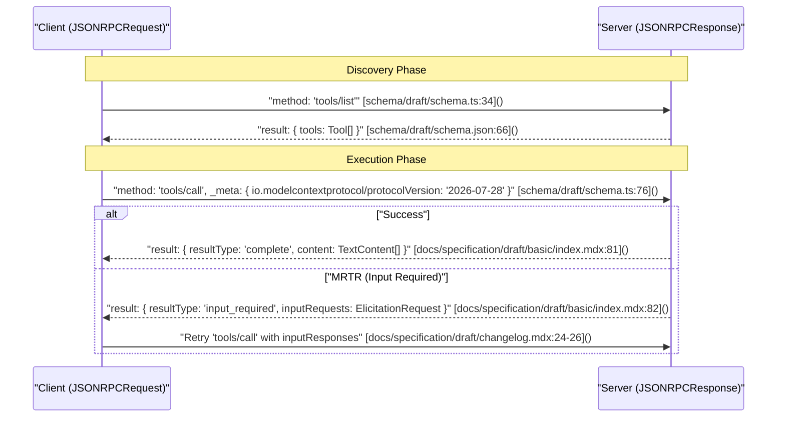
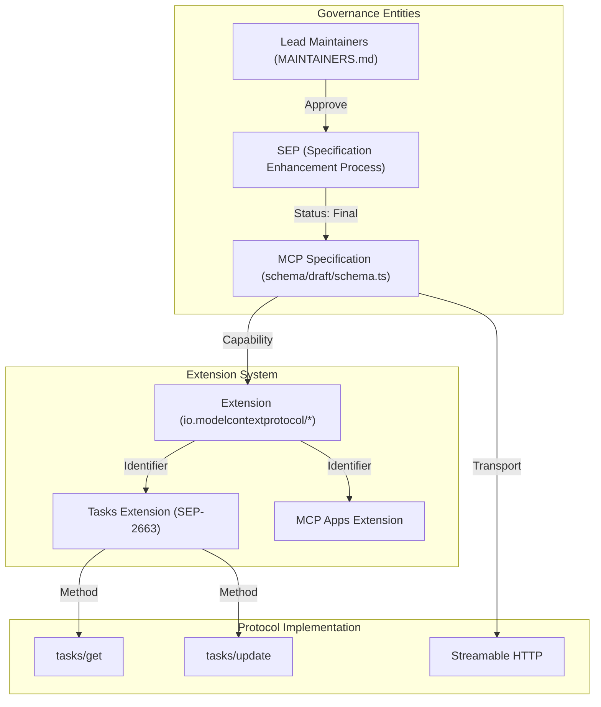

<!-- source: DeepWiki mcp.deepwiki.com · repo modelcontextprotocol/modelcontextprotocol · page 10 Glossary · fetched 2026-10-21 -->

# Glossary

Relevant source files

The following files were used as context for generating this wiki page:

- [.gitattributes](.gitattributes)
- [.github/dependabot.yml](.github/dependabot.yml)
- [CONTRIBUTING.md](CONTRIBUTING.md)
- [MAINTAINERS.md](MAINTAINERS.md)
- [README.md](README.md)
- [SECURITY.md](SECURITY.md)
- [blog/content/posts/2026-01-26-mcp-apps.md](blog/content/posts/2026-01-26-mcp-apps.md)
- [blog/content/posts/2026-04-08-maintainer-update.md](blog/content/posts/2026-04-08-maintainer-update.md)
- [blog/static/posts/images/maintainer-update-2026-04/clare.webp](blog/static/posts/images/maintainer-update-2026-04/clare.webp)
- [blog/static/posts/images/maintainer-update-2026-04/den.jpeg](blog/static/posts/images/maintainer-update-2026-04/den.jpeg)
- [docs/community/communication.mdx](docs/community/communication.mdx)
- [docs/community/governance.mdx](docs/community/governance.mdx)
- [docs/community/sdk-tiers.mdx](docs/community/sdk-tiers.mdx)
- [docs/community/security.mdx](docs/community/security.mdx)
- [docs/community/sep-guidelines.mdx](docs/community/sep-guidelines.mdx)
- [docs/docs.json](docs/docs.json)
- [docs/docs/getting-started/intro.mdx](docs/docs/getting-started/intro.mdx)
- [docs/docs/tools/debugging.mdx](docs/docs/tools/debugging.mdx)
- [docs/docs/tutorials/security/authorization.mdx](docs/docs/tutorials/security/authorization.mdx)
- [docs/extensions/apps/build.mdx](docs/extensions/apps/build.mdx)
- [docs/extensions/apps/overview.mdx](docs/extensions/apps/overview.mdx)
- [docs/extensions/auth/oauth-client-credentials.mdx](docs/extensions/auth/oauth-client-credentials.mdx)
- [docs/extensions/auth/overview.mdx](docs/extensions/auth/overview.mdx)
- [docs/extensions/client-matrix.mdx](docs/extensions/client-matrix.mdx)
- [docs/extensions/overview.mdx](docs/extensions/overview.mdx)
- [docs/extensions/tasks/overview.mdx](docs/extensions/tasks/overview.mdx)
- [docs/seps/2260-Require-Server-requests-to-be-associated-with-Client-requests.mdx](docs/seps/2260-Require-Server-requests-to-be-associated-with-Client-requests.mdx)
- [docs/seps/2322-MRTR.mdx](docs/seps/2322-MRTR.mdx)
- [docs/seps/2663-tasks-extension.mdx](docs/seps/2663-tasks-extension.mdx)
- [docs/seps/index.mdx](docs/seps/index.mdx)
- [docs/specification/draft/basic/index.mdx](docs/specification/draft/basic/index.mdx)
- [docs/specification/draft/changelog.mdx](docs/specification/draft/changelog.mdx)
- [docs/specification/draft/client/elicitation.mdx](docs/specification/draft/client/elicitation.mdx)
- [docs/specification/draft/schema.mdx](docs/specification/draft/schema.mdx)
- [package-lock.json](package-lock.json)
- [package.json](package.json)
- [schema/draft/schema.json](schema/draft/schema.json)
- [schema/draft/schema.ts](schema/draft/schema.ts)
- [seps/2260-Require-Server-requests-to-be-associated-with-Client-requests.md](seps/2260-Require-Server-requests-to-be-associated-with-Client-requests.md)
- [seps/2322-MRTR.md](seps/2322-MRTR.md)
- [seps/2663-tasks-extension.md](seps/2663-tasks-extension.md)
- [tools/sep-automation/package-lock.json](tools/sep-automation/package-lock.json)
- [tools/sep-automation/package.json](tools/sep-automation/package.json)
- [tools/sep-automation/src/config.ts](tools/sep-automation/src/config.ts)
- [tools/sep-automation/src/github/client.ts](tools/sep-automation/src/github/client.ts)
- [tools/sep-automation/src/github/types.ts](tools/sep-automation/src/github/types.ts)
- [tools/sep-automation/src/index.ts](tools/sep-automation/src/index.ts)
- [tools/sep-automation/src/maintainers/resolver.ts](tools/sep-automation/src/maintainers/resolver.ts)
- [tools/sep-automation/src/processor.ts](tools/sep-automation/src/processor.ts)
- [tools/sep-automation/src/sep/analyzer.ts](tools/sep-automation/src/sep/analyzer.ts)
- [tools/sep-automation/test/unit/config.test.ts](tools/sep-automation/test/unit/config.test.ts)

This glossary defines technical terms, protocol concepts, and codebase-specific jargon used within the Model Context Protocol (MCP) repository. It serves as a reference for onboarding engineers to understand the relationship between the specification and its implementation.

## Core Protocol Concepts

### JSON-RPC
The foundational messaging protocol for MCP. All communications follow the JSON-RPC 2.0 specification, using `Requests`, `Responses`, and `Notifications` [schema/draft/schema.ts:26-27]().

*   **Request**: A message that expects a response, identified by a unique `id`. In MCP, the ID MUST NOT be `null` [docs/specification/draft/basic/index.mdx:33-47]().
*   **Response**: A message sent in reply to a request, containing a `result` (Success) or an `error` (Failure) [docs/specification/draft/basic/index.mdx:53-101]().
*   **Notification**: A one-way message which does not expect a response [docs/specification/draft/schema.mdx:27-29]().

### ResultType
A mandatory discriminator field in every `Result` object (as of version 2026-07-28) that allows the client to determine how to parse the response [docs/specification/draft/basic/index.mdx:75-86]().
*   `complete`: The operation finished successfully and contains final content [docs/specification/draft/basic/index.mdx:81]().
*   `input_required`: The operation is paused and requires additional user information via MRTR [docs/specification/draft/basic/index.mdx:82]().

### _meta
A reserved field in `JSONRPCMessage` types used for protocol-level metadata [schema/draft/schema.ts:35-55](). MCP-specific keys are prefixed with `io.modelcontextprotocol/` [schema/draft/schema.ts:45](). Key metadata includes:
*   `protocolVersion`: The version being used for the request [schema/draft/schema.ts:76]().
*   `clientCapabilities`: The capabilities for the specific request [schema/draft/schema.ts:98]().

### MRTR (Multi Round-Trip Requests)
A pattern introduced in [SEP-2322] where a server responds with `resultType: "input_required"` to request more information before completing the original request [docs/specification/draft/changelog.mdx:24-26](). The client retries the original request providing the requested information in `inputResponses` [docs/specification/draft/changelog.mdx:24-26]().

### Transport
The mechanism for moving JSON-RPC messages between peers.
*   **STDIO**: Communication via standard input/output streams, typically for local processes [docs/docs/tutorials/security/authorization.mdx:21-23]().
*   **Streamable HTTP**: A stateless transport using HTTP POST for requests and a single `subscriptions/listen` stream for server-to-client notifications [docs/specification/draft/changelog.mdx:18-19]().

## System Architecture and Data Flow

The following diagram bridges the natural language concepts of a tool call to the specific code entities and types defined in the schema.

### Tool Call Flow: Natural Language to Code Entities

**Sources:** [schema/draft/schema.ts:69-111](), [docs/specification/draft/basic/index.mdx:75-86](), [docs/specification/draft/changelog.mdx:24-26]().

## Domain Specific Terms

| Term | Definition | Code Pointer |
| :--- | :--- | :--- |
| **Elicitation** | A capability allowing servers to request data (Form mode) or URL navigation (URL mode) from users. | [docs/specification/draft/client/elicitation.mdx:7-15]() |
| **Sampling** | A client capability allowing a server to request a completion from the LLM hosted by the client. | [docs/docs.json:141]() |
| **Resource** | Application-driven data (like files) that a server exposes for reading. | [docs/docs.json:150]() |
| **Prompt** | Server-provided templates that help users interact with LLMs. | [docs/docs.json:149]() |
| **Tool** | Model-controlled functions that a server exposes for execution. | [schema/draft/schema.json:66]() |
| **Task** | An asynchronous operation handle (`io.modelcontextprotocol/tasks`) for long-running requests. | [seps/2663-tasks-extension.md:13-15]() |
| **Root** | A filesystem boundary provided by the client (Deprecated in draft). | [docs/docs.json:140]() |

## Governance and Tooling

### SEP (Specification Enhancement Process)
The formal process for proposing changes to the MCP specification [package.json:28]().
*   **SEP Lifecycle Automation**: A tool that manages SEP states and GitHub integration [tools/sep-automation/src/index.ts:1-10]().

### Implementation Tiers
A classification system for SDKs based on their priority and completeness.
*   **Lead Maintainers**: David Soria Parra and Den Delimarsky [MAINTAINERS.md:7-11]().
*   **SDK Maintainers**: Specialized maintainers for Java, Ruby, Swift, Go, C#, Kotlin, Python, TypeScript, Rust, and PHP [MAINTAINERS.md:28-108]().

### Code Entity Mapping: Governance and Extensions

**Sources:** [MAINTAINERS.md:7-11](), [seps/2663-tasks-extension.md:1-15](), [docs/specification/draft/changelog.mdx:12-28]().

## Schema and Types

### Annotations
Optional metadata for the client to inform UI display, including `audience`, `priority`, and `lastModified` [schema/draft/schema.json:4-26]().

### Implementation
A structure identifying software metadata (`name`, `version`) used in `clientInfo` and `serverInfo` [schema/draft/schema.ts:80-90]().

### Cursor
An opaque token used to represent a position in a paginated result set [schema/draft/schema.ts:168]().

### MetaObject
A dictionary of metadata attached to messages, following specific segment naming rules (Prefix/Name) [schema/draft/schema.ts:35-54]().

**Sources:**
- [schema/draft/schema.ts:1-182]()
- [schema/draft/schema.json:1-150]()
- [docs/specification/draft/changelog.mdx:1-60]()
- [docs/specification/draft/basic/index.mdx:1-152]()
- [seps/2663-tasks-extension.md:1-54]()
- [MAINTAINERS.md:1-215]()