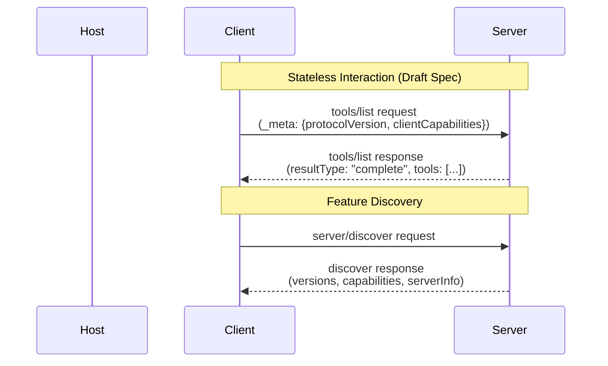
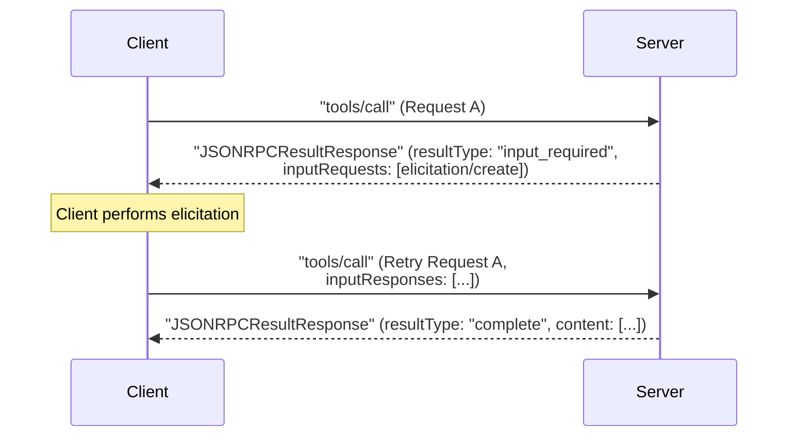

<!-- source: DeepWiki mcp.deepwiki.com · repo modelcontextprotocol/modelcontextprotocol · page 2 Protocol Specification · fetched 2026-10-21 -->

# Protocol Specification

Relevant source files

The following files were used as context for generating this wiki page:

- [.prettierignore](.prettierignore)
- [docs/specification/2024-11-05/basic/index.mdx](docs/specification/2024-11-05/basic/index.mdx)
- [docs/specification/2024-11-05/index.mdx](docs/specification/2024-11-05/index.mdx)
- [docs/specification/2024-11-05/server/index.mdx](docs/specification/2024-11-05/server/index.mdx)
- [docs/specification/2025-03-26/basic/index.mdx](docs/specification/2025-03-26/basic/index.mdx)
- [docs/specification/2025-03-26/changelog.mdx](docs/specification/2025-03-26/changelog.mdx)
- [docs/specification/2025-03-26/index.mdx](docs/specification/2025-03-26/index.mdx)
- [docs/specification/2025-03-26/server/index.mdx](docs/specification/2025-03-26/server/index.mdx)
- [docs/specification/2025-06-18/schema.mdx](docs/specification/2025-06-18/schema.mdx)
- [docs/specification/2025-11-25/schema.mdx](docs/specification/2025-11-25/schema.mdx)
- [docs/specification/draft/basic/index.mdx](docs/specification/draft/basic/index.mdx)
- [docs/specification/draft/changelog.mdx](docs/specification/draft/changelog.mdx)
- [docs/specification/draft/client/elicitation.mdx](docs/specification/draft/client/elicitation.mdx)
- [docs/specification/draft/index.mdx](docs/specification/draft/index.mdx)
- [docs/specification/draft/schema.mdx](docs/specification/draft/schema.mdx)
- [docs/specification/draft/server/index.mdx](docs/specification/draft/server/index.mdx)
- [docs/style.css](docs/style.css)
- [schema/2025-11-25/schema.json](schema/2025-11-25/schema.json)
- [schema/2025-11-25/schema.ts](schema/2025-11-25/schema.ts)
- [schema/draft/schema.json](schema/draft/schema.json)
- [schema/draft/schema.ts](schema/draft/schema.ts)
- [scripts/pull-registry-docs.sh](scripts/pull-registry-docs.sh)
- [typedoc.config.mjs](typedoc.config.mjs)
- [typedoc.plugin.mjs](typedoc.plugin.mjs)

## Purpose and Scope

This page documents the Model Context Protocol (MCP) specification—the authoritative definition of how clients and servers communicate. It covers the core messaging system, transport mechanisms, connection lifecycle, and protocol features that enable bidirectional interaction between MCP clients and servers.

This page focuses on the **protocol layer itself**: message types, encoding, transport, and capability negotiation. For information about implementing servers, see [Server Development](#5). For information about client implementations, see [Client Ecosystem](#4). For authorization and security mechanisms, see [Authorization and Security](#3).

## Overview: Protocol Architecture

MCP is built on three foundational layers:

1.  **JSON-RPC 2.0 Message System**: All communication uses JSON-RPC 2.0 for encoding requests, responses, and notifications.
2.  **Transport Layer**: Messages are transmitted via stdio (subprocess) or Streamable HTTP (remote).
3.  **Stateless Connection Model**: In the latest specification (`2026-07-28`), the protocol has shifted to a stateless architecture where capabilities and versioning are declared per-request.

The protocol is **bidirectional**—both clients and servers can initiate requests and send notifications. This enables servers to request user input via elicitation and access filesystem roots.

Sources: [schema/draft/schema.ts:26-32](), [docs/specification/draft/basic/index.mdx:7-24](), [docs/specification/draft/changelog.mdx:14-16]()

## JSON-RPC Message System

### Message Types

MCP defines three JSON-RPC message types, all encoded as UTF-8 JSON:

| Message Type | Direction | Expects Response | Structure |
| :--- | :--- | :--- | :--- |
| **Request** | Either direction | Yes | `{jsonrpc: "2.0", id, method, params?}` |
| **Response** | Either direction | No | `{jsonrpc: "2.0", id, result or error}` |
| **Notification** | Either direction | No | `{jsonrpc: "2.0", method, params?}` |

Key constraints:
*   Request IDs **MUST** be string or number (never `null`) [docs/specification/draft/basic/index.mdx:46-47]().
*   Result responses **MUST** include a `resultType` (e.g., `"complete"` or `"input_required"`) [docs/specification/draft/basic/index.mdx:73-82]().
*   Notifications **MUST NOT** include an ID.

Sources: [schema/draft/schema.ts:26-27](), [docs/specification/draft/basic/index.mdx:31-106]()

### Error Handling

MCP defines standard JSON-RPC error codes plus implementation-specific codes in the range `-32020` to `-32099`:

| Error Code | Name | Usage |
| :--- | :--- | :--- |
| `-32700` | `ParseError` | Invalid JSON received |
| `-32600` | `InvalidRequest` | Request structure invalid |
| `-32601` | `MethodNotFound` | Method not supported or capability not declared |
| `-32020` | `HeaderMismatch` | HTTP header and `_meta` version mismatch |
| `-32021` | `MissingRequiredClientCapability` | Client lacks capability for the request |
| `-32022` | `UnsupportedProtocolVersion` | Server doesn't support requested version |

Sources: [schema/draft/schema.ts:203-247](), [docs/specification/draft/basic/index.mdx:107-154]()

### Metadata System (`_meta`)

All messages **MAY** include a `_meta` field. In the latest stateless spec, `_meta` is **REQUIRED** for requests to carry protocol version and capabilities.

**Reserved Prefix System**:
*   Any prefix where the second label is `modelcontextprotocol` or `mcp` is **reserved** (e.g., `io.modelcontextprotocol/`) [schema/draft/schema.ts:45-46]().

**Stateless Request Metadata** [schema/draft/schema.ts:63-104]():
*   `io.modelcontextprotocol/protocolVersion`: Required protocol version.
*   `io.modelcontextprotocol/clientInfo`: Required client identification.
*   `io.modelcontextprotocol/clientCapabilities`: Required per-request capabilities.

Sources: [schema/draft/schema.ts:34-104](), [docs/specification/draft/changelog.mdx:14-16]()

## Transport Layer

### stdio Transport

The client launches the MCP server as a subprocess. Messages are framed using single-line JSON objects delimited by newlines.

Sources: [docs/specification/draft/changelog.mdx:16-18]()

### Streamable HTTP Transport

Standardized via SEP, this transport removes protocol-level sessions in favor of stateless requests.

**Key Changes in Draft Spec**:
*   **Stateless**: Endpoints like `tools/list` no longer vary per-connection [docs/specification/draft/changelog.mdx:12-13]().
*   **Subscriptions**: Replaces SSE resumability with `subscriptions/listen`, a single long-lived POST-response stream for change notifications [docs/specification/draft/changelog.mdx:18-19]().
*   **Headers**: Requires `Mcp-Method` and `Mcp-Name` on POST requests [docs/specification/draft/changelog.mdx:35-36]().

Sources: [docs/specification/draft/changelog.mdx:12-30]()

## Connection Lifecycle and Capabilities

### Stateless Lifecycle

The `initialize` handshake and `notifications/initialized` are **removed** in the latest draft specification.

**Sequence Diagram: Stateless Protocol Lifecycle**

**server/discover**: Servers **MUST** implement this to advertise supported versions and capabilities for up-front selection [docs/specification/draft/changelog.mdx:16-17]().

Sources: [docs/specification/draft/changelog.mdx:14-21]()

### Capability Negotiation

Capabilities are now declared **per-request** in the `_meta` field.

**Client Capabilities** [schema/draft/schema.ts:474-573]():
*   `elicitation`: Supports user input requests.
*   `roots`: Supports filesystem boundary lists (deprecated in draft).
*   `sampling`: Supports LLM access (deprecated in draft).

**Server Capabilities** [schema/draft/schema.ts:580-690]():
*   `prompts`, `resources`, `tools`: Core primitives.
*   `logging`: Supports emitting logs.

Sources: [schema/draft/schema.ts:85-91](), [docs/specification/draft/changelog.mdx:14-16]()

## Server Features

### Tools, Resources, and Prompts

Servers expose functional and data primitives to the model.

| Feature | Control | Description |
| :--- | :--- | :--- |
| **Tools** | Model | Executable functions (e.g., `tools/call`). |
| **Resources** | Application | Data sources (e.g., `resources/read`). |
| **Prompts** | User | Template instructions (e.g., `prompts/get`). |

**Annotations and Caching**:
*   **Annotations**: `audience`, `priority`, and `lastModified` inform client display [schema/draft/schema.json:4-26]().
*   **Caching**: `CacheableResult` provides `ttlMs` and `cacheScope` (`public`/`private`) hints [schema/draft/schema.json:122-146]().

Sources: [docs/specification/draft/server/index.mdx:15-22](), [schema/draft/schema.json:122-146](), [docs/specification/draft/changelog.mdx:36-37]()

## Multi Round-Trip Requests (MRTR)

MRTR replaces server-initiated requests (like `sampling/createMessage`) with a pattern where the server indicates that more input is required to finish a request.

**Sequence Diagram: Multi Round-Trip Requests (MRTR)**

*   **InputRequiredResult**: Used when a request is incomplete [schema/draft/schema.ts:178-185]().
*   **inputRequests**: Carries the nested request (e.g., `elicitation/create`) [schema/draft/schema.ts:1085-1090]().

Sources: [docs/specification/draft/changelog.mdx:24-27](), [schema/draft/schema.ts:1071-1100]()

## Task System (Extension)

Long-running operations are moved to an official extension `io.modelcontextprotocol/tasks`.

*   **Polling**: Uses `tasks/get` to check status [docs/specification/draft/changelog.mdx:22-23]().
*   **Input**: Uses `tasks/update` for mid-flight client-to-server input.
*   **States**: `working`, `input_required`, `completed`, `failed`, `cancelled`.

Sources: [docs/specification/draft/changelog.mdx:22-23](), [schema/draft/schema.ts:1212-1244]()

## Protocol Versioning

MCP uses date-based versioning (e.g., `2026-07-28`).

*   **LATEST_PROTOCOL_VERSION**: `2026-07-28` [schema/draft/schema.ts:30]().
*   **Negotiation**: Handled per-request via `_meta` or up-front via `server/discover`.
*   **Deprecation**: Features remain in spec for at least 12 months in the deprecated features registry [schema/draft/schema.ts:99-102]().

Sources: [schema/draft/schema.ts:30-32](), [docs/specification/draft/changelog.mdx:14-17]()

---

