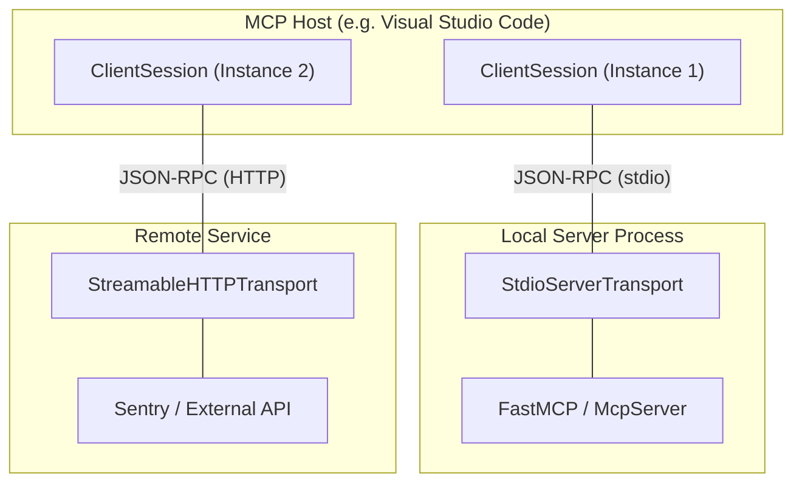
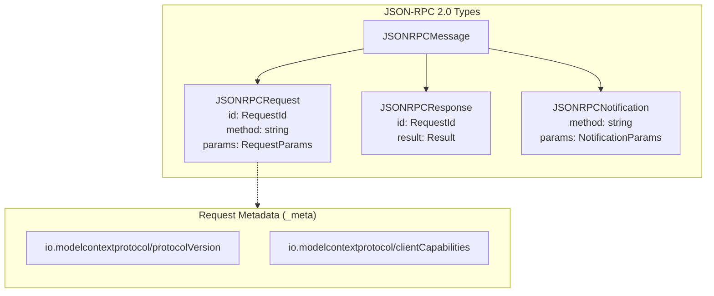

<!-- source: DeepWiki mcp.deepwiki.com · repo modelcontextprotocol/modelcontextprotocol · page 2.1 Architecture and Core Concepts · fetched 2026-10-21 -->

# Architecture and Core Concepts

Relevant source files

The following files were used as context for generating this wiki page:

- [docs/docs/develop/build-client.mdx](docs/docs/develop/build-client.mdx)
- [docs/docs/develop/build-server.mdx](docs/docs/develop/build-server.mdx)
- [docs/docs/develop/build-with-agent-skills.mdx](docs/docs/develop/build-with-agent-skills.mdx)
- [docs/docs/learn/architecture.mdx](docs/docs/learn/architecture.mdx)
- [docs/docs/learn/client-concepts.mdx](docs/docs/learn/client-concepts.mdx)
- [docs/docs/learn/server-concepts.mdx](docs/docs/learn/server-concepts.mdx)
- [docs/docs/sdk.mdx](docs/docs/sdk.mdx)
- [docs/specification/2024-11-05/architecture/index.mdx](docs/specification/2024-11-05/architecture/index.mdx)
- [docs/specification/2025-03-26/architecture/index.mdx](docs/specification/2025-03-26/architecture/index.mdx)
- [docs/specification/2025-06-18/architecture/index.mdx](docs/specification/2025-06-18/architecture/index.mdx)
- [docs/specification/2025-11-25/architecture/index.mdx](docs/specification/2025-11-25/architecture/index.mdx)
- [docs/specification/draft/architecture/index.mdx](docs/specification/draft/architecture/index.mdx)
- [docs/specification/draft/basic/patterns/mrtr.mdx](docs/specification/draft/basic/patterns/mrtr.mdx)
- [docs/specification/draft/basic/transports/index.mdx](docs/specification/draft/basic/transports/index.mdx)
- [docs/specification/draft/basic/transports/stdio.mdx](docs/specification/draft/basic/transports/stdio.mdx)

This document provides a technical overview of the Model Context Protocol (MCP) architecture, covering its JSON-RPC foundation, client-server model, and the transition to a stateless architecture in the latest specification.

## Overview

MCP is a schema-driven protocol that enables AI applications (hosts) to integrate with external data sources and tools (servers). The architecture is designed for modularity, separating the data layer (semantics) from the transport layer (communication). The protocol uses [JSON-RPC 2.0](https://www.jsonrpc.org/specification) as its messaging foundation [docs/docs/learn/architecture.mdx:82-85]().

The protocol focuses solely on the exchange of context; it does not dictate how AI applications manage that context or interact with LLMs [docs/docs/learn/architecture.mdx:22-25]().

## Client-Server Topology

MCP follows a client-server architecture where an **MCP Host** (e.g., Claude Desktop, Claude Code, or an IDE) coordinates one or more **MCP Clients**. Each client maintains a dedicated, one-to-one connection to a specific **MCP Server** [docs/docs/learn/architecture.mdx:28-40]().

### Participant Roles

| Participant | Role | Responsibility |
|-------------|------|----------------|
| **MCP Host** | AI Application | Acts as the container; manages multiple client instances, enforces security policies, and handles user authorization [docs/specification/draft/architecture/index.mdx:50-60](). |
| **MCP Client** | Protocol Component | Maintains a connection to exactly one server, attaches protocol metadata to requests, and routes messages bidirectionally [docs/specification/draft/architecture/index.mdx:61-72](). |
| **MCP Server** | Context Provider | Program that exposes Tools, Resources, and Prompts. Can be local (stdio) or remote (HTTP) [docs/specification/draft/architecture/index.mdx:74-83](). |

**Client-Server Entity Mapping**

Sources: [docs/docs/learn/architecture.mdx:44-61](), [docs/docs/develop/build-client.mdx:114-122](), [docs/specification/draft/architecture/index.mdx:17-48]()

## Stateless Architecture (Draft Spec)

The latest protocol revision introduces a shift toward a **stateless architecture**. In this model, every request is self-contained and carries its own protocol version and capabilities [docs/specification/draft/architecture/index.mdx:7-9]().

### Key Architectural Shifts
1.  **Handshake Removal**: Legacy versions used an `initialize` handshake. Modern MCP uses `server/discover` for up-front capability discovery, but every subsequent request must still include metadata [docs/specification/draft/architecture/index.mdx:118-123]().
2.  **Request-Scoped Capabilities**: Capabilities are declared per-request via the `_meta` field, allowing for dynamic feature negotiation [docs/specification/draft/architecture/index.mdx:118-123]().
3.  **Sessionless HTTP**: Streamable HTTP no longer relies on a long-lived session ID for basic requests; the protocol is designed to work without stateful load balancing [docs/specification/draft/basic/patterns/mrtr.mdx:29-32]().

### The `_meta` Field
Metadata is attached to interactions using the `_meta` field. Reserved keys use the `io.modelcontextprotocol/` prefix.

| Meta Key | Purpose |
|----------|---------|
| `protocolVersion` | The protocol version for this specific request [docs/specification/draft/architecture/index.mdx:144-144](). |
| `clientCapabilities` | Declares supported features (e.g., sampling, elicitation) for this request [docs/specification/draft/architecture/index.mdx:118-123](). |

Sources: [docs/specification/draft/architecture/index.mdx:116-130](), [docs/specification/draft/basic/transports/stdio.mdx:65-72]()

## Protocol Layers

### Data Layer
The data layer implements a JSON-RPC 2.0 based exchange protocol that defines the message structure and semantics [docs/docs/learn/architecture.mdx:82-85](). It handles primitives like tools, resources, and prompts [docs/docs/learn/architecture.mdx:87-90]().

**Data Layer Message Structure**

Sources: [docs/docs/learn/architecture.mdx:103-108](), [docs/specification/draft/architecture/index.mdx:116-130](), [docs/specification/draft/basic/transports/stdio.mdx:65-72]()

### Transport Layer
The transport layer manages communication channels and message framing. MCP supports two primary mechanisms [docs/docs/learn/architecture.mdx:92-95]():

1.  **Stdio Transport**: Uses standard input/output streams for direct process communication. Servers read from `stdin` and write to `stdout`. Messages are newline-delimited [docs/specification/draft/basic/transports/stdio.mdx:7-13]().
2.  **Streamable HTTP Transport**: Uses HTTP POST for messages with optional Server-Sent Events (SSE) for streaming [docs/docs/learn/architecture.mdx:99-101]().

## Core Communication Patterns

### Multi Round-Trip Requests (MRTR)
MRTR replaces the legacy pattern of server-initiated requests. It allows a server to request additional information from the client as part of a single logical operation [docs/specification/draft/basic/patterns/mrtr.mdx:7-14]().

1.  **Request**: Client sends a request (e.g., `tools/call`) [docs/specification/draft/basic/patterns/mrtr.mdx:44-44]().
2.  **Input Required**: Server determines more info is needed and returns an `InputRequiredResult` [docs/specification/draft/basic/patterns/mrtr.mdx:46-46]().
3.  **Gathering**: Client gathers input (via Elicitation, Sampling, etc.) [docs/specification/draft/basic/patterns/mrtr.mdx:48-48]().
4.  **Retry**: Client retries the original request with the new input included [docs/specification/draft/basic/patterns/mrtr.mdx:49-49]().

### Subscriptions
Clients can monitor changes by opening a subscription stream using `subscriptions/listen`. The server then sends notifications (e.g., `notifications/resources/updated`) tagged with a `subscriptionId` [docs/specification/draft/architecture/index.mdx:155-161]().

Sources: [docs/specification/draft/basic/patterns/mrtr.mdx:25-52](), [docs/specification/draft/architecture/index.mdx:131-162](), [docs/specification/draft/basic/transports/stdio.mdx:41-54]()

---

