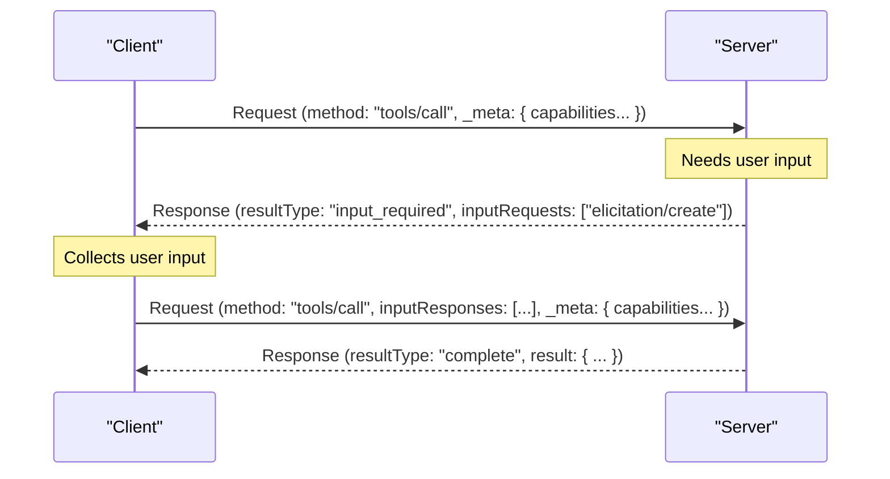
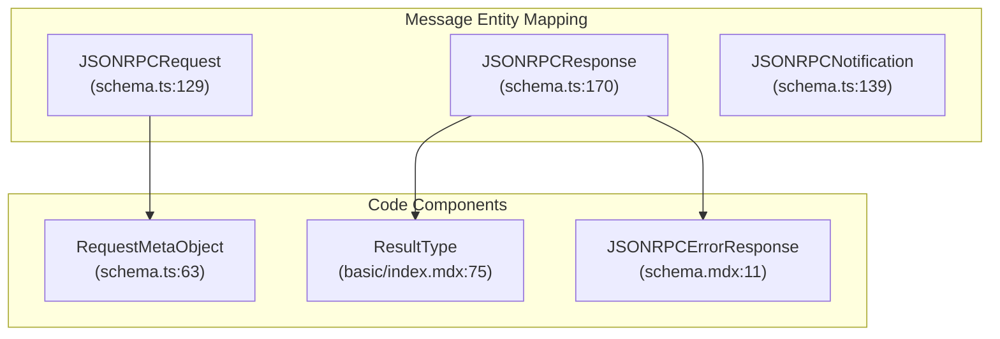

<!-- source: DeepWiki mcp.deepwiki.com · repo modelcontextprotocol/modelcontextprotocol · page 2.2 JSON-RPC Message System · fetched 2026-10-21 -->

# JSON-RPC Message System

<details>
<summary>Relevant source files</summary>

The following files were used as context for generating this wiki page:

- [.prettierignore](.prettierignore)
- [docs/specification/2025-06-18/schema.mdx](docs/specification/2025-06-18/schema.mdx)
- [docs/specification/2025-11-25/schema.mdx](docs/specification/2025-11-25/schema.mdx)
- [docs/specification/draft/basic/index.mdx](docs/specification/draft/basic/index.mdx)
- [docs/specification/draft/changelog.mdx](docs/specification/draft/changelog.mdx)
- [docs/specification/draft/client/elicitation.mdx](docs/specification/draft/client/elicitation.mdx)
- [docs/specification/draft/schema.mdx](docs/specification/draft/schema.mdx)
- [docs/style.css](docs/style.css)
- [schema/2025-11-25/schema.json](schema/2025-11-25/schema.json)
- [schema/2025-11-25/schema.ts](schema/2025-11-25/schema.ts)
- [schema/draft/examples/CallToolResultResponse/call-tool-result-response.json](schema/draft/examples/CallToolResultResponse/call-tool-result-response.json)
- [schema/draft/examples/CompleteResultResponse/completion-result-response.json](schema/draft/examples/CompleteResultResponse/completion-result-response.json)
- [schema/draft/examples/GetPromptResultResponse/get-prompt-result-response.json](schema/draft/examples/GetPromptResultResponse/get-prompt-result-response.json)
- [schema/draft/examples/ReadResourceResultResponse/read-resource-result-response.json](schema/draft/examples/ReadResourceResultResponse/read-resource-result-response.json)
- [schema/draft/schema.json](schema/draft/schema.json)
- [schema/draft/schema.ts](schema/draft/schema.ts)
- [scripts/pull-registry-docs.sh](scripts/pull-registry-docs.sh)
- [seps/414-request-meta.md](seps/414-request-meta.md)
- [typedoc.config.mjs](typedoc.config.mjs)
- [typedoc.plugin.mjs](typedoc.plugin.mjs)

</details>


## Purpose and Scope

This page documents the JSON-RPC 2.0 message system that forms the foundation of the Model Context Protocol (MCP). It details the structure and semantics of the three core message types—requests, responses, and notifications—along with error handling, the metadata system, and the ID requirements that enable bidirectional communication.

The protocol has transitioned to a **stateless architecture** as of version `2026-07-28`. Every request now carries protocol versioning, client identity, and capability negotiation within its metadata, removing the need for an initialization handshake [docs/specification/draft/changelog.mdx:14-15]().

## Core Message Types

MCP uses JSON-RPC 2.0 as specified in [https://www.jsonrpc.org/specification](https://www.jsonrpc.org/specification). All messages exchanged between clients and servers **MUST** follow this specification [docs/specification/draft/basic/index.mdx:27-29]().

The protocol defines three message types, represented by the union type `JSONRPCMessage` [schema/draft/schema.ts:26-27]():

```typescript
type JSONRPCMessage = JSONRPCRequest | JSONRPCNotification | JSONRPCResponse;
```

### Requests

A **request** is a message that expects a response. Both clients and servers can send requests to each other, enabling bidirectional communication [docs/specification/draft/basic/index.mdx:33-33]().

**Structure** [schema/draft/schema.ts:129-132]():

| Field | Type | Required | Description |
|-------|------|----------|-------------|
| `jsonrpc` | string | Yes | **MUST** be `"2.0"` [schema/draft/schema.ts:32]() |
| `id` | `RequestId` | Yes | Unique identifier (string or number) [schema/draft/schema.ts:122]() |
| `method` | string | Yes | The name of the method to invoke |
| `params` | object | No | Parameters for the method, typically including `_meta` |

**Key requirements:**
- The `id` field **MUST NOT** be `null` [docs/specification/draft/basic/index.mdx:47-47]().
- The `id` **MUST NOT** match the ID of any other request the sender has issued and not yet received a response for [docs/specification/draft/basic/index.mdx:48-49]().

Sources: [schema/draft/schema.ts:129-132](), [docs/specification/draft/basic/index.mdx:33-50]()

### Responses

A **response** is sent in reply to a request. It contains either a successful result or an error.

**Structure** [docs/specification/draft/basic/index.mdx:57-101]():

| Field | Type | Required | Description |
|-------|------|----------|-------------|
| `jsonrpc` | string | Yes | **MUST** be `"2.0"` |
| `id` | `RequestId` | Yes | **MUST** match the ID of the request being answered |
| `result` | `Result` | Conditional | Present on success; **MUST** include `resultType` [docs/specification/draft/basic/index.mdx:73-73]() |
| `error` | `Error` | Conditional | Present on failure; **MUST** include `code` and `message` |

**Result Types:**
MCP supports polymorphic results. The `resultType` field allows the client to determine how to parse the object [docs/specification/draft/basic/index.mdx:77-79]():
- `"complete"`: The request completed successfully [docs/specification/draft/basic/index.mdx:81-81]().
- `"input_required"`: The request requires additional input via the Multi Round-Trip Request (MRTR) pattern [docs/specification/draft/basic/index.mdx:82-82]().

Sources: [docs/specification/draft/basic/index.mdx:53-86](), [schema/draft/schema.ts:148-152](), [schema/draft/schema.ts:159-163]()

### Notifications

A **notification** is a one-way message that does not expect a response.

**Structure** [schema/draft/schema.ts:139-141]():

| Field | Type | Required | Description |
|-------|------|----------|-------------|
| `jsonrpc` | string | Yes | **MUST** be `"2.0"` |
| `method` | string | Yes | The name of the notification |
| `params` | `NotificationParams` | No | Parameters for the notification |

**Key requirements:**
- **MUST NOT** include an `id` field [docs/specification/draft/basic/index.mdx:158-158]().
- The receiver **MUST NOT** send a response [docs/specification/draft/basic/index.mdx:159-159]().

Sources: [schema/draft/schema.ts:139-141](), [docs/specification/draft/basic/index.mdx:155-163]()

## Error Handling

MCP uses standard JSON-RPC error codes and defines specific ranges for protocol-level errors.

### Error Codes and Allocation Policy

The specification partitions the implementation-defined range (`-32000` to `-32099`) as follows [docs/specification/draft/basic/index.mdx:112-125]():

| Range | Usage |
|-------|-------|
| `-32700`, `-32600` to `-32603` | Standard JSON-RPC 2.0 errors (Parse error, Invalid request, etc.) |
| `-32000` to `-32019` | **Legacy.** Allocated before the current policy. New codes MUST NOT be added here. |
| `-32020` to `-32099` | **Reserved for MCP Specification.** Defined exclusively in the schema. |

**Defined MCP Error Codes:**
- `-32020`: `HeaderMismatch` [docs/specification/draft/basic/index.mdx:131]()
- `-32021`: `MissingRequiredClientCapability` [docs/specification/draft/basic/index.mdx:132]()
- `-32022`: `UnsupportedProtocolVersion` [docs/specification/draft/basic/index.mdx:133]()

Sources: [docs/specification/draft/basic/index.mdx:107-153]()

## Metadata System (`_meta`)

The `_meta` field allows clients and servers to attach additional metadata to interactions without modifying the core parameter schemas.

### Key Naming and Reserved Prefixes
Metadata keys follow a strict `[prefix/]name` structure [schema/draft/schema.ts:39-40]():
- **Prefix:** Optional series of labels separated by dots (`.`), followed by a slash (`/`).
- **Reserved:** Any prefix where the second label is `modelcontextprotocol` or `mcp` is reserved (e.g., `io.modelcontextprotocol/`) [schema/draft/schema.ts:45-45]().

### Request Metadata (`RequestMetaObject`)
In the stateless protocol version (`2026-07-28`), the `_meta` field on requests is **required** and must include the following fields [schema/draft/schema.ts:63-111]():

| Field | Type | Description |
|-------|------|-------------|
| `io.modelcontextprotocol/protocolVersion` | string | The version being used (e.g., `2026-07-28`) |
| `io.modelcontextprotocol/clientInfo` | `Implementation` | Identifies the client software (name and version) |
| `io.modelcontextprotocol/clientCapabilities` | `ClientCapabilities` | Declares capabilities for this specific request |
| `progressToken` | `ProgressToken` | Optional token for out-of-band progress notifications |
| `io.modelcontextprotocol/logLevel` | `LoggingLevel` | Optional desired log level (deprecated) |

Sources: [schema/draft/schema.ts:35-158](), [docs/specification/draft/changelog.mdx:14-15]()

## Message Flow Patterns

### Multi Round-Trip Requests (MRTR)
MRTR replaces server-initiated requests (like sampling or elicitation) with a polling/retry pattern to maintain statelessness [docs/specification/draft/changelog.mdx:24-24]().



### Notification Correlation
Notifications delivered via a subscription stream include a subscription ID in their metadata to allow client correlation [schema/draft/schema.ts:120-134]().



Sources: [schema/draft/schema.ts:120-134](), [docs/specification/draft/changelog.mdx:24-27](), [docs/specification/draft/schema.mdx:11-36]()

## Pagination and Progress

### Pagination
List operations use `PaginatedRequestParams` and return `PaginatedResult`.
- `cursor`: An opaque token used to represent a cursor for pagination [schema/draft/schema.ts:172]().
- `nextCursor`: If present in the result, indicates more data is available [schema/draft/schema.ts:1075]().

### Progress Notifications
If a request includes a `progressToken` in `_meta`, the server may emit `notifications/progress` [schema/draft/schema.ts:64-67](). These notifications are delivered on the **response stream** of the request they relate to, not the general subscription stream [docs/specification/draft/changelog.mdx:18-18]().

Sources: [schema/draft/schema.ts:165-172](), [docs/specification/draft/changelog.mdx:18-18]()

---

