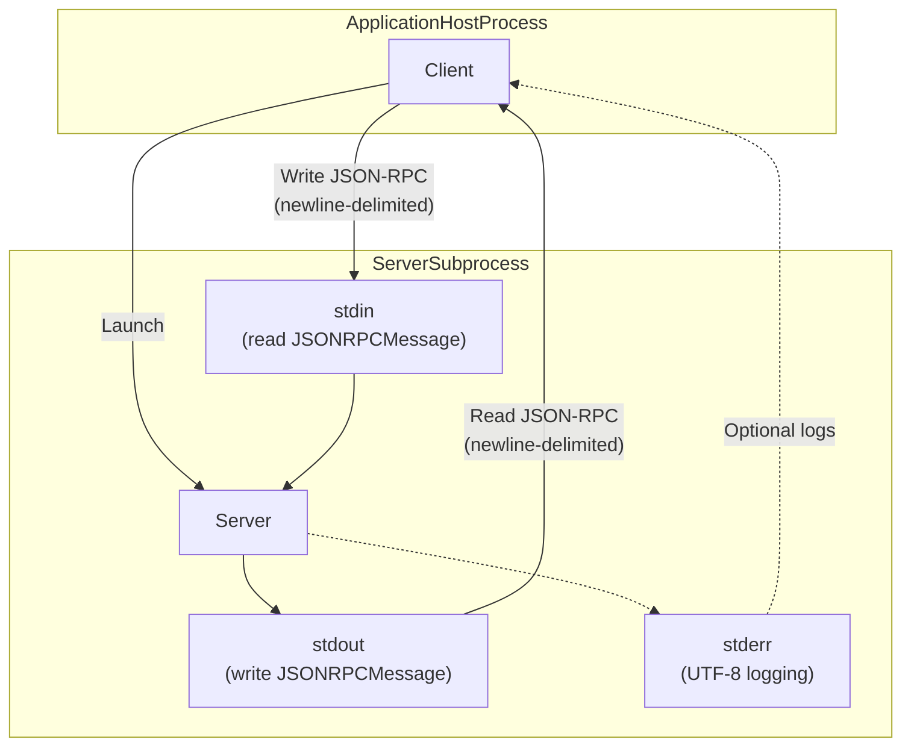
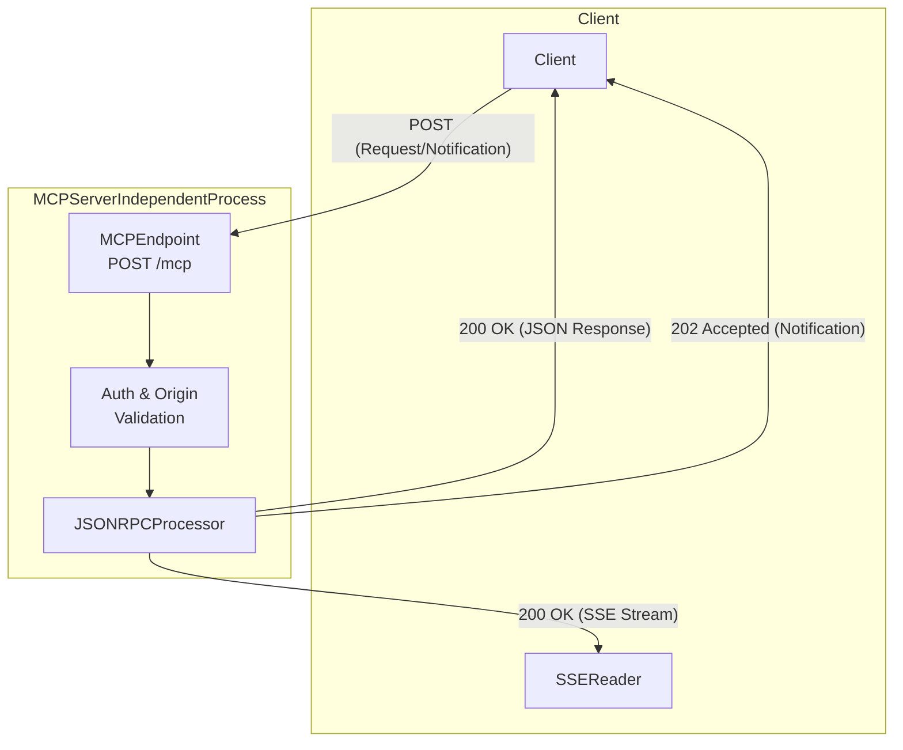
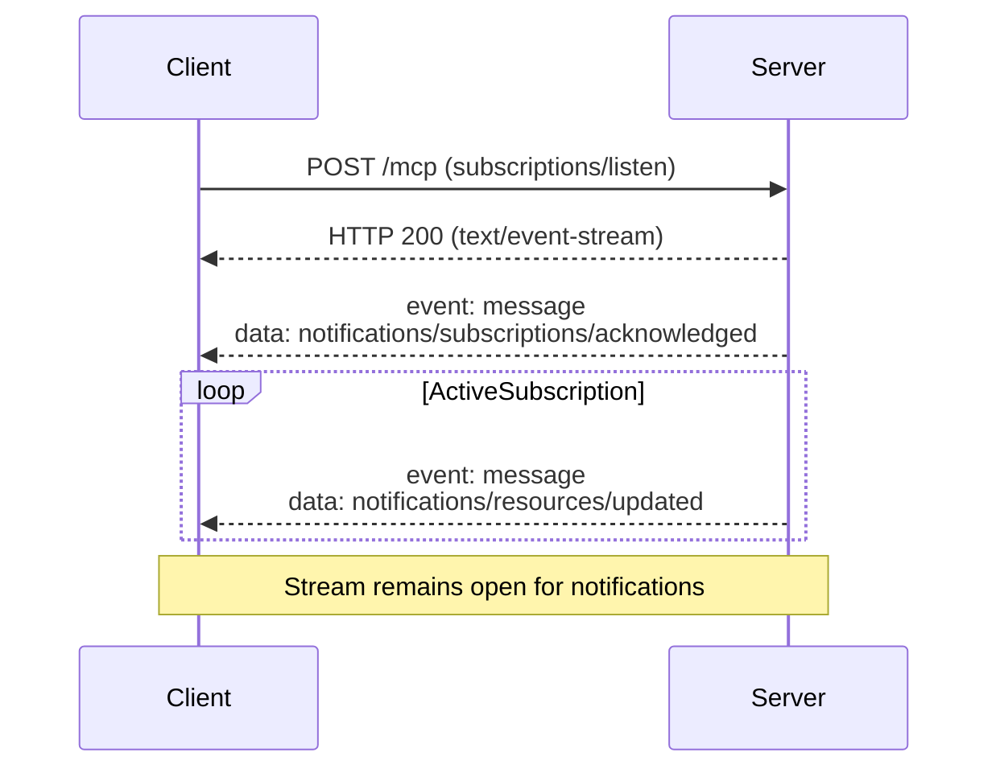

<!-- source: DeepWiki mcp.deepwiki.com · repo modelcontextprotocol/modelcontextprotocol · page 2.3 Transport Layer · fetched 2026-10-21 -->

# Transport Layer

Relevant source files

The following files were used as context for generating this wiki page:

- [blog/content/posts/2025-12-19-mcp-transport-future.md](blog/content/posts/2025-12-19-mcp-transport-future.md)
- [docs/seps/2243-http-standardization.mdx](docs/seps/2243-http-standardization.mdx)
- [docs/seps/2549-TTL-for-list-results.mdx](docs/seps/2549-TTL-for-list-results.mdx)
- [docs/seps/2567-sessionless-mcp.mdx](docs/seps/2567-sessionless-mcp.mdx)
- [docs/specification/draft/basic/transports/streamable-http.mdx](docs/specification/draft/basic/transports/streamable-http.mdx)
- [docs/specification/draft/basic/versioning.mdx](docs/specification/draft/basic/versioning.mdx)
- [schema/draft/examples/HeaderMismatchError/header-mismatch.json](schema/draft/examples/HeaderMismatchError/header-mismatch.json)
- [schema/draft/examples/MissingRequiredClientCapabilityError/missing-elicitation-capability.json](schema/draft/examples/MissingRequiredClientCapabilityError/missing-elicitation-capability.json)
- [schema/draft/examples/ReadResourceResultResponse/read-resource-result-response-with-ttl.json](schema/draft/examples/ReadResourceResultResponse/read-resource-result-response-with-ttl.json)
- [schema/draft/examples/UnsupportedProtocolVersionError/unsupported-version.json](schema/draft/examples/UnsupportedProtocolVersionError/unsupported-version.json)
- [scripts/render-seps.ts](scripts/render-seps.ts)
- [seps/2243-http-standardization.md](seps/2243-http-standardization.md)
- [seps/2549-TTL-for-list-results.md](seps/2549-TTL-for-list-results.md)
- [seps/2567-sessionless-mcp.md](seps/2567-sessionless-mcp.md)

## Purpose and Scope

The transport layer defines how JSON-RPC messages are physically transmitted between MCP clients and servers. This page covers the two standard transport mechanisms (stdio and Streamable HTTP), their message framing, SSE streaming, session management, and connection patterns. It also covers the HTTP standardization (SEP-2243), the introduction of TTL-based caching (SEP-2549), and the removal of protocol-level sessions (SEP-2567) in the 2026-07-28 protocol revision.

**Sources:** [docs/specification/draft/basic/transports/index.mdx:7-25](), [docs/specification/draft/architecture/index.mdx:7-13]()

## Transport Mechanisms

MCP defines two standard transports for carrying UTF-8 encoded JSON-RPC messages:

| Transport | Use Case | Connection Model | Message Framing |
|-----------|----------|------------------|-----------------|
| **stdio** | Local servers as subprocesses | Client launches server process | Newline-delimited JSON |
| **Streamable HTTP** | Remote/Distributed servers | Server runs independently | HTTP POST + SSE |

Protocol semantics are identical on every transport; the binding defines how messages are framed, how metadata is carried, and how cancellation is signaled.

**Sources:** [docs/specification/draft/basic/transports/index.mdx:10-22](), [docs/specification/draft/basic/transports/stdio.mdx:7-22]()

## stdio Transport

### Architecture

In the stdio transport, the client launches the MCP server as a subprocess. The two ends communicate over the subprocess's standard streams.

**Sources:** [docs/specification/draft/basic/transports/stdio.mdx:7-22]()

### Message Framing and Constraints

**Message Format:**
- Each message **MUST** be a complete JSON-RPC request, notification, or response [docs/specification/draft/basic/transports/stdio.mdx:12-12]().
- Messages are delimited by newlines and **MUST NOT** contain embedded newlines [docs/specification/draft/basic/transports/stdio.mdx:13-13]().
- The server **MUST NOT** write non-MCP messages to `stdout` [docs/specification/draft/basic/transports/stdio.mdx:18-19]().

**Stream Usage:**
- **stdin**: Client writes requests and notifications to the server [docs/specification/draft/basic/transports/stdio.mdx:35-37]().
- **stdout**: Server writes responses and notifications to the client [docs/specification/draft/basic/transports/stdio.mdx:41-44]().
- **stderr**: Used for logging purposes only. Clients **SHOULD NOT** assume `stderr` output indicates error conditions [docs/specification/draft/basic/transports/stdio.mdx:14-17]().

### Cancellation and Shutdown

- **Cancellation**: To cancel an in-flight request, the client sends a `notifications/cancelled` notification referencing the request ID [docs/specification/draft/basic/transports/stdio.mdx:78-83]().
- **Graceful Shutdown**: Initiated by the client closing the server's `stdin`. Servers **SHOULD** exit promptly when `stdin` is closed [docs/specification/draft/basic/transports/stdio.mdx:89-104]().
- **Unexpected Termination**: If the server exits, the client **SHOULD** restart it. Because the protocol is stateless (in modern versions), in-flight requests can be retried against the fresh process [docs/specification/draft/basic/transports/stdio.mdx:111-115]().

**Sources:** [docs/specification/draft/basic/transports/stdio.mdx:78-115]()

## Streamable HTTP Transport

### Architecture (Modern/Stateless)

The 2026-07-28 revision of Streamable HTTP moved toward a stateless model. The server exposes a single **MCP endpoint** that accepts POST requests. Protocol-level sessions and the `GET` stream endpoint have been removed [docs/specification/draft/basic/transports/streamable-http.mdx:16-20]().

**Sources:** [docs/specification/draft/basic/transports/streamable-http.mdx:16-45](), [docs/specification/draft/architecture/index.mdx:7-13]()

### HTTP Message Flow

1. **Client to Server**: Every JSON-RPC message is a new HTTP POST request [docs/specification/draft/basic/transports/streamable-http.mdx:72-73]().
2. **Notifications**: If the body is a notification, the server returns `202 Accepted` with no body [docs/specification/draft/basic/transports/streamable-http.mdx:82-84]().
3. **Requests**: The server returns either `application/json` (single response) or `text/event-stream` (SSE stream for progress/messages followed by final response) [docs/specification/draft/basic/transports/streamable-http.mdx:88-91]().
4. **Cancellation**: Closing the SSE response stream acts as the cancellation signal; no `notifications/cancelled` message is used on HTTP [docs/specification/draft/basic/transports/streamable-http.mdx:98-100]().

### SSE Response Streams

When returning `Content-Type: text/event-stream`:
- The server **MAY** send JSON-RPC notifications (e.g., `notifications/progress`) before the final response [docs/specification/draft/basic/transports/streamable-http.mdx:112-116]().
- The final JSON-RPC response **SHOULD** terminate the stream [docs/specification/draft/basic/transports/streamable-http.mdx:125-125]().
- Servers **SHOULD** include `X-Accel-Buffering: no` to prevent proxy buffering [docs/specification/draft/basic/transports/streamable-http.mdx:136-138]().
- **Keep-alive**: Servers should emit SSE comment lines (lines starting with `:`) to prevent idle timeouts [docs/specification/draft/basic/transports/streamable-http.mdx:146-153]().

**Sources:** [docs/specification/draft/basic/transports/streamable-http.mdx:109-153]()

## HTTP Header Standardization (SEP-2243)

To enable network intermediaries (load balancers, WAFs) to route traffic without deep packet inspection, critical metadata is mirrored into HTTP headers.

| Header Name | Source Field | Required For |
|-------------|--------------|--------------|
| `Mcp-Method` | `method` | All requests and notifications |
| `Mcp-Name` | `params.name` or `params.uri` | `tools/call`, `resources/read`, `prompts/get` |

### Security and Validation
- **Mismatches**: Servers MUST reject requests where header values do not match the JSON body [docs/seps/2243-http-standardization.mdx:57-59]().
- **Error Code**: A mismatch results in a `-32020` error [schema/draft/examples/HeaderMismatchError/header-mismatch.json:5-7]().

### Custom Headers (`x-mcp-header`)
Servers can designate tool parameters to be mirrored into headers using the `x-mcp-header` extension in the tool's `inputSchema`.
- Construct header as `Mcp-Param-{name}` [docs/seps/2243-http-standardization.mdx:176-176]().
- Restricted to primitive types (integer, string, boolean) [docs/seps/2243-http-standardization.mdx:168-168]().

**Sources:** [docs/seps/2243-http-standardization.mdx:46-63](), [seps/2243-http-standardization.md:30-60]()

## Caching and TTL (SEP-2549)

To reduce reliance on long-lived SSE streams for notifications, MCP supports time-based caching for list results.

### `CacheableResult` Interface
Results from `tools/list`, `prompts/list`, `resources/list`, and `resources/read` can include caching hints [seps/2549-TTL-for-list-results.md:85-86]():

- `ttlMs`: Number of milliseconds the client may cache the response [seps/2549-TTL-for-list-results.md:52-63]().
- `cacheScope`: Either `"public"` (shared cacheable) or `"private"` (user-specific) [seps/2549-TTL-for-list-results.md:65-78]().

**Sources:** [seps/2549-TTL-for-list-results.md:38-79](), [docs/seps/2549-TTL-for-list-results.mdx:59-98]()

## Connection Patterns and Evolution

### Stateless Architecture
Modern MCP (2026-07-28+) is stateless. Every request is self-contained and carries its own:
- Protocol Version [docs/specification/draft/basic/versioning.mdx:41-43]()
- Client Identity [docs/specification/draft/architecture/index.mdx:8-9]()
- Capabilities [docs/specification/draft/architecture/index.mdx:118-120]()

This removes the need for the `initialize` handshake and protocol-level sessions [docs/specification/draft/basic/transports/streamable-http.mdx:16-20](). SEP-2567 formally removed the `Mcp-Session-Id` header and protocol-level session concept in favor of explicit state handles [seps/2567-sessionless-mcp.md:11-15]().

### Subscriptions
Long-lived notifications (e.g., `notifications/tools/list_changed`) are delivered via a `subscriptions/listen` request. The response is an SSE stream that stays open for the duration of the subscription [docs/specification/draft/basic/patterns/index.mdx:62-67]().

**Sources:** [docs/specification/draft/basic/patterns/index.mdx:62-78](), [docs/specification/draft/basic/transports/streamable-http.mdx:127-134]()

## Backward Compatibility

Implementations must handle "Legacy" (handshake-based) vs "Modern" (stateless) counterparts.

- **Terminology**: "Modern" refers to revision `2026-07-28` and later; "Legacy" refers to `2025-11-25` and earlier [docs/specification/draft/basic/versioning.mdx:34-37]().
- **stdio Detection**: Probe with `server/discover`. If the server returns a modern error (e.g., `UnsupportedProtocolVersionError`) or a result, it is modern. Otherwise, fall back to `initialize` [docs/specification/draft/basic/transports/stdio.mdx:123-137]().
- **HTTP Detection**: Attempt a modern request. Inspect the body of a `400 Bad Request` before falling back [docs/specification/draft/basic/versioning.mdx:139-141]().

**Sources:** [docs/specification/draft/basic/versioning.mdx:126-153](), [docs/specification/draft/basic/transports/stdio.mdx:121-150]()

---

