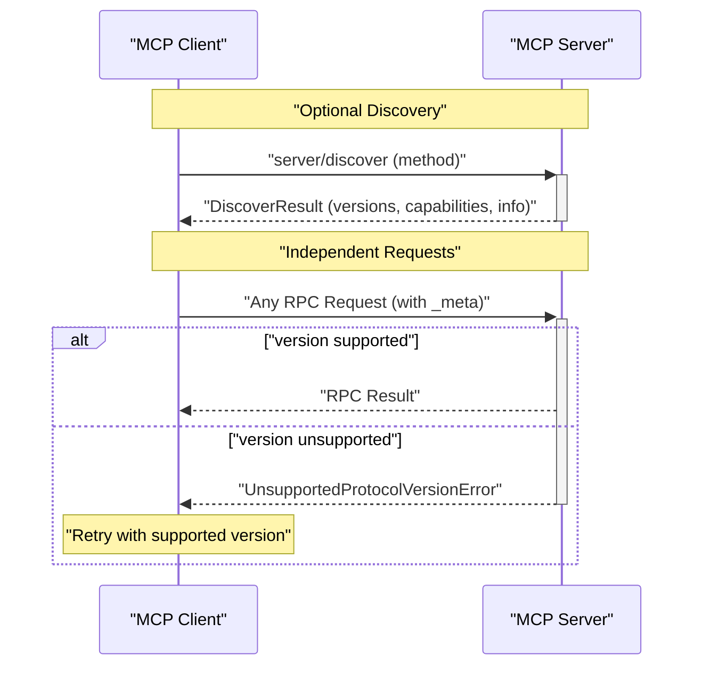
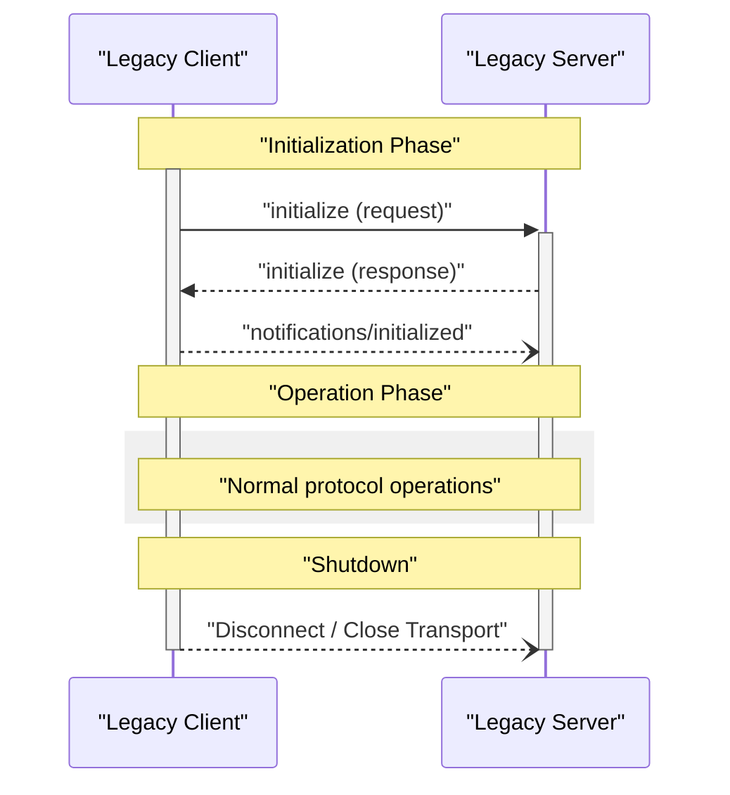

<!-- source: DeepWiki mcp.deepwiki.com · repo modelcontextprotocol/modelcontextprotocol · page 2.4 Connection Lifecycle and Capabilities · fetched 2026-10-21 -->

# Connection Lifecycle and Capabilities

<details>
<summary>Relevant source files</summary>

The following files were used as context for generating this wiki page:

- [docs/specification/2024-11-05/basic/index.mdx](docs/specification/2024-11-05/basic/index.mdx)
- [docs/specification/2024-11-05/basic/lifecycle.mdx](docs/specification/2024-11-05/basic/lifecycle.mdx)
- [docs/specification/2024-11-05/basic/transports.mdx](docs/specification/2024-11-05/basic/transports.mdx)
- [docs/specification/2024-11-05/basic/utilities/cancellation.mdx](docs/specification/2024-11-05/basic/utilities/cancellation.mdx)
- [docs/specification/2024-11-05/basic/utilities/ping.mdx](docs/specification/2024-11-05/basic/utilities/ping.mdx)
- [docs/specification/2024-11-05/client/sampling.mdx](docs/specification/2024-11-05/client/sampling.mdx)
- [docs/specification/2024-11-05/index.mdx](docs/specification/2024-11-05/index.mdx)
- [docs/specification/2024-11-05/server/index.mdx](docs/specification/2024-11-05/server/index.mdx)
- [docs/specification/2025-03-26/basic/index.mdx](docs/specification/2025-03-26/basic/index.mdx)
- [docs/specification/2025-03-26/basic/lifecycle.mdx](docs/specification/2025-03-26/basic/lifecycle.mdx)
- [docs/specification/2025-03-26/basic/transports.mdx](docs/specification/2025-03-26/basic/transports.mdx)
- [docs/specification/2025-03-26/changelog.mdx](docs/specification/2025-03-26/changelog.mdx)
- [docs/specification/2025-03-26/client/sampling.mdx](docs/specification/2025-03-26/client/sampling.mdx)
- [docs/specification/2025-03-26/index.mdx](docs/specification/2025-03-26/index.mdx)
- [docs/specification/2025-03-26/server/index.mdx](docs/specification/2025-03-26/server/index.mdx)
- [docs/specification/draft/basic/transports/streamable-http.mdx](docs/specification/draft/basic/transports/streamable-http.mdx)
- [docs/specification/draft/basic/versioning.mdx](docs/specification/draft/basic/versioning.mdx)
- [docs/specification/draft/index.mdx](docs/specification/draft/index.mdx)
- [docs/specification/draft/server/discover.mdx](docs/specification/draft/server/discover.mdx)
- [docs/specification/draft/server/index.mdx](docs/specification/draft/server/index.mdx)
- [schema/draft/examples/DiscoverResult/server-capabilities-discovery.json](schema/draft/examples/DiscoverResult/server-capabilities-discovery.json)
- [schema/draft/examples/DiscoverResultResponse/discover-result-response.json](schema/draft/examples/DiscoverResultResponse/discover-result-response.json)
- [schema/draft/examples/HeaderMismatchError/header-mismatch.json](schema/draft/examples/HeaderMismatchError/header-mismatch.json)
- [schema/draft/examples/MissingRequiredClientCapabilityError/missing-elicitation-capability.json](schema/draft/examples/MissingRequiredClientCapabilityError/missing-elicitation-capability.json)
- [schema/draft/examples/UnsupportedProtocolVersionError/unsupported-version.json](schema/draft/examples/UnsupportedProtocolVersionError/unsupported-version.json)

</details>


This document details the Model Context Protocol (MCP) connection lifecycle, including the shift toward stateless interactions in recent protocol revisions, capability negotiation, protocol version negotiation, and connection termination.

## Lifecycle Evolution

The MCP connection lifecycle has evolved from a stateful, session-based model to a stateless, per-request model in modern protocol versions (revision `2026-07-28` and later).

| Era | Protocol Versions | Lifecycle Pattern | Key Mechanism |
| :--- | :--- | :--- | :--- |
| **Modern** | `2026-07-28`+ | Stateless | Per-request `_meta` and `server/discover` |
| **Legacy** | `2025-11-25` and earlier | Session-based | `initialize` handshake |

Sources: [docs/specification/draft/basic/versioning.mdx:34-37](), [docs/specification/draft/basic/transports/streamable-http.mdx:16-20]()

### Modern Lifecycle (Stateless)

In modern MCP, there is no mandatory initialization handshake. Every request is independent and carries its own version, identity, and capability information in the `_meta` field [docs/specification/draft/index.mdx:53-54](). This shift eliminates the need for protocol-level sessions [docs/specification/draft/basic/transports/streamable-http.mdx:20-20]().



Sources: [docs/specification/draft/basic/versioning.mdx:15-27](), [docs/specification/draft/server/discover.mdx:7-10](), [docs/specification/draft/index.mdx:53-54]()

### Legacy Lifecycle (Session-based)

Legacy versions require a formal three-step handshake to establish a session before any other operations (except pings/logging) can occur.



Sources: [docs/specification/2025-03-26/basic/lifecycle.mdx:12-32]()

## Server Discovery

The `server/discover` method allows a client to query a server's supported protocol versions, capabilities, and identity [docs/specification/draft/server/discover.mdx:7-9](). Servers **MUST** implement this method [docs/specification/draft/server/discover.mdx:9-9]().

### Discovery Request
The request carries no body parameters but uses the standard `_meta` to convey client information [docs/specification/draft/server/discover.mdx:13-14]().

```json
{
  "jsonrpc": "2.0",
  "id": "discover-1",
  "method": "server/discover",
  "params": {
    "_meta": {
      "io.modelcontextprotocol/protocolVersion": "2026-07-28",
      "io.modelcontextprotocol/clientInfo": {
        "name": "ExampleClient",
        "version": "1.0.0"
      },
      "io.modelcontextprotocol/clientCapabilities": {}
    }
  }
}
```

Sources: [docs/specification/draft/server/discover.mdx:15-31]()

### Discovery Response
The server provides a `DiscoverResult` containing its supported versions and available features. This response supports caching via `ttlMs` and `cacheScope` [docs/specification/draft/server/discover.mdx:33-36]().

```json
{
  "jsonrpc": "2.0",
  "id": "discover-1",
  "result": {
    "resultType": "complete",
    "supportedVersions": ["2026-07-28"],
    "capabilities": {
      "tools": {},
      "resources": {}
    },
    "_meta": {
      "io.modelcontextprotocol/serverInfo": {
        "name": "ExampleServer",
        "version": "1.0.0"
      }
    },
    "instructions": "This server provides weather and resource utilities.",
    "ttlMs": 3600000,
    "cacheScope": "public"
  }
}
```

Sources: [docs/specification/draft/server/discover.mdx:38-60](), [schema/draft/examples/DiscoverResultResponse/discover-result-response.json:1-20]()

## Protocol Version Negotiation

Every modern request declares its protocol version in the `_meta` field [docs/specification/draft/basic/versioning.mdx:43-44](). On HTTP transports, this is also carried in the `MCP-Protocol-Version` header [docs/specification/draft/basic/versioning.mdx:44-46]().

If a server does not support the requested version, it **MUST** respond with an `UnsupportedProtocolVersionError` (code `-32022`) [docs/specification/draft/basic/versioning.mdx:48-52](). The error data includes the `supported` versions, enabling the client to retry with a mutually supported version [docs/specification/draft/basic/versioning.mdx:61-71]().

Sources: [docs/specification/draft/basic/versioning.mdx:43-71](), [schema/draft/examples/UnsupportedProtocolVersionError/unsupported-version.json:1-15]()

## Capability Negotiation

Capabilities establish which optional features are available. In the modern stateless model, negotiation occurs per-request via `_meta` [docs/specification/draft/index.mdx:54-54]().

### Key Capabilities

| Category | Capability | Description |
| :--- | :--- | :--- |
| **Server** | `tools` | Exposes callable functions for models [docs/specification/draft/index.mdx:62-62](). |
| **Server** | `resources` | Provides context and data for the model [docs/specification/draft/index.mdx:60-60](). |
| **Server** | `prompts` | Offers templated messages for users [docs/specification/draft/index.mdx:61-61](). |
| **Client** | `elicitation` | Support for server-initiated user input requests [docs/specification/draft/index.mdx:66-66](). |
| **Client** | `sampling` | (Legacy) Support for LLM access requests [docs/specification/2025-03-26/basic/lifecycle.mdx:148-148](). |

Sources: [docs/specification/draft/index.mdx:58-66](), [docs/specification/2025-03-26/basic/lifecycle.mdx:145-155]()

### Extension Negotiation
Support for optional extensions (e.g., `io.modelcontextprotocol/tasks`) is advertised in the `extensions` field of capabilities [docs/specification/draft/basic/versioning.mdx:82-85](). Extension identifiers must follow mandatory prefix rules [docs/specification/draft/basic/versioning.mdx:85-87]().

Sources: [docs/specification/draft/basic/versioning.mdx:80-116]()

## Connection Termination

Termination behavior is transport-specific:

*   **stdio**: The client closes the input stream to the server process [docs/specification/2025-03-26/basic/lifecycle.mdx:181-183](). The server should exit, or the client may escalate to `SIGTERM` and `SIGKILL` [docs/specification/2025-03-26/basic/lifecycle.mdx:184-187]().
*   **Streamable HTTP**: Interactions are generally discrete POST requests [docs/specification/draft/basic/transports/streamable-http.mdx:32-33](). For long-lived notification streams, closing the SSE response stream acts as the cancellation signal [docs/specification/draft/basic/transports/streamable-http.mdx:98-100]().

Sources: [docs/specification/2025-03-26/basic/lifecycle.mdx:181-196](), [docs/specification/draft/basic/transports/streamable-http.mdx:30-42](), [docs/specification/draft/basic/transports/streamable-http.mdx:98-101]()

## Backward Compatibility Rules

"Dual-era" implementations support both modern (stateless) and legacy (handshake) behaviors [docs/specification/draft/basic/versioning.mdx:38-39]().

1.  **stdio**: Clients probe with `server/discover` [docs/specification/draft/basic/versioning.mdx:136-138](). A recognized modern JSON-RPC error identifies a modern server; otherwise, the client falls back to `initialize` [docs/specification/draft/basic/versioning.mdx:143-147]().
2.  **Streamable HTTP**: Clients attempt a modern request and inspect the response of a `400 Bad Request` to determine if legacy fallback is necessary [docs/specification/draft/basic/versioning.mdx:139-141]().

Sources: [docs/specification/draft/basic/versioning.mdx:127-153]()

---

