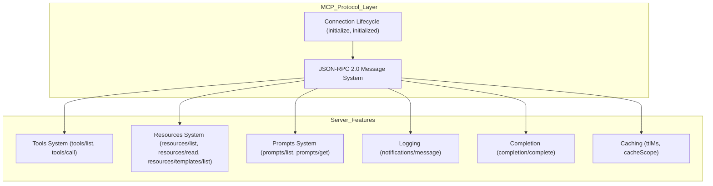
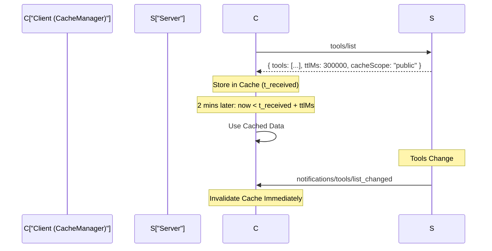

<!-- source: DeepWiki mcp.deepwiki.com · repo modelcontextprotocol/modelcontextprotocol · page 2.5 Server Features · fetched 2026-10-21 -->

# Server Features

Relevant source files

The following files were used as context for generating this wiki page:

- [blog/content/posts/2026-03-16-tool-annotations.md](blog/content/posts/2026-03-16-tool-annotations.md)
- [docs/seps/2106-json-schema-2020-12.mdx](docs/seps/2106-json-schema-2020-12.mdx)
- [docs/specification/draft/server/prompts.mdx](docs/specification/draft/server/prompts.mdx)
- [docs/specification/draft/server/resources.mdx](docs/specification/draft/server/resources.mdx)
- [docs/specification/draft/server/tools.mdx](docs/specification/draft/server/tools.mdx)
- [docs/specification/draft/server/utilities/caching.mdx](docs/specification/draft/server/utilities/caching.mdx)
- [docs/specification/draft/server/utilities/completion.mdx](docs/specification/draft/server/utilities/completion.mdx)
- [docs/specification/draft/server/utilities/pagination.mdx](docs/specification/draft/server/utilities/pagination.mdx)
- [schema/draft/examples/CallToolResult/result-with-array-structured-content.json](schema/draft/examples/CallToolResult/result-with-array-structured-content.json)
- [schema/draft/examples/ListPromptsResult/prompts-list-with-cursor-and-ttl.json](schema/draft/examples/ListPromptsResult/prompts-list-with-cursor-and-ttl.json)
- [schema/draft/examples/ListPromptsResultResponse/list-prompts-result-response.json](schema/draft/examples/ListPromptsResultResponse/list-prompts-result-response.json)
- [schema/draft/examples/ListResourceTemplatesResult/resource-templates-list-with-cursor-and-ttl.json](schema/draft/examples/ListResourceTemplatesResult/resource-templates-list-with-cursor-and-ttl.json)
- [schema/draft/examples/ListResourceTemplatesResultResponse/list-resource-templates-result-response.json](schema/draft/examples/ListResourceTemplatesResultResponse/list-resource-templates-result-response.json)
- [schema/draft/examples/ListResourcesResult/resources-list-with-cursor-and-ttl.json](schema/draft/examples/ListResourcesResult/resources-list-with-cursor-and-ttl.json)
- [schema/draft/examples/ListResourcesResultResponse/list-resources-result-response.json](schema/draft/examples/ListResourcesResultResponse/list-resources-result-response.json)
- [schema/draft/examples/ListToolsResult/tools-list-with-cursor-and-ttl.json](schema/draft/examples/ListToolsResult/tools-list-with-cursor-and-ttl.json)
- [schema/draft/examples/ListToolsResultResponse/list-tools-result-response.json](schema/draft/examples/ListToolsResultResponse/list-tools-result-response.json)
- [schema/draft/examples/Tool/tool-with-array-output-schema.json](schema/draft/examples/Tool/tool-with-array-output-schema.json)
- [schema/draft/examples/Tool/tool-with-composition-input-schema.json](schema/draft/examples/Tool/tool-with-composition-input-schema.json)
- [seps/2106-json-schema-2020-12.md](seps/2106-json-schema-2020-12.md)

This document details the various features and capabilities that Model Context Protocol (MCP) servers can implement. These features enable servers to provide rich contextual information and interactive functionalities to MCP clients. For information on client-side capabilities, see [Client Features](#2.6). For an overview of the core protocol, see [Architecture and Core Concepts](#2.1).

## Overview of Server Capabilities

MCP servers declare their supported features during the [Connection Lifecycle and Capabilities](#2.4) initialization phase. This negotiation ensures that both the client and server operate within a mutually understood set of functionalities.

The primary server features include:

*   **Tools**: Model-controlled executable functions.
*   **Resources**: Application-driven URI-addressable data.
*   **Prompts**: User-controlled structured message templates.
*   **Logging**: Structured observability and debugging.
*   **Completion**: Interactive argument autocompletion.
*   **Caching**: Performance optimization via TTL and scope hints.

The following diagram illustrates the relationship between these server features and the core protocol layer:

### MCP Server Architecture Diagram

Sources: [docs/specification/draft/server/tools.mdx:7-10](), [docs/specification/draft/server/resources.mdx:7-11](), [docs/specification/draft/server/prompts.mdx:7-10](), [docs/specification/draft/server/utilities/caching.mdx:7-9]()

## Tools System

The Tools system allows MCP servers to expose executable functions that can be invoked by language models. Each tool is uniquely identified by a name and includes metadata describing its schema.

### User Interaction Model
Tools are designed to be **model-controlled**, meaning the LLM discovers and invokes them automatically based on context [docs/specification/draft/server/tools.mdx:22-24](). For security, applications **SHOULD** provide a human-in-the-loop interface to confirm tool invocations [docs/specification/draft/server/tools.mdx:32-40]().

### Capabilities
Servers supporting tools **MUST** declare the `tools` capability [docs/specification/draft/server/tools.mdx:46-51]().
*   `listChanged`: Indicates the server will emit `notifications/tools/list_changed` when tools change [docs/specification/draft/server/tools.mdx:58-59]().

### Protocol Messages
*   **Listing Tools**: Clients send `tools/list` to discover tools [docs/specification/draft/server/tools.mdx:79-81]().
*   **Calling Tools**: Clients send `tools/call` with `name` and `arguments` [docs/specification/draft/server/tools.mdx:136-152]().
*   **Input Required**: Servers may respond with `InputRequiredResult` if more info is needed before completion [docs/specification/draft/server/tools.mdx:173-175](). This follows the Multi Round-Trip Request (MRTR) pattern [docs/specification/draft/server/tools.mdx:176-180]().

### Tool Annotations (Risk Vocabulary)
Tool annotations provide hints about operational risk [blog/content/posts/2026-03-16-tool-annotations.md:11-15]():
*   `readOnlyHint`: Does the tool modify the environment? [blog/content/posts/2026-03-16-tool-annotations.md:31]()
*   `destructiveHint`: Is the modification destructive? [blog/content/posts/2026-03-16-tool-annotations.md:32]()
*   `idempotentHint`: Can it be safely called again with the same args? [blog/content/posts/2026-03-16-tool-annotations.md:33]()
*   `openWorldHint`: Does it interact with external entities? [blog/content/posts/2026-03-16-tool-annotations.md:34]()

Sources: [docs/specification/draft/server/tools.mdx:7-60](), [blog/content/posts/2026-03-16-tool-annotations.md:15-35]()

## Resources System

Resources allow servers to share data like files or database schemas via URIs [docs/specification/draft/server/resources.mdx:7-11]().

### User Interaction Model
Resources are **application-driven**. The host application determines how to present them (e.g., a resource picker) [docs/specification/draft/server/resources.mdx:23-32]().

### Capabilities
Servers **MUST** declare the `resources` capability [docs/specification/draft/server/resources.mdx:40-51]().
*   `subscribe`: Supports resource-specific update notifications [docs/specification/draft/server/resources.mdx:57-59]().
*   `listChanged`: Emits notifications when the set of available resources changes [docs/specification/draft/server/resources.mdx:55-57]().

### Protocol Messages
*   **Listing**: `resources/list` returns available resources [docs/specification/draft/server/resources.mdx:86-103]().
*   **Reading**: `resources/read` retrieves contents [docs/specification/draft/server/resources.mdx:135-152]().
*   **Templates**: `resources/templates/list` allows parameterized URI templates [docs/specification/draft/server/resources.mdx:180-185]().

Sources: [docs/specification/draft/server/resources.mdx:7-71]()

## Prompts System

Prompts provide structured templates for LLM instructions [docs/specification/draft/server/prompts.mdx:7-10]().

### User Interaction Model
Prompts are **user-controlled**, typically triggered by user-initiated commands like slash commands in a UI [docs/specification/draft/server/prompts.mdx:22-32]().

### Capabilities
Servers **MUST** declare the `prompts` capability [docs/specification/draft/server/prompts.mdx:40-51]().

### Protocol Messages
*   **Listing**: `prompts/list` retrieves available templates [docs/specification/draft/server/prompts.mdx:69-83]().
*   **Getting**: `prompts/get` resolves a template with provided arguments [docs/specification/draft/server/prompts.mdx:123-140]().

Sources: [docs/specification/draft/server/prompts.mdx:7-162]()

## Caching and Performance

MCP supports time-based caching for list operations and resource reads to reduce re-fetching [docs/specification/draft/server/utilities/caching.mdx:7-9]().

### Cacheable Model
Servers include caching hints in results with `resultType: "complete"` [docs/specification/draft/server/utilities/caching.mdx:13-14]():
*   `ttlMs`: Milliseconds the result is considered fresh (analogous to HTTP `max-age`) [docs/specification/draft/server/utilities/caching.mdx:48-50]().
*   `cacheScope`: Either `"public"` (sharable) or `"private"` (user-specific/auth-bound) [docs/specification/draft/server/utilities/caching.mdx:95-102]().

### Caching Logic Flow

Sources: [docs/specification/draft/server/utilities/caching.mdx:124-145]()

## Utilities: Logging and Completion

### Logging
The logging feature allows servers to send structured logs to the client for observability [docs/specification/draft/server/utilities/logging.mdx:20-23]().
*   **Note**: In the latest draft, standard output streams (stderr) are often preferred for simple logging, while the protocol supports structured `notifications/message` [docs/specification/draft/server/utilities/logging.mdx:25-30]().
*   **Levels**: Follows syslog severity (debug, info, error, etc.) [docs/specification/draft/server/utilities/logging.mdx:44-56]().

### Completion
Servers provide autocompletion for prompt and resource template arguments [docs/specification/draft/server/utilities/completion.mdx:7-10]().
*   **Method**: `completion/complete` [docs/specification/draft/server/utilities/completion.mdx:48-57]().
*   **Ref Types**: `ref/prompt` or `ref/resource` [docs/specification/draft/server/utilities/completion.mdx:134-140]().

Sources: [docs/specification/draft/server/utilities/completion.mdx:7-140]()

## Pagination

Large result sets are handled via opaque cursor-based pagination [docs/specification/draft/server/utilities/pagination.mdx:7-9]().

### Pagination Flow
1.  **Initial Request**: Client calls a list method without a cursor [docs/specification/draft/server/utilities/pagination.mdx:76]().
2.  **Response**: Server returns a page and a `nextCursor` [docs/specification/draft/server/utilities/pagination.mdx:33-37]().
3.  **Continuation**: Client requests again with the `cursor` parameter [docs/specification/draft/server/utilities/pagination.mdx:54-66]().

Sources: [docs/specification/draft/server/utilities/pagination.mdx:7-107]()

---

