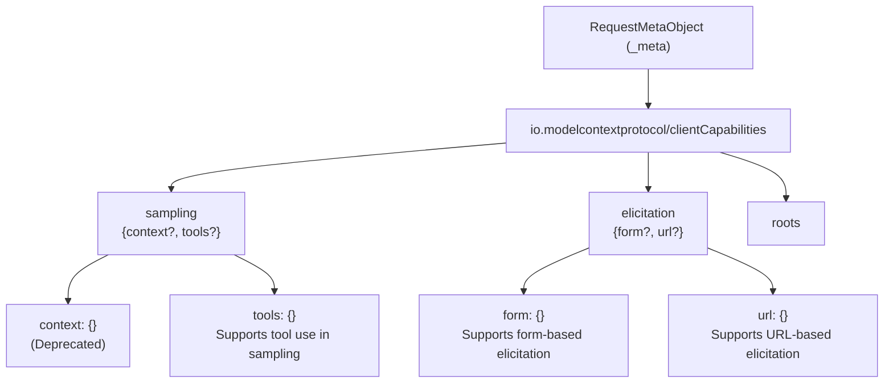
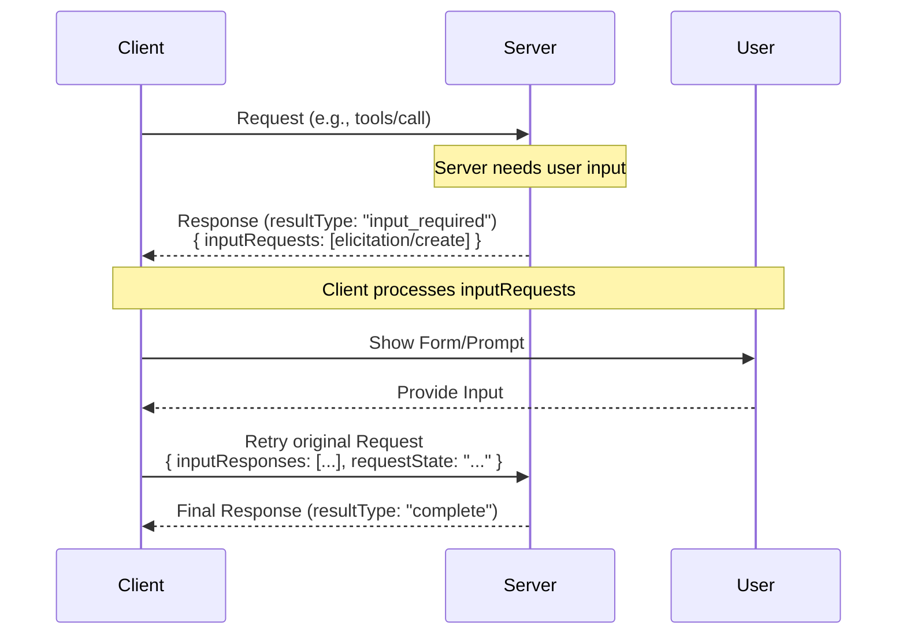
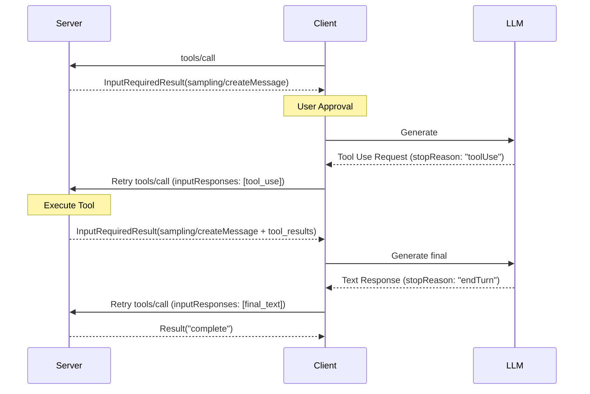

<!-- source: DeepWiki mcp.deepwiki.com · repo modelcontextprotocol/modelcontextprotocol · page 2.6 Client Features · fetched 2026-10-21 -->

# Client Features

<details>
<summary>Relevant source files</summary>

The following files were used as context for generating this wiki page:

- [docs/specification/draft/client/roots.mdx](docs/specification/draft/client/roots.mdx)
- [docs/specification/draft/client/sampling.mdx](docs/specification/draft/client/sampling.mdx)
- [docs/specification/draft/server/utilities/logging.mdx](docs/specification/draft/server/utilities/logging.mdx)
- [schema/draft/examples/ClientCapabilities/sampling-minimum-baseline-support.json](schema/draft/examples/ClientCapabilities/sampling-minimum-baseline-support.json)
- [schema/draft/examples/ClientCapabilities/sampling-tool-use-support.json](schema/draft/examples/ClientCapabilities/sampling-tool-use-support.json)
- [schema/draft/examples/CreateMessageRequest/sampling-request.json](schema/draft/examples/CreateMessageRequest/sampling-request.json)
- [schema/draft/examples/CreateMessageRequestParams/basic-request.json](schema/draft/examples/CreateMessageRequestParams/basic-request.json)
- [schema/draft/examples/CreateMessageRequestParams/follow-up-with-tool-results.json](schema/draft/examples/CreateMessageRequestParams/follow-up-with-tool-results.json)
- [schema/draft/examples/CreateMessageRequestParams/request-with-tools.json](schema/draft/examples/CreateMessageRequestParams/request-with-tools.json)
- [schema/draft/examples/CreateMessageResult/final-response.json](schema/draft/examples/CreateMessageResult/final-response.json)
- [schema/draft/examples/CreateMessageResult/text-response.json](schema/draft/examples/CreateMessageResult/text-response.json)
- [schema/draft/examples/CreateMessageResult/tool-use-response.json](schema/draft/examples/CreateMessageResult/tool-use-response.json)
- [schema/draft/examples/ElicitRequest/elicitation-request.json](schema/draft/examples/ElicitRequest/elicitation-request.json)
- [schema/draft/examples/InputRequests/elicitation-and-sampling-input-requests.json](schema/draft/examples/InputRequests/elicitation-and-sampling-input-requests.json)
- [schema/draft/examples/InputResponses/elicitation-and-sampling-input-responses.json](schema/draft/examples/InputResponses/elicitation-and-sampling-input-responses.json)
- [schema/draft/examples/ModelPreferences/with-hints-and-priorities.json](schema/draft/examples/ModelPreferences/with-hints-and-priorities.json)
- [seps/1577--sampling-with-tools.md](seps/1577--sampling-with-tools.md)

</details>


## Purpose and Scope

This document covers the capabilities that MCP **clients** expose to **servers**, enabling servers to request operations that require client resources or user interaction. These features are distinct from server features ([Server Features](#2.5)), which servers expose to clients.

Client features include:
- **Sampling**: LLM completions/generations requested by servers (Deprecated in 2026-07-28).
- **Elicitation**: User input collection through forms or external URLs.
- **Roots**: Filesystem boundary declarations for context scoping (Deprecated in 2026-07-28).
- **Logging**: Server log message routing to client handlers (Deprecated in 2026-07-28).

In the protocol version `2026-07-28`, the interaction model has shifted from server-initiated requests to the **Multi Round-Trip Requests (MRTR)** pattern.

Sources: [docs/specification/draft/client/sampling.mdx:1-37](), [docs/specification/draft/client/roots.mdx:1-24](), [docs/specification/draft/server/utilities/logging.mdx:20-24]()

## Client Capability Declaration

In the stateless `2026-07-28` protocol, clients no longer declare capabilities once during initialization. Instead, capabilities are declared **per-request** within the `_meta` object. Servers MUST NOT infer capabilities from prior requests.

### ClientCapabilities Structure



Sources: [docs/specification/draft/client/sampling.mdx:54-97](), [docs/specification/draft/client/roots.mdx:38-51](), [schema/draft/examples/ClientCapabilities/sampling-minimum-baseline-support.json:1-3]()

## Multi Round-Trip Requests (MRTR) Pattern

The MRTR pattern replaces server-initiated requests for client features. Instead of a server calling a client method like `sampling/createMessage`, the server returns an `InputRequiredResult`.

### MRTR Data Flow



Sources: [docs/specification/draft/client/sampling.mdx:113-117](), [docs/specification/draft/client/roots.mdx:55-60](), [docs/specification/draft/client/sampling.mdx:168-207]()

## Sampling (Deprecated)

Sampling allows servers to request LLM generations via the client. It is **deprecated** as of version `2026-07-28`. Existing implementations should migrate to direct LLM provider integrations.

### Sampling with Tools Flow (MRTR)

Servers include a `sampling/createMessage` request inside the `inputRequests` field of an `InputRequiredResult`.



Sources: [docs/specification/draft/client/sampling.mdx:7-17](), [docs/specification/draft/client/sampling.mdx:168-207](), [seps/1577--sampling-with-tools.md:58-71]()

### Key Data Structures

| Type | Description | File |
| :--- | :--- | :--- |
| `SamplingMessage` | Represents a message in the conversation history (role: user/assistant). | [docs/specification/draft/client/sampling.mdx:123-131]() |
| `ModelPreferences` | Hints for model selection (intelligence vs. speed vs. cost). | [docs/specification/draft/client/sampling.mdx:132-141]() |
| `CreateMessageResult` | The LLM response including `content`, `model`, and `stopReason`. | [docs/specification/draft/client/sampling.mdx:152-162]() |

## Elicitation

Elicitation allows servers to gather data from users. It is the primary mechanism for interactive workflows.

### Form Mode
Used for non-sensitive structured data. The client renders a UI based on a provided JSON schema.

**Example Request:**
```json
{
  "method": "elicitation/create",
  "params": {
    "mode": "form",
    "message": "Please provide your GitHub username",
    "requestedSchema": {
      "type": "object",
      "properties": {
        "name": { "type": "string" }
      },
      "required": ["name"]
    }
  }
}
```

Sources: [schema/draft/examples/ElicitRequest/elicitation-request.json:1-19](), [schema/draft/examples/InputRequests/elicitation-and-sampling-input-requests.json:1-17]()

## Roots (Deprecated)

Roots provide informational guidance to servers about relevant filesystem directories. This feature is **deprecated** as of version `2026-07-28`.

**Migration Path:** Servers should receive directory paths via tool parameters or server configuration instead of querying `roots/list`.

### Data Structure: Root
- `uri`: Must be a `file://` URI.
- `name`: Optional human-readable name.

Sources: [docs/specification/draft/client/roots.mdx:7-17](), [docs/specification/draft/client/roots.mdx:96-102]()

## Logging (Deprecated)

The global `logging/setLevel` method is **deprecated**.

**New Pattern:**
- Log levels are set **per-request** via `_meta["io.modelcontextprotocol/logLevel"]`.
- Servers MUST NOT emit `notifications/message` unless the request opted in via `_meta`.
- Notifications are request-scoped and delivered on the response stream of the associated request.

Sources: [docs/specification/draft/server/utilities/logging.mdx:7-18](), [docs/specification/draft/server/utilities/logging.mdx:60-73]()

## Security and Approval

1. **Human-in-the-Loop**: Clients SHOULD always require user approval for sampling and elicitation requests. [docs/specification/draft/client/sampling.mdx:35-46]()
2. **Permission Scoping**: Roots are informational guidance, not an access-control mechanism. [docs/specification/draft/client/roots.mdx:22-24]()
3. **Sensitive Data**: Log messages MUST NOT contain credentials or PII. [docs/specification/draft/server/utilities/logging.mdx:123-127]()

Sources: [docs/specification/draft/client/sampling.mdx:35-46](), [docs/specification/draft/client/roots.mdx:22-24](), [docs/specification/draft/server/utilities/logging.mdx:123-127]()

---

