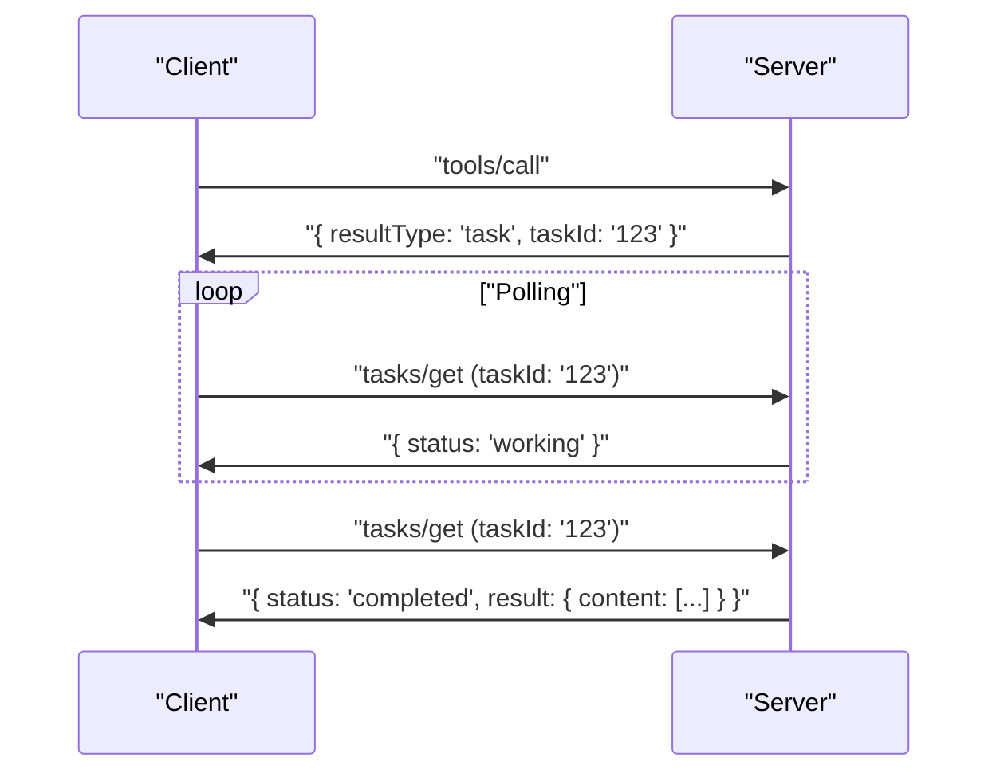
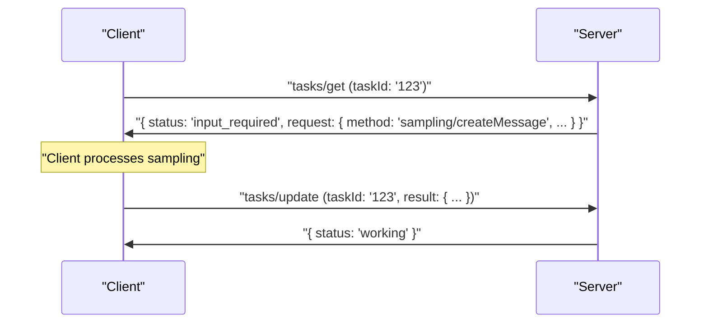
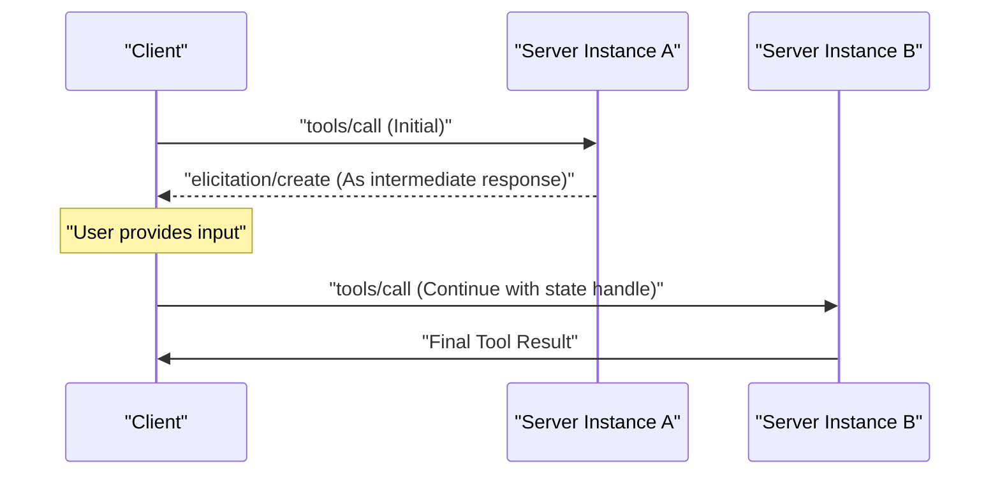

<!-- source: DeepWiki mcp.deepwiki.com · repo modelcontextprotocol/modelcontextprotocol · page 2.7 Task System and Async Operations · fetched 2026-10-21 -->

# Task System and Async Operations

<details>
<summary>Relevant source files</summary>

The following files were used as context for generating this wiki page:

- [blog/content/posts/2026-01-26-mcp-apps.md](blog/content/posts/2026-01-26-mcp-apps.md)
- [docs/community/sdk-tiers.mdx](docs/community/sdk-tiers.mdx)
- [docs/docs.json](docs/docs.json)
- [docs/docs/getting-started/intro.mdx](docs/docs/getting-started/intro.mdx)
- [docs/docs/tools/debugging.mdx](docs/docs/tools/debugging.mdx)
- [docs/extensions/apps/build.mdx](docs/extensions/apps/build.mdx)
- [docs/extensions/apps/overview.mdx](docs/extensions/apps/overview.mdx)
- [docs/extensions/auth/oauth-client-credentials.mdx](docs/extensions/auth/oauth-client-credentials.mdx)
- [docs/extensions/auth/overview.mdx](docs/extensions/auth/overview.mdx)
- [docs/extensions/client-matrix.mdx](docs/extensions/client-matrix.mdx)
- [docs/extensions/overview.mdx](docs/extensions/overview.mdx)
- [docs/extensions/tasks/overview.mdx](docs/extensions/tasks/overview.mdx)
- [docs/seps/2260-Require-Server-requests-to-be-associated-with-Client-requests.mdx](docs/seps/2260-Require-Server-requests-to-be-associated-with-Client-requests.mdx)
- [docs/seps/2322-MRTR.mdx](docs/seps/2322-MRTR.mdx)
- [docs/seps/2663-tasks-extension.mdx](docs/seps/2663-tasks-extension.mdx)
- [docs/seps/index.mdx](docs/seps/index.mdx)
- [docs/specification/draft/basic/patterns/cancellation.mdx](docs/specification/draft/basic/patterns/cancellation.mdx)
- [docs/specification/draft/basic/patterns/progress.mdx](docs/specification/draft/basic/patterns/progress.mdx)
- [docs/specification/draft/basic/patterns/subscriptions.mdx](docs/specification/draft/basic/patterns/subscriptions.mdx)
- [seps/1024-mcp-client-security-requirements-for-local-server-.md](seps/1024-mcp-client-security-requirements-for-local-server-.md)
- [seps/1034--support-default-values-for-all-primitive-types-in.md](seps/1034--support-default-values-for-all-primitive-types-in.md)
- [seps/1036-url-mode-elicitation-for-secure-out-of-band-intera.md](seps/1036-url-mode-elicitation-for-secure-out-of-band-intera.md)
- [seps/1303-input-validation-errors-as-tool-execution-errors.md](seps/1303-input-validation-errors-as-tool-execution-errors.md)
- [seps/1613-establish-json-schema-2020-12-as-default-dialect-f.md](seps/1613-establish-json-schema-2020-12-as-default-dialect-f.md)
- [seps/1686-tasks.md](seps/1686-tasks.md)
- [seps/1699-support-sse-polling-via-server-side-disconnect.md](seps/1699-support-sse-polling-via-server-side-disconnect.md)
- [seps/1730-sdks-tiering-system.md](seps/1730-sdks-tiering-system.md)
- [seps/2260-Require-Server-requests-to-be-associated-with-Client-requests.md](seps/2260-Require-Server-requests-to-be-associated-with-Client-requests.md)
- [seps/2322-MRTR.md](seps/2322-MRTR.md)
- [seps/2663-tasks-extension.md](seps/2663-tasks-extension.md)
- [seps/991-enable-url-based-client-registration-using-oauth-c.md](seps/991-enable-url-based-client-registration-using-oauth-c.md)

</details>


This page documents the MCP task system, which enables asynchronous, long-running operations through a polling-based workflow model. Tasks were originally introduced as an experimental feature in version 2025-11-25 and have been redesigned as an official extension in **SEP-2663** (`io.modelcontextprotocol/tasks`) to improve handshake reliability and remove blocking connection traps.

For information about synchronous request/response patterns, see the JSON-RPC message system documentation ([2.2]()). For multi-round-trip interactions that don't require durable polling, see the **MRTR (SEP-2322)** pattern ([2.7.4](#multi-round-trip-requests-mrtr)).

## Overview

The task system provides a standardized mechanism for representing expensive computations, batch processing, and operations that require user interaction mid-execution. Unlike standard JSON-RPC requests that block until completion, task-augmented requests allow the receiver to immediately return a **task handle** (a durable state machine), which the requestor then uses to poll for progress or retrieve final results.

Key improvements in the Task Extension (SEP-2663) include:
- **Stateless Handshake**: Moves from complex tool-level negotiation to a single extension capability declaration.
- **Non-Blocking Lifecycle**: Replaces the blocking `tasks/result` with a polling-based `tasks/get` and `tasks/update` flow.
- **Server-Directed Creation**: Servers can decide to return a task even if the client didn't explicitly request one, provided the client supports the extension.

**Sources:** [seps/2663-tasks-extension.md:11-37](), [docs/seps/2663-tasks-extension.mdx:29-54]()

## Architecture

### Task State Machine

```mermaid
stateDiagram-v2
    [*] --> "working" : "Request Received"
    
    "working" --> "input_required" : "Server needs info"
    "working" --> "completed" : "Success"
    "working" --> "failed" : "Error"
    "working" --> "cancelled" : "tasks/cancel"
    
    "input_required" --> "working" : "tasks/update (Result)"
    "input_required" --> "completed" : "Success"
    "input_required" --> "failed" : "Error"
    "input_required" --> "cancelled" : "tasks/cancel"
    
    "completed" --> [*]
    "failed" --> [*]
    "cancelled" --> [*]

    note right of "input_required"
        "Client retrieves nested request"
        "via tasks/get and provides"
        "response via tasks/update"
    end note
```

Tasks are durable state machines identified by a server-generated `taskId`. The `Task` object tracks the lifecycle and carries any pending server-to-client requests (like elicitation or sampling).

**Sources:** [seps/2663-tasks-extension.md:41-44](), [seps/2663-tasks-extension.md:402-431]()

## Capability Negotiation

Support for tasks is negotiated during the initialization handshake using the extension identifier `io.modelcontextprotocol/tasks`.

### Client Capability
The client signals support in its per-request capabilities:
```jsonc
{
  "method": "initialize",
  "params": {
    "capabilities": {
      "extensions": {
        "io.modelcontextprotocol/tasks": {}
      }
    }
  }
}
```

### Server Capability
The server declares support for specific task methods:
```jsonc
{
  "capabilities": {
    "extensions": {
      "io.modelcontextprotocol/tasks": {
        "methods": ["tasks/get", "tasks/update", "tasks/cancel"]
      }
    }
  }
}
```

**Sources:** [seps/2663-tasks-extension.md:51-80](), [docs/extensions/client-matrix.mdx:26-31]()

## Task Lifecycle Operations

### 1. Task Creation
When a client calls a tool (e.g., `tools/call`), a task-supporting server may return a `task` result type instead of a final result.

```json
{
  "jsonrpc": "2.0",
  "id": 1,
  "result": {
    "resultType": "task",
    "task": {
      "taskId": "task-uuid-123",
      "status": "working",
      "pollInterval": 5000
    }
  }
}
```

### 2. Polling and Retrieval (`tasks/get`)
The client polls the server to check status. The response contains the `Task` object. If the task is `completed`, the `result` field contains the final tool output.



**Sources:** [seps/2663-tasks-extension.md:184-228](), [seps/2663-tasks-extension.md:463-476]()

### 3. Handling Input (`input_required`)
If a task reaches the `input_required` state, the `Task` object includes a `request` field containing a server-to-client request (e.g., `sampling/createMessage`). The client resolves this and sends the result back via `tasks/update`.



**Sources:** [seps/2663-tasks-extension.md:434-453](), [seps/2663-tasks-extension.md:470-476]()

### 4. Cancellation (`tasks/cancel`)
Clients can explicitly terminate a task. Terminal tasks (completed/failed) cannot be cancelled.

**Sources:** [seps/2663-tasks-extension.md:354-386]()

## Multi Round-Trip Requests (MRTR)

**SEP-2322** introduces the MRTR pattern to handle server-initiated requests (Elicitation, Sampling) without requiring persistent SSE streams or complex server-side state shared across instances.

### MRTR vs. Tasks
- **Tasks**: For durable, long-running background jobs that survive connection drops. Requires polling.
- **MRTR**: For interactive, nested requests (like "I need a password to run this tool"). The server returns an intermediate "request" response, and the client "continues" the original call by sending the answer.

### MRTR Flow


MRTR enables **stateless scaling** by allowing any server instance to resume a request if the client provides the necessary state handle returned in the intermediate step.

**Sources:** [seps/2322-MRTR.md:13-27](), [seps/2322-MRTR.md:77-100](), [docs/seps/2322-MRTR.mdx:29-46]()

## Implementation Requirements

### Request Association
Per **SEP-2260**, all server-to-client requests (Sampling, Elicitation, Roots) **MUST** be associated with an originating client request. In the task system, this is enforced by embedding these requests within the `Task` object retrieved via `tasks/get`.

**Sources:** [seps/2260-Require-Server-requests-to-be-associated-with-Client-requests.md:12-21](), [seps/2663-tasks-extension.md:19-23]()

### Error Handling
| Code | Meaning |
|------|---------|
| `-32602` | Invalid Params: Attempting to cancel a terminal task. |
| `-32001` | Task Not Found: The provided `taskId` does not exist or has expired. |

**Sources:** [seps/2663-tasks-extension.md:494-501]()

### Time-To-Live (TTL)
Servers should implement TTL for task results to prevent memory exhaustion. The `Task` object includes `createdAt` and `lastUpdatedAt` timestamps to allow clients to track expiration.

**Sources:** [seps/2663-tasks-extension.md:454-462]()

---

