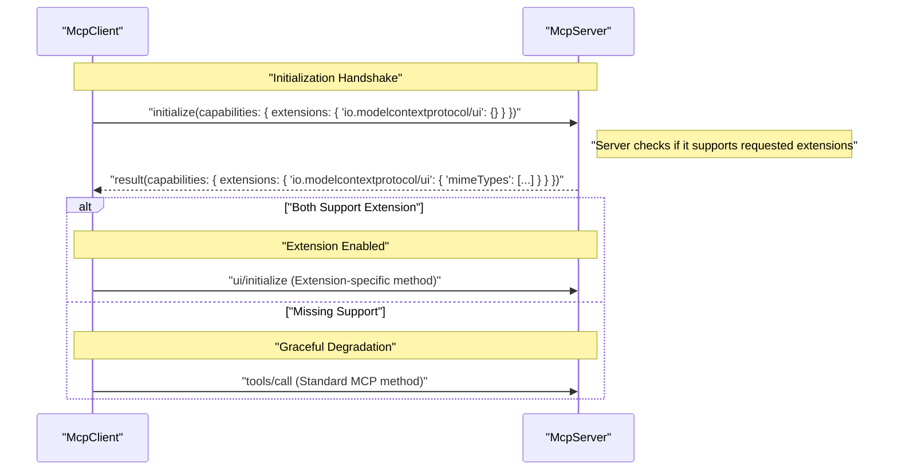
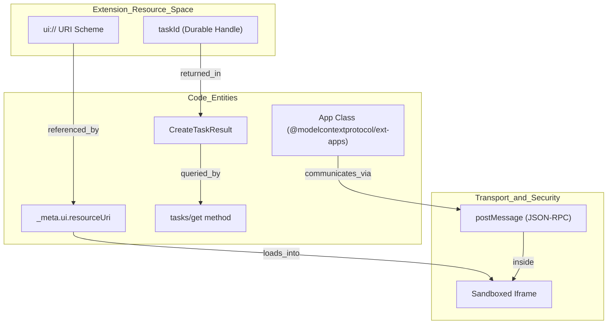

<!-- source: DeepWiki mcp.deepwiki.com · repo modelcontextprotocol/modelcontextprotocol · page 2.8 Extensions Framework · fetched 2026-10-21 -->

# Extensions Framework

Relevant source files

The following files were used as context for generating this wiki page:

- [blog/content/posts/2026-01-26-mcp-apps.md](blog/content/posts/2026-01-26-mcp-apps.md)
- [blog/content/posts/2026-03-11-understanding-mcp-extensions.md](blog/content/posts/2026-03-11-understanding-mcp-extensions.md)
- [docs/community/sdk-tiers.mdx](docs/community/sdk-tiers.mdx)
- [docs/docs/getting-started/intro.mdx](docs/docs/getting-started/intro.mdx)
- [docs/docs/tools/debugging.mdx](docs/docs/tools/debugging.mdx)
- [docs/extensions/apps/build.mdx](docs/extensions/apps/build.mdx)
- [docs/extensions/apps/overview.mdx](docs/extensions/apps/overview.mdx)
- [docs/extensions/auth/oauth-client-credentials.mdx](docs/extensions/auth/oauth-client-credentials.mdx)
- [docs/extensions/auth/overview.mdx](docs/extensions/auth/overview.mdx)
- [docs/extensions/client-matrix.mdx](docs/extensions/client-matrix.mdx)
- [docs/extensions/overview.mdx](docs/extensions/overview.mdx)
- [docs/extensions/tasks/overview.mdx](docs/extensions/tasks/overview.mdx)
- [schema/draft/examples/ClientCapabilities/extensions-ui-mime-types.json](schema/draft/examples/ClientCapabilities/extensions-ui-mime-types.json)
- [schema/draft/examples/ClientCapabilities/sampling-context-inclusion-support-deprecated.json](schema/draft/examples/ClientCapabilities/sampling-context-inclusion-support-deprecated.json)
- [seps/2133-extensions.md](seps/2133-extensions.md)

## Purpose and Scope

The Extensions Framework (SEP-2133) provides a standardized mechanism for extending the Model Context Protocol (MCP) with optional, composable capabilities beyond the core protocol [seps/2133-extensions.md:1-12](). This framework enables the ecosystem to evolve and experiment—through features like interactive UIs or specialized authorization—without forcing adoption across all implementations or compromising core protocol stability [seps/2133-extensions.md:12-15]().

## Extension Identification and Naming

Extensions are identified by a unique **Extension Identifier** using the format `{vendor-prefix}/{extension-name}` [seps/2133-extensions.md:23-27]().

*   **Vendor Prefixes**: To prevent collisions, prefixes SHOULD be a reversed domain name owned by the author (e.g., `com.example/`) [seps/2133-extensions.md:28-29]().
*   **Official Prefix**: Official extensions maintained by the MCP organization use the `io.modelcontextprotocol/` prefix [seps/2133-extensions.md:38-39]().
*   **Breaking Changes**: Any modification that causes existing implementations to fail (removing fields, changing types, altering semantics) MUST use a new identifier, such as `io.modelcontextprotocol/auth-v2` [seps/2133-extensions.md:30-31]().

Sources: [seps/2133-extensions.md:23-31]()

## Extension Types and Governance

The framework classifies extensions into three categories based on their maturity and maintenance [seps/2133-extensions.md:34-35]().

| Type | Prefix | Repository Pattern | Governance |
| :--- | :--- | :--- | :--- |
| **Official** | `io.modelcontextprotocol/` | `ext-{category}` | MCP Core Maintainers & Appointed Repository Maintainers [seps/2133-extensions.md:38-43]() |
| **Experimental** | `io.modelcontextprotocol/` | `experimental-ext-{name}` | Working Groups (WGs) or Interest Groups (IGs) [seps/2133-extensions.md:56-59]() |
| **Unofficial** | `vendor-specific/` | External | Independent developers [seps/2133-extensions.md:34-35]() |

### Incubation and Graduation
Experimental extensions serve as an incubation pathway for WGs/IGs to prototype ideas before formal SEP submission [seps/2133-extensions.md:53-55](). To graduate to **Official** status, an extension must pass through the **Extensions Track** of the SEP process, requiring at least one reference implementation in an official SDK [docs/extensions/overview.mdx:72-84]().

Sources: [seps/2133-extensions.md:34-64](), [docs/extensions/overview.mdx:60-75]()

## Capability Negotiation

Extensions are opt-in and negotiated during the `initialize` handshake [docs/extensions/client-matrix.mdx:16-17](). Clients and servers advertise support via the `extensions` field within their respective capabilities [docs/extensions/overview.mdx:114-116]().

### Negotiation Flow
The following diagram illustrates how the `initialize` method facilitates extension discovery between `McpClient` and `McpServer`.

Sources: [docs/extensions/overview.mdx:114-135](), [docs/extensions/apps/overview.mdx:71-76]()

## Official Extensions

### 1. MCP Apps (`io.modelcontextprotocol/ui`)
MCP Apps allow servers to return interactive HTML interfaces (dashboards, forms) that render in sandboxed iframes within the client [blog/content/posts/2026-01-26-mcp-apps.md:15-18]().
*   **Mechanism**: Tools include a `_meta.ui.resourceUri` pointing to a `ui://` scheme resource [blog/content/posts/2026-01-26-mcp-apps.md:62-68]().
*   **Communication**: The app communicates with the host via JSON-RPC over `postMessage` [blog/content/posts/2026-01-26-mcp-apps.md:83-84]().
*   **Library**: Developers use `@modelcontextprotocol/ext-apps` which provides the `App` class [blog/content/posts/2026-01-26-mcp-apps.md:104-111]().

### 2. MCP Tasks (`io.modelcontextprotocol/tasks`)
Designed for long-running operations (CI pipelines, human approvals) that exceed standard timeout limits [docs/extensions/tasks/overview.mdx:17-21]().
*   **Durable Handles**: Servers return a `taskId` with status `working` instead of blocking [docs/extensions/tasks/overview.mdx:54-57]().
*   **Polling & Updates**: Clients use `tasks/get` to check status and `tasks/update` to provide mid-flight input when status is `input_required` [docs/extensions/tasks/overview.mdx:59-65]().

### 3. Authorization Extensions
Managed in the `ext-auth` repository, these supplement core OAuth 2.1 features [docs/extensions/overview.mdx:24-31]().
*   **OAuth Client Credentials**: For machine-to-machine (M2M) auth without user login [docs/extensions/client-matrix.mdx:29]().
*   **Enterprise-Managed Authorization**: Centralized access control via enterprise Identity Providers (IdP) [docs/extensions/client-matrix.mdx:30]().

Sources: [blog/content/posts/2026-01-26-mcp-apps.md:15-111](), [docs/extensions/tasks/overview.mdx:17-65](), [docs/extensions/client-matrix.mdx:26-31]()

## Technical Implementation and Data Flow

The following diagram maps the Natural Language concepts of "UI Resources" and "Task Polling" to the code entities and URI schemes used in the implementation.

Sources: [blog/content/posts/2026-01-26-mcp-apps.md:62-84](), [docs/extensions/tasks/overview.mdx:54-65](), [docs/extensions/apps/overview.mdx:39-49]()

## Graceful Degradation
Extensions are optional. Servers SHOULD provide text-only fallbacks for UI-enabled tools so they can serve hosts that do not support the `io.modelcontextprotocol/ui` extension [blog/content/posts/2026-03-11-understanding-mcp-extensions.md:30-31](). If a client receives an extension-specific result type (like `CreateTaskResult`) for an extension it did not negotiate, it must treat it as an error or handle it via standard protocol fallbacks [docs/extensions/tasks/overview.mdx:40-42]().

Sources: [blog/content/posts/2026-03-11-understanding-mcp-extensions.md:30-31](), [docs/extensions/tasks/overview.mdx:40-42]()

---

