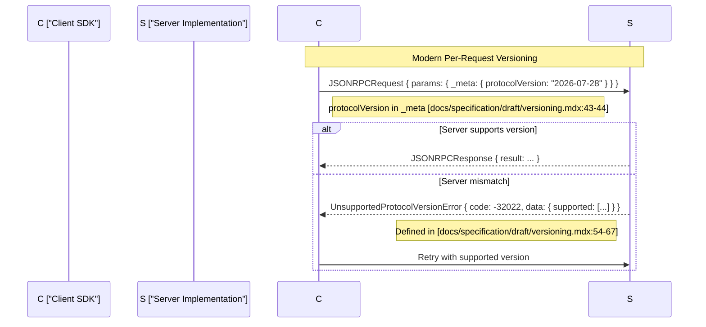
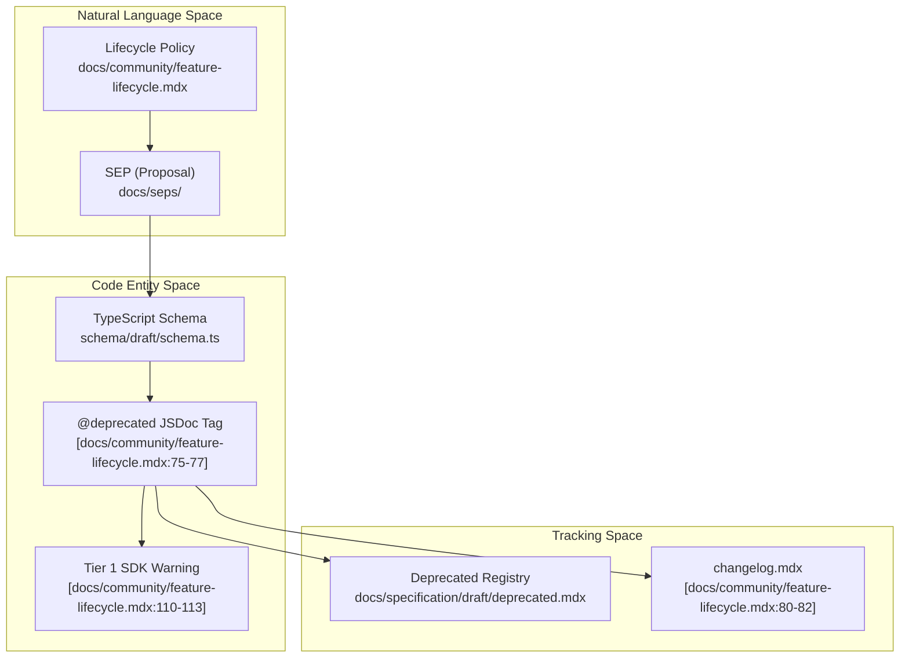

<!-- source: DeepWiki mcp.deepwiki.com · repo modelcontextprotocol/modelcontextprotocol · page 2.9 Protocol Versioning and Changelog · fetched 2026-10-21 -->

# Protocol Versioning and Changelog

Relevant source files

The following files were used as context for generating this wiki page:

- [docs/community/feature-lifecycle.mdx](docs/community/feature-lifecycle.mdx)
- [docs/docs/learn/versioning.mdx](docs/docs/learn/versioning.mdx)
- [docs/seps/1024-mcp-client-security-requirements-for-local-server-.mdx](docs/seps/1024-mcp-client-security-requirements-for-local-server-.mdx)
- [docs/seps/1034--support-default-values-for-all-primitive-types-in.mdx](docs/seps/1034--support-default-values-for-all-primitive-types-in.mdx)
- [docs/seps/1036-url-mode-elicitation-for-secure-out-of-band-intera.mdx](docs/seps/1036-url-mode-elicitation-for-secure-out-of-band-intera.mdx)
- [docs/seps/1046-support-oauth-client-credentials-flow-in-authoriza.mdx](docs/seps/1046-support-oauth-client-credentials-flow-in-authoriza.mdx)
- [docs/seps/1302-formalize-working-groups-and-interest-groups-in-mc.mdx](docs/seps/1302-formalize-working-groups-and-interest-groups-in-mc.mdx)
- [docs/seps/1303-input-validation-errors-as-tool-execution-errors.mdx](docs/seps/1303-input-validation-errors-as-tool-execution-errors.mdx)
- [docs/seps/1319-decouple-request-payload-from-rpc-methods-definiti.mdx](docs/seps/1319-decouple-request-payload-from-rpc-methods-definiti.mdx)
- [docs/seps/1330-elicitation-enum-schema-improvements-and-standards.mdx](docs/seps/1330-elicitation-enum-schema-improvements-and-standards.mdx)
- [docs/seps/1577--sampling-with-tools.mdx](docs/seps/1577--sampling-with-tools.mdx)
- [docs/seps/2596-spec-feature-lifecycle-and-deprecation.mdx](docs/seps/2596-spec-feature-lifecycle-and-deprecation.mdx)
- [docs/seps/991-enable-url-based-client-registration-using-oauth-c.mdx](docs/seps/991-enable-url-based-client-registration-using-oauth-c.mdx)
- [docs/spec-version-warning.js](docs/spec-version-warning.js)
- [docs/specification/draft/basic/transports/streamable-http.mdx](docs/specification/draft/basic/transports/streamable-http.mdx)
- [docs/specification/draft/basic/versioning.mdx](docs/specification/draft/basic/versioning.mdx)
- [docs/specification/draft/deprecated.mdx](docs/specification/draft/deprecated.mdx)
- [schema/2024-11-05/schema.json](schema/2024-11-05/schema.json)
- [schema/2024-11-05/schema.ts](schema/2024-11-05/schema.ts)
- [schema/2025-03-26/schema.json](schema/2025-03-26/schema.json)
- [schema/2025-03-26/schema.ts](schema/2025-03-26/schema.ts)
- [schema/2025-06-18/schema.json](schema/2025-06-18/schema.json)
- [schema/2025-06-18/schema.ts](schema/2025-06-18/schema.ts)
- [schema/draft/examples/HeaderMismatchError/header-mismatch.json](schema/draft/examples/HeaderMismatchError/header-mismatch.json)
- [schema/draft/examples/MissingRequiredClientCapabilityError/missing-elicitation-capability.json](schema/draft/examples/MissingRequiredClientCapabilityError/missing-elicitation-capability.json)
- [schema/draft/examples/UnsupportedProtocolVersionError/unsupported-version.json](schema/draft/examples/UnsupportedProtocolVersionError/unsupported-version.json)
- [seps/2596-spec-feature-lifecycle-and-deprecation.md](seps/2596-spec-feature-lifecycle-and-deprecation.md)

This document describes the Model Context Protocol's date-based versioning scheme, the transition from session-based (Legacy) to per-request (Modern) versioning, the feature lifecycle policy (Active, Deprecated, Removed), and the tracking of specification changes.

## Versioning Scheme

MCP uses string-based version identifiers in the format `YYYY-MM-DD`. This identifier indicates the last date on which **backwards-incompatible** changes were made to the protocol [docs/docs/learn/versioning.mdx:7-9]().

### Backwards Compatibility
The protocol version is **not** incremented when the specification is updated with backwards-compatible improvements [docs/docs/learn/versioning.mdx:12-14](). This allows for incremental growth—such as adding optional fields or new capabilities—while preserving interoperability between existing clients and servers [docs/docs/learn/versioning.mdx:13-15]().

### Revision States
Specification revisions exist in one of three states [docs/docs/learn/versioning.mdx:18-25]():
| State | Meaning |
| :--- | :--- |
| **Draft** | In-progress specifications; not yet ready for production consumption [docs/docs/learn/versioning.mdx:22-22](). |
| **Current** | The authoritative protocol version ready for use. It may receive compatible updates [docs/docs/learn/versioning.mdx:23-24](). |
| **Final** | Past, complete specifications that are frozen and will not be changed [docs/docs/learn/versioning.mdx:25-25](). |

The **current** protocol version is `2025-11-25` [docs/docs/learn/versioning.mdx:27-27]().

Sources: [docs/docs/learn/versioning.mdx:7-27]()

## Version Negotiation

MCP has evolved from a handshake-based negotiation to a per-request metadata-based model.

### Terminology
*   **Modern**: Versions `2026-07-28` and later. These convey version, identity, and capabilities as per-request metadata in the `_meta` field [docs/specification/draft/versioning.mdx:34-35]().
*   **Legacy**: Versions `2025-11-25` and earlier. These establish a session with an `initialize` handshake [docs/specification/draft/versioning.mdx:36-37]().
*   **Dual-era**: Implementations supporting both models [docs/specification/draft/versioning.mdx:38-39]().

### Modern Negotiation Flow (Per-Request)
In modern versions, there is no negotiation handshake. Every request declares its protocol version in its `_meta` field (or `MCP-Protocol-Version` HTTP header) [docs/specification/draft/versioning.mdx:12-13](), [docs/specification/draft/versioning.mdx:43-46]().

1.  **Client Request**: Client sends a JSON-RPC request containing `_meta.protocolVersion`.
2.  **Server Validation**: If the server does not support the version, it **MUST** respond with an `UnsupportedProtocolVersionError` (code `-32022`) [docs/specification/draft/versioning.mdx:48-52]().
3.  **Client Retry**: The error response includes a `supported` list of versions. The client should select a mutually supported version and retry [docs/specification/draft/versioning.mdx:61-71]().

### Code Entity Mapping: Modern Negotiation
The following diagram maps the per-request negotiation process to specific code entities.

Sources: [docs/specification/draft/versioning.mdx:7-78](), [docs/docs/learn/versioning.mdx:47-55]()

## Feature Lifecycle (SEP-2596)

Individual features (messages, capabilities, transports) follow a structured lifecycle to ensure predictable evolution and removal [docs/community/feature-lifecycle.mdx:6-10]().

### Lifecycle States
Features move through three primary states [docs/community/feature-lifecycle.mdx:24-30]():
1.  **Active**: Part of the Current specification revision.
2.  **Deprecated**: Scheduled for removal. Remained in the spec with a documented migration path [docs/community/feature-lifecycle.mdx:29-29]().
3.  **Removed**: Deleted from the `draft` specification [docs/community/feature-lifecycle.mdx:30-30]().

### Deprecation Requirements
A feature is marked as Deprecated via a **Specification Enhancement Process (SEP)** [docs/community/feature-lifecycle.mdx:55-56](). The deprecation must include:
*   **Minimum Deprecation Window**: At least **twelve months** before the feature is eligible for removal [docs/community/feature-lifecycle.mdx:65-66]().
*   **Migration Path**: Instructions on how to achieve the same functionality using active features [docs/community/feature-lifecycle.mdx:61-64]().

### Deprecated Features Registry
The file `docs/specification/draft/deprecated.mdx` is the canonical registry for features in a Deprecated or Removed state [docs/specification/draft/deprecated.mdx:7-10]().

| Feature | Deprecated In | Migration Path | Earliest Removal |
| :--- | :--- | :--- | :--- |
| **Roots** | `2026-07-28` | Pass paths via tool parameters/resource URIs [docs/specification/draft/deprecated.mdx:26-26]() | 2027-07-28 |
| **Sampling** | `2026-07-28` | Integrate directly with LLM provider APIs [docs/specification/draft/deprecated.mdx:27-27]() | 2027-07-28 |
| **Logging** | `2026-07-28` | Log to `stderr` or use OpenTelemetry [docs/specification/draft/deprecated.mdx:28-28]() | 2027-07-28 |
| **HTTP+SSE** | `2025-03-26` | Use Streamable HTTP [docs/specification/draft/deprecated.mdx:31-31]() | ~SEP-2596 + 3mo |

Sources: [docs/community/feature-lifecycle.mdx:24-72](), [docs/specification/draft/deprecated.mdx:22-31]()

## Protocol Evolution and Changelog

The repository tracks changes across releases via `changelog.mdx` files and date-versioned schema snapshots.

### Major Specification Milestones
*   **2024-11-05**: Initial foundation. Introduced basic JSON-RPC 2.0 structure, Resources, Prompts, and Tools [schema/2024-11-05/schema.ts:5-6]().
*   **2025-03-26**: Introduced `JSONRPCBatchRequest` and `JSONRPCBatchResponse` types [schema/2025-03-26/schema.ts:17-22](). Introduced **Streamable HTTP** as a replacement for HTTP+SSE [docs/specification/draft/basic/transports/streamable-http.mdx:9-10]().
*   **2025-06-18**: Refined sampling with `tools` and `toolChoice` via SEP-1577 [docs/seps/1577--sampling-with-tools.mdx:31-32]().
*   **2025-11-25 (Current)**: Added **Tasks** (SEP-1686) and established the `_meta` field standard.
*   **2026-07-28 (Draft)**: Shifted to stateless transport, removed protocol-level sessions in Streamable HTTP, and initiated major feature deprecations (Roots, Sampling, Logging) [docs/specification/draft/basic/transports/streamable-http.mdx:16-20](), [docs/specification/draft/deprecated.mdx:26-28]().

### Code Entity Mapping: Feature Evolution
The diagram below illustrates how features move from proposal to the Deprecated Registry.

Sources: [docs/community/feature-lifecycle.mdx:73-113](), [docs/specification/draft/deprecated.mdx:7-21](), [docs/specification/draft/basic/transports/streamable-http.mdx:9-25]()

---

