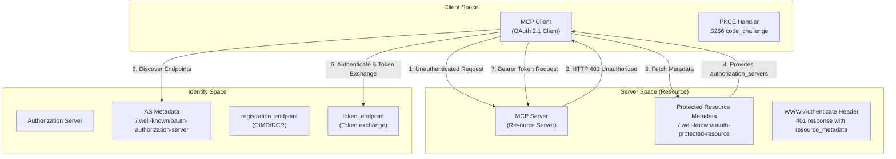

<!-- source: DeepWiki mcp.deepwiki.com · repo modelcontextprotocol/modelcontextprotocol · page 3 Authorization and Security · fetched 2026-10-21 -->

# Authorization and Security

Relevant source files

The following files were used as context for generating this wiki page:

- [MAINTAINERS.md](MAINTAINERS.md)
- [blog/content/posts/2026-04-08-maintainer-update.md](blog/content/posts/2026-04-08-maintainer-update.md)
- [blog/static/posts/images/maintainer-update-2026-04/clare.webp](blog/static/posts/images/maintainer-update-2026-04/clare.webp)
- [blog/static/posts/images/maintainer-update-2026-04/den.jpeg](blog/static/posts/images/maintainer-update-2026-04/den.jpeg)
- [docs/community/communication.mdx](docs/community/communication.mdx)
- [docs/community/governance.mdx](docs/community/governance.mdx)
- [docs/community/sep-guidelines.mdx](docs/community/sep-guidelines.mdx)
- [docs/docs/tutorials/security/authorization.mdx](docs/docs/tutorials/security/authorization.mdx)
- [docs/specification/draft/basic/authorization/authorization-server-discovery.mdx](docs/specification/draft/basic/authorization/authorization-server-discovery.mdx)
- [docs/specification/draft/basic/authorization/client-registration.mdx](docs/specification/draft/basic/authorization/client-registration.mdx)
- [docs/specification/draft/basic/authorization/index.mdx](docs/specification/draft/basic/authorization/index.mdx)
- [docs/specification/draft/basic/authorization/security-considerations.mdx](docs/specification/draft/basic/authorization/security-considerations.mdx)

## Purpose and Scope

This section provides comprehensive coverage of the Model Context Protocol's authorization system and security architecture. MCP uses an **OAuth 2.1-based framework** to secure access to sensitive resources and operations exposed by MCP servers. While authorization is **optional**, it is the standard mechanism for HTTP-based transports to protect user data and ensure administrative actions are performed by permitted users.

Authorization is specifically designed for remote, HTTP-hosted servers. Local servers using the **stdio transport** should not follow this specification and should instead rely on environment-based credentials or local security contexts.

Sources: [docs/docs/tutorials/security/authorization.mdx:6-9](), [docs/docs/tutorials/security/authorization.mdx:21-27](), [docs/specification/draft/basic/authorization/index.mdx:12-25]()

## Core Security Architecture

The MCP security model bridges "Natural Language Space" (user intent and model reasoning) with "Code Entity Space" (authenticated protocol messages and resource access).

### System Roles and Code Entities

The following diagram maps the logical OAuth roles to specific code-level responsibilities and discovery endpoints defined in the specification.

**Diagram: Mapping Protocol Roles to Code Entities**

Sources: [docs/docs/tutorials/security/authorization.mdx:34-45](), [docs/specification/draft/basic/authorization/index.mdx:47-59](), [docs/specification/draft/basic/authorization/authorization-server-discovery.mdx:7-19](), [docs/specification/draft/basic/authorization/authorization-server-discovery.mdx:100-125]()

## Key Authorization Components

MCP's security framework is modular, with detailed documentation available for each sub-system:

### [OAuth 2.1 Authorization Framework](#3.1)
MCP adopts the **OAuth 2.1** draft specification as its core authorization lifecycle. This includes:
- **Discovery**: Using Protected Resource Metadata ([RFC 9728]()) and Authorization Server Metadata ([RFC 8414]()).
- **PKCE Requirements**: Mandatory use of Proof Key for Code Exchange (PKCE) with the `S256` method to prevent code interception.
- **Resource Binding**: Mandatory use of the `resource` parameter ([RFC 8707]()) to bind tokens to specific server audiences.

For details, see [OAuth 2.1 Authorization Framework](#3.1).

Sources: [docs/specification/draft/basic/authorization/index.mdx:27-46](), [docs/specification/draft/basic/authorization/security-considerations.mdx:11-13](), [docs/specification/draft/basic/authorization/security-considerations.mdx:50-54]()

### [Client Registration Methods](#3.2)
Before a client can authorize, it must be known to the Authorization Server. MCP supports three methods:
1. **Client ID Metadata Documents (CIMD)**: The primary method (SEP-991) where clients use HTTPS URLs as identifiers pointing to a JSON document.
2. **Dynamic Client Registration (DCR)**: A legacy fallback ([RFC 7591]()) for servers that do not yet support CIMD.
3. **Pre-registration**: For established relationships between specific clients and servers.

For details, see [Client Registration Methods](#3.2).

Sources: [docs/specification/draft/basic/authorization/client-registration.mdx:7-19](), [docs/specification/draft/basic/authorization/client-registration.mdx:20-29](), [docs/specification/draft/basic/authorization/client-registration.mdx:140-145]()

### [Token Management and Validation](#3.3)
This covers the operational lifecycle of credentials:
- **Validation**: Servers **MUST** validate the `aud` (audience) claim to ensure the token was specifically issued for their use.
- **Scope Strategy**: MCP uses a "principle of least privilege" approach, where servers suggest required scopes in the `WWW-Authenticate` challenge.
- **Step-up Flow**: Handling `insufficient_scope` errors by requesting additional permissions from the resource owner.

For details, see [Token Management and Validation](#3.3).

Sources: [docs/specification/draft/basic/authorization/index.mdx:97-114](), [docs/specification/draft/basic/authorization/security-considerations.mdx:14-24]()

### [Security Best Practices and Threat Models](#3.4)
Comprehensive documentation on mitigating common vulnerabilities:
- **Confused Deputy**: Preventing servers from being tricked into using their authority on behalf of a malicious client.
- **Token Passthrough**: Explicitly forbidden; servers must never forward tokens received from clients to other services.
- **Mix-Up Attacks**: Mitigation via `iss` (issuer) identification in authorization responses ([RFC 9207]()).
- **Local Server Security**: Specific requirements for servers running on `localhost` (SEP-1024).

For details, see [Security Best Practices and Threat Models](#3.4).

Sources: [docs/specification/draft/basic/authorization/security-considerations.mdx:22-23](), [docs/specification/draft/basic/authorization/security-considerations.mdx:63-68](), [blog/content/posts/2026-04-08-maintainer-update.md:39-39]()

## Standards Compliance Matrix

MCP implements a selected subset of industry standards to balance security with developer ergonomics.

| Standard | Role | Requirement |
| :--- | :--- | :--- |
| **OAuth 2.1** | Core Framework | **MUST** (for HTTP) |
| **RFC 9728** | Resource Metadata | **MUST** (for discovery) |
| **RFC 8414** | AS Metadata | **MUST** (for clients) |
| **RFC 8707** | Resource Indicators | **MUST** (for audience binding) |
| **PKCE** | Code Protection | **MUST** (S256 method) |
| **CIMD** | Client Identity | **SHOULD** (recommended registration) |

Sources: [docs/specification/draft/basic/authorization/index.mdx:27-46](), [docs/specification/draft/basic/authorization/security-considerations.mdx:50-54](), [docs/specification/draft/basic/authorization/client-registration.mdx:22-24]()

## Security Governance

The security and authorization specifications are managed by dedicated Interest Groups (IGs) within the MCP governance structure, overseen by the Steering Group.

- **Security Interest Group**: Facilitated by [Den Delimarsky](https://github.com/localden), [Paul Carleton](https://github.com/pcarleton), and [Jenn Newton](https://github.com/jenn-newton).
- **Authorization Interest Group**: Facilitated by [Aaron Parecki](https://github.com/aaronpk), [Darin McAdams](https://github.com/D-McAdams), and [Paul Carleton](https://github.com/pcarleton).

Sources: [MAINTAINERS.md:160-171](), [docs/community/governance.mdx:68-75](), [blog/content/posts/2026-04-08-maintainer-update.md:39-40]()

---

