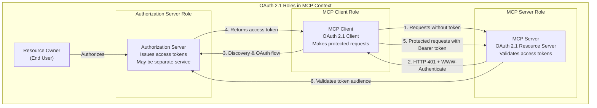
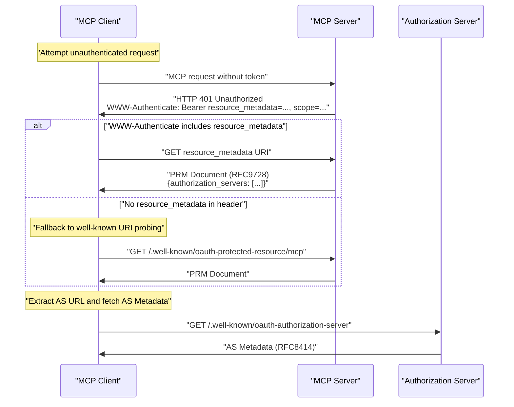

<!-- source: DeepWiki mcp.deepwiki.com · repo modelcontextprotocol/modelcontextprotocol · page 3.1 OAuth 2.1 Authorization Framework · fetched 2026-10-21 -->

# OAuth 2.1 Authorization Framework

Relevant source files

The following files were used as context for generating this wiki page:

- [MAINTAINERS.md](MAINTAINERS.md)
- [blog/content/posts/2026-04-08-maintainer-update.md](blog/content/posts/2026-04-08-maintainer-update.md)
- [blog/static/posts/images/maintainer-update-2026-04/clare.webp](blog/static/posts/images/maintainer-update-2026-04/clare.webp)
- [blog/static/posts/images/maintainer-update-2026-04/den.jpeg](blog/static/posts/images/maintainer-update-2026-04/den.jpeg)
- [docs/community/communication.mdx](docs/community/communication.mdx)
- [docs/community/governance.mdx](docs/community/governance.mdx)
- [docs/community/sep-guidelines.mdx](docs/community/sep-guidelines.mdx)
- [docs/docs/tutorials/security/authorization.mdx](docs/docs/tutorials/security/authorization.mdx)
- [docs/specification/2025-06-18/basic/authorization.mdx](docs/specification/2025-06-18/basic/authorization.mdx)
- [docs/specification/2025-06-18/basic/index.mdx](docs/specification/2025-06-18/basic/index.mdx)
- [docs/specification/2025-06-18/basic/transports.mdx](docs/specification/2025-06-18/basic/transports.mdx)
- [docs/specification/2025-06-18/basic/utilities/cancellation.mdx](docs/specification/2025-06-18/basic/utilities/cancellation.mdx)
- [docs/specification/2025-06-18/basic/utilities/ping.mdx](docs/specification/2025-06-18/basic/utilities/ping.mdx)
- [docs/specification/2025-06-18/client/sampling.mdx](docs/specification/2025-06-18/client/sampling.mdx)
- [docs/specification/draft/basic/authorization/authorization-server-discovery.mdx](docs/specification/draft/basic/authorization/authorization-server-discovery.mdx)
- [docs/specification/draft/basic/authorization/client-registration.mdx](docs/specification/draft/basic/authorization/client-registration.mdx)
- [docs/specification/draft/basic/authorization/index.mdx](docs/specification/draft/basic/authorization/index.mdx)
- [docs/specification/draft/basic/authorization/security-considerations.mdx](docs/specification/draft/basic/authorization/security-considerations.mdx)

## Purpose and Scope

This document describes MCP's OAuth 2.1-based authorization framework for HTTP-based transports. It covers authorization server discovery, client registration methods, token management, and security requirements for implementing protected MCP servers and clients.

Authorization is **OPTIONAL** for MCP implementations. When implemented, this specification applies **ONLY** to HTTP-based transports. For STDIO transports, implementations **SHOULD NOT** follow this specification and instead retrieve credentials from the environment or use third-party libraries embedded directly in the server. For alternative transports, follow established security best practices for that protocol.

**Sources:** [docs/specification/draft/basic/authorization/index.mdx:8-25](), [docs/docs/tutorials/security/authorization.mdx:6-27](), [docs/specification/2025-06-18/basic/authorization.mdx:7-24]()

## Standards and Specifications

MCP's authorization framework implements a selected subset of OAuth 2.1 and related specifications to ensure security while maintaining simplicity:

| Specification | RFC/Draft | Purpose |
|---------------|-----------|---------|
| OAuth 2.1 | draft-ietf-oauth-v2-1-13 | Core authorization protocol framework |
| Authorization Server Metadata | RFC8414 | Discovery of authorization server capabilities |
| Dynamic Client Registration | RFC7591 | Automatic client registration (deprecated in favor of CIMD) |
| Protected Resource Metadata | RFC9728 | Discovery of resource server authorization requirements |
| Resource Indicators | RFC8707 | Token audience binding to prevent misuse |
| Bearer Token Usage | RFC6750 | Access token transmission in HTTP requests |
| Client ID Metadata Documents | draft-ietf-oauth-client-id-metadata-document-00 | URL-based client identification (CIMD) |
| OIDC Discovery 1.0 | OpenID Connect | Alternative discovery mechanism for auth servers |

**Sources:** [docs/specification/draft/basic/authorization/index.mdx:26-46](), [docs/docs/tutorials/security/authorization.mdx:34-44](), [docs/specification/2025-06-18/basic/authorization.mdx:25-37]()

## Roles and Architecture

### OAuth 2.1 Role Mapping

**Roles:**
- **MCP Server**: Acts as an OAuth 2.1 resource server, capable of accepting and responding to protected resource requests using access tokens.
- **MCP Client**: Acts as an OAuth 2.1 client, making protected resource requests on behalf of a resource owner.
- **Authorization Server**: Responsible for interacting with the user and issuing access tokens. It may be hosted with the resource server or as a separate entity.

**Sources:** [docs/specification/draft/basic/authorization/index.mdx:47-59](), [docs/docs/tutorials/security/authorization.mdx:122-133](), [docs/specification/2025-06-18/basic/authorization.mdx:40-52]()

### Implementation Requirements Matrix

| Component | MUST | SHOULD | MAY |
|-----------|------|--------|-----|
| **Authorization Servers** | Implement OAuth 2.1, support PKCE, provide RFC8414 or OIDC Discovery | Support Client ID Metadata Documents (CIMD) | Support Dynamic Client Registration (RFC7591) |
| **MCP Servers** | Implement RFC9728 Protected Resource Metadata, validate token audience | Include `scope` in 401 responses | Provide metadata at root well-known URI |
| **MCP Clients** | Support AS discovery (RFC8414/OIDC), use PKCE (S256), include `resource` parameter | Support CIMD for registration | Support Dynamic Client Registration |

**Sources:** [docs/specification/draft/basic/authorization/index.mdx:60-81](), [docs/specification/draft/basic/authorization/security-considerations.mdx:50-54](), [docs/specification/2025-06-18/basic/authorization.mdx:53-67]()

## Authorization Server Discovery

### Discovery Mechanisms

MCP provides a two-stage discovery process: first locating the Protected Resource Metadata (PRM) on the MCP server, then using that to find the Authorization Server (AS) metadata.

**Sources:** [docs/specification/draft/basic/authorization/authorization-server-discovery.mdx:7-55](), [docs/docs/tutorials/security/authorization.mdx:34-77](), [docs/specification/2025-06-18/basic/authorization.mdx:97-126]()

### Protected Resource Metadata (PRM) Discovery

MCP servers **MUST** implement one of the following to provide AS location information:

1. **WWW-Authenticate Header**: Include the URL in the `resource_metadata` parameter of the `WWW-Authenticate` header in a 401 response.
2. **Well-Known URI**: Serve metadata at `/.well-known/oauth-protected-resource` or a sub-path corresponding to the MCP endpoint.

MCP clients **MUST** support both and prioritize the header value if present.

**Sources:** [docs/specification/draft/basic/authorization/authorization-server-discovery.mdx:37-50](), [docs/docs/tutorials/security/authorization.mdx:34-60](), [docs/specification/2025-06-18/basic/authorization.mdx:74-92]()

### Authorization Server Metadata Discovery

To handle different issuer URL formats, MCP clients **MUST** attempt multiple well-known endpoints:

**For issuer URLs with path components** (e.g., `https://auth.example.com/tenant1`):
1. OAuth 2.0 AS Metadata: `https://auth.example.com/.well-known/oauth-authorization-server/tenant1`
2. OIDC Discovery: `https://auth.example.com/.well-known/openid-configuration/tenant1`
3. OIDC Discovery (path appending): `https://auth.example.com/tenant1/.well-known/openid-configuration`

**Validation:** MCP clients **MUST** validate that the `issuer` value in the retrieved document is identical to the issuer identifier used to construct the URL.

**Sources:** [docs/specification/draft/basic/authorization/authorization-server-discovery.mdx:56-95](), [docs/docs/tutorials/security/authorization.mdx:62-77](), [docs/specification/2025-06-18/basic/authorization.mdx:93-96]()

## Client Registration Methods

### Selection Priority

Clients supporting all options **SHOULD** use the following priority order:
1. **Pre-registration**: Use existing credentials if available.
2. **Client ID Metadata Documents (CIMD)**: Use if AS metadata indicates `client_id_metadata_document_supported`.
3. **Dynamic Client Registration (DCR)**: Use as fallback if `registration_endpoint` is present.
4. **Manual Prompt**: Prompt the user to enter information.

**Sources:** [docs/specification/draft/basic/authorization/client-registration.mdx:7-19]()

### Client ID Metadata Documents (CIMD)

This approach enables clients to use HTTPS URLs as client identifiers, pointing to a JSON document containing client metadata. This is the recommended approach for the unbounded MCP ecosystem.

**Client Requirements:**
- Host metadata at an HTTPS URL.
- The `client_id` URL MUST match the document URL exactly.
- Required properties: `client_id`, `client_name`, `redirect_uris`.

**Server Requirements:**
- SHOULD fetch metadata when encountering URL-formatted `client_ids`.
- MUST validate document structure and `client_id` match.
- SHOULD cache metadata respecting HTTP headers.

**Sources:** [docs/specification/draft/basic/authorization/client-registration.mdx:20-71]()

### Dynamic Client Registration (DCR)

**Warning:** DCR is deprecated in the MCP specification. New implementations should use CIMD. It remains for backwards compatibility with older authorization servers.

**Sources:** [docs/specification/draft/basic/authorization/client-registration.mdx:140-145](), [docs/docs/tutorials/security/authorization.mdx:83-95](), [docs/specification/2025-06-18/basic/authorization.mdx:128-146]()

## Authorization Lifecycle

### PKCE Requirements

**Proof Key for Code Exchange (PKCE)** is mandatory for all MCP clients to mitigate authorization code interception.

- Clients **MUST** use the `S256` code challenge method.
- Clients **MUST** verify PKCE support in AS metadata (`code_challenge_methods_supported`) before proceeding.
- If the field is absent, the client **MUST** refuse to proceed.

**Sources:** [docs/specification/draft/basic/authorization/security-considerations.mdx:45-62](), [docs/docs/tutorials/security/authorization.mdx:106-119]()

### Resource Parameter Usage

MCP clients **MUST** include the `resource` parameter (RFC8707) in authorization and token requests to bind tokens to their intended audiences.

- The `resource` parameter identifies the canonical URI of the MCP server.
- MCP servers **MUST** validate that tokens presented were specifically issued for their use.

**Sources:** [docs/specification/draft/basic/authorization/security-considerations.mdx:14-24](), [docs/specification/draft/basic/authorization/index.mdx:39-40]()

### Scope Selection and Challenges

1. **Initial Handshake**: MCP servers SHOULD include a `scope` parameter in the `WWW-Authenticate` header to guide clients on required permissions.
2. **Least Privilege**: Clients SHOULD treat these scopes as authoritative for the current operation.
3. **Step-up Authorization**: If a client attempts an operation requiring more permissions, the server returns a `403 Forbidden` with `error="insufficient_scope"` and the required `scope` list. The client then re-authorizes to upgrade the token.

**Sources:** [docs/specification/draft/basic/authorization/index.mdx:98-123](), [docs/specification/draft/basic/authorization/index.mdx:504-559]()

## Security Requirements

### Token Validation

MCP servers **MUST** validate tokens on every request:
- **Audience Binding**: Verify the token was issued for the server's specific URI.
- **Issuer Validation**: Verify the token was issued by a trusted AS.
- **Scope Verification**: Ensure the token possesses the scopes required for the specific MCP method or resource.

**Sources:** [docs/specification/draft/basic/authorization/security-considerations.mdx:14-24](), [docs/docs/tutorials/security/authorization.mdx:122-133]()

### Threat Mitigations

- **Token Passthrough**: Explicitly forbidden. Servers must never forward a client's token to upstream services.
- **Mix-Up Attacks**: Mitigated by validating the `iss` (issuer) parameter in the authorization response.
- **SSRF**: Authorization servers fetching CIMD documents MUST implement SSRF protections against malicious client URLs.
- **Token Theft**: AS SHOULD issue short-lived access tokens and MUST rotate refresh tokens for public clients.

**Sources:** [docs/specification/draft/basic/authorization/security-considerations.mdx:25-35](), [docs/specification/draft/basic/authorization/security-considerations.mdx:63-68](), [docs/specification/draft/basic/authorization/security-considerations.mdx:90-97]()

---

