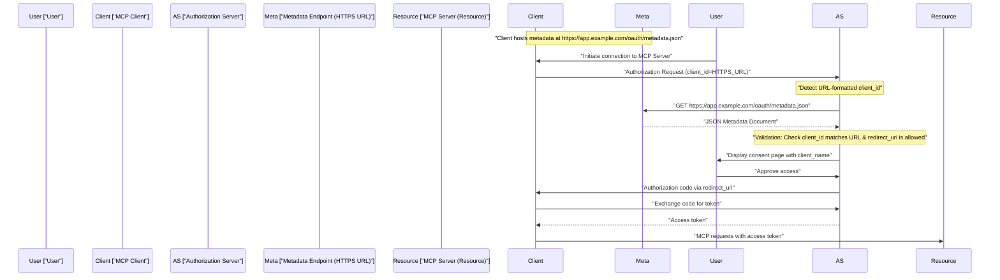
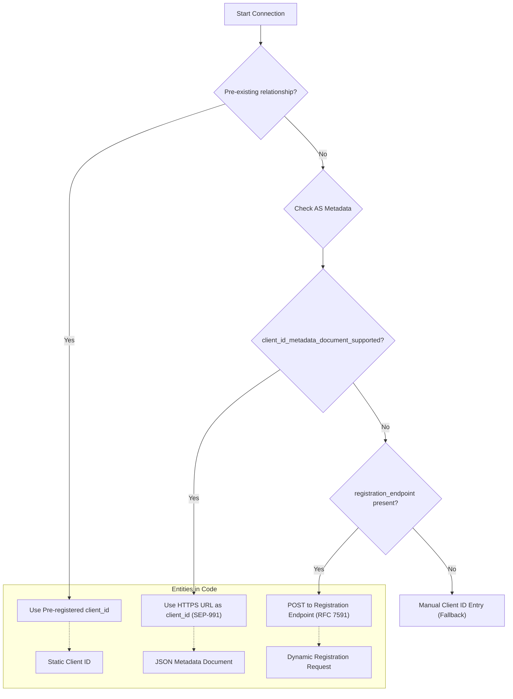

<!-- source: DeepWiki mcp.deepwiki.com · repo modelcontextprotocol/modelcontextprotocol · page 3.2 Client Registration Methods · fetched 2026-10-21 -->

# Client Registration Methods

Relevant source files

The following files were used as context for generating this wiki page:

- [blog/content/archives.md](blog/content/archives.md)
- [blog/content/posts/client_registration/index.md](blog/content/posts/client_registration/index.md)
- [blog/content/posts/client_registration/mitigation-attack-cost.png](blog/content/posts/client_registration/mitigation-attack-cost.png)
- [blog/content/search.md](blog/content/search.md)
- [blog/layouts/_markup/render-codeblock-mermaid.html](blog/layouts/_markup/render-codeblock-mermaid.html)
- [blog/layouts/baseof.html](blog/layouts/baseof.html)
- [docs/seps/1024-mcp-client-security-requirements-for-local-server-.mdx](docs/seps/1024-mcp-client-security-requirements-for-local-server-.mdx)
- [docs/seps/1034--support-default-values-for-all-primitive-types-in.mdx](docs/seps/1034--support-default-values-for-all-primitive-types-in.mdx)
- [docs/seps/1036-url-mode-elicitation-for-secure-out-of-band-intera.mdx](docs/seps/1036-url-mode-elicitation-for-secure-out-of-band-intera.mdx)
- [docs/seps/1046-support-oauth-client-credentials-flow-in-authoriza.mdx](docs/seps/1046-support-oauth-client-credentials-flow-in-authoriza.mdx)
- [docs/seps/1302-formalize-working-groups-and-interest-groups-in-mc.mdx](docs/seps/1302-formalize-working-groups-and-interest-groups-in-mc.mdx)
- [docs/seps/1303-input-validation-errors-as-tool-execution-errors.mdx](docs/seps/1303-input-validation-errors-as-tool-execution-errors.mdx)
- [docs/seps/1319-decouple-request-payload-from-rpc-methods-definiti.mdx](docs/seps/1319-decouple-request-payload-from-rpc-methods-definiti.mdx)
- [docs/seps/991-enable-url-based-client-registration-using-oauth-c.mdx](docs/seps/991-enable-url-based-client-registration-using-oauth-c.mdx)
- [docs/spec-version-warning.js](docs/spec-version-warning.js)

## Purpose and Scope

This document explains the three client registration approaches supported by the Model Context Protocol (MCP) for HTTP-based transports: **Client ID Metadata Documents (CIMD)**, **Dynamic Client Registration (DCR)**, and **Pre-registration**. Client registration is the prerequisite step where an MCP client obtains or provides a `client_id` to identify itself to an authorization server before initiating an OAuth 2.1 flow [docs/seps/991-enable-url-based-client-registration-using-oauth-c.mdx:35-39]().

## The Registration Challenge in MCP

MCP's architecture often involves clients and servers with no prior relationship. Unlike traditional OAuth where a client developer registers their app with a specific provider (e.g., "Login with Google"), an MCP client must be able to connect to any remote MCP server the user specifies [blog/content/posts/client_registration/index.md:61-65]().

This creates two primary challenges:
1. **Operational Scale**: It is impossible for every client to be pre-registered with every possible authorization server [blog/content/posts/client_registration/index.md:65-66]().
2. **Trust and Identity**: Authorization servers need a way to verify client metadata (like names and redirect URIs) to prevent impersonation and phishing [blog/content/posts/client_registration/index.md:55-58]().

**Sources:** [blog/content/posts/client_registration/index.md:55-66](), [docs/seps/991-enable-url-based-client-registration-using-oauth-c.mdx:46-55]()

## Registration Approach Priority

The MCP specification adopts OAuth 2.1 as its foundation [blog/content/posts/client_registration/index.md:9-9](). While multiple methods exist, SEP-991 establishes a clear preference for URL-based metadata discovery in open ecosystems.

| Priority | Method | Description |
| :--- | :--- | :--- |
| 1 | **Pre-registration** | Optimal for established relationships where credentials already exist [docs/seps/991-enable-url-based-client-registration-using-oauth-c.mdx:54-55](). |
| 2 | **Client ID Metadata Documents** | **SHOULD** be supported as the primary method for open connections [docs/seps/991-enable-url-based-client-registration-using-oauth-c.mdx:77-79](). |
| 3 | **Dynamic Client Registration** | **MAY** be supported for backwards compatibility [docs/seps/991-enable-url-based-client-registration-using-oauth-c.mdx:77-79](). |

**Sources:** [docs/seps/991-enable-url-based-client-registration-using-oauth-c.mdx:77-79](), [blog/content/posts/client_registration/index.md:77-78]()

## Client ID Metadata Documents (CIMD)

CIMD (based on `draft-parecki-oauth-client-id-metadata-document`) allows an OAuth client to use an HTTPS URL as its `client_id` [docs/seps/991-enable-url-based-client-registration-using-oauth-c.mdx:29-31](). This URL points to a JSON document containing the client's metadata, enabling trust without pre-coordination [docs/seps/991-enable-url-based-client-registration-using-oauth-c.mdx:59-61]().

### Metadata Document Requirements
Clients MUST host a valid JSON document at an HTTPS URL containing at minimum [docs/seps/991-enable-url-based-client-registration-using-oauth-c.mdx:121-125]():
*   `client_id`: MUST exactly match the document URL.
*   `client_name`: Human-readable name for the consent screen.
*   `redirect_uris`: Array of allowed redirection endpoints.

### CIMD Implementation Data Flow
This diagram illustrates the interaction between the `Authorization Server` and the `Metadata Endpoint` (the client's URL).

**Diagram: CIMD Metadata Retrieval and Validation**

**Sources:** [docs/seps/991-enable-url-based-client-registration-using-oauth-c.mdx:83-119]()

### Security Implications of CIMD
*   **Trust Model**: Servers can trust clients based on the HTTPS domain hosting the metadata and domain reputation [docs/seps/991-enable-url-based-client-registration-using-oauth-c.mdx:63-66]().
*   **Policy Control**: Authorization servers can be "Open" (accepting any HTTPS `client_id`) or "Protected" (restricting to specific domains) [docs/seps/991-enable-url-based-client-registration-using-oauth-c.mdx:68-71]().
*   **Caching**: Servers should cache metadata document results while respecting HTTP cache headers to improve performance [docs/seps/991-enable-url-based-client-registration-using-oauth-c.mdx:118-119]().

## Dynamic Client Registration (DCR)

DCR (RFC 7591) provides an API for just-in-time registration by sending client metadata to a registration endpoint [docs/seps/991-enable-url-based-client-registration-using-oauth-c.mdx:38-38]().

### Operational Limitations
DCR presents several challenges in the open MCP ecosystem:
*   **Unbounded Database Growth**: Every user instance of a client (e.g., Claude Desktop on two different machines) typically creates distinct registrations, leading to database bloat for the authorization server [blog/content/posts/client_registration/index.md:94-96]().
*   **Client Expiry**: There is no standard mechanism to notify a client that its ID is invalid, often leading to "black hole" registrations [blog/content/posts/client_registration/index.md:97-98]().
*   **Impersonation Risk**: Open DCR endpoints are vulnerable to clients claiming false identities (e.g., a malicious app claiming to be "Claude Desktop") unless strict vetting is applied [blog/content/posts/client_registration/index.md:57-58]().

**Sources:** [blog/content/posts/client_registration/index.md:88-105](), [docs/seps/991-enable-url-based-client-registration-using-oauth-c.mdx:38-45]()

## Pre-registration

Pre-registration is the traditional OAuth pattern where a `client_id` is issued manually by the server administrator to the client developer [docs/seps/991-enable-url-based-client-registration-using-oauth-c.mdx:37-37]().

### Machine-to-Machine (M2M) Scenarios
For scenarios where an end-user is unavailable for interactive authorization, SEP-1046 recommends the **OAuth client credentials flow** [docs/seps/1046-support-oauth-client-credentials-flow-in-authoriza.mdx:31-31](). 
*   **JWT Assertions**: The RECOMMENDED method using asymmetric keys (RFC 7523) [docs/seps/1046-support-oauth-client-credentials-flow-in-authoriza.mdx:39-40]().
*   **Client Secrets**: Allowed for maximum compatibility with existing systems via HTTP Basic authentication [docs/seps/1046-support-oauth-client-credentials-flow-in-authoriza.mdx:48-49]().

**Sources:** [docs/seps/991-enable-url-based-client-registration-using-oauth-c.mdx:37-37](), [docs/seps/1046-support-oauth-client-credentials-flow-in-authoriza.mdx:31-52]()

## Summary of Registration Flow Logic

This diagram maps the decision logic a client or server might use when determining which registration entity to use.

**Diagram: Registration Method Selection Logic**

**Sources:** [docs/seps/991-enable-url-based-client-registration-using-oauth-c.mdx:77-81](), [blog/content/posts/client_registration/index.md:65-78]()

---

