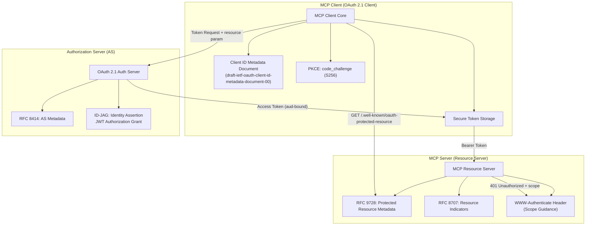
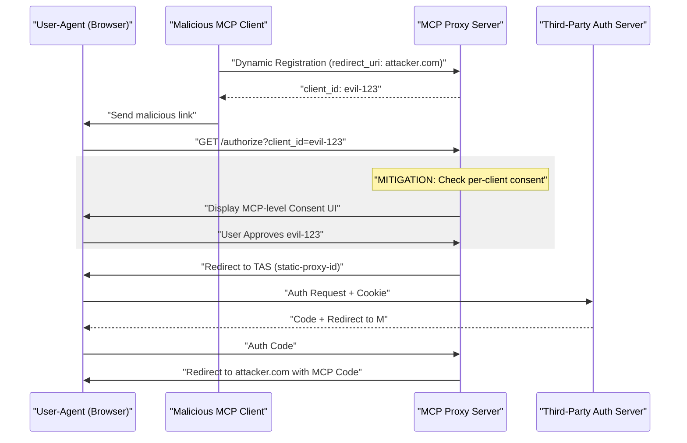
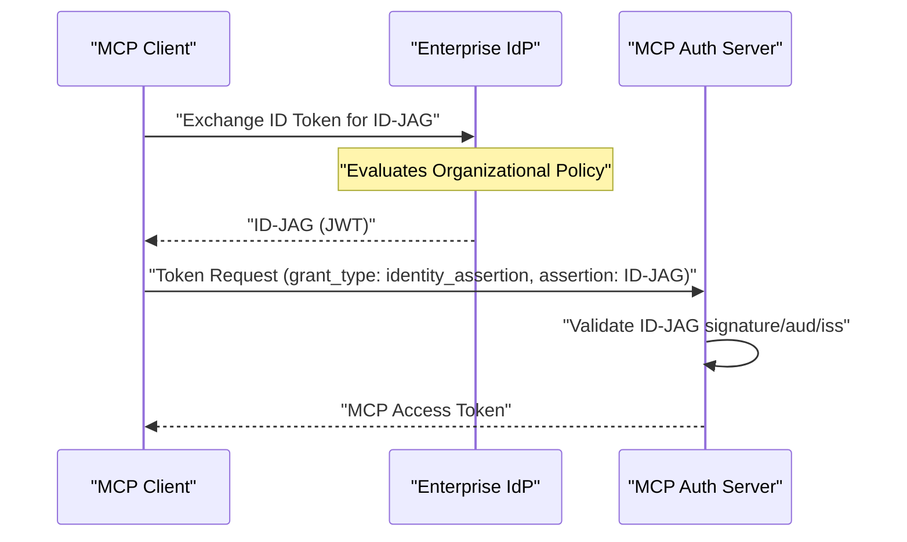

<!-- source: DeepWiki mcp.deepwiki.com · repo modelcontextprotocol/modelcontextprotocol · page 3.4 Security Best Practices and Threat Models · fetched 2026-10-21 -->

# Security Best Practices and Threat Models

Relevant source files

The following files were used as context for generating this wiki page:

- [.gitattributes](.gitattributes)
- [.github/dependabot.yml](.github/dependabot.yml)
- [CONTRIBUTING.md](CONTRIBUTING.md)
- [README.md](README.md)
- [SECURITY.md](SECURITY.md)
- [blog/content/posts/enterprise-managed-auth/ema-comparison.png](blog/content/posts/enterprise-managed-auth/ema-comparison.png)
- [blog/content/posts/enterprise-managed-auth/index.md](blog/content/posts/enterprise-managed-auth/index.md)
- [docs/community/security.mdx](docs/community/security.mdx)
- [docs/docs/tutorials/security/security_best_practices.mdx](docs/docs/tutorials/security/security_best_practices.mdx)
- [docs/extensions/auth/enterprise-managed-authorization.mdx](docs/extensions/auth/enterprise-managed-authorization.mdx)
- [docs/specification/draft/basic/authorization/authorization-server-discovery.mdx](docs/specification/draft/basic/authorization/authorization-server-discovery.mdx)
- [docs/specification/draft/basic/authorization/client-registration.mdx](docs/specification/draft/basic/authorization/client-registration.mdx)
- [docs/specification/draft/basic/authorization/index.mdx](docs/specification/draft/basic/authorization/index.mdx)
- [docs/specification/draft/basic/authorization/security-considerations.mdx](docs/specification/draft/basic/authorization/security-considerations.mdx)
- [package-lock.json](package-lock.json)
- [package.json](package.json)

## Purpose and Scope

This document identifies security threats, attack vectors, and best practices specific to the Model Context Protocol (MCP). It provides technical implementation details for mitigating risks such as the Confused Deputy problem, token passthrough, session hijacking, and Server-Side Request Forgery (SSRF). This page complements the [OAuth 2.1 Authorization Framework](/specification/draft/basic/authorization) and [Enterprise-Managed Authorization](/extensions/auth/enterprise-managed-authorization) specifications.

**Sources:** [docs/specification/draft/basic/authorization/index.mdx:8-15](), [docs/docs/tutorials/security/security_best_practices.mdx:6-20]()

## Security Architecture and Code Entities

The following diagram bridges protocol concepts to specific implementation requirements for MCP clients and servers.

**Sources:** [docs/specification/draft/basic/authorization/index.mdx:47-59](), [docs/specification/draft/basic/authorization/security-considerations.mdx:14-24](), [docs/specification/draft/basic/authorization/authorization-server-discovery.mdx:11-19]()

## Threat Models and Mitigations

### 1. Confused Deputy Problem (Proxy Servers)

This vulnerability occurs when an MCP proxy server connects to a third-party API using a static Client ID while allowing dynamic registration for its own clients. Attackers can exploit existing user consent cookies on the third-party Authorization Server to bypass human-in-the-loop approval.

| Code Entity / Role | Mitigation Responsibility |
|:---|:---|
| **MCP Proxy Server** | **MUST** implement per-client consent before forwarding to third-party auth. |
| **MCP Proxy Server** | **MUST** store consent decisions in a registry keyed by `client_id` and `user_id`. |
| **MCP Proxy Server** | **MUST** validate that `redirect_uri` exactly matches the registered URI. |

**Sources:** [docs/docs/tutorials/security/security_best_practices.mdx:27-73](), [docs/docs/tutorials/security/security_best_practices.mdx:160-182]()

### 2. Token Passthrough Anti-Pattern

Token passthrough is strictly forbidden. MCP servers must never forward a token received from a client directly to a downstream API.

*   **Vulnerability:** Replaying tokens across different trust boundaries.
*   **Mitigation:** 
    *   MCP clients **MUST** include the `resource` parameter ([RFC 8707](https://www.rfc-editor.org/rfc/rfc8707.html)) in requests to bind the token to a specific server [docs/specification/draft/basic/authorization/security-considerations.mdx:14-24]().
    *   MCP servers **MUST** validate the `aud` (audience) claim to ensure the token was issued specifically for them [docs/docs/tutorials/security/security_best_practices.mdx:242-244]().
    *   Servers needing upstream access **MUST** act as a separate OAuth client and obtain their own tokens [docs/docs/tutorials/security/security_best_practices.mdx:222-241]().

### 3. Server-Side Request Forgery (SSRF)

SSRF risks are prominent during **Client ID Metadata Document (CIMD)** fetching and **Authorization Server Discovery**.

*   **Threat:** A malicious client provides a `client_id` URL pointing to an internal network resource (e.g., `http://169.254.169.254/latest/meta-data/`).
*   **Mitigation:**
    *   Authorization servers **MUST** validate that `client_id` URLs use the `https` scheme [docs/specification/draft/basic/authorization/client-registration.mdx:38-42]().
    *   Authorization servers **SHOULD** implement network-level egress filtering to prevent fetching metadata from private IP ranges [docs/specification/draft/basic/authorization/security-considerations.mdx:96-100]().
    *   Fetched `client_id` values inside the document **MUST** match the request URL exactly [docs/specification/draft/basic/authorization/client-registration.mdx:47]().

**Sources:** [docs/specification/draft/basic/authorization/security-considerations.mdx:84-100](), [docs/specification/draft/basic/authorization/client-registration.mdx:38-52]()

### 4. Session Hijacking and Async Events

In Streamable HTTP transports, session IDs are used to route async events.

*   **Threat:** Predicting or stealing a `session_id` to inject malicious payloads into another user's event stream.
*   **Mitigation:**
    *   Servers **MUST NOT** use session IDs for authentication; every request must carry a Bearer token [docs/docs/tutorials/security/security_best_practices.mdx:318-322]().
    *   Session IDs **MUST** be cryptographically secure non-deterministic values (e.g., UUIDv4) [docs/docs/tutorials/security/security_best_practices.mdx:324-326]().
    *   Servers **SHOULD** bind sessions to the user identity by keying storage as `<user_id>:<session_id>` [docs/docs/tutorials/security/security_best_practices.mdx:327-331]().

**Sources:** [docs/docs/tutorials/security/security_best_practices.mdx:246-331]()

## Local Server Security

Local MCP servers (running via `stdio`) operate with the same privileges as the MCP client (e.g., the user's IDE or Desktop app).

*   **Trust Model:** Local MCP servers are trusted like any other software installed on the system [SECURITY.md:41-45]().
*   **Command Execution:** MCP clients launch servers by executing commands. This is intended behavior and not a vulnerability [SECURITY.md:62-75]().
*   **Pre-Configuration Consent:** Clients **MUST** display the full command line (no truncation) before executing a local server [docs/docs/tutorials/security/security_best_practices.mdx:365-375]().
*   **Command Sanitization:** Clients **SHOULD** warn users about dangerous patterns like `sudo`, `rm -rf`, or pipes [docs/docs/tutorials/security/security_best_practices.mdx:377-385]().
*   **Transport Boundary:** The SDK does not defend peers against a malicious counterpart across `stdio`; a malicious server already has code execution by virtue of being run [SECURITY.md:76-84]().

**Sources:** [docs/docs/tutorials/security/security_best_practices.mdx:333-392](), [SECURITY.md:31-84]()

## Enterprise and Machine-to-Machine (M2M) Security

### Enterprise-Managed Authorization (EMA)
EMA centralizes access control via an Identity Provider (IdP). It uses the **Identity Assertion JWT Authorization Grant (ID-JAG)** to eliminate per-server consent prompts.

**Sources:** [docs/extensions/auth/enterprise-managed-authorization.mdx:42-74](), [blog/content/posts/enterprise-managed-auth/index.md:62-74]()

### M2M with Client Credentials
For non-interactive scenarios (e.g., one MCP server calling another), the OAuth 2.1 **Client Credentials Grant** is used.
*   Clients **MAY** use `private_key_jwt` for authentication at the token endpoint to avoid sharing static secrets [docs/specification/draft/basic/authorization/client-registration.mdx:42]().

**Sources:** [docs/specification/draft/basic/authorization/client-registration.mdx:42](), [docs/specification/draft/basic/authorization/index.mdx:62-63]()

---

