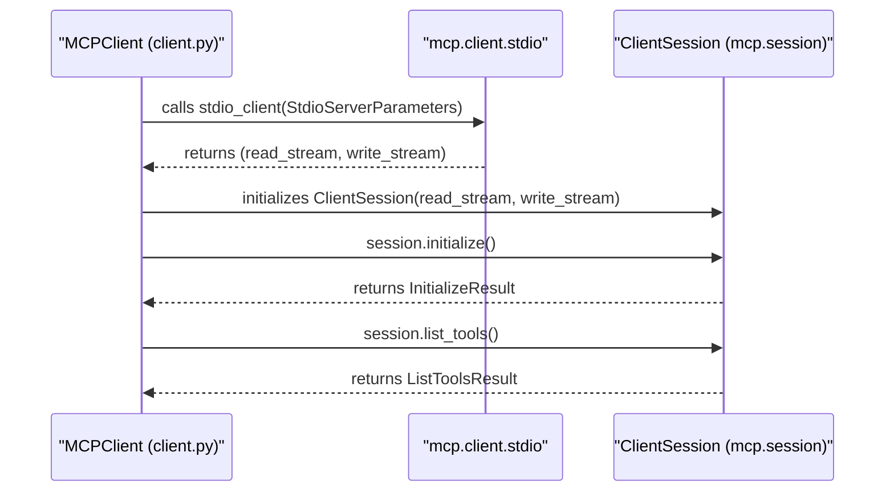
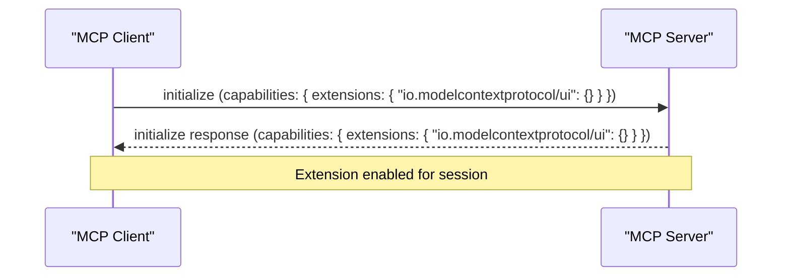

<!-- source: DeepWiki mcp.deepwiki.com · repo modelcontextprotocol/modelcontextprotocol · page 4 Client Ecosystem · fetched 2026-10-21 -->

# Client Ecosystem

<details>
<summary>Relevant source files</summary>

The following files were used as context for generating this wiki page:

- [blog/content/posts/2026-01-26-mcp-apps.md](blog/content/posts/2026-01-26-mcp-apps.md)
- [docs/community/sdk-tiers.mdx](docs/community/sdk-tiers.mdx)
- [docs/docs/develop/build-client.mdx](docs/docs/develop/build-client.mdx)
- [docs/docs/develop/build-server.mdx](docs/docs/develop/build-server.mdx)
- [docs/docs/develop/build-with-agent-skills.mdx](docs/docs/develop/build-with-agent-skills.mdx)
- [docs/docs/getting-started/intro.mdx](docs/docs/getting-started/intro.mdx)
- [docs/docs/learn/architecture.mdx](docs/docs/learn/architecture.mdx)
- [docs/docs/learn/client-concepts.mdx](docs/docs/learn/client-concepts.mdx)
- [docs/docs/learn/server-concepts.mdx](docs/docs/learn/server-concepts.mdx)
- [docs/docs/sdk.mdx](docs/docs/sdk.mdx)
- [docs/docs/tools/debugging.mdx](docs/docs/tools/debugging.mdx)
- [docs/extensions/apps/build.mdx](docs/extensions/apps/build.mdx)
- [docs/extensions/apps/overview.mdx](docs/extensions/apps/overview.mdx)
- [docs/extensions/auth/oauth-client-credentials.mdx](docs/extensions/auth/oauth-client-credentials.mdx)
- [docs/extensions/auth/overview.mdx](docs/extensions/auth/overview.mdx)
- [docs/extensions/client-matrix.mdx](docs/extensions/client-matrix.mdx)
- [docs/extensions/overview.mdx](docs/extensions/overview.mdx)
- [docs/extensions/tasks/overview.mdx](docs/extensions/tasks/overview.mdx)

</details>


This page documents the MCP client ecosystem: the applications that integrate with MCP servers to expose tools, resources, prompts, and other capabilities to users and AI models. The ecosystem includes desktop applications, IDE extensions, web platforms, CLI tools, and specialized frameworks. For details about the MCP protocol features themselves, see [Protocol Specification](#2).

## Core Client Concepts

MCP clients are instantiated by **host applications** to communicate with particular MCP servers. The host application (e.g., Claude.ai or an IDE) manages the overall user experience and coordinates multiple clients. Each client handles one direct communication with one server.

[docs/docs/learn/client-concepts.mdx:6-9]()

### Client-Server Participants
The MCP architecture involves three key participants:
- **MCP Host**: The AI application that coordinates and manages one or multiple MCP clients.
- **MCP Client**: A component that maintains a connection to an MCP server and obtains context for the host.
- **MCP Server**: A program that provides context (tools, resources, prompts) to clients.

[docs/docs/learn/architecture.mdx:35-40]()

### Participant Interaction
```mermaid
graph TB
    subgraph "MCP Host (AI Application)"
        [Client1] -- "Dedicated connection" --- [ServerA]
        [Client2] -- "Dedicated connection" --- [ServerB]
        [Client3] -- "Dedicated connection" --- [ServerC]
        [Client4] -- "Dedicated connection" --- [ServerC]
    end

    [ServerA] ["MCP Server A - Local (stdio)"]
    [ServerB] ["MCP Server B - Local (stdio)"]
    [ServerC] ["MCP Server C - Remote (Streamable HTTP)"]
```
Sources: [docs/docs/learn/architecture.mdx:44-61]()

## Client Feature Support

The MCP client ecosystem exhibits a power law distribution in feature adoption. While `Tools` represent the baseline value proposition, advanced features and extensions allow for richer interactions.

| Feature | Explanation | Example |
| :--- | :--- | :--- |
| **Elicitation** | Servers request specific information from users during interactions. | A travel server asking for seat preferences. |
| **Roots** | Clients specify filesystem boundaries for server focus. | Giving a server access to a specific workspace directory. |
| **Sampling** | Servers request LLM completions through the client (agentic workflow). | A server asking the LLM to pick the best flight from a list. |
| **Apps** | Interactive HTML interfaces rendered inline in the conversation. | A dashboard or interactive chart returned by a tool. |
| **Tasks** | Asynchronous execution for long-running operations. | A CI pipeline or batch process returning a durable handle. |

For details, see [Client Directory and Feature Matrix](#4.1).

Sources: [docs/docs/learn/client-concepts.mdx:14-18](), [docs/extensions/client-matrix.mdx:26-31](), [docs/extensions/tasks/overview.mdx:17-21]()

## Client SDK Ecosystem

Official SDKs are classified into tiers based on feature completeness, protocol support, and maintenance commitment. This system helps developers choose the right SDK for building clients.

| Tier | Status | Requirement |
| :--- | :--- | :--- |
| **Tier 1** | Fully Supported | 100% conformance test pass rate, comprehensive documentation. |
| **Tier 2** | Actively Maintained | 80% conformance test pass rate, basic documentation. |
| **Tier 3** | Experimental | No minimum conformance requirement, partially implemented. |

### SDK Availability
- **Tier 1**: TypeScript, Python, C#, Go.
- **Tier 2**: Java, Rust.
- **Tier 3**: Swift, Ruby, PHP, Kotlin.

Sources: [docs/docs/sdk.mdx:10-21](), [docs/community/sdk-tiers.mdx:33-42]()

## Notable Client Implementations

### Desktop Applications
- **Claude Desktop**: Supports local MCP servers via `stdio` transport. [docs/docs/develop/build-server.mdx:6-7]()
- **Goose**: An open-source AI agent with built-in support for MCP Apps. [blog/content/posts/2026-01-26-mcp-apps.md:166-166]()

### IDE Extensions
- **Visual Studio Code**: Supports MCP Apps in Insiders builds and integrates MCP servers via GitHub Copilot. [docs/extensions/client-matrix.mdx:38-38]()
- **Cursor**: Supports MCP tools in Cursor Composer and interactive extensions. [docs/extensions/client-matrix.mdx:44-44]()

### Web Platforms
- **Claude.ai**: Supports remote MCP servers via Streamable HTTP and renders MCP Apps. [blog/content/posts/2026-01-26-mcp-apps.md:165-165]()
- **ChatGPT**: Supports remote MCP servers and interactive UI components. [blog/content/posts/2026-01-26-mcp-apps.md:169-169]()
- **Microsoft 365 Copilot**: Supports MCP Apps for interactive conversation interfaces. [docs/extensions/client-matrix.mdx:39-39]()

## Client Integration Patterns

Clients typically connect to servers using one of two transport layers:
1. **Stdio Transport**: Used for local processes. The client spawns the server as a child process and communicates via standard input/output. [docs/docs/learn/architecture.mdx:97-98]()
2. **Streamable HTTP Transport**: Used for remote servers. The client communicates via HTTP POST for requests and receives updates via Server-Sent Events (SSE). [docs/docs/learn/architecture.mdx:99-99]()

### Code Entity Bridge: Python Client Implementation
This diagram maps the natural language "Connect to Server" flow to the specific classes and methods used in the `mcp-python-sdk`.


Sources: [docs/docs/develop/build-client.mdx:114-156]()

### Extension Negotiation
Clients and servers negotiate capabilities during the initialization handshake. Extensions like `io.modelcontextprotocol/ui` (Apps) or `io.modelcontextprotocol/tasks` (Tasks) are opt-in.


Sources: [docs/extensions/client-matrix.mdx:16-17](), [docs/extensions/tasks/overview.mdx:50-52]()

For details on configuration and environment setup, see [Client Integration Patterns](#4.2).

---

