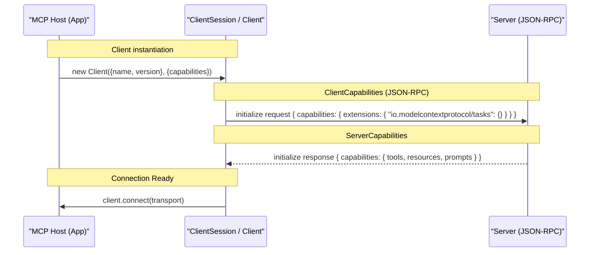
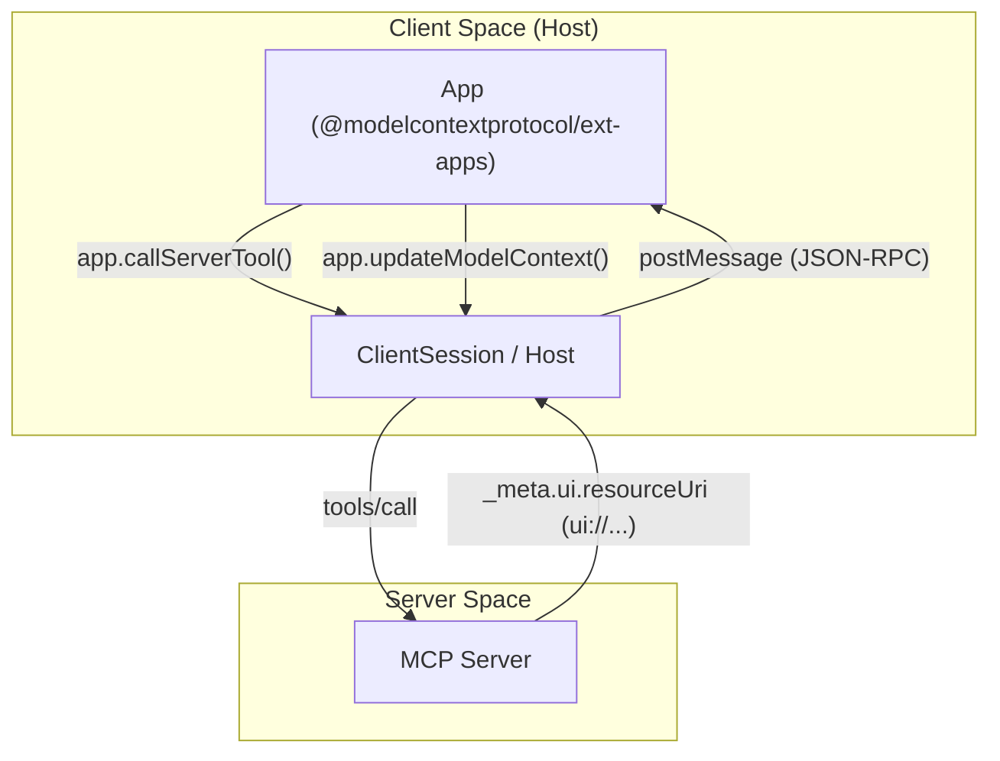

<!-- source: DeepWiki mcp.deepwiki.com · repo modelcontextprotocol/modelcontextprotocol · page 4.1 Client Directory and Feature Matrix · fetched 2026-10-21 -->

# Client Directory and Feature Matrix

Relevant source files

The following files were used as context for generating this wiki page:

- [blog/content/posts/2026-01-26-mcp-apps.md](blog/content/posts/2026-01-26-mcp-apps.md)
- [docs/community/sdk-tiers.mdx](docs/community/sdk-tiers.mdx)
- [docs/docs/getting-started/intro.mdx](docs/docs/getting-started/intro.mdx)
- [docs/docs/tools/debugging.mdx](docs/docs/tools/debugging.mdx)
- [docs/extensions/apps/build.mdx](docs/extensions/apps/build.mdx)
- [docs/extensions/apps/overview.mdx](docs/extensions/apps/overview.mdx)
- [docs/extensions/auth/oauth-client-credentials.mdx](docs/extensions/auth/oauth-client-credentials.mdx)
- [docs/extensions/auth/overview.mdx](docs/extensions/auth/overview.mdx)
- [docs/extensions/client-matrix.mdx](docs/extensions/client-matrix.mdx)
- [docs/extensions/overview.mdx](docs/extensions/overview.mdx)
- [docs/extensions/tasks/overview.mdx](docs/extensions/tasks/overview.mdx)

## Purpose and Scope

This page catalogs known MCP client implementations and documents their supported features through a standardized feature matrix. It serves as a technical reference for understanding which MCP capabilities (Resources, Prompts, Tools, Sampling, Tasks, etc.) each client supports. This directory enables users to identify compatible clients for their specific infrastructure and allows developers to understand the implementation landscape of the Model Context Protocol.

For integration guides, see [Client Integration Patterns](4.2). For protocol message details, see [Protocol Specification](2).

## Feature Categories and Badge System

The MCP ecosystem uses a standardized badge system to categorize client support levels. These features are defined in the documentation and implemented via capability negotiation during the protocol handshake [docs/community/sdk-tiers.mdx:23-26]().

| Feature Category | Features | Color | Purpose |
|:---|:---|:---|:---|
| **Server Features** | Resources, Prompts, Tools | Blue | Core server-provided primitives consumed by the client. |
| **Client Features** | Sampling, Roots, Elicitation | Green | Capabilities provided by the client that servers can request. |
| **Discovery** | Discovery, Instructions | Purple | Dynamic capability updates and LLM guidance. |
| **Authorization** | CIMD, DCR | Yellow | Identity and registration mechanisms (OAuth 2.1). |
| **Advanced** | Tasks, Apps | Orange | Long-running operations and interactive UI extensions. |

### Feature Definitions in Code
*   **Sampling**: Allows servers to request LLM completions through the client, placing the client in control of security [docs/community/sdk-tiers.mdx:23-24]().
*   **Roots**: Defines filesystem boundaries (using `file://` URIs) for server operations.
*   **Elicitation**: Enables servers to request specific information from users via structured JSON schemas [docs/community/sdk-tiers.mdx:23-24]().
*   **MCP Apps**: An official extension (`io.modelcontextprotocol/ui`) allowing tools to return interactive HTML interfaces [docs/extensions/client-matrix.mdx:28-28]().
*   **Tasks**: An experimental extension (`io.modelcontextprotocol/tasks`) for long-running operations with polling and mid-flight input [docs/extensions/tasks/overview.mdx:50-58]().

## Client Capability Negotiation

When an MCP client connects to a server, it must perform an initialization handshake. The client declares its supported features within the `ClientCapabilities` object. For extensions, both client and server must declare support in the `extensions` field during this handshake [docs/extensions/overview.mdx:116-118]().

### Handshake Data Flow
The following diagram maps the natural language "Capability Negotiation" to the specific code entities and message flow used during connection establishment.

**Handshake and Capability Mapping**

Sources: [docs/extensions/overview.mdx:116-133](), [docs/extensions/tasks/overview.mdx:158-170](), [docs/extensions/auth/oauth-client-credentials.mdx:195-217]()

## Support Matrix: Official Extensions

Beyond core protocol features, clients are increasingly adopting official extensions. Support is tracked for `MCP Apps` and `OAuth` variations. Extensions are always opt-in [docs/extensions/client-matrix.mdx:16-16]().

| Client | [MCP Apps](https://apps.extensions.modelcontextprotocol.io) (`ui`) | [OAuth Client Credentials](https://github.com/modelcontextprotocol/ext-auth) | [Enterprise Auth](https://github.com/modelcontextprotocol/ext-auth) |
|:---|:---:|:---:|:---:|
| Claude (Web & Desktop) | ✅ | | |
| VS Code GitHub Copilot | ✅ | | |
| Microsoft 365 Copilot | ✅ | | |
| ChatGPT | ✅ | | |
| Cursor | ✅ | | |
| Goose | ✅ | | |
| Postman | ✅ | | |
| MCPJam | ✅ | | |
| Archestra.AI | ✅ | | ✅ |
| PostHog Code | ✅ | | |

Sources: [docs/extensions/client-matrix.mdx:34-47](), [blog/content/posts/2026-01-26-mcp-apps.md:163-170]()

## Notable Client Implementations

### AI Assistants and IDEs
*   **Claude Desktop**: A primary host for local MCP servers. It supports Tools, Resources, Prompts, and the `MCP Apps` extension [blog/content/posts/2026-01-26-mcp-apps.md:165-165](). It uses the `stdio` transport for local servers [docs/docs/tools/debugging.mdx:92-94]().
*   **VS Code**: Supports `MCP Apps` in Insiders builds [blog/content/posts/2026-01-26-mcp-apps.md:167-168]().
*   **Goose**: An open-source agent supporting `MCP Apps` and providing tutorials for building them [blog/content/posts/2026-01-26-mcp-apps.md:166-166]().

### Frameworks as Clients
*   **SDK-based Clients**: Developers can build custom clients using Tier 1 SDKs. For example, the TypeScript SDK provides `ClientCredentialsProvider` for automated auth [docs/extensions/auth/oauth-client-credentials.mdx:202-205]().

## Technical Implementation: MCP Apps

The `MCP Apps` feature is the first official extension to move beyond text-based interaction. It utilizes the `ui://` URI scheme and a `_meta.ui.resourceUri` field in tool descriptions [blog/content/posts/2026-01-26-mcp-apps.md:62-68]().

### App Communication Flow
This diagram associates the UI interaction with the underlying protocol methods and classes.

**MCP App Interaction Model**

Sources: [blog/content/posts/2026-01-26-mcp-apps.md:64-84](), [blog/content/posts/2026-01-26-mcp-apps.md:109-129](), [docs/extensions/apps/overview.mdx:77-96]()

## SDK Tiers and Feature Completeness

The level of feature support in a client often depends on the underlying SDK tier. Tier 1 SDKs are fully supported with complete protocol implementation [docs/community/sdk-tiers.mdx:23-24]().

| Tier | Conformance Requirement | Feature Support |
|:---|:---|:---|
| **Tier 1** | 100% Pass Rate | Full protocol including optional capabilities like Sampling and Elicitation. |
| **Tier 2** | 80% Pass Rate | Actively maintained, working toward full specification support. |
| **Tier 3** | No Minimum | Experimental, partially implemented, or specialized. |

Sources: [docs/community/sdk-tiers.mdx:33-42](), [docs/community/sdk-tiers.mdx:65-67]()

## Summary of Client Transports

Clients connect to servers using two primary transport layers:

1.  **Stdio Transport**: Standard for local desktop integrations (Claude Desktop, IDEs). Logs to `stderr` are captured for debugging [docs/docs/tools/debugging.mdx:31-34]().
2.  **Streamable HTTP Transport**: Used for remote/web integrations. Supports `Mcp-Session-Id` headers and Server-Sent Events (SSE) [docs/docs/tools/debugging.mdx:43-49]().

Sources: [docs/docs/tools/debugging.mdx:20-22](), [docs/docs/tools/debugging.mdx:43-49]()

---

