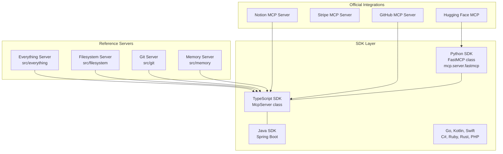
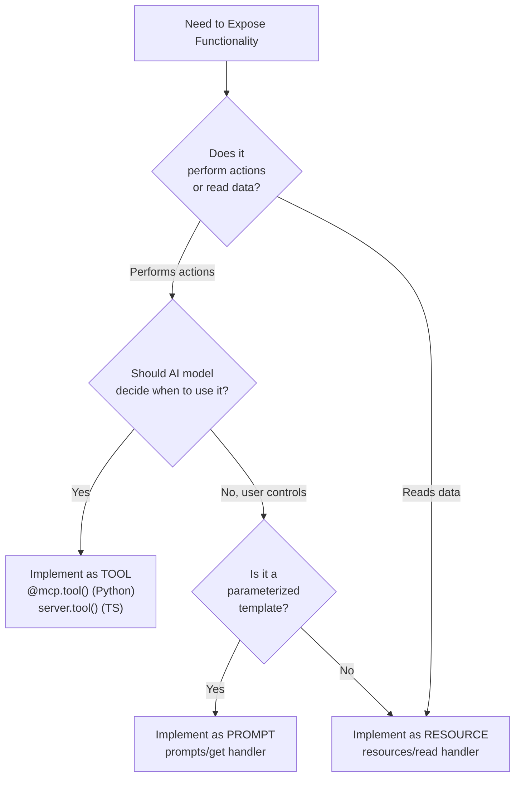

<!-- source: DeepWiki mcp.deepwiki.com · repo modelcontextprotocol/modelcontextprotocol · page 5 Server Development · fetched 2026-10-21 -->

# Server Development

<details>
<summary>Relevant source files</summary>

The following files were used as context for generating this wiki page:

- [docs/docs/develop/build-client.mdx](docs/docs/develop/build-client.mdx)
- [docs/docs/develop/build-server.mdx](docs/docs/develop/build-server.mdx)
- [docs/docs/develop/build-with-agent-skills.mdx](docs/docs/develop/build-with-agent-skills.mdx)
- [docs/docs/learn/architecture.mdx](docs/docs/learn/architecture.mdx)
- [docs/docs/learn/client-concepts.mdx](docs/docs/learn/client-concepts.mdx)
- [docs/docs/learn/server-concepts.mdx](docs/docs/learn/server-concepts.mdx)
- [docs/docs/sdk.mdx](docs/docs/sdk.mdx)
- [docs/examples.mdx](docs/examples.mdx)

</details>


MCP servers are lightweight, domain-focused programs that expose specific capabilities—tools, resources, and prompts—to AI applications through a standardized protocol. This page introduces the server development ecosystem, the philosophy of composable servers, and guides you to detailed implementation resources.

The MCP server ecosystem has grown significantly, with thousands of servers available in the community alongside official integrations from companies like Notion, Stripe, GitHub, Hugging Face, and Postman.

For client-side development, see [Client Ecosystem](#4).

## Server Development Philosophy

MCP servers follow a **domain-focused, composable** design philosophy:

*   **Domain-Focused**: Each server specializes in a specific domain or service rather than attempting to provide general-purpose functionality. For example, a weather server focuses solely on weather data [docs/docs/develop/build-server.mdx:10-10](), while a filesystem server provides file operations within specified boundaries [docs/docs/develop/build-server.mdx:26-26]().
*   **Composable**: Servers are designed to work together, allowing AI applications to combine multiple specialized servers to accomplish complex tasks. A host application coordinates multiple clients, each handling one direct communication with one server [docs/docs/learn/client-concepts.mdx:6-8]().

This approach reduces complexity, improves maintainability, and enables rapid ecosystem growth through specialization.

## The MCP Server Ecosystem

The server ecosystem consists of reference implementations, official integrations, and community servers.

**Server Ecosystem Structure:**



**Sources:** [docs/examples.mdx:8-34](), [docs/docs/sdk.mdx:10-21](), [docs/docs/develop/build-server.mdx:145-148]()

### Reference Servers

Official examples demonstrating protocol features and best practices. These servers serve as learning resources and SDK usage examples:

| Server | Purpose | SDK |
|--------|---------|-----|
| **Everything** | Reference server with prompts, resources, and tools | TypeScript |
| **Fetch** | Web content fetching and markdown conversion | TypeScript |
| **Filesystem** | Secure file operations with configurable access controls | TypeScript |
| **Git** | Tools to read, search, and manipulate Git repositories | TypeScript |
| **Memory** | Knowledge graph-based persistent memory system | TypeScript |
| **Sequential Thinking** | Dynamic problem-solving through thought sequences | TypeScript |
| **Time** | Time and timezone conversion capabilities | TypeScript |

See [Reference Server Implementations](#5.2) for detailed documentation.

**Sources:** [docs/examples.mdx:10-21]()

## Server Capabilities Overview

MCP servers provide functionality through three main building blocks [docs/docs/learn/server-concepts.mdx:12-18]():

| Feature | Control | Explanation | Example |
| :--- | :--- | :--- | :--- |
| **Tools** | Model | Functions the LLM can actively call to perform actions. | `searchFlights`, `sendEmail` |
| **Resources** | Application | Passive data sources providing read-only context. | `file:///docs/api.md`, `calendar://events` |
| **Prompts** | User | Pre-built instruction templates for specific tasks. | "Plan a vacation", "Summarize meetings" |

**Capability Decision Flow:**



For detailed capability implementation, see [Server Capabilities Deep Dive](#5.3).

**Sources:** [docs/docs/learn/server-concepts.mdx:12-18](), [docs/docs/develop/build-server.mdx:191-191]()

## Building Your First Server

### SDK Selection

MCP provides official SDKs in multiple languages, classified into tiers based on feature completeness [docs/docs/sdk.mdx:6-6]():

*   **Tier 1 (Core)**: TypeScript, Python, C#, Go [docs/docs/sdk.mdx:12-15]()
*   **Tier 2**: Java, Rust [docs/docs/sdk.mdx:16-17]()
*   **Tier 3**: Swift, Ruby, PHP, Kotlin [docs/docs/sdk.mdx:18-21]()

### Development Workflow

The typical server development process involves initializing the project, defining capabilities, and implementing handlers. Modern tools like **Agent Skills** (e.g., `build-mcp-server`) can guide AI coding assistants through design and implementation [docs/docs/develop/build-with-agent-skills.mdx:13-21]().

**Example: Weather Server Implementation (Python FastMCP)**

```python
# Initialize FastMCP server
from mcp.server.fastmcp import FastMCP
mcp = FastMCP("weather")

@mcp.tool()
async def get_forecast(latitude: float, longitude: float) -> str:
    """Get weather forecast for a location."""
    # Implementation logic here...
    return "Sunny"
```
[docs/docs/develop/build-server.mdx:145-212]()

See [Building MCP Servers](#5.1) for complete quickstart tutorials.

## Server Execution and Deployment

### Deployment Paths

Based on the use case, several deployment models are available:

| Path | Transport | Best For |
| :--- | :--- | :--- |
| **Local stdio** | `stdio` | Prototyping and local-only access (files, local processes) [docs/docs/develop/build-with-agent-skills.mdx:80-82](). |
| **MCP Bundles (MCPB)** | `stdio` | Distributing local servers with runtimes as single archives [docs/docs/develop/build-with-agent-skills.mdx:74-79](). |
| **Remote HTTP** | `Streamable HTTP` | Cloud APIs, OAuth flows, and multi-user deployments [docs/docs/develop/build-with-agent-skills.mdx:62-66](). |
| **MCP Apps** | `Streamable HTTP` | Servers requiring rich UI widgets in chat [docs/docs/develop/build-with-agent-skills.mdx:68-72](). |

### Critical Rule for STDIO
STDIO-based servers must **never** write to `stdout` for logging, as this corrupts JSON-RPC messages. Use `stderr` instead [docs/docs/develop/build-server.mdx:48-49]().

**Configuration Example (`claude_desktop_config.json`):**
```json
{
  "mcpServers": {
    "filesystem": {
      "command": "npx",
      "args": ["-y", "@modelcontextprotocol/server-filesystem", "/path/to/data"]
    }
  }
}
```
[docs/examples.mdx:61-85]()

## Testing and Debugging

### MCP Inspector

The [MCP Inspector](https://github.com/modelcontextprotocol/inspector) is the primary interactive tool for testing servers [docs/docs/learn/architecture.mdx:19-19]().

**Usage:**
```bash
npx @modelcontextprotocol/inspector <command> <args>
```

### Debugging in Claude Desktop

Claude Desktop provides logs for troubleshooting MCP connections:
*   **macOS**: `~/Library/Logs/Claude/mcp*.log`
*   **Windows**: `%APPDATA%\Claude\logs\mcp*.log`

Common issues include incorrect working directories, missing environment variables, and protocol version mismatches.

## Child Pages

*   [Building MCP Servers](#5.1) — Step-by-step guide to creating MCP servers, including quickstart tutorials and transport selection.
*   [Reference Server Implementations](#5.2) — Documentation of official reference servers as implementation examples.
*   [Server Capabilities Deep Dive](#5.3) — Detailed patterns for implementing Tools, Resources, Prompts, and Logging.
*   [Server Registry and Discovery](#5.4) — How to publish and discover servers in the MCP ecosystem.

**Sources:** [docs/docs/develop/build-server.mdx:1-400](), [docs/docs/learn/architecture.mdx:1-115](), [docs/docs/develop/build-with-agent-skills.mdx:6-83](), [docs/docs/sdk.mdx:1-51](), [docs/examples.mdx:1-92]()

---

