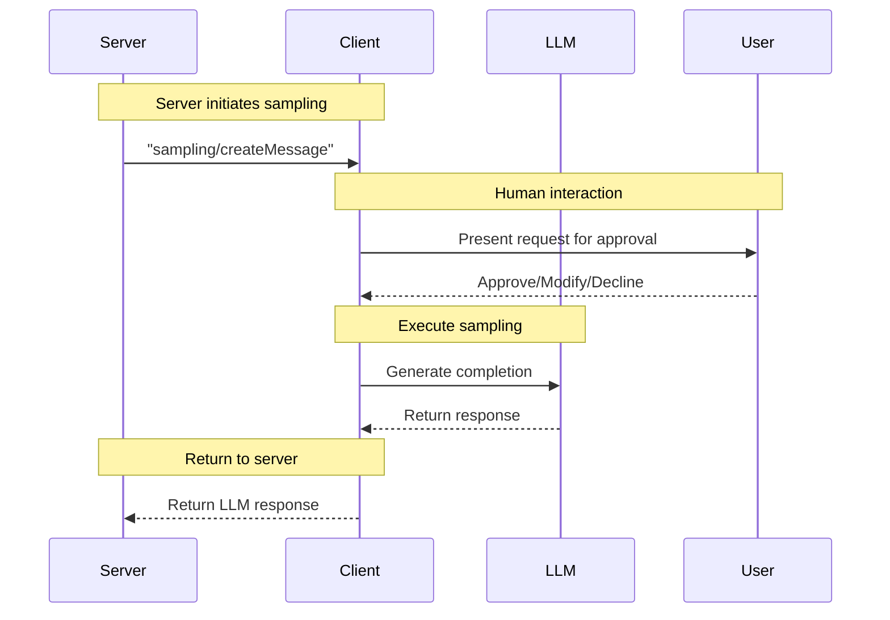
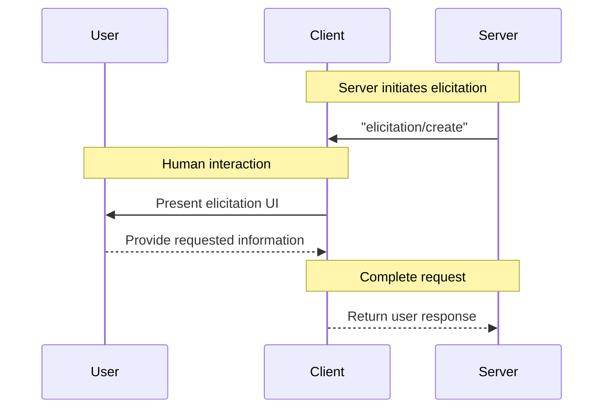

<!-- source: DeepWiki mcp.deepwiki.com · repo modelcontextprotocol/modelcontextprotocol · page 5.1 Building MCP Servers · fetched 2026-10-21 -->

# Building MCP Servers

<details>
<summary>Relevant source files</summary>

The following files were used as context for generating this wiki page:

- [docs/docs/develop/build-client.mdx](docs/docs/develop/build-client.mdx)
- [docs/docs/develop/build-server.mdx](docs/docs/develop/build-server.mdx)
- [docs/docs/develop/build-with-agent-skills.mdx](docs/docs/develop/build-with-agent-skills.mdx)
- [docs/docs/develop/connect-local-servers.mdx](docs/docs/develop/connect-local-servers.mdx)
- [docs/docs/develop/connect-remote-servers.mdx](docs/docs/develop/connect-remote-servers.mdx)
- [docs/docs/learn/architecture.mdx](docs/docs/learn/architecture.mdx)
- [docs/docs/learn/client-concepts.mdx](docs/docs/learn/client-concepts.mdx)
- [docs/docs/learn/server-concepts.mdx](docs/docs/learn/server-concepts.mdx)
- [docs/docs/sdk.mdx](docs/docs/sdk.mdx)
- [docs/images/claude-add-files-connectors-and-more.png](docs/images/claude-add-files-connectors-and-more.png)
- [docs/images/claude-desktop-hamburger-menu-icon.png](docs/images/claude-desktop-hamburger-menu-icon.png)
- [docs/images/quickstart-remote/4-select-resources-menu.png](docs/images/quickstart-remote/4-select-resources-menu.png)
- [docs/images/quickstart-remote/5-select-prompts-resources.png](docs/images/quickstart-remote/5-select-prompts-resources.png)
- [docs/images/quickstart-remote/6-configure-tools.png](docs/images/quickstart-remote/6-configure-tools.png)
- [docs/images/quickstart-tools.png](docs/images/quickstart-tools.png)

</details>


This guide covers the practical implementation patterns for building MCP servers. It demonstrates how to register tools, expose resources, define prompts, and handle client feature requests like sampling and elicitation.

For a complete tutorial building a weather server from scratch, see [Build an MCP Server](docs/docs/develop/build-server.mdx:1-4). For conceptual understanding of server capabilities, see [Understanding MCP Servers](docs/docs/learn/server-concepts.mdx:1-9). For SDK-specific APIs, see [SDK Reference](docs/docs/sdk.mdx:1-34).

## Server Implementation Overview

Building an MCP server involves implementing handlers for three core server capabilities and optionally supporting client features. The implementation pattern varies by SDK but follows the same conceptual flow.

### Implementation Flow Diagram

Title: MCP Server Lifecycle and Registration Flow
```mermaid
graph TB
    [START]("Initialize Server Instance")
    [REGISTER]("Register Capabilities")
    [TRANSPORT]("Configure Transport")
    [RUN]("Start Server")
    [HANDLE]("Handle Client Requests")
    
    [START] --> [REGISTER]
    [REGISTER] --> [TOOLS]("Register Tools<br/>@mcp.tool() or server.tool()")
    [REGISTER] --> [RESOURCES]("Register Resources<br/>server.resource() or handlers")
    [REGISTER] --> [PROMPTS]("Register Prompts<br/>server.prompt() or handlers")
    [TOOLS] --> [TRANSPORT]
    [RESOURCES] --> [TRANSPORT]
    [PROMPTS] --> [TRANSPORT]
    [TRANSPORT] --> [STDIO]("stdio transport<br/>StdioServerTransport")
    [TRANSPORT] --> [HTTP]("HTTP transport<br/>Streamable HTTP")
    [STDIO] --> [RUN]
    [HTTP] --> [RUN]
    [RUN] --> [HANDLE]
    [HANDLE] --> [TOOLCALL]("tools/call")
    [HANDLE] --> [RESREAD]("resources/read")
    [HANDLE] --> [PROMPTGET]("prompts/get")
```

**Code Entity Mapping:**

| Concept | TypeScript SDK | Python SDK | Java SDK |
|---------|---------------|------------|----------|
| Server Instance | `McpServer` or `Server` | `FastMCP` [docs/docs/develop/build-server.mdx:145-148]() | `McpServer` |
| Tool Registration | `server.tool()` | `@mcp.tool()` [docs/docs/develop/build-server.mdx:191-192]() | `McpServer.addTool()` |
| Resource Registration | `server.resource()` | `server.add_resource()` | `McpServer.addResource()` |
| Prompt Registration | `server.prompt()` | `server.add_prompt()` | `McpServer.addPrompt()` |
| stdio Transport | `StdioServerTransport` | `stdio_client` [docs/docs/develop/build-client.mdx:107-107]() | `StdioServerTransport` |

Sources: [docs/docs/develop/build-server.mdx:138-156](), [docs/docs/develop/build-client.mdx:101-121](), [docs/docs/sdk.mdx:8-21]()

## Registering Tools

Tools are the primary mechanism for MCP servers to expose executable functionality to clients. Tool registration involves defining the tool's input schema and implementing its execution logic.

### Python Tool Registration Pattern

The Python SDK provides the `FastMCP` class which uses Python type hints and docstrings to automatically generate tool definitions [docs/docs/develop/build-server.mdx:155-156]().

```python
# Using FastMCP decorator pattern
from mcp.server.fastmcp import FastMCP

mcp = FastMCP("weather")

@mcp.tool()
async def get_forecast(latitude: float, longitude: float) -> str:
    """Get weather forecast for a location.
    
    Args:
        latitude: Latitude of the location
        longitude: Longitude of the location
    """
    # Tool implementation
    return forecast_data
```

The `@mcp.tool()` decorator automatically:
- Extracts the input schema from type hints [docs/docs/develop/build-server.mdx:155-156]().
- Uses the docstring for tool description [docs/docs/develop/build-server.mdx:155-156]().
- Registers the tool with the server [docs/docs/develop/build-server.mdx:191-192]().

Sources: [docs/docs/develop/build-server.mdx:145-156](), [docs/docs/develop/build-server.mdx:191-197]()

### Tool Result Format

Tools enable AI models to perform actions. Each tool defines a specific operation with typed inputs and outputs [docs/docs/learn/server-concepts.mdx:24-25](). MCP uses JSON Schema for validation [docs/docs/learn/server-concepts.mdx:28-29]().

**Protocol operations:**

| Method | Purpose | Returns |
| :--- | :--- | :--- |
| `tools/list` | Discover available tools | Array of tool definitions with schemas [docs/docs/learn/server-concepts.mdx:34-34]() |
| `tools/call` | Execute a specific tool | Tool execution result [docs/docs/learn/server-concepts.mdx:35-35]() |

Sources: [docs/docs/learn/server-concepts.mdx:32-35]()

## Exposing Resources

Resources provide read-only access to data sources. Applications can access this information directly and decide how to use it [docs/docs/learn/server-concepts.mdx:99-101]().

### Resource Interaction and Data Flow

Title: Resource Interaction and Data Flow
```mermaid
sequenceDiagram
    participant Client
    participant Server
    participant DataSource["Data Source<br/>(File, DB, API)"]
    
    Note over Client,Server: Resource Discovery
    Client->>Server: "resources/list"
    Server-->>Client: "List of resource URIs"
    
    Note over Client,Server: Resource Access
    Client->>Server: "resources/read {uri}"
    Server->>DataSource: "Fetch data"
    DataSource-->>Server: "Raw data"
    Server->>Server: "Format with MIME type"
    Server-->>Client: "Resource content + metadata"
    
    Note over Client,Server: Change Notifications (Optional)
    Client->>Server: "resources/subscribe {uri}"
    Server-->>Client: "Subscription confirmed"
    DataSource-->>Server: "Data changed"
    Server->>Client: "resources/updated notification"
```

### Resource Discovery Patterns

Resources support two discovery patterns [docs/docs/learn/server-concepts.mdx:104-105]():
- **Direct Resources**: Fixed URIs pointing to specific data (e.g., `calendar://events/2024`) [docs/docs/learn/server-concepts.mdx:106-106]().
- **Resource Templates**: Dynamic URIs with parameters for flexible queries (e.g., `travel://activities/{city}/{category}`) [docs/docs/learn/server-concepts.mdx:107-108]().

Sources: [docs/docs/learn/server-concepts.mdx:104-110](), [docs/docs/learn/server-concepts.mdx:115-120]()

## Defining Prompts

Prompts are pre-built instruction templates that tell the model to work with specific tools and resources [docs/docs/learn/server-concepts.mdx:18-18]().

### Prompt Structure and Generation

Title: Prompt Template Resolution
```mermaid
graph TB
    [DEFINE]("Define Prompt Template")
    [ARGS]("Specify Arguments<br/>(name, type, description)")
    [REGISTER]("Register with Server<br/>server.prompt()")
    
    [CLIENT_REQUEST]("Client: prompts/get")
    [VALIDATE]("Validate Arguments")
    [GENERATE]("Generate Messages")
    [RETURN]("Return Message Array")
    
    [DEFINE] --> [ARGS]
    [ARGS] --> [REGISTER]
    
    [CLIENT_REQUEST] --> [VALIDATE]
    [VALIDATE] --> [GENERATE]
    [GENERATE] --> [RETURN]
```

Sources: [docs/docs/learn/server-concepts.mdx:18-18](), [docs/docs/learn/architecture.mdx:87-90]()

## Handling Client Features

MCP clients can provide features to servers to build richer interactions [docs/docs/learn/client-concepts.mdx:10-12]().

### Sampling: Requesting LLM Completions

Sampling allows servers to request LLM completions through the client, enabling an agentic workflow [docs/docs/learn/client-concepts.mdx:18-18]().

Title: Sampling Request and Approval Flow


Sources: [docs/docs/learn/client-concepts.mdx:18-18](), [docs/docs/learn/architecture.mdx:89-89]()

### Elicitation: Requesting User Input

Elicitation enables servers to request specific information from users during interactions [docs/docs/learn/client-concepts.mdx:16-16]().

Title: Elicitation Information Gathering


Sources: [docs/docs/learn/client-concepts.mdx:30-47]()

## Transport Layer Selection

MCP supports two transport mechanisms [docs/docs/learn/architecture.mdx:96-97]():

| Transport | Use Case | Characteristics |
| :--- | :--- | :--- |
| **Stdio** | Local processes | Direct process communication via stdin/stdout [docs/docs/learn/architecture.mdx:98-98](). |
| **Streamable HTTP** | Remote servers | Uses HTTP POST for messages and SSE for streaming [docs/docs/learn/architecture.mdx:99-99](). |

### Critical Stdio Logging Rule
When implementing Stdio-based servers, **never write to stdout**. Writing to stdout will corrupt the JSON-RPC messages and break your server [docs/docs/develop/build-server.mdx:48-49](). Use `sys.stderr` or a logging library [docs/docs/develop/build-server.mdx:49-54]().

Sources: [docs/docs/learn/architecture.mdx:96-101](), [docs/docs/develop/build-server.mdx:45-70]()

## Deployment and Connectivity

### Local vs. Remote Deployment
Servers can be deployed locally or remotely. Local servers typically use the `stdio` transport and are launched by the host application [docs/docs/learn/architecture.mdx:63-68](). Remote servers use `Streamable HTTP` and allow multiple clients to connect over the internet [docs/docs/learn/architecture.mdx:33-33]().

### Connecting to Clients
- **Claude Desktop**: Configuration is handled via `claude_desktop_config.json` [docs/docs/develop/connect-local-servers.mdx:82-86]().
- **Custom Connectors**: Used to bridge Claude to remote MCP servers via a URL [docs/docs/develop/connect-remote-servers.mdx:16-18]().
- **MCP Bundles (MCPB)**: A method to package local servers with their runtime for easier installation [docs/docs/develop/build-with-agent-skills.mdx:74-78]().

Sources: [docs/docs/learn/architecture.mdx:33-71](), [docs/docs/develop/connect-local-servers.mdx:82-90](), [docs/docs/develop/connect-remote-servers.mdx:16-29](), [docs/docs/develop/build-with-agent-skills.mdx:74-78]()

---

