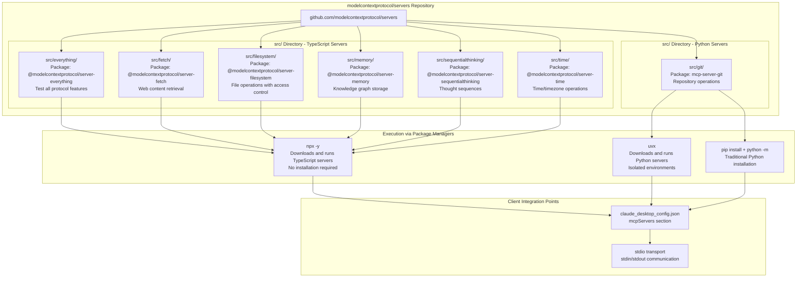
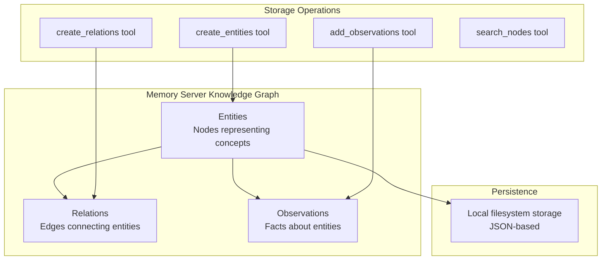
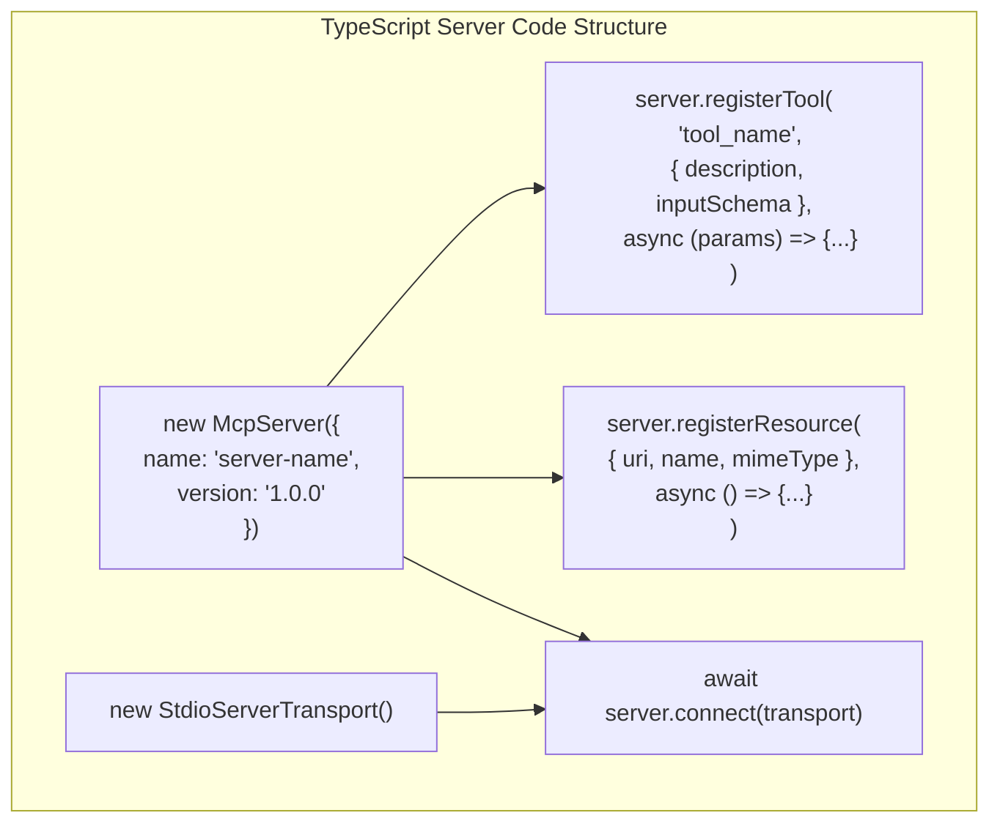
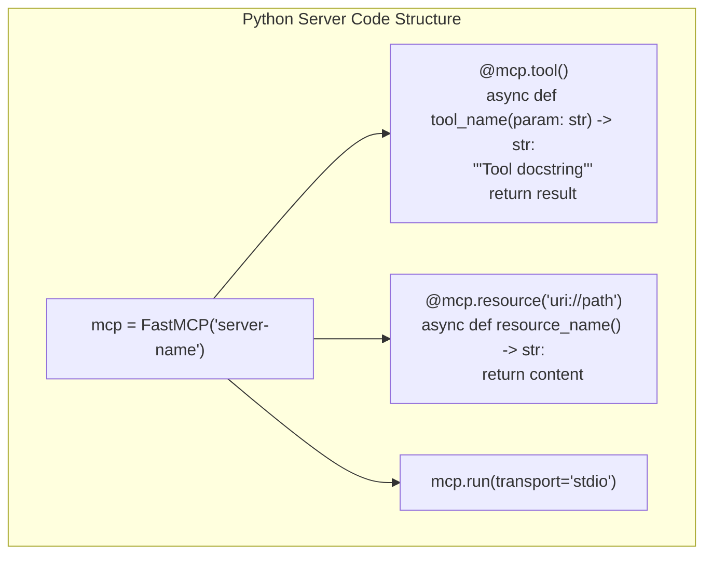

<!-- source: DeepWiki mcp.deepwiki.com · repo modelcontextprotocol/modelcontextprotocol · page 5.2 Reference Server Implementations · fetched 2026-10-21 -->

# Reference Server Implementations

<details>
<summary>Relevant source files</summary>

The following files were used as context for generating this wiki page:

- [docs/docs/develop/build-client.mdx](docs/docs/develop/build-client.mdx)
- [docs/docs/develop/build-server.mdx](docs/docs/develop/build-server.mdx)
- [docs/docs/develop/build-with-agent-skills.mdx](docs/docs/develop/build-with-agent-skills.mdx)
- [docs/docs/learn/architecture.mdx](docs/docs/learn/architecture.mdx)
- [docs/docs/learn/client-concepts.mdx](docs/docs/learn/client-concepts.mdx)
- [docs/docs/learn/server-concepts.mdx](docs/docs/learn/server-concepts.mdx)
- [docs/docs/sdk.mdx](docs/docs/sdk.mdx)
- [docs/examples.mdx](docs/examples.mdx)

</details>


## Purpose and Scope

This document provides comprehensive documentation of the official reference MCP server implementations maintained in the `modelcontextprotocol/servers` repository. These servers demonstrate core MCP features, SDK usage patterns, and best practices for building production-ready servers. Each reference server showcases different aspects of the protocol: tools, resources, prompts, and various integration patterns.

For information about building custom MCP servers, see [Building MCP Servers](#5.1). For initial setup and execution, see [Overview](#1).

**Sources:** [docs/examples.mdx:1-24](), [docs/docs/learn/architecture.mdx:13-21]()

## Reference Server Architecture

The reference servers follow a consistent architectural pattern across TypeScript and Python implementations. Each server provides a focused set of capabilities demonstrating specific MCP features.

**Repository Structure and Package Distribution**



**Sources:** [docs/examples.mdx:8-21](), [docs/examples.mdx:40-55]()

## Server Capability Matrix

The following table summarizes the capabilities exposed by each reference server:

| Server | Tools | Resources | Prompts | Primary Purpose |
|--------|-------|-----------|---------|-----------------|
| Everything | ✅ | ✅ | ✅ | Complete protocol test bed demonstrating all MCP features |
| Fetch | ✅ | ✅ | ❌ | Web content retrieval and conversion for LLM consumption |
| Filesystem | ✅ | ✅ | ❌ | Secure file operations with access control boundaries |
| Git | ✅ | ❌ | ❌ | Repository reading, searching, and manipulation |
| Memory | ✅ | ✅ | ❌ | Knowledge graph-based persistent storage system |
| Sequential Thinking | ✅ | ❌ | ❌ | Dynamic problem-solving through thought sequences |
| Time | ✅ | ❌ | ❌ | Time and timezone conversion operations |

**Sources:** [docs/examples.mdx:12-20](), [docs/docs/learn/server-concepts.mdx:10-18]()

## Everything Server

### Purpose
The Everything server serves as the comprehensive reference implementation and test bed for the MCP protocol. It demonstrates the complete feature set: tools, resources, and prompts in a single server implementation. This server is specifically designed for testing and validation rather than production use.

### Package Information
- **Package:** `@modelcontextprotocol/server-everything`
- **Execution:** `npx -y @modelcontextprotocol/server-everything`

### Capabilities Demonstrated
| Feature Type | What It Demonstrates |
|--------------|---------------------|
| **Tools** | Complete tool registration and execution patterns including input validation |
| **Resources** | Both direct resources and resource templates with URI-based access |
| **Prompts** | Prompt definition with parameter handling and completion |
| **Notifications** | Real-time notification patterns for capability changes |

**Sources:** [docs/examples.mdx:14]()

## Fetch Server

### Purpose
The Fetch server provides web content retrieval and conversion capabilities optimized for LLM consumption. It fetches web pages and converts HTML content into clean, LLM-friendly formats that maximize information density while minimizing token usage.

### Package Information
- **Package:** `@modelcontextprotocol/server-fetch`
- **Execution:** `npx -y @modelcontextprotocol/server-fetch`

### Capabilities
- **Web Fetching Tool**: Retrieves web page content via HTTP/HTTPS.
- **Content Conversion**: Converts HTML to clean markdown or plain text.
- **LLM Optimization**: Strips unnecessary HTML/CSS/JS while preserving semantic content.

**Sources:** [docs/examples.mdx:15]()

## Filesystem Server

### Purpose
The Filesystem server provides secure file operations with configurable access controls. It implements filesystem boundaries (roots) to prevent unauthorized access outside specified directories. This server demonstrates the MCP roots concept and secure file handling patterns.

### Package Information
- **Package:** `@modelcontextprotocol/server-filesystem`
- **Execution:** `npx -y @modelcontextprotocol/server-filesystem /path/to/allowed/files`

### Capabilities
| Tool | Purpose |
|------|---------|
| `read_file` | Read file contents |
| `write_file` | Write content to file |
| `list_directory` | List directory contents |
| `move_file` | Move/rename files |
| `search_files` | Search for files by pattern |
| `get_file_info` | Get file metadata |

### Security Model
The server enforces boundaries by only allowing operations within paths specified during startup. It uses the `file://` URI scheme for resource access.

**Sources:** [docs/examples.mdx:16](), [docs/docs/learn/client-concepts.mdx:106-121]()

## Git Server

### Purpose
The Git server provides comprehensive tools for reading, searching, and manipulating Git repositories. It enables LLMs to inspect repository structure, search commit history, and analyze code changes.

### Package Information
- **Package:** `mcp-server-git`
- **Execution:** `uvx mcp-server-git` or `pip install mcp-server-git`

### Capabilities
- **Repository Reading**: Clone repository, read file contents at specific commits.
- **Commit Analysis**: View commit history, show commit details, generate diffs.
- **Search Functions**: Search commits by message, author, or file changes.

**Sources:** [docs/examples.mdx:17](), [docs/examples.mdx:48-55]()

## Memory Server

### Purpose
The Memory server implements a knowledge graph-based persistent memory system. It allows LLMs to store and retrieve information across sessions, maintaining context and learned facts.

### Package Information
- **Package:** `@modelcontextprotocol/server-memory`
- **Execution:** `npx -y @modelcontextprotocol/server-memory`

### Knowledge Graph Architecture



**Sources:** [docs/examples.mdx:18](), [docs/examples.mdx:43-44]()

## Sequential Thinking Server

### Purpose
The Sequential Thinking server provides dynamic and reflective problem-solving capabilities through structured thought sequences. It enables LLMs to break down complex problems into explicit reasoning steps.

### Package Information
- **Package:** `@modelcontextprotocol/server-sequentialthinking`
- **Execution:** `npx -y @modelcontextprotocol/server-sequentialthinking`

**Sources:** [docs/examples.mdx:19]()

## Time Server

### Purpose
The Time server provides time and timezone conversion capabilities, enabling LLMs to perform temporal calculations and timezone conversions accurately.

### Package Information
- **Package:** `@modelcontextprotocol/server-time`
- **Execution:** `npx -y @modelcontextprotocol/server-time`

**Sources:** [docs/examples.mdx:20]()

## Server Implementation Patterns

**TypeScript Server Implementation Pattern**

The TypeScript SDK provides a high-level `McpServer` class for registering capabilities.



**Python Server Implementation Pattern (FastMCP)**

The Python SDK uses the `FastMCP` class which leverages decorators for capability registration.



**Sources:** [docs/docs/develop/build-server.mdx:144-159](), [docs/docs/develop/build-server.mdx:191-212]()

## Configuration with MCP Clients

### Claude Desktop Integration
Reference servers are configured through the `claude_desktop_config.json` file.

**Configuration file locations:**
- **macOS:** `~/Library/Application Support/Claude/claude_desktop_config.json`
- **Windows:** `%APPDATA%\Claude\claude_desktop_config.json`

#### Multi-Server Example
```json
{
  "mcpServers": {
    "memory": {
      "command": "npx",
      "args": ["-y", "@modelcontextprotocol/server-memory"]
    },
    "filesystem": {
      "command": "npx",
      "args": [
        "-y",
        "@modelcontextprotocol/server-filesystem",
        "/Users/username/Desktop"
      ]
    },
    "git": {
      "command": "uvx",
      "args": ["mcp-server-git"]
    }
  }
}
```

**Sources:** [docs/examples.mdx:58-85]()

## Development and Testing

### Testing with MCP Inspector
The MCP Inspector provides interactive testing of server implementations by establishing a direct connection to the server process.

```bash
# Test a TypeScript server
npx @modelcontextprotocol/inspector node build/index.js

# Test a Python server
npx @modelcontextprotocol/inspector uvx mcp-server-git
```

**Sources:** [docs/docs/learn/architecture.mdx:19](), [docs/docs/develop/build-with-agent-skills.mdx:90-96]()

### Debugging Reference Servers
- **Logging**: When implementing STDIO-based servers, never write to `stdout` directly (e.g., using `print()` in Python without `file=sys.stderr`). Writing to `stdout` will corrupt the JSON-RPC message stream and break the server connection [docs/docs/develop/build-server.mdx:46-70]().
- **Environment Variables**: For servers requiring authentication (like GitHub or Git), ensure environment variables are correctly passed in the client configuration [docs/examples.mdx:76-82]().

**Sources:** [docs/docs/develop/build-server.mdx:44-70](), [docs/examples.mdx:76-82]()

---

