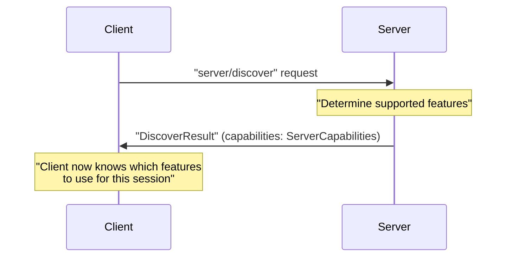
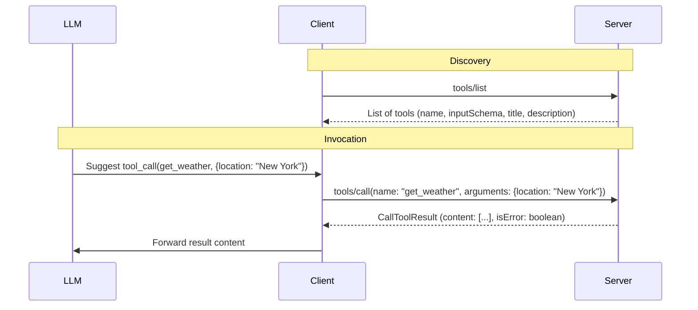
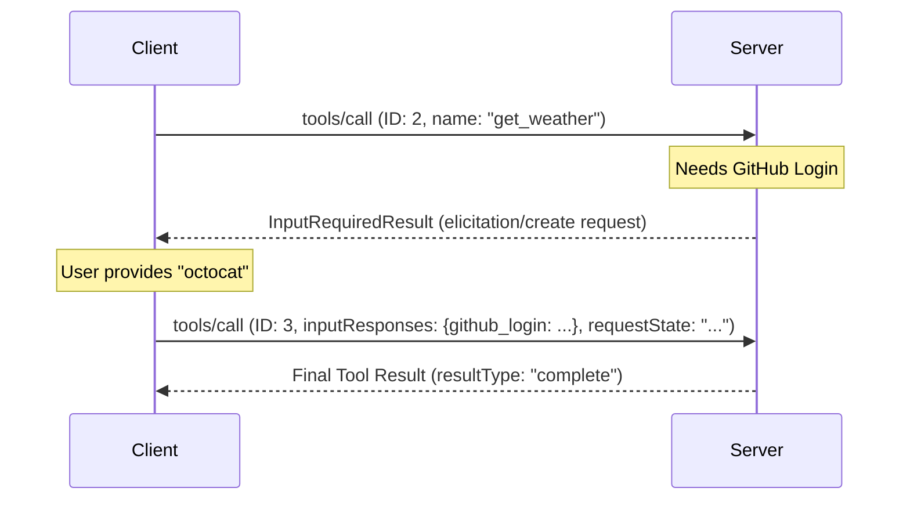
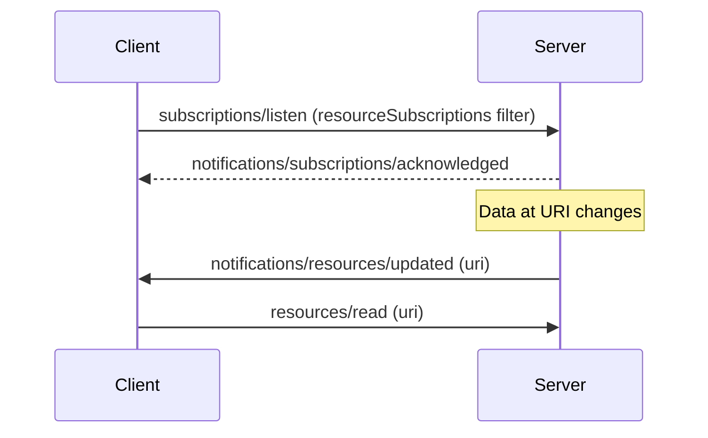
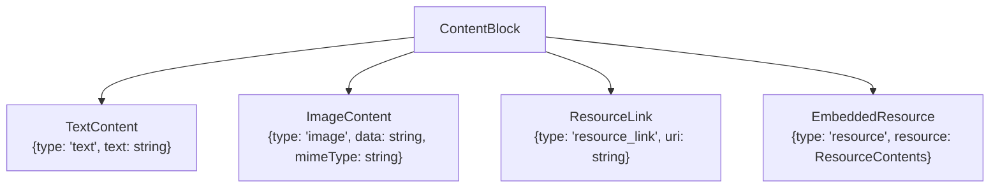
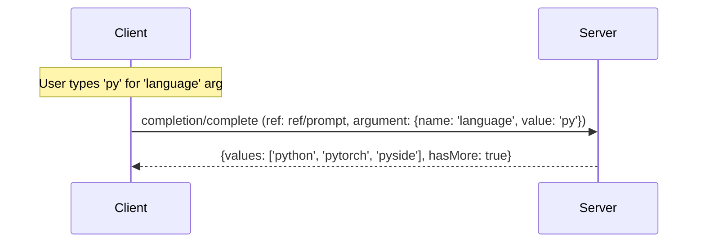

<!-- source: DeepWiki mcp.deepwiki.com · repo modelcontextprotocol/modelcontextprotocol · page 5.3 Server Capabilities Deep Dive · fetched 2026-10-21 -->

# Server Capabilities Deep Dive

<details>
<summary>Relevant source files</summary>

The following files were used as context for generating this wiki page:

- [docs/specification/draft/server/prompts.mdx](docs/specification/draft/server/prompts.mdx)
- [docs/specification/draft/server/resources.mdx](docs/specification/draft/server/resources.mdx)
- [docs/specification/draft/server/tools.mdx](docs/specification/draft/server/tools.mdx)
- [docs/specification/draft/server/utilities/caching.mdx](docs/specification/draft/server/utilities/caching.mdx)
- [docs/specification/draft/server/utilities/completion.mdx](docs/specification/draft/server/utilities/completion.mdx)
- [docs/specification/draft/server/utilities/pagination.mdx](docs/specification/draft/server/utilities/pagination.mdx)
- [schema/draft/examples/AudioContent/audio-wav-content.json](schema/draft/examples/AudioContent/audio-wav-content.json)
- [schema/draft/examples/CallToolRequestParams/get-weather-tool-call-params.json](schema/draft/examples/CallToolRequestParams/get-weather-tool-call-params.json)
- [schema/draft/examples/CallToolResult/invalid-tool-input-error.json](schema/draft/examples/CallToolResult/invalid-tool-input-error.json)
- [schema/draft/examples/CallToolResult/result-with-structured-content.json](schema/draft/examples/CallToolResult/result-with-structured-content.json)
- [schema/draft/examples/CallToolResult/result-with-unstructured-text.json](schema/draft/examples/CallToolResult/result-with-unstructured-text.json)
- [schema/draft/examples/CompleteResult/multiple-completion-values-with-more-available.json](schema/draft/examples/CompleteResult/multiple-completion-values-with-more-available.json)
- [schema/draft/examples/CompleteResult/single-completion-value.json](schema/draft/examples/CompleteResult/single-completion-value.json)
- [schema/draft/examples/EmbeddedResource/embedded-file-resource-with-annotations.json](schema/draft/examples/EmbeddedResource/embedded-file-resource-with-annotations.json)
- [schema/draft/examples/GetPromptResult/code-review-prompt.json](schema/draft/examples/GetPromptResult/code-review-prompt.json)
- [schema/draft/examples/ImageContent/image-png-content-with-annotations.json](schema/draft/examples/ImageContent/image-png-content-with-annotations.json)
- [schema/draft/examples/ResourceLink/file-resource-link.json](schema/draft/examples/ResourceLink/file-resource-link.json)
- [schema/draft/examples/ServerCapabilities/tools-list-changed-notifications.json](schema/draft/examples/ServerCapabilities/tools-list-changed-notifications.json)

</details>


This document provides detailed technical guidance for implementing MCP server capabilities. It covers the protocol message structures, data types, and implementation requirements for exposing tools, resources, prompts, and supporting features.

## Capability Negotiation

Servers declare their supported capabilities during the handshake. In the latest specification, this is managed via the `server/discover` method or the initial capability exchange, determining which protocol features the server can support during the session.

### ServerCapabilities Structure

The complete capability structure includes:

```typescript
interface ServerCapabilities {
  experimental?: { [key: string]: object };
  logging?: object;
  completions?: object;
  prompts?: {
    listChanged?: boolean;
  };
  resources?: {
    subscribe?: boolean;
    listChanged?: boolean;
  };
  tools?: {
    listChanged?: boolean;
  };
}
```

**Capability Declaration Flow:**



Sources: [docs/specification/draft/server/tools.mdx:46-57](), [docs/specification/draft/server/resources.mdx:40-72](), [docs/specification/draft/server/prompts.mdx:40-52](), [docs/specification/draft/server/utilities/caching.mdx:16-16]()

## Tools Capability

Tools enable servers to expose executable functions that can be invoked by language models. Tools are **model-controlled**, meaning the LLM decides when to call them based on the `inputSchema` provided by the server.

### Tool Discovery and Invocation

**Protocol Message Flow:**



Sources: [docs/specification/draft/server/tools.mdx:7-10](), [docs/specification/draft/server/tools.mdx:79-172](), [docs/specification/draft/server/tools.mdx:251-275]()

### Tool Results and Content

Tool calls return a `CallToolResult` which can include multiple content blocks and optional structured data for programmatic use.

| Field | Type | Description |
|-------|------|-------------|
| `content` | `ContentBlock[]` | Array of text, image, or resource content. |
| `isError` | `boolean` | Indicates if the tool execution failed. |
| `structuredContent` | `object` | (Optional) Raw data for client processing. |

Sources: [docs/specification/draft/server/tools.mdx:156-172](), [schema/draft/examples/CallToolResult/result-with-structured-content.json:1-15]()

### Multi Round-Trip Tool Calls (MRTR)

If a tool requires additional user input (e.g., authentication or missing parameters), it returns an `InputRequiredResult`. The client then retries the call with `inputResponses`.



Sources: [docs/specification/draft/server/tools.mdx:174-235]()

## Resources Capability

Resources allow servers to share data (files, DB schemas, etc.) that provide context. Resources are **application-driven**, meaning the host application decides when to include them based on user selection or heuristics.

### Resource Types and Discovery

Servers can expose static resources or dynamic **Resource Templates** using URI templates ([RFC 6570](https://datatracker.ietf.org/doc/html/rfc6570)).

| Method | Description |
|--------|-------------|
| `resources/list` | Returns a list of available URIs with metadata (mimeType, icons). |
| `resources/templates/list` | Returns parameterized URI templates like `file:///{path}`. |
| `resources/read` | Retrieves the content for a specific URI. |

Sources: [docs/specification/draft/server/resources.mdx:85-179](), [docs/specification/draft/server/resources.mdx:181-231]()

### Resource Subscriptions

If a server declares the `subscribe` capability, clients can listen for updates to specific URIs using the `subscriptions/listen` mechanism.



Sources: [docs/specification/draft/server/resources.mdx:232-261]()

## Prompts Capability

Prompts are structured message templates designed to be **user-controlled**, typically triggered via UI elements like slash commands.

### Prompt Content Composition

A `prompts/get` request returns a list of `PromptMessage` objects. Each message has a `role` ("user" or "assistant") and a `content` block.

**Content Block Hierarchy:**



Sources: [docs/specification/draft/server/prompts.mdx:207-250](), [schema/draft/examples/EmbeddedResource/embedded-file-resource-with-annotations.json:1-13]()

## Common Utilities

### Caching and Freshness

Servers provide caching hints to reduce redundant network traffic for list operations and resource reads.

- `ttlMs`: Hint specifying how long the client may consider the result fresh (analogous to HTTP `max-age`).
- `cacheScope`: `"public"` (shared across users) or `"private"` (specific to an authorization context).

**Cache Invalidation:** Notifications like `notifications/tools/list_changed` immediately **invalidate** cached entries regardless of the remaining TTL.

Sources: [docs/specification/draft/server/utilities/caching.mdx:11-26](), [docs/specification/draft/server/utilities/caching.mdx:41-109](), [docs/specification/draft/server/utilities/caching.mdx:123-145]()

### Completion API

The completion API provides suggestions for prompt arguments or resource template variables, enabling interactive user experiences like dropdowns.



Sources: [docs/specification/draft/server/utilities/completion.mdx:7-11](), [docs/specification/draft/server/utilities/completion.mdx:46-87](), [docs/specification/draft/server/utilities/completion.mdx:133-149]()

### Pagination

For large result sets, MCP uses an opaque cursor-based pagination model. Clients must not attempt to parse these cursors.

| Request Param | Response Field | Description |
|---------------|----------------|-------------|
| `cursor` | `nextCursor` | Opaque token used to fetch the next chunk of data. |

Sources: [docs/specification/draft/server/utilities/pagination.mdx:24-68](), [docs/specification/draft/server/utilities/pagination.mdx:83-91]()

---

