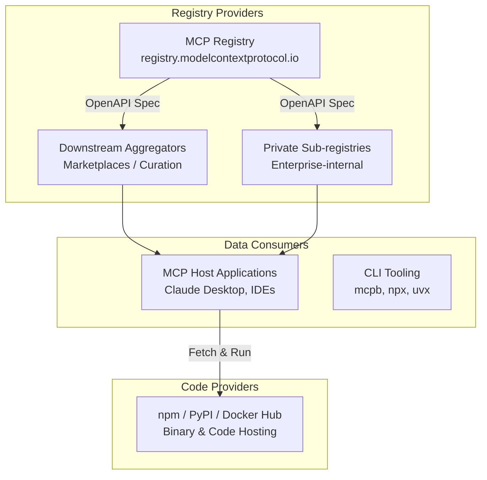
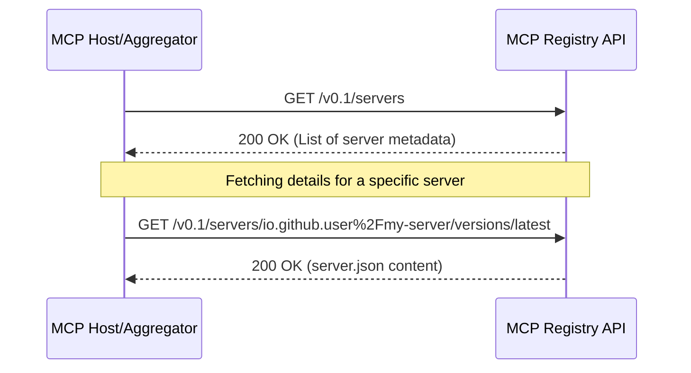

<!-- source: DeepWiki mcp.deepwiki.com · repo modelcontextprotocol/modelcontextprotocol · page 5.4 Server Registry and Discovery · fetched 2026-10-21 -->

# Server Registry and Discovery

Relevant source files

The following files were used as context for generating this wiki page:

- [blog/archetypes/default.md](blog/archetypes/default.md)
- [blog/content/posts/2025-07-29-prompts-for-automation.md](blog/content/posts/2025-07-29-prompts-for-automation.md)
- [blog/content/posts/2025-07-31-governance-for-mcp.md](blog/content/posts/2025-07-31-governance-for-mcp.md)
- [blog/content/posts/2025-09-05-php-sdk.md](blog/content/posts/2025-09-05-php-sdk.md)
- [blog/content/posts/2025-09-08-mcp-registry-preview.md](blog/content/posts/2025-09-08-mcp-registry-preview.md)
- [blog/content/posts/2025-09-26-mcp-next-version-update.md](blog/content/posts/2025-09-26-mcp-next-version-update.md)
- [blog/content/posts/2025-11-03-using-server-instructions.md](blog/content/posts/2025-11-03-using-server-instructions.md)
- [blog/content/posts/2025-11-20-adopting-mcpb.md](blog/content/posts/2025-11-20-adopting-mcpb.md)
- [blog/content/posts/2025-11-21-mcp-apps.md](blog/content/posts/2025-11-21-mcp-apps.md)
- [blog/content/posts/2025-11-25-first-mcp-anniversary.md](blog/content/posts/2025-11-25-first-mcp-anniversary.md)
- [blog/content/posts/2025-11-28-sep-process-update.md](blog/content/posts/2025-11-28-sep-process-update.md)
- [blog/content/posts/welcome-to-mcp-blog.md](blog/content/posts/welcome-to-mcp-blog.md)
- [docs/registry/about.mdx](docs/registry/about.mdx)
- [docs/registry/github-actions.mdx](docs/registry/github-actions.mdx)
- [docs/registry/quickstart.mdx](docs/registry/quickstart.mdx)
- [docs/registry/registry-aggregators.mdx](docs/registry/registry-aggregators.mdx)

The MCP Registry is the authoritative centralized index for discovering and publishing Model Context Protocol servers. Launched in September 2024, the registry has scaled to nearly 2,000 entries, providing a standardized mechanism for server distribution, namespace management, and discovery across the ecosystem [blog/content/posts/2025-11-25-first-mcp-anniversary.md:35-36]().

This system allows developers to publish metadata about their servers—including installation commands, environment variables, and capabilities—enabling clients and aggregators to automatically configure and integrate them.

## The Registry Ecosystem

The MCP Registry operates as a "source of truth" metadata repository, distinct from the package registries (like npm or PyPI) that host the actual server binaries [docs/registry/about.mdx:34-38]().

**Diagram: The MCP Registry Data Flow and Ecosystem Relationships**

### Key Roles
*   **Official Registry**: Hosted at `https://registry.modelcontextprotocol.io`, this unopinionated metadata store is maintained by the Registry Working Group [docs/registry/about.mdx:10-15]().
*   **Sub-registries**: Organizations can implement the Registry OpenAPI spec to host private or specialized server lists [docs/registry/about.mdx:56-60]().
*   **Aggregators**: Downstream consumers (like marketplaces) that ingest registry data and add opinionated metadata like ratings or security scans [docs/registry/about.mdx:50-54]().

**Sources**: [docs/registry/about.mdx:10-60](), [blog/content/posts/2025-09-08-mcp-registry-preview.md:25-37]()

## Server Metadata and Namespaces

The registry uses a standardized `server.json` schema to describe server instances. This schema ensures that clients know exactly how to execute a server and what environment it requires [docs/registry/about.mdx:19-20]().

### Namespace Authentication
To prevent name squatting and impersonation, the registry enforces **Namespace Authentication**. Server names must follow a reverse DNS format (e.g., `io.github.username/server-name`) [docs/registry/about.mdx:21-25]().
*   **GitHub Verification**: Users verify ownership of their GitHub namespace [docs/registry/about.mdx:72-73]().
*   **DNS/HTTP Verification**: Domain owners verify via DNS records or HTTP challenges [docs/registry/about.mdx:89-90]().

### The `server.json` Structure
The core entity in the registry is the `server.json` file.

| Field | Description | Example |
| :--- | :--- | :--- |
| `name` | Unique reverse-DNS identifier | `io.github.user/weather-server` |
| `packages` | List of distribution methods | `npm`, `pypi`, `docker` |
| `transport` | Communication mechanism | `stdio` or `sse` |
| `args` | Execution arguments | `["--port", "8080"]` |
| `capabilities` | Declared server features | Tools, Resources, Prompts |

**Sources**: [docs/registry/about.mdx:19-25](), [blog/content/posts/2025-09-08-mcp-registry-preview.md:25-27]()

## Discovery Mechanisms

Discovery occurs through a versioned REST API that allows clients to query server metadata.

### API Implementation (v0.1)
The registry provides unauthenticated read-only endpoints for discovery [docs/registry/about.mdx:16-17]():

1.  **List Servers**: `GET /v0.1/servers`
2.  **Get Versions**: `GET /v0.1/servers/{serverName}/versions`
3.  **Get Latest**: `GET /v0.1/servers/{serverName}/versions/latest`

**Diagram: API Interaction Flow for Server Discovery**

**Sources**: [docs/registry/about.mdx:16-25](), [blog/content/posts/2025-09-08-mcp-registry-preview.md:25-27]()

## Publishing and Integration

### GitHub Actions Integration
The recommended path for publishing is using the official GitHub Action. This automates the validation of `server.json` and submission to the registry during a repository's release cycle [blog/content/posts/2025-09-08-mcp-registry-preview.md:20-21]().

### MCP Bundles (.mcpb)
For local, portable servers, the ecosystem supports the **MCP Bundle** format. These are ZIP archives containing [blog/content/posts/2025-11-20-adopting-mcpb.md:19-21]():
*   `manifest.json`: Metadata and capabilities description [blog/content/posts/2025-11-20-adopting-mcpb.md:25]().
*   `server/`: Implementation code (Node.js, Python, or binary) [blog/content/posts/2025-11-20-adopting-mcpb.md:26]().
*   `node_modules/`: Bundled dependencies [blog/content/posts/2025-11-20-adopting-mcpb.md:28]().

This format enables "one-click" installation in compatible clients like Claude Desktop [blog/content/posts/2025-11-20-adopting-mcpb.md:15-16]().

### Server Identity and .well-known
Modern MCP servers (RC 2025-11-14) can advertise their capabilities via `.well-known` URLs. This allows the registry and clients to discover a server's "business card" without establishing a full stateful connection [blog/content/posts/2025-09-26-mcp-next-version-update.md:67-72]().

**Sources**: [blog/content/posts/2025-11-20-adopting-mcpb.md:15-32](), [blog/content/posts/2025-09-26-mcp-next-version-update.md:67-72](), [docs/registry/about.mdx:19-25]()

## Moderation and Security

The registry delegates code-level security scanning to the underlying package managers (npm, PyPI) and downstream aggregators [docs/registry/about.mdx:78-83](). However, it maintains a **Moderation Policy** to handle:
*   **Spam/Malware**: Publishers must verify namespaces, preventing arbitrary spam [docs/registry/about.mdx:88-90]().
*   **Impersonation**: Handled via namespace verification through DNS or GitHub [docs/registry/about.mdx:70-75]().
*   **Takedowns**: Maintainers can manually remove entries that violate guidelines, such as malicious code or impersonation [docs/registry/about.mdx:91-92](), [blog/content/posts/2025-09-08-mcp-registry-preview.md:39-42]().

**Sources**: [docs/registry/about.mdx:70-94](), [blog/content/posts/2025-09-08-mcp-registry-preview.md:39-42]()

---

